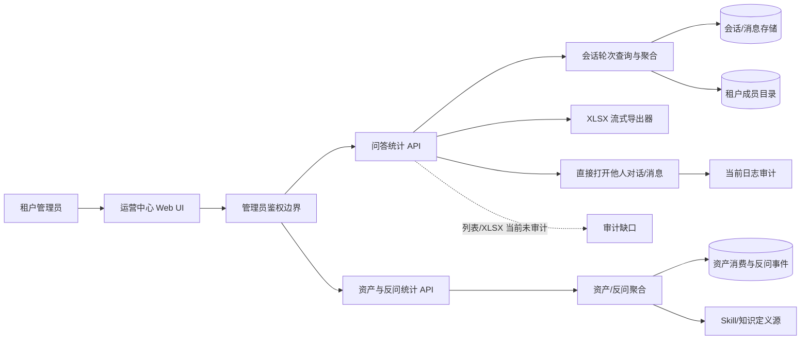
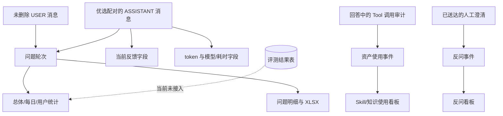
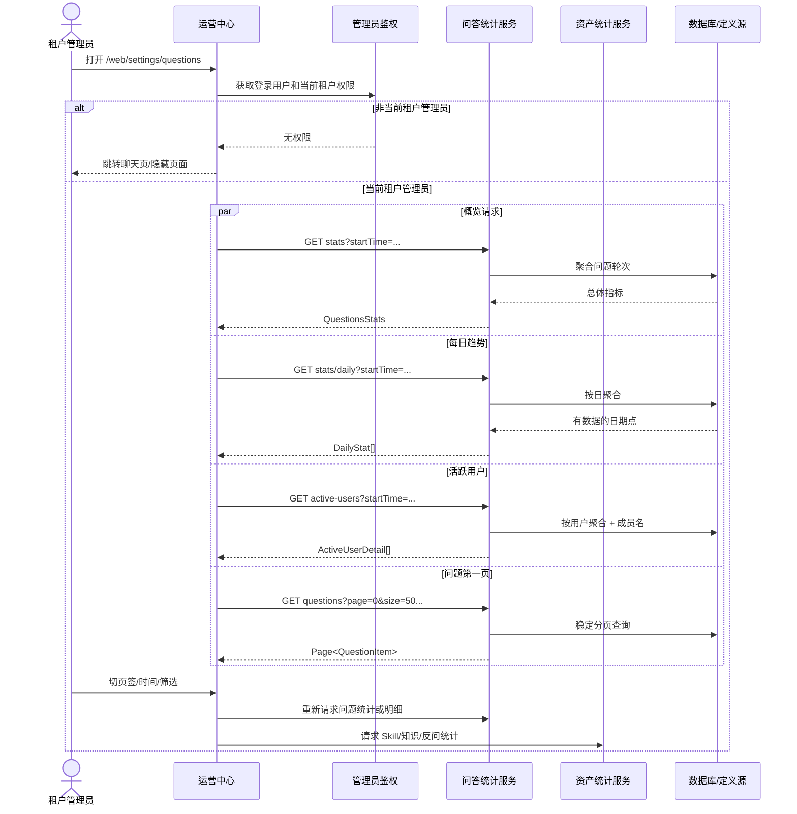
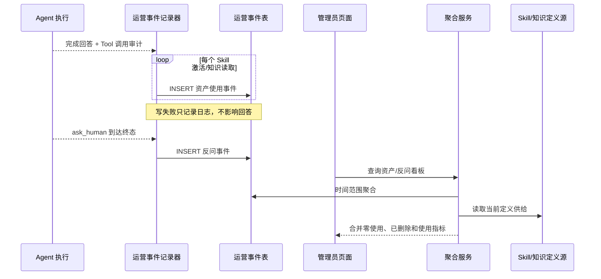
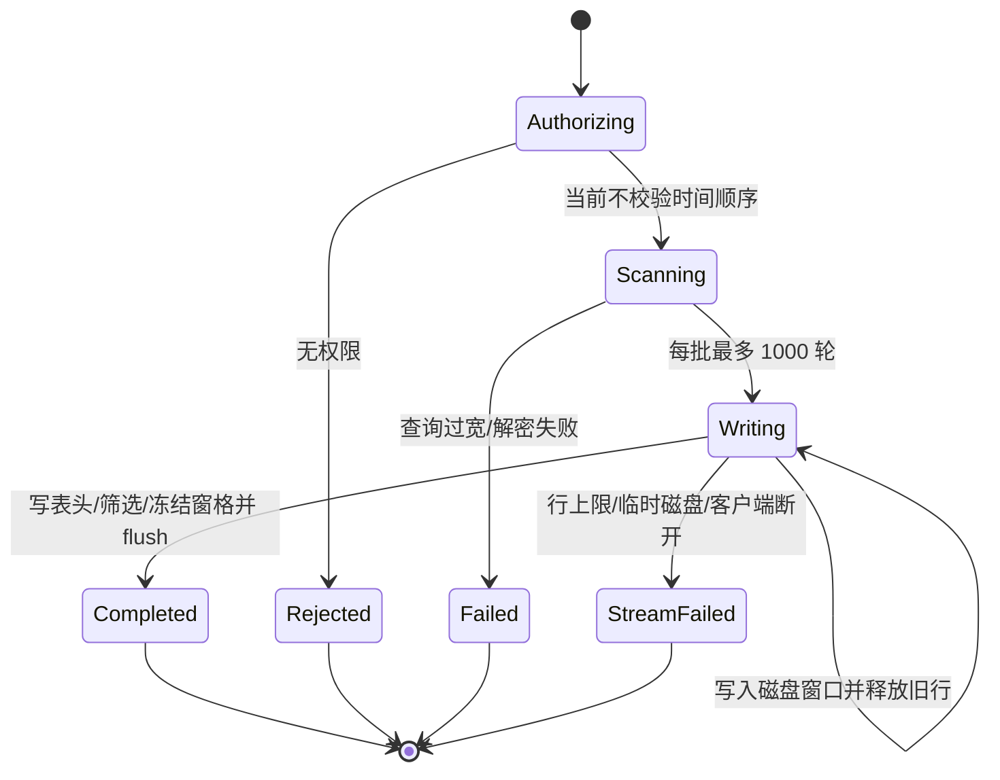
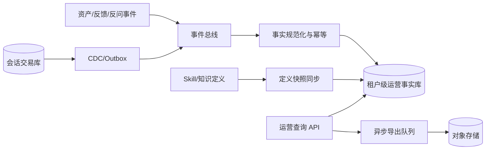

```
# 运营分析、管理统计和导出

## 1. 结论与边界

### 1.1 解决的业务问题

本模块面向租户管理员，回答五类运营问题：

1. 租户内有多少真实用户问题、多少活跃用户，回答的完成、取消、错误和未完成情况如何。
2. 用户对回答给出了多少好评、差评，哪些用户或哪些问题需要进一步查看。
3. 模型消耗了多少输入、缓存和输出 token，缓存命中表现如何，指标随日期如何变化。
4. Skill 与知识资产是否真正被 Agent 消费，哪些资产供给过剩、零使用或已删除但仍有历史使用记录。
5. Agent 发起了多少次人工澄清，用户是否响应、是否把答案保存为记忆。

最终产品形态是一个只读运营中心，包含“概览、问题明细、技能、知识、反问”五个页签，所有页签共享时间范围；问题明细可以查看所属对话，并把当前筛选结果导出为 XLSX。

### 1.2 目标用户与权限结论

- 目标用户是**当前租户的租户管理员**，不是平台超级管理员，也不是普通成员。
- 浏览器路由应在展示前检查管理员身份；后端每个管理接口仍必须独立鉴权，不能相信前端守卫。
- 管理员只能统计当前登录上下文绑定的租户，客户端不得提交可覆盖的 `tenantId`。
- 管理员可只读查看同租户成员的对话明细；跨租户、已删除、后台任务型对话必须不可读。
- 跨用户读取对话正文属于高敏感操作。当前只有直接打开他人对话/消息会产生日志审计；问题列表和 XLSX 批量正文读取尚无审计，是必须补齐的当前风险。仅查看聚合数值不应泄露消息正文。

### 1.3 输入、输出与核心依赖

| 类别 | 输入 | 输出 | 数据依赖 |
|---|---|---|---|
| 总体统计 | 时间范围 | 问题数、活跃用户、反馈、状态、token | CHAT 会话中的未删除用户/助手消息 |
| 每日趋势 | 时间范围 | 按自然日升序的指标点 | 消息创建时间和 token 物化列 |
| 活跃用户 | 时间范围 | 用户排行、问题数、最后提问、反馈数 | 消息与租户成员目录 |
| 问题明细 | 时间、关键词、用户、Skill、反馈、分页 | 一页问题轮次 | 会话、用户消息、配对助手消息 |
| 资产统计 | 时间、资产类型、层级、关键词、零使用、排序、分页 | 资产供给和消费数据 | Skill/知识定义 + 资产消费事件 |
| 反问统计 | 时间、关键词、用户、分页 | 反问摘要与明细 | 人工澄清事件 + 会话消息 |
| 导出 | 与问题明细相同的筛选条件 | XLSX 下载流 | 问题轮次扫描结果 |

### 1.4 明确不包含

- 评测题库、Golden Answer、模型裁判分数和评测任务不属于当前运营统计数据源；它们是独立产品能力。
- 这里的“反馈”是用户对助手消息的当前反馈状态，不是不可变反馈事件漏斗。
- 当前没有成本金额、模型单价、首 token 延迟、P95/P99、留存率、会话转化率或跨租户平台总览。
- 当前没有 CSV/PDF 导出、导出任务中心、定时运营报表或邮件投递。
- 当前没有可搜索的审计日志 UI；运营统计不能替代合规审计系统。

### 1.5 实现状态结论

| 结论 | 等级 | 说明 |
|---|---|---|
| 五页签、管理 API、XLSX 流式导出、租户管理员保护均有静态实现 | `I` | 本次未运行应用 |
| 当前时间链路会丢失请求 offset，且问题、资产、反问、每日桶使用的时区解释不完全相同 | `I` | 浏览器、控制器、JVM 和数据库 Session 共同影响边界 |
| 会话软删不会清理资产使用或反问事件，历史事件仍可能进入运营统计 | `I` | 当前无删除代码或外键级联 |
| 浏览器回归要求五页签、预设/自定义时间、筛选恢复、分页和下载 | `A` | 自动化代码存在，本次未执行 |
| release 环境的 XLSX 导出被测试标为预期 HTTP 500 | `K` | 这是环境观察，不能推导所有环境都失败 |
| 翻页请求失败会清空最近成功页及分页条 | `K` | 使用浏览器路由 Mock 稳定复现的 UI 缺陷 |
| API/WS 黑盒仓没有运营统计专用用例 | `I` | 反馈写入契约有覆盖，但统计读取缺少 API 黑盒门禁 |
| 生产级复刻应引入不可变事实、快照一致性、游标分页和异步导出 | `D` | 改进设计，不代表当前实现 |

本次只做三仓静态分析，没有构建、测试或运行验证，因此本文不使用 `R` 结论。

## 2. 术语与参与方

### 2.1 术语

| 术语 | 精确定义 |
|---|---|
| 问题轮次 | 一个未删除 USER 消息及其归属的一个助手回答；问题数按 USER 消息计，不按会话计 |
| 活跃用户 | 时间范围内至少有一个问题轮次的不同 `userId` 数 |
| 当前反馈 | 与该问题轮次配对的助手消息当前保存的 `POSITIVE`、`NEGATIVE` 或空值 |
| 完成/取消/错误 | 配对助手消息的终态分别为 `COMPLETED`、`CANCELLED`、`ERROR` |
| 未完成 | 没有配对助手消息，或助手消息仍为 `PENDING`/`STREAMING` |
| 概览输入 token | 助手消息物化的 `inputTokens` 求和；历史缺失值可从执行过程数据懒回填 |
| 明细总输入 token | 问题明细的 `totalTokens` 来自 `processData.tokenStats.totalTokens`；当前新数据写入时等于该回答的 `inputTokens`，不包含输出 token |
| 概览缓存命中率 | `cachedTokens / inputTokens`；分母为零时为 0 |
| 明细缓存命中率 | `cachedTokens / totalTokens`；分母为零时为 0；若旧数据缺少 `totalTokens`，解析器回退到 `inputTokens` |
| 资产使用次数 | Skill 激活或知识读取事件行数；同一问题重复使用会重复计数 |
| 资产问题数 | 使用该资产的不同助手 `messageId` 数 |
| 资产用户数 | 使用该资产的不同 `userId` 数 |
| 采用率 | 在指定资产类型和层级中，时间范围内 `usageCount > 0` 的已定义资产数 / 供给资产数 |
| 反问响应率 | `RESPONDED` 反问事件数 / 全部已送达反问事件数；分母为零时为 0 |
| 零使用资产 | 当前仍有定义，但所选时间范围内没有消费事件的资产 |
| 悬空资产 | 有历史消费事件，但当前定义已经删除；显示历史标识但不可打开详情 |

### 2.2 参与方



### 2.3 数据源与口径关系



## 3. 业务规则

### 3.1 时间范围

1. UI 默认选择“近 7 天”，另提供近 30 天、近 90 天和自定义范围。
2. 预设范围只发送 `startTime`，不发送 `endTime`；自定义范围同时发送起止时间。
3. 服务端语义必须是 `[startTime, endTime)`：开始包含、结束不包含。
4. 当前 UI 把自定义结束日期转换为本地时间当天 `23:59:59`，并非下一日零点。这会遗漏最后一秒内的小数时间，复刻时应改为“结束日期下一天 00:00:00”的排他上界。
5. 时间筛选以**用户问题的创建时间**确定问题轮次归属。资产事件以回答完成后的记录时间归属，并非 Tool 实际调用时间；同一回答的多条资产事件使用同一个时间。反问事件以响应、超时或取消的终态记录时间归属，并非问题送达时间。因此跨日执行可能被统计到完成日而非触发日。
6. 当前时间传递存在部署敏感的 offset 丢失链路，属于 `I` 风险：浏览器用 `toISOString()` 发送带 `Z` 的 UTC 文本；控制器却接收 `LocalDateTime`，只保留年月日时分秒；问题统计再把这个无 offset 值按 JVM `ZoneId.systemDefault()` 解释为 Instant；资产/反问查询则用 `Timestamp.valueOf(LocalDateTime)` 交给 JDBC。部署时区变化会改变实际查询窗口，问题统计和资产统计也不保证采用完全相同的时区解释。
7. 每日统计通过数据库 `CAST(created_at AS DATE)` 分桶，桶边界受数据库 Session 时区影响，不等同于租户自然日，也不一定与 JVM 时区一致。
8. 生产复刻必须统一为 `Instant` 或 `OffsetDateTime` 的 API/服务契约，数据库保存 UTC，并显式携带 `tenantZoneId` 完成自然日换算；禁止先把 offset 丢进 `LocalDateTime` 再按服务器时区重建 Instant。

### 3.2 问题轮次配对

只统计满足以下条件的 USER 消息：

- 租户等于当前租户；
- 所属会话未删除且类型为 `CHAT`；
- USER 消息未删除并有 `turnIndex`；
- 不统计后台任务型对话；
- 每个 USER 消息最多配对一个未删除 ASSISTANT 消息。

助手配对优先级：

1. 与 USER 相同 `turnIndex` 的候选优先于 `turnIndex + 1` 的历史兼容候选；
2. 候选必须创建于 USER 之后，且不能跨越下一条 USER 消息；
3. 同优先级取创建时间更晚、ID 更大的助手消息。

这使重新生成后的最新回答成为统计对象，而不是把同一轮的多个生成版本重复计数。

### 3.3 筛选和排序

| 筛选 | 规则 |
|---|---|
| `keyword` | 对解密后的用户问题做 Unicode 友好的不区分大小写包含匹配 |
| `feedbackType` | `ALL`/未知值视为不过滤；支持 `POSITIVE`、`NEGATIVE`、`HAS_FEEDBACK`、`NO_FEEDBACK` |
| `feedbackTags` | 多个标签采用 OR：助手反馈至少包含一个请求标签 |
| `skillName` | 精确匹配助手消息记录的 Skill 名称集合，不做模糊匹配 |
| `userId` | 精确匹配租户内用户 ID |
| 问题排序 | `user.createdAt DESC, user.id DESC`，必须稳定 |
| 活跃用户排序 | 问题数降序、最后提问时间降序、显示名升序 |
| 资产关键词 | 不区分大小写匹配 `assetName` 或 `assetId` |
| 资产排序 | `usage/questions/users` 对应指标降序，再按 `assetId` 升序 |
| 反问排序 | 创建时间降序 |

### 3.4 分页

- 问题明细为零基页码；API 默认 `page=0&size=20`，UI 固定使用 `size=50`。
- 问题服务把负页码归零，把页大小约束在 `1..1000`。
- 页偏移为 `page * size`；当前实现使用精确整数乘法，超大页码可能溢出并失败。
- UI 在关键词、用户、Skill、反馈或时间范围变化时必须回到第一页。
- Skill、知识、反问 UI 固定每页 20 条。
- 当前资产/反问服务没有完整钳制负页码和非正页大小；生产复刻必须在控制器边界统一拒绝非法分页参数。

### 3.5 统计口径

| 指标 | 公式 |
|---|---|
| `totalQuestions` | 问题轮次数 |
| `activeUsers` | `COUNT(DISTINCT userId)` |
| `positiveCount` | 当前配对助手消息 `feedbackType=POSITIVE` 的轮次数 |
| `negativeCount` | 当前配对助手消息 `feedbackType=NEGATIVE` 的轮次数 |
| `completedCount` | 助手状态为 `COMPLETED` 的轮次数 |
| `cancelledCount` | 助手状态为 `CANCELLED` 的轮次数 |
| `errorCount` | 助手状态为 `ERROR` 的轮次数 |
| `incompleteCount` | 无助手或状态为 `PENDING/STREAMING` 的轮次数 |
| `cancelRate` | `cancelledCount / totalQuestions`，空集为 0 |
| `totalInputTokens`（概览） | 助手消息物化列 `inputTokens` 求和，缺失按 0 |
| `totalTokens`（概览） | `/stats` 当前返回 `inputTokens + outputTokens`；UI 却把它标为“输入 token”，存在命名/展示冲突 |
| `cachedTokens` | 助手消息 `cachedTokens` 求和 |
| `cacheHitRatio`（概览） | `cachedTokens / totalInputTokens`，分母为 0 时为 0 |
| `totalOutputTokens` | 助手消息 `outputTokens` 求和 |

问题明细的同名字段不能套用概览公式：`QuestionItem.totalTokens` 来自 `processData.tokenStats.totalTokens`，当前采集器写入时令其等于总输入 token；`QuestionItem.outputTokens` 单独返回，`QuestionItem.cacheHitRatio` 使用 `cachedTokens / totalTokens`。因此 `/stats.totalTokens` 与 `/questions[].totalTokens` 是两个语义冲突的当前契约。

> `I`：概览 `totalTokens` 包含输入与输出，而明细 `totalTokens` 表示总输入；前端又把两者都展示为输入/总 token。复刻时应分别改名为 `inputTokens`、`outputTokens`、`billableTokens` 或 `totalInputTokens`，禁止保留同名异义字段。

### 3.6 反馈与评测的关系

- 反馈写在助手消息当前状态上；用户从好评切换到差评时，旧标签和原因会被清空，再写入新反馈。
- 用户撤销反馈后，历史统计也会随查询结果回退，因为没有独立反馈事件历史。
- 黑盒 API 用例要求反馈标签、Unicode/特殊字符原因能往返，跨账户写入应返回 403/404；当前跨账户/不存在消息可能返回 500，是 `K` 缺陷。
- 评测运行结果、人工 verdict、裁判分数拥有独立数据表，不会进入本模块的好评/差评或 token 统计。生产设计若要关联，必须新增明确的 `source=LIVE_CHAT|EVALUATION` 维度，不能混计。

### 3.7 资产采用规则

1. Skill 使用事件：一个已产出响应的 Tool 审计中出现读取 `skill://<name>/SKILL.md`。
2. 知识使用事件：Tool 审计中出现 `read_knowledge` 且参数含非空知识 ID。
3. 同一回答内重复读取会产生多条使用事件，因此 `usageCount` 是调用次数；`questionCount` 通过不同 `messageId` 去重。
4. 统计看板合并“当前定义集合”和“时间范围内事件集合”，因此零使用定义与定义已删除的历史事件都可见。
5. 当前 Skill 事件只记录 Skill 名称，不记录最终解析出的定义 ID/层级；同名多层级定义无法精准归因，只能以 `TENANT > SYSTEM > PERSONAL` 的展示优先级选一个定义。这是事实限制，不是可靠归属规则。
6. 资产使用记录失败采用 fail-soft，只写日志、不打断聊天。因此运营数据是近似事实，不能用于严格计费。
7. 当前采集器只检查 Tool 名和参数，没有按单次 Tool 的 success 标志过滤；所以更准确的名称是“被调用/被尝试消费次数”，不应在没有补充成功字段前解释成“成功使用次数”。
8. 当前运营库存只纳入 SYSTEM、TENANT、PERSONAL Skill/知识定义；平台虽支持 PROJECT 资产，但运营供应量、采用率和详情不覆盖 PROJECT。
9. 一次回答的所有资产事件在回答完成后批量写入，并共享同一个记录时间；这不是各 Tool 调用的发生时间。

### 3.8 反问规则

- 只记录实际到达用户的 `RESPONDED`、`TIMEOUT`、`CANCELLED`；投递前失败不计数。
- `RESPONDED` 可包含答案及 `remembered=true/false`；超时/取消的答案、remembered 通常为空。
- 可选项按 JSON 字符串数组保存；自由文本反问为空数组。
- 明细尝试关联反问发生时点之前最近的 USER 消息，用于打开对话并高亮当时问题。
- `createdAt` 是收到响应、发生超时或取消时的终态记录时间，不是反问送达时间；长时间等待跨日时，日期统计归到终态日。

## 4. 完整执行链路

### 4.1 页面加载与筛选



页面需要为总体卡片、趋势、活跃用户和问题列表分别维护 loading/error/data，不能因为一个请求失败而把其他成功区域一起抹除。

### 4.2 问题查询执行

1. 从可信请求上下文取得 `tenantId` 和管理员 `userId`。
2. 当前先校验管理员权限；问题页码会归零、页大小会钳制到 `1..1000`，但没有校验 `startTime < endTime`。资产/反问分页甚至没有同等级钳制。生产设计必须在进入查询前统一验证分页和时间范围。
3. 当前兼容实现把控制器得到的无 offset `LocalDateTime` 按 JVM 系统时区转为 Instant；这是 `I` 行为，不是可靠契约。生产设计应直接解析 `OffsetDateTime`/`Instant`，并另传租户时区用于自然日展示。
4. 生成查询开始时的“最新候选边界”，确保扫描期间的新消息不会进入同一次分页/导出。
5. 在 SQL 层按租户、CHAT、未删除、时间、用户、反馈、Skill 选候选并配对助手。
6. 若存在加密正文关键词或反馈标签筛选，分批解密并在应用层过滤；最多扫描 100,000 个候选，超过返回“查询范围过大”。
7. 批量解密候选消息，把成员 `userId` 映射为显示名。
8. 从助手过程数据映射耗时、模型和 token；从助手反馈映射类型、标签和原因。
9. 返回稳定页结构；若页内无数据返回空 `content`，不能把空集当错误。

### 4.3 概览和历史 token 回填

当前统计调用前会执行租户级懒回填：

1. 查询 token 物化列缺失的助手消息，每批 200 条。
2. 通过统一解密边界读取历史 `processData`。
3. 解析 input/output/cached token，缺失值写 0。
4. 按消息所有者批量更新，避免管理员身份直接改写成员消息。
5. 单租户使用进程内锁串行回填；首次排空后，每次仅便宜探测一条晚到缺口。
6. 回填后执行 SQL 聚合。

这意味着“读统计”可能触发数据库写入，且多实例进程锁不能全局互斥。生产复刻建议将回填做成离线迁移或幂等后台 Job，读 API 不承担维护写入。

### 4.4 资产与反问采集



### 4.5 查看问题所属对话

1. 管理员在问题或反问行点击查看。
2. 后端按 `conversationId` 解析真实所有者和租户。
3. 允许所有者本人或同租户管理员读取；拒绝跨租户、已删除和后台对话。
4. 用所有者身份读取消息，不能用管理员身份查询导致空数据或越权。
5. 如果是管理员读取他人对话，写结构化审计日志：actor 租户/用户、owner 租户/用户、conversationId、资源类型、资源 ID。
6. 返回按时间升序的未删除 USER/ASSISTANT 消息，前端抽屉高亮问题轮次。

### 4.6 XLSX 导出



`StreamFailed` 是当前实现的重要限制：异常发生时响应可能已经提交 200 Header，不能保证再翻译成结构化 4xx/5xx。

导出必须复用问题明细的全部筛选条件，但忽略 `page` 和 `size`，按查询开始时的稳定边界扫描全量匹配结果。当前列顺序为：用户、用户问题、提问时间、模型、耗时、总 token、缓存 token、缓存命中率、返回 token、触发 Skill、轮次、反馈、反馈标签、反馈原因、会话 ID。其中 XLSX“总 token”直接取问题明细的 `QuestionItem.totalTokens`，当前语义是总输入 token，不是概览 `input + output`；“返回 token”才是独立输出 token。

实现使用磁盘支持的流式工作簿，内存只保留约 100 行；单元格超过 XLSX 上限时安全截断并附加标记；超过 1,048,575 条数据行时失败。文件名形如 `questions-20260813-142530.xlsx`，Content-Type 为标准 XLSX 类型。

## 5. 对外契约

### 5.1 通用约定

- Base path：`/api/admin`。
- 认证：浏览器 Session/Cookie；中间件必须把当前 `tenantId`、`userId`、`isTenantAdmin` 放入可信上下文。
- 所有接口只读，除统计前的历史 token 懒回填这一当前实现副作用。
- 当前时间参数虽然接受 ISO-8601 date-time 文本，但控制器字段类型为 `LocalDateTime`，offset 不会进入后续领域值；不能把当前接口理解成可靠的 offset-aware 契约。
- `D`：复刻接口应强制使用 `Instant` 或 `OffsetDateTime`，例如 `2026-08-01T00:00:00+08:00`，并独立传递租户 IANA 时区，例如 `Asia/Shanghai`。
- `D`：错误体建议统一为：

```json
{
  "timestamp": "2026-08-13T06:30:00Z",
  "status": 422,
  "errorCode": "CONVERSATION_QUERY_TOO_BROAD",
  "message": "Query range is too broad; narrow the time range or filters",
  "traceId": "01J5OPS8M6X..."
}
```

| 情况 | 当前/建议 | HTTP | `errorCode` | 说明 |
|---|---|---:|---|---|
| 未登录 | `I` | 401 | 当前认证错误体不保证与下方建议 JSON 一致 | 由认证过滤器处理 |
| 非当前租户管理员 | `I` | 403 | 当前无稳定业务 `errorCode` 保证 | 管理拦截器直接拒绝 |
| 跨租户、不存在、已删除或 BACKGROUND 对话详情 | `I` | 404 | 当前无稳定业务 `errorCode` 保证 | 统一隐藏资源存在性 |
| 解密密钥缺失/密文损坏 | `I` | 503 | `CONVERSATION_DECRYPTION_FAILED` | 已有全局异常翻译 |
| 解密筛选候选超过上限 | `I` | 422 | `CONVERSATION_QUERY_TOO_BROAD` | 已有全局异常翻译 |
| `startTime >= endTime` | `I` 缺口 | 通常 200 空集 | 无 | 当前没有顺序校验，不能声称返回 400 |
| 问题列表非法页码/页大小 | `I` | 200 或异常 | 无 | 页码归零、页大小钳制，但极大页码乘法可能失败 |
| 资产/反问非法分页 | `I` 缺口 | 可能 500 | 无 | 没有统一钳制或参数校验 |
| 导出超过 XLSX 行上限 | `I` 缺口 | 无稳定 422 保证 | 无 | 异常发生在 `StreamingResponseBody` 写出阶段，可能已发送 200 Header |
| 参数、时间范围非法 | `D` | 400 | `INVALID_ARGUMENT` | 生产复刻统一在控制器边界校验 |
| 导出超过格式行上限 | `D` | 422 | `EXPORT_ROW_LIMIT_EXCEEDED` | 应在提交下载响应前完成可失败检查，或改异步任务 |
| 未分类服务错误 | `D` | 500 | `INTERNAL_ERROR` | 使用统一脱敏错误体和 traceId |

### 5.2 API 清单

| 方法与路径 | 参数 | 响应 |
|---|---|---|
| `GET /api/admin/questions` | 问题筛选 + `page,size` | Spring 风格问题页 |
| `GET /api/admin/questions/export` | 问题筛选，不含分页 | XLSX 二进制流 |
| `GET /api/admin/questions/stats` | `startTime,endTime` | 总体指标与筛选枚举 |
| `GET /api/admin/questions/stats/daily` | `startTime,endTime` | 每日指标数组 |
| `GET /api/admin/questions/active-users` | `startTime,endTime` | 活跃用户数组 |
| `GET /api/admin/questions/conversations/{id}/messages` | path ID | 对话消息数组 |
| `GET /api/admin/asset-stats/skills` | 时间、层级、关键词、零使用、排序、分页 | 资产使用页 |
| `GET /api/admin/asset-stats/knowledge` | 同上 | 资产使用页 |
| `GET /api/admin/asset-stats/adoption` | 时间 | 采用率矩阵单元数组 |
| `GET /api/admin/asset-stats/clarifications` | 时间、关键词、用户、分页 | 反问页和摘要 |
| `GET /api/admin/asset-stats/users` | 无 | 租户成员筛选选项 |
| `GET /api/admin/asset-stats/asset-detail` | `assetType,assetId,scope,ownerUserId?` | 只读资产详情 |
| `GET /api/admin/asset-stats/skill-download` | `skillId` | Skill ZIP |
| `GET /api/admin/asset-stats/message-assets` | `conversationId,messageId` | 当前是 message 级资产 + conversation 级全部反问的拼接结果；不保证反问属于该回答 |

### 5.3 问题明细请求

```http
GET /api/admin/questions?keyword=退款&feedbackType=NEGATIVE&feedbackTags=INCORRECT&feedbackTags=MISSING_CONTEXT&skillName=sales-analysis&userId=u-17&startTime=2026-08-01T00%3A00%3A00%2B08%3A00&endTime=2026-08-08T00%3A00%3A00%2B08%3A00&page=0&size=50
```

| 参数 | 类型 | 必填 | 默认/约束 |
|---|---|---|---|
| `keyword` | string | 否 | 解密后的问题包含匹配 |
| `feedbackType` | enum | 否 | `ALL`；另支持四种值 |
| `feedbackTags` | repeated string | 否 | OR 语义；空数组视为无筛选 |
| `skillName` | string | 否 | 精确名称 |
| `userId` | string | 否 | 当前租户成员 ID |
| `startTime` | ISO datetime | 否 | 包含 |
| `endTime` | ISO datetime | 否 | SQL 排他上界；当前不校验其大于 start，`D` 契约必须校验 |
| `page` | integer | 否 | 0，零基 |
| `size` | integer | 否 | API 默认 20；允许 1..1000；UI 使用 50 |

响应示例：

```json
{
  "content": [
    {
      "conversationId": "conv-20260813-001",
      "persistedTurnIndex": 4,
      "turnIndex": 3,
      "totalTurns": 6,
      "userMessageContent": "为什么本周退款率上升？",
      "assistantMessageId": 987654,
      "turnState": "COMPLETED",
      "userName": "运营人员甲",
      "userId": "u-17",
      "skillName": "sales-analysis, anomaly-explain",
      "feedbackType": "NEGATIVE",
      "feedbackReason": "没有说明样本范围",
      "feedbackTags": ["MISSING_CONTEXT"],
      "createdAt": "2026-08-05T10:20:30",
      "durationMs": 8421,
      "inputTokens": 1200,
      "totalTokens": 1200,
      "cachedTokens": 300,
      "cacheHitRatio": 0.25,
      "outputTokens": 450,
      "model": "complex-model"
    }
  ],
  "totalElements": 101,
  "totalPages": 3,
  "number": 0,
  "size": 50,
  "first": true,
  "last": false,
  "numberOfElements": 50,
  "empty": false
}
```

上述明细示例体现当前新数据语义：`totalTokens` 是总输入 token，等于当前采集器写入的 `inputTokens`；输出 token 不相加，单独由 `outputTokens` 返回。概览响应中的同名 `totalTokens` 则仍为输入与输出之和。

### 5.4 总体与每日统计

```json
{
  "totalQuestions": 1240,
  "activeUsers": 86,
  "positiveCount": 93,
  "negativeCount": 21,
  "completedCount": 1160,
  "cancelledCount": 34,
  "errorCount": 18,
  "incompleteCount": 28,
  "cancelRate": 0.027419,
  "totalInputTokens": 2800000,
  "totalTokens": 3560000,
  "cachedTokens": 900000,
  "cacheHitRatio": 0.321429,
  "totalOutputTokens": 760000,
  "users": [
    {"userId": "u-17", "userName": "运营人员甲", "account": "user17"}
  ],
  "skills": ["anomaly-explain", "sales-analysis"]
}
```

每日接口只返回有问题的日期，UI 在所选区间内补零：

```json
[
  {
    "date": "2026-08-05",
    "questionCount": 180,
    "activeUsers": 35,
    "positiveCount": 12,
    "negativeCount": 4,
    "inputTokens": 380000,
    "outputTokens": 92000,
    "cachedTokens": 110000,
    "cacheHitRatio": 0.289474
  }
]
```

`users` 是筛选候选的全租户成员，不仅是活跃成员；`skills` 是对当前管理员身份可见且经过能力过滤的 Skill 展示名。这两个列表不应被理解为统计指标。

### 5.5 活跃用户

```json
[
  {
    "userId": "u-17",
    "userName": "运营人员甲",
    "account": "user17",
    "questionCount": 37,
    "lastAskedAt": "2026-08-07T18:25:40",
    "positiveCount": 8,
    "negativeCount": 2
  }
]
```

当前接口返回全量数组，由 UI 每 10 条本地分页。生产设计应使用服务端分页，避免大租户一次返回全体活跃用户。

### 5.6 资产使用页

请求示例：

```http
GET /api/admin/asset-stats/skills?startTime=2026-08-01T00%3A00%3A00Z&scope=TENANT&keyword=sales&onlyZeroUsage=false&sortBy=questions&page=0&size=20
```

```json
{
  "content": [
    {
      "assetId": "sales-analysis",
      "assetName": "sales-analysis",
      "scope": "TENANT",
      "ownerUserId": null,
      "ownerUserName": null,
      "enabled": true,
      "defined": true,
      "usageCount": 48,
      "questionCount": 42,
      "userCount": 16
    }
  ],
  "totalElements": 8
}
```

采用矩阵：

```json
[
  {"assetType": "SKILL", "scope": "SYSTEM", "supplyCount": 8, "usedCount": 5},
  {"assetType": "SKILL", "scope": "TENANT", "supplyCount": 12, "usedCount": 9},
  {"assetType": "KNOWLEDGE", "scope": "PERSONAL", "supplyCount": 20, "usedCount": 4}
]
```

`sortBy` 的未知值当前回退到 `usage`；推荐设计应返回 400，避免调用方误以为自定义排序生效。

### 5.7 反问页

```json
{
  "content": [
    {
      "id": 1203,
      "question": "你希望按哪个区域分析？",
      "options": ["华东", "华南", "全部"],
      "answer": "华东",
      "status": "RESPONDED",
      "userId": "u-17",
      "userName": "运营人员甲",
      "conversationId": "conv-20260813-001",
      "remembered": true,
      "questionContent": "分析本月退款率",
      "questionTurnIndex": 2,
      "createdAt": "2026-08-05T10:20:34"
    }
  ],
  "totalElements": 27,
  "summary": {
    "totalCount": 27,
    "conversationCount": 18,
    "respondedCount": 23,
    "respondedRate": 0.851852
  }
}
```

摘要应用与列表相同的时间、关键词和用户筛选，但不受分页影响。

### 5.8 XLSX 契约

```http
GET /api/admin/questions/export?feedbackType=NEGATIVE&startTime=2026-08-01T00%3A00%3A00Z
Accept: application/vnd.openxmlformats-officedocument.spreadsheetml.sheet
```

成功响应：

```http
HTTP/1.1 200 OK
Content-Type: application/vnd.openxmlformats-officedocument.spreadsheetml.sheet
Content-Disposition: attachment; filename*=UTF-8''questions-20260813-142530.xlsx
```

要求：

- 文件非空、可被 Excel/LibreOffice 读取。
- Sheet 名为“对话明细”，首行冻结，所有列带自动筛选。
- 导出记录集合与同一筛选的列表全量集合一致，而不是只导出当前页。
- 用户输入按字符串单元格写入，不能解释为公式；以 `= + - @` 开头的内容需做 CSV/Spreadsheet 注入防护验证。
- 导出开始后按钮禁用并显示 loading；失败显示可见错误，不能下载错误 JSON 伪文件。
- 浏览器优先使用服务端 `Content-Disposition` 文件名，解析失败才使用本地时间戳后备名。

### 5.9 无 WebSocket/Tool 契约

运营统计读取和导出是 REST 能力，没有 WebSocket、SSE、Agent Tool 或 MCP 入口。资产和反问数据由聊天执行链路异步写入，但不会向运营页面推送实时事件；页面通过重新请求获得新快照。

### 5.10 `message-assets` 的当前关联限制

该接口的两个入参当前驱动两条彼此独立的查询：

1. `messageId` 用于查询该助手消息的资产使用记录，条件是 `message_id + tenant_id`。
2. `conversationId` 用于查询该会话的全部反问记录，条件是 `conversation_id + tenant_id`。

当前反问记录器不会写 `clarification_record.message_id`，因此无法证明某条反问属于指定助手回答；服务也没有校验传入的 `messageId` 是否属于传入的 `conversationId`。兼容复刻必须保留“消息级资产 + 会话级反问”的实际语义，或在升级版中同时完成以下改造：

- 在反问事件中写入稳定的 run/assistant-message/turn 关联 ID；
- 查询前校验 message、conversation、tenant 的归属关系；
- 返回字段显式区分 `messageAssets` 与 `conversationClarifications`，避免调用方误解。

## 6. 数据模型与生命周期

### 6.1 最小兼容数据模型

以下 DDL 是自包含的等价模型，省略与运营无关的消息内容块细节：

```sql
CREATE TABLE conversation (
    id                varchar(64) PRIMARY KEY,
    tenant_id         varchar(64) NOT NULL,
    user_id           varchar(64) NOT NULL,
    conversation_type varchar(31) NOT NULL DEFAULT 'CHAT',
    is_deleted        boolean NOT NULL DEFAULT false,
    created_at        timestamptz NOT NULL,
    updated_at        timestamptz
);
CREATE INDEX idx_conv_tenant_user ON conversation(tenant_id, user_id);

CREATE TABLE message (
    id              bigint GENERATED BY DEFAULT AS IDENTITY PRIMARY KEY,
    tenant_id       varchar(64) NOT NULL,
    user_id         varchar(64) NOT NULL,
    conversation_id varchar(64) NOT NULL,
    role            varchar(16) NOT NULL,
    content         text,
    turn_index      integer,
    state           varchar(16) NOT NULL DEFAULT 'COMPLETED',
    feedback_type   varchar(16),
    feedback_reason text,
    feedback_tags   text,
    skill_names     text,
    process_data    text,
    input_tokens    bigint,
    output_tokens   bigint,
    cached_tokens   bigint,
    is_deleted      boolean NOT NULL DEFAULT false,
    created_at      timestamptz NOT NULL,
    FOREIGN KEY (conversation_id) REFERENCES conversation(id)
);
CREATE INDEX idx_msg_turn ON message(tenant_id, conversation_id, turn_index, role, is_deleted);
CREATE INDEX idx_msg_ops_time ON message(tenant_id, role, created_at, is_deleted);
CREATE INDEX idx_msg_feedback ON message(tenant_id, feedback_type, created_at);

CREATE TABLE tenant_user (
    tenant_id varchar(64) NOT NULL,
    user_id   varchar(64) NOT NULL,
    user_name varchar(255),
    account   varchar(255),
    updated_at timestamptz,
    PRIMARY KEY (tenant_id, user_id)
);

CREATE TABLE asset_usage_event (
    id              bigint GENERATED BY DEFAULT AS IDENTITY PRIMARY KEY,
    tenant_id       varchar(64) NOT NULL,
    user_id         varchar(64) NOT NULL,
    asset_type      varchar(16) NOT NULL CHECK (asset_type IN ('SKILL','KNOWLEDGE')),
    asset_id        varchar(128) NOT NULL,
    asset_name      varchar(255),
    asset_scope     varchar(16),
    conversation_id varchar(64),
    message_id      varchar(64),
    created_at      timestamptz NOT NULL DEFAULT now()
);
CREATE INDEX idx_asset_usage_aggregate
    ON asset_usage_event(tenant_id, asset_type, created_at, asset_id);
CREATE INDEX idx_asset_usage_message
    ON asset_usage_event(tenant_id, message_id);

CREATE TABLE clarification_event (
    id              bigint GENERATED BY DEFAULT AS IDENTITY PRIMARY KEY,
    tenant_id       varchar(64) NOT NULL,
    user_id         varchar(64) NOT NULL,
    conversation_id varchar(64),
    message_id      varchar(64),
    question        text NOT NULL,
    options_json    text,
    answer          text,
    status          varchar(16) NOT NULL CHECK (status IN ('RESPONDED','TIMEOUT','CANCELLED')),
    remembered      boolean,
    created_at      timestamptz NOT NULL DEFAULT now()
);
CREATE INDEX idx_clarification_aggregate
    ON clarification_event(tenant_id, created_at, user_id);
```

兼容性说明：上面的 `message_id` 是推荐保留的关联字段；当前表虽已有同名列，但当前写入链路不赋值，不能据此实现回答级反问查询。

### 6.2 当前生命周期

| 对象 | 创建 | 更新 | 删除/保留 |
|---|---|---|---|
| 问题轮次 | 用户消息写入时形成 | 助手消息到达、状态/token/反馈变化 | 消息或会话软删后退出统计 |
| 反馈 | 用户操作助手消息 | 类型、标签、原因可覆盖/清空 | 撤销后无历史事件可统计 |
| token | 新回答写物化列；历史数据懒回填 | 缺失列可补 0 或解析值 | 随消息生命周期 |
| 资产事件 | 回答完成后按 Tool 调用逐行写入；同一回答共用完成时刻 | 不更新 | 当前没有事件过期策略；会话软删不会清理记录，事件仍可能进入统计 |
| 反问事件 | 到达响应/超时/取消终态时写入；时间是终态时刻 | 不更新 | 当前没有事件过期策略；会话软删不会清理记录，事件仍可能进入统计 |
| 成员显示名 | 身份同步写入成员表 | 可随账号资料更新 | 事件仍保留 `userId`，显示名可变化 |

### 6.3 一致性语义

- 问题/反馈统计是**查询时当前快照**；历史报表会因反馈撤销、消息软删或重新生成而变化。
- 资产/反问是事件统计，但当前写入 fail-soft 且没有唯一业务键，可能漏记或重复记。
- 资产/反问统计只按事件表中的租户和时间过滤，不联结 conversation 的 `is_deleted`；所以软删会话后，关联事件不会自动退出统计。当前表没有 conversation 外键，也不存在级联删除保证。
- 同一次问题列表请求通过查询开始时上界避免新消息穿页；不同 API 并行加载没有共同 snapshot，因此卡片、趋势、用户表和问题页可能短暂不一致。
- 当前定义与使用事件是分别读取后在内存合并，定义在查询中途变化可能造成短暂悬空/恢复。

### 6.4 会话删除后的事件保留策略

当前兼容行为是“保留原事件且继续统计”。生产复刻必须选择并固化一种策略，不能依赖无外键的偶然残留：

| 策略 | 统计效果 | PII 处理 | 适用场景 |
|---|---|---|---|
| 级联物理删除 | 历史资产/反问随会话立即消失 | 删除正文、答案、用户关联 | 强删除或用户隐私优先 |
| 保留事件但排除统计 | 运营查询联结会话删除状态或写 `source_deleted_at` | 到期前仍保存原始 PII | 有短期恢复窗口 |
| 匿名化保留 | 保留资产级计数，不再关联用户、会话、问题和答案 | 删除/哈希 user、conversation 及自由文本 | 需要长期趋势但不需要逐条追溯 |

推荐默认采用“同步匿名化 + 保留非识别聚合”，并通过 Outbox 保证会话软删与事件处理最终一致；若法规或产品要求彻底删除，则使用幂等级联任务。无论选择哪种策略，都必须定义重试、失败告警、保留期和删除证明。

### 6.5 生产级事件模型建议

```sql
ALTER TABLE asset_usage_event
  ADD COLUMN event_id uuid NOT NULL,
  ADD COLUMN resolved_definition_id varchar(128),
  ADD COLUMN occurrence_index integer NOT NULL DEFAULT 0,
  ADD CONSTRAINT uk_asset_usage_event UNIQUE(event_id);

CREATE TABLE feedback_event (
    event_id uuid PRIMARY KEY,
    tenant_id varchar(64) NOT NULL,
    actor_user_id varchar(64) NOT NULL,
    assistant_message_id varchar(64) NOT NULL,
    old_type varchar(16),
    new_type varchar(16),
    tags_json text,
    reason text,
    occurred_at timestamptz NOT NULL
);

CREATE TABLE analytics_snapshot (
    snapshot_id uuid PRIMARY KEY,
    tenant_id varchar(64) NOT NULL,
    as_of timestamptz NOT NULL,
    timezone varchar(64) NOT NULL,
    schema_version integer NOT NULL
);
```

引入事件 ID 后，记录器可安全重试；引入 `resolved_definition_id` 后，不再依赖名称猜测 Skill 层级；引入 snapshot 后，一组页面请求和导出可共享 `asOf`。

## 7. 核心实现设计

### 7.1 模块划分

```text
operations-analytics/
├── api/                 # 管理 API、参数 DTO、统一错误体
├── authorization/       # 当前租户管理员和对象级只读授权
├── turn-query/          # USER/ASSISTANT 配对、筛选、稳定分页
├── aggregation/         # 总体、每日、用户、资产、反问聚合
├── collection/          # 资产、反问、反馈事件采集
├── export/              # 同口径扫描、XLSX/异步导出
├── audit/               # 跨用户明细读取与导出审计
└── ui/                  # 五页签、共享时间、错误/空态/分页
```

### 7.2 问题查询伪代码

```text
function listQuestions(auth, request): Page<QuestionItem>:
    requireTenantAdmin(auth)
    tenant = auth.currentTenantId
    q = validateAndNormalize(request)
    boundary = store.newestEligibleUserMessage(tenant, q)

    if q.requiresDecryptedFilter:
        matched = []
        scanned = 0
        for batch in store.scanCandidates(tenant, q, boundary, batchSize=500):
            scanned += batch.size
            if scanned > 100_000:
                throw QueryTooBroad
            for turn in decryptAndPair(batch):
                if decodedMatches(turn, q): matched.add(turn)
        pageItems = matched.slice(q.offset, q.offset + q.limit)
        total = matched.size
    else:
        total = store.countCandidates(tenant, q, boundary)
        pageItems = store.loadCandidates(tenant, q, boundary, q.offset, q.limit)

    names = memberDirectory.batchResolve(tenant, pageItems.userIds)
    return page(mapToItem(pageItems, names), total, q.page, q.size)
```

### 7.3 聚合 SQL 轮廓

实际实现需先形成“一条 USER 对应至多一条助手”的 `eligible_turns` CTE，再聚合，不能直接 join 所有助手导致重复：

```sql
WITH eligible_turns AS (
  SELECT
    u.id AS user_message_id,
    u.user_id,
    u.created_at,
    a.id AS assistant_message_id,
    a.state,
    a.feedback_type,
    COALESCE(a.input_tokens, 0) AS input_tokens,
    COALESCE(a.output_tokens, 0) AS output_tokens,
    COALESCE(a.cached_tokens, 0) AS cached_tokens
  FROM message u
  JOIN conversation c ON c.id = u.conversation_id
  LEFT JOIN LATERAL (
    SELECT x.*
    FROM message x
    WHERE x.conversation_id = u.conversation_id
      AND x.tenant_id = u.tenant_id
      AND x.user_id = u.user_id
      AND x.role = 'ASSISTANT'
      AND x.is_deleted = false
      AND x.created_at >= u.created_at
      AND x.created_at < COALESCE(
          (SELECT MIN(n.created_at) FROM message n
           WHERE n.conversation_id = u.conversation_id
             AND n.role = 'USER' AND n.is_deleted = false
             AND (n.created_at, n.id) > (u.created_at, u.id)),
          'infinity'::timestamptz)
    ORDER BY CASE WHEN x.turn_index = u.turn_index THEN 0 ELSE 1 END,
             x.created_at DESC, x.id DESC
    LIMIT 1
  ) a ON true
  WHERE u.tenant_id = :tenantId
    AND u.role = 'USER'
    AND u.is_deleted = false
    AND c.is_deleted = false
    AND c.conversation_type = 'CHAT'
    AND (:start IS NULL OR u.created_at >= :start)
    AND (:end IS NULL OR u.created_at < :end)
)
SELECT
  COUNT(*) AS total_questions,
  COUNT(DISTINCT user_id) AS active_users,
  SUM(CASE WHEN feedback_type='POSITIVE' THEN 1 ELSE 0 END) AS positive_count,
  SUM(CASE WHEN feedback_type='NEGATIVE' THEN 1 ELSE 0 END) AS negative_count,
  SUM(CASE WHEN state='COMPLETED' THEN 1 ELSE 0 END) AS completed_count,
  SUM(CASE WHEN state='CANCELLED' THEN 1 ELSE 0 END) AS cancelled_count,
  SUM(CASE WHEN state='ERROR' THEN 1 ELSE 0 END) AS error_count,
  SUM(CASE WHEN assistant_message_id IS NULL OR state IN ('PENDING','STREAMING')
           THEN 1 ELSE 0 END) AS incomplete_count,
  SUM(input_tokens) AS input_tokens,
  SUM(output_tokens) AS output_tokens,
  SUM(cached_tokens) AS cached_tokens
FROM eligible_turns;
```

### 7.4 资产聚合算法

```text
definitions = loadVisibleDefinitions(tenant, assetType)
usage = SELECT asset_id,
               COUNT(*) usageCount,
               COUNT(DISTINCT message_id) questionCount,
               COUNT(DISTINCT user_id) userCount
        FROM asset_usage_event
        WHERE tenant_id=? AND asset_type=? AND created_at in range
        GROUP BY asset_id

merged = union(definitions.keys, usage.keys)
for key in merged:
    emit definition fields or defined=false
    emit usage metrics or zeros
filter(scope, keyword, onlyZeroUsage)
sort(metric desc, assetId asc)
page
```

当前 Java 内存合并适合每租户几百个资产。生产级大规模实现应把定义快照同步到分析库，以 SQL join、物化视图或 OLAP 查询替代全量内存合并。

### 7.5 UI 状态模型

每个数据区至少维护：

```ts
type Loadable<T> =
  | { state: "idle" | "loading"; previous?: T }
  | { state: "ready"; data: T; receivedAt: string }
  | { state: "empty"; data: T }
  | { state: "error"; error: UserVisibleError; previous?: T };
```

翻页时保留 `previous`，失败后显示错误横幅并继续展示最近成功页。只有首次加载失败且没有旧数据时才显示全表错误空态。这一设计直接防止 `NOVA-BUG-036`。

### 7.6 最小可用版

1. PostgreSQL 保存会话/消息及资产、反问事件。
2. 只支持近 7/30/90 天与自定义时间。
3. 实现总体、每日、活跃用户、问题列表、Skill/知识、反问和 XLSX。
4. 只允许当前租户管理员；对话详情做对象级授权和审计。
5. 页式分页，问题每页 50，资产/反问每页 20。
6. 导出同步执行，但限制最大 100,000 行并有明确错误。

### 7.7 生产级版

- 事件写入使用 Outbox/Kafka 和全局幂等 event ID。
- 预聚合到按租户、日、模型、Skill、用户的事实表或 OLAP 引擎。
- 使用 `asOf` 快照或仓库版本保证卡片、趋势、分页、导出一致。
- 大列表改游标分页，排序键包含时间与唯一 ID。
- 大导出异步化：创建 Job、进度、对象存储、短期签名 URL、取消和过期清理。
- 维护反馈事件历史，支持“当前满意度”和“期间发生反馈”两套口径。
- 明确租户时区、数据保留、PII 脱敏和列级导出权限。
- 增加 API、UI、审计和数据质量监控。

## 8. 并发与非正常路径

### 8.1 并发与快照

| 场景 | 当前表现 | 复刻要求 |
|---|---|---|
| 翻页期间有新问题 | 单次查询/扫描有最新候选边界；下一请求可能看到新数据 | 使用 `asOf` 或游标保持一次浏览会话稳定 |
| 卡片与趋势并行加载 | 各自独立快照，可能短暂不一致 | 响应返回相同 `asOf`，或允许 UI 标注刷新时间 |
| 反馈在统计期间变化 | 后续查询使用新反馈状态 | 定义快照口径；若要历史分析写反馈事件 |
| 多实例 token 回填 | 进程锁不互通，可能重复扫描/写 | 数据库 claim/乐观锁或离线 Job |
| 重复记录资产事件 | 当前无唯一键，可能重复计数 | `eventId` 唯一约束 + upsert |
| 删除资产与查询并发 | 可能显示 defined=false | 接受悬空历史，详情返回 404 并保留统计行 |

### 8.2 非正常路径

1. **非管理员**：前端跳转不是安全边界；API 返回 403，不返回任何计数。
2. **跨租户 conversationId**：统一返回 404，避免枚举资源是否存在。
3. **开始不早于结束**：当前没有顺序校验，SQL 通常返回 200 空集，不能把这理解为合法范围；`D` 设计应在控制器边界返回 400 `INVALID_ARGUMENT`。
4. **解密失败**：返回脱敏 503；UI 给出历史会话不可读指引，不显示密钥或密文。
5. **关键词范围过大**：扫描超过 100,000 候选返回 422；UI提示缩小时间或增加筛选。
6. **空数据**：卡片为 0、趋势显示空态、表格“暂无数据”、导出按钮禁用。
7. **某个概览子请求失败**：只影响对应区域，其他成功区域保留。
8. **翻页失败**：保留最近成功页、页码和分页控件，显示错误并允许重试。
9. **导出失败**：停止 loading，显示可见错误，不触发下载。
10. **导出流中途失败**：服务器可能已发送 200 Header；生产版应在生成成功后再发布对象，或用异步 Job，避免残缺 XLSX。
11. **超过 XLSX 行数**：当前流式写出阶段抛异常，没有稳定的 422 错误保证，且可能已经发送 200 Header；`D` 设计应在提交响应前返回受控错误，或拆分多个 Sheet/文件、改用异步导出，不得静默截断行。
12. **客户端下载中断**：取消扫描、关闭工作簿、清理临时文件；记录取消指标而非服务错误。
13. **成员已删除**：显示名回退为 `userId`，统计仍保留。
14. **未知反馈值/排序值**：兼容版可回退，生产版应 400 并记录调用方版本。
15. **事件采集失败**：聊天不失败，但需告警并支持从消息 Tool 审计补数。

### 8.3 当前已知缺陷

| 缺陷 | 等级 | 影响 | 复刻防线 |
|---|---|---|---|
| release XLSX 导出返回 500 | `K` | 管理员无法下载；原因未由静态分析证明 | 保留真实环境下载测试；后端记录 traceId 和导出阶段 |
| 翻页 500 后清空旧页和分页 | `K` | 用户误以为没有数据，无法重试同页 | UI 保留 stale data；Mock 失败测试必须通过 |
| 跨账户/不存在消息反馈可能返回 500 | `K` | 反馈统计上游权限错误不受控 | 反馈写 API 规范化为 403/404 |
| totalTokens 展示语义冲突 | `I` | 输入 token 卡片可能显示输入+输出 | 重命名并迁移 DTO |
| 概览与明细的 `totalTokens` 同名异义 | `I` | 概览为输入+输出，明细为总输入，调用方容易按错误公式处理 | 拆成明确字段并版本化 DTO |
| 资产同名多层级归因不精确 | `I` | 使用量可能显示在错误层级定义 | 事件记录解析后的 definition ID/scope |
| 资产/反问子页只记录 console error | `I` | 用户可能只看到空表，不知加载失败 | 引入显式错误空态和重试按钮 |
| 时间 offset 被 `LocalDateTime` 丢弃 | `I` | 浏览器、JVM 和 DB Session 时区组合可导致窗口偏移或日期桶不一致 | API 使用 Instant/OffsetDateTime，按 tenantZoneId 聚合 |
| 会话软删不清理运营事件 | `I` | 已删除会话的资产/反问仍可能被统计并保留 PII | 明确保留期并级联清理或匿名化 |
| 回答级资产接口混入会话级反问 | `I` | 调用方可能把整段会话反问误归因到一个回答 | 写入 message/run/turn 关联并校验归属 |
| 问题列表/XLSX 批量正文读取无审计 | `I` | 高敏批量访问缺少可追溯性 | 记录列表查看和导出请求/下载审计 |
| PROJECT 资产库存与下载边界不一致 | `I` | 看板不列项目资产，但持有全局 ID 的同租户管理员可下载 PROJECT Skill | 明确产品授权并统一 list/detail/download 范围 |

## 9. 安全、权限和审计

### 9.1 授权模型

```text
allowAdminAnalytics(auth):
  require auth.sessionValid
  require exists authority where
      authority.resourceType == "TENANT"
      and authority.resourceId == auth.currentTenantId
      and authority.canEdit == true
```

用户在租户 A 是管理员并不代表切换到租户 B 后仍有权限。管理员判断必须把权限资源 ID 与当前租户 ID 精确比较。

### 9.2 对象级权限

- 聚合接口永远从服务端上下文取租户，不接受请求 `tenantId`。
- 资产详情的 `assetId/scope/ownerUserId` 必须和当前租户共同查询。
- 当前 Skill 下载端点先按全局 `skillId` 找定义，再允许 SYSTEM 或 `definition.tenantId == currentTenantId` 的记录，没有排除 PROJECT。与此同时运营库存和 `asset-detail` 不解析 PROJECT Skill。结果是：PROJECT Skill 不出现在看板，却可能被知道其全局 ID 的同租户管理员直接下载。这是 `I` 的范围不一致和潜在越权风险。
- `D`：Skill 下载必须先按与 list/detail 相同的产品授权模型解析可见定义；若租户管理员被明确授权管理全部项目资产，也必须在契约、审计和 UI 中显式呈现，不能依靠全局 ID 的偶然可达性。
- 对话消息读取必须解析真实 owner，并使用 owner 身份访问；同租户管理员只读。
- UI 中管理员查看他人对话时不展示反馈修改、删除、重试等所有者动作。

### 9.3 敏感数据

问题正文、反馈原因、反问答案、成员账号、个人 Skill/知识内容均可能包含 PII 或商业秘密：

- 列表默认只返回展示所需字段；详情按需加载。
- 日志不得记录问题正文、反馈原因、反问答案、完整导出筛选或密文。
- 导出权限可单独设为 `analytics.export`，并支持字段脱敏/去标识化。
- XLSX 需防公式注入；以危险前缀开头的用户文本强制写字符串并按客户端兼容策略加安全前缀。
- 下载响应使用 `Cache-Control: no-store`，对象存储链接短期有效且绑定租户/用户。

### 9.4 审计

当前已实现的高敏审计仅覆盖管理员直接打开其他用户的 conversation/messages：系统向独立的 `AUDIT.admin-access` logger 写结构化 INFO。问题列表和 XLSX 同样批量读取其他用户的问题正文、反馈等敏感数据，却没有调用该审计器，也没有持久化审计记录。这是当前缺口，不能把“直接钻取有审计”扩张为“所有跨用户正文读取都有审计”。

生产设计应将以下事件写入不可篡改审计库：

| 事件 | 必需字段 |
|---|---|
| `ANALYTICS_VIEW` | actor、tenant、时间范围、页签、筛选摘要、traceId |
| `ANALYTICS_CONVERSATION_READ` | actor、owner、tenant、conversationId、message/turn、结果 |
| `ANALYTICS_EXPORT_REQUESTED` | actor、tenant、过滤器哈希、预计/实际行数、jobId |
| `ANALYTICS_EXPORT_DOWNLOADED` | actor、tenant、jobId、文件哈希、下载时间 |
| `ANALYTICS_ASSET_DOWNLOAD` | actor、tenant、asset definition ID、scope、owner |
| `ANALYTICS_ACCESS_DENIED` | actor、currentTenant、target摘要、原因 |

审计记录只保存过滤器规范化摘要或哈希，不保存明文问题关键词。

## 10. 外部依赖对端设计

### 10.1 当前依赖

本模块不直接调用 CAN Gateway、LLM Provider 或 MCP Server。它依赖的对端是：

1. 认证/用户环境服务：提供当前租户、用户 ID、成员显示名和租户管理员授权资源。
2. Skill 定义源：运营库存当前只列 SYSTEM、TENANT 和租户成员的 PERSONAL Skill；PROJECT Skill 被排除。详情遵循同样范围，但下载端点当前存在前述 PROJECT 范围不一致。
3. 知识定义源：运营库存当前列 SYSTEM、TENANT 和租户成员的 PERSONAL 知识；PROJECT 知识因没有项目运行上下文而被排除。
4. 会话存储：提供加密透明的轮次查询、聚合、扫描和对象级读取。

### 10.2 对端最小契约

```ts
interface IdentityContext {
  userId: string;
  tenantId: string;
  tenantAdmin: boolean;
}

interface AssetDefinitionProvider {
  list(tenantId: string, type: "SKILL" | "KNOWLEDGE"): AssetDefinition[];
  get(tenantId: string, type: string, id: string, scope: string,
      ownerUserId?: string): AssetDefinition | null;
}

interface ConversationAnalyticsStore {
  queryTurns(scope: TenantScope, query: TurnQuery): TurnPage;
  scanTurns(scope: TenantScope, query: TurnQuery, batchSize: number,
            consumer: (batch: Turn[]) => void): void;
  aggregate(scope: TenantScope, range: TimeRange): Aggregate;
  aggregateByDay(scope: TenantScope, range: TimeRange, timezone: string): DailyAggregate[];
  aggregateByUser(scope: TenantScope, range: TimeRange): UserAggregate[];
}
```

### 10.3 不可证明的对端内部细节

- 身份服务怎样缓存权限、怎样处理 Session 续期，不属于本模块可证明范围。
- Skill/知识定义源是否使用数据库、文件系统或远程服务不影响本契约。
- release 导出 500 的根因不能从 UI 预期失败判断，可能是数据、解密、临时磁盘、代理超时或版本不一致。

### 10.4 生产级参考架构

建议把交易库通过 Outbox/CDC 投递到运营事实流，聚合服务读取 OLAP：



保留交易库直查作为最小兼容模式，但生产大租户应使用事实库并暴露数据延迟 `watermark`。

## 11. 可观察性

### 11.1 日志

结构化字段建议：

```json
{
  "event": "analytics.query.completed",
  "traceId": "01J5OPS8M6X...",
  "tenantIdHash": "sha256:...",
  "view": "QUESTION_DETAIL",
  "rangeDays": 7,
  "page": 0,
  "size": 50,
  "candidateRows": 1520,
  "decodedRows": 0,
  "returnedRows": 50,
  "totalRows": 101,
  "elapsedMs": 83,
  "status": "SUCCESS"
}
```

禁止记录问题正文、关键词、反馈原因、反问答案、Cookie 或导出文件内容。

### 11.2 指标

- `analytics_http_requests_total{endpoint,status}`
- `analytics_query_duration_seconds{view}`
- `analytics_query_candidates_total{view}`
- `analytics_decrypted_scan_rows{result}`
- `analytics_query_too_broad_total`
- `analytics_token_backfill_rows_total{result}`
- `analytics_collection_events_total{type,result}`
- `analytics_collection_lag_seconds{type}`
- `analytics_export_jobs_total{result}`
- `analytics_export_rows_total`
- `analytics_export_duration_seconds`
- `analytics_admin_cross_user_reads_total{resource}`
- `analytics_stale_page_retained_total{cause}`

### 11.3 告警

- 资产/反问事件写入错误率 5 分钟超过阈值。
- `CONVERSATION_DECRYPTION_FAILED` 任意出现即告警密钥/密文健康度。
- 导出 5xx 或残缺下载比例持续升高。
- `QUERY_TOO_BROAD` 比例升高，提示需要索引/搜索架构升级。
- 交易问题数与事实库问题数差异超过允许延迟窗口。
- 跨用户读取量异常或非工作时间批量导出。

## 12. 复刻实施顺序

1. **身份和租户边界**：实现可信上下文、当前租户管理员判定和 401/403；静态验收是所有 `/api/admin/**` 均有服务端守卫。
2. **消息轮次模型**：实现 CHAT、软删、USER/ASSISTANT 配对及稳定排序；用固定数据验证重新生成不重复计数。
3. **问题明细 API**：实现时间、用户、反馈、Skill、关键词和零基分页；验收 101 条数据按 50/50/1 返回。
4. **总体/每日/用户聚合**：固化全部公式、空集和时区；对同一 fixture 手算比对。
5. **反馈上游**：实现受控写入、标签/原因编解码和跨账户 403/404，避免统计脏源。
6. **资产与反问事件**：实现幂等事件写入、定义合并、采用率和悬空资产。
7. **五页签 UI**：共享时间范围，但每个区域独立 Loadable 状态；筛选变化重置页码。
8. **对话明细与审计**：使用 owner 身份读取，同租户管理员只读，跨租户 404，写审计。
9. **同步 XLSX**：先实现小数据流式导出、列防注入、临时资源清理和可见错误。
10. **生产强化**：引入事件事实库、快照版本、服务端用户分页和异步导出。
11. **三通道质量门禁**：补 REST 黑盒契约、浏览器分页/失败/下载和真实环境 smoke；无需 WebSocket 用例。

## 13. 验收标准

### 13.1 正向场景

1. 管理员打开页面，五页签均可访问，默认近 7 天。
2. 总体数值与相同 fixture 手工聚合完全一致，空分母比例为 0。
3. 近 30/90 天和自定义范围进入正确请求，结束时间使用排他上界。
4. 问题明细 101 条、每页 50，依次返回 50/50/1，无重复遗漏。
5. 搜索、用户、Skill、反馈变化后自动回第一页。
6. 点击活跃用户的问题数/好评/差评，可跳到带对应筛选的问题明细。
7. Skill 问题数可跳到按该 Skill 过滤的问题明细。
8. 零使用资产仍展示；定义删除后历史使用显示“已删除”且不能打开详情。
9. 反问摘要和列表使用相同过滤条件，响应率公式准确。
10. XLSX 包含全部筛选结果、正确列和文件名，文件非空可打开。

### 13.2 权限和安全

1. 未登录返回 401；普通成员返回 403，响应不泄露聚合数。
2. 租户 A 管理员切换到租户 B 后，没有 B 的管理员授权则返回 403。
3. 同租户管理员可只读查看成员对话并产生 `AUDIT.admin-access` 日志；不能修改反馈或删除消息。
4. 跨租户 conversationId 返回 404；当前不会记录拒绝审计，生产版应新增 `ANALYTICS_ACCESS_DENIED`。
5. 问题列表和 XLSX 批量读取他人正文时，当前没有审计；生产验收必须要求记录查看/导出审计且不记录明文关键词。
6. XLSX 中以 `=cmd|...` 开头的问题不会作为公式执行。
7. 日志、Trace、下载错误均不包含问题正文、反馈原因或密钥。

### 13.3 失败与恢复

1. 概览统计失败不影响趋势和活跃用户成功区域。
2. 第 2 页返回 500 时仍显示第 1 页、`1/3` 摘要和可重试分页。
3. 关键词候选超过 100,000 返回 422，UI 提示缩小范围，不显示“暂无数据”。
4. 解密失败当前返回脱敏 503 和 `CONVERSATION_DECRYPTION_FAILED`，但没有稳定 traceId 字段保证；生产目标错误体必须包含 traceId。
5. 导出 500 不产生下载，按钮恢复可点击，显示错误。
6. 客户端取消下载后服务器关闭扫描并清理临时文件。
7. 资产事件写失败不影响回答，但告警触发，补数任务可恢复缺失事件。

### 13.4 数据生命周期

1. 软删问题后，问题、总体和活跃用户统计都不再包含该轮。
2. 反馈从正向切到负向后，当前快照正向减一、负向加一，旧标签/原因不残留。
3. 同一消息使用同一 Skill 两次：次数加 2，问题数加 1，用户数加 1。
4. 删除资产定义不删除历史事件；重新创建同名资产不得错误吞并旧定义历史，生产版以 definition ID 区分。
5. 兼容性测试确认当前软删会话后资产/反问事件仍保留并继续参与统计；生产目标测试则应按选定保留策略验证级联清理、排除统计或匿名化，不能无策略地留下孤立 PII。

## 14. 测试矩阵

| 场景 | 通道 | 前置条件 | 操作 | 预期结果 | 当前证据等级 |
|---|---|---|---|---|---|
| 五页签 smoke | UI | 管理员登录 | 依次切换五页签和时间范围 | 端点成功、页面无错误 | `A`，未运行 |
| 概览预设时间 | UI | 默认近 7 天 | 切到其他预设再恢复 | 请求含正确 startTime，无 endTime | `A`，未运行 |
| 自定义范围 | UI | 概览页 | 输入动态起止日期并重置 | 请求含起止，重置回近 7 天 | `A`，未运行 |
| 问题筛选 | UI | 问题明细 | 搜索、用户、Skill、反馈切换恢复 | 状态准确、无持久副作用 | `A`，未运行 |
| 101 条分页 | UI + Mock | GET 列表被只读 Mock | 1→2→3→2 页 | 50/50/1，无重复遗漏 | `A`，Mock 契约，未运行 |
| 筛选后分页重置 | UI + Mock | 位于第 2 页 | 搜索或切时间 | 请求 page=0，旧行不残留 | `A`，Mock 契约，未运行 |
| 翻页失败保留旧页 | UI + Mock | 第 1 页成功 | Mock 第 2 页 500 | 显错且保留第 1 页 | `K`，当前预期失败 |
| XLSX 下载 | UI + Live | 非空明细 | 点击导出 | 响应成功且文件非空 | `A`；release 为 `K` 预期失败 |
| 资产筛选 | UI | Skill/知识页 | 搜索、层级、排序、零使用切换恢复 | 请求成功、状态恢复 | `A`，未运行 |
| 反问筛选 | UI | 反问页 | 搜索、用户、时间切换恢复 | 请求成功、状态恢复 | `A`，未运行 |
| 反馈多标签/Unicode | API Live | 创建测试对话 | 负向反馈+多标签+特殊原因 | 读取完全往返 | `A`，未运行 |
| 反馈切换和撤销 | API Live | 已有正向反馈 | 切负向再撤销 | extras 清空，最终全空 | `A`，未运行 |
| 跨账户反馈 | API Live | 第二账号 | 修改他人/不存在消息 | 403/404且所有者不变 | `K`，当前可能 500 |
| 管理员访问 | API | 管理员身份 | GET 管理接口 | 200 且仅当前租户 | `P`/缺口：黑盒仓未登记 |
| 普通用户访问 | API | 普通身份 | GET 管理接口 | 403 | `P`/缺口：黑盒仓未登记 |
| 聚合公式 | 单元/集成 | 固定消息状态 | 请求 stats/daily/users | 与手算一致 | `I`：测试源码存在，本次未运行 |
| 同名 token 字段 | API + 集成 | 固定 input=1200/output=450/cached=300 | 请求 stats 与 questions | stats.totalTokens=1650；item.totalTokens=1200；两处命中率按各自分母计算 | `I` 契约，未运行 |
| offset/时区兼容风险 | API + 集成 | 浏览器、JVM、DB Session 时区可分别控制 | 发送同一带 offset 范围并查日桶 | 兼容测试记录当前偏移；生产目标在任意部署时区得到同一 Instant 窗口和 tenantZone 日期 | `I` 风险 / `D` 目标，未运行 |
| 反问关联粒度 | API + 集成 | 一会话含两轮反问、两条助手消息 | 分别调用 message-assets | 当前两次都返回会话全部反问；生产目标仅返回关联 turn/message 的反问 | `I` 契约 / `D` 目标，未运行 |
| 会话软删后的事件 | API + 集成 | 会话已有资产与反问事件 | 软删后查询看板 | 当前事件仍参与统计；生产行为由保留/排除/匿名化策略明确决定 | `I` 契约 / `D` 目标，未运行 |
| PROJECT Skill 下载边界 | API | 同租户 PROJECT Skill 与全局 definition ID | 查询库存/detail/download | 当前库存/detail 不可见但直接下载可达；生产目标三接口授权一致并有审计 | `I` 风险 / `D` 目标，未运行 |
| 加密历史查询 | 集成 | 有可解密历史 | 关键词/导出 | 正确过滤且无明文日志 | `I`，未运行 |
| 查询过宽 | API | >100k 解密候选 | 关键词查询 | 422 特定错误码 | `I`，未运行 |
| 资产重复消费 | 集成 | 同消息重复 Tool 使用 | 查询资产统计 | usage=2, questions=1 | `D` 验收；当前算法支持 |
| 跨租户对话查看 | API | A 管理员持 B ID | 读取 messages | 当前 404、无拒绝审计；生产目标为 404 + 拒绝审计 | `I` 响应 / `D` 审计，未运行 |
| 列表/XLSX 审计 | API | 管理员查询他人问题 | 列表并导出 | 当前无审计；生产目标写查看/导出审计且不含明文 | `I` 缺口 / `D` 目标，未运行 |

### 14.1 Mock、Live、预期失败的解释

- `Mock` 只证明前端请求参数和状态机，不证明后端聚合正确。
- `Live` 用例连接实际目标环境，但本次分析未执行，不能标为 `R`。
- `test.fail()`/known failure 仍执行严格断言；若产品修复后意外通过，应移除预期失败标记。
- Midscene 的“页面视觉正常”只能作为补充，金额、计数、权限、分页和文件必须用确定性 API/DOM/文件断言。

## 15. 当前能力与建议汇总

### `I` 已实现事实

- 存在租户管理员专属运营入口和服务端管理员拦截。
- 问题统计基于当前租户 CHAT 会话中的未删除 USER 轮次。
- 有总体、每日、活跃用户、问题明细、资产采用、反问统计和对话钻取。
- 问题明细支持时间、关键词、反馈、标签、Skill、用户和稳定分页。
- 关键词/反馈标签需要解密扫描，存在 100,000 候选硬上限。
- XLSX 使用批量扫描和磁盘支持工作簿，不把全量结果留在内存。
- 资产和反问记录 fail-soft；运营事件不会阻断聊天。
- `/stats.totalTokens` 是输入+输出，而 `/questions[].totalTokens` 是来自 processData 的总输入 token；两个 DTO 当前同名异义。
- 浏览器发送的 offset 会在 `LocalDateTime` 控制器边界丢失；问题窗口、资产/反问窗口和每日数据库桶受 JVM/JDBC/数据库 Session 时区组合影响。
- 资产事件时间是回答完成后的批量记录时间，反问时间是响应/超时/取消终态时间。
- 会话软删不清理资产/反问事件，事件查询也不联结会话删除状态。
- `message-assets` 当前组合 message 级资产和 conversation 级反问，无法完成回答级反问归因。
- 运营资产库存排除 PROJECT；Skill 下载端点却未排除同租户 PROJECT 定义。
- 直接打开他人 conversation/messages 有日志审计；问题列表和 XLSX 批量正文读取当前无审计。
- 评测数据没有并入运营统计。

### `A` Active 测试契约

- 五页签均应消费共享时间范围并能恢复初始筛选。
- 自定义时间范围应携带精确起止时间并可重置。
- 问题页应正确处理 101 条三页、筛选重置和非空下载。
- Skill/知识支持搜索、层级、排序和仅看零使用；反问支持搜索和用户筛选。
- 反馈上游支持多标签、Unicode、切换、撤销和特殊字符往返。

### `K` Known Failure

- release 运营问题导出当前被标记为 HTTP 500 预期失败。
- 翻页失败会清空最近成功页和分页条。
- 对不存在/其他账户消息提交反馈可能返回 500，而非受控 403/404。

### `P` Planned/覆盖缺口

- API/WS 黑盒仓没有专门的运营统计读 API 用例；管理员访问、普通用户拒绝、跨租户、聚合公式和导出内容需补契约测试。
- 当前没有成本、延迟分位、留存、评测关联和审计日志 UI。

### `F` 强推断

- release 导出 500 可能与环境数据、解密、临时资源、代理超时或版本差异有关；没有运行日志，不能确定根因。
- 当前运营数适合产品观察，不适合精确计费：资产事件 fail-soft、无幂等键，反馈是可变快照。

### `D` 复刻建议

- 固化时间时区和排他结束边界，消除 `23:59:59` 缺口。
- 拆分 input/output/billable token，废弃歧义 `totalTokens` 展示。
- 事件携带全局 `eventId` 和解析后 definition ID/scope。
- 反问事件写入 message/run/turn 关联，校验 `messageId` 与 `conversationId` 的归属。
- 明确 PROJECT 是否属于租户运营管理员范围，并统一 inventory/detail/download 授权。
- 为软删会话定义事件保留、统计排除、匿名化或物理清理策略。
- 使用快照 `asOf`、游标分页、事实库与异步导出。
- UI 保留 stale page 并显示局部错误；所有资产/反问失败都有可见重试。
- 将导出、跨用户读取和资产下载写入持久化审计。

## 16. 证据附录

> 本附录仅用于源码追溯。删除本节不影响正文的实现和验收完整性。

### 16.1 Nova 产品仓

管理接口与权限：

- `nova-app/src/main/java/com/aloudata/nova/controller/QuestionController.java`
- `nova-app/src/main/java/com/aloudata/nova/controller/AssetStatsController.java`
- `nova-app/src/main/java/com/aloudata/nova/auth/RequireTenantAdmin.java`
- `nova-app/src/main/java/com/aloudata/nova/auth/AdminAuthInterceptor.java`
- `nova-app/src/main/java/com/aloudata/nova/auth/TenantAdminChecker.java`
- `nova-app/src/main/java/com/aloudata/nova/audit/AdminAccessAuditLogger.java`

统计、导出与采集：

- `nova-app/src/main/java/com/aloudata/nova/service/QuestionService.java`
- `nova-app/src/main/java/com/aloudata/nova/service/QuestionsXlsxExporter.java`
- `nova-app/src/main/java/com/aloudata/nova/service/MessageTokenBackfiller.java`
- `nova-app/src/main/java/com/aloudata/nova/service/AssetStatsService.java`
- `nova-app/src/main/java/com/aloudata/nova/service/AssetUsageRecorder.java`
- `nova-app/src/main/java/com/aloudata/nova/service/ChatService.java`
- `nova-app/src/main/java/com/aloudata/nova/core/bridge/NovaCoreConversationFacade.java`
- `nova-bundled-plugins/nova-ext-storage/src/main/java/com/aloudata/nova/ext/storage/conversation/store/MyBatisConversationStore.java`
- `nova-bundled-plugins/nova-ext-storage/src/main/resources/com/aloudata/nova/ext/storage/conversation/mapper/TurnQueryMapper.xml`

DTO 与数据库：

- `nova-app/src/main/java/com/aloudata/nova/model/QuestionItem.java`
- `nova-app/src/main/java/com/aloudata/nova/model/QuestionsStats.java`
- `nova-app/src/main/java/com/aloudata/nova/model/DailyStat.java`
- `nova-app/src/main/java/com/aloudata/nova/model/ActiveUserDetail.java`
- `nova-app/src/main/java/com/aloudata/nova/model/assetstats/`
- `nova-app/src/main/resources/db/product-migration/postgresql/V202607131200__add_asset_usage_stats.sql`
- `nova-app/src/main/resources/db/product-migration/postgresql/V202607132100__add_clarification_remembered.sql`
- `nova-app/src/main/resources/db/product-migration/postgresql/V202607141600__add_clarification_options.sql`
- `nova-bundled-plugins/nova-ext-storage/src/main/resources/com/aloudata/nova/ext/storage/db/migration-shared/postgresql/V202606291940__add_message_token_columns.sql`
- `nova-bundled-plugins/nova-ext-storage/src/main/resources/com/aloudata/nova/ext/storage/db/migration-shared/postgresql/V202606301033__add_message_cached_token_column.sql`

前端：

- `web/app/(app)/settings/questions/page.tsx`
- `web/app/(app)/settings/layout.tsx`
- `web/components/auth/AdminGuard.tsx`
- `web/components/settings/QuestionsSettings.tsx`
- `web/components/settings/ActiveUsersSection.tsx`
- `web/components/settings/QuestionDetailDrawer.tsx`
- `web/components/settings/asset-stats/AssetUsageBoard.tsx`
- `web/components/settings/asset-stats/ClarificationsBoard.tsx`
- `web/lib/api/questions.ts`
- `web/lib/api/assetStats.ts`
- `web/lib/conversationLoadError.ts`

### 16.2 nova_auto_test 黑盒仓

该仓没有 `/api/admin/questions` 或 `/api/admin/asset-stats` 专用 YAML；相关证据主要来自反馈上游和管理员用例缺口：

- `nova_auto_test/cases/15-settings/feedback/SET-FB-001.yaml`
- `nova_auto_test/cases/15-settings/feedback/SET-FB-002.yaml`
- `nova_auto_test/cases/15-settings/feedback/SET-FB-003.yaml`
- `nova_auto_test/cases/15-settings/feedback/SET-FB-004.yaml`
- `nova_auto_test/cases/15-settings/feedback/SET-FB-005.yaml`
- `nova_auto_test/src/features/settings/feedbackClient.ts`
- `nova_auto_test/src/features/settings/feedbackRunner.ts`
- `nova_auto_test/docs/nova-test-cases/14-auth-tenant/admin-auth.md`

### 16.3 nova_ui_e2e 浏览器仓

- `nova_ui_e2e/docs/agent-analytics-playwright-test-design.md`
- `nova_ui_e2e/src/analytics-page.ts`
- `nova_ui_e2e/tests/agent-analytics.spec.ts`
- `nova_ui_e2e/tests/agent-analytics.midscene.spec.ts`
- `nova_ui_e2e/flows/06-settings/analytics-smoke.yaml`
- `nova_ui_e2e/unit/analytics-page.contract.test.ts`
- `nova_ui_e2e/docs/known-product-issues.md`（`NOVA-BUG-036`）

### 16.4 证据限制

- 三仓版本可能并非同一部署版本；冲突已并列描述，没有以测试覆盖源码事实。
- 浏览器分页 101 条用例使用 Mock，只证明前端分页协议与状态行为。
- release 导出失败来自 E2E 的环境性 expected failure，本文没有访问 release 日志。
- 本次没有执行任何 Maven、Playwright、单元、集成或真实环境命令。

```
