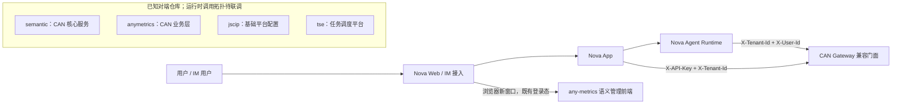
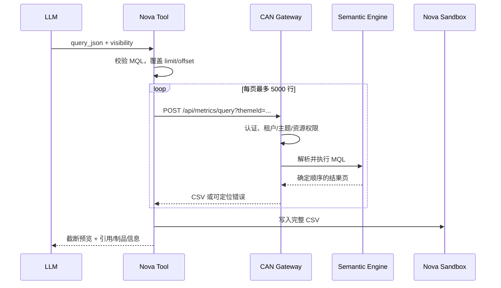
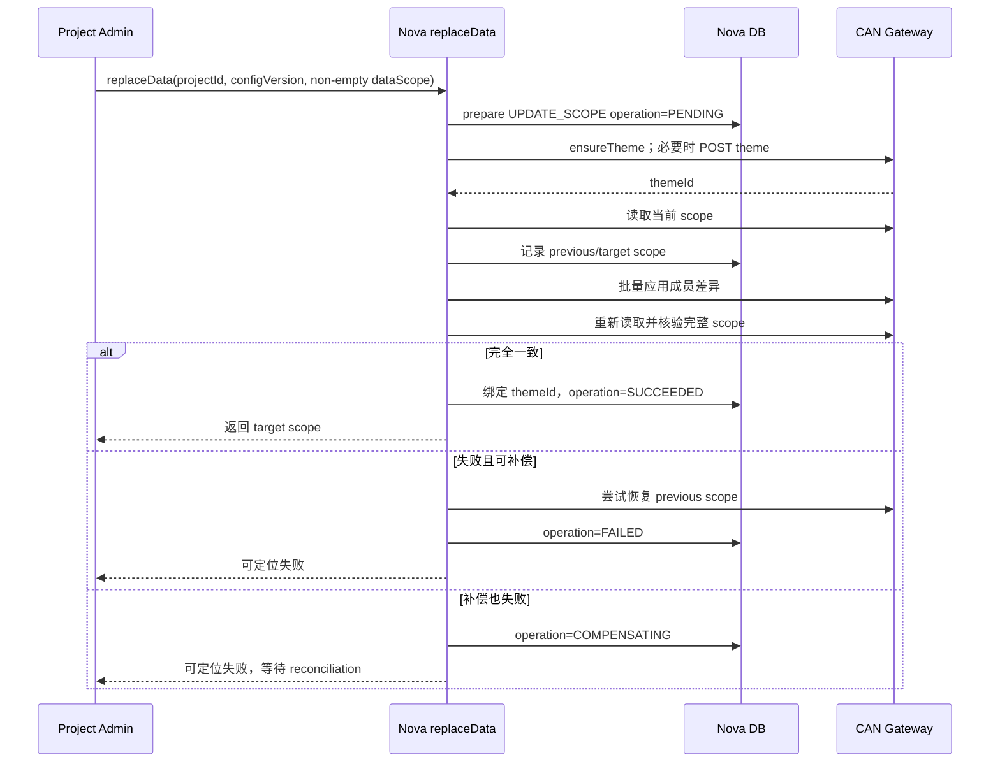
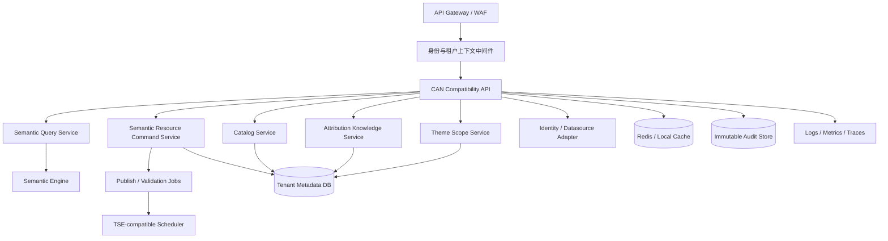

```
# CAN Gateway 与语义平台对端复刻说明

> 文档定位：本文描述 Nova Agent 所依赖、但不在 Nova 仓库内实现的 CAN Gateway 与 CAN 语义平台能力。目标是在没有当前会话、没有 Nova/CAN 源码、没有原运行环境的前提下，仍能据此实现一个兼容对端，或在新系统中设计生产级替代品。
>
> 证据日期：2026-08-06。分析范围为 `Nova`、`nova_auto_test`、`nova_ui_e2e` 三个仓库的静态代码与测试契约；未连接 CAN 环境，未执行构建、测试或远程请求。

## 1. 边界、结论与证据等级

### 1.1 一句话结论

CAN Gateway 对 Nova 而言不是单纯的“指标查询 HTTP 代理”，而是一个多租户语义能力门面：它同时承接指标/维度/数据集目录检索、MQL 查询、主题数据范围、归因知识、语义资源变更、受限数据源元数据、用户身份解析与业务日历等契约；浏览器则通过另一个外部入口进入语义管理站点。Nova 严重依赖这些边界契约，但不应依赖对端内部服务的具体拆分。

### 1.2 证据标签

| 标签 | 含义 | 本文使用方式 |
|---|---|---|
| `I` | 三仓静态代码中已实现 | 可作为当前兼容契约，但仍不等于经过本次运行验证 |
| `A` | 自动化/E2E 中的活动测试契约 | 表示测试明确要求，不表示本次已执行通过 |
| `K` | 已知缺陷或契约冲突 | 复刻时必须兼容或明确修复策略 |
| `F` | 从调用形态、设计材料或仓库职责得到的强推断 | 不应伪装成对端既有实现 |
| `D` | 本文给出的生产级设计建议 | 从零实现时建议采用，不是当前事实 |
| `R` | 本次运行验证 | 本文没有 `R` 结论 |

### 1.3 本文覆盖和不覆盖的边界

本文覆盖：

- Nova 与 CAN Gateway 的 HTTP、认证、租户、超时、响应及错误契约；
- Agent 侧所有 CAN 工具到 Gateway 路由的映射；
- 数据主题、归因知识和语义资源管理接口；
- 外部语义管理页面的跳转契约；
- 根据交互边界反推的 `semantic`、`anymetrics`、`tse`、`jscip`、`any-metrics` 职责；
- 最小兼容 Stub 和生产级重建设计；
- 缓存、审计、幂等、限流、可观测性和验收矩阵。

本文不宣称掌握：

- CAN Gateway、semantic、anymetrics、tse、jscip 的内部源码或真实数据库模型；
- 完整 MQL 语法、查询优化器和底层指标计算算法；
- 原系统的服务间认证、部署拓扑和容量数据；
- 本次未运行的自动化用例已通过。

### 1.4 当前实现、缺失与建议的分界

| 事项 | 结论 |
|---|---|
| Nova 调用 Gateway 的路径、请求形态和错误翻译 | `I`，可按本文复刻 |
| Gateway 内部是否按 semantic/anymetrics/jscip 分流 | 开放问题/待联调；对 Nova 来说应视为黑盒，不赋予 `F` 级调用边 |
| MQL 完整语法及执行语义 | 只掌握 Nova 使用到的最小子集；完整能力需另立语言规范 |
| 主题创建幂等键和外部引用 | 请求头发送是 `I`；服务器的完整幂等行为是兼容期望，未在本次验证 |
| 自动重试 | Nova Gateway 客户端没有通用重试 `I`；生产 Gateway 内部重试按本文 `D` 设计 |
| 外部语义站点可访问性 | E2E 有契约 `A`，本次未登录、未访问 |
| 生产安全性 | 静态管理 API Key 是当前兼容方式；短期令牌、mTLS、密钥轮换属于 `D` |

## 2. 业务问题、用户与产品形态

### 2.1 解决的业务问题

Nova 是面向自然语言分析的 Agent。它不能只拿到数据库连接后自由拼 SQL，因为业务指标还包含口径、时间粒度、可用维度、数据权限、主题范围和组织语义。CAN 对端提供了以下业务能力：

1. **发现语义资产**：搜索指标，查看类别、维度、数据集和血缘分解。
2. **把自然语言实体映射到语义维度**：例如把用户输入的门店名称解析为候选维度和值。
3. **执行受治理的指标查询**：Nova 生成 MQL，由对端解析、鉴权、计算并返回 CSV。
4. **限制项目可见范围**：一个项目绑定一个数据主题；项目 Agent 只能访问该主题中的资产。
5. **维护归因知识**：为指标配置影响因素树、分析维度路径和相关指标，供 Agent 做归因分析。
6. **维护语义资产**：通过带校验/试运行的资源接口创建或修改类别、数据集、维度、指标和数据集关系。
7. **进入专业管理产品**：用户从 Nova 跳往外部语义管理前端查看或维护资产详情。

### 2.2 目标用户

| 用户 | 典型动作 | 所需权限边界 |
|---|---|---|
| 普通分析用户 | 搜索指标、查询、查看维度/归因 | 用户身份、租户、主题、数据行权限 |
| 项目成员 | 在指定项目中分析 | 项目绑定主题；缺失主题时 fail-closed |
| 语义建模人员 | 新建/校验/发布语义资产 | 用户态资源写权限，所有变更可审计 |
| 租户管理员 | 管理主题和归因知识 | 管理 API 权限，必须固定租户 |
| IM 用户 | 从三方 IM 身份进入 Nova | 三方 ID 解析为 CAN 租户和用户，禁用用户不可进入 |
| Nova 后台任务 | 拉取受限数据源、恢复项目主题操作 | 机器身份、最小权限、幂等和审计 |

### 2.3 输入、输出和依赖

- 主要输入：租户 ID、用户 ID、项目/主题上下文、指标/维度/数据集标识、MQL JSON、管理变更 DTO。
- 主要输出：目录文本或 JSON、CSV 查询结果、归因知识 JSON、主题/资源管理结果、标准化错误和 trace ID。
- 外部依赖：身份与账户、语义目录、语义查询引擎、数据源、异步调度平台、语义管理前端。
- 数据归属：业务语义资产和查询结果属于 CAN 侧；Nova 持有会话、项目和工具执行记录，并可能把 CSV 写入自己的沙箱/制品系统。

## 3. 总体参与方与信任边界



图中只表达 Nova 可观察的边界和已知仓库职责；Gateway/外部前端究竟调用哪个内部仓库是开放问题，必须通过对端源码或联调确认。兼容实现可以把所有对端能力合并为一个进程，只要门面契约等价。

### 3.1 对端组件角色

| 名称 | 可确认/推断的角色 | Nova 是否直接调用 |
|---|---|---|
| CAN Gateway | `I`：Nova 的统一 HTTP 对端；其内部认证翻译、路由和领域落点待对端联调 | 是 |
| semantic | 仓库职责资料只确认“Spring Boot、CAN 核心服务”；指标语义、MQL 执行等细分职责待联调 | 未观察到 Nova 直连 |
| anymetrics | 仓库职责资料只确认“Spring Boot、CAN 业务层”；具体承接哪些目录/资源 API 待联调 | 未观察到 Nova 直连；Nova 某些认证配置可指向独立业务 API，但不属于本文 Gateway 契约 |
| any-metrics | 仓库职责资料确认 Node.js 前端；Nova `authUrl` 指向外部语义站点 `I`，该站点与此仓库部署实例的映射待联调 | 浏览器外跳 |
| jscip | 仓库职责资料确认 Spring Boot 基础平台配置，包含账户/数据源；它是否直接服务本文 users/metadata 路由待联调 | 未观察到 Nova 直连 |
| tse | 仓库职责资料确认 Spring Boot 任务调度平台；它是否参与语义发布、加速或查询任务待联调 | 没有观察到 Nova 直连，不能列为同步调用必需项 |

上述组件名称和仓库级职责是本机上下文事实；本文不再为 `Gateway → semantic/anymetrics/jscip` 或 `semantic → tse` 指定 `F` 级调用边，它们都是开放假设。生产重建时把语义查询、业务目录、身份/数据源和调度拆为适配器或异步调用属于纯设计方案 `D`；兼容 Stub 完全可以单体实现。

## 4. 两套认证模式与租户上下文

### 4.1 用户态接口

所有 Agent 查询、目录读取和资源变更默认使用：

```http
X-Tenant-Id: tenant-001
X-User-Id: user-123
```

约束：

- 对端用户态契约要求同时收到 tenant 和 user；两者均不得由 LLM 任意指定。
- 当前只有部分 caller 会严格预检 tenant+user，另一些 caller 依赖 thread-local/header builder 或以 `Error:` 返回预检失败；缺失身份的错误类型和时机并不统一 `K`。因此不能承诺“所有调用都在发请求前以同一种异常失败”，但任何 caller 都不得退化成公共用户。
- 对端必须把租户作为所有查询、缓存和审计记录的第一分区键 `D`。
- 用户态接口需要同时执行资产权限和数据行/列权限；“资源存在”不能替代授权 `D`。

### 4.2 管理/内部接口

主题、归因管理、受限元数据和 IM 身份解析使用：

```http
X-API-Key: <server-side-secret>
X-Tenant-Id: tenant-001
```

管理密钥只存在于 Nova 服务端配置，不能返回给浏览器或出现在错误文本、日志和 trace tag 中 `I`。兼容实现必须支持此静态头；生产新建系统建议把它替换为短时 OAuth2 client credential 或 mTLS，同时在兼容层继续接受旧头 `D`。

### 4.3 不可覆盖头和头部安全

Nova 管理客户端精确禁止自定义 Header 覆盖 `X-API-Key`、`X-Tenant-Id`、`X-User-Id`，并拒绝含 CR/LF 或控制字符的 Header 名/值 `I`。`Idempotency-Key` 与 `X-External-Reference` 是允许的非认证头，项目主题创建正是通过该入口发送。Gateway 也应：

- 拒绝重复且冲突的身份头；
- 禁止客户端通过 body/query 覆盖认证中间件已解析出的租户；
- 对代理链使用可信来源的签名身份，而不是盲信公网传入头；
- 审计“调用身份”和“业务租户”，不记录密钥值。

### 4.4 项目与个人场景

Nova 会在服务端计算 `themeId`，不会把该选择交给 LLM。不同 caller 对 PERSONAL 空值和 all sentinel 的处理并不相同，必须以 4.5 的矩阵为准，不能在本节概括成统一规则。对具备 authoritative PROJECT 场景校验的 caller，必须有项目 ID 和具体主题 ID；缺失或全量占位值时 fail-closed。场景上下文非法时也不能悄悄降级为个人全量范围。

当前 Nova 在部分会话/主题入口只预检“主题是否对租户可见”，并不证明该主题对当前 user 可见 `I`。因此，**兼容事实**只能写成“Nova 提供 tenant/user/theme 上下文并做租户级预检”；“Gateway 重新检查 user/project 对主题及资产的权限”是必须补上的安全控制 `D`，不能写成当前客户端已经保证。

### 4.5 Personal/all sentinel 行为矩阵

Nova 存在三条历史不同的 theme 归一链路，Stub 必须按 caller 复现，不能用一条“null/blank/all 都一样”覆盖：

| Caller/辅助器 | PERSONAL `null` | `""` | `all` | `__ALL__` | concrete | PROJECT |
|---|---|---|---|---|---|---|
| CAN 插件五工具 `ThemeUtil` | 省略 themeId | 省略 | 省略 | 省略 | 发送 | 必须有 projectId + canonical concrete theme；否则 fail-closed |
| Product `semantic_dataset` 的 `ProductToolSupport` | 省略 | `INVALID_SCENE_CONTEXT` | invalid | invalid | 发送 | 同样要求 projectId + concrete theme；拒绝 legacy aliases |
| Gateway JDBC body 组装 | 不放 `dataThemeId` | 不放 | 不放 | 不放 | 解析为 `Long` 后放 body；非数字报错 | 依赖上游场景装配；本方法自身只执行上述字符串判断 |
| 旧 `MetricToolContext` | 无 context/null 均省略 | 省略 | 省略 | **会作为普通值发送** | 发送 | 本辅助器自身不理解 authoritative scene |

CAN 插件在缺少 authoritative scene mode 的 legacy runtime 中还接受 `dataThemeId`、`themeId`、`nova.can.theme-id` 别名；Product tools 在 authoritative PERSONAL/PROJECT 场景明确拒绝 legacy alias。新工程应统一一个规范，但兼容层在迁移完成前应保留 caller 级差异。

## 5. HTTP 基线契约

### 5.1 连接行为

| 项目 | 当前 Nova 行为 `I` | 对端兼容要求 |
|---|---|---|
| 协议 | HTTP/1.1 | 必须支持；可额外支持 HTTP/2 |
| 重定向 | NORMAL | API 最好不重定向认证域 |
| 代理 | `Proxy.NO_PROXY`，直连 | 不依赖本机 HTTP 代理 |
| 连接超时 | 默认 15 秒，可配置 | 超时后连接可安全释放 |
| 请求超时 | 默认 60 秒，可配置 | 长查询需在此窗口内返回，或另行设计异步协议 |
| IM 用户解析 | 连接约 2 秒、请求 3 秒级 | 身份入口必须快速失败 |
| 财务日历 | 请求约 3 秒级 | 轻量接口不能被查询工作负载拖垮 |
| 客户端重试 | 无通用自动重试 | 对端不能依赖客户端必然重试 |
| Base URL | 去除尾部 `/` 后拼路径 | 路由同时避免双斜杠差异 |

NovaCore CAN 插件的规范配置前缀是 `can.*`；产品历史配置是 `nova.metric.*`/`nova.can.*`。当规范 URL 未提供时，Nova 会桥接历史 `nova.metric.gateway-url`。缺少 URL 时返回可定位配置错误，不发网络请求。

### 5.2 三类响应形态

对端必须按路由返回正确形态，不能把所有接口强行套成一种格式。

**标准业务信封**：

```json
{
  "success": true,
  "message": "ok",
  "data": {}
}
```

- `success=false` 即便 HTTP 是 2xx，也被 Nova 视为失败。
- 成功但 body 为空时，部分产品客户端把结果视为 `null`。
- 管理、归因、用户、日历等接口主要使用此形态。

**原始文本/JSON**：

- 指标目录工具返回可直接交给 LLM 的原始文本。
- `/api/metrics/query` 成功返回 CSV 文本。
- `/api/metadata/can_datasource` 返回原始 JSON 对象，不套信封。
- 资源变更接口返回原始 JSON 对象。

**资源错误信封**：

```json
{"error":"validation failed", "trace_id":"trace-123"}
```

`/api/resource/**` 的非 2xx 应采用此形态。非 JSON 错误会被 Nova 明确识别为“对端契约违规”。`/api/can/**` 历史错误形态则是：

```json
{"errorMsg":"not found", "traceId":"trace-123"}
```

### 5.3 逐路由 response codec

“2xx”只说明 HTTP 成功，不同 caller 随后采用不同解码器。复刻时必须按路由绑定 codec，不能按 URL host 统一猜测。

| Codec | 使用路由 | 2xx 空 body | `success:false` | 缺 `success` | 缺 `data` | 其他规则 |
|---|---|---|---|---|---|---|
| `RAW_TEXT` | CAN 五工具目录/查询、`semantic_dataset`、资源工具成功体、JDBC raw JSON | 返回空字符串；上层按各工具规则处理 | 不识别，原样返回 | 不适用 | 不适用 | 非 2xx 由 raw client 翻译；query 再检测 200 `Error:` |
| `API_DATA` | `/api/mgmt/**`、归因 tool read、`/api/can/**`、users | Jackson `nullNode` | 抛 `GatewayException`，即使 HTTP 2xx | **接受**，继续取 data | 返回 `nullNode` | 2xx 非 JSON解析失败；message 优先作为错误原因 |
| `CALENDAR_STRICT_ENVELOPE` | `/api/calendar/fiscal-labels`、`/api/calendar/list` | 解析失败 | 失败 | **失败**（按 false 处理） | 失败 | fiscal-labels 要求 data object；list 要求 data array；empty/invalid JSON 均失败 |
| `ADMIN_RAW_JSON` | `/api/metadata/can_datasource` | JSON 反序列化失败 | 不识别信封 | 不适用 | 不适用 | 直接把整个 body 反序列化成 metadata DTO |
| `IM_FULL_ENVELOPE` | `/api/internal/v1/im/users/resolve` | 上层解析失败 | 由 IM 服务读取并拒绝 | 必填兼容预期 | success 时需要 data | 底层保留 status+完整 body，不预先 unwrap |

特别说明：`semantic_dataset` 的 Gateway 分支通过 raw `get` 返回 body，**不会**自动解开 `{success,message,data}`。Stub 若误套标准信封，LLM 将看到整段信封而不是 data。标准信封客户端反而较宽松：`success` 缺失仍接受、`data` 缺失变成 null；这是当前兼容事实 `I`，生产新版本应以 schema 校验收紧 `D`。

### 5.4 状态码与错误语义

| HTTP/情形 | 对 Nova 的语义 | 对端要求 |
|---|---|---|
| 400 | 请求/MQL/语义校验失败 | 给出安全、可定位的字段或语法信息 |
| 401 | 身份被拒绝 | 不回显 API Key/token |
| 403 | 权限不足 | 必须是终态；Agent 不应靠改写指标绕过 |
| 404 | 资源不存在或不在主题范围 | 尽量区分真正不存在与 scope 外 |
| 500/502/503/504 | 服务不可用 | 带 trace ID；不要伪装成业务空结果 |
| 2xx + `success:false` | 业务失败 | 保留供兼容，但新接口建议使用恰当 4xx/5xx |
| 200 + 文本 `ERROR:` | 查询失败 | 历史兼容；新实现应返回非 2xx |
| 网络/超时 | 客户端状态 -1 | 可安全重试性应通过文档/头部表达 |

Nova 会识别中英文权限标记，包括“没有权限、无权限、权限不足、无此权限、无该权限”、`permission denied`、`not authorized`、`access denied` 等。错误正文默认截断到 500 字符，插件上限可配置；因此关键原因与 trace ID 必须放在正文前部。

MQL 解析错误即便经由 500/502/503/504 返回，也可能按正文标记被 Nova 重新分类为客户端语义错误。这是遗留兼容，不是推荐的状态码设计。

## 6. Agent 工具与 Gateway 路由映射

CAN 插件注册 11 个工具；另有产品宿主提供 `semantic_dataset` 双后端工具。核心只读基线自动化明确要求前五个工具出现在工具清单 `A`。

| Agent 工具 | 方法与路径 | 核心输入 | 响应 | 用途 |
|---|---|---|---|---|
| `metric_search` | 多路径，见 6.2 | action、keyword、category、分页、服务端 themeId | 原始文本 | 指标发现与分类 |
| `metric_dimensions` | `GET /api/metrics/{metric}/dimensions` 或 `/api/metrics/dimensions` | 一个/多个指标、keyword、themeId | 原始文本 | 可用维度或交集 |
| `metric_dimension_resolve` | `GET /api/metrics/dimensions/resolve` | metrics、value、dim、limit、themeId | 原始文本 | 业务值反查维度 |
| `metric_query` | `POST /api/metrics/query` | MQL JSON；Gateway 可见 limit/offset/themeId | CSV 文本 | 查询指标数据 |
| `metric_breakdown` | `GET /api/metrics/breakdown` | metric 列表、themeId | 原始文本 | 指标分解/血缘 |
| `metric_attr_kb_search` | `GET /api/metrics/{metric}/attribution` | knowledgeType、themeId | 标准信封 | 归因知识 |
| `category_resource` | `/api/resource/category/*` | 资源 DTO、dry_run | 原始 JSON | 类别管理 |
| `dataset_resource` | `/api/resource/dataset/*` | 资源 DTO、dry_run | 原始 JSON | 数据集管理 |
| `dimension_resource` | `/api/resource/dimension/*` | 资源 DTO、dry_run | 原始 JSON | 维度管理 |
| `metric_resource` | `/api/resource/metrics/*` | 资源 DTO、dry_run | 原始 JSON | 指标管理 |
| `dataset_relation_resource` | `/api/resource/relation/*` | 关系 DTO、dry_run | 原始 JSON | 数据集关系管理 |
| `semantic_dataset` | `/api/dataset/list`、`/api/dataset/info` | keyword/name、分页、themeId | 原始 body，不解标准信封 | 数据集浏览 |

### 6.1 Gateway 全路由总表

缩写：`U`=用户态 `X-Tenant-Id+X-User-Id`；`A`=管理态 `X-API-Key+X-Tenant-Id`；`T/U/H` 分别表示 tenant/user/theme 是否进入有效上下文；`RAW`、`DATA`、`CAL_STRICT`、`ADMIN_RAW`、`IM_FULL` 对应 5.3 的 codec。`I` 表示 Nova 静态实现，`A-test` 表示补充仓库存在活动测试契约；对端内部路由到哪个微服务不在此表承诺。

| Caller | Method | Path | Auth | T/U/H | Request 要点 | Success codec | Error 要点 | 等级 |
|---|---|---|---|---|---|---|---|---|
| `metric_search.search` | GET | `/api/metrics/search` | U | 是/是/可选 | `keyword,pageSize,themeId` | RAW 文本 | raw status + `ERROR:` | I/A-test |
| `metric_search.list` | GET | `/api/metrics/list` | U | 是/是/可选 | `pageNumber,pageSize,themeId` | RAW 文本 | 同上 | I/A-test |
| `metric_search.categories` | GET | `/api/metrics/categories` | U | 是/是/可选 | `themeId`；Project 仍传 | RAW 文本 | 同上 | I/A-test |
| `metric_search.category` | GET | `/api/metrics/categories/{categoryId}` | U | 是/是/可选 | 当前 raw 拼接 categoryId；分页、themeId | RAW 文本 | ID 必须 URI-safe | I/K |
| `metric_dimensions` 单指标 | GET | `/api/metrics/{metric}/dimensions` | U | 是/是/可选 | `keyword?,themeId` | RAW 文本 | 404 可含 `not in theme` | I/A-test |
| `metric_dimensions` 多指标 | GET | `/api/metrics/dimensions` | U | 是/是/可选 | `metricNames` 逗号串、keyword、themeId | RAW 文本 | 权限错误终态 | I/A-test |
| `metric_dimension_resolve` | GET | `/api/metrics/dimensions/resolve` | U | 是/是/可选 | `metrics,value,dim?,limit?,themeId` | RAW 文本 | raw status | I/A-test |
| `metric_breakdown` | GET | `/api/metrics/breakdown` | U | 是/是/可选 | `metric` 逗号串、themeId | RAW 文本 | raw status | I/A-test |
| `metric_query` | POST | `/api/metrics/query` | U | 是/是/可选 | query=`themeId`；body=MQL+覆盖后的 limit/offset | RAW CSV | status；另检 200 `Error:` | I/A-test |
| `metric_attr_kb_search` | GET | `/api/metrics/{metric}/attribution` | U | 是/是/可选 | `knowledgeType,onlyDefault?,themeId` | DATA | 400 unknown metric；null data→空知识 DTO | I |
| `semantic_dataset.list` | GET | `/api/dataset/list` | U | 是/是/可选 | `keyword?,pageNum,pageSize,themeId` | RAW body | 404 `not in theme` 会翻译 | I |
| `semantic_dataset.info` | GET | `/api/dataset/info` | U | 是/是/可选 | `name` 可逗号串、themeId | RAW body | 同上 | I |
| `semantic_jdbc_query` | POST | `/api/jdbc/query` | U | 是/是/可选数值 | `{sql,resultFormat:"ROWS",dataThemeId?}` | RAW JSON rows | 空/`Error:`/schema 无效 | I |
| Category resource | GET | `/api/resource/category/list` | U | 是/是/否 | `category_type` | RAW JSON | resource JSON error | I |
| Category create | POST | `/api/resource/category/create/validate`、`/create` | U | 是/是/否 | category DTO；dry-run 选路径 | RAW JSON | `{error,trace_id}` | I |
| Category update | POST | `/api/resource/category/update/validate`、`/update` | U | 是/是/否 | category ID + changes | RAW JSON | 同上 | I |
| Category delete | POST | `/api/resource/category/delete/validate`、`/delete` | U | 是/是/否 | category ID/type | RAW JSON | 同上 | I |
| Dataset resource read | GET | `/api/resource/dataset/list`、`/batch-detail` | U | 是/是/否 | list 分页或 `dataset_names` | RAW JSON | resource JSON error | I |
| Dataset resource create | POST | `/api/resource/dataset/batch-create/validate`、`/batch-create` | U | 是/是/否 | single 或 `{items}` | RAW JSON | 同上 | I |
| Dataset resource update | POST | `/api/resource/dataset/batch-update/validate`、`/batch-update` | U | 是/是/否 | single 或 `{items}` | RAW JSON | 同上 | I |
| Dataset resource delete | POST | `/api/resource/dataset/batch-delete/validate`、`/batch-delete` | U | 是/是/否 | single/`items`/names | RAW JSON | 同上 | I |
| Dimension resource list | POST | `/api/resource/dimension/list` | U | 是/是/否 | filter + page body | RAW JSON | resource JSON error | I |
| Dimension resource detail | GET | `/api/resource/dimension/batch-detail` | U | 是/是/否 | `dimension_names` | RAW JSON | 同上 | I |
| Dimension create | POST | `/api/resource/dimension/batch-create/validate`、`/batch-create` | U | 是/是/否 | single 或 `{items}` | RAW JSON | 同上 | I |
| Dimension update | POST | `/api/resource/dimension/batch-update/validate`、`/batch-update` | U | 是/是/否 | single 或 `{items}` | RAW JSON | 同上 | I |
| Dimension delete | POST | `/api/resource/dimension/batch-delete/validate`、`/batch-delete` | U | 是/是/否 | names/items | RAW JSON | 同上 | I |
| Metric resource read | GET | `/api/resource/metrics/list`、`/batch-detail` | U | 是/是/否 | filters（可重复 status）或 names | RAW JSON | resource JSON error | I |
| Metric create | POST | `/api/resource/metrics/batch-create/validate`、`/batch-create` | U | 是/是/否 | single 或 `{items}` | RAW JSON | 同上 | I |
| Metric update | POST | `/api/resource/metrics/batch-update/validate`、`/batch-update` | U | 是/是/否 | single 或 `{items}` | RAW JSON | 同上 | I |
| Metric delete | POST | `/api/resource/metrics/batch-delete/validate`、`/batch-delete` | U | 是/是/否 | names/items | RAW JSON | 同上 | I |
| Relation create | POST | `/api/resource/relation/create/validate`、`/create` | U | 是/是/否 | relation DTO | RAW JSON | resource JSON error | I |
| Relation update | POST | `/api/resource/relation/update/validate`、`/update` | U | 是/是/否 | 必填 `relation_id,src_dataset_name,dst_dataset_name,type`；conditions/name/display 可选 | RAW JSON | 同上 | I |
| Relation delete | POST | `/api/resource/relation/delete/validate`、`/delete` | U | 是/是/否 | relation_id | RAW JSON | 同上 | I |
| Attribution mgmt list | GET | `/api/mgmt/attribution/metrics`、`/metrics-page` | A | 是/否/否 | keyword/page 可选 | DATA | envelope/message | I/A-test |
| Attribution mgmt detail | GET | `/api/mgmt/attribution/metrics/{metricName}` | A | 是/否/否 | `knowledgeType?,onlyDefault?` | DATA | envelope/message | I/A-test |
| Factor create/validate | POST | `/api/mgmt/attribution/metrics/{metricName}/factors`、`/factors/validate` | A | 是/否/否 | factor/validate DTO | DATA | valid=false 可为 200 | I/A-test |
| Factor update/delete | PUT/DELETE | `/api/mgmt/attribution/metrics/{metricName}/factors/{id}` | A | 是/否/否 | metric 和 id 均 encode | DATA | envelope/message | I/A-test |
| Attribution dimension create | POST | `/api/mgmt/attribution/metrics/{metricName}/dimensions` | A | 是/否/否 | levels 对象数组 | DATA | envelope/message | I/A-test |
| Attribution dimension update/delete | PUT/DELETE | `/api/mgmt/attribution/metrics/{metricName}/dimensions/{id}` | A | 是/否/否 | metric 和 id 均 encode | DATA | envelope/message | I/A-test |
| Correlation create | POST | `/api/mgmt/attribution/metrics/{metricName}/correlations` | A | 是/否/否 | correlation DTO | DATA | envelope/message | I/A-test |
| Correlation update/delete | PUT/DELETE | `/api/mgmt/attribution/metrics/{metricName}/correlations/{id}` | A | 是/否/否 | metric 和 id 均 encode | DATA | envelope/message | I/A-test |
| Theme list/create | GET/POST | `/api/mgmt/themes` | A | 是/否/否 | POST tenant/name/description + 可选幂等头 | DATA | envelope/message | I |
| Theme page | GET | `/api/mgmt/themes/page` | A | 是/否/否 | keyword/page | DATA | envelope/message | I |
| Theme detail/update/delete | GET/PUT/DELETE | `/api/mgmt/themes/{themeId}` | A | 是/否/路径中 | encoded ID；PUT upsert DTO | DATA | envelope/message | I |
| Theme member page | GET | `/api/mgmt/themes/{id}/members/{metrics|dimensions|datasets}` | A | 是/否/路径中 | keyword/page | DATA | envelope/message | I |
| Theme direct members | POST/DELETE | `/api/mgmt/themes/{id}/{metrics|dimensions|datasets}` | A | 是/否/路径中 | tenant + names array | DATA | envelope/message | I |
| Theme categories | POST/DELETE | `/api/mgmt/themes/{id}/{metric-categories|dimension-categories}` | A | 是/否/路径中 | tenant + categories | DATA | envelope/message | I |
| Mgmt category catalog | GET | `/api/mgmt/catalog/metric-categories`、`/dimension-categories` | A | 是/否/否 | 无 | DATA | envelope/message | I |
| Mgmt asset catalog | GET | `/api/mgmt/catalog/metrics`、`/dimensions`、`/datasets` | A | 是/否/可选 | category/keyword/page/themeId | DATA | envelope/message | I |
| Mgmt catalog counts | GET | `/api/mgmt/catalog/counts` | A | 是/否/可选 | themeId | DATA | envelope/message | I |
| CAN metric detail | GET | `/api/can/metrics/batch-detail` | U | 是/是/否 | `metricNames`，每批≤50 | DATA | legacy `errorMsg/traceId` 变体 | I |
| CAN dimension detail | GET | `/api/can/dimension/detail` | U | 是/是/否 | `dimName` | DATA | 404 转 null | I |
| User search | POST | `/api/users/search` | U（显式） | 是/是/否 | `{keyword,limit}` | DATA | envelope/message | I |
| IM resolve | POST | `/api/internal/v1/im/users/resolve` | A | 是/待解析/否 | platform + thirdPartyUserId；requestId 可选 | IM_FULL | status+full envelope | I |
| Fiscal labels | GET | `/api/calendar/fiscal-labels` | U | 是/是/否 | calendarName/date | CAL_STRICT object | 短超时；严格信封 | I |
| Calendar list | GET | `/api/calendar/list` | U | 是/是/否 | 无 | CAL_STRICT array | 短超时；严格信封 | I |
| Datasource metadata | GET | `/api/metadata/can_datasource` | A | 是/否/否 | 无 | ADMIN_RAW | 非 2xx/JSON parse error | I |

表中“theme=否”表示 Nova 当前未给该路由附带 theme 参数，不等于该资源可以跨租户；tenant 始终是硬边界。资源写接口当前依赖用户态权限，而主题/归因管理依赖 server-side admin key。

### 6.2 指标目录

```http
GET /api/metrics/search?keyword=gmv&pageSize=50&themeId=theme-1
GET /api/metrics/list?pageNumber=1&pageSize=50&themeId=theme-1
GET /api/metrics/categories?themeId=theme-1
GET /api/metrics/categories/{categoryId}?pageNumber=1&pageSize=50&themeId=theme-1
```

- 页码从 1 开始；默认和最大 `pageSize` 为 50，越界值被 Nova 夹到合法范围。
- `search` 的 keyword 也兼容工具输入别名 `query`，但 HTTP 参数固定为 `keyword`。
- `action=category` 当前把 `categoryId` 直接拼到 path，没有 URL encoding `I/K`；兼容 fixture 必须使用 URI-safe ID。改为 path-segment encoding 是 `D`，并需要评估对现有含 `%`/`+` ID 的兼容影响。
- `categories` 在项目上下文仍会请求 `/api/metrics/categories`，并由 `ThemeUtil` 附带具体 `themeId` `I/A`；对端必须返回主题内可见分类，不能把租户级完整分类树泄露给项目。宿主可以另外注入 scope validator 阻断，但不能把“必然阻断”当作基础 Gateway 契约。
- 对端文本至少应包含稳定指标代码、展示名、类别和简要口径，使 LLM 不必解析脆弱 UI 文案。

### 6.3 可用维度与值解析

```http
GET /api/metrics/revenue/dimensions?keyword=shop&themeId=theme-1
GET /api/metrics/dimensions?metricNames=revenue,orders&keyword=shop&themeId=theme-1
GET /api/metrics/dimensions/resolve?metrics=revenue,orders&value=Shanghai&dim=city&limit=10&themeId=theme-1
```

- 多指标维度接口语义是**共同可用维度的交集**。
- `resolve.value` 可按半角/全角逗号批量拆分；Nova 最多发送 10 个值，每个最长 50 字符。
- `limit` 仅在调用者显式提供时发送，范围 1..50。
- resolve 结果应按匹配度排序，并标明命中的维度、规范值、显示值和所属指标；当前接口是预格式化文本。
- 指标不在主题内的 404 应提供稳定标记，使 Nova 能提示“当前项目数据范围不含该指标”。

### 6.4 指标分解

```http
GET /api/metrics/breakdown?metric=revenue,profit&themeId=theme-1
```

响应表示派生/复合指标的依赖树或血缘。兼容文本应避免只给展示名；每个节点至少包含指标代码、展示名、类型和子节点。循环引用必须在保存时拒绝，读取时也应设置深度和节点数上限。

## 7. MQL 查询契约

### 7.1 最小请求模型

```json
{
  "metrics": ["retail_amount"],
  "dimensions": ["shop_name"],
  "timeConstraint": "DateTrunc(['metric_time'], \"MONTH\") = '2026-07-01'",
  "filters": "['region_name'] = 'East'",
  "metricDefinitions": {
    "retail_amount": "Sum(['sales'/'amount'])"
  },
  "limit": 5000,
  "offset": 0
}
```

Nova 侧已知校验：

- 顶层必须是 JSON object；
- `metrics` 必须是非空数组；
- `timeConstraint` 若存在必须是字符串，并包含 `metric_time`；
- 不支持 `DATE()` 表达式；
- `metricDefinitions` 的每个 key 必须同时出现在 `metrics`；
- Nova 覆盖调用者提供的 `limit`/`offset`，防止绕过分页策略。

完整 MQL 函数、类型、转义、时区和空值语义不在三仓中定义。复刻生产系统时必须另行发布版本化 MQL 规范；最小 Stub 可以只实现固定 fixture 匹配，不应声称支持完整语言。

### 7.2 请求和 CSV 响应

```http
POST /api/metrics/query?themeId=theme-1
Content-Type: application/json
X-Tenant-Id: tenant-001
X-User-Id: user-123

{...MQL...}
```

成功响应为 `text/csv`，第一行是表头：

```csv
shop_name,retail_amount
Shanghai Store,1200.50
"Hangzhou, West",980.00
```

当前解析器先用 Java `String.lines()` 把响应切成**物理行**，再逐行处理逗号、双引号和 `""` 转义 `I`。因此当前兼容 CSV 支持“单个物理行内的带逗号/双引号字段”，但**不支持 cell 内嵌 CR/LF**；对端若返回跨物理行的 quoted cell 会被错分成多行。完整 RFC 4180（含 quoted CR/LF）只能标为解析器升级建议 `D`。空查询是成功，可只返回表头或空 body，但兼容实现建议统一返回表头。权限失败绝不能表现成空数据。

### 7.3 分页和容量

- Nova 每次请求最多 5,000 行，`offset` 递增。
- 用户可给总 `limit`；未给时仍有 1,000,000 行绝对上限。
- 当前停止条件是：空页、短页、达到用户 limit、达到绝对行上限，或“追加后总行数没有增长” `I`。一个非空的完整重复页仍会增长行数和 offset，**不会**被识别为 no-progress；页面签名/主键游标检测属于 `D`。
- Nova 不对页面请求自动重试；重复页会导致重复数据，因此对端分页排序必须确定。
- Nova 只把最多约 8,000 字符格式化进 LLM 上下文；完整 CSV 可写入 Nova 沙箱并按可见性发布制品。
- 工具参数 `purpose` 和 `visibility=internal|default|export` 是 Nova 本地策略，不发送给 Gateway。

建议对端为查询生成 `query_id`/`trace_id` 响应头，并在相同 MQL、数据快照和 offset 下提供稳定页。若底层数据实时变化，应使用快照 token；当前 Nova 未发送 token，兼容实现只能尽量提供请求期间一致性 `D`。

### 7.4 查询时序



## 8. 归因知识契约

### 8.1 Agent 读取接口

```http
GET /api/metrics/{urlEncodedMetric}/attribution?knowledgeType=all&themeId=theme-1
```

`knowledgeType` 可选 `factors|dimensions|correlations|all`，默认 `all`。工具客户端还可发送 `onlyDefault`。响应使用标准信封；下面给出 Nova 归一后的 DTO 结构：

```json
{
  "metricName": "profit",
  "metricDisplayName": "Profit",
  "factors": [{
    "id": "f-1",
    "name": "Profit decomposition",
    "isDefault": true,
    "enabled": true,
    "tree": {
      "expression": "revenue - cost",
      "items": [{
        "metricName": "revenue",
        "metricDisplayName": "Revenue",
        "isMissing": false,
        "children": null
      }]
    },
    "remark": "Default analysis path",
    "updatedAt": 1785559200000
  }],
  "dimensions": [{
    "id": "d-1",
    "name": "Organization path",
    "isDefault": true,
    "enabled": true,
    "levels": [{
      "dimensionName": "region",
      "dimensionDisplayName": "Region",
      "isMissing": false
    }],
    "remark": "Drill down order",
    "updatedAt": 1785559200000
  }],
  "correlations": [{
    "id": "c-1",
    "enabled": true,
    "relatedMetric": "order_count",
    "relatedMetricDisplayName": "Order Count",
    "isMissing": false,
    "direction": "POSITIVE",
    "description": "More orders normally increase profit",
    "updatedAt": 1785559200000
  }],
  "truncated": false
}
```

Factor item 的 `children` 类型不是 item 数组，而是一个递归 `FactorTree` 对象或 `null`：

```json
{
  "metricName": "gross_profit",
  "metricDisplayName": "Gross Profit",
  "isMissing": false,
  "children": {
    "expression": "revenue - cost",
    "items": [
      {"metricName":"revenue","isMissing":false,"children":null},
      {"metricName":"cost","isMissing":false,"children":null}
    ]
  }
}
```

Gateway 管理详情还存在旧 wrapper 形态：`data.metric={name,displayName}`，而不是顶层 `metricName/metricDisplayName`。Nova 管理客户端会把该 wrapper 归一为顶层字段，并把缺失/非数组的 factors、dimensions、correlations 归一为空数组；无 `metric` wrapper 时直接按顶层 DTO 反序列化 `I`。归因各项 `updatedAt` 均是 epoch milliseconds `Long`。

规则：

- 未配置知识的业务语义不是错误。当前客户端会把 null data 归一成空知识 DTO，renderer 随后返回友好的“未配置归因知识”提示 `I`。为了契约清晰和跨语言兼容，对端首选返回非 null data 对象并显式给出三个空数组，但这不是当前硬兼容要求。
- Agent 读取只返回 `enabled=true` 的知识；管理读取可包含禁用项。
- 未知指标当前已验证变体是 HTTP 400 + plain text `ERROR: unknown metric: <name>`；标准信封 400 message 也会被客户端穿透。它必须与“已知但未配置”区分。
- 项目模式下，返回树中的每个指标和层级维度也必须属于主题范围。
- 对端应防止循环因子树；Nova 渲染仍会做深度限制。

### 8.2 管理接口

所有路径以 `/api/mgmt/attribution` 为前缀，使用管理认证。

| 方法与路径 | 请求/响应要点 |
|---|---|
| `GET /metrics` | 返回已配置指标数组 |
| `GET /metrics-page?keyword&pageNumber&pageSize` | 返回分页指标 |
| `GET /metrics/{metricName}?knowledgeType&onlyDefault` | 返回完整聚合，可包含 disabled |
| `POST /metrics/{metric}/factors` | 创建 factor |
| `PUT /metrics/{metricName}/factors/{id}` / `DELETE /metrics/{metricName}/factors/{id}` | 更新/删除 factor |
| `POST /metrics/{metric}/factors/validate` | 返回 `{valid,errors[]}`；`valid=false` 可在 HTTP 200 中表达 |
| `POST /metrics/{metric}/dimensions` | 创建 dimension path |
| `PUT /metrics/{metricName}/dimensions/{id}` / `DELETE /metrics/{metricName}/dimensions/{id}` | 更新/删除 path |
| `POST /metrics/{metric}/correlations` | 创建 correlation |
| `PUT /metrics/{metricName}/correlations/{id}` / `DELETE /metrics/{metricName}/correlations/{id}` | 更新/删除 correlation |

Factor 请求字段：`tenantId, metricName, name, isDefault, enabled, tree, remark`。Dimension path 请求字段：`tenantId, metricName, name, isDefault, enabled, levels:[string], remark`；Nova 发往 Gateway 时会把字符串层级转换成 `[{"dimensionName":"region"}]`。Correlation 字段：`tenantId, metricName, relatedMetric, direction, description, enabled`；更新时 related metric 应保持只读。所有管理路径中的 `metricName` 和记录 `id` 都由 Nova 使用 UTF-8 form URL encoding 后放入 path segment `I`；兼容服务需按同一规则解码，生产新版本建议使用 RFC 3986 path-segment 编码并增加含空格、`+`、`/`、中文的契约测试 `D`。

业务不变量：

- 一个指标、一个知识类型最多一个默认项；切换默认需要原子更新。
- 因子公式必须引用存在且允许的指标，拒绝自引用、重复边、循环和非法语法。
- 维度层级有序，顺序影响下钻逻辑。
- 相关方向仅 `POSITIVE|NEGATIVE`；同一相关指标不能重复配置。
- 校验失败不得产生脏数据 `A`；跨租户 ID 猜测不能读取/修改 `A`。

`K`：现有端到端材料记录过 UI 生成的 `[metricCode]` 公式被 Gateway 解析器在第一个字符拒绝，另有“合法公式误判”历史问题。兼容复刻必须先固定一套公式文法，并让前端生成器、validate 和 save 使用同一解析器；不能只在 UI 侧打补丁。

## 9. 数据主题契约

### 9.1 主题模型

```json
{
  "id": "theme-1",
  "tenantId": "tenant-001",
  "name": "Retail Project Scope",
  "description": "Assets allowed in the retail project",
  "metricCount": 12,
  "dimensionCount": 8,
  "datasetCount": 3,
  "updatedAt": 1785559200000,
  "metrics": [{"name":"revenue","displayName":"Revenue","isMissing":false}],
  "dimensions": [],
  "datasets": [],
  "selections": {
    "metrics": {
      "categoryGroups": [{
        "categoryId": "cat-1",
        "categoryName": "Sales",
        "memberCount": 10,
        "members": []
      }],
      "directMembers": []
    },
    "dimensions": {"categoryGroups": [], "directMembers": []},
    "datasets": {"categoryGroups": [], "directMembers": []}
  }
}
```

条目字段兼容指标/维度/数据集历史别名，但规范输出使用 `name,displayName,isMissing`。目录候选项还可包含：

```json
{
  "name": "revenue",
  "displayName": "Revenue",
  "alreadyInTheme": true,
  "selection": {
    "state": "COVERED_BY_CATEGORY",
    "category": {"id":"cat-1","name":"Sales"}
  }
}
```

`updatedAt` 是 epoch milliseconds `Long`，不是 ISO 字符串 `I`。`selections` 必须是 `metrics`、`dimensions`、`datasets` 三个 bucket，每个 bucket 才含 `categoryGroups` 与 `directMembers`。`selection.state` 已观察到 `DIRECT_SELECTED` 和 `COVERED_BY_CATEGORY`。前者是直接成员，后者由类别覆盖；移除类别时需明确是否保留直接成员。

### 9.2 主题 CRUD 和成员接口

| 方法与路径 | 契约 |
|---|---|
| `GET /api/mgmt/themes` | 平铺主题数组 |
| `GET /api/mgmt/themes/page?keyword&pageNumber&pageSize` | 分页 |
| `GET /api/mgmt/themes/{id}` | 详情 |
| `POST /api/mgmt/themes` | `{tenantId,name,description}` |
| `PUT /api/mgmt/themes/{id}` | 同上 |
| `DELETE /api/mgmt/themes/{id}` | 删除；被项目引用时应按策略拒绝 |
| `GET /api/mgmt/themes/{id}/members/{metrics|dimensions|datasets}` | keyword + 分页 |
| `POST` 或带 body 的 `DELETE /api/mgmt/themes/{id}/{metrics|dimensions|datasets}` | `{tenantId, metricNames|dimNames|datasetNames:[...]}` |
| `POST` 或带 body 的 `DELETE /api/mgmt/themes/{id}/{metric-categories|dimension-categories}` | `{tenantId,categories:[{categoryId,categoryName}]}` |

成员批处理响应：

```json
{
  "added": ["revenue"],
  "ignored": ["unknown_metric"],
  "removed": [],
  "notFound": [],
  "coveredDirectRemovedCount": 1
}
```

未知添加项进入 `ignored`，删除不存在项进入 `notFound`；操作本身可以幂等成功。

### 9.3 主题目录

```http
GET /api/mgmt/catalog/metric-categories
GET /api/mgmt/catalog/dimension-categories
GET /api/mgmt/catalog/metrics?categoryId=cat-1&keyword=rev&pageNumber=1&pageSize=20&themeId=theme-1
GET /api/mgmt/catalog/dimensions?categoryId=cat-2&keyword=reg&pageNumber=1&pageSize=20&themeId=theme-1
GET /api/mgmt/catalog/datasets?keyword=sales&pageNumber=1&pageSize=20&themeId=theme-1
GET /api/mgmt/catalog/counts?themeId=theme-1
```

分页对象至少包含 `items,total,pageNumber,pageSize,hasNext,selectedCategory`。

### 9.4 项目创建与数据范围替换：两个不同链路

当前实现必须拆成两条链路理解，不能把“项目创建”描述成创建外部 Theme 的 Saga。

**项目创建当前行为 `I`**：创建请求要求 `dataScope` 存在但必须为空；只在 Nova 本地创建 Project，`dataThemeId=null`，对应持久化 operation 最终为 `SUCCEEDED`。初始 `dataScope` 中只要含任一 metric/dimension/dataset 就直接校验失败，不调用 Gateway。理想的“创建项目时同步创建 Theme 并应用 dataScope”尚未实现，只能列为 `D`。

**数据范围替换当前行为 `I`**：只有后续 `replaceData` 才确保 Theme 存在、应用差异、核验并在 Nova 本地绑定 `dataThemeId`。两个系统没有分布式事务：



持久化状态枚举只有 `PENDING|SUCCEEDED|FAILED|COMPENSATING` `I`，不存在 `RETRYABLE`。重试能力通过失败记录、重试计数/时间和 reconcile job 表达，不应凭空增加状态。

`replaceData` 中必要的主题创建请求会发送：

```http
Idempotency-Key: <stable-operation-key>
X-External-Reference: <stable-project-id>
```

请求头发送是 `I`。对端是否完整兑现这些幂等语义未在本次运行验证。生产兼容语义 `D` 应为：同一租户、路由和幂等键重复提交相同 request hash 返回相同资源/响应；同键不同 body 返回 409；处理中重复请求返回可重试状态；`X-External-Reference` 对一个租户唯一，可用于“响应丢失后找回”，即使当前 Nova 客户端尚未调用按外部引用查询接口。把同样的 Gateway Saga 前移到 Project create、允许初始非空 `dataScope`，是理想产品设计 `D`，不是当前实现。

## 10. 语义资源管理契约

### 10.1 通用 dry-run 模式

类别、数据集、维度、指标和数据集关系均遵循：

- 默认 `dry_run=true`，请求发往 `.../validate`，不落库；
- 只有显式 `dry_run=false` 才调用真正 create/update/delete；
- Tool 结果是 ephemeral，不应把完整敏感配置长期塞入 LLM 上下文；
- 批量接口支持单个对象或 `{items:[...]}`；删除可接受名称数组。

验证结果：

```json
{
  "status": "passed_with_warnings",
  "errors": [],
  "warnings": [{
    "code": "OWNER_EMPTY",
    "message": "business owner is empty",
    "field": "business_owner",
    "item_index": 0
  }]
}
```

`status` 为 `passed|passed_with_warnings|failed`。Nova 将 passed 渲染成 `ready/can_execute=true`；failed 作为工具错误。validate 与实际写入必须共享同一校验器和事务边界，防止“预检通过、写入采用另一套规则”。

### 10.2 类别

```http
GET  /api/resource/category/list?category_type=CATEGORY_METRIC
POST /api/resource/category/create[/validate]
POST /api/resource/category/update[/validate]
POST /api/resource/category/delete[/validate]
```

- `category_type`: `CATEGORY_METRIC|CATEGORY_DIMENSION|CATEGORY_DATASET`。
- create: `category_type,category_name(<=32),parent_id?(<=64),front_id?(<=64)`。
- update/delete: `category_id,category_type`；update 至少一个变更字段。
- 需要校验父级同租户同类型、无循环、`front_id` 合法。

### 10.3 数据集

```http
GET /api/resource/dataset/list?keyword=&page=1&page_size=20
GET /api/resource/dataset/batch-detail?dataset_names=sales,orders
POST /api/resource/dataset/{batch-create|batch-update|batch-delete}[/validate]
```

分页默认 1/20，`page_size` 最大 200。创建对象：

```json
{
  "dataset_name": "sales",
  "dataset_display_name": "Sales",
  "description": "Order line facts",
  "category_id": "-1",
  "source_info": {
    "type": "TABLE",
    "catalog": "prod",
    "schema": "mart",
    "table": "fact_sales"
  },
  "def_columns": [{
    "name": "amount",
    "display_name": "Amount",
    "description": "Net amount",
    "type": "MEASURE",
    "expr": "['sales'/'amount']",
    "source_column": "amount",
    "origin_data_type": "DECIMAL"
  }]
}
```

`source_info.type`：`TABLE` 需要 catalog/schema/table；`SQL` 需要 sql；`FILE` 需要 file_id。列 `type` 为 `DIMENSION|MEASURE`。已知原始类型：`INT,BIGINT,VARCHAR,TEXT,DOUBLE,DECIMAL,DATE,DATETIME,DATE_TIME,TIMESTAMP,BOOLEAN,JSON`。更新时数据集代码不可变。

### 10.4 维度

```http
POST /api/resource/dimension/list
GET  /api/resource/dimension/batch-detail?dimension_names=region,city
POST /api/resource/dimension/{batch-create|batch-update|batch-delete}[/validate]
```

list body 可含 `keyword,dimension_category_id,dataset_name,owners[],status_filters[],page,page_size`。创建对象：

```json
{
  "dimension_name": "region",
  "dimension_display_name": "Region",
  "dimension_description": "Sales region",
  "dimension_category_id": "-1",
  "dataset_name": "sales",
  "config": {"type":"COLUMN_BIND","value":"['sales'/'region']"},
  "value_list": [],
  "is_publish": true,
  "basic_attributes": {},
  "business_attributes": {},
  "technical_attributes": {},
  "management_attributes": {}
}
```

维度代码只允许字母、数字、下划线且不能含 `__`；展示名最长约 150，描述字段的规范名是 `dimension_description`、最长约 300。Nova 对 LLM 输入兼容旧别名 `dim_description`，但发给 Gateway 时统一输出 `dimension_description` `I`。当前写契约只确认 `COLUMN_BIND`；内部常量出现过 `CUSTOM`，但不能据此宣布 Gateway 已支持。更新时代码不可变。

### 10.5 指标

```http
GET  /api/resource/metrics/list?keyword=&metric_category_id=&status_filters=PUBLISHED&status_filters=OFFLINE&page=1&page_size=20
GET  /api/resource/metrics/batch-detail?metric_names=revenue,profit
POST /api/resource/metrics/{batch-create|batch-update|batch-delete}[/validate]
```

状态：`UNPUBLISHED,PUBLISHED,SAVED_NOT_PUBLISHED,OFFLINE,PENDING_PUBLISH,PENDING_OFFLINE,PENDING_DELETE`。指标代码允许字母、数字、下划线、括号和连字符，最长约 120；生产实现建议进一步收紧为稳定 URI-safe 标识。

三类 caliber：

```json
{
  "metric_name": "revenue",
  "metric_display_name": "Revenue",
  "type": "ATOMIC",
  "caliber": {
    "dataset_name": "sales",
    "expr": "Sum(['sales'/'amount'])",
    "metric_time": "['sales'/'order_time']"
  },
  "business_owner": "finance",
  "business_caliber": "Net sales revenue",
  "unit": "CNY",
  "metric_category_id": "-1",
  "is_publish": true,
  "is_new_dimension_default_enable": false,
  "available_dimensions": ["region"],
  "disable_dimensions": []
}
```

- `ATOMIC`：必须有 `dataset_name,expr,metric_time`。
- `DERIVED`：必须有 `ref_metric_code`；发布时还需要 period/filters/indirection。indirection 已知类型：`SAME_PERIOD|RANK|PROPORTION|CUSTOM_AGG`。
- `COMPOSITE`：必须有 `expr`，可带 `metric_definitions`。
- 更新时指标代码不可变，类型原则上不可变；类型迁移应采用新版本/新指标，而非原地换语义。

### 10.6 数据集关系

```http
POST /api/resource/relation/create[/validate]
POST /api/resource/relation/update[/validate]
POST /api/resource/relation/delete[/validate]
```

```json
{
  "relation_name": "sales_to_shop",
  "relation_display_name": "Sales to Shop",
  "src_dataset_name": "sales",
  "dst_dataset_name": "shop",
  "type": "MANY_TO_ONE",
  "relation_conditions": [{
    "src_expr": "['sales'/'shop_id']",
    "dst_expr": "['shop'/'id']"
  }]
}
```

类型为 `ONE_TO_ONE|MANY_TO_ONE`。Gateway 下游条件会补 `op:"="`。create 必填 `src_dataset_name,dst_dataset_name,type,relation_conditions`。update 必填 `relation_id,src_dataset_name,dst_dataset_name,type`，`relation_conditions`、`relation_name`、`relation_display_name` 可选；一旦提供 conditions 就整体替换。delete 只必填 `relation_id`。当前未观察到关系 list 接口，因此复刻 UI 若需要列表，应新增版本化接口，不能假定旧接口存在。

## 11. 其他对端接口

### 11.1 数据集读取

```http
GET /api/dataset/list?keyword=sales&pageNum=1&pageSize=20&themeId=theme-1
GET /api/dataset/info?name=sales&themeId=theme-1
```

这是产品侧 `semantic_dataset` 的 Gateway 后端之一。必须遵循相同用户态身份和主题 scope。

### 11.2 JDBC 受控查询

```http
POST /api/jdbc/query
Content-Type: application/json

{"sql":"select ...","resultFormat":"ROWS","dataThemeId":123}
```

响应：

```json
{"columns":["shop","amount"],"rows":[["A","10.5"]],"maxRows":1000}
```

Gateway 兼容契约把每个 cell 表达为 JSON string；数值、日期和 null 的展示语义也由对端先序列化为字符串。Nova 只要求 `columns`/`rows` 非 null、每个列名元素非 null（空字符串当前未拒绝）、每行非 null且列数一致、`maxRows>0` `I`。该接口风险高：生产实现必须只允许受控查询模板或只读解析、限制 statement/time/rows/bytes、绑定主题与用户数据权限，并禁止多语句和 DDL/DML `D`。

### 11.3 受限数据源元数据

```http
GET /api/metadata/can_datasource
X-API-Key: ...
X-Tenant-Id: tenant-001
```

原始响应：

```json
{
  "tenantId":"tenant-001",
  "engineType":"POSTGRESQL",
  "url":"jdbc:postgresql://db.example/warehouse",
  "username":"restricted_user",
  "password":"secret",
  "credentialScope":"nova-restricted"
}
```

Nova 只接受 `credentialScope` 精确等于 `nova-restricted`；否则拒绝使用。此接口携带明文凭据，是高风险兼容面。生产设计应改为短时凭证或 secret reference，响应全程禁止日志、缓存和前端透传，并将权限限定到租户只读 schema `D`。

### 11.4 租户用户搜索

```http
POST /api/users/search

{"keyword":"alice","limit":20}
```

标准信封 data：

```json
{"users":[{"userId":"u-1","account":"alice","nickname":"Alice","displayName":"Alice Zhang"}]}
```

keyword 长度 2..100。必须只搜索当前租户，并对返回字段最小化。

### 11.5 IM 身份解析

```http
POST /api/internal/v1/im/users/resolve
X-API-Key: ...
X-Tenant-Id: tenant-001
X-Request-Id: req-123

{"platform":"DINGTALK","thirdPartyUserId":"external-id"}
```

```json
{
  "success":true,
  "code":"OK",
  "traceId":"trace-1",
  "data":{
    "tenantId":"tenant-001",
    "userId":"u-1",
    "nickname":"Alice",
    "account":"alice",
    "email":"a@example.com",
    "cloudAccount":"cloud-a",
    "creationMode":"SYNCED",
    "ban":false
  }
}
```

返回 tenant 必须和请求一致；`ban=true` 必须拒绝登录。三方用户 ID 不应出现在普通诊断日志中。

### 11.6 财务日历

```http
GET /api/calendar/fiscal-labels?calendarName=retail&date=2026-08-06
GET /api/calendar/list
```

两条日历路由不使用宽松 `API_DATA`，而是独立的 `CALENDAR_STRICT_ENVELOPE`：HTTP 2xx 后仍要求合法 JSON、`success=true`；缺失 success 与 `success=false` 都失败。`fiscal-labels.data` 必须是 object，`list.data` 必须是 array；空 body、非法 JSON、data 缺失或类型不符均失败。标签 data：

```json
{
  "calendarName":"retail",
  "date":"2026-08-06",
  "status":"ACTIVE",
  "labels":[{"granularity":"FISCAL_MONTH","label":"FY26-M07"}]
}
```

列表 data：`[{"name":"retail","displayName":"Retail Calendar","granularities":["FISCAL_WEEK","FISCAL_MONTH"]}]`。

### 11.7 CAN 详情辅助接口

```http
GET /api/can/metrics/batch-detail?metricNames=revenue,profit
GET /api/can/dimension/detail?dimName=region
```

指标批次 Nova 最大 50 个。指标对象可含 `code,metricName,metricDisplayName,businessCaliber,basicAttributes.owner,owner,description,type,dataType`；缺失指标从数组省略。维度**详情响应**可含 `dimName,name,dimDisplayName,dimDescription,basicAttributes.owner,originDataType`，其中 `name` 被 Nova 映射为平台唯一 `dimCode`；这里的 camelCase `dimDescription` 与资源写接口的 snake_case `dimension_description` 是两个不同 DTO 契约。维度 404/null 在 UI 中优雅显示无详情。

## 12. 外部语义管理站点契约

Nova 从 `/api/user/env` 向浏览器暴露外部 `authUrl` 和 Gateway URL。登录、语义首页和资源详情跳转只使用 `authUrl`，不能在缺失时回退到 Gateway URL。当前 URL helper 只是去掉 `authUrl` 的一个尾部 `/` 后直接拼接 code，**没有执行 URL encoding** `I`：

- `{authUrl}/metric/content/{metricCode}`
- `{authUrl}/dimension/content/{dimensionCode}`
- `{authUrl}/dataset/content/{datasetCode}` 仅有辅助函数；当前 catalog hover 明确写着数据集详情路由尚未约定且不生成链接，因此不能把此路径列为已生效契约
- 语义管理入口：`authUrl` 根路径或对端内部导航路径。

Nova 没有在跳转 URL 中附加 token；浏览器依赖外部站点已有登录态/共享认证态 `I/F`。E2E 源码期望远程页面主机类似 `anymetrics` 或 `can.aloudata.work`，且不落入登录页/错误页，这是活动测试契约 `A`，本次未运行，不能视为可达性证据 `R`。

生产建议 `D`：使用 OIDC Authorization Code + PKCE 或一次性 signed handoff，而不是假设跨域 Cookie 必然可用；修复 helper 对资源 code 做 path-segment encoding，外部站点仍需按用户和租户重新鉴权。为保持当前兼容，Stub 的 fixture code 应先限制为 URI-safe 字符，避免掩盖未编码缺陷。

## 13. 最小兼容 Stub 设计

### 13.1 目标与分层

最小 Stub 用于让另一个 Agent 工程在无真实 CAN 时完成契约测试，不用于模拟完整语义计算。建议三个 profile：

1. `catalog-query`：实现核心 6 个只读工具路由和主题 scope。
2. `management`：增加主题、归因和资源 dry-run/CRUD。
3. `full-contract`：增加用户、IM、日历、JDBC、元数据和故障注入。

Stub 必须确定性、租户隔离、可注入错误，并记录请求但脱敏认证头。

### 13.2 最小数据集

```json
{
  "tenants": {
    "tenant-a": {
      "users": [{"userId":"user-a","account":"alice","nickname":"Alice","ban":false}],
      "imBindings": [{"platform":"DINGTALK","thirdPartyUserId":"ext-a","userId":"user-a"}],
      "categories": {
        "metrics": [{"id":"cat-sales","name":"Sales"}],
        "dimensions": [{"id":"cat-org","name":"Organization"}],
        "datasets": [{"id":"cat-fact","name":"Facts"}]
      },
      "themes": {
        "theme-retail": {
          "name": "Retail Scope",
          "updatedAt": 1785559200000,
          "metrics": ["revenue", "order_count", "profit"],
          "dimensions": ["region", "shop_name"],
          "datasets": ["sales"],
          "selections": {
            "metrics":{"categoryGroups":[],"directMembers":[
              {"name":"revenue","displayName":"Revenue","isMissing":false},
              {"name":"order_count","displayName":"Order Count","isMissing":false},
              {"name":"profit","displayName":"Profit","isMissing":false}
            ]},
            "dimensions":{"categoryGroups":[],"directMembers":[
              {"name":"region","displayName":"Region","isMissing":false},
              {"name":"shop_name","displayName":"Shop Name","isMissing":false}
            ]},
            "datasets":{"categoryGroups":[],"directMembers":[
              {"name":"sales","displayName":"Sales","isMissing":false}
            ]}
          }
        }
      },
      "metrics": {
        "revenue": {"displayName":"Revenue","categoryId":"cat-sales","dimensions":["region","shop_name"],"dependencies":[],"status":"PUBLISHED"},
        "order_count": {"displayName":"Order Count","categoryId":"cat-sales","dimensions":["region"],"dependencies":[],"status":"PUBLISHED"},
        "profit": {"displayName":"Profit","categoryId":"cat-sales","dimensions":["region"],"dependencies":["revenue"],"status":"PUBLISHED"}
      },
      "dimensions": {
        "region":{"dimension_display_name":"Region","dimension_description":"Sales region","dataset_name":"sales","config":{"type":"COLUMN_BIND","value":"['sales'/'region']"}},
        "shop_name":{"dimension_display_name":"Shop Name","dataset_name":"sales","config":{"type":"COLUMN_BIND","value":"['sales'/'shop_name']"}}
      },
      "datasets": {
        "sales":{"dataset_display_name":"Sales","source_info":{"type":"TABLE","catalog":"fixture","schema":"public","table":"sales"},"def_columns":[{"name":"amount","type":"MEASURE","expr":"['sales'/'amount']"}]},
        "shop":{"dataset_display_name":"Shop","source_info":{"type":"TABLE","catalog":"fixture","schema":"public","table":"shop"},"def_columns":[{"name":"id","type":"DIMENSION","expr":"['shop'/'id']"}]}
      },
      "relations": [{
        "relation_id":"rel-1",
        "src_dataset_name":"sales",
        "dst_dataset_name":"shop",
        "type":"MANY_TO_ONE",
        "relation_conditions":[{"src_expr":"['sales'/'shop_id']","dst_expr":"['shop'/'id']","op":"="}]
      }],
      "attribution": {
        "profit": {
          "factors":[{"id":"f-1","name":"Default","isDefault":true,"enabled":true,"tree":{"expression":"revenue","items":[{"metricName":"revenue","isMissing":false,"children":null}]},"updatedAt":1785559200000}],
          "dimensions":[{"id":"ad-1","name":"Org","isDefault":true,"enabled":true,"levels":[{"dimensionName":"region","isMissing":false}],"updatedAt":1785559200000}],
          "correlations":[{"id":"ac-1","relatedMetric":"order_count","direction":"POSITIVE","enabled":true,"isMissing":false,"updatedAt":1785559200000}]
        }
      },
      "queryRows": [
        {"shop_name":"Shanghai Store","revenue":"1200.5"},
        {"shop_name":"Hangzhou, West","revenue":"980.0"}
      ],
      "jdbc": {"columns":["shop_name","revenue"],"rows":[["Shanghai Store","1200.5"]],"maxRows":1000},
      "calendars": [{"name":"retail","displayName":"Retail Calendar","granularities":["FISCAL_MONTH"]}],
      "fiscalLabels": {"retail/2026-08-06":[{"granularity":"FISCAL_MONTH","label":"FY26-M07"}]},
      "datasourceMetadata": {"tenantId":"tenant-a","engineType":"POSTGRESQL","url":"jdbc:fixture","username":"fixture","password":"fixture-secret","credentialScope":"nova-restricted"}
    },
    "tenant-b": {"users":[{"userId":"user-b","ban":false}],"themes":{},"metrics":{},"dimensions":{},"datasets":{},"attribution":{},"queryRows":[]}
  }
}
```

fixture 与 route/codec 必须显式绑定，避免 handler 随意返回错误形态：

| 路由族 | Fixture 区域 | Codec | 必备反向 fixture |
|---|---|---|---|
| `/api/metrics/search|list|categories|...` | categories/metrics/dimensions | RAW 文本 | 主题外 metric、未知 category、403 |
| `/api/metrics/query` | queryRows | RAW CSV 物理行 | quoted comma、空页、完整重复页、200 `Error:` |
| `/api/metrics/{m}/attribution` | attribution | DATA | 已知空知识、unknown metric 400 plain text、disabled 过滤 |
| `/api/dataset/*` | datasets | RAW body | `not in theme`、整信封原样透传检测 |
| `/api/resource/category|dataset|dimension|metrics|relation/*` | 对应资源 map/list | RAW JSON | validate failed、write 无脏数据、`{error,trace_id}` |
| `/api/mgmt/themes|catalog/*` | themes/categories/asset maps | DATA | epoch updatedAt、三 selections bucket、幂等冲突 |
| `/api/mgmt/attribution/*` | attribution | DATA | metric wrapper/flat 两种、metric-scoped update/delete |
| `/api/can/metrics/batch-detail`、`/dimension/detail` | metrics/dimensions 的 detail projection | DATA | 缺失 metric 被省略、dimension 404→null、legacy errorMsg |
| `/api/jdbc/query` | jdbc | RAW JSON | cell 非字符串、列数错、maxRows=0、空 body |
| `/api/users/search` | users | DATA | 跨租户搜索、短 keyword |
| `/api/internal/v1/im/users/resolve` | imBindings/users | IM_FULL | tenant mismatch、ban、unknown binding |
| `/api/calendar/*` | calendars/fiscalLabels | CAL_STRICT | success 缺失/false、empty/invalid、data 类型错误、短超时注入 |
| `/api/metadata/can_datasource` | datasourceMetadata | ADMIN_RAW | scope 错误、空/非法 JSON、脱敏检查 |

### 13.3 路由骨架伪代码

```text
handle(request):
  traceId = request.X-Request-Id ?? randomTraceId()
  route = router.match(request.method, request.path)
  if route is USER_ROUTE:
      identity = requireHeaders(X-Tenant-Id, X-User-Id)
      authorizeUser(identity, route.permission)
  else if route is ADMIN_ROUTE:
      identity = requireHeaders(X-Tenant-Id, X-API-Key)
      authenticateAdminKeyWithoutLoggingIt()

  tenantStore = stores.partition(identity.tenantId)
  themeId = request.query.themeId
  if themeId != null:
      theme = tenantStore.requireTheme(themeId)

  if faultRules.match(route, identity, request):
      return faultRules.response(traceId)

  result = route.handler(tenantStore, identity, theme, request)
  audit(route, identity, requestHash(redactedRequest), result.status, traceId)
  return route.responseCodec.encode(result, traceId)
```

查询 Stub 只需解析 `metrics,dimensions,limit,offset`，校验指标在租户和主题内，再从 fixture 选择列并稳定分页；遇到未知 MQL 表达式返回 400 `UNSUPPORTED_MQL_IN_STUB`，不能静默给假结果。

### 13.4 故障注入

full-contract profile 应支持仅测试环境可用的控制面：按 route、tenant、request marker 注入 400/401/403/404/500/503、延迟、连接中断、2xx `success:false`、`ERROR:` 文本、非法 JSON、重复页。控制面不得部署到生产。

### 13.5 Stub 验收

- tenant-a 的请求不能读取 tenant-b fixture；跨租户资源 ID 返回 404 或 403，但策略全局一致。
- theme-retail 外的指标返回 scope 错误；省略 themeId 的个人模式可见租户授权范围。
- 相同 MQL/offset 返回相同 CSV 字节；引号字段正确转义。
- 主题创建幂等键重放返回同一 themeId；同键不同 body 为 409。
- factor validate 失败后管理读取无新记录。
- 403 正文不包含 Key；日志把 `X-API-Key` 和 datasource password 替换为 `[REDACTED]`。

## 14. 生产级从零设计

### 14.1 逻辑架构



兼容 API 和内部领域接口分离。外部路径可以保持本文契约，内部使用版本化 typed DTO；不要让历史响应形态污染核心领域模型。

### 14.2 推荐存储模型

下面是等价实现所需的最小关系模型，不是原系统表结构：

```sql
create table data_theme (
  tenant_id varchar(128) not null,
  theme_id varchar(128) not null,
  name varchar(256) not null,
  description text,
  external_reference varchar(256),
  version bigint not null default 1,
  created_at timestamp not null,
  updated_at timestamp not null,
  primary key (tenant_id, theme_id),
  unique (tenant_id, external_reference)
);

create table data_theme_member (
  tenant_id varchar(128) not null,
  theme_id varchar(128) not null,
  member_type varchar(32) not null,
  member_name varchar(256) not null,
  selection_type varchar(32) not null,
  category_id varchar(128),
  created_at timestamp not null,
  primary key (tenant_id, theme_id, member_type, member_name, selection_type)
);

create table attribution_factor (
  tenant_id varchar(128) not null,
  id varchar(128) not null,
  metric_name varchar(256) not null,
  name varchar(256) not null,
  is_default boolean not null,
  enabled boolean not null,
  expression text,
  tree_json text not null,
  remark text,
  version bigint not null,
  updated_at timestamp not null,
  primary key (tenant_id, id)
);

create unique index one_default_factor
  on attribution_factor(tenant_id, metric_name)
  where is_default = true;

create table idempotency_record (
  tenant_id varchar(128) not null,
  route_key varchar(256) not null,
  idempotency_key varchar(256) not null,
  request_hash varchar(128) not null,
  status varchar(32) not null,
  response_status integer,
  response_body text,
  resource_id varchar(128),
  expires_at timestamp not null,
  primary key (tenant_id, route_key, idempotency_key)
);

create table audit_event (
  event_id varchar(128) primary key,
  occurred_at timestamp not null,
  tenant_id varchar(128) not null,
  actor_type varchar(32) not null,
  actor_id varchar(256) not null,
  action varchar(128) not null,
  resource_type varchar(64),
  resource_id varchar(256),
  request_hash varchar(128),
  outcome varchar(32) not null,
  trace_id varchar(128) not null,
  detail_json text
);
```

归因 dimension path/correlation、语义资产及 outbox 应采用同样 `(tenant_id,id)` 主键原则。数据库行级策略只能作为第二道防线，应用查询必须显式包含 tenant。

### 14.3 幂等、事务与并发

- 所有 POST 创建和批量写支持 `Idempotency-Key`；PUT/DELETE 使用版本号或 `If-Match` 防丢失更新。
- 幂等记录在业务事务开始前抢占为 `PROCESSING`，业务提交时同时存响应快照；进程崩溃由恢复任务核对资源和 external reference。
- 同键同 hash：返回已完成响应；同键异 hash：409 `IDEMPOTENCY_KEY_REUSED`。
- 批量成员变更在单租户单主题事务内提交；返回逐项结果，不能半成功后只给笼统 500。
- 默认归因项切换、因子图校验和保存必须串行化或使用乐观锁。
- 发布类长任务采用 outbox + scheduler，不在 HTTP 事务中等待；查询 API 只读取已发布版本。

### 14.4 缓存

| 数据 | 推荐 Key | TTL/失效 |
|---|---|---|
| 指标目录 | tenant + user/role fingerprint + theme + keyword/page + catalogVersion | 30~120 秒；语义发布/主题变更主动失效 |
| 维度/分解 | tenant + user + theme + metric set + semanticVersion | 1~5 分钟 |
| 归因读取 | tenant + theme + metric + type + attributionVersion | 30~60 秒；管理写后失效 |
| 主题详情 | tenant + theme + version | 1 分钟；成员变更失效 |
| MQL 结果 | tenant + effectivePermissionHash + theme + normalizedMql + dataSnapshot | 默认关闭或短 TTL；禁止跨用户权限复用 |

不要缓存 401/403；404 只可短缓存并绑定租户与 scope。Key 中缺少 user/permission hash 会造成严重越权。缓存值不得包含 datasource password。

### 14.5 超时、重试和熔断

- Gateway 外层总预算应小于 Nova 的 60 秒，例如查询 55 秒、目录 10 秒、管理写 20 秒。
- 只有幂等 GET 和带幂等键的写请求才可对瞬时连接错误做有限重试；退避含 jitter。
- MQL 计算成本高，Gateway 不应在不知道下游是否已执行时盲目重试；使用 query ID 或幂等 query token。
- 每个下游独立连接池、熔断器和并发舱壁；semantic 查询拥塞不能拖垮 IM 身份和日历接口。
- 客户端取消应向下游传播，并取消仍在运行的查询。

### 14.6 限流与配额

建议分层 token bucket：

- 用户目录读取：如 60 req/min/user；
- MQL：如 10 concurrent/tenant、2 concurrent/user，并按扫描量/执行时间计费；
- 管理写：如 30 req/min/admin client；
- IM resolve：按平台+租户限制并防枚举；
- 批量接口：限制 items、body bytes、公式节点和树深度。

返回 429、`Retry-After`、稳定错误码和 trace ID。具体阈值需容量测试后配置，不能硬编码为上述示例。

### 14.7 审计与安全

- 记录 actor、tenant、route、资源、操作前后版本、结果、trace ID；敏感 body 只存 hash 或字段级脱敏。
- 管理 API、主题/归因/资源变更和 datasource 读取属于强审计事件。
- API Key、密码、SQL 敏感字面值、IM 外部 ID 不进入普通日志。
- datasource 凭据使用 KMS 加密；优先返回短时凭据/secret reference。
- 所有返回数据执行租户、主题、资产和行列权限的交集。
- 对外错误不泄露下游主机、栈、SQL、密钥或其他租户资源是否存在。

### 14.8 可观测性

每个请求统一 `trace_id`，优先透传 `X-Request-Id`，并产生：

- 指标：route/status/tenant-tier 延迟、下游延迟、MQL queue/execute time、rows/bytes、cache hit、rate limited、circuit state；tenant 使用受控标签，禁止 user/metric 等高基数标签。
- Trace：认证、scope 解析、目录/语义引擎调用、序列化、审计写入；query text 仅记录 hash。
- 日志：结构化 `traceId,tenantId,actorHash,route,outcome,errorCode,downstream`。
- SLO 示例：目录 p95 < 1s；身份解析 p99 < 2s；查询可用性和延迟按成本分层；管理写成功率排除业务校验失败。
- 告警：403 激增、跨租户校验触发、查询超时率、重复页、信封解析失败、幂等冲突、审计落库失败。

## 15. 异常路径与验收矩阵

### 15.1 必测异常

| 场景 | 预期 HTTP/结果 | 可观察结果 |
|---|---|---|
| 缺 tenant/user | Nova 请求前失败或 Gateway 401 | 不发/不执行查询；无默认身份 |
| tenant A 猜 tenant B theme ID | 403 或不泄露型 404 | 无 B 数据；审计一条拒绝事件 |
| 项目无 theme | Nova fail-closed | 不向 Gateway 发全量查询 |
| metric 不在 theme | 404/scope 错误 | Agent 提示范围问题，不自动绕过 |
| 未知 metric | 400 | 与“无查询行/无归因配置”区分 |
| 已知 metric 无归因 | 200 + 三个空数组 | UI/Agent 显示未配置，不报错 |
| 403 permission | 403 | LLM 收到终态权限错误；正文无密钥 |
| Gateway timeout | 可定位超时 | Nova 工具返回 `Error:`，线程可取消 |
| 200 + success=false | 业务失败 | 不把 data 当成功 |
| `/api/resource` 非 JSON 错误 | 契约违规 | trace 可定位；不能误报业务校验 |
| CSV 行内含逗号/双引号 | 200 CSV | 当前解析列与行数准确 |
| CSV quoted cell 含 CR/LF | 当前不兼容 | 回归测试固定缺陷；升级 RFC 4180 后再改变预期 `D` |
| 查询第二页是完整重复页 | 当前继续追加并增加 offset | 回归测试固定风险；服务端必须确定性正确分页，签名检测属 `D` |
| factor 自引用/循环 | validate false/400 | 数据库不产生任何新记录 |
| 同幂等键同 body | 同一响应 | 只有一个主题/资源 |
| 同幂等键不同 body | 409 | 原资源不变，审计冲突 |
| 更新 version 过期 | 409/412 | 不覆盖他人修改 |
| datasource scope 非 restricted | Nova 拒绝 | 凭据不被使用、不入日志 |
| IM 返回另一 tenant | Nova 拒绝 | 不创建错误租户会话 |
| banned IM user | 403/业务拒绝 | 无会话、审计拒绝 |

### 15.2 业务等价验收场景

1. **个人指标分析**：用户搜索 `revenue`，得到稳定代码和展示名；读取共同维度；解析 `Shanghai Store`；发送 MQL；收到两行确定性 CSV；Nova 生成预览和下载制品。
2. **项目范围隔离**：项目绑定 `theme-retail`；目录、维度、breakdown、query 和归因均不能返回主题外资产；删除项目主题绑定后所有 CAN 工具 fail-closed。
3. **归因知识生命周期**：管理员先 validate 因子树，再保存、设为默认、禁用、删除；Agent 只看到启用版本；校验失败和跨租户更新不污染状态。
4. **项目创建与 replaceData**：create 仅建立本地 project、空 scope、`dataThemeId=null`、operation=SUCCEEDED；随后 replaceData 创建/复用 Theme。成员更新中断时，以同一幂等键重试不创建第二 Theme；最终核验 target scope 并标 SUCCEEDED，或恢复 previous scope 后标 FAILED；补偿失败标 COMPENSATING。
5. **资源 dry-run**：每类资源先返回 warnings/errors；默认不写；只有 `dry_run=false` 写入；写后目录版本变化且相关缓存失效。
6. **外部语义跳转**：当前以 URI-safe fixture code 验证未编码 helper 的既有拼接行为；生产增强测试再覆盖中文、空格、`/` 的 path-segment encoding。外部站点应重新鉴权，无权限用户不能仅凭 URL code 查看资产。

### 15.3 自动化现状说明

- `nova_auto_test` 中核心 CAN 生命周期用例活动地检查五个只读工具存在 `A`。
- Gateway 配置、编码、错误前缀、401/403 脱敏、超时、尾斜杠等用例已被规划，但当前标记为 planned，不能写成已通过。
- 归因的列表/CRUD、启用过滤、跨租户隔离、非法因子无脏数据有活动契约 `A`；直接让 Agent 稳定触发归因工具等部分场景仍属 planned。
- `nova_ui_e2e` 提供主题、归因、公式、实时工具事件、持久化结果和外部站点跳转的详细行为契约；本次没有执行，不能升级为 `R`。
- 本文编写过程中没有运行构建、单测、E2E 或远程 CAN 验证。

## 16. 实施顺序、开放问题与证据附录

### 16.1 推荐实施顺序

1. 固定认证、租户上下文、错误模型和 response codec；用跨租户测试验收。
2. 实现只读目录、scope 和最小 MQL/CSV；让五个核心 Agent 工具通过契约测试。
3. 实现主题模型、幂等和项目 Saga 所需接口；验收故障恢复。
4. 实现归因知识、统一公式解析器和 Agent 读取过滤。
5. 实现资源 dry-run/CRUD、版本和审计；再接发布/调度。
6. 接入身份、日历、受限数据源；最后替换静态密钥和明文凭据兼容面。
7. 接入外部语义前端并完成 OIDC/SSO、安全跳转和浏览器 E2E。

### 16.2 必须在联调前澄清的开放问题

- 完整 MQL 语法、函数、时区、空值、排序和分页快照语义；
- Gateway 对各路径的准确 content-type 和成功空 body 约定；
- `themeId` 的实际类型是字符串还是数值，JDBC `dataThemeId: Long` 与其他字符串接口如何统一；
- 外部引用查询/恢复接口是否存在，以及幂等记录保留期；
- 类别覆盖与直接成员同时存在时的删除优先级；
- 资源 publish 是同步事务还是 TSE 异步任务，状态机与回滚规则；
- 归因公式的正式 grammar，方括号指标引用是否应支持；
- 数据集详情外部路由是否正式为 `/dataset/content/{code}`；
- `/api/metrics/query` 是否能返回 query/trace/snapshot header；
- `/api/metadata/can_datasource` 是否可升级为短时 credential/reference；
- Gateway 内部到 semantic/anymetrics/jscip/tse 的真实责任划分。本问题不应阻塞兼容门面实现。

### 16.3 兼容等价完成定义

以下项目用于判断“现有 Nova 能否无改动接入”，不得混入尚未实现的生产增强：

- 6.1 中所有 `I` 路径、认证模式、参数名和逐路由 codec 有契约测试；
- 保留 caller 级 personal sentinel 差异、Project concrete theme fail-closed、categories 带 themeId；
- MQL 按物理行解析 CSV，支持行内 quoted comma/quote，但测试明确记录 cell CR/LF 当前不兼容；
- 分页只按空/短/limit/绝对上限/行数未增长停止，完整重复页缺陷有回归用例但不伪装成已修复；
- 主题 DTO 使用 epoch Long 和三 selections bucket；归因使用 metric-scoped update/delete、epoch Long 和递归 FactorTree children；
- Project create 只做本地空 scope，`replaceData` 才创建/绑定 Theme；operation 只出现四个真实状态；
- Nova 能区分无数据、无配置、unknown metric、范围外、权限不足和服务不可用；
- `semantic_dataset` raw body、JDBC string cells、外链当前未 encode 等历史行为有兼容测试；
- API Key、datasource password 和 IM 外部 ID 不出现在浏览器或普通日志。

### 16.4 生产增强完成定义 `D`

以下项目完成后才能称为“生产级重建”，但它们不是兼容 Stub 的阻断条件：

- Gateway 对 tenant/user/theme/asset/row-column 权限执行完整交集，不依赖 Nova 的租户级预检；
- CSV 升级完整 RFC 4180、多行 cell；分页具备 snapshot/cursor 或页面签名重复检测；
- 所有写入具备幂等、乐观锁、审计、outbox/补偿和可验证恢复；Project create 可选执行理想 Theme Saga；
- 静态 admin key、明文 datasource credential 和隐式跨站登录被短时令牌/mTLS/OIDC 替代；
- 外链 path segment 正确编码，dataset 详情路由正式版本化；
- 缓存、限流、熔断、取消、SLO、告警和故障注入均有自动化验收证据。

### 16.5 源码与测试证据索引

本节仅用于追溯；正文不依赖这些文件才能成立。

- CAN 插件注册、设置和 HTTP 客户端：`nova-bundled-plugins/nova-ext-can/src/main/java/com/aloudata/nova/ext/can/`
- 产品 Gateway HTTP 客户端、头部和异常：`nova-app/src/main/java/com/aloudata/nova/gateway/`
- 项目主题、归因、CAN 服务和 DTO：`nova-app/src/main/java/com/aloudata/nova/` 下的 project、attribution、datatheme、gateway 相关包
- Agent CAN 工具与产品数据工具：`nova-bundled-plugins/nova-ext-can/`、`nova-app/src/main/java/com/aloudata/nova/tools/`
- 运行配置示例：`nova-app/src/main/resources/application.yml.example`
- 自动化契约：同级补充仓库 `nova_auto_test`
- 浏览器与 UI 契约：同级补充仓库 `nova_ui_e2e`
- 仓库职责背景：本机 `can-dev-context` skill 的 repositories reference；因未读取各对端源码，本文将内部职责保持为 `F`

```
