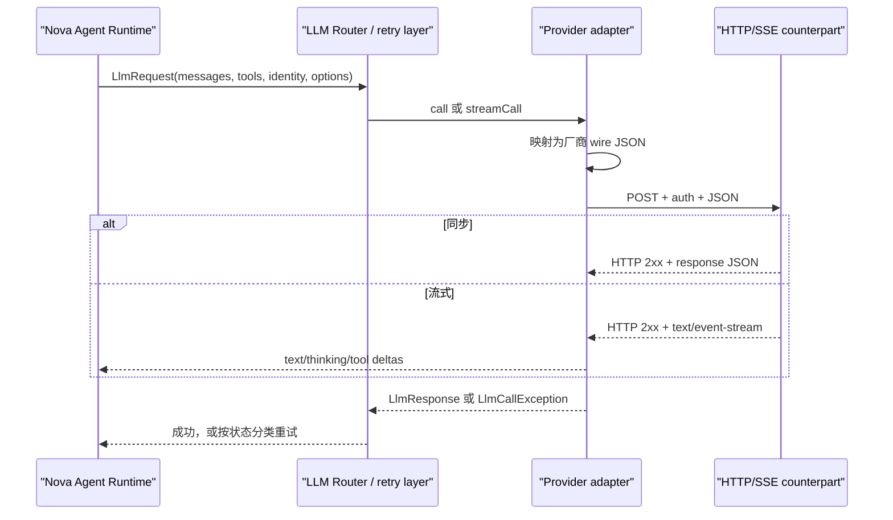
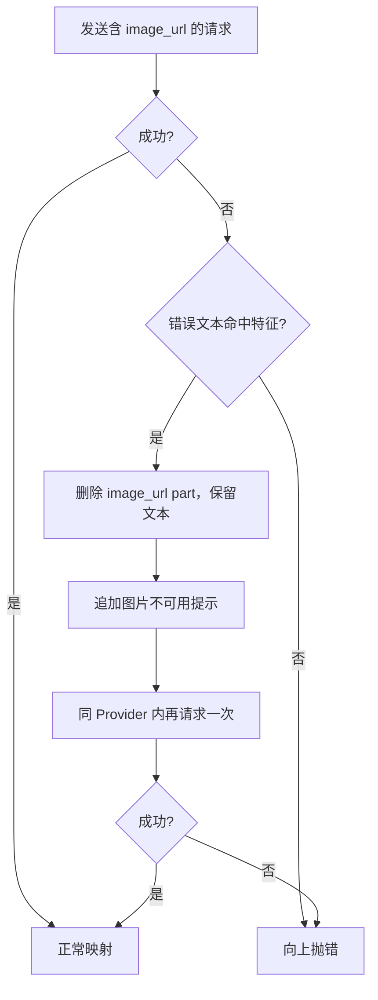
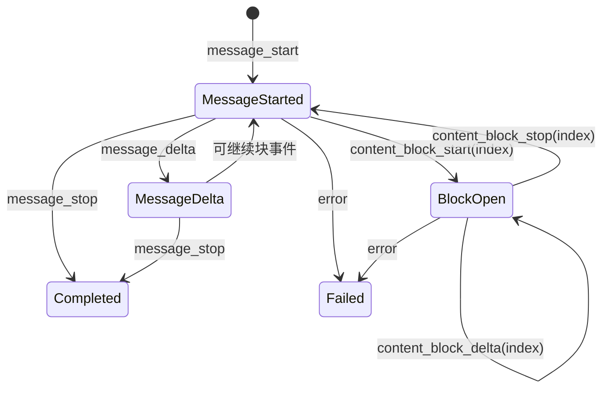
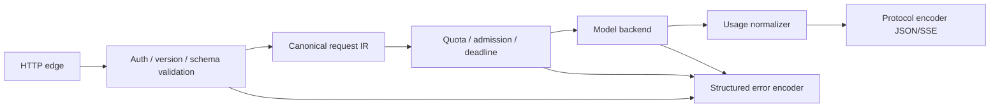

```
# OpenAI-compatible 与 Anthropic Provider 对端契约复刻

> 技术轴 T24。本章从 Nova 客户端实际发出的 HTTP/JSON/SSE 反向定义两类 LLM 对端。读者不需要当前仓库、原会话或官方服务端源码，即可实现：测试 Stub、企业代理网关，或能被 Nova 接入的生产 Provider。

## 0. 证据标记、边界与结论

| 标记 | 含义 |
|---|---|
| **I（Implemented）** | Nova 客户端静态实现与测试资产可确认的当前行为 |
| **A（Assumption）** | 为形成独立实现而显式采用的假设 |
| **K（Known issue）** | 当前缺口、兼容性风险或保证强度限制 |
| **P（Planned）** | 配置或结构体现的演进意图，不能当成现状 |
| **REQ（Requirement）** | 等价复刻必须满足的行为 |
| **F（Fallback）** | 当前或推荐的失败降级路径 |
| **D（Design）** | 推荐的生产级对端设计 |

本章结论来自 Nova 的 Provider、HTTP client、wire DTO、映射器和测试资产的静态分析；没有调用 OpenAI、Anthropic 或第三方兼容服务，也没有运行测试。

**边界声明**：本工程不包含 OpenAI、Anthropic、DeepSeek、Gemini、Doubao、Qwen、MiniMax 等对端源码。因此：

- **I** 表示“Nova 客户端已发送、接受或依赖的契约”，不是官方服务端内部保证；
- 对端排队、计费、模型执行、缓存内部算法、重复请求去重等都只能标为 **A/D**；
- 示例中的模型名、错误正文不是长期稳定的官方承诺；
- “OpenAI-compatible”在本文特指 Nova 当前实现的 `POST /chat/completions` 方言，不等于支持整个 OpenAI API。

### 0.1 一页结论

| 维度 | OpenAI-compatible 对端 | Anthropic 对端 |
|---|---|---|
| endpoint | `{baseUrl}/chat/completions` | `{baseUrl}/v1/messages` |
| 默认 base URL | 无，配置必填 | `https://api.anthropic.com` |
| 鉴权 | Bearer、`x-api-key`、`api-key` 三选一 | 固定 `x-api-key` |
| 版本头 | 无 | 必须接受 `anthropic-version`；可选 `anthropic-beta` |
| system | `messages[].role=system` | 顶层 `system` 字符串或文本块数组 |
| 工具参数 | `function.arguments` JSON 字符串 | `tool_use.input` JSON 对象 |
| 工具结果 | `role=tool` + `tool_call_id` | `role=user` 中的 `tool_result` 块 |
| 图片 | `image_url.url=data:<mime>;base64,...` | `image.source={type:base64,media_type,data}` |
| 推理 | 多种兼容字段、可解析 `<think>` | `thinking` 块 + 必须原样回传的 `signature` |
| SSE | 仅消费 `data:`，以 `[DONE]` 或 finish_reason 收束 | 消费 `event:` + `data:` 类型事件，以 `message_stop` 收束 |
| usage | prompt/completion/total，可含缓存与推理明细 | input/output + cache creation/read |
| 图片拒绝 | 特定错误文本触发一次 text-only retry | 无 Provider 内 text-only retry |
| Provider 能力声明 | streaming=true、tools=true、vision=false、thinking=false | 四项均 true |
| 宽容性 | 为多家兼容网关做了较多纠偏 | 更接近 Anthropic 块协议，未知事件忽略 |

**K**：OpenAI Provider 虽能编码图片，却声明 `vision=false`。上游通常先用视觉代理描述图片；只有仍到达 Provider 的 Image 块才按多模态发送。能力声明与 wire 编码能力不能混为一谈。

## 1. 共同调用边界

### 1.1 参与方



### 1.2 身份、租户与请求关联

- **I**：调用携带 Nova `Identity`，但不会自动变成公共 HTTP header；它主要用于可选 wire capture 的租户归属。
- **I**：OpenAI 可选 `user` 请求字段；Anthropic 可选 `metadata.user_id`。二者都来自显式 vendor option，不会自动发送真实用户 ID。
- **REQ**：企业对端若需要 tenant、trace 或 quota identity，应由受控网关装饰 HTTP client，或扩展明确的 header 契约；不得从 prompt 猜身份。
- **D**：发送不可逆 HMAC/内部 surrogate ID，不发送邮箱、姓名等原始 PII。

### 1.3 共同超时与重试

| 项目 | OpenAI-compatible | Anthropic |
|---|---:|---:|
| connect timeout | 10 秒 | 10 秒 |
| 同步 request timeout | 默认 300 秒，可配置 | 默认 120 秒，可配置 |
| stream timeout | 固定 5 分钟 | 固定 5 分钟 |
| client 内 HTTP retry | 无 | 无 |
| 上层默认 retry | 初次后最多 3 次 | 初次后最多 3 次 |

**I**：上层对 HTTP 408、429、5xx，以及没有 HTTP status 的 `LlmCallException` 重试；其他 4xx 不重试。退避初值约 200ms、倍数 2、上限 10s，并带最高约 25% jitter。

**K**：Provider 异常只把 status 嵌在文本中，若上层 status 提取依赖文本格式，错误信息变化可能影响分类。

**REQ**：对端必须把永久错误表达为 4xx，把瞬时过载表达为 429/5xx；不可用 HTTP 200 包装失败 JSON，否则 Nova 会尝试按成功响应解析并得到协议错误。

**D**：429/503 返回 `Retry-After`；当前 Nova 未显式消费该头，但其他客户端可用。服务端应对取消/断连尽快终止生成。

### 1.4 幂等性真实边界

- **I**：两类请求都没有发送 `Idempotency-Key`，也没有稳定 request ID 字段。
- **I**：重试会完整重发请求；流式失败后上层可重启整次 generation。
- **K**：对端可能重复计费、重复审计或重复执行内置 server tool；Nova 不能证明 exactly-once。
- **REQ**：Nova 暴露给模型的普通工具由 Nova 在模型返回后执行；LLM retry 本身不会让模型端直接重复 Nova 工具副作用。但 provider 自带 server tool 不在此保证内。
- **D**：自建网关可用 `(tenant, canonicalRequestHash, clientAttemptGroup)` 做短窗口合并，但随机采样请求是否可复用必须由产品策略决定。更稳妥的是只去重计费登记，不缓存随机输出。

### 1.5 Provider 实例配置契约

OpenAI-compatible：

| 配置 | 必填 | 默认/约束 | 作用 |
|---|---|---|---|
| `api-key` | 是 | 非空 | 认证值 |
| `base-url` | 是 | 非空 | endpoint root |
| `model` | 是 | 非空 | 每次请求固定 model |
| `temperature` | 否 | 0.7，配置声明范围 0..2 | 请求未覆盖时采用 |
| `wire-api` | 否 | `chat` | `responses` 当前仅被识别，不生效 |
| `proxy` | 否 | 无 | 实例 HTTP proxy；`none` 直连 |
| `parse-inline-think` | 否 | false | 将响应中的 `<think>...</think>` 拆成 thinking/text；流式也做增量拆分 |
| `context-length-tokens` | 否 | 0 | 只报告能力元数据；上游可按 256K fallback |
| `stream-include-usage` | 否 | true | 是否发送 stream_options |
| `auth-style` | 否 | bearer | 三种认证 header |
| `request-timeout-seconds` | 否 | 300，最小 1 | 只控制同步请求；stream 仍固定 5 分钟 |

**K**：构造器附近存在“parse-inline-think 暂未生效”的陈旧说明，但当前同步和流式路径均实际调用拆分逻辑。复刻应以执行路径为准，同时修正文档漂移。

Anthropic：

| 配置 | 必填 | 默认/约束 | 作用 |
|---|---|---|---|
| `api-key` | 是 | 非空 | `x-api-key` |
| `model` | 是 | 非空 | 每次请求固定 model |
| `base-url` | 否 | `https://api.anthropic.com` | endpoint root |
| `timeout-seconds` | 否 | 120，最小 1 | 只控制同步请求 |
| `anthropic-version` | 否 | `2023-06-01` | 每次请求 header |
| `anthropic-beta` | 否 | 不发送 | CSV beta header |
| `default-thinking-budget` | 否 | 无，最小 1 | 默认启用 thinking，单请求可覆盖 |
| `default-cache-control` | 否 | 无 | system/tools/lastUserMessage/lastMessage CSV |
| `context-length-tokens` | 否 | 0 | 能力元数据；上游可按 256K fallback |

**I**：Anthropic factory 默认 vendor option 只填补单请求缺失的顶层 key；例如单请求给出整个 `anthropic.cache_control` 后，不再与 factory 的位置 Map 逐项合并。

## 2. OpenAI-compatible HTTP 对端契约

### 2.1 地址、鉴权和 header

**I**：`baseUrl` 必填，末尾所有 `/` 被剥除，然后固定拼接 `/chat/completions`。例如：

```text
baseUrl = https://gateway.example/v1/
effective endpoint = https://gateway.example/v1/chat/completions
```

请求固定为 `POST`，UTF-8 JSON。header：

```http
Content-Type: application/json
Authorization: Bearer sk-example
```

鉴权可配置为：

| `auth-style` | header |
|---|---|
| `bearer` 或未知值 | `Authorization: Bearer <api-key>` |
| `x-api-key` | `x-api-key: <api-key>` |
| `api-key` | `api-key: <api-key>` |

流式额外发送：

```http
Accept: text/event-stream
```

**I**：代理只在 OpenAI client 有实例级配置；接受 `http://host:port` 或 `https://host:port`，必须显式端口；空值或 `none` 表示直连。主机级 HTTP 工厂还可统一装饰 TLS、代理或网络策略。

**K**：配置表面存在 `wire-api=responses`，当前完全不改变行为；仍调用 `/chat/completions`。这是 **P**，不是 Responses API 支持。

### 2.2 请求顶层 JSON

所有空值省略；client 最终强制写入 `stream:boolean`：

| 字段 | 类型 | 必填/默认 | 语义 |
|---|---|---|---|
| `model` | string | 必填，Provider 实例绑定 | 模型 ID |
| `messages` | array | 必填 | 历史消息 |
| `tools` | array | 可选 | function tools |
| `temperature` | number | 请求覆盖，否则实例默认 0.7 | sampling |
| `max_tokens` | integer | 可选 | 最大输出 token |
| `top_p` | number | 可选 | nucleus sampling |
| `stop` | string[] | 可选 | 停止序列 |
| `seed` | integer | 可选 | 尽力确定性 |
| `response_format` | object | 可选 | JSON mode/schema 等方言 |
| `frequency_penalty` | number | 可选 | 频率惩罚 |
| `presence_penalty` | number | 可选 | 出现惩罚 |
| `user` | string | 可选 | 对端 abuse/routing identity |
| `top_k` | integer | 可选，非标准扩展 | 兼容网关参数 |
| `min_p` | number | 可选，非标准扩展 | 兼容网关参数 |
| `enable_thinking` | boolean | 可选，非标准扩展 | 开启推理 |
| `thinking_budget` | integer | 可选，非标准扩展 | 推理预算 |
| `extra_body` | object | 可选，保持嵌套 | 厂商私有参数 |
| `tool_choice` | 任意 JSON | 可选，原样透传 | `auto`/`none`/指定函数等 |
| `stream` | boolean | client 强制 | 同步 false、流式 true |
| `stream_options.include_usage` | boolean | 流式默认 true | 请求最后 usage chunk |

**K**：`tool_choice` 不做形状校验，对端必须自行验证。`extra_body` 不会摊平到顶层。

最小文本请求：

```json
{
  "model": "model-a",
  "messages": [
    {"role": "system", "content": "You are a concise assistant."},
    {"role": "user", "content": "Summarize this."}
  ],
  "temperature": 0.7,
  "stream": false
}
```

带工具的请求：

```json
{
  "model": "model-a",
  "messages": [{"role":"user","content":"Weather in Hangzhou?"}],
  "tools": [{
    "type": "function",
    "function": {
      "name": "get_weather",
      "description": "Get current weather",
      "parameters": {
        "type": "object",
        "properties": {"city":{"type":"string"}},
        "required": ["city"]
      }
    }
  }],
  "tool_choice": "auto",
  "stream": false
}
```

### 2.3 messages 与 content

消息 wire 形状：

```ts
type Message = {
  role: "system" | "user" | "assistant" | "tool";
  content: string | Array<TextPart | ImagePart>;
  reasoning_content?: string;
  reasoning_details?: unknown;
  tool_calls?: ToolCall[];
  tool_call_id?: string;
};
```

多模态 part：

```json
[
  {"type":"text","text":"Describe the image"},
  {
    "type":"image_url",
    "image_url":{"url":"data:image/png;base64,iVBOR...","detail":"auto"}
  }
]
```

**I**：图片路径是 Nova sandbox 相对路径。适配器读取全部字节并内联成 data URL；sandbox 缺失时在网络调用前失败。未声明 MIME 时按 `image/png`。

**I**：连续 user 消息会合并：纯文本以两个换行连接；任一侧多模态时转成一个 parts 数组。assistant/tool 不合并。

**I**：没有可见文本/图片的 assistant 消息仍发送 `content:""`，以兼容拒绝缺少 content 的网关。

**I**：一个 Nova TOOL 消息中 N 个工具结果会拆为 N 条：

```json
{"role":"tool","tool_call_id":"call_1","content":"25°C"}
```

### 2.4 tool call 契约

Assistant tool call：

```json
{
  "id": "call_1",
  "type": "function",
  "function": {
    "name": "get_weather",
    "arguments": "{\"city\":\"Hangzhou\"}"
  }
}
```

**REQ**：`arguments` 必须是包含 JSON object 的字符串，不是 object。Nova 在接收后解析为 Map；非法 JSON 会成为协议错误。

**I**：Nova 发送历史 tool arguments 与 schema 时递归稳定排序，以提高 prompt cache 前缀稳定性。

**I/F**：同步或流式响应缺少 tool call ID 时，Nova 会生成 `call_<序号>_<nanoTime>`；缺少 name 的 call 被丢弃。自动 ID 不跨重试稳定，因此对端应始终给稳定且唯一的 ID。

**I**：对少数方言，Nova 会纠正 `{}{...}` 拼接或 Python literal 风格参数。对端不应依赖这些纠偏作为正式协议。

### 2.5 同步成功响应

最小可接受响应：

```json
{
  "id": "chatcmpl-001",
  "model": "model-a",
  "choices": [{
    "index": 0,
    "message": {"role":"assistant","content":"Done."},
    "finish_reason": "stop"
  }],
  "usage": {
    "prompt_tokens": 12,
    "completion_tokens": 3,
    "total_tokens": 15,
    "prompt_tokens_details": {"cached_tokens": 4},
    "completion_tokens_details": {"reasoning_tokens": 0}
  },
  "system_fingerprint": "fp_example"
}
```

**I**：未知字段忽略，只消费 `choices[0]`。choices 为空会转为 ERROR 响应；choice 存在但 `finish_reason` 为空会抛协议异常。

finish reason 映射：

| wire | Nova |
|---|---|
| `stop` | END_TURN |
| `tool_calls` | TOOL_USE |
| `length` | MAX_TOKENS |
| `content_filter` | ERROR |
| 其他 | ERROR |

### 2.6 OpenAI-compatible SSE

响应头建议：

```http
HTTP/1.1 200 OK
Content-Type: text/event-stream; charset=utf-8
Cache-Control: no-cache
```

Nova 只解析以 `data:` 开头的单行；忽略 `event:`、注释、空行及其他字段：

```text
data: {"id":"x","model":"model-a","choices":[{"index":0,"delta":{"role":"assistant","content":"Hel"},"finish_reason":null}]}

data: {"id":"x","model":"model-a","choices":[{"index":0,"delta":{"content":"lo"},"finish_reason":"stop"}]}

data: {"id":"x","model":"model-a","choices":[],"usage":{"prompt_tokens":5,"completion_tokens":1,"total_tokens":6}}

data: [DONE]

```

**REQ**：每个 JSON 必须位于一个 `data:` 行；Nova 不拼接多行 SSE data。至少一个 chunk 必须有非空 `finish_reason`。

**I**：`[DONE]` 缺失但已有 finish_reason 时接受并告警；有 `[DONE]` 却从未出现 finish_reason 时失败为 incomplete。

**K（流式内存安全）**：即使 wire capture sink 未启用，两类 client 都把成功 SSE body 包在 `RecordingInputStream` 中并无界复制完整原始字节；随后 `BufferedReader.readLine()` 也没有单行上限。恶意或异常对端可用无限 stream、超长 data 行或巨大 delta 同时撑爆 capture buffer、line buffer 与业务 accumulator，导致 OOM。5 分钟 request timeout 不能替代字节/frame 上限。

**D**：tee 仅在 capture 启用时建立，且使用 ring buffer/总字节硬上限并标记 truncated；SSE parser 用 bounded frame reader，限制总 stream bytes、单行、单 event、delta text、tool arguments、block count 和累计 response。超过上限立即取消 body、关闭 socket并返回 `protocol_limit_exceeded`，不能继续拼接。

Tool 增量：

```text
data: {"choices":[{"index":0,"delta":{"tool_calls":[{"index":0,"id":"call_1","type":"function","function":{"name":"get_weather","arguments":"{\"city\":"}}]},"finish_reason":null}]}

data: {"choices":[{"index":0,"delta":{"tool_calls":[{"index":0,"function":{"arguments":"\"Hangzhou\"}"}}]},"finish_reason":"tool_calls"}]}

data: [DONE]
```

按 `tool_calls[].index` 累积；后续空 id/name 不覆盖首块非空值。`reasoning_content` 按增量追加；`reasoning_details` 被当作累计快照，Nova计算新旧差分后追加。

**I**：Gemini 方言的 `extra_content.google.thought_signature` 会被保存到结果 extras，但当前“下一轮自动回传”并非完整保证，属于 **K/P**。

### 2.7 图片 text-only fallback



命中特征包括：`Unexpected item type in content`、同时含 image/content/invalid、`unknown variant` + `image_url`，或 `image_url` + expected + text。

**I/F**：图片被删除，各文本 part 以双换行拼接，并追加英文提示，要求模型告知用户当前模型不能分析图片。

**K**：predicate 不检查 HTTP status，也不检查流是否已向 listener 发出 delta；只要任意 `LlmCallException.message` 命中文本，包括 500 或 HTTP 200 后的 SSE 协议错误，就可能二次发 text-only。流式已输出部分内容后 fallback 没有在 Provider 内先发 reset，可能把首 attempt partial 与第二 attempt 混在 UI。Provider 内每次外层 attempt 最多两次 HTTP；上层初次+3 retry 的最坏组合为 **4×2=8 次 HTTP 请求**。

**D**：只在“尚未发任何 delta”的 pre-stream 阶段，且结构化 error code=`unsupported_image_content`、明确永久 4xx（推荐 400/422）时降级一次；500、timeout、半流失败不得触发图片降级。若必须重启已可见 stream，先发带 attemptId 的 reset 并清空 listener state。

### 2.8 MiniMax 与兼容方言

- **I**：按模型/base URL 识别 MiniMax 后合并 system，并默认发送 `extra_body.reasoning_split=true`；用户值可覆盖。
- **I**：多家兼容服务可能返回 `reasoning_content`、`reasoning_details`、`top_k`、`min_p` 等扩展。
- **REQ**：自建“OpenAI-compatible”对端至少实现本文最小子集；不支持扩展字段时应忽略未知字段，而不是因 `null` 省略或附加字段直接 400。
- **D**：公开 capabilities endpoint 或静态模型清单，让适配器不要靠错误文本探测能力。

## 3. Anthropic HTTP 对端契约

### 3.1 地址与 header

固定 endpoint：`{baseUrl去尾斜杠}/v1/messages`。默认 base URL 为 `https://api.anthropic.com`。

```http
POST /v1/messages HTTP/1.1
x-api-key: sk-ant-example
anthropic-version: 2023-06-01
Content-Type: application/json
```

流式增加 `Accept: text/event-stream`。若配置 beta：

```http
anthropic-beta: prompt-caching-2024-07-31,another-feature
```

**REQ**：对端必须接受 `anthropic-version`；应按版本选择兼容行为。未知/未启用 beta 应返回清晰 4xx，而不是静默产生另一种 schema。

**K**：Anthropic Provider 没有实例级 proxy 字段，但仍经过 host-wide HTTP factory；环境统一代理可生效。

### 3.2 顶层请求

| 字段 | 类型 | 必填/默认 |
|---|---|---|
| `model` | string | 必填，实例绑定 |
| `messages` | array | 必填 |
| `system` | string 或 text block[] | 可选 |
| `tools` | array | 可选 |
| `max_tokens` | integer | 必填；Nova 未给时 4096 |
| `temperature` | number | 可选 |
| `top_p` | number | 可选 |
| `top_k` | integer | 可选 |
| `stop_sequences` | string[] | 可选 |
| `tool_choice` | object | 可选 |
| `metadata` | object | 可选 |
| `thinking` | object | 可选 |
| `service_tier` | string | 可选 |
| `stream` | boolean | client 强制 |

```json
{
  "model": "claude-example",
  "system": "You are a concise assistant.",
  "messages": [{
    "role": "user",
    "content": [{"type":"text","text":"Summarize this."}]
  }],
  "max_tokens": 4096,
  "stream": false
}
```

**I**：所有 SYSTEM 消息仅提取 Text，并以双换行连接成顶层 system；不作为 messages role。非 system 消息映射后，相邻相同有效角色会合并，因为对端被假定要求 user/assistant 交替。

### 3.3 content block 联合类型

```ts
type ContentBlock =
  | {type:"text", text:string, cache_control?:CacheControl}
  | {type:"image", source:ImageSource, cache_control?:CacheControl}
  | {type:"tool_use", id:string, name:string, input:object, cache_control?:CacheControl}
  | {type:"tool_result", tool_use_id:string, content:string|ContentBlock[], is_error?:boolean, cache_control?:CacheControl}
  | {type:"thinking", thinking:string, signature:string, cache_control?:CacheControl};
```

图片：

```json
{
  "type":"image",
  "source":{
    "type":"base64",
    "media_type":"image/png",
    "data":"iVBOR..."
  }
}
```

**I**：Nova 当前只从 sandbox 读字节并发送 base64；wire DTO 虽能表示 `source.type=url`，映射器不生成 URL source。sandbox 缺失时调用前失败。

Tool 轮次：

```json
{
  "role":"assistant",
  "content":[{
    "type":"tool_use",
    "id":"toolu_1",
    "name":"get_weather",
    "input":{"city":"Hangzhou"}
  }]
}
```

```json
{
  "role":"user",
  "content":[{
    "type":"tool_result",
    "tool_use_id":"toolu_1",
    "content":"25°C",
    "is_error":false
  }]
}
```

`is_error=false` 在 Nova 发送时通常省略，true 才显式发送。

### 3.4 tool_choice、thinking、cache 与 metadata

Tool choice：

```json
{"type":"auto","disable_parallel_tool_use":false}
```

或指定：

```json
{"type":"tool","name":"get_weather","disable_parallel_tool_use":true}
```

允许 type：`auto | any | tool | none`。**I/K**：Nova 只做宽松 Map 读取，不校验 type/name 组合；对端必须返回明确 validation error。

Thinking：

```json
{"type":"enabled","budget_tokens":8000}
```

**REQ**：响应中 thinking block 的 `signature` 是 opaque 值；Nova 会将其放入历史消息并原样回传。对端不得要求客户端解析、重算或修改签名。

**K**：Anthropic 图片 media type 没有 OpenAI 路径的 `image/png` fallback；输入 Image 的 mediaType 为 null 时 JSON 会省略 `media_type`，对端通常会拒绝。调用前应校验/探测 MIME，不能把省略解释为默认 PNG。

Cache control：

```json
{"type":"text","text":"stable prefix","cache_control":{"type":"ephemeral"}}
```

Nova 可在 system、最后一个 tool、最后一个 user message 的最后一块、最后一条 message 的最后一块标记。工具 input/schema 会稳定排序以提升字节级前缀命中。

**A**：缓存 TTL 和是否真正命中由对端决定；Nova 注释认为 ephemeral 常见为 5 分钟，但客户端不能验证内部缓存。

Metadata：

```json
{"user_id":"opaque-user-hash"}
```

Service tier 原样发送，常见值 `auto | standard_only | priority`，客户端不校验。

### 3.5 同步成功响应

```json
{
  "id":"msg_001",
  "model":"claude-example",
  "role":"assistant",
  "content":[
    {"type":"thinking","thinking":"...","signature":"opaque-signature"},
    {"type":"text","text":"Done."}
  ],
  "stop_reason":"end_turn",
  "stop_sequence":null,
  "usage":{
    "input_tokens":100,
    "output_tokens":20,
    "cache_creation_input_tokens":40,
    "cache_read_input_tokens":0
  }
}
```

stop reason：

| wire | Nova |
|---|---|
| `end_turn` | END_TURN |
| `tool_use` | TOOL_USE |
| `max_tokens` | MAX_TOKENS |
| `stop_sequence` | STOP_SEQUENCE，并把实际序列放入 extras |
| `pause_turn` | END_TURN |
| null | END_TURN |
| 其他 | ERROR |

**I**：usage 的 Nova input 总数为 `input + cache_creation + cache_read`，cachedTokens 为 `cache_read`；total 再加 output。

### 3.6 Anthropic SSE 事件状态机



每帧必须提供分开的事件名和单行 data：

```text
event: message_start
data: {"message":{"id":"msg_1","model":"claude-example","role":"assistant","content":[],"stop_reason":null,"usage":{"input_tokens":5,"output_tokens":0}}}

event: content_block_start
data: {"index":0,"content_block":{"type":"text","text":""}}

event: content_block_delta
data: {"index":0,"delta":{"type":"text_delta","text":"Hello"}}

event: content_block_stop
data: {"index":0}

event: message_delta
data: {"delta":{"stop_reason":"end_turn","stop_sequence":null},"usage":{"output_tokens":1}}

event: message_stop
data: {"type":"message_stop"}

```

事件处理：

| event | Nova 行为 |
|---|---|
| `message_start` | 记录 id/model/初始 usage |
| `content_block_start` | 按 index 建 text/tool/thinking accumulator |
| `content_block_delta` | 追加对应 delta |
| `content_block_stop` | tool partial JSON 在此一次解析 |
| `message_delta` | 记录 stop reason、output usage；保留 start 的 input/cache |
| `message_stop` | 终止读取并组装 |
| `ping` | 忽略 |
| `error` | 抛 `LlmCallException` |
| 未知事件 | debug 后忽略 |

Tool 流：

```text
event: content_block_start
data: {"index":1,"content_block":{"type":"tool_use","id":"toolu_1","name":"get_weather","input":{}}}

event: content_block_delta
data: {"index":1,"delta":{"type":"input_json_delta","partial_json":"{\"city\":"}}

event: content_block_delta
data: {"index":1,"delta":{"type":"input_json_delta","partial_json":"\"Hangzhou\"}"}}

event: content_block_stop
data: {"index":1}
```

Thinking 流用 `thinking_delta.thinking`，签名流用 `signature_delta.signature`。二者按同一 index 累积。

**K/F**：某个非 error 事件 JSON 解析失败时，当前 client 记录警告后继续；tool JSON 最终解析失败会用空 Map。这是 fail-soft，可能执行错误工具。生产复刻建议对 tool block fail-closed。

**K**：除显式 `event:error` 外，所有 event parse 异常都 WARN 后继续。`message_stop` 即使此前没有 message_start、没有任何 block/message_delta、没有 stop_reason，也会返回 success；自然 EOF 没有 message_stop 同样会 onComplete 并组装已有或空内容。对端 Stub 测试必须锁定这些当前接受行为，生产适配器应 fail-closed。

#### 3.6.1 当前 acceptance matrix 与推荐规则

| 序列 | CURRENT | 生产 D |
|---|---|---|
| start → block start/delta/stop → message_delta(stop_reason) → message_stop | success | success |
| message_stop only | success，空响应 | protocol error |
| start → text → EOF，无 message_stop | success | incomplete/retryable |
| start → message_stop，无 stop_reason | success，null映射 END_TURN | protocol error |
| malformed non-error event → 后续 stop | WARN并跳过，可能success | fail closed |
| tool partial JSON非法 → block_stop | 空args继续 | fail closed，不执行tool |
| `event:error` | 抛异常 | 抛结构化异常 |
| unknown event type | 忽略 | 可忽略并计数 |

生产规则：必须恰好一个 message_start；block index 生命周期成对且不重复；message_delta 提供合法 stop_reason；恰好一个 message_stop；EOF 前缺任一终止证据为 incomplete。contract tests 应逐行覆盖上表。

**K（unknown兼容边界）**：response JSON 中“已知 record 的未知字段”会忽略；stream 的未知 event type 会忽略；stream `content_block_start` 遇到未知 block type 时可记 OTHER 并丢弃。但同步 response 的 content 使用 sealed subtype discriminator，未知 `type` 可能使整个 response 反序列化失败，不能笼统宣称“所有 unknown block 都向前兼容”。

## 4. 错误、状态与失败传播

### 4.1 HTTP 错误

任意非 2xx 都失败。Nova 保留响应正文前 500 字符：

```json
{
  "error": {
    "type": "invalid_request_error",
    "code": "invalid_tool_schema",
    "message": "tools[0].input_schema is invalid",
    "request_id": "req_123"
  }
}
```

**REQ**：对端错误正文应短、结构化、不含秘密；status 必须准确。建议共同字段：`type/code/message/param/request_id/retryable`。

**I**：Nova 不结构化解析 error JSON，只把 body snippet 放入异常文本。OpenAI 路径还会把请求正文前 500 字符写 WARN；Anthropic 路径非 2xx 只记录响应片段。

**K**：请求日志、完整 wire capture 可能含 prompt、工具结果、图片 base64、用户数据与模型推理。必须视为高敏感数据。

### 4.2 建议 status 表

| status | code 示例 | retry | 含义 |
|---:|---|---|---|
| 400 | invalid_request | 否 | schema/角色/参数非法 |
| 401 | invalid_api_key | 否 | key 不存在 |
| 403 | model_not_allowed | 否 | key 无模型权限 |
| 404 | model_not_found | 否 | 模型或 endpoint 不存在 |
| 408 | request_timeout | 是 | 对端未完成 |
| 409 | request_conflict | 视业务 | 幂等键冲突 |
| 413 | request_too_large | 否 | prompt/图片超限 |
| 422 | unsupported_content | 否 | 图片/工具能力不支持 |
| 429 | rate_limited | 是 | 配额或并发过载 |
| 500 | internal_error | 是 | 未知内部错误 |
| 502/503/504 | upstream_unavailable | 是 | 模型后端不可用 |

**D**：OpenAI 图片不支持应返回稳定 `code=unsupported_image_content`；适配器据 code 降级，而不是匹配自然语言。

### 4.3 SSE error

Anthropic 可在 HTTP 200 后发送：

```text
event: error
data: {"type":"error","error":{"type":"overloaded_error","message":"Overloaded"}}

```

OpenAI client 没有专用 SSE error 事件解析。**REQ**：OpenAI-compatible 对端在 stream 建立前尽量用非 2xx；建立后失败若不能给合法终止 chunk，应直接断流，使 Nova 识别 incomplete 并重试。

## 5. Nova 两类 Adapter 的关键差异

| 主题 | OpenAI adapter | Anthropic adapter | 复刻影响 |
|---|---|---|---|
| 目标生态 | 多厂商兼容协议 | Anthropic Messages | 前者需 quirk registry，后者需版本矩阵 |
| system | role 消息，MiniMax 特例合并 | 顶层字段 | 网关转换不能只改 endpoint |
| role alternation | 仅合并相邻 user | 合并所有相邻有效角色 | 必须保存块顺序 |
| arguments | 字符串，接收时解析/纠偏 | object，流中 partial string | 转换网关需双向序列化 |
| tool result | 独立 tool role | user/tool_result block | tool_call_id ↔ tool_use_id |
| reasoning | flat/nested/inline 多方言 | thinking + signature | Anthropic 签名不可丢 |
| terminal | 必须 finish_reason；DONE 可缺 | message_stop；当前 EOF 较宽松 | Stub 不可共用一个终止器 |
| image reject | 一次 text-only fallback | 直接失败 | UX 与请求次数不同 |
| capabilities | 不声明 vision/thinking | 都声明 true | 路由前置逻辑不同 |
| usage stream | 可选 final empty-choice chunk | start input + delta output | 聚合算法不同 |

**REQ**：若实现统一内部 Provider，不要用一个“通用 Message JSON”直接透传。先规范化为 typed IR，再各自编码；IR 至少保留 role、块顺序、tool identity、thinking signature、usage breakdown 和 raw finish reason。

**K**：OpenAI wire DTO 可接收/表达 `reasoning_details`，但 Nova SPI `Thinking` 历史重新编码时只写 `reasoning_content`；nested reasoning details 不能原形 round-trip。对要求原始 reasoning_details 回传的网关，这会丢私有结构/签名语义。生产 IR 必须把 opaque reasoning payload 与展示文本分开保存。

## 6. 最小可运行 Stub 设计

### 6.1 Stub 目标

最小 Stub 不运行模型，只按请求内容选择脚本响应。它必须：

1. 校验 method、path、auth、content type；
2. 解析并保存原始 JSON；
3. 按 `stream` 返回 JSON 或 SSE；
4. 能脚本化 status、延迟、断流、非法 JSON、工具增量和 usage；
5. 记录 request count，验证 retry/fallback 次数；
6. 绝不把真实 API key 写入测试快照。

### 6.2 伪代码

```java
Response handle(Request http) {
  assertMethod("POST");
  Json body = parseJson(http.body());
  Scenario s = scenarios.match(http.path(), body);
  s.validateHeaders(http.headers());
  s.capture(redact(http));
  if (s.delayMs > 0) waitCancelable(s.delayMs);
  if (s.status != 200) return json(s.status, s.errorBody);
  return body.bool("stream") ? sse(s.frames) : json(200, s.responseBody);
}
```

### 6.3 OpenAI Stub 必备场景

- text sync `stop`；
- tool sync，arguments 为字符串；
- stream text + usage + `[DONE]`；
- stream tool arguments 分片；
- 有 finish_reason 无 DONE；
- 有 DONE 无 finish_reason；
- 429 后成功；
- 400 永久失败；
- 图片请求先返回已知“不支持图片”文本，第二次断言无 image_url 且含提示；
- 空 tool ID、空 tool name、非法 arguments；
- 同步/流式 timeout 与连接中断。

### 6.4 Anthropic Stub 必备场景

- 顶层 system 与 role 交替校验；
- thinking signature 回传；
- tool_use → user/tool_result；
- cache marker 与 cache usage；
- 完整 SSE 状态机；
- tool partial JSON；
- `event:error`；
- 未知 event 被忽略；
- content event malformed 的当前 fail-soft；
- EOF without message_stop；
- 429/500 重试、400 不重试。

## 7. 生产 Provider 设计

### 7.1 分层



**D**：协议 edge 与模型 backend 解耦；OpenAI/Anthropic encoder 共用内部 typed IR，但各自保留 raw vendor extras。

### 7.2 校验与能力

- model 必须存在且调用者可用；
- messages 非空、role/块组合合法；
- token + 图片字节 + tool schema 总量在限额内；
- tool name 唯一，schema 是 JSON object；
- Anthropic `max_tokens > 0`，thinking budget 与 max_tokens/模型限制一致；
- 指定 tool_choice 时 tool 必须存在；
- model 不支持 image/tool/thinking 时返回机器可读 4xx；
- API version/beta 不支持时列出允许值，不回显 key。

### 7.3 流式生产要求

- header 发出后定期 ping，但不改变协议语义；
- 每个 block/tool index 在单流内稳定且不复用；
- delta 按生成顺序发送；同一 tool arguments 片段拼接后必须是一个 JSON object；
- usage 只计一次并明确缓存 token 口径；
- 客户端断开要传播 cancellation；
- deadline 到达时：若尚未发 header 返回 504；若已流式，发送协议 error 或断流；
- 最终事件只发一次。

### 7.4 背压与并发

**D**：每连接使用有界缓冲；慢客户端超过阈值取消模型生成，而不是无限积压。Admission 按 tenant/model 维护并发与 token-rate，429 附 retry hint。模型 backend 的 queue time、first-token time 与 generation time 分开观测。

## 8. 安全与隐私

- API key 仅存 secret manager；日志只保留 key fingerprint。
- base URL 必须允许列表或经 SSRF 校验；禁止访问 link-local、metadata service 和内网未授权地址。
- Proxy 凭据不得拼入可见日志。
- prompt、tool output、image 和 thinking 默认不落普通日志。
- wire capture 必须租户隔离、显式授权、加密、短 TTL、有审计；失败也要执行清理。
- 限制请求 body、单图、总图、SSE frame、error body 大小；当前 client 对流式错误会 drain 全部 body，恶意对端可能造成内存压力，属于 **K**。
- 当前成功 SSE 也被无界 RecordingInputStream 完整复制且 readLine 无上限；capture 开关不能消除该风险。生产必须 bounded tee + bounded frame parser + 累计 delta 上限。
- tool schema/metadata 不可信；不得把它们拼进 SQL、shell 或日志格式串。
- thinking/signature 作为机密对待，不向普通终端用户展示。

## 9. 可观测性

### 9.1 推荐 span 属性

```text
llm.provider_type=openai|anthropic
llm.provider_name=<configured instance>
llm.requested_model=<id>
llm.response_model=<id>
llm.stream=true|false
llm.attempt=1..N
llm.finish_reason=<raw>
llm.input_tokens=<n>
llm.output_tokens=<n>
llm.cached_tokens=<n>
http.status_code=<n>
network.connect_ms=<n>
queue_ms=<n>
first_token_ms=<n>
total_ms=<n>
fallback.image_text_only=true|false
```

禁止属性：API key、完整 prompt、完整 arguments、base64 image、thinking/signature。

### 9.2 指标

- request/attempt/success/error 按 provider、model、status、stream；
- 429、5xx、protocol_error、timeout、cancel；
- first token 与总延迟直方图；
- input/output/cache/reasoning token；
- image fallback 率；
- stream incomplete、Anthropic missing message_stop；
- tool JSON parse failure、自动生成 tool ID、丢弃空 name；
- wire capture 使用量、失败与清理积压。

## 10. Contract test 矩阵

| ID | 场景 | 对端断言 | Nova 可观察结果 |
|---|---|---|---|
| OA-01 | 同步文本 | path/header/model/messages/stream=false | Text + END_TURN |
| OA-02 | 三种 auth | 恰好一个正确 auth header | 2xx |
| OA-03 | 多模态 | data URL MIME/base64 正确 | 成功或显式 4xx |
| OA-04 | 图片降级 | 第二请求无 image_url | 最终文本含不可分析告知 |
| OA-05 | 工具同步 | arguments 是 JSON string | ToolUse Map |
| OA-06 | 工具流式 | index 稳定、分片可拼 | start/args/end 顺序 |
| OA-07 | usage chunk | choices 可空、usage 有值 | usage 聚合 |
| OA-08 | 无 finish_reason | DONE 后结束 | protocol failure |
| OA-09 | 无 DONE | 有 finish_reason 后 EOF | 成功 + 偏差告警 |
| OA-10 | 429→200 | request count=2+ | reset/最终成功 |
| OA-11 | 400 | request count=1 | 不重试 |
| OA-12 | wire-api=responses | 仍命中 chat path | 证明配置 no-op |
| OA-13 | 500正文含 image_url expected text | 不做text-only fallback | 防错误分类 |
| OA-14 | 已发delta后图片样式错误 | 不静默二次/必须reset | 防混流 |
| OA-15 | 4个外层attempt×图片fallback | 上限计数=8 | 请求放大可见 |
| AN-01 | 同步文本 | system 顶层、max_tokens | Text + END_TURN |
| AN-02 | role 合并 | 无连续同 role | 对端接受 |
| AN-03 | tool round | tool_result 在 user block | ToolUse/结果关联 |
| AN-04 | thinking | signature 原样回传 | 下一轮接受 |
| AN-05 | cache | marker 位置与 usage | cachedTokens 正确 |
| AN-06 | SSE text | 完整 event 序列 | delta + complete |
| AN-07 | SSE tool | partial_json 可拼 | ToolUse args 正确 |
| AN-08 | SSE error | HTTP 200 内 error event | onError + 抛异常 |
| AN-09 | 未知 event | 插入 future_event | 被忽略，其余成功 |
| AN-10 | EOF 无 stop | 提前关闭 | 记录当前宽松行为 |
| AN-11 | message_stop only | 当前空success；严格模式失败 | acceptance差异固定 |
| AN-12 | malformed event后stop | 当前WARN继续；严格模式失败 | fail-soft边界 |
| AN-13 | unknown sync block type | 整体parse失败 | sealed subtype边界 |
| AN-14 | image mediaType null | 省略media_type并被对端拒绝 | 调用前校验 |
| BOTH-01 | 408/429/5xx | 先错后成 | 按策略重试 |
| BOTH-02 | timeout | 延迟超过阈值 | typed failure |
| BOTH-03 | unknown JSON fields | 响应增加字段 | 兼容成功 |
| BOTH-04 | cancellation | 流中中断 | 尽快停止，无 terminal 重复 |
| BOTH-05 | capture failure | sink 抛错 | 主调用 fail-soft |
| BOTH-06 | 超长SSE单行/无限成功流 | 触发字节/frame上限 | 无OOM、socket关闭 |

## 11. 验收标准

### 11.1 最小 Stub

- **REQ**：上述 OA/AN 核心用例能脚本化，且能断言精确请求次数与原始 JSON。
- **REQ**：SSE 支持逐帧 flush，不一次性把整串写完伪装流式。
- **REQ**：测试秘密自动脱敏；测试结束无悬挂连接/线程。
- **REQ**：可模拟半流断开、超时、429、事件错误和非法工具 JSON。

### 11.2 生产对端

- **REQ**：100% 满足对应协议的必填字段、角色/块转换与终止规则。
- **REQ**：永久/瞬时错误 status 分类正确，错误有稳定 code/request_id。
- **REQ**：不宣称请求 exactly-once；重试计费与 server tool 副作用有书面语义。
- **REQ**：断连取消、限流、deadline、背压和 body 限制经压测验证。
- **REQ**：token usage 口径有测试，缓存 token 不重复计数。
- **REQ**：Anthropic thinking signature 字节级原样回传；OpenAI tool arguments 能稳定往返。
- **REQ**：日志/trace/metric 不含 key、prompt、base64、tool secret 或 thinking。
- **REQ**：版本升级先跑双协议 contract suite，再灰度。

## 12. 当前实现、风险与推荐改进清单

| 项 | 结论 |
|---|---|
| `/responses` | **P/K**：配置存在但当前未实现 |
| OpenAI vision | **I/K**：wire 可发图，capability=false，上游可能先代理 |
| OpenAI 图片降级 | **I/F/K**：按错误文本一次 text-only retry，建议改机器码 |
| OpenAI terminal | **I**：finish_reason 必须，DONE 可缺 |
| Anthropic terminal | **I/K**：message_stop 正常终止，但 EOF 当前也可能完成 |
| Anthropic tool JSON | **I/F/K**：解析失败变空 Map，生产建议 fail-closed |
| Anthropic terminal | **I/K**：stop-only、无reason、EOF均可能success；生产需严格状态机 |
| unknown兼容 | **I/K**：未知字段/event可忽略；同步未知block type可能整包失败 |
| streaming memory | **K**：成功/错误body capture与readLine无界，可能OOM |
| 幂等 header | **K**：两类均没有 |
| retry | **I**：由上层统一做，不在 HTTP client 内 |
| proxy | **I**：OpenAI 可实例配置；Anthropic 仅 host factory |
| error schema | **K**：只消费 status + 文本片段，未结构化解析 |
| wire capture | **I/K**：诊断 fail-soft，但数据极敏感 |
| context length | **I**：配置只作为能力元数据；0/unset 由上游按 256K 回退，不是对端验证 |

推荐优先级：

1. **D**：引入结构化 ProviderError，保留 status/code/retry-after/request-id。
2. **D**：为 generation 增加稳定 attempt-group 与可选幂等 header 契约。
3. **D**：严格化 Anthropic `message_stop` 和 tool JSON 终止验证。
4. **D**：以 model capability registry 替代图片错误探测和声明不一致。
5. **D**：限制 SSE error drain 与 wire capture 大小，并默认字段级脱敏。
6. **D**：只有真正实现 `/responses` 后才允许 `wire-api=responses` 生效；此前 UI 应标注不可用。

## 13. 版本兼容与升级策略

兼容层必须把“Nova 内部消息模型”“目标 wire 协议版本”和“具体 Provider 方言”分开版本化。新增字段默认宽容读取、保守写出；新增事件可以忽略，但未知终态、未知工具参数语义和未知内容块不得静默变成成功。升级前以固定请求/响应语料同时回放同步、流式、工具、多模态、thinking、usage 和错误样例；升级后先以影子流量比较规范化结果，再按租户或模型实例灰度。回滚只切换 adapter/wire 版本，不修改已经持久化的内部消息历史。

## 14. 复刻实施检查清单

最小实现应依次完成：统一内部消息模型、两类请求映射、严格 SSE 状态机、工具参数增量组装、usage 归一化、结构化错误、deadline/取消、脱敏诊断和可脚本化 Stub。进入生产前还必须证明：断流不会生成伪终态，重试不会重复有副作用的 server tool，图片/思考内容不会落入普通日志，未知协议变体会产生可定位失败，模型或 wire 版本升级可灰度且可回滚。

## 15. 证据追溯附录

关键事实来自以下实现类别，路径仅用于审计，不承担正文理解：

- OpenAI-compatible：Provider factory、HTTP client、wire records、request/response mapper、usage normalizer、reasoning/tool-argument compatibility helpers、streaming tests；
- Anthropic：Provider factory、HTTP client、wire records、content-block mapper、stream listener bridge、token/stream tests；
- 共同机制：NovaCore LLM Provider SPI、Router/Caller retry、wire capture sink、outbound HTTP factory。

**最终边界**：本文足以实现“Nova 能调用的对端”，但不声称复刻任何商业模型本身。模型质量、训练、内容安全策略、计费算法和厂商内部缓存均不在本章可观察证据范围内。

```
