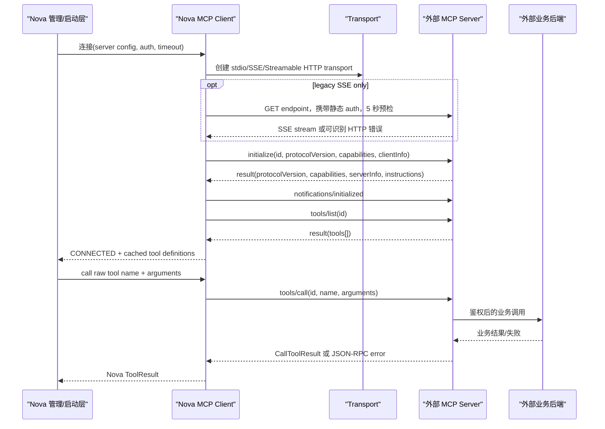
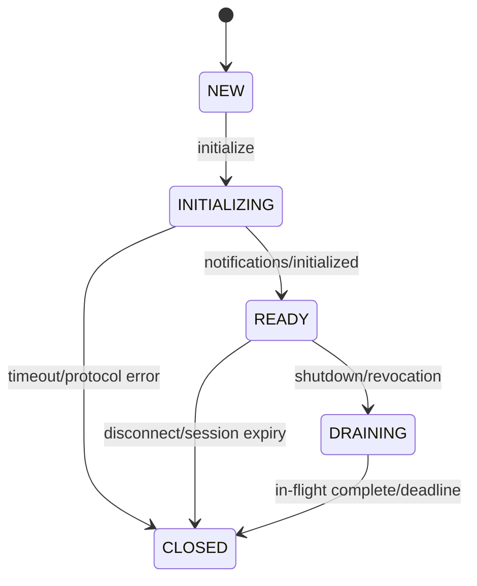
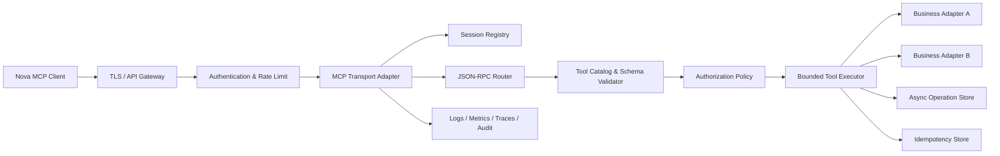

```
# T25：外部 MCP Server 兼容实现与生产参考设计

> 目标：在没有 Nova 源码、没有本会话上下文、也没有既有 MCP Server 源码的前提下，仅依赖本文即可实现一个能被 Nova 连接、发现并调用工具的 MCP Server；进一步可以据此演进为具备身份隔离、会话治理、可观测性和高可用能力的生产服务。
>
> 结论标记：`[I]` Nova 客户端源码静态确认；`[A]` 由静态实现推断、未运行验证；`[K]` 当前缺口或兼容风险；`[P]` 规划/协议可选能力；`[REQ]` 复刻兼容必须遵守；`[F]` 失败语义；`[D]` 本文推荐的对端设计。本文没有启动 Nova、没有连接真实 MCP Server、没有运行测试。

## 1. 边界、目标用户与核心结论

### 1.1 模块解决什么问题

MCP Server 是 Nova 与外部能力之间的协议边界。它把工单、代码仓库、数据平台、浏览器、文件系统或企业内部服务封装为一组具有 JSON Schema 的工具。Nova 完成四件事：

1. 建立 `stdio`、legacy SSE 或 Streamable HTTP 连接；
2. 通过 MCP 初始化握手协商协议版本和能力；
3. 读取 `tools/list`，把远端工具变成 LLM 可见工具；
4. 将 LLM 的工具参数转发到 `tools/call`，把文本结果返回 Agent tool loop。

本文主要面向：

- 需要为 Nova 开发 MCP Server 的后端工程师；
- 需要替换一个无源码第三方 MCP Server 的平台团队；
- 需要设计多租户、鉴权和审计边界的安全团队；
- 需要构造稳定 Stub 和端到端测试环境的测试工程师。

### 1.2 输入、输出与外部依赖

| 项目 | 内容 |
|---|---|
| Nova 配置输入 | server name、transport、transport config、auth type/config、timeout、scope |
| Server 协议输入 | JSON-RPC `initialize`、`tools/list`、`tools/call`，以及 initialized notification |
| Server 协议输出 | initialize result、tool descriptors、call result或 JSON-RPC error |
| 业务输入 | `tools/call.params.arguments` 中的 JSON 对象 |
| 业务输出 | MCP content blocks；Nova 当前只消费 `text` block |
| 身份依赖 | HTTP 静态 Bearer/custom headers，或 stdio 进程环境/本机权限 |
| 业务依赖 | Server 自己调用的数据库、SaaS API、消息系统、文件系统等 |

### 1.3 最重要的兼容结论

- `[I/REQ]` Nova 当前实际支持 `stdio`、`sse`、`streamable_http` 三种 transport；Server 不应自行发明 transport 名称。
- `[I/REQ]` 最小兼容协议面是 `initialize`、接收 `notifications/initialized`、`tools/list`、`tools/call`。request `id` 必须原样回显，不能把字符串 UUID 强转成数字。
- `[I/REQ]` 工具必须提供稳定 raw name 和可转换的 object JSON Schema。Nova 给 LLM 暴露的是经过加工的名称，但调用 Server 时仍发送原始名称。
- `[I/K]` Nova 当前只拼接 `text` content；image、audio、embedded resource 和 resource link 即使协议合法，也会被忽略。核心结果必须有文本表示。
- `[I/K]` Nova 在每个远端 Server 上串行执行全部工具调用。不要以 Nova 当前行为推导 Server 永远不会收到并发；其他 MCP client 仍可能并发。
- `[I/K]` Nova 没有显式订阅/处理 `notifications/tools/list_changed`；已发现工具在连接时缓存，变化要依赖重连重新 `tools/list`。
- `[I/K]` Nova 当前没有把 Agent 取消信号传播为 MCP `notifications/cancelled`，同步调用可能持续到 SDK request timeout。
- `[I/K]` Nova 的 tenant/user/project scope 是客户端可见性规则，不会自动进入 `tools/call` 参数或动态请求头。Server 只能信任连接上收到的凭据，不能假设拿到了 Nova 当前用户。
- `[I]` 配置的 timeout 取值 1～300 秒，默认 30 秒；初始化使用该值，而一般 JSON-RPC request timeout 实际是 `max(timeout, 120秒)`。
- `[D]` 生产 Server 应以“认证主体绑定会话、schema稳定、调用幂等、错误可分类、日志不泄密、断线可回收”为设计基线，而不是只让握手成功。

## 2. 当前兼容面与推荐能力的分界

| 能力 | Nova client observed | 对端最低要求 | 推荐生产设计 |
|---|---|---|---|
| initialize | 主动调用并记录版本/serverInfo/instructions | 必须 | 严格版本协商、能力最小声明 |
| initialized notification | SDK 在初始化后发送 | 必须接受且不响应 | 标记 session READY |
| tools/list | 连接时调用一次 | 必须 | 支持 cursor；同一 session 内保持稳定 |
| tools/call | 同步调用 | 必须 | 参数校验、deadline、幂等键、审计 |
| tools/list_changed | 未见消费回调 | 不可依赖 | 可发送，但同时提供重连/版本策略 |
| progress | 未见消费 | 不可依赖 | 可选；最终结果仍必须完整 |
| cancel notification | Nova 未显式发送 | 不可依赖 | 支持并将其映射到业务取消 |
| roots/resources/prompts | 未见注册或调用 | 不要设为调用前提 | 仅在其他 client 场景按需实现 |
| sampling/elicitation | 未见 server→client handler | 不要使用 | 需要时先做双方能力协商测试 |
| text result | 读取并按换行拼接 | 必须 | 第一块给摘要，后续给证据/引用 |
| non-text result | 当前忽略 | 不能作为唯一结果 | 同时返回 text fallback |
| static HTTP auth | Bearer/custom headers | HTTP Server 应支持 | token轮换、受众、scope、过期校验 |
| per-call user context | 不提供 | 不可假设存在 | 由独立 gateway 做动态签名扩展 |

`[REQ]` Server 的能力声明必须真实。不要声明 `listChanged=true` 后把正确性建立在 Nova 会立即刷新之上，也不要声明 sampling 后在一次工具调用中反向要求 Nova 生成内容。

## 3. 总体交互链路



### 3.1 Nova 的连接状态语义

`[I]` 每台 Server 的连接、断开、重连由独立锁串行化。成功后缓存一个不可变快照：client、server metadata、工具列表、连接状态、握手结果和递增的 connection revision。

`[F]` 初始化、工具列举或 transport 创建任一步失败，都形成该 Server 的 ERROR 快照，client 为空、工具为空；其他 Server 不受影响。

`[I]` test connection 执行同样的 transport、initialize 和 list 流程，随后关闭 client，不写入运行快照。

`[I]` reconnect 会先关闭旧 client，再创建新 client、重新握手并替换快照。因此重连期间不是无缝双连接切换；失败后旧连接不会继续承载调用。

## 4. Nova 侧连接配置契约

### 4.1 通用字段

```json
{
  "name": "ticket_ops",
  "transport": "streamable_http",
  "transportConfig": {"url": "https://mcp.example.com/mcp"},
  "authType": "HEADER",
  "authConfig": {
    "bearerToken": "<secret>",
    "headers": {"X-Client-Id": "nova-prod"}
  },
  "timeoutSeconds": 30
}
```

| 字段 | 类型 | 必填/默认 | 约束与对端意义 |
|---|---|---|---|
| `name` | string | 必填 | 1～64；只允许字母、数字、下划线；参与 LLM 工具名 |
| `transport` | enum | 必填 | `stdio`、`sse`、`streamable_http`；大小写不敏感地接受 enum 名 |
| `transportConfig` | object | 必填 | stdio 要 `command`；HTTP 要 `url` |
| `authType` | enum | 实现侧解析 | 当前 `NONE` 或 `HEADER` |
| `authConfig` | object | HEADER 必填有效 credential | HTTP 请求头来源，不会放进 JSON-RPC params |
| `timeoutSeconds` | integer | 30 | 1～300；initialize timeout；普通 request 至少 120 秒 |

Server 的 scope（SYSTEM/TENANT/PROJECT/PERSONAL）属于 Nova 管理模型，而不是 MCP wire 字段；其身份边界在第 5.2 节完整定义。

### 4.2 stdio 配置

```json
{
  "name": "local_repo",
  "transport": "stdio",
  "transportConfig": {
    "command": "/opt/mcp/bin/repo-server",
    "args": ["--workspace", "/srv/repos/read-only"],
    "env": {"LOG_LEVEL": "info"}
  },
  "authType": "NONE",
  "timeoutSeconds": 30
}
```

`[I/REQ]`：

- `command` 必须非空；`args` 是字符串数组；`env` 是字符串 map。
- Nova 启动子进程，以 stdin/stdout 承载 MCP，以 stderr 收集服务日志。
- stdout 只能输出一行一个 JSON-RPC message；任何 banner、debug、stack trace 都会污染协议。
- stderr 每行会被 Nova 以 WARN 级别记录，格式包含 Server name。高频 INFO 不应全部写 stderr，否则会制造告警噪声。
- HTTP header auth 不适用于 stdio。需要 secret 时可通过环境变量或本机 secret provider 交付。

`[K]` Nova 明确封存的是 MCP auth config；stdio `transportConfig.env` 是否具备同等级 secret-at-rest 保护不能由本文证据保证。因此不要把长期 API key 明文放在可读管理配置中。推荐只传 secret 文件路径、短期 token 引用或工作负载身份 socket。

### 4.3 legacy SSE 配置与 wire 责任

```json
{
  "transport": "sse",
  "transportConfig": {"url": "https://mcp.example.com/sse"},
  "authType": "HEADER",
  "authConfig": {"bearerToken": "<secret>"}
}
```

legacy SSE Server 至少需要：

1. 在配置 URL 上接受带认证头的 `GET`；
2. 返回长期存在的 SSE response；
3. 通过 endpoint event 告诉 client 后续 JSON-RPC POST 地址；
4. 在 message event 中向 client 推送 JSON-RPC response/notification；
5. 将 GET stream、POST channel 和认证主体绑定到同一 session。

Nova当前打包的是官方 MCP Java SDK `io.modelcontextprotocol.sdk:mcp:1.1.1` 与 `mcp-json-jackson2:1.1.1`。其legacy SSE transport固定声明协议 `2024-11-05`，精确transcript如下：

```http
GET /sse HTTP/1.1
Accept: text/event-stream
Cache-Control: no-cache
MCP-Protocol-Version: 2024-11-05
Authorization: Bearer <configured-token>
```

Server先在同一SSE stream发送POST channel；data可为相对URI，SDK相对配置base URL解析：

```text
event: endpoint
data: /messages?sessionId=s-01

```

随后每条Server→client JSON-RPC消息：

```text
event: message
data: {"jsonrpc":"2.0","id":"req-1","result":{"tools":[]}}

```

client→Server消息不是写SSE stream，而是：

```http
POST /messages?sessionId=s-01 HTTP/1.1
Content-Type: application/json
MCP-Protocol-Version: 2024-11-05
Authorization: Bearer <configured-token>

{"jsonrpc":"2.0","id":"req-1","method":"tools/list","params":{}}
```

SDK只把POST status `200/201/202/206` 视为成功；POST body本身不承载对应JSON-RPC response，response应通过原GET SSE stream的`message` event返回。endpoint必须与创建SSE session的principal绑定，拒绝丢失、过期或跨principal session。legacy client graceful close只置closing并dispose GET subscription，不发送标准DELETE；Server靠GET断开/idle TTL回收session。`[I/REQ]`

`[I]` Nova 在创建 SSE SDK transport 前额外发送一次 GET 预检：连接和整次请求 timeout 均为 5 秒，携带相同 auth headers，follow redirect 为 NORMAL。

| 预检结果 | Nova 判定 |
|---|---|
| connect timeout/DNS/TLS/其他异常 | 连接失败 |
| HTTP read timeout | 认为 endpoint 已建立流，预检通过 |
| HTTP 405 | 明确提示 transport 类型错误 |
| HTTP >=400 | 失败，优先提取 body 的 `message/error/detail` 或 `error.message` |
| 非 JSON 错误 body | 最多回显 200 字符后截断 |
| HTTP <400 且 body 完成 | 继续交给正式 SDK 握手 |

`[REQ]` 不要让预检 GET 创建不可回收的重型业务 session。它可能在 5 秒后由 client 结束，随后 SDK 再建立正式 SSE stream。服务端应做到断开即回收、创建幂等、没有业务副作用。

### 4.4 Streamable HTTP 配置与 wire 责任

```json
{
  "transport": "streamable_http",
  "transportConfig": {"url": "https://mcp.example.com/mcp"},
  "authType": "HEADER",
  "authConfig": {
    "headers": {"Authorization": "Bearer <secret>", "X-Client-Id": "nova"}
  }
}
```

`[I]` Nova 对 Streamable HTTP 没有 legacy SSE 的独立预检，直接由 MCP SDK 建立协议。HTTP client 显式禁用系统代理，并应用宿主提供的 outbound request decoration。

`[D]` Server 应遵循所选 MCP 协议版本的 Streamable HTTP 规则：同一 MCP endpoint 接收 POST JSON-RPC；根据请求和协商返回 `application/json` 或 `text/event-stream`；若使用 `Mcp-Session-Id`，后续请求必须验证其与认证主体一致；可支持 GET server message stream 和 DELETE session termination。不要只实现一个普通 REST `/tools/call`，那不是 MCP。

SDK 1.1.1 Streamable HTTP transport默认支持并向上层提供四个版本：`2024-11-05`、`2025-03-26`、`2025-06-18`、`2025-11-25`；transport实现基于2025-03-26模型并包含后续版本header/stream兼容。实际initialize offered version由client生命周期从transport支持集选择，不能仅凭artifact版本猜一个值；必须抓取真实握手并将Server返回版本记录为验收证据。

精确HTTP形态：

```http
POST /mcp HTTP/1.1
Accept: application/json, text/event-stream
Content-Type: application/json
Cache-Control: no-cache
MCP-Protocol-Version: <当前协商版本；初始化前为SDK选择的最新支持值>
Mcp-Session-Id: <仅已建立stateful session后>

{"jsonrpc":"2.0","id":"req-1","method":"tools/list","params":{}}
```

Server可返回单个JSON response：

```http
HTTP/1.1 200 OK
Content-Type: application/json
Mcp-Session-Id: s-01

{"jsonrpc":"2.0","id":"req-1","result":{"tools":[]}}
```

也可返回SSE response，事件类型必须是`message`：

```http
HTTP/1.1 200 OK
Content-Type: text/event-stream
Mcp-Session-Id: s-01

event: message
id: stream-event-1
data: {"jsonrpc":"2.0","id":"req-1","result":{"tools":[]}}

```

notification POST应返回`202 Accepted`或空2xx，不能返回JSON-RPC response；SDK收到notification的application/json body会记录non-compliant warning并忽略。Nova SDK把空content-type、`Content-Length: 0`或status 202视为成功无body。stateful Server可提供：

```http
GET /mcp
Accept: text/event-stream
Cache-Control: no-cache
MCP-Protocol-Version: <negotiated>
Mcp-Session-Id: s-01
Last-Event-ID: <恢复时可选>
```

用于Server主动notification/request；graceful close时client发送：

```http
DELETE /mcp
Cache-Control: no-cache
MCP-Protocol-Version: <negotiated>
Mcp-Session-Id: s-01
```

GET返回405表示Server不支持独立SSE stream，SDK退回request-response模式。携session的GET/POST遇404或400会被SDK解释为session invalid/not found、清除active session并向上层传播；401/403进入authorization error处理。Server必须校验Origin（浏览器/可被浏览器调用的部署）、Host、session与principal绑定；未知/过期session返回协议规定的明确4xx，不能新建一个同ID空session。

`[REQ]` 兼容测试必须使用 Nova 实际 MCP SDK client，而不能只用 curl 验证 POST 返回 200。Accept、content type、session header和 SSE framing 任一错误都可能让 SDK 无法匹配 response。

### 4.5 transport 选择建议

| 场景 | 建议 | 原因 |
|---|---|---|
| 本机工具、单用户、受控二进制 | stdio | 部署简单，无网络暴露 |
| 新建远程服务 | Streamable HTTP | 会话和网络设施更符合当前 MCP 方向 |
| 必须兼容已有 legacy endpoint | SSE | 仅为兼容保留 |
| 多副本、高并发、网关治理 | Streamable HTTP | 易做负载均衡、认证、指标和限流 |

## 5. 认证、secret 与租户身份契约

### 5.1 Nova 当前发送什么

当前只有两种 auth type：

```json
{"authType":"NONE","authConfig":null}
```

```json
{
  "authType":"HEADER",
  "authConfig": {
    "bearerToken": "abc",
    "headers": {
      "X-API-Key": "key-1",
      "X-Region": "cn-east"
    }
  }
}
```

HEADER 转换规则：

1. 非空 `bearerToken` 先生成 `Authorization: Bearer abc`；
2. 再依次加入 custom headers；
3. custom headers 可覆盖前一步的 `Authorization`；
4. 空 header name 被丢弃；管理层会拒绝所有 credential 都为空的 HEADER 配置；
5. transport 层若 auth JSON 已损坏，会记警告并退化为不带 header，而不是强制中止。

`[I/K]` Nova组装custom header使用大小写敏感的Java Map；`Authorization`和`authorization`可同时存在，随后HTTP builder可能发送两个逻辑同名header。`[REQ]` Server必须按HTTP大小写不敏感规则canonicalize，若同一安全header出现多个值或冲突credential立即拒绝，不能选择“第一个/最后一个”。`[D]` Nova管理校验也应先lower-case去重，禁止custom headers覆盖任何形式的Authorization/Cookie/Host/Content-Length/MCP session/version header。

`[K]` 当前没有 OAuth refresh、mTLS 配置、每次调用动态换 token或 per-user token exchange。短 token 在连接生命周期中到期后，Nova 可能只能通过更新配置/重连恢复。

### 5.2 scope 不等于远端身份

Nova 有四种管理可见范围：

| scope | Nova 内可见性 | 是否自动发给 Server |
|---|---|---|
| SYSTEM | 所有调用上下文可候选 | 否 |
| TENANT | 指定 tenant | 否 |
| PROJECT | 指定 tenant + project | 否 |
| PERSONAL | 指定 tenant + user | 否 |

同名 Server 的客户端选择优先级包含更具体 scope 覆盖更宽 scope，例如 PERSONAL 覆盖 TENANT、TENANT 覆盖 SYSTEM；PROJECT 只在匹配项目上下文可见。这个选择只决定 Nova 使用哪条连接。

`[REQ]` Server 不得从工具参数里的 `tenantId/userId/projectId` 建立信任，因为 LLM 或用户可以构造参数；Nova 还会删除所有 `_` 前缀的内部参数再发起 `tools/call`。

### 5.3 推荐身份模型

最小安全设计是“一个 Nova Server definition 对应一个远端 service principal”：

```text
Nova scope/definition
        │ static credential
        ▼
MCP authenticated principal
        │ allowed tool + resource scopes
        ▼
Business backend authorization
```

token claims 推荐包含：

```json
{
  "iss": "identity.example.com",
  "sub": "nova-tenant-acme-mcp",
  "aud": "ticket-mcp",
  "exp": 1786590000,
  "jti": "unique-token-id",
  "tenant": "acme",
  "scopes": ["ticket:read", "ticket:comment"]
}
```

Server 验证顺序：签名算法 allow-list → issuer → audience → expiration/not-before → token revocation/jti → tenant binding → tool scope → resource-level authorization。

如果必须传播“当前 Nova 用户”，需要另建身份网关：Nova 以自身可信身份请求短期 delegated token，网关把 tenant/user/project/action 签名后注入每次调用。`[K]` 这不是当前 Nova MCP adapter 已提供的行为，需要改 client 或在每个 tool argument 中引入签名 envelope；不能只新增一个未签名 `userId` 字段。

### 5.4 secret 生命周期

`[D]`：

- secret 只在创建/更新时接收，读取 API 永远返回掩码；
- 日志、metric label、trace baggage、错误 body 不记录 token/header；
- secret 有 owner、purpose、createdAt、expiresAt、lastUsedAt 和 rotation generation；
- 轮换期间允许 old/new 双 token 短暂并存，随后撤销旧 token；
- 认证失败只返回统一 401/403，内部审计才记录具体原因；
- stdio 子进程使用最小环境变量 allow-list，防止继承宿主全部 secret。

## 6. JSON-RPC 与 MCP 初始化契约

### 6.1 framing 与通用规则

所有消息均为 JSON-RPC 2.0：

```json
{"jsonrpc":"2.0","id":"req-1","method":"tools/list","params":{}}
```

`[REQ]`：

- request 有 `id`，notification 没有 `id`；notification 不返回 response；
- response 必须原样回显 `id` 的 JSON 类型和值；
- response 只能有 `result` 或 `error` 之一；
- stdio 每个完整 JSON message 独占一行，UTF-8，及时 flush；
- HTTP 使用协议规定 content type 和状态语义；业务失败通常仍是成功传输的 JSON-RPC response；
- 未知 method 返回 `-32601 Method not found`，不要静默丢弃 request；
- malformed JSON、invalid request、invalid params 分别使用标准 JSON-RPC code；
- 错误 `data` 不能包含 stack、SQL、token或内部路径。

### 6.2 initialize request

Nova 使用SDK artifact 1.1.1，但具体clientInfo、offered protocol version和capability字段由client lifecycle生成；Server不应硬编码client name。下面是**协议示例，不是已抓取的Nova wire**：

```json
{
  "jsonrpc": "2.0",
  "id": "6de5-1",
  "method": "initialize",
  "params": {
    "protocolVersion": "2024-11-05",
    "capabilities": {},
    "clientInfo": {"name": "mcp-client", "version": "1.x"}
  }
}
```

推荐响应：

```json
{
  "jsonrpc": "2.0",
  "id": "6de5-1",
  "result": {
    "protocolVersion": "2024-11-05",
    "capabilities": {"tools": {}},
    "serverInfo": {"name": "ticket-mcp", "version": "2.4.1"},
    "instructions": "Read and comment on tickets visible to the authenticated principal."
  }
}
```

`[I]` Nova 保存 response 的 `protocolVersion`、序列化后的 `serverInfo`、`instructions`，并把后者作为连接描述展示。它不会替 Server 验证版本兼容性。

### 6.3 版本协商

已观察事实与示例必须分开：

- `[I]` legacy SSE transport只支持/声明`2024-11-05`。
- `[I]` SDK 1.1.1 Streamable transport支持集是`2024-11-05, 2025-03-26, 2025-06-18, 2025-11-25`，其latest排序为`2025-11-25`。
- `[I]` Nova保存Server initialize response中的实际`protocolVersion`。
- `[A]` 没有运行抓包时，不能宣称某次Nova连接实际offered或returned哪一个版本；本文JSON只作示例。

验收记录必须保存：Nova release、MCP artifact坐标、transport、initialize request实际offered version、Server returned version、结果。Server返回不在该transport支持集中的版本，或legacy SSE返回非`2024-11-05`，判为不兼容，不能“接受任意字符串继续”。

`[REQ]` Server 应：

1. 维护明确的 supported protocol version 集合；
2. 对支持的请求版本返回协商版本；
3. 对不兼容版本返回清晰 JSON-RPC error，并在日志记录 offered/supported，不记录 secret；
4. 按协商版本选择字段和 transport 行为；
5. 不以 server application version 代替 protocol version。

`[D]` 在升级 MCP SDK 前，用兼容矩阵同时跑 Nova 当前版本与目标版本。协议版本、server release、tool catalog version 是三套独立版本：

```json
{
  "protocolVersion": "2024-11-05",
  "serverInfo": {"name":"ticket-mcp","version":"2.4.1"},
  "catalogVersion": "tickets-v3"
}
```

catalogVersion 可放在 Server 自己的诊断信息或健康接口，不要增加 Nova 无法识别的握手必填前置条件。

### 6.4 initialized notification

```json
{
  "jsonrpc":"2.0",
  "method":"notifications/initialized"
}
```

`[REQ]` 接收后不返回任何 JSON-RPC response。Server 可以把 session 从 `INITIALIZING` 转成 `READY`；初始化完成前收到 `tools/call` 应返回明确 session-not-ready error。



## 7. 工具发现契约

### 7.1 tools/list

最小请求：

```json
{"jsonrpc":"2.0","id":"6de5-2","method":"tools/list","params":{}}
```

响应：

```json
{
  "jsonrpc":"2.0",
  "id":"6de5-2",
  "result":{
    "tools":[
      {
        "name":"get_ticket",
        "description":"Get one ticket visible to the authenticated principal.",
        "inputSchema":{
          "type":"object",
          "properties":{
            "ticketId":{"type":"string","minLength":1,"description":"Stable ticket identifier"},
            "includeComments":{"type":"boolean","default":false}
          },
          "required":["ticketId"],
          "additionalProperties":false
        }
      }
    ]
  }
}
```

`[I]` Nova 在连接时立即 list，并缓存 raw tool name、description和 schema；如果 schema 对象无法转换为通用 map，会记录 warning 并退化为空 schema。

`[REQ]` schema 设计规则：

- 根类型使用 `object`；`properties`、`required`、`additionalProperties` 明确；
- 字段 description 面向模型，说明语义、单位、格式和限制；
- enum 值稳定且说明大小写；时间用 ISO-8601 并说明时区；
- 不依赖客户端执行 default，Server 自己应用默认值；
- Server 必须再次校验，不相信 LLM 遵守 schema；
- 对大对象使用引用 ID，不把任意二进制或无界 JSON 放进参数；
- schema 改动遵循兼容演进：新增 optional 字段安全，删除/改义/收紧通常是 breaking change。

### 7.2 工具命名

MCP Server 返回 raw name，例如 `get_ticket`。Nova 给 LLM 暴露：

```text
mcp__<sanitized-server-name>__<sanitized-raw-tool-name>
```

只保留 `[A-Za-z0-9_-]`，其他字符替换为 `_`；总长超过 64 时确定性截断并附 Java hash 的 base36 后缀。`tools/call` 仍发送 raw name。

`[REQ]` raw name 应：

- 在一个 Server 内唯一、非空、跨重启稳定；
- 建议用 ASCII snake_case，避免不同名称清洗后碰撞；
- 不把 tenant、随机版本、实例 ID 写入名称；
- 一旦发布不改变语义。breaking change 发布新名字，例如 `search_tickets_v2`。

tool descriptor的 `description` 在 Nova 侧会被加工为：

```text
<raw-name> [MCP:<server-name>] <server description>
```

所以每个工具的descriptor description不必重复Server名，但要写清该工具的副作用、权限、返回值和何时使用；initialize `instructions` 是Server级说明，不会替代每个工具description。

### 7.3 分页与动态工具

MCP `tools/list` 可有 cursor，但 `[A]` 当前 Nova 连接代码只读取一次 `client.listTools().tools()`，未见自行循环或显式 cursor 处理；SDK 是否自动翻页不能据此保证。兼容 Server 应让 Nova 所需工具在首个响应完整出现，或用 Nova 实际 SDK 验证分页。

`[I/K]` 未发现 Nova 注册 tools-change consumer。即使 Server 发：

```json
{"jsonrpc":"2.0","method":"notifications/tools/list_changed"}
```

当前缓存也不能保证刷新。生产兼容策略：

1. 一个 session 内工具集合和 schema 保持稳定；
2. 部署工具变化后触发 Nova 管理侧 reconnect；
3. breaking catalog change 使用灰度 Server definition/name；
4. Server 仍可发送标准 notification，供其他 client 使用，但不作为 Nova 正确性前提。

## 8. 工具调用、结果与错误

### 8.1 tools/call request

```json
{
  "jsonrpc":"2.0",
  "id":"6de5-3",
  "method":"tools/call",
  "params":{
    "name":"get_ticket",
    "arguments":{"ticketId":"T-123","includeComments":false}
  }
}
```

`[I]` Nova 会删除 arguments 中所有 key 以 `_` 开头的项，再发送原始 MCP tool name。删除只发生在顶层 map，不能把 `_conversationId` 等当远端契约。

Server 处理顺序：

```text
validate session READY
→ authenticate principal
→ resolve exact tool version
→ validate JSON Schema + semantic constraints
→ authorize tool action and target resource
→ establish deadline/idempotency/audit context
→ execute business dependency
→ normalize result or error
→ emit metrics/audit
→ respond exactly once
```

### 8.2 成功 result

```json
{
  "jsonrpc":"2.0",
  "id":"6de5-3",
  "result":{
    "content":[
      {"type":"text","text":"Ticket T-123\nstatus: OPEN\nowner: team-a"}
    ],
    "isError":false
  }
}
```

`[I]` Nova 只保留 `TextContent`，多块文本以 `\n` 拼接。空 content 或全是 non-text content 会变成成功的空字符串。

`[REQ]` 所以每次面向 Nova 的成功调用至少返回一块可独立理解的 text。若同时返回图片或资源：

```json
{
  "content":[
    {"type":"text","text":"Chart generated. Summary: revenue rose 8%. Artifact URL: https://..."},
    {"type":"image","mimeType":"image/png","data":"<base64>"}
  ],
  "isError":false
}
```

Nova 当前只看摘要文字；不要把关键数据只放在 image/resource 中。

### 8.3 两类失败必须区分

第一类是“工具已被正确调用，但业务操作失败”，用 `CallToolResult.isError=true`：

```json
{
  "jsonrpc":"2.0",
  "id":"6de5-3",
  "result":{
    "content":[{"type":"text","text":"NOT_FOUND: ticket T-123 is not visible"}],
    "isError":true
  }
}
```

Nova 会变成失败 ToolResult：

```text
Error: MCP tool get_ticket failed: NOT_FOUND: ticket T-123 is not visible
```

第二类是 JSON-RPC/协议失败：

```json
{
  "jsonrpc":"2.0",
  "id":"6de5-3",
  "error":{
    "code":-32602,
    "message":"Invalid params",
    "data":{"violations":[{"field":"ticketId","code":"required"}]}
  }
}
```

Nova SDK 抛异常，adapter 返回：

```text
Error: MCP tool get_ticket call failed: <SDK exception message>
```

使用原则：

| 情况 | 载体 |
|---|---|
| JSON 不合法、method 不存在、params 结构错 | JSON-RPC error |
| `tools/call` method存在但tool name不存在 | `CallToolResult.isError=true`，或实现约定的invalid-params JSON-RPC error；不能用`-32601 Method not found`冒充method不存在 |
| 工具已定位，业务资源不存在/无权/上游失败 | `result.isError=true` + text |
| Server 崩溃、断线 | transport exception，由 client 合成失败 |

`[D]` 文本错误使用稳定前缀：`INVALID_ARGUMENT`、`FORBIDDEN`、`NOT_FOUND`、`CONFLICT`、`RATE_LIMITED`、`UPSTREAM_TIMEOUT`、`INTERNAL`，随后给安全的人类可读说明和 correlation ID。不要返回 stack、SQL、token、内部 hostname。

### 8.4 重试与幂等

Nova adapter 本身未实现tool-call自动重试，也没有注入可信operation id。由LLM生成的`idempotencyKey`只是普通不可信argument：可能遗漏、重复、被prompt injection操纵；`_`前缀runtime参数还会被剥离。当前client因此**不能保证 destructive call安全重放**。默认策略应是`NON_RETRYABLE`；断线且结果未知时标`UNKNOWN`并人工/查询对账，必要时先plan/confirm。`[I/K/REQ]`

只有client新增由可信runtime签发、模型不可修改的operation envelope后，才能采用下面设计：

```json
{
  "name":"create_ticket",
  "arguments":{
    "title":"...",
    "idempotencyKey":"signed-runtime-operation-01J...",
    "requestHash":"sha256:..."
  }
}
```

Server验证operation key签名、audience、principal/tenant、tool、requestHash、issuedAt/expiry，再持久化 `(principal, tool, idempotencyKey) → requestHash, status, result`：

- 首次请求占位为 RUNNING；
- 同 key 同 hash：等待或返回已完成结果；
- 同 key 不同 hash：返回 CONFLICT；
- 结果保存到业务去重窗口结束；
- 未提供 key 的 destructive tool 默认不自动重试。

TTL必须覆盖所有可能重放窗口；同key同hash返回原结果（replay），同key异hash返回CONFLICT，RUNNING超时进入UNKNOWN而不是重新执行。若不能修改Nova client，采用Server生成plan token并要求第二次confirm call；confirm token绑定principal+完整参数hash+expiry+一次性状态。

只读工具可在网络错误时由更上层退避重试，但必须有总 deadline 和 jitter，不能在 MCP Server、业务 SDK、反向代理三层各自无界重试。

## 9. 会话、并发、取消、超时和断线

### 9.1 Nova 当前并发边界

`[I]` Nova 针对同一个 `McpSyncClient` 使用同步锁包住 `callTool`，因此一台 Server 的所有工具调用串行；不同 Server 可并行。这是为规避 stdio 单 pipe 在并发 emit 下不可靠，但当前实现对 HTTP transport 同样串行。

影响：

- 一个 120 秒慢调用会 head-of-line block 后续工具；
- Server 单连接的并发容量不会被 Nova 当前 client 充分利用；
- 横向拆成多台 MCP Server definition 可能增加并行度，但会增加运维和工具选择复杂度；
- Server 仍应正确处理其他 client 的并发，不得使用进程级全局“current request”。

### 9.2 推荐 Server 并发模型

```text
transport reader
  → validate/enqueue by session
    → bounded worker pool
      → per-principal quota
      → per-tool concurrency limit
      → dependency bulkhead
  → response multiplexer keyed by JSON-RPC id
```

每个 request context 至少有：

```text
requestId, sessionId, principalId, tenantId,
toolName, receivedAt, deadline, cancellationToken,
idempotencyKey, correlationId, traceContext
```

不要将这些存进 static/thread global；异步 continuation 可能换线程。

### 9.3 timeout 的真实语义

`[I]` Nova 配置值：

- initialization timeout = `timeoutSeconds`，范围 1～300，默认 30；
- 所有 JSON-RPC round trip request timeout = `max(timeoutSeconds, 120)`；
- legacy SSE preflight = 5 秒；
- Server 自身业务 timeout 不由 Nova 参数自动传入。

`[K]` 设 `timeoutSeconds=10` 不会让 tool call 10 秒终止，它仍可能等待 120 秒。Server 必须有更短且明确的内部 deadline，例如：

```text
Nova request timeout 120s
reverse proxy idle timeout 115s
MCP handler total deadline 105s
business dependency timeout 20s × bounded attempts
response serialization reserve 2s
```

Server 返回 `UPSTREAM_TIMEOUT` 比让 client transport timeout 更可诊断。

### 9.4 取消

MCP 可通过 request-related cancellation notification 表达取消，但 `[I/K]` Nova 的 adapter 没有读取 ToolExecutionContext cancellation，也未显式调用 SDK cancellation；用户停止 Agent 不保证远端任务停止。

`[D]` Server 仍应支持取消：

1. 以原 request id 定位 in-flight task；
2. 原子设置 cancellation token；
3. 尝试取消数据库 statement、HTTP request、子进程；
4. 幂等处理重复/晚到 cancel；
5. 已完成 response 不被改写；
6. 超过取消宽限期强制隔离 worker；
7. 审计区分 client_cancel、deadline、server_shutdown。

因为 Nova 当前可能不发 cancel，Server 还必须靠 deadline、连接关闭监听和 orphan reaper 回收任务。

### 9.5 断线与重连

Server 应把 transport 断线视为 session lease 结束，而不是立刻假设所有业务副作用都未发生：

- 未提交事务回滚；
- 已提交副作用保存 idempotency result；
- 可取消查询主动取消；
- 不可取消外部任务记录 operationId，供后续查询；
- session-owned temp files、subscriptions和 child process 在 TTL 后清理。

`[I]` Nova reconnect 重新 initialize/list，并递增 connection revision。绑定到旧连接的工具实例应失效，新工具绑定替换旧实例。

## 10. 通知、进度与 Server→Client 能力

`[I]` 当前静态证据只确认 initialized notification；没有确认 Nova 消费 logging、progress、resource、prompt、roots、sampling、elicitation 或 tools-change notification。

因此兼容 Server 必须遵守：

- 工具最终 response 自包含，不要求 client 先处理 progress；
- 不把业务结果只发 notification；
- 不在工具执行中同步依赖 client sampling/elicitation；
- 未声明/未协商 capability 时绝不发送依赖该能力的请求；
- notification 失败不改变已完成业务结果；
- notification 速率有上限，避免淹没 transport。

`[D]` 若未来扩展 progress，使用 monotonic progress token，更新可丢、最终结果不可丢；若扩展 logging，日志级别和字段做 allow-list，不发送 secret/PII。

## 11. 最小确定性 stdio Stub

下面的 Python 3 程序无第三方依赖，覆盖Nova最小握手、list、成功、业务错误和JSON-RPC error。它是**连通性smoke Stub**，不是严格MCP conformance Server，也不是生产Server：它固定版本、未强制initialize状态、未实现batch/cancel和完整schema验证。

```python
#!/usr/bin/env python3
import json
import sys

PROTOCOL_VERSION = "2024-11-05"

TOOLS = [
    {
        "name": "echo",
        "description": "Return arguments.text with a deterministic prefix.",
        "inputSchema": {
            "type": "object",
            "properties": {"text": {"type": "string"}},
            "required": ["text"],
            "additionalProperties": False,
        },
    },
    {
        "name": "fail",
        "description": "Return a deterministic MCP tool error for contract tests.",
        "inputSchema": {
            "type": "object",
            "properties": {},
            "additionalProperties": False,
        },
    },
]

def send(message):
    # stdout is protocol-only; logs must go to stderr.
    sys.stdout.write(json.dumps(message, separators=(",", ":")) + "\n")
    sys.stdout.flush()

def ok(request_id, result):
    send({"jsonrpc": "2.0", "id": request_id, "result": result})

def rpc_error(request_id, code, message, data=None):
    error = {"code": code, "message": message}
    if data is not None:
        error["data"] = data
    send({"jsonrpc": "2.0", "id": request_id, "error": error})

def call_tool(request_id, params):
    name = params.get("name")
    arguments = params.get("arguments") or {}
    if name == "echo":
        text = arguments.get("text")
        if not isinstance(text, str):
            rpc_error(request_id, -32602, "Invalid params", {
                "violations": [{"field": "text", "code": "required_string"}]
            })
            return
        ok(request_id, {
            "content": [{"type": "text", "text": "echo:" + text}],
            "isError": False,
        })
    elif name == "fail":
        ok(request_id, {
            "content": [{"type": "text", "text": "TEST_FAILURE: intentional"}],
            "isError": True,
        })
    else:
        ok(request_id, {
            "content": [{"type": "text", "text": "NOT_FOUND: tool " + str(name)}],
            "isError": True,
        })

def handle(message):
    method = message.get("method")
    request_id = message.get("id")

    if method == "notifications/initialized":
        return  # notification: never respond
    if method == "initialize":
        ok(request_id, {
            "protocolVersion": PROTOCOL_VERSION,
            "capabilities": {"tools": {}},
            "serverInfo": {"name": "deterministic-stub", "version": "1.0.0"},
            "instructions": "Deterministic contract-test server.",
        })
    elif method == "tools/list":
        ok(request_id, {"tools": TOOLS})
    elif method == "tools/call":
        call_tool(request_id, message.get("params") or {})
    elif method == "ping":
        ok(request_id, {})
    elif request_id is not None:
        rpc_error(request_id, -32601, "Method not found")

for line in sys.stdin:
    try:
        if line.strip():
            handle(json.loads(line))
    except json.JSONDecodeError as exc:
        rpc_error(None, -32700, "Parse error", {"offset": exc.pos})
    except Exception as exc:
        print("stub internal error: " + str(exc), file=sys.stderr, flush=True)
        rpc_error(None, -32603, "Internal error")
```

配置：

```json
{
  "name":"deterministic_stub",
  "transport":"stdio",
  "transportConfig":{
    "command":"python3",
    "args":["/absolute/path/deterministic_mcp.py"]
  },
  "authType":"NONE",
  "timeoutSeconds":10
}
```

`[REQ]` Stub 的 protocol version 必须与实际 Nova SDK 可协商版本一致。若 Nova 升级后握手拒绝，先更新协商逻辑，不要通过忽略 initialize 参数伪造成功。

严格contract Stub必须在此smoke版本之上加入：`NEW→INITIALIZING→READY→CLOSED`状态；只接受支持版本并回显协商版本；initialize前tools/list/call返回not-initialized；重复initialize拒绝；notification不响应；request id保持JSON类型；未知method才返回`-32601`；已知tools/call的未知tool返回`isError=true`；malformed JSON=`-32700`、invalid params=`-32602`；stdout零非协议字节。负向测试逐项抓取并断言，不能因为client最终timeout就算“通过”。

### 11.1 HTTP Stub 的等价要求

HTTP Stub 不应手写半套 framing；优先使用与目标协议版本匹配的官方/成熟 MCP Server SDK。无论语言，测试模式需提供：

```text
GET /health/live  -> process alive
GET /health/ready -> dependencies ready
POST/GET/DELETE /mcp -> MCP Streamable HTTP
optional GET /sse + POST session endpoint -> legacy SSE
```

并以固定 seed、固定时钟、内存 idempotency store 和 fault headers 实现确定性故障：

```text
X-Test-Fault: delay-130s
X-Test-Fault: close-after-request
X-Test-Fault: invalid-json
X-Test-Fault: duplicate-response
X-Test-Fault: auth-401
```

这些 fault header 只能在测试构建中存在，生产构建必须编译移除或强认证隔离。

下面是SDK 1.1.1 request-response模式的最小Streamable HTTP Stub骨架；它以GET 405明确关闭独立SSE stream，POST返回JSON或202，DELETE关闭session。为保持篇幅，`TOOLS`和`call_tool_result`复用上一节定义：

```python
from http.server import BaseHTTPRequestHandler, ThreadingHTTPServer
import json, secrets

SUPPORTED = {"2025-11-25", "2025-06-18", "2025-03-26"}
SESSIONS = {}  # session -> {ready, protocol}; contract-test only

class StreamableHandler(BaseHTTPRequestHandler):
    def send_json(self, status, obj, session=None):
        body = json.dumps(obj, separators=(",", ":")).encode()
        self.send_response(status)
        self.send_header("Content-Type", "application/json")
        self.send_header("Content-Length", str(len(body)))
        if session: self.send_header("Mcp-Session-Id", session)
        self.end_headers(); self.wfile.write(body)

    def error(self, rid, code, message, status=200):
        self.send_json(status, {"jsonrpc":"2.0","id":rid,
                                "error":{"code":code,"message":message}})

    def do_GET(self):
        # Request-response-only Server: SDK accepts 405 and does not keep a GET stream.
        self.send_response(405); self.send_header("Allow", "POST, DELETE"); self.end_headers()

    def do_DELETE(self):
        sid = self.headers.get("Mcp-Session-Id")
        if not sid or sid not in SESSIONS:
            self.send_response(404); self.end_headers(); return
        del SESSIONS[sid]
        self.send_response(204); self.end_headers()

    def do_POST(self):
        if "application/json" not in self.headers.get("Content-Type", ""):
            return self.error(None, -32600, "Content-Type must be application/json", 415)
        n = int(self.headers.get("Content-Length", "0"))
        try: msg = json.loads(self.rfile.read(n))
        except Exception: return self.error(None, -32700, "Parse error")
        rid, method = msg.get("id"), msg.get("method")
        requested = self.headers.get("MCP-Protocol-Version")

        if method == "initialize":
            offered = msg.get("params", {}).get("protocolVersion")
            negotiated = offered if offered in SUPPORTED else requested
            if negotiated not in SUPPORTED:
                return self.error(rid, -32602, "Unsupported protocol version")
            sid = secrets.token_urlsafe(24)
            SESSIONS[sid] = {"ready":False, "protocol":negotiated}
            return self.send_json(200, {"jsonrpc":"2.0","id":rid,"result":{
              "protocolVersion":negotiated,"capabilities":{"tools":{}},
              "serverInfo":{"name":"strict-http-stub","version":"1.0.0"}}}, sid)

        sid = self.headers.get("Mcp-Session-Id")
        state = SESSIONS.get(sid)
        if not state: self.send_response(404); self.end_headers(); return
        if requested != state["protocol"]:
            return self.error(rid, -32602, "Protocol version mismatch", 400)
        if method == "notifications/initialized":
            state["ready"] = True
            self.send_response(202); self.end_headers(); return
        if not state["ready"]:
            return self.error(rid, -32002, "Session not initialized")
        if method == "tools/list":
            return self.send_json(200, {"jsonrpc":"2.0","id":rid,
                                        "result":{"tools":TOOLS}})
        if method == "tools/call":
            return self.send_json(200, {"jsonrpc":"2.0","id":rid,
                                        "result":call_tool_result(msg.get("params",{}))})
        return self.error(rid, -32601, "Method not found")

ThreadingHTTPServer(("127.0.0.1", 18082), StreamableHandler).serve_forever()
```

这段Stub仍需在测试夹具中补`TOOLS/call_tool_result`、body/header上限、Origin和认证；它的价值是固定SDK可观察HTTP状态，而不是替代官方Server SDK。运行互操作测试时保存脱敏的raw request/response transcript；本文上述transcript来自SDK 1.1.1实现静态确认，并非一次已执行抓包，必须保留这一证据等级差异。

## 12. 生产 MCP Server 参考架构



### 12.1 组件职责

| 组件 | 单一职责 | 禁止事项 |
|---|---|---|
| Gateway | TLS、body/header limit、粗限流 | 解析业务 arguments |
| Auth | credential→principal、scope | 信任未签名 tool 参数身份 |
| Transport adapter | framing、session、response multiplex | 承载业务逻辑 |
| JSON-RPC router | method dispatch、标准 error | 吞掉 unknown request |
| Tool catalog | descriptor、schema、版本 | 每次 list 随机顺序/随机变化 |
| Schema validator | 结构和基础约束 | 替代资源权限校验 |
| Authorization | action/resource policy | 只看 tool name 不看目标资源 |
| Executor | deadline、cancel、bulkhead、result | 无界线程/队列/重试 |
| Business adapter | 对下游协议封装 | 把下游 raw error 直接回 client |
| Idempotency store | 去重副作用 | 永久保存无界结果 |
| Audit | 谁何时对什么做什么 | 保存完整 secret/敏感 payload |

### 12.2 横向扩展

Streamable HTTP session 若包含进程内状态，需要 sticky routing 或共享 session registry。推荐尽量无状态：认证主体来自 token，tool catalog 由版本配置加载，in-flight operation 放共享 store；session ID 只作为防混线和清理 lease。

部署滚动升级：

1. 新副本 ready 后接新 session；
2. 老副本标 DRAINING，不接新 initialize；
3. 允许 in-flight 到 deadline；
4. 关闭 SSE/GET stream并发出可重连信号；
5. 清理 session lease；
6. Nova reconnect 后重新 list。

stdio Server 通常“一连接一子进程”，不做服务内部横向扩展；它通过调用远端业务后端扩展。必须限制子进程 CPU、内存、文件句柄、工作目录和网络出口。

## 13. 日志、健康、指标与审计

### 13.1 结构化日志

推荐字段：

```json
{
  "timestamp":"2026-08-13T10:00:00Z",
  "level":"INFO",
  "event":"mcp.tool.completed",
  "serverVersion":"2.4.1",
  "protocolVersion":"2024-11-05",
  "sessionHash":"sha256:...",
  "requestId":"6de5-3",
  "correlationId":"01J...",
  "principalHash":"sha256:...",
  "tenantHash":"sha256:...",
  "tool":"get_ticket",
  "outcome":"success",
  "durationMs":34
}
```

`[REQ]` stdio 日志只写 stderr。生产默认不记录 arguments/result；若为诊断采样，必须按 tool 定义 redaction schema、长度限制和访问审计。

`[I/K]` 当前Nova adapter在DEBUG记录完整`cleanParams`，MCP返回`isError=true`时WARN记录提取后的error text，并把error text或异常message写入ToolResult返回LLM/UI。参数、下游body、路径、token或PII因此可能沿“Nova log + conversation/tool timeline”双通道泄漏。Server错误必须默认安全；Nova生产禁用该DEBUG，并在adapter按tool schema redact参数、按长度截断/分类error，完整cause只进受控诊断存储。

### 13.2 健康语义

| probe | 成功条件 | 不应包含 |
|---|---|---|
| live | event loop/进程还能响应 | 每个业务下游都成功 |
| ready | 能接 initialize/list/call，关键配置和 catalog 已加载 | 高延迟深查询 |
| dependency | 指定下游状态，供诊断 | secret、连接串 |

stdio 没有独立 HTTP health 时，用 initialize+tools/list 作为 readiness contract；不要额外把诊断文字写 stdout。

### 13.3 指标

最低指标：

```text
mcp_sessions_active{transport}
mcp_initialize_total{outcome,protocol_version}
mcp_requests_total{method,outcome,error_category}
mcp_request_duration_seconds{method,tool,outcome}
mcp_inflight_requests{tool}
mcp_queue_depth{tool}
mcp_auth_total{outcome,reason_class}
mcp_dependency_requests_total{dependency,outcome}
mcp_dependency_duration_seconds{dependency,operation}
mcp_cancellations_total{source}
mcp_orphan_operations_total{tool}
mcp_catalog_version_info{version}
```

tenant、user、requestId、raw error 不能做 metric label，防止高基数和隐私泄漏。

### 13.4 审计

有副作用工具记录：principal、tenant、tool、resource type + safe ID hash、decision、idempotency key hash、before/after version、outcome、correlation ID、时间。审计 append-only，业务管理员不可覆盖；读取审计本身也审计。

## 14. 安全威胁与控制

| 威胁 | 控制 |
|---|---|
| prompt injection 诱导调用危险 tool | Server 独立授权、危险操作确认/审批、最小 scope |
| 参数越权指定其他 tenant/user | 忽略不可信身份参数，以 authenticated principal 为准 |
| SSRF | URL 参数 host allow-list、DNS/IP 复核、禁止 metadata/private ranges |
| 路径穿越 | 固定根目录、canonical path containment、禁止 symlink escape |
| 命令注入 | 不经 shell 拼接；固定 executable 和参数数组 |
| schema bomb/大 payload | body、深度、数组、字符串和执行结果上限 |
| result 泄密 | 字段级授权、redaction、text fallback 同样审查 |
| session fixation | server-generated random ID，绑定 credential/TLS context，过期轮换 |
| replay | token expiry/jti、idempotency semantics、可选 nonce |
| tool confused deputy | 每个调用校验 action + target resource，不仅认证一次 |
| supply-chain | SDK锁版本、SBOM、签名镜像/二进制、漏洞扫描 |

`[D]` destructive tool 最好拆成 plan/execute 两步：plan 返回预览和短期签名 confirmation token；execute 验证 token 与 principal、参数 hash、expiry 完全匹配。

## 15. Contract Test 设计

### 15.1 transport matrix

| ID | 场景 | 预期 |
|---|---|---|
| TR-01 | stdio 正常握手/list/call | CONNECTED，echo 文本正确 |
| TR-02 | stdio stdout 先输出 banner | 握手失败，可诊断为 framing/parse |
| TR-03 | stdio request id 字符串被改成数字 | client 无法匹配，超时 |
| TR-04 | stdio stderr 输出诊断 | 协议不受污染，Nova 日志可见 |
| TR-05 | SSE GET 长连接 | 预检 read-timeout 被判可达，正式握手成功 |
| TR-06 | SSE GET 405 | 明确 transport 类型错误 |
| TR-07 | SSE 401 JSON body | 错误正文安全可见，连接失败 |
| TR-08 | Streamable HTTP JSON response | initialize/list/call 成功 |
| TR-09 | Streamable HTTP SSE response | response id 正确路由 |
| TR-10 | session ID 被另一 credential 重用 | Server 拒绝，不串租户 |

### 15.2 protocol matrix

| ID | 输入 | 预期 |
|---|---|---|
| PR-01 | initialize supported version | 返回协商版本和真实 capabilities |
| PR-02 | unsupported version | 明确 JSON-RPC error，不进入 READY |
| PR-03 | initialized notification | 无 response，session READY |
| PR-04 | tools/list before initialized | 按协议策略返回错误或安全处理，不能崩溃 |
| PR-05 | unknown method with id | `-32601` 且 id 原样回显 |
| PR-06 | malformed JSON | parse error，连接仍按策略可控 |
| PR-07 | notification with no id | 绝不生成 response |
| PR-08 | duplicate request id | 拒绝或精确定义，不错配 response |

### 15.3 tool matrix

| ID | 场景 | 预期 Nova 可观察结果 |
|---|---|---|
| TL-01 | object schema + required | LLM 工具定义包含 schema |
| TL-02 | 两个 text blocks | Nova 输出以换行拼接 |
| TL-03 | only image block | 当前 Nova 成功但输出空；标为不兼容用法 |
| TL-04 | `isError=true` + text | failed ToolResult，含稳定原因 |
| TL-05 | JSON-RPC invalid params | failed ToolResult，协议异常可定位 |
| TL-06 | argument 含 `_conversationId` | Server 不收到该顶层字段 |
| TL-07 | raw tool name 有特殊字符/超长 | 外部名确定性；call 仍用 raw name |
| TL-08 | catalog 热变化 + notification | 当前 Nova 不保证刷新；重连后刷新 |
| TL-09 | 两次同 Server 慢调用 | Nova 串行，第二个等待 |
| TL-10 | 不同 Server 调用 | 可并行且互不故障扩散 |

### 15.4 auth、恢复和非正常路径

| ID | 场景 | 预期 |
|---|---|---|
| AR-01 | Bearer 正确 | principal绑定 session |
| AR-02 | custom Authorization 覆盖 bearer | 以最终 header鉴权，配置审计提示歧义 |
| AR-03 | token 到期 | 401/断线，不回显 token；轮换重连恢复 |
| AR-04 | tenant A session 调 tenant B resource | 403且无存在性泄漏 |
| AR-05 | client断线时副作用已提交 | 以 idempotency key 可查询原结果 |
| AR-06 | 业务下游超时 | Server 先返回 `UPSTREAM_TIMEOUT`，不等 transport 超时 |
| AR-07 | Agent 用户点击停止 | 当前 Nova 不保证远端取消；Server deadline最终回收 |
| AR-08 | reconnect list 失败 | 新状态 ERROR，旧 client 不继续使用 |
| AR-09 | 一台 Server 崩溃 | 其他 Server保持 CONNECTED |
| AR-10 | 日志/错误扫描 | 无 token、secret、完整敏感 arguments/result |

## 16. 分层验收标准

### 16.1 最小兼容验收

全部满足才可称“Nova 可连接”：

1. 三种 transport 中至少目标 transport 用 Nova 实际 SDK 完成握手；
2. request id 原样回显，initialized notification 不响应；
3. `tools/list` 至少一个稳定工具，schema 可转换；
4. `tools/call` 成功结果含 text；
5. `isError=true` 与 JSON-RPC error 均不会让 Server 进程崩溃；
6. stdio stdout 零日志污染，HTTP auth header 正确处理；
7. 断开后无长期遗留 session/process/file。

### 16.2 业务等价验收

每个业务工具必须额外证明：

- 对同一 authenticated principal，同样输入产生等价结果/副作用；
- 对无权主体不可读取、推断或修改资源；
- 默认值、时间、分页、排序、空结果和大结果语义明确；
- 重试和断线不会重复副作用；
- 业务错误是稳定可判别文本，而不是任意 stack；
- 所有关键动作有 correlation ID 和审计记录。

### 16.3 生产就绪验收

- 峰值连接数、request rate、慢调用下无无界队列；
- p95/p99 延迟、错误率和 saturation 有 SLO/告警；
- token 轮换不中断或有明确重连窗口；
- 单依赖故障由 bulkhead 隔离；
- 滚动升级能 drain session；
- catalog breaking change 有版本/灰度/回滚；
- 安全测试覆盖 SSRF、路径穿越、命令注入、越权、重放和日志泄密；
- orphan reaper 能回收 Nova 未传播取消的任务。

## 17. 当前实现、推断与推荐设计清单

### 17.1 已静态确认 `[I]`

- transport 为 stdio、SSE、Streamable HTTP；HTTP 使用 MCP Java SDK transport。
- SSE 有携 auth 的 5 秒 GET 预检；Streamable HTTP 无该预检。
- auth 只有 NONE/HEADER；Bearer + custom headers，custom 可覆盖 Authorization。
- initialize 后 list tools；protocolVersion/serverInfo/instructions被记录。
- 初始化 timeout 使用配置值，普通 request 至少 120 秒。
- tool call 按 Server client 串行，删除顶层 `_` 参数。
- 只拼接 text content；MCP error和异常转失败 ToolResult。
- tools 在连接时缓存；重连关闭旧 client并建立新快照。
- scope 不编码进 MCP wire；一台 Server 失败不影响其他 Server。

### 17.2 静态推断 `[A]`

- SDK 负责 initialized notification和具体 transport framing；不同 SDK 版本的 wire 细节需互操作测试。
- tools/list pagination 是否由 SDK 自动处理不能由调用点证明。
- legacy SSE 预检可能创建一个随后被关闭的额外 stream/session。
- Nova 用户停止后，外层任务会取消，但同步 MCP call 可能继续直到返回/timeout。

### 17.3 当前缺口 `[K]`

- 未发现动态 tools/list_changed 刷新链路。
- 未发现 MCP cancel notification 传播。
- 未消费 non-text content。
- 没有动态 per-user/tenant signed identity 注入。
- 静态 header token 缺少协议内 refresh。
- 每 Server 串行调用带来 head-of-line blocking。
- 配置 timeout 小于 120 秒时不约束 tool call 到同样数值。

### 17.4 推荐设计 `[D]`

- 新远程 Server 优先 Streamable HTTP，stdio用于本机受控工具，SSE仅兼容遗留。
- 主体绑定 session，工具参数身份永不作为信任根。
- schema和 catalog在 session内稳定，变更通过版本和重连生效。
- 所有核心结果提供 text fallback。
- destructive tool使用幂等键或 plan/confirm/execute。
- deadline、cancel、disconnect reaper三条回收路径同时具备。
- 结构化日志、低基数指标、append-only audit和 secret redaction成为发布门禁。

## 18. 证据追溯附录

本文关键结论来自以下静态证据类型，复刻者不需要读取它们即可实现本文契约：

- transport enum和 transport factory：确认三种 transport、stdio command/args/env、HTTP URL、auth header和 SSE 预检；
- MCP manager handshake：确认 initialize、tools/list、timeout、缓存、重连和故障快照；
- MCP tool adapter：确认名称映射、原始工具名、顶层内部参数剥离、串行调用、文本抽取和错误翻译；
- management service：确认 Server name、auth config、timeout和 scope校验；
- 测试用 Fake Server：确认 Nova SDK 使用字符串 request id、initialized notification和最小 wire shape；
- 单元/连接测试：确认 stdio握手、cache、scope隔离、reconnect、错误转换和文本拼接。

`[REQ]` 如果未来 Nova 升级 MCP SDK、增加 notification handler、取消传播或 non-text bridge，应先更新“client observed”矩阵和 contract tests，再调整对端设计；不能仅依据 MCP 规范声称 Nova 已经支持某项可选能力。

```
