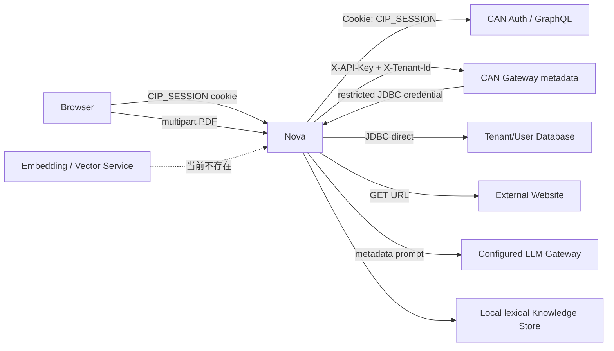
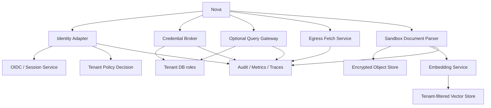

```
# T27：外部身份、数据源与内容服务对端复刻设计

> 目标：在没有 Nova 源码、没有 CAN/Anymetrics、数据库或内容服务源码的情况下，仅依赖本文即可实现与 Nova 当前调用行为兼容的最小对端，并能进一步建设生产级身份服务、受限数据源凭据服务和内容解析/向量服务。
>
> 标记：`[I]` 当前 Nova 源码静态确认；`[A]` 静态推断、未运行验证；`[K]` 当前风险或能力缺口；`[P]` 规划/历史设计而非当前保证；`[REQ]` 兼容复刻必须保持；`[F]` 失败语义；`[D]` 推荐生产设计。本文没有启动 Nova、没有访问外部系统、没有运行测试。

## 1. 边界与核心结论

本章覆盖三组容易被误认为“一个外部平台”的能力：

1. **身份对端**：CAN/Anymetrics 根据 `CIP_SESSION` 返回当前 user/tenant/env，并通过 GraphQL列租户、切租户。
2. **数据源对端**：用户数据源是 Nova 直接 JDBC 连接；系统指标数据源先从 CAN Gateway 取得受限 JDBC credential，再由 Nova 建池。不存在通用的“DataSource REST 执行服务”。
3. **内容对端**：`web_fetch` 在 Nova 插件内直接请求目标 URL并本地解析 HTML；PDF 在 Nova 本地用 PDFBox解析、再调用统一 LLM补元数据；知识检索是数据库/词法匹配。当前没有独立 embedding/vector content service。

### 1.1 现状与推荐设计总表

| 能力 | 当前对端 | Nova client observed | 不存在/缺失 | 推荐生产形态 |
|---|---|---|---|---|
| session认证 | CAN HTTP | cookie→user/tenant | OIDC token introspection/JWKS | 标准 OIDC/BFF或兼容 adapter |
| user env | CAN HTTP | 原样 data + Nova装饰字段 | versioned env schema | typed identity/context API |
| tenant list/switch | CAN GraphQL | session内可变 current tenant | switch transaction/version | session generation +确认 API |
| tenant admin | env resource array | TENANT+resourceId+canEdit | 独立 policy decision API | signed claims或PDP |
| 用户数据库 | 实际 JDBC数据库 | Nova DriverManager/Hikari直连 | datasource proxy | DB/credential broker分离 |
| 系统指标库 credential | CAN Gateway | admin API拉 `nova-restricted` credential | 短期动态凭据 | broker + lease/rotation |
| SQL preview | 同一 JDBC/Gateway query | 无独立 preview REST | 统一 query service | 只读 query proxy（可选） |
| URL内容 | 任意HTTP站点 | 本地 GET+jsoup | 外部 content extractor | egress fetch service（推荐） |
| PDF | 浏览器上传→Nova本地 | PDFBox文本+LLM元数据 | OCR/恶意文件隔离 | sandbox parser service |
| embedding/vector | 无 | 无远端调用 | embedding、vector DB | 明确新契约，不能冒充现状 |

### 1.2 三条不可混淆的信任边界

- `[REQ]` 浏览器携带的 `CIP_SESSION` 是用户会话 credential；Gateway `X-API-Key` 是 Nova 服务级管理 credential；两者不能互换。
- `[REQ]` `X-Tenant-Id/X-User-Id` 只有在可信 Gateway 鉴权完成后才是身份上下文，直接暴露到公网会被伪造。
- `[REQ]` JDBC username/password只授权到单个数据库角色；Nova 的 tenant/user上下文不会自动传进数据库，行列权限必须由 SQL重写、数据库RLS或独立 query gateway实现。

## 2. 整体拓扑与执行链



## 3. CAN/Anymetrics 身份对端契约

### 3.1 配置与网络行为

Nova身份配置语义：

```yaml
nova:
  auth:
    enabled: true
    api-url: https://can-internal.example.com
    login-url: https://can.example.com
    timeout-seconds: 10
    cookie-name: CIP_SESSION
```

| 配置 | 默认/回退 | 用途 |
|---|---|---|
| `enabled` | false | false时使用本地mock tenant/user |
| `api-url` | 回退 `auth-url` | Nova服务端调用 user/env/graphql |
| `login-url` | 回退 `auth-url` | 浏览器登录和 agent_redirect |
| `timeout-seconds` | 10 | connect和每请求timeout |
| `cookie-name` | `CIP_SESSION` | 浏览器取/写会话cookie及GraphQL cookie名；user/env上游调用不使用该配置，固定发送 `CIP_SESSION` |

`[I]` Java HTTP client不跟随 redirect；因此身份 API 不能以302跳登录页表示 session失效，必须返回正常的认证错误 JSON或非2xx。宿主 outbound factory可能对内部域名附加 `elasticEnv` header，见第7节。

`[I/K]` 当前存在必须由兼容对端知晓的cookie-name不对称：`GET /user/getUserInfoByCookie` 与 `GET /env/variables` 的上游请求头固定为 `Cookie: CIP_SESSION=<value>`，即使 `nova.auth.cookie-name` 配成其他名称也不变；GraphQL列租户/切租户则发送 `Cookie: <configured-cookie-name>=<value>`。浏览器过滤器按配置名取cookie，并在配置名不是 `CIP_SESSION` 时兼容回退后者。若对端只接受一个自定义cookie名，user/env与GraphQL不能同时兼容。生产复刻应统一cookie-name解析，或在adapter中明确同时接受两种名称并把差异列为迁移债务。`[D]`

### 3.2 Session认证接口

请求：

```http
GET /user/getUserInfoByCookie HTTP/1.1
Host: can-internal.example.com
Cookie: CIP_SESSION=<opaque-session>
Accept: application/json
Content-Type: application/json
```

成功响应最低字段：

```json
{
  "success": true,
  "data": {
    "user": {
      "userId": "u-100",
      "username": "Alice",
      "account": "alice@example.com"
    },
    "tenant": {
      "tenantId": "tenant-a"
    }
  }
}
```

失败响应：

```json
{
  "success": false,
  "errorCode": "AM_01_0016",
  "errorMsg": "session expired"
}
```

`[I/REQ]` HTTP必须是2xx且 `success=true` 才算认证成功；userId或tenantId缺失同样失败。空body、HTML body、JSON解析失败和非2xx都转换为 Nova 认证异常。错误body日志最多截取500字符，但对端仍不能返回token/stack。

`[I]` Nova以完整 session字符串为key缓存 AuthUser：最多10,000项、write后10秒过期。撤销session到Nova拒绝之间可能有最多约10秒stale窗口；env live调用发现 expired会主动清理该cookie的user/admin cache。

`[D]` 对端session必须至少128位随机、Secure/HttpOnly、短闲置TTL和绝对TTL；服务端存 `sessionHash→user,currentTenant,generation,expiresAt,revokedAt`，不存明文。认证响应附 `sessionGeneration` 可让client防切租户竞态，但这是新增能力。

### 3.3 User Env接口

请求：

```http
GET /env/variables HTTP/1.1
Cookie: CIP_SESSION=<opaque-session>
Accept: application/json
Content-Type: application/json
```

兼容响应：

```json
{
  "success": true,
  "data": {
    "userInfo": {
      "userId": "u-100",
      "account": "alice@example.com",
      "nickname": "Alice",
      "photo": null,
      "userSource": "Aloudata",
      "allAuthorityResource": [
        {
          "resourceDTO": {
            "resourceType": "TENANT",
            "resourceId": "tenant-a",
            "resourceName": "Tenant A"
          },
          "authorityRole": "TENANT_ADMIN",
          "canEdit": true,
          "canDelete": true,
          "canAuth": true
        }
      ]
    },
    "tenantInfo": {
      "tenantId": "tenant-a",
      "tenantName": "Tenant A",
      "displayName": "Tenant A"
    }
  }
}
```

Nova把 `data` 原样返回前端，并在object形态上装饰 `authUrl`、`gatewayUrl`、`allowShare`、`allowDownload`、`defaultLocale`。这些装饰字段不是CAN对端职责。

管理员判定是：`allAuthorityResource` 中至少一项 `resourceDTO.resourceType == TENANT`、`resourceDTO.resourceId == 当前tenantId` 且 `canEdit == true`。`authorityRole`文本本身不是判定依据。任何字段缺失都fail-closed为非管理员。`[I/REQ]`

失败仍使用 `success=false/errorCode/errorMsg`。`AM_01_0016` 被特殊识别为session expired并触发cache失效；其他code只作为认证失败传播。

### 3.4 GraphQL列租户

请求body是固定operation：

```http
POST /graphql HTTP/1.1
Cookie: CIP_SESSION=<opaque-session>
Accept: application/json
Content-Type: application/json

{
  "operationName":"queryTenantByCurrentUser",
  "variables":{},
  "query":"query queryTenantByCurrentUser { queryTenantByCurrentUser { id displayName } }"
}
```

成功：

```json
{
  "data": {
    "queryTenantByCurrentUser": [
      {"id":"tenant-a","displayName":"Tenant A"},
      {"id":"tenant-b","displayName":"Tenant B"}
    ]
  },
  "extensions":{"success":true}
}
```

`[REQ]` `data.queryTenantByCurrentUser`必须是array；空array合法。id/displayName按文本读取，推荐对端不返回空id。

### 3.5 GraphQL切租户

```http
POST /graphql HTTP/1.1
Cookie: CIP_SESSION=<opaque-session>
Content-Type: application/json

{
  "operationName":"switchTenant",
  "variables":{"tenantId":"tenant-b"},
  "query":"mutation switchTenant($tenantId: String) { switchTenant(tenantId: $tenantId) }"
}
```

典型成功：

```json
{
  "data":{"switchTenant":true},
  "extensions":{"success":true}
}
```

Nova只检查 HTTP 2xx及 `extensions.success` 没有显式false，不校验 `data.switchTenant`。成功后清 auth/admin cache，再最多20次调用 `/env/variables`，每次间隔100ms，直到 `tenantInfo.tenantId` 等于目标；约2秒仍不可见则失败。`[I/K]`

对端必须原子校验用户属于目标tenant并更新session currentTenant，env读取具备read-your-writes或在2秒内收敛。禁止先返回success再异步执行一个可能失败的切换。

GraphQL业务失败：

```json
{
  "data":null,
  "extensions":{
    "success":false,
    "errorCode":"AM_01_0016",
    "errorMsg":"session expired"
  }
}
```

`AM_01_0016`走401重新登录；其他GraphQL error当前被映射成500类内部错误。标准 GraphQL顶层 `errors[]` 若没有 `extensions.success=false` 可能未被当前client识别，因此兼容Stub必须输出上述extensions。`[K/REQ]`

### 3.6 浏览器 tn bootstrap与登录跳转

CAN登录后经 `/agent_redirect` 把cookie串编码进 query：

```text
tn = Base64("CIP_SESSION=abc; other=value")，外层可URL encode
```

Nova URL-decode、补Base64 padding、解码、按分号解析cookie并写回Nova域。页面入口随后302到去掉tn的相对URL；以 `/chatAgent/` 开头的入口固定转 `/web/chat`。API路径也可从 query `tn` 或 `X-Agent-Tn` 取得direct token并在本次请求认证。`[I]`

页面入口与API入口的失败边界不同：

| 入口 | token能解码但不含会话cookie | cookie写入 | 后续行为 |
|---|---|---|---|
| 非 `/api/**` 页面 | 允许 | 把解析出的所有cookie写回 | 302到clean URL；不会在bootstrap阶段认证 |
| `/api/**?tn=...` | 拒绝，400 | 只有找到配置cookie名或兼容 `CIP_SESSION` 才继续 | 写cookie后立即调用user/env身份链并执行业务API |
| `/api/**` + `X-Agent-Tn` | 同上 | 同上 | 同上 |

因此“tn缺 `CIP_SESSION` 一律400”不是当前契约；页面可能写入其他cookie并302，真正认证失败发生在下一次受保护请求。`[I/K]`

`Set-Cookie` 的当前精确矩阵如下；“会话cookie”指名称等于配置 `cookie-name` 或固定兼容名 `CIP_SESSION`：

| 请求scheme / cookie类别 | `Path` | `Max-Age` | `HttpOnly` | `Secure` | `SameSite` | `Partitioned` |
|---|---|---:|---:|---:|---|---:|
| HTTP / 会话cookie | `/` | 86400秒（24h） | 是 | 否 | 未设置 | 否 |
| HTTP / 其他decoded cookie | `/` | 86400秒 | 否 | 否 | 未设置 | 否 |
| HTTPS / 会话cookie | `/` | 86400秒 | 是 | 是 | `None` | 是，无值flag |
| HTTPS / 其他decoded cookie | `/` | 86400秒 | 否 | 是 | `None` | 否 |

`[I/K]` 页面bootstrap会写入token中解析出的所有cookie，而不仅是会话cookie；这扩大了上游输入边界。生产推荐tn只携一次性exchange code，Nova后端以code换取单一session，code单次使用、60秒过期、绑定redirect origin和PKCE；不要在URL传长期cookie。

登录URL构造：

```text
<loginBase>/login?refer=urlencode(
  <loginBase>/agent_redirect?path=double_urlencode(<nova-return-path>)
)
```

Next.js `_rsc`参数和静态`.txt`后缀会被剥离，避免登录后落到RSC payload。

## 4. 身份对端最小确定性Stub

以下Python标准库Stub实现三个HTTP入口；仅用于contract test：

```python
#!/usr/bin/env python3
import json
from http.server import BaseHTTPRequestHandler, ThreadingHTTPServer

SESSIONS = {"valid": {"userId":"u-1", "tenantId":"t-1"}}
TENANTS = [{"id":"t-1","displayName":"Tenant 1"},
           {"id":"t-2","displayName":"Tenant 2"}]

def cookie_session(headers):
    for part in headers.get("Cookie", "").split(";"):
        k, _, v = part.strip().partition("=")
        if k == "CIP_SESSION": return v
    return None

class Handler(BaseHTTPRequestHandler):
    def reply(self, obj, status=200):
        body = json.dumps(obj, separators=(",", ":")).encode()
        self.send_response(status)
        self.send_header("Content-Type", "application/json")
        self.send_header("Content-Length", str(len(body)))
        self.end_headers(); self.wfile.write(body)

    def principal(self):
        return SESSIONS.get(cookie_session(self.headers))

    def expired(self):
        self.reply({"success":False,"errorCode":"AM_01_0016",
                    "errorMsg":"session expired"})

    def do_GET(self):
        p = self.principal()
        if not p: return self.expired()
        if self.path == "/user/getUserInfoByCookie":
            return self.reply({"success":True,"data":{
              "user":{"userId":p["userId"],"username":"Stub","account":"stub"},
              "tenant":{"tenantId":p["tenantId"]}}})
        if self.path == "/env/variables":
            tid = p["tenantId"]
            return self.reply({"success":True,"data":{
              "userInfo":{"userId":p["userId"],"allAuthorityResource":[{
                "resourceDTO":{"resourceType":"TENANT","resourceId":tid},
                "canEdit":True}]},
              "tenantInfo":{"tenantId":tid,"tenantName":tid}}})
        self.reply({"error":"not found"}, 404)

    def do_POST(self):
        if self.path != "/graphql": return self.reply({"error":"not found"},404)
        p = self.principal()
        if not p: return self.reply({"data":None,"extensions":{
          "success":False,"errorCode":"AM_01_0016","errorMsg":"expired"}})
        length = int(self.headers.get("Content-Length","0"))
        req = json.loads(self.rfile.read(length) or b"{}")
        if req.get("operationName") == "queryTenantByCurrentUser":
            return self.reply({"data":{"queryTenantByCurrentUser":TENANTS},
                               "extensions":{"success":True}})
        if req.get("operationName") == "switchTenant":
            target = req.get("variables",{}).get("tenantId")
            if target not in {x["id"] for x in TENANTS}:
                return self.reply({"data":None,"extensions":{
                  "success":False,"errorCode":"TENANT_NOT_FOUND","errorMsg":"denied"}})
            p["tenantId"] = target
            return self.reply({"data":{"switchTenant":True},
                               "extensions":{"success":True}})
        self.reply({"data":None,"extensions":{"success":False,
                    "errorCode":"UNKNOWN_OPERATION","errorMsg":"unknown"}})

ThreadingHTTPServer(("127.0.0.1", 18081), Handler).serve_forever()
```

## 5. 数据源形态与管理API

### 5.1 用户管理数据源不是外部REST服务

Nova保存每tenant的数据源定义，解密password后直接建立Hikari JDBC pool。外部对端就是相应数据库协议和驱动，不需要实现Nova专用HTTP API。

创建API：

```http
POST /api/data-sources
Content-Type: application/json

{
  "alias":"sales_ro",
  "dialect":"postgresql",
  "url":"jdbc:postgresql://db.example:5432/sales",
  "username":"nova_reader",
  "password":"<secret>",
  "description":"Sales replica",
  "readable":true,
  "writable":false,
  "writableSchemaPrefix":null
}
```

创建、更新、删除、连接测试和系统同步都要求tenant admin；list对tenant用户可见。记录字段包括 tenant、alias、dialect、url、username、加密password、read/write policy、source、审计时间和最后测试状态。

返回从不含password：

```json
{
  "id":"uuid",
  "alias":"sales_ro",
  "dialect":"postgresql",
  "description":"Sales replica",
  "readable":true,
  "writable":false,
  "writableSchemaPrefix":null,
  "source":"USER_MANAGED",
  "urlMasked":"jdbc:postgresql://db.example:5432/sales",
  "lastTestStatus":null,
  "lastTestAt":null
}
```

创建操作只校验字段、加密保存、发布配置事件并返回 DTO，**不会自动连接或执行 ping**；所以新建记录的 `lastTestStatus/lastTestAt/lastTestError/lastTestLatencyMs` 初始为空。只有显式调用 `POST /api/data-sources/{id}/test` 才更新这些字段。`[I]` 复刻端不得把“创建成功”解释成“连接已验证”。

非管理员URL进一步mask host/内嵌credential；管理员可看到完整URL但仍看不到password。`[I/K]` 管理员URL可能含query credential且当前mask正则不覆盖所有driver格式，生产应结构化存host/port/db/options并对secret query key allow-list。

### 5.2 更新与删除

`PUT /api/data-sources/{id}` 中所有字段可选；password为null表示保留旧密文，空字符串会加密为空credential。USER_MANAGED可更新连接和policy；SYSTEM_MANAGED只接受description/readable/writable/writableSchemaPrefix，alias/dialect/url/username/password被静默忽略。`[I/REQ]`

删除是写 `deletedAt` 的软删除；SYSTEM_MANAGED禁止删除。配置变化发布本地event，立即关闭对应 `(tenant,alias)` pool；另有默认60秒周期比较updatedAt，跨节点修改最终使每节点pool失效。

`[I/K]` update、delete和test当前先执行全局 `findById(id)`，随后再比较entity tenant与当前tenant。不存在ID走“not found”，存在但属于其他tenant走“tenant mismatch”，而且两类异常的HTTP映射也可能不同；攻击者可据此探测外租户ID是否存在。生产复刻必须直接查询 `findActiveByTenantIdAndId(tenantId,id)`，不存在或不属于当前tenant统一返回同一404 body/时延，并让update/delete/test共用该对象级授权helper。`[D]`

`[K]` alias变更时event只携新alias，旧alias pool是否立刻关闭需要专项验证；生产应以不可变 datasourceId为cache key或同时发布old/new alias。

### 5.3 dialect与URL

支持集由运行时dialect bean决定，当前代码包括 PostgreSQL、MySQL/MariaDB family、StarRocks、Doris、ADB、Presto、Spark、Databricks等。每dialect声明：name、engine aliases、driver class、ping SQL、合法JDBC前缀。

`mysql/starrocks/doris/adb` 使用MariaDB Connector时，`jdbc:mysql://` URL自动追加 `permitMysqlScheme`；其他dialect必须匹配其prefix，否则创建/更新拒绝。

`writable=true` 必须有非空 `writableSchemaPrefix`；执行写入时目标schema必须以该prefix开头。`[K]` 字符串prefix是粗粒度策略，不能代替SQL AST校验、数据库GRANT和RLS。

### 5.4 连接池与测试

pool默认：

```yaml
nova:
  data-source-registry:
    refresh-interval-seconds: 60
    connection-pool:
      maximum-pool-size: 10
      minimum-idle: 2
      connection-timeout-ms: 30000
      idle-timeout-ms: 600000
      max-lifetime-ms: 1800000
```

连接测试：

```http
POST /api/data-sources/{id}/test
```

Nova用 `DriverManager.getConnection(url,user,password)`，创建statement，`setQueryTimeout(5)`并执行dialect `pingSql()`；返回：

```json
{"success":true,"errorMessage":null,"latencyMs":37}
```

失败仍是HTTP成功body：

```json
{"success":false,"errorMessage":"connection refused","latencyMs":5012}
```

同时持久化lastTestAt/status/error。`[K]` 当前只设置statement query timeout，driver connect/DNS/TLS timeout依赖JDBC URL/driver默认，可能远超5秒；错误message原样返回admin和入库，可能包含host/user。推荐统一safe error code，底层详细错误单独加密诊断。

### 5.5 SQL query与preview实际边界

没有独立 `/preview` 对端。Agent工具对用户数据源从tenant-scoped registry取pool，执行只读SELECT并自行分页、限制总行数、生成markdown/CSV artifact。系统指标alias `__metric_backend__` 的查询则调用CAN Gateway `/api/jdbc/query`。Nova 依赖该接口按逻辑数据集和当前身份返回已授权结果，但客户端代码只能证明请求结构和响应消费方式，不能证明真实 Gateway 内部已经执行映射或行级授权。兼容对端必须实现这两项校验，生产实现还应以对象权限与行列策略兜底。`[F/REQ/D]`

`readable` 当前是管理DTO和 `list_data_sources` 工具展示给用户/LLM的metadata；tenant registry列举不会过滤 `readable=false`，按 `(tenant,alias)` 建池也不校验它，通用查询取得pool时同样没有统一的强制拒绝。换言之，它目前主要是提示性policy，不是可靠授权边界。`[I/K]` 复刻当前行为时要如实展示该flag；生产实现应在registry/query入口统一 `if (!readable) deny`，并由数据库只读GRANT/RLS兜底，不能只相信LLM看见了false。`[D]`

Gateway query请求：

```http
POST /api/jdbc/query
X-Tenant-Id: tenant-a
X-User-Id: u-100
Content-Type: application/json

{"sql":"select ...","resultFormat":"ROWS","dataThemeId":123}
```

兼容成功body是直接JSON对象：

```json
{
  "columns":["region","amount"],
  "rows":[["East","100.25"],["West",null]],
  "maxRows":10000
}
```

每个非null cell当前必须是string，row宽度必须等于columns，maxRows>0。空body、`Error:`前缀、shape错误都变成tool failure。`[I/REQ]`

## 6. 系统指标数据源凭据对端

### 6.1 Gateway metadata请求

```http
GET /api/metadata/can_datasource
X-API-Key: <nova-admin-service-secret>
X-Tenant-Id: tenant-a
Accept: application/json
```

该metadata route使用Product侧 `CanGatewayHttpClient`，只从 `nova.metric.gateway-url` 和 `nova.metric.admin-api-key` 取得目标与服务credential；connect timeout硬编码 **15秒**、每请求timeout硬编码 **60秒**，HTTP/1.1、禁用代理、允许NORMAL redirect。它不读取 `nova.can.http.*`，也不接受ToolExecutionContext覆盖。`[I]`

另有NovaCore CAN插件自己的gateway client，才使用 `nova.can.http.connect-timeout-seconds/request-timeout-seconds` 与工具上下文；两者类名和对端相似但不是同一配置面。复刻metadata credential链时必须采用Product 15/60契约，不能把插件可配置timeout误套进来。跨authority redirect由宿主HTTP wrapper删除authorization/cookie/origin/referer/host，但 `X-API-Key` 并不在通用drop表中。`[K]` 管理credential endpoint应禁redirect，或把所有敏感自定义header加入cross-authority drop并验证最终host allow-list。

成功body直接反序列化：

```json
{
  "tenantId":"tenant-a",
  "engineType":"DORIS",
  "url":"jdbc:mysql://db.internal:9030/analytics?permitMysqlScheme",
  "username":"nova_tenant_a",
  "password":"<secret>",
  "credentialScope":"nova-restricted"
}
```

未知字段被忽略。`credentialScope` 必须精确等于 `nova-restricted`，否则Nova fail-fast拒绝使用；engineType必须映射到已安装dialect；URL必须与dialect prefix一致。`[K]` 当前对象未显式校验响应tenantId等于请求tenantId，生产对端和client都应双向校验。

### 6.2 credential生命周期

首次访问系统alias且数据库无记录时，Nova要求当前user上下文、拉metadata、加密password并持久化SYSTEM_MANAGED行。后续普通使用不会每次拉取。管理员 `/api/data-sources/system/provision` 可强制刷新url/user/password/engine，保存后关闭旧pool，下次使用重建。

`[K]` 对端返回长期明文password，Nova持久化后没有lease expiry；轮换依赖人工同步。`[D]` 推荐响应短期credential：

```json
{
  "credentialId":"cred-01J...",
  "tenantId":"tenant-a",
  "engineType":"DORIS",
  "url":"jdbc:mariadb://...",
  "username":"nova_lease_01J",
  "password":"one-time-secret",
  "credentialScope":"nova-restricted",
  "issuedAt":"...",
  "expiresAt":"...",
  "renewAfter":"...",
  "allowedSchemas":["semantic_ro","nova_user_tenant_a"]
}
```

Nova在renewAfter前构造新pool、健康检查成功后原子swap并drain旧pool；broker可按credentialId撤销。DB角色自身实施只读/写schema限制，不能只信响应标签。

### 6.3 数据库最小Stub

用临时PostgreSQL即可验证直连契约：

```sql
create role nova_reader login password 'test-only-password';
create database nova_contract owner postgres;
\connect nova_contract
create schema sales;
create table sales.orders(id bigint primary key, amount numeric(18,2));
insert into sales.orders values (1, 10.50), (2, 20.00);
grant usage on schema sales to nova_reader;
grant select on all tables in schema sales to nova_reader;
alter default privileges in schema sales grant select on tables to nova_reader;
```

配置使用 `jdbc:postgresql://127.0.0.1:<port>/nova_contract`；测试必须证明reader无法INSERT/访问其他schema，而不仅是ping成功。

## 7. `elasticEnv`环境路由header

宿主outbound HTTP factory在启用且ENVTAG有效时，只对 `aloudata.work` 或其子域的HTTP(S)请求设置：

```http
elasticEnv: release-2.3_test
```

跳转到外部域时会删除该header；跳回内部域重新按policy计算。最大redirect 5。`[REQ]` 对端可用该header选择测试/dev elastic environment，但不能把它作为tenant/user认证。生产环境建议由DNS/service discovery确定环境，header只作受信网关注入并由公网入口删除。

## 8. JDBC安全、SSRF与租户隔离

`[I/K]` tenant admin可配置任意符合JDBC scheme的host；当前URL校验不解析DNS/IP，也未见host/port allow-list。这是数据库协议SSRF和内网扫描面。连接测试、pool初始化和query都可触发网络访问。

生产控制：

1. 只允许批准dialect和驱动，禁止任意driver class/`jdbc:`子协议；
2. URL结构化解析，拒绝userinfo、危险driver option和多host failover旁路；
3. DNS解析后拒绝loopback、link-local、metadata、control-plane和未批准private CIDR；
4. egress firewall以Nova datasource worker身份只放行登记目标；
5. DNS rebinding防护：连接前后解析/固定IP，TLS校验仍用原hostname；
6. 每tenant连接数、测试频率、query并发和结果字节配额；
7. password envelope encryption绑定tenant+datasourceId作AAD，管理API永不回显；
8. datasource lookup始终使用 `(tenantId,alias/id)`，跨tenant统一not-found；
9. read-only由SQL parser + JDBC readOnly + DB GRANT三层实施；
10. 审计谁创建、测试、同步、查询和写入，不记录SQL敏感literal/password。

## 9. 内容URL：当前是本地Web Fetch，不是内容服务

### 9.1 client observed契约

Agent `web_fetch` 参数：

```json
{"url":"https://example.com/article","selector":"article"}
```

如果没有scheme自动补`https://`。Nova直接GET：

```http
GET /article
User-Agent: Mozilla/5.0 ... Chrome/120...
Accept: text/html,application/xhtml+xml,application/xml;q=0.9,*/*;q=0.8
Accept-Language: zh-CN,zh;q=0.9,en;q=0.8
```

connect timeout 15秒、request timeout 30秒，可按tool config选择proxy；HTTP client允许redirect。只接受2xx，content-type允许HTML/xhtml/text或缺失，其他类型失败。`[I]`

解析由jsoup本地完成：提取title/canonical/description、最多25个重要链接、最多3个结构化JSON snippet；移除script/style/nav/footer/aside/iframe/form等；selector存在时取首个匹配，否则按article/main等启发式；总输出截到50,000字符。

```text
# Page Title
URL: https://...
Canonical: ...
Description: ...

## Main Content
...

## Important Links
...
```

`[K]` 当前实现只校验http/https字符串和content-type，未见DNS/IP SSRF拦截、response字节流上限（字符串完整读入后才截文本）、redirect逐跳安全复核。不能把它视为安全的任意URL内容对端。

### 9.2 推荐外部Fetch Service

将不可信网络和解析移出Agent进程：

```http
POST /v1/fetch
Authorization: Bearer <nova-service-token>
Idempotency-Key: <request-id>
Content-Type: application/json

{
  "tenantId":"tenant-a",
  "url":"https://example.com/article",
  "selector":"article",
  "acceptLanguage":"zh-CN,zh;q=0.9,en;q=0.8",
  "maxResponseBytes":5242880,
  "maxExtractedChars":50000
}
```

```json
{
  "requestId":"01J...",
  "finalUrl":"https://example.com/article",
  "status":200,
  "contentType":"text/html;charset=utf-8",
  "title":"...",
  "canonicalUrl":"...",
  "text":"...",
  "links":[{"text":"...","url":"..."}],
  "truncated":false,
  "contentSha256":"...",
  "fetchedAt":"...",
  "cache":{"hit":false,"ageSeconds":0}
}
```

Fetch service每次DNS解析和redirect都执行scheme/port/domain/CIDR policy；流式读取硬限制compressed/decompressed bytes、ratio、deadline；禁止携带Nova cookie/auth到目标站，跨域redirect不转发target credential；HTML解析sandbox限制CPU/内存。cache key至少包含normalized URL、selector、accept-language、policy version和auth partition；私有/带授权内容默认不共享cache。

## 10. PDF：本地上传、解析与LLM元数据

### 10.1 当前契约

```http
POST /api/settings/knowledge/import/pdf?scope=PERSONAL
Content-Type: multipart/form-data

file=<PDF bytes>
```

用户/租户设置入口的精确route是 `POST /api/settings/knowledge/import/pdf?scope=<PERSONAL|TENANT|PROJECT>`；scope按 `KnowledgeScope` 枚举解析，`USER` 不是合法wire value。该入口显式拒绝 `SYSTEM`。Project专用入口是 `POST /api/projects/{projectId}/knowledge/import/pdf`，没有scope query，服务端强制使用 `PROJECT` 并先校验项目编辑权限。普通设置入口虽然类型层面可收到PROJECT，可靠的项目导入仍应走project route以获得projectId和对象级授权。`[I]`

两个endpoint都只解析并返回disabled draft，不持久化；用户编辑确认后另行创建knowledge。`[I]`

PDFBox把整个InputStream读入byte[]，拒绝null/empty/解析失败，抽取文本trim后最多200,000字符；有效但无文本的扫描PDF被拒绝。Nova再取前10,000字符调用`simple`模型、最大目标token 1024，让LLM输出title/summary/keywords/synonyms/category。LLM网络错误、空响应、非JSON或缺字段fail-soft，保留filename标题和模板summary。`[I]`

响应不是裸draft，而是固定的preview envelope。单PDF的最低兼容响应为：

```json
{
  "items": [
    {
      "name":"document-title",
      "title":"Document title",
      "summary":"One sentence summary",
      "keywords":["term1","term2"],
      "synonyms":[],
      "category":"OTHER",
      "content":"extracted text...",
      "enabled":false
    }
  ],
  "nameConflicts": {
    "document-title":"knowledge-existing-123"
  }
}
```

`items` 即预览队列。PDF importer产生的draft name虽可为空，但 `parseAndPreview` 返回前会执行 `resolveName(name,title)`：已有非空name被trim并校验长度，否则由title slugify（title也为空时基于 `knowledge`），所以wire item的name是非空resolved name。随后服务端以该resolved name和目标scope查询既有knowledge；存在同名时 `nameConflicts` 返回 `name -> existingKnowledgeId`，不存在时才是 `{}`。兼容对端必须始终返回该对象而不是省略。`[I]`

全局multipart示例上限是单文件50MB、请求100MB；PDF extractor自身没有更小byte limit。`[K]` PDF压缩炸弹、极端页数/对象数、恶意字体和CPU耗尽可能影响Nova进程；没有OCR，扫描件不可用；200K是字符截断而非页/字节保护。

### 10.2 推荐PDF服务

生产对端采用异步sandbox：

```http
POST /v1/documents
Content-Type: application/pdf
X-Tenant-Id: tenant-a
X-Content-Sha256: ...
```

```json
{"documentId":"doc-01J","status":"QUEUED","deduplicated":false}
```

```http
GET /v1/documents/doc-01J
```

```json
{
  "status":"COMPLETED",
  "mediaType":"application/pdf",
  "pageCount":12,
  "text":"...",
  "textTruncated":false,
  "ocrUsed":false,
  "language":"zh",
  "metadata":{"title":"..."},
  "warnings":[],
  "expiresAt":"..."
}
```

上传先流式hash、magic sniff、字节/页/对象/解压ratio限制和恶意文件扫描；解析worker无网络、只读文件、CPU/内存/时间限制；OCR独立队列。原文件和文本用tenant key加密、短TTL，download使用一次性URL。LLM元数据作为独立可重试步骤，失败不影响text artifact。

## 11. Embedding与Vector：明确为当前缺失能力

`[I]` 当前知识库持久化结构、search/read工具和insight recall使用字符串/词法匹配；源码注释明确“no vectors, no LLM”。未发现Nova调用embedding endpoint、向量数据库、collection upsert或vector query的生产链路。

`[P]` 历史/设计文档提到内容消化、embedding或向量并不能证明运行时存在。复刻当前效果不需要实现vector service；若新增，属于产品能力扩展，必须单独验收召回差异。

推荐新增契约：

```http
POST /v1/embeddings
Authorization: Bearer <service-token>
Content-Type: application/json

{
  "tenantId":"tenant-a",
  "model":"text-embedding-v3",
  "modelVersion":"2026-08-01",
  "texts":["chunk one","chunk two"],
  "inputType":"document"
}
```

```json
{
  "dimensions":1536,
  "vectors":[[0.1,-0.2],[0.2,-0.1]],
  "usage":{"inputTokens":12},
  "modelVersion":"2026-08-01"
}
```

vector upsert/query：

```json
{
  "namespace":"tenant-a:knowledge",
  "documents":[{
    "id":"knowledge-id:chunk-0",
    "vector":[0.1,-0.2],
    "textRef":"encrypted://...",
    "metadata":{"tenantId":"tenant-a","scope":"PERSONAL","ownerId":"u-1","version":3}
  }]
}
```

query必须由服务端从认证principal注入tenant/scope filter，不允许client自由指定其他tenant namespace。embedding cache key包含 normalized text hash + model/version + normalization version；模型升级双写新index、离线回填、shadow query评估后切alias，不能把不同dimension/version混在同collection。

## 12. 错误、timeout、cache与降级总表

| 依赖 | timeout/cache | 当前失败 | 推荐错误码/降级 |
|---|---|---|---|
| auth user | 10s；AuthUser 10s | 401 auth exception | `auth.session.invalid/upstream_timeout`，fail closed |
| env | 10s；admin result 10s | expired清cache；admin检查失败=false | `auth.env.unavailable`，权限fail closed |
| GraphQL | 10s；无cache | 非2xx/shape/error→内部或401 | typed 400/401/403/502；切换幂等 |
| Gateway metadata | connect15s/request60s；DB持久缓存 | sync失败，pool不更新 | 保留旧未过期lease；告警 |
| JDBC test | statement5s，connect不确定 | body success=false | driver connect/read/total deadline |
| JDBC query | pool timeout30s；结果分页 | Tool `Error:` | typed query failure + safe diagnostic id |
| web fetch | connect15s/request30s；无内容cache | Tool failure | SSRF拒绝、size/timeout/error code |
| PDF | HTTP multipart + 同步解析 | 400；LLM fail-soft | parser async，metadata可降级 |
| vector | 当前无 | 不适用 | lexical fallback + recall degradation标记 |

对身份和权限依赖，连接失败不能使用旧身份无限放行；最多使用明确stale TTL且只用于非敏感读取。对metadata credential，可在旧lease仍有效时继续服务，但禁止用已过期credential悄悄重试。内容解析可fail-soft返回原文/filename；权限决策不可fail-open。

## 13. 生产参考架构



各服务采用服务身份mTLS或短JWT，audience精确绑定；tenant/user上下文使用签名claims，不信任裸header，或只在受控mesh中由gateway覆盖注入。所有响应有 `requestId/error.code/retryable`，日志不含cookie、API key、JDBC password、PDF正文或embedding输入。

## 14. Contract Test矩阵

### 14.1 身份

| ID | 场景 | 预期 |
|---|---|---|
| AU-01 | valid cookie认证 | userId/tenantId建立SandboxContext |
| AU-02 | success=true但缺tenant | 认证失败 |
| AU-03 | HTML/302登录页 | 不跟随，认证失败 |
| AU-04 | env `AM_01_0016` | 401且user/admin cache清理 |
| AU-05 | admin资源属于其他tenant | 非管理员 |
| AU-06 | list tenants非array | 内部shape错误 |
| AU-07 | switch后env立即新tenant | 成功并清旧cache |
| AU-08 | switch返回success但env未变 | 20次后失败 |
| AU-09 | concurrent switch A/B | 以session generation防旧确认覆盖新切换 |
| AU-10 | 页面tn malformed | 400，不写cookie、不redirect |
| AU-11 | 页面tn合法但无配置cookie/CIP_SESSION | 写入解析出的cookie并302；下一受保护请求才认证失败 |
| AU-12 | API query/header tn合法但无配置cookie/CIP_SESSION | 400，不执行业务handler |
| AU-13 | HTTPS tn含会话及普通cookie | 两者24h/Path=/且Secure/SameSite=None；仅会话cookie HttpOnly+Partitioned |
| AU-14 | 自定义cookie-name | user/env仍固定CIP_SESSION，GraphQL用配置名；兼容Stub分别验收 |

### 14.2 数据源

| ID | 场景 | 预期 |
|---|---|---|
| DS-01 | tenant admin创建合法Postgres | password密文、响应无password |
| DS-01A | 刚创建尚未显式test | lastTestAt/status/error/latency均为空，不发生连接 |
| DS-02 | dialect/URL不匹配 | 创建前400 |
| DS-03 | MariaDB family + mysql scheme | 自动追加permitMysqlScheme |
| DS-04 | writable无prefix | 拒绝 |
| DS-05 | update password=null | 旧credential保留 |
| DS-06 | SYSTEM_MANAGED改URL | 字段被忽略，policy可更新 |
| DS-07 | 配置event | 旧pool关闭，下次用新pool |
| DS-08 | test query timeout/connect timeout | 有界结束且safe error |
| DS-09 | metadata scope非nova-restricted | fail-fast不建pool |
| DS-10 | metadata tenant不匹配 | 推荐client拒绝 |
| DS-11 | JDBC URL指metadata/loopback | egress policy拒绝 |
| DS-12 | tenant A按id访问B datasource | indistinguishable not-found |
| DS-13 | read role尝试INSERT | 数据库GRANT拒绝 |
| DS-14 | Gateway rows含number cell/列宽错 | response shape failure |
| DS-15 | readable=false后按alias查询 | 当前仍可能建池/查询 `[K]`；生产参考实现必须拒绝 |

### 14.3 内容与向量

| ID | 场景 | 预期 |
|---|---|---|
| CT-01 | HTML article | title/URL/main text确定性输出 |
| CT-02 | selector无匹配 | 成功空main或明确契约结果 |
| CT-03 | 5MB以上body | 推荐fetch service流式拒绝 |
| CT-04 | redirect到127.0.0.1 | 每跳SSRF拒绝 |
| CT-05 | gzip bomb | 解压ratio/字节上限终止 |
| CT-06 | `POST /api/settings/knowledge/import/pdf?scope=PERSONAL` 有文本 | `{items:[resolvedNameDisabledDraft],nameConflicts:{...或空}}` 且不持久化 |
| CT-06A | `POST /api/projects/{projectId}/knowledge/import/pdf` | 强制PROJECT scope并校验project edit |
| CT-07 | 扫描PDF无文本 | 当前400；推荐OCR异步 |
| CT-08 | malformed/超大PDF | sandbox有界失败，Nova存活 |
| CT-09 | LLM metadata失败 | filename fallback，text保留 |
| CT-10 | vector query伪造tenant filter | 服务端覆盖并拒绝跨tenant |
| CT-11 | embedding model升级 | 新旧index隔离，可回滚 |
| CT-12 | vector不可用 | 明确lexical fallback，不假装vector结果 |

## 15. 复刻验收标准

### 15.1 当前效果等价

- CAN Stub完成user/env/list/switch，session expired code与2秒切换确认兼容；
- 管理员判定严格绑定当前tenant resourceId；
- JDBC CRUD、密文、pool invalidation、ping测试和tenant隔离可观察；
- Gateway metadata只接受`nova-restricted`，系统alias能同步并重建pool；
- `/api/jdbc/query`返回string/null cell矩阵并执行用户级授权；
- web fetch的header、timeout、HTML抽取和50K截断等价；
- PDF文本抽取/LLM fallback/draft不持久化等价；
- 测试明确证明当前没有embedding/vector远端依赖。

### 15.2 生产就绪

- session撤销、切租户并发、credential轮换和跨tenant越权经过故障注入；
- JDBC与URL fetch都有DNS/IP/egress SSRF控制；
- secret全生命周期可轮换、可撤销、日志零泄漏；
- DB role落实least privilege和RLS/allowed schema；
- PDF parser资源隔离、病毒/压缩炸弹/超时可控；
- cache都有tenant/auth partition、TTL、version和失效策略；
- 外部调用具备RED/USE指标、trace和审计；
- vector若新增，有model/index版本、回填、质量评估、fallback和删除传播。

## 16. I/A/K/P/REQ/F/D汇总

### `[I]`

- CIP cookie调用user/env，10秒AuthUser/admin cache，expired主动失效。
- GraphQL固定列租户/切租户operation，切换后20×100ms确认。
- user datasource直接JDBC；system datasource从Gateway拉credential。
- credentialScope必须`nova-restricted`；配置变化关闭Hikari pool。
- connection test执行dialect ping；query preview属于工具formatter而非外部service。
- web fetch本地HTTP+jsoup；PDF本地PDFBox+统一LLM；知识召回词法化。

### `[A]`

- 部署中的CAN response可能有更多env字段，Nova除管理员字段外多数透传。
- JDBC driver的连接timeout和多host行为依具体driver URL参数。
- Gateway/Nova反向代理可能在代码外再加TLS、WAF和header。

### `[K]`

- tn传完整cookie且写入多个cookie；auth cache存在短stale窗口。
- GraphQL不校验switch data，仅看extensions并轮询env。
- JDBC URL和web fetch URL缺少完整SSRF/DNS rebinding控制。
- Gateway管理header跨authority redirect保护不完整。
- datasource test raw错误回显；长期JDBC credential无lease。
- PDF整包读内存、无OCR、在Nova进程解析。
- non-existent embedding/vector能力容易被设计文档误写为已实现。

### `[P]`

- 历史content digester、embedding/vector构想只有在运行调用链和测试存在后才能升级为`[I]`。

### `[REQ]`

- session/user/tenant/admin字段、GraphQL operation和expired code保持兼容。
- service API key与用户cookie分离；tenant header不作为公网信任根。
- password永不管理响应回显；tenant必须进入所有datasource key。
- `nova-restricted`和DB真实GRANT双重限制系统credential。
- 内容/向量推荐契约明确标为新设计，不伪装成当前依赖。

### `[F]`

- 身份/权限依赖fail closed；内容元数据可fail-soft。
- credential刷新失败保留旧pool仅限旧credential仍有效。
- SQL、HTML、PDF和vector分别返回typed安全错误，完整cause进受控诊断。

### `[D]`

- 一次性session exchange/OIDC、session generation和PDP。
- 短期JDBC credential broker、pool原子轮换、query gateway可选。
- egress fetch service和sandbox document parser隔离不可信输入。
- embedding/vector作为版本化新增子系统，强制tenant filter和lexical fallback。

## 17. 证据追溯附录

本文结论来自Nova身份HTTP client与filter、tenant switch GraphQL client、tenant admin resource判定、Gateway header/metadata client、datasource controller/registry/dialect/query formatter、web fetch插件、PDF knowledge importer和词法召回实现。路径和类名不承担正文解释；读者无需源码即可按本文wire contract实现对端。

如未来出现独立content service、OCR、embedding provider或vector store，必须先补真实请求/响应、身份、timeout、cache和故障测试，再将相关段落从`[P]/[D]`改为`[I]`。

```
