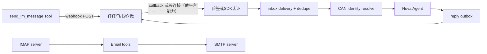
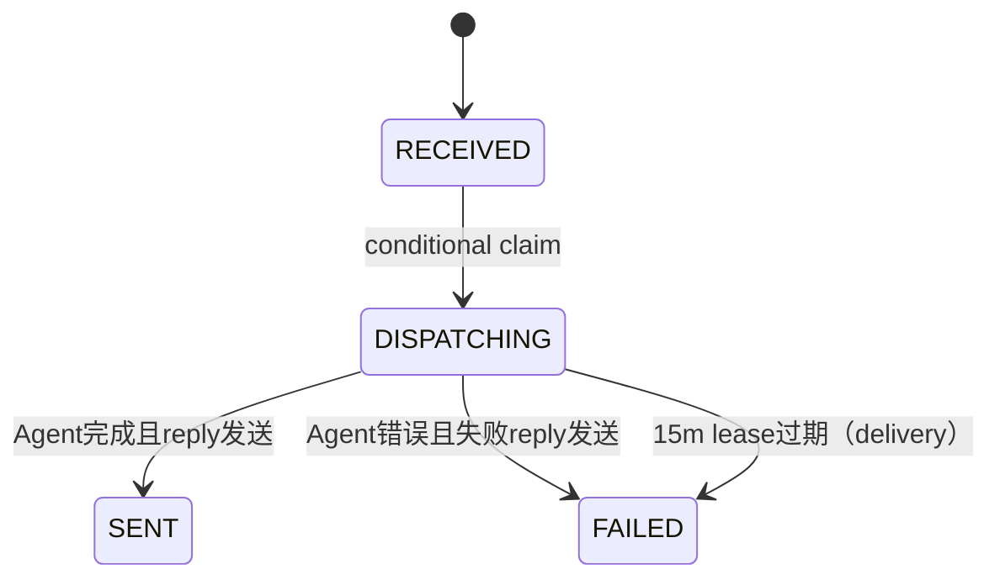
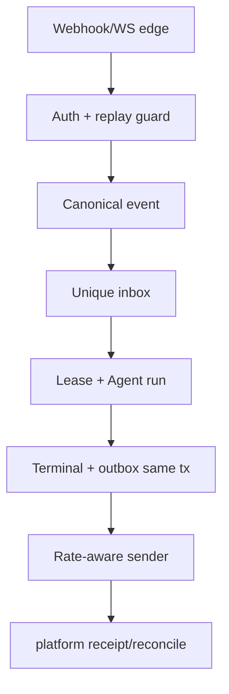

```
# 企业 IM Bot 与邮件对端契约复刻

> 技术轴 T26。本章从 Nova 实际接收和发出的协议反向定义钉钉、飞书、企业微信、CAN 外部身份 Gateway、SMTP 与 IMAP 对端。读者不需要原工程或本会话，即可实现测试 Stub、私有化兼容服务或生产级集成。

## 0. 标记与边界

| 标记 | 含义 |
|---|---|
| **I** | 当前客户端/回调实现可确认 |
| **A** | 明确假设 |
| **K** | 已知缺口/弱保证 |
| **P** | 演进意图，非现状 |
| **REQ** | 等价复刻要求 |
| **F** | 降级路径 |
| **D** | 推荐生产设计 |

本工程没有钉钉、飞书、企微、邮件服务器或 CAN Gateway 源码。本章中平台内部路由、计费、队列、限流和持久化均不是已知事实；**I** 只代表 Nova 观察或依赖的 client contract。本次为静态分析，没有连接真实对端或运行测试。

## 1. 总体形态

Nova 有两条不同 IM 产品链，不能混淆：

1. **企业 Channel 助手**：平台私聊 callback/长连接 → 验证与去重 → 外部身份解析 → Agent → durable outbox → 回复原会话。
2. **主动群机器人 Tool**：Agent 显式调用 `send_im_message` → 用户级 webhook → text/markdown/card；无 inbox、无 durable outbox。

邮件也是 Tool，不是 Agent inbox：`send_email` 通过 SMTP 发送；`receive_email` 按需通过 IMAP 只读搜索。没有邮件 webhook、IDLE listener、自动 Agent dispatch 或邮件 outbox。



## 2. Channel 与公共 callback

### 2.1 公共入口

```http
POST /{platformId}/{channelId}/events
Content-Type: application/json
```

路由属于 IM plugin ingress service 的 PUBLIC endpoint，body 上限 1 MiB。`platformId` 仅接受 `dingtalk|feishu|wecom`，channel 必须 ACTIVE 且平台匹配。**I**：当前 registry 只允许钉钉和飞书创建 webhook channel；企微只允许 websocket，因此不能把该公共路由推导为“企微 callback 已接通”。

成功 acceptance：

```json
{
  "status":"accepted",
  "newlyAccepted":true,
  "ignored":false,
  "deliveryId":"uuid"
}
```

重复返回 HTTP 200，`newlyAccepted=false,status=duplicate`；群聊等被忽略也返回 200、`ignored=true`。认证失败 401；缺 body/非法 payload 400；channel 不存在 404；持久接受失败 500。

**REQ**：平台应把 2xx 当 ack，不因业务 ignored/duplicate 重投。Nova 必须先持久化再返回 accepted。

### 2.2 回放窗口与通用 HMAC

钉钉和 generic verifier 的 callback timestamp 按 epoch milliseconds，允许与服务器时间相差最多 5 分钟。generic verifier 是插件内的扩展 verifier；其契约为：

```text
X-IM-Timestamp: 1786586400000
X-IM-Signature: Base64(HMAC-SHA256(webhookSecret, timestamp + "." + rawBodyUtf8))
```

比较是 constant-time，并且依赖 credential `webhookSecret`。**K**：当前 bundled registry 没有任何第三个平台 webhook mode 使用它；尤其企微仅注册 websocket，故这是可复用实现资产而不是企微 current 能力。若未来为企微开放 webhook，除提供 `webhookSecret` 外，还必须明确它是 Nova 私有明文 callback 契约还是实现企微官方验签/解密协议，不能直接宣称兼容官方 callback。该 verifier 没有 nonce ledger；启用后同一签名可在 5 分钟窗口内重放，但 delivery dedupe 可阻止同 message ID 再调 Agent。

### 2.3 加密边界

**I**：callback JSON 本身没有 AES 解密流程；因此若官方平台只发送 encrypted envelope，必须由平台 SDK/前置 Gateway 解密为本文明文 payload。企微 current 不提供 callback mode；不要把企微附件 AES 解密误认为 callback envelope 解密。

### 2.4 平台 × connection mode 身份与凭据

这是创建/启用 channel 时的 current 必填矩阵；身份字段参与 robot 唯一键，credential 存在 credential vault，不能互相替代：

| 平台 | mode | 必填非 secret 身份 | 必填 credential | 说明 |
|---|---|---|---|---|
| DingTalk | webhook | `platformBotId`（Robot Code） | `webhookSecret` | payload 有 robotCode 时必须与 platformBotId 一致 |
| DingTalk | websocket | `platformBotId` + `platformAppId`（AppKey/clientId） | `appSecret` | platformBotId 仍必填并用于事件 robotCode 约束 |
| Feishu | webhook | `platformAppId` | `appSecret` + `verificationToken` | current 入站验 token；appSecret 供 token/reply/媒体侧使用 |
| Feishu | websocket | `platformAppId` | `appSecret` | appId 可由 credential `appId` 覆盖读取，但 channel 身份字段仍必填 |
| WeCom | websocket | `platformBotId`（Bot ID） | `secret` | 唯一受支持 mode；`platformAppId` 被归一化为 null |
| WeCom | webhook | **不支持** | generic verifier 若被扩展启用会需要 `webhookSecret` | 不属于 current，不能据公共 route/normalizer 宣称可用 |

**I**：企微媒体附件可带 `aeskey/aes_key`，下载后使用 AES/CBC/NoPadding 解密并校验 padding/长度；这是附件字节契约。

## 3. 钉钉对端

### 3.1 callback 验证

凭据：`webhookSecret`；channel `platformBotId` 必填。timestamp/sign 可来自 query：

```text
?timestamp=<epochMillis>&sign=<base64>
```

或 header `X-DingTalk-Timestamp`、`X-DingTalk-Sign`。期望签名：

```text
Base64(HMAC-SHA256(key=webhookSecret,
                   data=timestamp + "\n" + webhookSecret))
```

若 payload `robotCode` 与配置 bot ID 同时存在，必须相等。

### 3.2 inbound 最小 payload

```json
{
  "msgId":"dt-001",
  "conversationType":"1",
  "robotCode":"robot-a",
  "senderStaffId":"staff-1",
  "senderUnionId":"union-1",
  "senderId":"sender-1",
  "msgtype":"text",
  "text":{"content":"你好"},
  "sessionWebhook":"https://example.dingtalk.com/reply-token"
}
```

身份优先级：`senderStaffId` → `senderUnionId` → `senderId`，类型依次为 `DINGTALK_STAFF_ID/UNION_ID/SENDER_ID`。只处理 `conversationType=1|single` 私聊。

消息支持：text；picture；file；audio/voice；video；richtext。媒体通过 `downloadCode|pictureDownloadCode` 标识；reply target 是 `sessionWebhook`。

### 3.3 Stream 长连接

Nova 通过 DingTalk 官方 Stream SDK adapter，以 `platformAppId`（appKey/clientId）+ `appSecret`（clientSecret）配置连接，并把 SDK 交付的 bot message 交给公共 ingress。listener 对 SDK callback 返回空消息类型对象：

```json
{"msgtype":"empty"}
```

SDK 已认证的事件不再走 HTTP 签名，但 Nova 仍核对 robotCode。**边界**：握手、topic 编码、心跳、重连与传输 ack 都由官方 SDK 版本控制，Nova 源码没有给出可自包含的 wire contract。自建对端不得根据本段猜测私有协议；可复刻且可验收的是 connection factory/adapter seam：给定 channel + credential 创建 client、注册事件 listener、启动、关闭，并用 fake client 注入事件验证标准化与生命周期。若要做真实兼容服务，必须另行锁定官方 SDK 版本及其官方协议文档。

### 3.4 Agent reply

对 `sessionWebhook` POST：

```json
{
  "msgtype":"markdown",
  "markdown":{"title":"Nova","text":"Agent answer"}
}
```

reply URL 必须 HTTPS、host 是 `.dingtalk.com` 或管理员显式配置的私有端点。HTTP 非 2xx 失败；2xx body 的业务 code 当前不校验，属于 **K**。

### 3.5 主动机器人 Tool

TEXT/MARKDOWN/ACTIONCARD 分别编码。签名 secret 存在时在 webhook URL 加：

```text
timestamp=<epochMillis>
sign=URLENCODE(Base64(HMAC-SHA256(secret, timestamp + "\n" + secret))))
```

Text/markdown 可带：

```json
{"at":{"isAtAll":false,"atMobiles":["138..."],"atUserIds":["u1"]}}
```

ActionCard 单按钮用 `singleTitle/singleURL`，多按钮用 `btns[{title,actionURL}]`；不支持 @，Nova会报告降级说明。成功要求 HTTP 2xx 且 JSON `errcode=0`。

## 4. 飞书对端

### 4.1 callback 验证与 challenge

只验证 payload 顶层 `token` 或 `header.token` 等于 channel `verificationToken`，constant-time。**K**：当前没有基于 raw body 的飞书签名验证，也不解密 encrypt envelope。

URL verification：

```json
{"type":"url_verification","token":"verify-token","challenge":"abc"}
```

成功：

```json
{"challenge":"abc"}
```

challenge 缺失返回 400。

### 4.2 inbound event

```json
{
  "header":{"token":"verify-token"},
  "event":{
    "sender":{"sender_id":{"user_id":"u1","open_id":"ou1","union_id":"on1"}},
    "message":{
      "message_id":"om_001",
      "chat_type":"p2p",
      "message_type":"text",
      "content":"{\"text\":\"你好\"}"
    }
  }
}
```

身份优先级 `user_id/open_id/union_id`；类型 `FEISHU_USER_ID/OPEN_ID/UNION_ID`。content 可为 JSON object 或 JSON 字符串。支持 text、image、file/audio/media；媒体键 `image_key/file_key`。

### 4.3 长连接

Nova 通过飞书官方 WS SDK adapter，以 `platformAppId` + `appSecret` 配置 client，并把 SDK 交付的消息事件包装为 `{schema,header,event}` 后送入公共 ingress。**边界**：鉴权、订阅、心跳、重连和 ack 属于官方 SDK 行为，Nova 只暴露 factory/adapter seam，不构成可复刻的 wire protocol。测试应 fake adapter 注入 SDK event 并验证 start/stop/事件映射；真实兼容服务需锁定官方 SDK 与官方协议文档。

### 4.4 token 与 reply API

取 token：

```http
POST /open-apis/auth/v3/tenant_access_token/internal
Content-Type: application/json

{"app_id":"app","app_secret":"secret"}
```

响应至少：

```json
{"tenant_access_token":"t-1","expire":7200}
```

回复原 message ID：

```http
POST /open-apis/im/v1/messages/{messageId}/reply
Authorization: Bearer t-1
Content-Type: application/json

{"msg_type":"text","content":"{\"text\":\"Agent answer\"}"}
```

当前 reply sender 每次取 token，不缓存；只看 HTTP 2xx，不检查飞书 `code`，属于 **K**。

### 4.5 主动 webhook

text：`{msg_type:text,content:{text}}`；markdown/card 转 interactive schema 2.0，body elements 含 markdown/button。@ 使用 `<at user_id="...">`（text）或 `<at id="...">`（interactive）；@all ID 为 `all`；手机号 @ 不支持。

有 secret 时：

```json
{"timestamp":"<epochSeconds>","sign":"<base64>","msg_type":"text",...}
```

当前签名算法的 observed client contract：

```text
stringToSign = timestampSec + "\n" + secret
sign = Base64(HMAC-SHA256(key=stringToSign UTF8, data=empty bytes))
```

成功要求 HTTP 2xx 且 JSON `code=0`。

## 5. 企业微信对端

### 5.1 inbound 明文 payload

payload 可直接是 body，或外层 `{body:{...}}`：

```json
{
  "body":{
    "msgid":"wx-001",
    "chattype":"single",
    "from":{"userid":"zhangsan"},
    "msgtype":"text",
    "text":{"content":"你好"},
    "response_url":"https://qyapi.weixin.qq.com/reply-token"
  }
}
```

只处理 single，唯一身份为 `from.userid` / `WECOM_USERID`。支持 text、voice、image、file、video、mixed。媒体可含 `url|download_url`、`media_id`、`aeskey|aes_key`、filename、mime、size。

**I**：bundled registry 不支持企微 webhook/callback，企微 current 仅有 websocket。代码中的明文 payload normalizer 与 generic HMAC verifier 是可扩展资产，但没有可创建/启用的企微 webhook channel 将二者接通；generic verifier 还要求 `webhookSecret`。因此它既不是企微官方 callback 加解密协议，也不能列为当前产品能力。

### 5.2 WebSocket

默认 `wss://openws.work.weixin.qq.com`，10 秒连接 timeout。建立后发送：

```json
{
  "cmd":"aibot_subscribe",
  "headers":{"req_id":"uuid"},
  "body":{"bot_id":"bot-a","secret":"secret"}
}
```

每 30 秒：

```json
{"cmd":"ping","headers":{"req_id":"uuid"}}
```

Nova 接受任意完整 text frame 为 event payload；不解析 subscribe/pong 业务 ack。对端 close/error 触发断线重连。

### 5.3 reply

对可信 `response_url` POST：

```json
{
  "msgtype":"stream",
  "stream":{
    "id":"nova-<deliveryId>",
    "finish":true,
    "content":"Agent answer"
  }
}
```

host 必须 `.weixin.qq.com` 或配置端点。`stream.id` 稳定，可作为对端幂等/更新 key；Nova 只看 HTTP status。

### 5.4 主动 webhook

Text 支持 `mentioned_list`（含 `@all`）和 `mentioned_mobile_list`。Markdown/card 均降级为 markdown，button 渲染为 Markdown link，@ 被忽略。成功要求 HTTP 2xx 且 `errcode=0`。

## 6. 外部身份与 CAN Gateway

### 6.1 标准化请求

IM 根据平台选择 external user ID 后调用：

```ts
{
  source: "im";
  provider: "dingtalk"|"feishu"|"wecom";
  expectedTenantId: string;
  externalUserId: string;
  externalUserIdType: string;
  attributes: Record<string,string>;
}
```

Product resolver 以 `(provider,tenant,externalUserId,externalUserIdType)` 缓存成功结果 10 分钟，最多 10,000 条；失败不缓存。

### 6.2 CAN HTTP 契约

```http
POST /api/internal/v1/im/users/resolve
X-API-Key: <admin-api-key>
X-Tenant-Id: tenant-1
X-Request-Id: <traceId，可选>
Accept: application/json
Content-Type: application/json

{"platform":"DINGTALK","thirdPartyUserId":"staff-1"}
```

**I**：provider 转大写；externalUserIdType 和 attributes 没发给 CAN，故 CAN 只能按 platform + thirdPartyUserId + tenant 解。

成功响应必须严格包含：

```json
{
  "success":true,
  "code":"OK",
  "message":"resolved",
  "traceId":"trace-1",
  "data":{
    "tenantId":"tenant-1",
    "userId":"nova-user-1",
    "ban":false,
    "nickname":"张三",
    "account":"zhangsan",
    "email":"z@example.com",
    "cloudAccount":"cloud-1",
    "creationMode":"SYNC"
  }
}
```

tenant 必须与请求相同，ban 必须是 boolean 且 false，userId 非空。非 2xx、`success!=true`、字段缺失、tenant 不匹配、ban=true 都失败；IM 生成失败回复，不运行 Agent。

**D**：CAN 应以 `(tenant,platform,thirdPartyUserId)` 唯一；返回稳定 code；审计 admin caller；不自动把未知外部用户映射到默认账号。若允许 JIT 创建，必须在 `creationMode` 可见且受 tenant policy 控制。

## 7. Inbox、Agent 与 Outbox 一致性

### 7.1 delivery

去重键持久唯一，推荐等价公式：`channelId:platform:platformMessageId`。状态：



数据库字段至少包含 tenant/channel/platform/message ID、direction、payload、reply target、external/nova user、conversation、dedupe key、owner/lease、attempt、agent run/message/result/error、correlation 和时间。

**I**：RECEIVED 每 5 秒恢复；claim 仅 `WHERE status=RECEIVED`。必须区分两个正交字段：DISPATCHING lease 过期后，`delivery.status=FAILED`，同时 `agent_run_state=UNKNOWN`。UNKNOWN 不是 delivery 状态，也不代表已确认 Agent 失败；系统不重跑 Agent，以避免重复工具副作用。

### 7.2 conversation route

`(channelId,externalUserId)` 唯一绑定一个 Nova conversation。channel idle timeout 到期或用户发送 `/new` 时创建新会话；同 route 在本节点串行。

### 7.3 outbox

Agent terminal 与 outbox PENDING 同事务，一 delivery 至多一个 outbox。poll 2 秒，batch 20，SENDING lease 2 分钟，最多 10 attempts；退避 `min(300s,5s*2^(attempt-1))`。

**I**：send fail 只重试发送，不重跑 Agent。**K**：HTTP ack 丢失会重复发；除企微 stream ID 外没有通用 platform idempotency key。

## 8. 长连接 owner lease

**I**：当前已有数据库 lease，存在 channel row 的 `connection_owner_id/connection_lease_until/status`。owner 可在自己持有或 lease 过期时 acquire；定期 renew；lease duration 必须大于 refresh interval 的两倍。连接配置签名改变会 stop/recreate。连接失败从 5 秒指数退避到 5 分钟。

**K**：lease 只有 nodeId，无随机 fencing token/generation；旧 owner 的 SDK event 可能在失租与 socket stop 的小窗口到达。最终 inbox dedupe 可挡相同平台 message ID，但无法阻止所有资源浪费。

**D**：增加 lease_token + generation；event acceptance 校验当前 generation；失租先将 connector DRAINING 再 stop；平台 message ID 仍是最终 dedupe key。

## 9. 附件与媒体对端

最多 8 附件，默认单次/总字节上限 50 MiB。下载 timeout 30 秒，不跟 redirect，响应流硬限长；临时 URL 只允许平台域名并做 DNS/私网防护。管理员显式私有 endpoint 才允许私网 host。

- 钉钉：先 appKey/appSecret 取 access token，再 `/v1.0/robot/messageFiles/download` 用 `x-acs-dingtalk-access-token` 和 `{robotCode,downloadCode}` 换 URL；
- 飞书：取 tenant token，再按 messageId + file/image key 下载资源；
- 企微：从可信 URL 下载 encrypted bytes，再用 payload aeskey 解密。

字节会做 magic/MIME、可执行文件、压缩炸弹、路径穿越校验，写 sandbox `uploads/im/<delivery>/<ordinal>-<filename>`。图片变 ContentBlock.Image，文件变 AgentAttachment 和文本路径提示。

## 10. 主动 IM Tool 的错误语义

HTTP connect 10 秒、request 15 秒，强制 NO_PROXY。配置 webhook host 与所选平台冲突时调用前失败。平台业务成功码为 0。

网络 timeout/interrupted 返回明确 `result unknown — may have been delivered; do NOT resend without confirming`；其他 IOException 返回 failed。**REQ**：Agent 不得在 UNKNOWN 后自动再调 Tool。

工具参数：

```json
{
  "msg_type":"text|markdown|card",
  "content":"required",
  "title":"optional",
  "at_all":false,
  "at_mobiles":["138..."],
  "at_userids":["u1"],
  "buttons":[{"text":"Open","url":"https://example.com"}]
}
```

**K**：没有 durable request ledger；side effect 由 tool call 直接执行。

## 11. SMTP 发送契约

### 11.1 配置与 transport

| 配置 | 默认 | 语义 |
|---|---|---|
| `send-email.from` | username fallback | From |
| `smtp-host` | 必填 | server |
| `smtp-port` | 465 | port |
| `smtp-username/password` | 必填 | AUTH |
| `smtp-ssl` | true | true→SMTPS；false→SMTP 并设置 `starttls.enable=true` |
| `ssl-protocols` | 空 | 可选 TLS list |
| `proxy` | 空 | SOCKS `host:port`，缺 port 用1080 |

只有登录身份可用。参数：to、subject、body 必填（实现允许 subject null 后空串，但 schema 标必填）、html 默认 false、attachments 为 sandbox paths。**K**：`smtp-ssl=false` 当前只启用 STARTTLS，没有设置 `starttls.required=true`；若服务端不提供 STARTTLS，JavaMail 可能继续明文 SMTP。不能把该模式描述成强制 TLS。

MIME：无附件时 text/plain 或 text/html UTF-8；有附件时 `multipart/mixed`，首 part 为正文，附件用 FileDataSource filename。收件人由标准 InternetAddress parser 解析，可含多个地址。

```text
EHLO
AUTH ...
MAIL FROM:<configured from or username>
RCPT TO:<to...>
DATA <MIME message>
QUIT
```

**I**：SMTP send 无 timeout 配置、无 retry、无 outbox、无稳定 Message-ID/idempotency key。服务器接受 DATA 后连接断开会返回 failed，但邮件可能已投递，属于 **K/UNKNOWN**，当前文案未像 IM Tool 一样专门隔离 UNKNOWN。

**D**：生产发送使用 durable email outbox、自定义稳定 Message-ID、发送 attempt 与 SMTP reply codes；4xx retry、5xx permanent；timeout 后通过 Sent folder/provider API reconcile，不盲重发。

### 11.2 附件安全

接受相对路径、`/sandbox/...`、`~/...`，最终必须 resolve/realPath 均位于 sandbox root，必须存在且是 regular file；symlink escape 拒绝。

## 12. IMAP 接收契约

配置：host、port 默认993、username/password、ssl默认true、TLS protocols；`receive-email.proxy` 当前仅保留配置兼容，socket factory 明确直连，属于 **K**。连接和 read timeout 均 15 秒。

使用 `imaps` 或 `imap`，folder 默认 INBOX，以 READ_ONLY 打开，绝不设 Seen/删除。**K**：`imap-ssl=false` 当前是明文 `imap`，没有启用 STARTTLS；只应在受控网络测试使用，不满足生产传输安全要求。参数：limit 1..50 默认5、folder、search、from、subject、since（`7d`、`yyyy-MM-dd`、`all`）。

首选 server SEARCH：

```text
OR SUBJECT <search> BODY <search>
FROM <from>
SUBJECT <subject>
SINCE <date>
```

条件 AND。服务器不支持组合 SEARCH 时先降为 date-only，再失败则 batch 200 本地扫描，批间 sleep 100ms；没有 since 默认最多扫描最近 `max(limit*10,500)`，`all` 才全量。**K**：非法 `since` 当前不会 fail-fast。server SEARCH 构造时会静默不加日期条件；若进入 reduced/batch fallback，日期解析仍为 null，最终使用默认 recent window（除 `all` 外）。这会把输入错误误解为更宽或不同的查询窗口；复刻 current 必须保留并测试该行为，推荐设计应在入口返回参数错误。

返回 sender/subject/sent date/body preview。HTML 用简单正则去标签，不是安全 sanitizer；每封 body 10,000 字符、总输出 50,000 字符截断。Multipart 只取第一个非空文本 part，不返回附件。

**K**：相对日期按 Nova 节点本地时区，不是 mailbox 时区；server `ReceivedDate` 与本地 fallback 的 sentDate 语义可能不同。完整 server SEARCH 路径的 `totalMatches` 是服务器返回总命中数；reduced/batch fallback 在凑满 `limit` 后即停止，所以 `totalMatches` 实际只是“已返回/已发现的下界”，不是真实总数。其 `hasMore` 以 `matched.size() >= limit` 置 true：命中数恰好等于 limit 且后面没有更多邮件时也可能假阳性。

## 13. 错误、速率与重试

| 链路 | 当前 retry | UNKNOWN 策略 |
|---|---|---|
| callback | 平台负责重投，Nova dedupe | 已持久化才 ack |
| Agent dispatch | 不自动重跑过期 DISPATCHING | delivery 标 FAILED；agent_run_state 标 UNKNOWN |
| reply outbox | 最多10次，5s→300s | HTTP ack 丢失可能重复 |
| long connection | 5s→5m，SDK或manager重连 | lease owner 切换 |
| send_im_message | 无 retry | timeout明确禁止自动重发 |
| SMTP | 无 retry | 当前未专门分类 |
| IMAP | SEARCH 内部降级，不重连 | 返回 Tool error |
| CAN resolve | 无本地 retry，成功缓存10m | 失败不调 Agent |

**D**：平台 429/5xx/业务限流码应分类 retry，遵守 Retry-After；4xx auth/schema permanent。每 tenant/channel 设 token bucket 和并发上限，避免 callback storm 打满 Agent。

## 14. 最小 Stub

### 14.1 IM callback/long connection Stub

callback Stub 必须能为钉钉和飞书生成合法/非法认证、±5分钟 timestamp（适用签名模式）、重复 message ID、群聊、challenge、各种身份优先级和附件字段，并记录 ack。企微 current 只测试 websocket subscribe/ping/event/close；若为 proposed generic callback 做扩展测试，必须显式注册 webhook mode、提供 `webhookSecret`，并标为 Nova 私有 callback contract。钉钉/飞书长连接只通过 factory fake 注入官方 SDK 事件并验证 adapter start/stop/事件映射，不复刻不可见 handshake。

### 14.2 平台 HTTP Stub

记录 method/path/header/body，并脚本返回 HTTP status、业务 code、延迟、断连：

- 钉钉 sessionWebhook、token、download URL；
- 飞书 token、message reply、resource；
- 企微 response_url 与 encrypted media；
- webhook text/markdown/card/@/签名；
- 验证 outbox retry 不重跑 Agent。

### 14.3 CAN Stub

覆盖 success、ban、tenant mismatch、missing field、success=false、401/404/429/500、timeout；断言 admin API key/tenant/request ID 与 body exact contract。

### 14.4 SMTP/IMAP Stub

SMTP Stub 支持 SMTPS、可升级 STARTTLS、拒绝 STARTTLS、AUTH、RCPT reject、DATA 后断线和 multipart capture；IMAP Stub 支持 IMAPS、明文 IMAP、LOGIN、SELECT readonly、SEARCH 成功/拒绝、FETCH、folder missing、慢响应和多 MIME。current compatibility tests 必须证明 `smtp-ssl=false` 只设置 enable 而未 required、`imap-ssl=false` 没有 STARTTLS；推荐生产模式的独立 tests 必须要求 SMTPS/IMAPS 或 fail-closed STARTTLS，禁止将两组期望混为一条测试。

## 15. 生产对端设计



- callback 先验签、限 body，再解析；原始 event 加密短留存；
- inbox dedupe 使用平台稳定 event/message ID，缺 ID fail-closed；
- identity 映射 tenant scoped，禁止默认用户 fallback；
- Agent UNKNOWN 可按 stable runId reconcile；
- outbox 有 clientMessageId、远端 receipt、lease token、attempt、nextAt；
- channel owner 有 fencing generation；
- credentials 独立 envelope encryption、轮换和审计；
- attachment 流式限长、域名/DNS复核、病毒扫描、隔离区；
- email 使用专门 outbox/inbox UIDVALIDITY+UID checkpoint，而不是直接 Tool side effect。

## 16. 安全

- PUBLIC callback 不代表匿名信任；认证失败先于持久化。
- secret/API key/appSecret/password 不进日志、payload_json、Agent prompt。
- reply URL/媒体 URL 防 SSRF；默认 HTTPS/WSS，私有 HTTP/WS 仅管理员 override。
- external user ID、邮箱地址是 PII；日志 hash/遮蔽，CAN错误文案会替换外部ID。
- 飞书 callback 虽在 channel credential 中同时要求 `appSecret` 与 `verificationToken`，current 入站 verifier 只校验 verificationToken，属于 **K**；生产应支持官方签名/加密 envelope 和 nonce replay ledger。
- HTML email 是对外主动内容，必须用户确认；不要把 IM/邮件富文本直接在管理 UI 无 sanitizer 渲染。
- SMTP/IMAP TLS certificate verification不可关闭；生产门禁要求 SMTPS/IMAPS 或 fail-closed STARTTLS。current `smtp-ssl=false` 会允许 STARTTLS 降级，`imap-ssl=false` 是明文，二者都不能作为推荐生产配置。推荐 OAuth2/app password，限制传统密码。

## 17. 可观测性

指标：callback accepted/duplicate/ignored/auth-failed；delivery 各状态；agent_run_state UNKNOWN；Agent latency/outcome；outbox age/retry/failed/duplicate-risk；connection owner/renew/lost/reconnect；platform HTTP status/business code/429；identity resolve latency/cache/ban/mismatch；media bytes/reject；SMTP accept/unknown；IMAP search fallback/scan count。

Trace 字段：tenantHash、channelId、platform、deliveryId、dedupeHash、externalUserHash、conversationId、agentRunId、outboxId、attempt、connectionGeneration、platformMessageId、correlationId。禁止 message content、附件字节、凭据。

## 18. Contract test 矩阵

| ID | 场景 | 预期 |
|---|---|---|
| IM-01 | 合法callback | 先落RECEIVED后200 |
| IM-02 | 重复message | 一个delivery/Agent run |
| IM-03 | 错签/过期 | 401，无delivery |
| IM-04 | 群聊 | ignored，不调Agent |
| IM-05 | CAN tenant mismatch/ban | failure reply，不调Agent |
| IM-06 | dispatch lease过期 | delivery FAILED + agent_run_state UNKNOWN，不重跑 |
| IM-07 | Agent terminal事务崩溃 | terminal/outbox同有或同无 |
| IM-08 | send 5xx后成功 | Agent一次、send多次 |
| IM-09 | send ack丢失 | 重复风险可观测 |
| IM-10 | 双节点长连接 | 仅lease owner connect |
| DT-01 | query/header签名 | 均验证成功 |
| DT-02 | richtext+media | 顺序/下载正确 |
| FS-01 | challenge | token验证后原样challenge |
| FS-02 | content JSON string | 正确文本/附件 |
| CFG-01 | 平台×mode credential | 按 2.4 矩阵缺任一身份/凭据均 fail-fast |
| WC-00 | 创建企微 webhook channel | 拒绝 unsupported mode；不得误走 generic verifier |
| WC-01 | subscribe+ping | 载荷精确、断线回调 |
| WC-02 | AES media | 解密/错误key失败 |
| TOOL-01 | 三平台text/card/@ | JSON与降级说明正确 |
| TOOL-02 | timeout | UNKNOWN且不自动重发 |
| MAIL-01 | SMTPS plain | MIME/From/To正确 |
| MAIL-02 | opportunistic STARTTLS attachments | current `enable=true/required未设`，sandbox文件、multipart正确 |
| MAIL-03 | DATA后断线 | 标结果不确定 |
| MAIL-04 | IMAP readonly recent | 不改flags，顺序/截断正确 |
| MAIL-05 | SEARCH reject | reduced/batch fallback |
| MAIL-06 | proxy配置 | IMAP仍直连，记录当前边界 |
| MAIL-07 | 非法 since | current 静默丢日期过滤/进入默认窗口；recommended 模式 fail-fast |
| MAIL-08 | fallback 恰好 limit | totalMatches 标下界，hasMore 可能假阳性 |
| MAIL-09 | SMTP 非 SSL 服务端无 STARTTLS | current 可降级；recommended required 模式拒绝 |
| MAIL-10 | IMAP ssl=false | current 明文且无 STARTTLS；生产策略拒绝 |

## 19. 验收标准

- 钉钉/飞书 callback 与三平台 reply/主动 webhook 的可见 JSON/header/signature 通过 fixture 精确断言；企微 current 只验 websocket，不把 generic callback 计为通过；
- 钉钉/飞书长连接仅验 Nova adapter seam、官方 SDK event 映射与 start/stop；不以猜测 handshake/topic wire 作为验收；
- 任意重复入站消息最多一次 Agent dispatch；DISPATCHING 过期明确为 delivery FAILED + agent_run_state UNKNOWN；
- Agent terminal 与 reply outbox 原子；send retry 不触发 Agent；
- 双节点只有一个有效长连接 owner，失租及时 stop；该断言针对 Nova lease/adapter 生命周期，不承诺官方 SDK 内部 wire；
- CAN 映射绝不跨 tenant，ban/未知用户 fail-closed；
- 文件数量、总字节、MIME、archive、SSRF、AES 和 sandbox escape 均有反向测试；
- SMTP/IMAP 使用真实协议 Stub 验证 current TLS 降级事实、认证、MIME、SEARCH fallback/下界统计与 readonly；推荐生产配置另验 required STARTTLS 或 SMTPS/IMAPS fail-closed；
- 所有 timeout/ack-loss 文档和 UI 区分 FAILED 与 UNKNOWN；
- 日志、trace、数据库诊断不泄露 secret、password、token、正文或附件；
- 不把本章未观察的商业平台内部行为宣称为既有保证。

## 20. 证据追溯

事实来自 IM plugin 的 public HTTP route、channel/credential vault、verifier/normalizer、reliable ingress repository、Agent dispatch/outbox、平台 reply sender、三个长连接 factory/owner lease、媒体 downloader/materializer、主动 IM Tool adapters；邮件来自 core tools 的 SMTP sender 与 IMAP receiver；CAN identity 来自产品 external identity resolver、Gateway client 与通用 identity SPI。路径仅供审计，正文已包含复刻所需契约。

```
