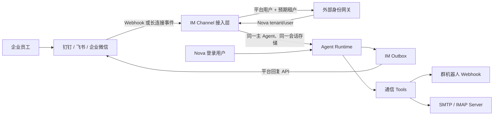
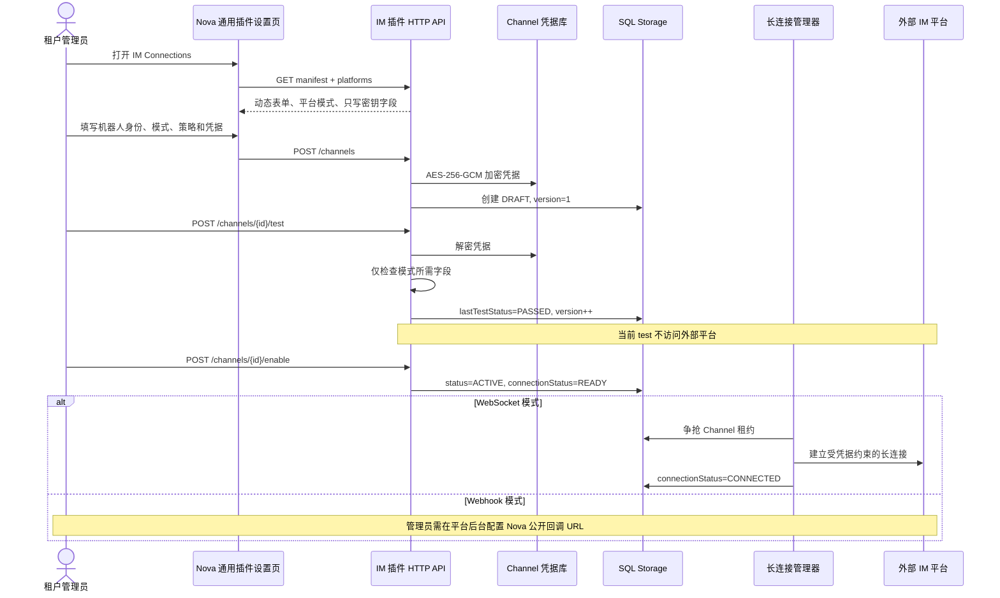
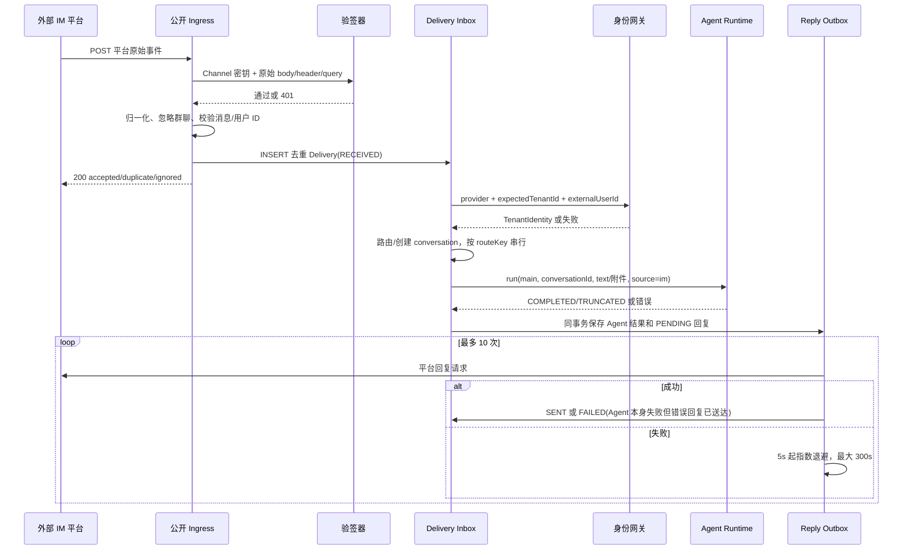
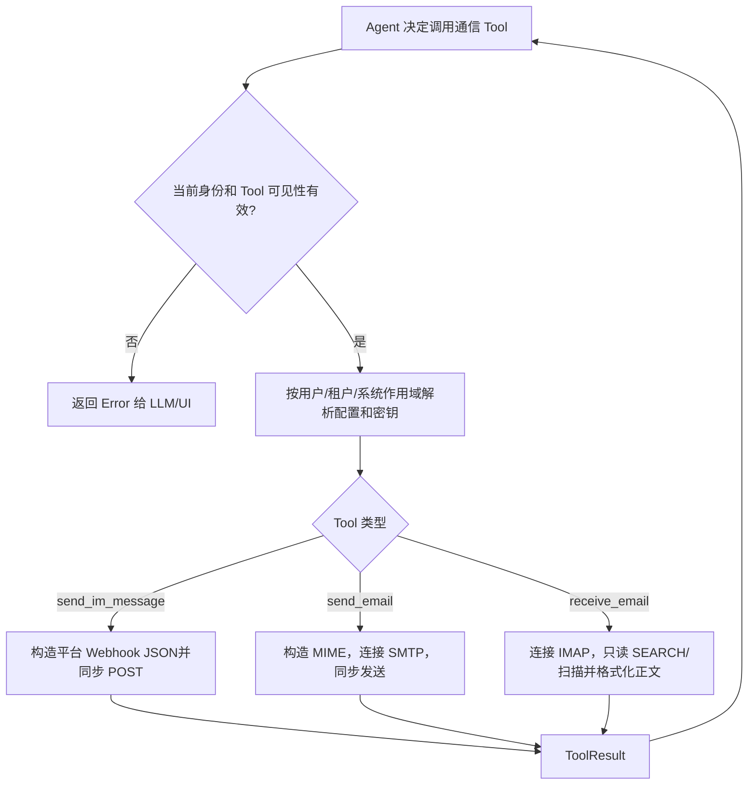
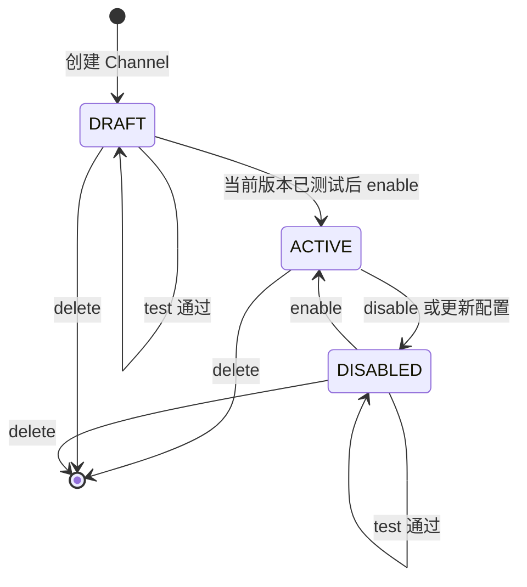
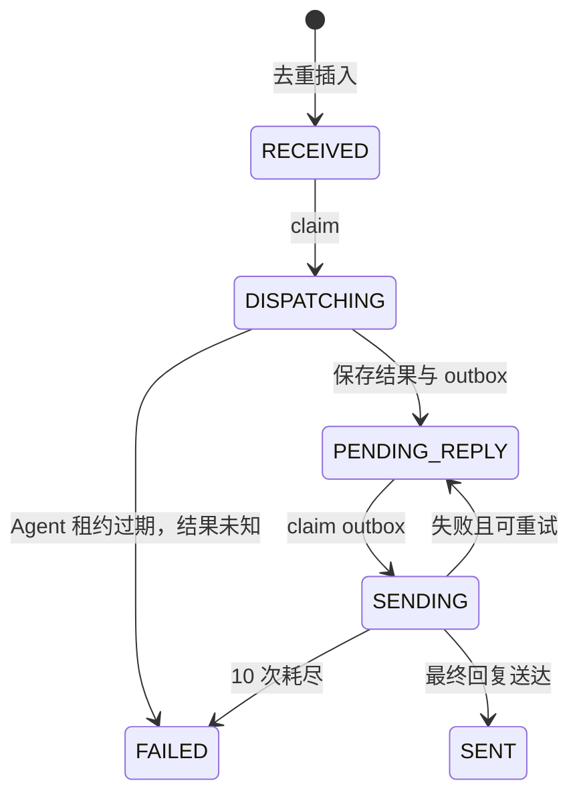
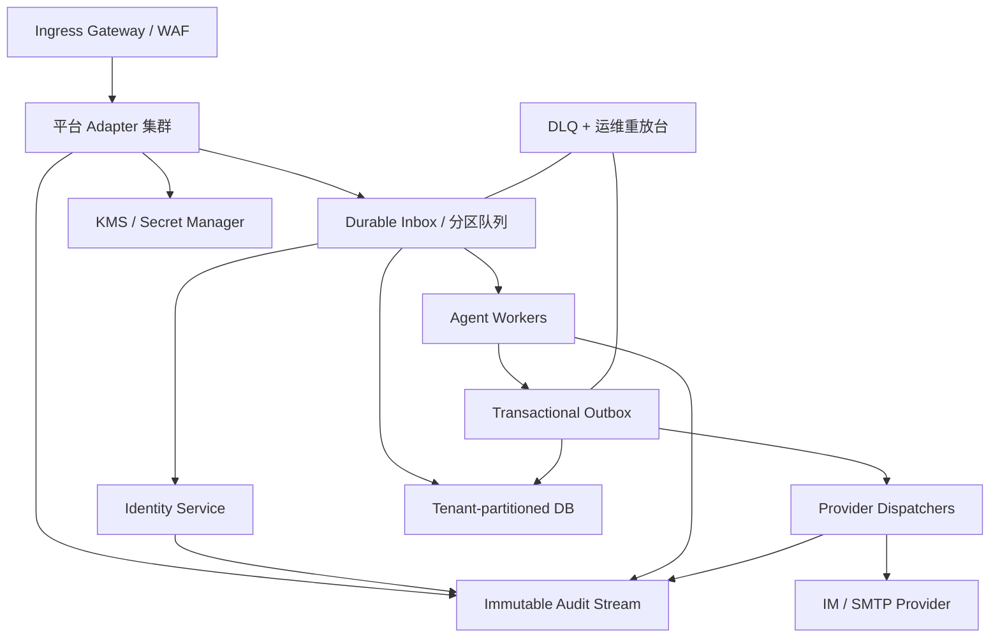

```
# 企业通信、机器人和邮件：自包含复刻设计

## 1. 结论与边界

### 1.1 业务问题与目标用户

本能力把 Agent 平台接入企业日常沟通渠道，包含两个彼此独立但可共同部署的产品形态：

1. **IM 单聊 Agent 入口**：员工在钉钉、飞书或企业微信中私聊企业应用机器人，平台把消息送入 Agent；系统以该员工对应的 Nova 身份执行同一个主 Agent，并将最终文本回复送回原会话。
2. **Agent 主动通信工具**：已经登录 Nova 的用户让 Agent 向群机器人 Webhook 发送通知、通过 SMTP 发邮件，或通过 IMAP 查询邮箱。它们是按用户或租户配置的 Tool，不是 IM 单聊入口的出站实现。

目标用户包括租户管理员、企业员工、在 Nova 中调用通信 Tool 的登录用户，以及负责部署企业应用机器人、SMTP/IMAP 服务和身份网关的集成人员。

### 1.2 当前能力结论

| 能力 | 当前结论 | 证据等级 |
|---|---|---|
| 钉钉应用机器人单聊 | 支持 Webhook 与 Stream 长连接接收；支持文本、部分富文本、图片和文件输入；最终回复通过事件携带的临时回复地址发送 Markdown | `I` |
| 飞书应用机器人单聊 | 支持 Webhook 与事件长连接；支持 URL verification、文本、图片和文件输入；最终回复通过消息回复 API 发送纯文本 | `I` |
| 企业微信智能机器人单聊 | 仅支持 WebSocket 长连接；支持文本、语音识别文本、图片、文件、视频和 mixed 输入归一化；最终回复通过 `response_url` 发送完成态 stream 消息 | `I` |
| 群聊 Agent | 三个平台的群消息均被归一化层明确忽略，不进入身份解析或 Agent | `I` |
| IM 多轮会话 | 按“通道 + 外部用户”绑定 Nova conversation，默认空闲 360 分钟后换新；`/new` 立即创建新会话并回复确认 | `I` |
| IM 身份 | 调用外部身份网关，将平台用户映射到通道所属租户中的 Nova 用户；没有本地自助绑定主链路 | `I` |
| IM 可靠投递 | 入站 inbox 去重、Agent 结果持久化、outbox 重试和进程恢复已经实现 | `I` |
| IM 流式回复、思考中卡片 | 未实现；当前等待 Agent 完成后只发一条最终文本 | `P` |
| IM 图片/文件/Artifact 输出 | 通道存在 `allowFileOutput` 配置，但当前回复发送器只处理文本，该开关没有实际消费方 | `I/P` |
| 主动群机器人通知 | `send_im_message` 支持钉钉、飞书、企业微信自定义机器人 Webhook，支持文本、Markdown、简易卡片、按钮和部分 @ | `I` |
| SMTP 发信 | `send_email` 支持纯文本/HTML、一个 `to` 字符串和沙箱文件附件 | `I` |
| IMAP 收信 | `receive_email` 只读查询最近邮件，支持文件夹、关键词、发件人、主题和日期过滤 | `I` |
| 邮件触发 Agent、线程同步、已读/回复 | 未实现；邮件只作为被 Agent 调用的同步 Tool | `I/P` |
| 消息编辑、撤回、已读回执 | 未实现 | `P` |

本次只做静态分析，未连接真实钉钉、飞书、企业微信、SMTP、IMAP 或 CAN Gateway，也未运行自动化测试，因此全文不使用 `R`。

### 1.3 明确不应混淆的边界

- “应用机器人单聊通道”保存租户级应用凭据，接收员工消息并桥接到 Agent；“群机器人通知 Tool”保存 Tool 配置，只有 Agent 主动调用时才向 Webhook 发消息。两者的凭据、接口和可靠性模型不同。
- 单聊通道的 `test` 操作只验证密文可解密且必填字段存在，**不会真正连接平台或发送探测消息**。
- 源码中有完整群聊、服务身份、流式卡片和输出文件的需求设计，但当前执行代码仍然只接受 direct/p2p/single，因此这些只能作为 `P` 或 `D`。
- 历史设计曾把邮件描述为可选插件；当前代码实际把 SMTP/IMAP Tool 放在默认装配的核心工具插件中。是否暴露给某个 Agent 仍受正式工具组、启停和作用域配置控制。

## 2. 术语与参与方

| 术语 | 定义 |
|---|---|
| Channel | 一个租户拥有的企业应用机器人接入实例；绑定平台、机器人身份、传输模式、密文凭据和输入策略 |
| Webhook 模式 | 平台向 Nova 公网 HTTP 入口推送事件；当前仅钉钉和飞书允许配置 |
| WebSocket 模式 | Nova 主动建立长连接接收平台事件；三平台均有适配器 |
| Delivery | 一条平台消息在 Nova 中的耐久入站记录，也是去重和运行追踪单元 |
| Conversation Route | `(channelId, externalUserId)` 到 Nova `conversationId` 的当前映射 |
| Reply Target | 入站事件中可用于回复的临时目标：钉钉 `sessionWebhook`、飞书原消息 ID、企微 `response_url` |
| Tool 配置 | `send_im_message`、`send_email`、`receive_email` 的作用域配置；与 Channel 配置分开 |
| 外部身份网关 | 接收平台用户 ID，在指定租户内返回 Nova 用户的服务；当前复用 CAN Gateway 管理员接口 |



## 3. 业务规则

### 3.1 Channel 管理规则

1. Channel 归属于创建者当前租户；管理接口要求已认证的租户用户且具有 `tenant-admin` 权限。
2. 平台值固定为 `dingtalk`、`feishu`、`wecom`。
3. 钉钉支持 `webhook`、`websocket`；飞书支持 `webhook`、`websocket`；企业微信只支持 `websocket`。
4. 机器人全局业务唯一键为：
   - 钉钉：`dingtalk:<platformBotId>`；
   - 飞书：`feishu:<platformAppId>`；
   - 企业微信：`wecom:<platformBotId>`。
   当前数据库对 `(platform, robotKey)` 建全局唯一索引，而不是租户内唯一。这阻止同一个平台机器人被两个 Nova 租户同时绑定。
5. 租户内 Channel 名称唯一。
6. 创建后状态是 `DRAFT`；测试成功后仍保持原管理状态，但记录当前配置版本测试通过；只有当前版本测试通过后才能启用为 `ACTIVE`。
7. 更新必须提交 `version` 做乐观锁。平台和机器人业务身份不可变；更新一个已启用 Channel 会自动降为 `DISABLED`，清除测试结果，必须重新测试并启用。
8. 凭据更新是字段级合并：不提交 `credentials` 表示保留；提交空对象表示清空；提交部分字段表示覆盖部分字段。字符串 `****` 不被视为“保留”，而是直接拒绝，防止把掩码写回密钥库。
9. 默认策略：允许图片输入、允许文件输入、禁止文件输出、会话空闲 360 分钟。超时必须在 1 到 43,200 分钟之间。

### 3.2 平台凭据矩阵

| 平台/模式 | 非密身份字段 | 必需密钥 | 当前实际用途 |
|---|---|---|---|
| 钉钉 Webhook | `platformBotId` = Robot Code；媒体能力还需要 `platformAppId` = App Key | 文本回调最低仅要求 `webhookSecret`；媒体还需要 `appSecret` | 回调签名验证；回复使用事件中的 `sessionWebhook`。当前模式的必填规则和 `test` 只检查 `webhookSecret`，因此仅能保证文本链路配置完整 |
| 钉钉 WebSocket | `platformBotId` = Robot Code；`platformAppId` = App Key | `appSecret` | Stream SDK 登录；下载附件还需要 App Key/App Secret/Robot Code |
| 飞书 Webhook | `platformAppId` = App ID | `appSecret`、`verificationToken` | token 验证；App 凭据用于附件下载和最终回复 |
| 飞书 WebSocket | `platformAppId` = App ID | `appSecret` | Event SDK 登录、附件下载和最终回复 |
| 企业微信 WebSocket | `platformBotId` = Bot ID | `secret` | `aibot_subscribe` 登录；附件使用事件短链与 AES key |

### 3.3 入站消息规则

1. 只有状态为 `ACTIVE` 且 URL 平台与 Channel 平台相同的 Channel 可以收消息。不存在、未启用或平台不符统一返回 404，不暴露跨租户详情。
2. 当前只处理单聊：钉钉 `conversationType=1|single`、飞书 `chat_type=p2p`、企业微信 `chattype=single`。其他类型以 HTTP 200/受信长连接 ACK 结束，标记 `ignored=true`，不写 Delivery、不调用 Agent。
3. 外部消息 ID 必须存在。外部用户 ID 按以下优先级选择：
   - 钉钉：`senderStaffId` → `senderUnionId` → `senderId`；
   - 飞书：`user_id` → `open_id` → `union_id`；
   - 企业微信：`from.userid`。
4. 去重键为 `channelId:platform:platformMessageId`。重复推送返回原 Delivery，不重复调用 Agent。
5. 同一进程内按 `channelId:externalUserId` 串行执行；不同用户可并行，执行线程池大小为 16。
6. `/new` 是唯一实现的命令：它为路由生成新的 conversation ID，不调用 LLM，回复“已创建新会话，请发送你的问题。”。“新话题”和切工作空间只存在于规划中。
7. Agent 状态只有 `COMPLETED` 或 `TRUNCATED` 被当作成功；其他状态转为失败回复。空文本成功结果使用固定兜底文案。
8. 入站图片/文件受 Channel 策略控制。被禁止的附件不下载，而是在用户文本中加入可见提示。
9. 钉钉 Webhook 的媒体下载实际依赖 App Key、App Secret 和 Robot Code。当前凭据字段 Schema 是各模式字段的并集，表单可能展示 `appSecret`（其 `requiredFor` 标注为 WebSocket），但 Webhook 模式的必填校验和 `test` 只要求/检查 `webhookSecret`，也不会真实调用媒体接口。因而当前 Webhook Channel 即使测试通过，也可能只能处理文本；复刻时必须二选一：把该模式明确标为“文本模式”，或在启用图片/文件输入时额外收集并真实验证 `platformAppId`、`appSecret`、`platformBotId`。

### 3.4 主动通信 Tool 规则

1. 三个 Tool 都要求非全局登录身份，并通过正式 Tool 配置解析链获取凭据；注册成功不等于一定对当前 Agent 可见。
2. `send_im_message` 和 `send_email` 的描述要求 Agent 在发送前征得用户确认，但当前没有独立的硬审批状态机。这是提示约束，不是服务端强保证。
3. `send_im_message` 网络超时或线程中断会返回“结果未知，可能已投递，不要未经确认重发”；它不自动重试，也不持久化平台消息 ID。
4. `send_email` 成功与否以一次 SMTP `sendMessage` 返回为准，不提供业务幂等键、投递状态回查或撤回。
5. `receive_email` 只读打开邮件文件夹，不改变已读状态，也不保存邮箱游标。

## 4. 完整执行链路

### 4.1 管理员创建并启用 Channel



### 4.2 Webhook 入站到最终回复



### 4.3 长连接差异

- 钉钉：Stream SDK 订阅机器人消息 Topic，回调内容转为原始 JSON；Channel 配置了 Robot Code 时再次比对事件的 `robotCode`。
- 飞书：Event SDK 只注册 p2p 消息事件，SDK 开启自动重连；事件重组为 `{schema,header,event}` 再进入统一归一化器。
- 企业微信：Java WebSocket 客户端连接配置的 `wss://` 地址，发送 `aibot_subscribe`，每 30 秒发送 `ping`。断开会进入管理器退避重连。
- 多实例通过数据库连接租约确保同一 WebSocket Channel 在一个节点持有。默认租约 45 秒、刷新 15 秒；租约必须大于刷新周期两倍。

### 4.4 邮件与主动群通知链路



## 5. 对外契约

### 5.1 插件管理与 Channel API

插件路由的完整前缀为 `/api/plugins/im/<service>`。

| 方法 | 路径 | 权限 | 请求上限 | 结果 |
|---|---|---|---:|---|
| GET | `/api/plugins/im/management/manifest` | 登录用户 | 无 body | 通用设置页 Manifest |
| GET | `/api/plugins/im/channel/platforms` | `tenant-admin` | 无 body | 平台字段、模式和只写凭据 Schema |
| GET | `/api/plugins/im/channel/channels` | `tenant-admin` | 无 body | 当前租户 Channel 列表 |
| POST | `/api/plugins/im/channel/channels` | `tenant-admin` | 256 KiB | 创建，201 |
| GET | `/api/plugins/im/channel/channels/{id}` | `tenant-admin` | 无 body | 单个 Channel |
| PUT | `/api/plugins/im/channel/channels/{id}` | `tenant-admin` | 256 KiB | 更新，必须带 `version` |
| DELETE | `/api/plugins/im/channel/channels/{id}` | `tenant-admin` | 无 body | 物理删除，204 |
| POST | `/api/plugins/im/channel/channels/{id}/test` | `tenant-admin` | 无 body | 本地凭据字段测试 |
| POST | `/api/plugins/im/channel/channels/{id}/enable` | `tenant-admin` | 无 body | 激活 |
| POST | `/api/plugins/im/channel/channels/{id}/disable` | `tenant-admin` | 无 body | 停用 |
| GET | `/api/plugins/im/health/` | 登录用户 | 无 body | 凭据库总体状态 |
| GET | `/api/plugins/im/health/channels/{id}` | `tenant-admin` | 无 body | Channel/连接状态 |
| POST | `/api/plugins/im/ingress/{platformId}/{channelId}/events` | 公开 | 1 MiB | Webhook 接收 |

创建钉钉 WebSocket Channel 示例：

```json
{
  "platform": "dingtalk",
  "connectionMode": "websocket",
  "name": "销售分析机器人",
  "platformBotId": "robot-code-001",
  "platformAppId": "ding-app-key",
  "config": {},
  "credentials": {
    "appSecret": "replace-with-runtime-secret"
  },
  "policies": {
    "allowImageInput": true,
    "allowFileInput": true,
    "allowFileOutput": false,
    "idleTimeoutMinutes": 360
  }
}
```

Channel 响应示例；任何接口都不返回明文凭据：

```json
{
  "id": "6a0baae1-7e91-47f2-93aa-e8ed96509642",
  "platform": "dingtalk",
  "connectionMode": "websocket",
  "name": "销售分析机器人",
  "platformBotId": "robot-code-001",
  "platformAppId": "ding-app-key",
  "config": {},
  "status": "DRAFT",
  "connectionStatus": "STOPPED",
  "lastTestStatus": "NOT_TESTED",
  "lastTestedConfigVersion": 0,
  "credentialsConfigured": true,
  "policies": {
    "allowImageInput": true,
    "allowFileInput": true,
    "allowFileOutput": false,
    "idleTimeoutMinutes": 360
  },
  "version": 1,
  "createdAt": "2026-08-13T01:00:00Z",
  "updatedAt": "2026-08-13T01:00:00Z"
}
```

统一错误体：

```json
{
  "success": false,
  "errorCode": "IM_CHANNEL_VERSION_CONFLICT",
  "error": "The Channel was modified concurrently",
  "correlationId": "request-correlation-id"
}
```

关键状态码为 400 参数错误、401 回调认证失败、403 缺少租户用户身份、404 不存在或不可见、409 状态/版本冲突、503 插件或密钥库未就绪、500 安全包装后的内部错误。

### 5.2 Webhook 接收契约

#### 钉钉

请求：`POST /api/plugins/im/ingress/dingtalk/{channelId}/events`

- 签名输入：`timestamp + "\n" + webhookSecret`。
- 算法：HMAC-SHA256，密钥为 `webhookSecret`，结果 Base64。
- `timestamp`/`sign` 可来自查询参数，也可来自 `X-DingTalk-Timestamp`/`X-DingTalk-Sign`。
- 时间戳按 epoch milliseconds 解析，允许最大正负 5 分钟。
- 如果事件带 `robotCode`，必须与 Channel 的 `platformBotId` 一致。

最小文本事件：

```json
{
  "msgId": "ding-message-001",
  "conversationType": "1",
  "robotCode": "robot-code-001",
  "senderStaffId": "staff-001",
  "msgtype": "text",
  "text": {"content": "分析昨天的销售额"},
  "sessionWebhook": "https://example.dingtalk.com/session/temporary-token"
}
```

当前归一化支持 `text`、`picture`、`file`、`audio|voice`、`video`、`richtext|rich_text`。图片/文件通过 `downloadCode|pictureDownloadCode` 下载。

#### 飞书

请求：`POST /api/plugins/im/ingress/feishu/{channelId}/events`

- 当前认证只比较 payload 根级 `token` 或 `header.token` 与 Channel 的 `verificationToken`，使用常量时间比较。
- URL verification 请求必须先通过上述 token 验证，再返回 `{ "challenge": "..." }`，不会创建 Delivery。
- 当前没有实现飞书加密事件体解密，也没有基于时间戳和签名 Header 的完整验签。

最小事件：

```json
{
  "schema": "2.0",
  "header": {"token": "verification-token"},
  "event": {
    "sender": {
      "sender_id": {"user_id": "u-1", "open_id": "ou-1", "union_id": "on-1"}
    },
    "message": {
      "message_id": "om-message-001",
      "chat_type": "p2p",
      "message_type": "text",
      "content": "{\"text\":\"分析昨天的销售额\"}"
    }
  }
}
```

当前支持 `text`、`image`、`file`、`audio`、`media`。非 JSON 的 `content` 会被当作文本兜底。

#### 企业微信

当前平台描述符只允许 `websocket`，因此没有可正式配置的公网 Webhook Channel。长连接事件可以是根 payload 或 `{ "body": ... }`：

```json
{
  "body": {
    "msgid": "wecom-message-001",
    "chattype": "single",
    "from": {"userid": "zhangsan"},
    "msgtype": "text",
    "text": {"content": "分析昨天的销售额"},
    "response_url": "https://qyapi.weixin.qq.com/cgi-bin/message/temporary-token"
  }
}
```

当前支持 `text`、`voice`、`image`、`file`、`video`、`mixed`。图片/文件短链必须属于允许的平台域名，且附件使用事件中的 `aeskey|aes_key` 进行 AES-CBC 解密。

统一 HTTP 接收响应示例：

```json
{
  "status": "accepted",
  "newlyAccepted": true,
  "ignored": false,
  "deliveryId": "e9df8f00-d29d-43af-a747-82658b369752"
}
```

重复事件的 `newlyAccepted=false`、`status=duplicate`；群聊等被忽略事件的 `ignored=true` 且 `deliveryId` 为空字符串。

### 5.3 外部身份网关契约

Nova 发出：

```http
POST /api/internal/v1/im/users/resolve HTTP/1.1
X-API-Key: <server-admin-api-key>
X-Tenant-Id: tenant-a
X-Request-Id: <optional-trace-id>
Content-Type: application/json
Accept: application/json

{"platform":"DINGTALK","thirdPartyUserId":"staff-001"}
```

固定超时 3 秒。期望成功响应：

```json
{
  "success": true,
  "code": "OK",
  "message": "resolved",
  "traceId": "gateway-trace-id",
  "data": {
    "tenantId": "tenant-a",
    "userId": "nova-user-001",
    "nickname": "张三",
    "account": "zhangsan",
    "email": "zhangsan@example.com",
    "cloudAccount": "optional-cloud-account",
    "creationMode": "SYNCED",
    "ban": false
  }
}
```

Nova 必须拒绝：非 2xx、`success!=true`、缺少 `code|traceId|data`、租户不等于请求租户、`ban` 非布尔或为 true、`userId` 为空。成功结果按 `(provider,tenantId,externalUserId,externalUserIdType)` 缓存 10 分钟，最多 10,000 条；失败不缓存。当前请求只把平台名和第三方用户 ID发给 Gateway，`externalUserIdType` 没传给对端，因此 Gateway 必须能按平台与值自行识别，或生产复刻时扩展契约明确携带 ID 类型。

### 5.4 Agent 调用契约

IM 入站使用下列等价请求调用主 Agent：

```json
{
  "runId": "im:<channelId>:<platformMessageId>",
  "identity": {"tenantId": "tenant-a", "userId": "nova-user-001"},
  "agentId": "main",
  "conversationId": "conversation-uuid",
  "userInput": "分析昨天的销售额",
  "runtimeContext": {
    "source": "im",
    "platformId": "dingtalk",
    "channelId": "channel-uuid",
    "externalConversationType": "direct",
    "correlationId": "request-correlation-id"
  },
  "contentBlocks": [{"type": "text", "text": "分析昨天的销售额"}],
  "attachments": []
}
```

图片以内容块引用沙箱相对路径，普通文件以 Agent attachment 加入，并在用户文本中附加沙箱路径提示。相同的身份、会话、模型路由、工具权限、知识、记忆和上下文裁剪继续由 Agent Runtime 负责，IM 不创建旁路权限。

### 5.5 `send_im_message` Tool

参数 Schema：

```json
{
  "type": "object",
  "required": ["content"],
  "properties": {
    "msg_type": {"type": "string", "enumHint": ["text", "markdown", "card"]},
    "content": {"type": "string"},
    "title": {"type": "string"},
    "at_all": {"type": "boolean", "default": false},
    "at_mobiles": {"type": "array", "items": {"type": "string"}},
    "at_userids": {"type": "array", "items": {"type": "string"}},
    "buttons": {
      "type": "array",
      "items": {
        "type": "object",
        "properties": {"text": {"type": "string"}, "url": {"type": "string"}}
      }
    }
  }
}
```

配置键：

```yaml
send-im-message.platform: wecom # wecom|feishu|dingtalk
send-im-message.webhook: https://platform.example/webhook/opaque-token
send-im-message.secret: "" # 飞书/钉钉可选签名 Secret，企微留空
```

平台转换：

| 逻辑类型 | 企业微信 | 飞书 | 钉钉 |
|---|---|---|---|
| text | `msgtype=text`，支持 user/mobile/@all | `msg_type=text`，user/@all 变 `<at>`；手机号忽略 | `msgtype=text`，支持 mobile/user/@all |
| markdown | `msgtype=markdown` | `msg_type=interactive` 卡片 | `msgtype=markdown` |
| card | 降级 Markdown 链接 | schema 2.0 interactive card + open_url button | `actionCard`，单/多按钮 |
| card 中 @ | 忽略并返回降级提示 | user/@all 可进入 Markdown，mobile 忽略 | actionCard 不支持 @，全部忽略 |

成功结果采用 `EPHEMERAL` 保留策略，例如：`IM message sent successfully via 钉钉.`。HTTP 非 2xx、平台返回非零码或响应不可解析均为 Tool 失败。

### 5.6 `send_email` Tool

```json
{
  "type": "object",
  "required": ["to", "subject", "body"],
  "properties": {
    "to": {"type": "string"},
    "subject": {"type": "string"},
    "body": {"type": "string"},
    "html": {"type": "boolean", "default": false},
    "attachments": {
      "type": "array",
      "items": {"type": "string"},
      "description": "当前会话共享沙箱内的文件路径"
    }
  }
}
```

配置：`send-email.from`、`smtp-host`、`smtp-port` 默认 465、`smtp-username`、`smtp-password`、`smtp-ssl` 默认 true、`ssl-protocols`、`proxy`。这些值通过正式 Tool scope 规则从有效的 USER/TENANT/SYSTEM 配置链解析，不应假设一定是个人配置；无论最终来自哪个层级，都必须经过同一出站网络策略。SSL=true 使用 SMTPS；false 使用 SMTP + STARTTLS。附件路径接受相对路径、`/sandbox/...` 或 `~/...`，规范化和解析符号链接后必须仍位于当前沙箱根目录。

### 5.7 `receive_email` Tool

参数：

```json
{
  "limit": 5,
  "folder": "INBOX",
  "search": "可选：匹配主题或正文",
  "from": "可选：发件人片段",
  "subject": "可选：主题片段",
  "since": "7d | 2026-08-01 | all"
}
```

`limit` 默认 5，最小有效值 1，最大截断为 50；实现也容错读取公共 limit 别名。配置为 `receive-email.imap-host`、端口默认 993、用户名、密码、SSL 默认 true、TLS 协议列表和一个目前不生效的 proxy 占位字段；同样按正式规则解析 USER/TENANT/SYSTEM 有效配置，并在任何 scope 下执行统一 egress 校验。

搜索降级顺序：完整服务器端 IMAP SEARCH → 只按日期服务端搜索、其他条件客户端过滤 → 分批扫描。无 `since` 时客户端兜底只扫描最近 `max(limit*10,500)` 封；`since=all` 才扫描全部。单封正文最多输出 10,000 字符，总结果最多约 50,000 字符。只返回 From、Subject、Date、正文预览，不返回稳定 message ID、附件或原始 Header。

### 5.8 IM 插件运行配置

```yaml
nova:
  im:
    # Base64 编码的随机 32 字节值；只能通过 Secret/env 注入。
    credential-master-key: ${NOVA_IM_CREDENTIAL_MASTER_KEY:}
    connection:
      lease-duration: PT45S
      refresh-interval: PT15S
      node-id: "" # 留空则每次进程启动生成 UUID；显式值必须在实例间唯一
    attachment:
      max-bytes: 52428800
    endpoint:
      dingtalk:
        api-base-url: https://api.dingtalk.com
        oapi-base-url: https://oapi.dingtalk.com
      feishu:
        base-url: https://open.feishu.cn
      wecom:
        api-base-url: https://qyapi.weixin.qq.com
        ws-url: wss://openws.work.weixin.qq.com
  metric:
    gateway-url: https://gateway.example.com
    admin-api-key: ${GATEWAY_ADMIN_API_KEY:}
```

Duration 接受 ISO-8601 字符串或毫秒数字，必须为正；连接租约必须大于刷新周期的两倍。HTTP 平台基址只接受 canonical `http|https` URL，WebSocket 只接受 `ws|wss`，均不得带 userinfo、query 或 fragment。官方地址之外的显式覆盖被视为管理员认可的私有部署端点，因此生产系统应再以网络策略约束。

插件运行期还依赖 SQL Storage、AgentRunner、ExternalIdentityResolver 和 SandboxProvider。缺少 AgentRunner/身份解析器会启动失败；缺少 SandboxProvider 时插件进程不会崩溃，但 Channel/Ingress 运行服务不绑定，管理 Manifest 仍可被发现，而业务请求返回未就绪。缺少 Channel 主密钥时平台元数据和健康接口可访问，但任何需要保存或解封密钥的操作不可用。

## 6. 数据模型与生命周期

### 6.1 必需表

下面是可复刻所需的最小 PostgreSQL 结构；H2 使用等价类型。生产实现应补外键、保留策略和审计表。

```sql
CREATE TABLE im_channel (
  id varchar(64) PRIMARY KEY,
  tenant_id varchar(64) NOT NULL,
  created_by varchar(128) NOT NULL,
  updated_by varchar(128) NOT NULL,
  platform varchar(32) NOT NULL,
  connection_mode varchar(32) NOT NULL,
  name varchar(255) NOT NULL,
  robot_key varchar(512) NOT NULL,
  platform_bot_id varchar(128),
  platform_app_id varchar(128),
  config_json text NOT NULL DEFAULT '{}',
  credential_envelope_json text,
  credential_secret_ref varchar(512),
  status varchar(16) NOT NULL,
  connection_status varchar(32) NOT NULL DEFAULT 'STOPPED',
  connection_status_updated_at timestamptz,
  last_connected_at timestamptz,
  last_disconnected_at timestamptz,
  disabled_at timestamptz,
  last_test_status varchar(32) NOT NULL DEFAULT 'NOT_TESTED',
  last_tested_config_version bigint NOT NULL DEFAULT 0,
  allow_image_input boolean NOT NULL DEFAULT true,
  allow_file_input boolean NOT NULL DEFAULT true,
  allow_file_output boolean NOT NULL DEFAULT false,
  idle_timeout_minutes int NOT NULL DEFAULT 360,
  connection_owner_id varchar(128),
  connection_lease_until timestamptz,
  last_connection_error text,
  version bigint NOT NULL DEFAULT 1,
  created_at timestamptz NOT NULL,
  updated_at timestamptz NOT NULL
);
CREATE UNIQUE INDEX uk_im_channel_platform_robot ON im_channel(platform, robot_key);
CREATE UNIQUE INDEX uk_im_channel_tenant_name ON im_channel(tenant_id, name);
CREATE INDEX idx_im_channel_tenant_status ON im_channel(tenant_id, status, updated_at);

CREATE TABLE im_conversation_binding (
  id varchar(64) PRIMARY KEY,
  channel_id varchar(64) NOT NULL,
  tenant_id varchar(64) NOT NULL,
  platform varchar(32) NOT NULL,
  platform_user_id varchar(255) NOT NULL,
  platform_user_id_type varchar(64) NOT NULL,
  nova_user_id varchar(128) NOT NULL,
  conversation_id varchar(64) NOT NULL,
  status varchar(16) NOT NULL,
  created_at timestamptz NOT NULL,
  last_active_at timestamptz NOT NULL,
  inactive_at timestamptz
);
CREATE UNIQUE INDEX uk_im_conversation_binding_route
  ON im_conversation_binding(channel_id, platform_user_id);

CREATE TABLE im_message_delivery (
  id varchar(64) PRIMARY KEY,
  channel_id varchar(64) NOT NULL,
  tenant_id varchar(64) NOT NULL,
  platform varchar(32) NOT NULL,
  platform_message_id varchar(255) NOT NULL,
  direction varchar(16) NOT NULL,
  status varchar(16) NOT NULL,
  platform_user_id varchar(255),
  platform_user_id_type varchar(64),
  nova_user_id varchar(128),
  conversation_id varchar(64),
  payload_json text,
  reply_context_json text,
  dedupe_key varchar(512),
  route_key varchar(512),
  processing_owner varchar(128),
  processing_lease_until timestamptz,
  attempt_count int NOT NULL DEFAULT 0,
  agent_run_id varchar(128),
  agent_run_state varchar(32),
  agent_message_id varchar(128),
  agent_result_json text,
  last_error_code varchar(64),
  last_error_message text,
  error_message text,
  next_attempt_at timestamptz,
  correlation_id varchar(128),
  reply_target text,
  received_at timestamptz,
  created_at timestamptz NOT NULL,
  updated_at timestamptz NOT NULL,
  completed_at timestamptz
);
CREATE UNIQUE INDEX uk_im_message_delivery_dedupe ON im_message_delivery(dedupe_key);
CREATE INDEX idx_im_delivery_retry
  ON im_message_delivery(status, next_attempt_at, processing_lease_until);

CREATE TABLE im_outbox (
  id varchar(64) PRIMARY KEY,
  delivery_id varchar(64) NOT NULL,
  channel_id varchar(64) NOT NULL,
  tenant_id varchar(64) NOT NULL,
  platform varchar(32) NOT NULL,
  reply_target text,
  content text NOT NULL,
  status varchar(16) NOT NULL,
  attempt_count int NOT NULL DEFAULT 0,
  next_attempt_at timestamptz,
  processing_owner varchar(128),
  processing_lease_until timestamptz,
  last_error text,
  created_at timestamptz NOT NULL,
  updated_at timestamptz NOT NULL,
  sent_at timestamptz
);
CREATE UNIQUE INDEX uk_im_outbox_delivery ON im_outbox(delivery_id);
CREATE INDEX idx_im_outbox_retry
  ON im_outbox(status, next_attempt_at, processing_lease_until);
```

这些列不能因当前主路径使用较少而从兼容 DDL 中删除：`credential_secret_ref` 是旧版密钥引用列，当前运行时以 `credential_envelope_json` 为准；`reply_context_json` 是早期完整回复上下文承载位，当前接收路径通常写空并把目标收敛到 `reply_target`；Delivery 的 `next_attempt_at`/`error_message` 保留历史恢复和错误兼容语义，当前实际回复重试由 outbox 的同名调度字段与 `last_error` 驱动。连接状态时间列用于连接生命周期观测和旧数据兼容。新实现可以通过后续 migration 收敛冗余字段，但不能在迁移历史数据前直接省略或复用成不同语义。

### 6.2 状态机





实际上 `PENDING_REPLY`/`SENDING` 是 outbox 状态；Delivery 在 Agent 完成后仍保持 `DISPATCHING`，直到出站成功才变 `SENT`，或出站/Agent 失败变 `FAILED`。复刻时建议将 Agent 完成与回复投递拆成两个显式状态，避免监控歧义。

### 6.3 凭据与数据生命周期

- Channel 凭据用 AES-256-GCM；主密钥必须是 Base64 编码的 32 字节值。AAD 绑定 `tenantId + channelId + platform + credentials`，跨租户、跨 Channel 搬动密文会解密失败。
- 密文 envelope 含版本、keyId、算法、IV、ciphertext；当前只接受版本 1 和固定 `primary` key 语义，没有多 key 解密或在线轮换实现。
- Tool 密钥通过产品统一配置密钥封装机制保存，与 Channel 专用主密钥不是同一存储边界。
- 当前 Channel 删除是物理删除，但没有在代码中级联删除 conversation binding、delivery、outbox；表结构也没有声明外键级联。复刻时必须定义保留/匿名化/级联策略，不能照搬此缺口。
- 早期产品迁移创建了 `im_user_binding`、`im_attachment`、`im_audit_log`，当前插件运行代码没有读写它们。不能据表存在声称已有本地绑定、附件台账或审计能力。
- 原始平台 payload、回复目标和 Agent 结果会进入数据库，可能含员工标识、临时 URL 和业务内容；当前未看到字段级加密或 TTL 清理。

## 7. 核心实现设计

### 7.1 推荐模块边界

```text
enterprise-communications/
├── channel/          # Channel CRUD、状态机、乐观锁、凭据引用
├── platform/
│   ├── dingtalk/     # 回调/Stream、媒体、回复
│   ├── feishu/       # 回调/Event、媒体、回复
│   └── wecom/        # WebSocket、媒体解密、回复
├── ingress/          # 验证、归一化、inbox、去重、排序
├── identity/         # 外部身份解析边界与缓存
├── conversation/     # 路由、超时、reset
├── agentbridge/      # AgentRunner 适配和来源上下文
├── outbox/           # 平台发送、退避、死信、回查
├── media/            # 下载、SSRF 防护、MIME/病毒/归档校验
├── tools/            # 主动 IM、SMTP、IMAP Tool
└── audit/            # 管理变更、入站、身份、Agent、出站审计
```

核心抽象：

```java
interface ImPlatformAdapter {
  VerifiedEvent verifyAndDecode(Channel channel, HttpEnvelope request);
  NormalizedInbound normalize(VerifiedEvent event);
  SendReceipt reply(Channel channel, ReplyContext target, OutboundMessage message);
  Optional<Connection> openLongConnection(Channel channel, EventConsumer consumer);
}

interface ExternalIdentityResolver {
  ResolvedUser resolve(String provider, String idType, String externalId,
                       String expectedTenantId);
}

interface ReliableAgentIngress {
  Acceptance accept(Channel channel, NormalizedInbound message);
  void dispatch(String deliveryId);
}
```

当前 Channel 最终回复发送器只以 HTTP 状态判断成功：任何 2xx 都会把 outbox/Delivery 推进为 `SENT`，虽然响应体会被解析，却不检查钉钉/飞书/企微的业务 `code|errcode`。这与主动 `send_im_message` Tool 的实现不同，后者会要求平台零错误码。因而存在“HTTP 200 + 业务拒绝”被误记为已送达的 false-SENT 风险。复刻时 `SendReceipt` 至少应包含 `accepted`、`providerCode`、`providerMessage`、`receiptId`，并由每个平台适配器同时校验 HTTP 与业务码；无法证明结果时进入 `UNKNOWN`，不能写 `SENT`。

### 7.2 MVP 复刻范围

MVP 可以保持当前收敛边界：

1. 三个平台只支持单聊文本；图片和文件作为第二阶段。
2. 长连接优先，钉钉/飞书可提供 Webhook 备选。
3. 必须具备 Channel 租户隔离、凭据加密、外部身份解析、入站去重、同路由串行、会话复用、Agent 结果 outbox。
4. 最终回复只发纯文本；明确不承诺 token 流式、图表和文件输出。
5. SMTP/IMAP 与群机器人 Webhook 作为独立 Tool 实现，不复用 Channel 密钥。

MVP 不应删掉 inbox/outbox 只做内存异步。平台会重推，Agent 工具调用可能具有外部副作用，没有持久去重会产生重复执行。

### 7.3 生产级增强

1. **真实连接测试**：`test` 应调用平台 token/权限/订阅探针，并区分密钥格式通过、网络可达、鉴权通过、权限齐全、机器人身份匹配。
2. **群聊**：引入显式服务身份、固定项目/工作空间、`(channel,groupId)` 路由、@/引用规则和双主体审计；绝不在身份解析失败时回退高权限默认用户。
3. **流式渲染**：建立平台能力矩阵和统一节流器，约 800–1500ms 聚合；超时窗口结束时落最终消息和产品深链。
4. **富媒体输出**：渲染图片/图表、上传平台媒体、文件外发策略、大小和敏感等级控制；真正消费 `allowFileOutput`。
5. **消息生命周期**：保存平台 outbound message ID，支持编辑、撤回、已读和发送结果查询。
6. **全局顺序**：用数据库 route lease、分区消息队列或 advisory lock 取代仅进程内串行。
7. **精确一次效果**：出站请求携带平台支持的幂等键；对超时结果先查询后重发。平台不支持时向用户和运维暴露“未知”状态。
8. **邮件生产化**：使用 OAuth2/短期凭据、域名和网络策略、SMTP timeout、投递回执、抑制名单、速率限制、反垃圾和审计；IMAP 邮件正文进入 LLM 前做不可信内容隔离。

## 8. 并发与非正常路径

### 8.1 已实现的可靠性

- 入站先持久化再 ACK，唯一去重键阻止同一消息重复调用 Agent。
- `RECEIVED` 每 5 秒扫描恢复，单批最多 100 条。
- Agent dispatch 使用 15 分钟租约。租约到期后直接标记 `IM_AGENT_OUTCOME_UNKNOWN`，**不自动重跑 Agent**，避免重复工具副作用。
- outbox 每 2 秒轮询，单批 20；发送租约 2 分钟；最多 10 次；退避从 5 秒开始指数增长，最大 300 秒。
- 长连接启动失败从 5 秒起退避，最大 5 分钟；数据库租约支持多实例接管。
- Tool 的网络错误会返回给 LLM/UI，出站工具结果均使用短暂保留，避免成功回执长期污染上下文。

### 8.2 当前缺口与复刻处理

| 场景 | 当前行为/风险 | 生产复刻要求 |
|---|---|---|
| Webhook 多节点同用户并发 | 串行器仅在进程内；两个节点可同时写同一 conversation，路由首次插入也可能撞唯一键 | 用 route lease/分区队列；对唯一冲突重读并重试 |
| outbox 请求超时 | 重新认领可能造成平台重复消息；除企微 body 中的稳定 stream id 外，没有通用幂等保证 | 保存平台请求 ID和回查状态；未知状态单独告警 |
| SDK 意外断线 | 企微明确调用断线回调；钉钉和飞书工厂没有消费传入的 disconnect callback，主要依赖 SDK或租约表象 | 给所有适配器统一健康事件和 watchdog |
| Channel 更新/停用时正在执行 | 已接收 Delivery 可继续；出站时只按 ID/平台加载 Channel，不要求仍 ACTIVE | 明确“停用阻止新入站但允许排空”或“立即取消”，并做可审计策略 |
| Channel 删除且有待发送 outbox | 发送器找不到 Channel 后标记失败；历史表可能成为孤儿 | 禁止有在途数据时删除，或事务级软删/级联归档 |
| 回复目标过期 | 重试仍使用原临时 URL/消息 ID，最终耗尽 | 按平台记录有效期，接近过期时改用主动消息 API或深链 |
| 身份网关超时/用户未找到 | Delivery 记失败，并尝试向原会话发送统一联系管理员文案 | 区分未绑定、禁用、跨租户、上游超时；提供安全自助绑定或工单链接 |
| SMTP 超时 | 当前 SMTP 配置没有显式连接/读/写超时，调用可能长时间阻塞 | 设置三类 timeout，使用隔离线程池和熔断器 |
| IMAP 搜索不兼容 | 三级降级，最坏扫描大量邮件 | 限制最大扫描量/耗时，提供取消和分页游标 |
| 发送 Tool 重复调用 | 没有业务幂等键 | 让调用方提交 `idempotency_key`，持久化发送记录 |

当前没有取消正在运行的 IM Agent、撤回已发回复或将平台撤回事件反向同步 Nova 的实现。

生产复刻必须把失败归类持久化，而不是仅保存自由文本错误。兼容当前表的增量 Schema 至少为：

```sql
ALTER TABLE im_outbox ADD COLUMN failure_class varchar(32);
ALTER TABLE im_outbox ADD COLUMN http_status int;
ALTER TABLE im_outbox ADD COLUMN provider_code varchar(128);
ALTER TABLE im_outbox ADD COLUMN receipt_id varchar(255);
CREATE INDEX idx_im_outbox_receipt ON im_outbox(platform, receipt_id);
```

HTTP 400/401/403/404/410、签名失败和确定的目标不存在属于终止失败；HTTP 408/429/5xx 属于可重试失败，429/503 等应优先遵守 `Retry-After`，否则再使用带抖动的指数退避。若请求已发出后发生断连或读取超时，结果必须记为 `UNKNOWN`：先用 `receipt_id`、幂等键或平台查询接口回查，只有确认未受理才允许重发。平台没有查询能力时应停留未知态并告警/人工处置，不能把它自动等同于失败或成功。

## 9. 安全、权限和审计

### 9.1 必须保持的安全边界

1. Channel 管理仅限租户管理员；公开 Ingress 的租户只能由 URL 中 Channel 反查，不能相信 payload 自带租户。
2. 身份网关请求携带通道的预期租户；返回租户必须完全相等。任何解析失败都不能套用默认用户或管理员身份。
3. Channel 密钥只在插件密钥库内解封，不进入 HTTP 响应、Agent prompt 或浏览器。
4. 回调验签先于归一化和持久化；时间戳防重放窗口当前只用于钉钉和通用 HMAC 分支。
5. 附件最多 8 个，总量及单个默认最大 50 MiB；拒绝可执行扩展名、MZ/ELF/JAR/Mach-O/shebang 等签名、危险 ZIP 路径、超大解压比、声明 MIME 与文件签名不符。
6. 平台临时媒体 URL 默认只允许官方 HTTPS 域名、443、无 userinfo/fragment，并拒绝解析到私网地址；只有管理员显式覆盖的平台基址可访问私网。
7. 邮件附件解析真实路径后必须仍在沙箱根目录，防目录穿越和符号链接逃逸。

### 9.2 当前风险

- 飞书 Webhook 没有实现加密 payload 解密和更强的请求签名；只验证 verification token。生产部署要么只用官方 SDK长连接，要么补齐平台当前官方验签/解密协议。
- 主动群机器人 Tool 接受任意自定义 Webhook host；已知平台域名只用于发现“选择的平台是否不匹配”，自定义 host 并不会拒绝。用户级配置可以由正式作用域允许，存在 SSRF/内网探测风险。必须加协议限制、域名 allowlist、DNS 重绑定防护和统一出站策略。
- SMTP/IMAP 配置可能按正式规则从 USER、TENANT 或 SYSTEM 任一有效层级解析，并非只由管理员范围提供；任何层级都不能绕过 egress。生产策略仅允许 `smtp`、`smtps`、`imap`、`imaps` 对应的受控连接模式，端口使用租户/系统 allowlist（典型为 SMTP 25/587、SMTPS 465、IMAP 143、IMAPS 993，但不应把典型端口当作无条件放行），host 必须匹配精确域名或受控后缀 allowlist。解析前后都拒绝环回、链路本地、私网、保留地址和非预期 IP；连接时固定使用已经校验的解析结果，并在 TTL/重连时重新校验，防 CNAME/多 A 记录和 DNS rebinding。只有管理员显式批准的私有邮件网段可作为例外，且应绑定租户、协议、端口和目的 IP 范围并审计。
- 原始 IM payload、Agent 结果和临时回复 URL 持久化为明文；需数据分级、字段加密、脱敏和保留期限。
- `send_email` 支持 HTML，但没有 HTML 安全策略或 DLP；`receive_email` 把不可信邮件正文放进 LLM 上下文，存在提示注入、追踪像素/恶意内容和敏感信息泄露风险。
- 当前 `im_audit_log` 只有历史表结构，没有写入路径；Channel CRUD、身份解析、Agent 执行和出站消息没有统一审计闭环。
- 管理 API 的 `credentialsConfigured` 只表示存在密文，并不表示凭据当前有效。

### 9.3 推荐审计事件

至少记录 `CHANNEL_CREATED/UPDATED/TESTED/ENABLED/DISABLED/DELETED`、`CALLBACK_REJECTED`、`MESSAGE_ACCEPTED/DUPLICATE/IGNORED`、`IDENTITY_RESOLVED/FAILED`、`AGENT_STARTED/COMPLETED/UNKNOWN`、`REPLY_SENT/RETRY/FAILED`、`TOOL_SEND_REQUESTED/SUCCEEDED/UNKNOWN/FAILED`。字段包含 tenant、actor、channel、delivery、conversation、provider、外部 ID 的不可逆摘要、配置版本、correlationId 和错误码；禁止记录密钥、完整 Cookie、完整临时 URL、邮件密码和原始邮件正文。

## 10. 外部依赖对端设计

### 10.1 观察到的 IM 平台对端契约

Nova 当前依赖以下语义，而不要求对端采用任何特定内部实现：

| 对端 | Nova 发起/接收的关键契约 |
|---|---|
| 钉钉 | OAuth token `POST /v1.0/oauth2/accessToken`；附件地址 `POST /v1.0/robot/messageFiles/download`；事件 `sessionWebhook` 接受 Markdown POST；Stream SDK用 AppKey/AppSecret订阅机器人消息 |
| 飞书 | tenant token `POST /open-apis/auth/v3/tenant_access_token/internal`；回复 `POST /open-apis/im/v1/messages/{messageId}/reply`，Bearer token；附件 `GET /open-apis/im/v1/messages/{messageId}/resources/{key}?type=image|file`；Event SDK推送 p2p 事件 |
| 企业微信 | WebSocket 接受 `aibot_subscribe` 和 `ping`；事件提供 `response_url`，接受 `msgtype=stream`、稳定 id、`finish=true` 和 content；媒体 URL + AES key 可下载解密 |
| 群机器人 Webhook | 三平台均以 HTTP 2xx + JSON 零错误码表示成功；钉钉/企微字段为 `errcode/errmsg`，飞书为 `code/msg` |
| SMTP | 用户名密码认证；SMTPS 或 STARTTLS；一次 MIME 消息可包含 HTML/文本和沙箱文件 |
| IMAP | 用户名密码认证；IMAPS 或 IMAP；文件夹只读、SEARCH、ENVELOPE/正文读取 |

这些是调用端观察到的兼容面。平台的权限申请、限流、消息大小、临时 URL 生命周期和专有部署差异无法仅由当前代码证明，生产上线前必须按目标平台版本做 POC。

### 10.2 两级兼容 Stub

用于本地复刻验收的 Stub 不需要模拟完整开放平台，但要区分“忠实兼容当前实现”和“验证生产语义”两档，避免测试桩反向制造当前系统并不存在的保证。

**当前兼容 Stub**：`idempotency_key` 可选；`POST /reply/{replyId}` 可只返回 HTTP 结果，也应能返回“HTTP 2xx + 非零业务码”以复现 Channel false-SENT；不要求提供回执查询。它用于证明签名、去重、身份、Agent、现有 outbox 重试和当前缺口。

**生产严格 Stub**：所有出站请求必须携带稳定 `idempotency_key`，成功返回唯一 `receipt_id`、平台业务零码和可查询状态；提供按 receipt/idempotency key 查询的接口，并可模拟“服务端已受理后断连”。它用于验收 UNKNOWN 回查、确定未受理后重发，以及相同键不会产生第二条消息。

```text
Stub IM Platform
├── POST /robot/event/{platform}/{channelId}
│   └── 生成带稳定 messageId、用户 ID、replyTarget 的单聊事件
├── POST /token
│   └── 返回短期 access token
├── GET|POST /media/{mediaId}
│   └── 返回受大小限制的测试图片/文件
├── POST /reply/{replyId}
│   ├── 记录请求 body、authorization、可选或强制的 idempotency key
│   └── 可配置 2xx+零码、2xx+非零码、4xx、5xx、Retry-After、超时、成功后断连
├── GET /receipts/{receiptOrIdempotencyKey}
│   └── 严格模式返回 NOT_FOUND|ACCEPTED|DELIVERED|REJECTED
├── WebSocket /events
│   └── 接收 subscribe/ping 并推送重复/乱序事件
└── GET /recorded
    └── 供测试查询实际调用次数和 payload
```

身份 Stub：

```pseudo
POST /api/internal/v1/im/users/resolve
  require X-API-Key == configuredAdminKey
  require X-Tenant-Id
  key = (tenantHeader, body.platform, body.thirdPartyUserId)
  if missing -> 404 {success:false, code:"IM_USER_NOT_FOUND", traceId,...}
  if banned -> 200 {success:true, data:{tenantId, userId, ban:true},...}
  return 200 {success:true, code:"OK", traceId, data:{tenantId,userId,ban:false,...}}
```

SMTP/IMAP Stub 应支持：捕获 MIME、模拟认证失败/超时、空邮箱、BODY SEARCH 不支持、日期 SEARCH 不支持、multipart/HTML/超长正文和恶意附件名。任何测试都不得向真实员工、真实群或真实邮箱发送消息。

### 10.3 生产级参考架构



生产设计要点：

- Adapter 负责平台协议，不拥有用户权限；身份服务只在预期租户内返回主体。
- Inbox 以 `(provider,channel,messageId)` 唯一；队列按 conversation route 分区实现跨节点顺序。
- Agent 运行结果和 outbox 在同一事务提交；出站支持幂等、回查、死信和人工重放，重放绝不重新执行 Agent。
- 平台 token 放集中缓存但以 tenant/channel/credential-version 分区；凭据轮换后立即失效旧 cache。
- KMS envelope 支持 key version 和渐进轮换；应用数据库只存 ciphertext + key reference。
- IM 和邮件外发经过 DLP、目标 allowlist、配额、租户策略和显式审批；定时任务使用服务身份而非隐式继承某位管理员。

### 10.4 无法从 Nova 证明的对端内部细节

- 三个平台如何存储机器人、员工和租户关系。
- 平台是否对相同 reply request 自动幂等、临时 URL 的精确有效期、长连接服务端重推算法。
- CAN Gateway 后面由哪个账号主数据系统完成三方 ID 映射，以及平台 ID 是否已经规范化为 staff/user/open/union ID。
- 本机 CAN 职责资料只说明 `semantic` 是核心服务、`anymetrics` 是业务层、`jscip` 提供账号和数据源等基础配置；它不能证明 `/api/internal/v1/im/users/resolve` 具体由哪个服务实现。因此复刻应以本节 HTTP 契约为边界，而不是假设某个仓库是对端。
- 邮件服务器的配额、投递回执、垃圾邮件策略、OAuth2 能力和归档策略。

## 11. 可观察性

### 11.1 当前可观察信号

- Channel 对管理员暴露 `status`、`connectionStatus`、`lastTestStatus`、配置版本和更新时间。
- 插件健康为 `UP/READY` 或 `DEGRADED/MISSING_KEY`。
- Delivery/Outbox 数据库记录 correlationId、attemptCount、Agent run/message、错误码、错误消息、发送时间。
- 日志记录 Channel ID、Delivery ID、nodeId、correlationId 和重试次数，通常不记录消息正文或密钥。
- Tool 错误穿透给 LLM/UI；IM callback 的内部错误使用安全统一文案和 correlationId。

### 11.2 推荐指标与告警

- `im_ingress_total{platform,status}`、`im_callback_auth_failure_total`、`im_duplicate_total`、`im_ignored_total{reason}`。
- `im_identity_latency_seconds`、`im_identity_failure_total{code}`。
- `im_agent_duration_seconds`、`im_agent_unknown_total`、`im_route_queue_depth`。
- `im_outbox_age_seconds`、`im_reply_attempts`、`im_reply_failure_total`。
- `im_connection_state{platform,channel_hash}`、租约争抢失败和断线次数。
- `smtp_send_latency`、`smtp_unknown_total`、`imap_search_fallback_total{level}`。
- 告警：最老 outbox 超阈值、连续认证失败、Channel 长时间 RETRYING、身份网关错误率、Delivery UNKNOWN、死信增长。

## 12. 复刻实施顺序

1. **建立平台无关模型和证据边界**：Channel、NormalizedInbound、IdentityRequest、Delivery、Route、Outbox；静态验收是三平台代码不进入 Agent Core。
2. **实现 Channel 管理**：租户管理员权限、乐观锁、密钥 envelope、状态机、动态字段 Schema；验证响应不泄密。
3. **实现外部身份接口**：强制 expected tenant、失败不降级、短期成功缓存；用 Stub 覆盖跨租户和 banned。
4. **实现一个平台的文本单聊**：建议先飞书长连接或钉钉 Stream；完成验收后再复制 Adapter 结构。
5. **实现 inbox、路由锁和 Agent bridge**：先持久化再 ACK，运行 ID确定化，路由内跨节点串行。
6. **实现 transactional outbox**：平台发送、退避、未知态、死信；证明回复重试不重跑 Agent。
7. **补另外两平台和 Webhook**：逐个实现官方验签、解密、挑战和连接健康。
8. **补媒体安全管线**：下载 allowlist、大小/MIME/恶意文件、沙箱写入、病毒扫描。
9. **实现主动 Tool**：群机器人、SMTP、IMAP分别使用独立配置、网络策略和审批。
10. **最后扩展群聊、流式卡片、输出文件、撤回/已读**：这些必须在身份和审计模型稳定后实现。

## 13. 验收标准

### 13.1 正向场景

1. 租户管理员创建三平台 Channel；密钥只写不读；当前配置测试通过后才能启用。
2. 一个已映射员工发送单聊文本，平台在回调时限内收到 ACK，随后收到唯一最终回复；Nova 产品端以本人身份可读取同一 conversation。
3. 同一员工连续两条消息按顺序进入同一 conversation；超过空闲超时后新建 conversation。
4. `/new` 不调用 LLM，回复重置成功，下一轮使用新 conversation。
5. 图片和文件策略开启时附件安全落入该用户会话沙箱；关闭时不下载并向 Agent说明未接收。
6. `send_im_message` 三个平台分别生成正确 payload、签名和降级提示。
7. SMTP 发信只读取当前沙箱附件；IMAP 查询为空时返回友好成功文本。

### 13.2 反向和恢复场景

1. 签名错误、时间戳超窗、Feishu token错误、Channel 未启用均不得写 Delivery或调用 Agent。
2. 群聊消息返回 ignored，不创建 conversation，不使用任何服务身份。
3. 相同平台消息 ID 推送 10 次，只创建一个 Delivery、一次 Agent run 和一个 outbox。
4. 身份网关返回另一个 tenant、ban=true、空 userId、超时或 500，均不执行 Agent；用户收到安全且可行动的失败回复。
5. Agent 完成后进程崩溃，outbox 能恢复；回复失败重试不再次运行 Agent。
6. Agent 运行中进程失联且租约过期，状态为 UNKNOWN/FAILED，不盲目重跑副作用工具。
7. 两节点同时收到同一路由消息，业务顺序保持一致，首次路由创建不因唯一冲突丢消息。
8. 临时回复 URL 过期、平台 429/5xx、成功后连接断开都能区分可重试、不可重试和未知。
9. 任意跨租户 Channel ID访问表现为 404；凭据、临时 URL和原始邮件密码不进入日志、trace和 API。
10. Webhook、SMTP、IMAP 指向环回、链路本地、私网或 DNS 重绑定目标时被网络策略拒绝，除非管理员明确配置受控私有平台端点。
11. 删除/停用有在途消息的 Channel 按明确策略排空或拒绝，不产生无法追踪的孤儿数据。

## 14. 测试矩阵

| 场景 | 通道 | 前置条件 | 操作 | 预期结果 | 当前证据等级 |
|---|---|---|---|---|---|
| Channel 动态设置页 | UI/API | IM 插件 ready，tenant-admin | 获取 Manifest/平台 Schema | 出现 IM Connections 和三平台动态字段 | `I`；前端仅有单元测试，未运行 |
| Feishu URL verification | HTTP | ACTIVE webhook Channel | 发送正确 token + challenge | 200 challenge，零 Delivery | `I`；插件单元测试存在，未运行 |
| 三平台单聊归一化 | Long connection/HTTP | ACTIVE Channel | 发送文本/媒体事件 | 提取稳定 messageId、用户 ID、reply target | `I`；插件单元测试存在，未运行 |
| 群聊忽略 | Long connection/HTTP | ACTIVE Channel | 发送 group 事件 | ignored，不进 Agent | `I` |
| 入站重复 | HTTP/DB | 同一 messageId | 重复 2 次 | 同一 deliveryId，Agent 仅执行一次 | `I`；仓储单元测试存在，未运行 |
| outbox 租约恢复 | DB/worker | SENDING 租约过期 | 第二节点 claim | attempt+1，不重跑 Agent | `I`；仓储单元测试存在，未运行 |
| IM Tool 三平台签名和卡片 | API Tool | Mock Webhook | 调用 send_im_message | 捕获平台 payload，零码成功 | `P`：`TOOL-COMM-003/004/006` 均 planned |
| SMTP 一次发送 | API Tool | Mock SMTP | send_email | MIME 正确且仅调用一次 | `P`：`TOOL-COMM-001` planned |
| 邮件发送失败 | API Tool | SMTP/IM Mock 失败 | 发送 | `success=false` 且 Error 可定位 | `P`：`TOOL-COMM-005/007/009` planned |
| IMAP limit/空邮箱 | API Tool | Mock IMAP | receive_email | 数量不超 limit；空邮箱友好 | `P`：`TOOL-COMM-002/008/010` planned |
| 邮件配置控件 | Browser | 登录设置页 | 打开 receive_email 配置 | host文本、port数字、password、SSL checkbox正确 | `A`：UI E2E 用例存在，本次未运行 |
| IM Channel 浏览器全生命周期 | Browser | tenant-admin + Stub 平台 | 创建/测试/启用/接收/停用/删除 | UI、API、运行态和清理全部一致 | `D`：两个测试仓当前无此 active 覆盖 |

`nova_auto_test` 中通信类 10 个 YAML case 全部为 `planned`，原因是缺少 Mock SMTP/IMAP/IM Adapter 和直接 Tool 测试入口；不能把它们写成当前黑盒保证。`nova_ui_e2e` 只静态覆盖了 `receive_email` 配置控件类型，未发现 IM Channel、实际发信、收信或机器人对话的端到端场景。

## 15. 当前能力与建议汇总

### `I` 已实现事实

- 三平台应用机器人单聊接入、外部身份解析、会话复用、入站去重、Agent bridge、最终文本 outbox。
- 钉钉/飞书 Webhook 与三平台长连接；企业微信仅长连接。
- 输入附件下载、MIME/归档/可执行文件校验和沙箱落盘。
- 独立的三平台群机器人 Webhook Tool、SMTP 发信 Tool、IMAP只读查询 Tool。
- Channel 专用 AES-GCM 密钥库、租户管理权限、乐观锁和连接租约。

### `A` Active 测试契约

- 浏览器 E2E 要求 `receive_email` 配置呈现正确的字符串、整数、密码和布尔控件。本次未运行。

### `K` Known Failure

- 两个测试仓没有为本主题登记明确 known_failure。本文识别的缺口是静态实现风险，不冒充已复现缺陷。

### `P` 规划或未落地能力

- 群聊 Agent、服务身份、自助绑定、引用追问、工作空间命令。
- 思考中回执、token/卡片流式更新、图表/图片/文件输出、深链。
- 消息编辑、撤回、已读、邮件触发 Agent、邮件线程同步。
- 黑盒通信用例当前全部 planned。

### `F` 强推断

- 平台 reply target 是临时能力，长时间 Agent运行或重试可能使其过期；当前代码没有有效期字段或替代通道。
- Gateway 必须知道每个平台保存的是哪一种第三方 ID，因为 Nova 请求未携带 `externalUserIdType`。
- 当前多节点 Webhook 场景无法仅靠进程内串行保证同路由全局顺序。

### `D` 复刻建议

- 生产版补完整验签/解密、真实连接测试、跨节点 route lock、出站幂等/回查、KMS轮换、数据 TTL和统一审计。
- Webhook/SMTP/IMAP 全部纳入受控 egress，防 SSRF、DNS重绑定和任意内网访问。
- 对外发送建立服务端审批和业务发送记录，不只依赖 Tool description要求 LLM确认。
- 将邮件和 IM 外部内容标记为不可信，隔离 prompt injection，并在外发前执行 DLP和租户政策。

## 16. 证据附录

本附录只用于追溯；删除本节不影响正文复刻。

### Nova 实现证据

- `nova-bundled-plugins/nova-ext-im/src/main/java/com/aloudata/nova/ext/im/ImPlugin.java`
- `nova-bundled-plugins/nova-ext-im/src/main/java/com/aloudata/nova/ext/im/api/ImPluginHttpApi.java`
- `nova-bundled-plugins/nova-ext-im/src/main/java/com/aloudata/nova/ext/im/channel/ImChannelService.java`
- `nova-bundled-plugins/nova-ext-im/src/main/java/com/aloudata/nova/ext/im/connection/`
- `nova-bundled-plugins/nova-ext-im/src/main/java/com/aloudata/nova/ext/im/ingress/`
- `nova-bundled-plugins/nova-ext-im/src/main/java/com/aloudata/nova/ext/im/attachment/`
- `nova-bundled-plugins/nova-ext-im/src/main/java/com/aloudata/nova/ext/im/outbound/ImPlatformReplySender.java`
- `nova-bundled-plugins/nova-ext-im/src/main/java/com/aloudata/nova/ext/im/store/`
- `nova-bundled-plugins/nova-ext-im/src/main/java/com/aloudata/nova/ext/im/tool/`
- `nova-bundled-plugins/nova-ext-im/src/main/resources/db/migration/im/`
- `nova-bundled-plugins/nova-ext-core-tools/src/main/java/com/aloudata/nova/ext/core/tools/email/SendEmailTool.java`
- `nova-bundled-plugins/nova-ext-core-tools/src/main/java/com/aloudata/nova/ext/core/tools/email/ReceiveEmailTool.java`
- `nova-app/src/main/java/com/aloudata/nova/identity/ProductExternalIdentityResolver.java`
- `nova-app/src/main/java/com/aloudata/nova/identity/ExternalIdentityGatewayClient.java`
- `nova-app/src/main/java/com/aloudata/nova/gateway/CanGatewayHttpClient.java`
- `nova-app/src/main/java/com/aloudata/nova/config/NovaCoreConfig.java`
- `nova-app/src/main/resources/application.yml.example`
- `web/lib/api/pluginHttp.ts`
- `web/components/settings/PluginSettings.tsx`

### 测试仓证据

- `nova_auto_test/cases/02-tool-execution/builtin-comm/TOOL-COMM-001.yaml` 至 `TOOL-COMM-010.yaml`
- `nova_ui_e2e/tests/settings-tools.spec.ts` 中 `TOOL-09`

### 需求与平台调研证据

- `docs/IM机器人/IM单聊机器人技术设计方案.md`
- `docs/IM机器人/IM需求文档.md`
- `docs/IM机器人/钉钉/`
- `docs/IM机器人/飞书/`
- `docs/IM机器人/企业微信/`

```
