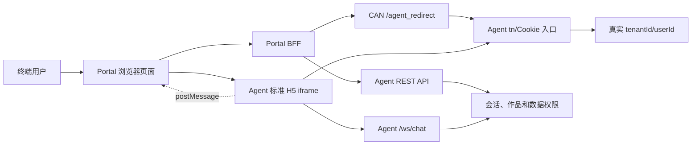
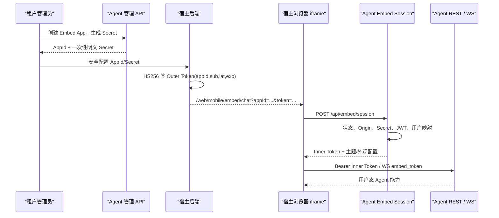
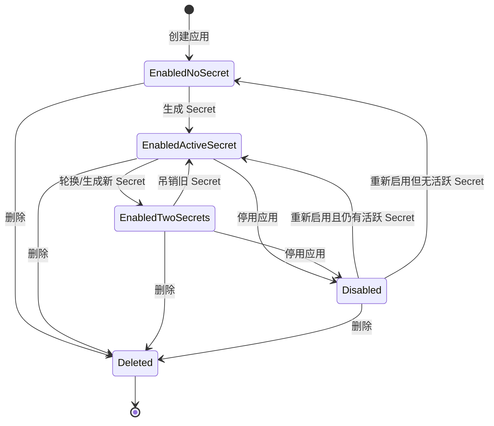
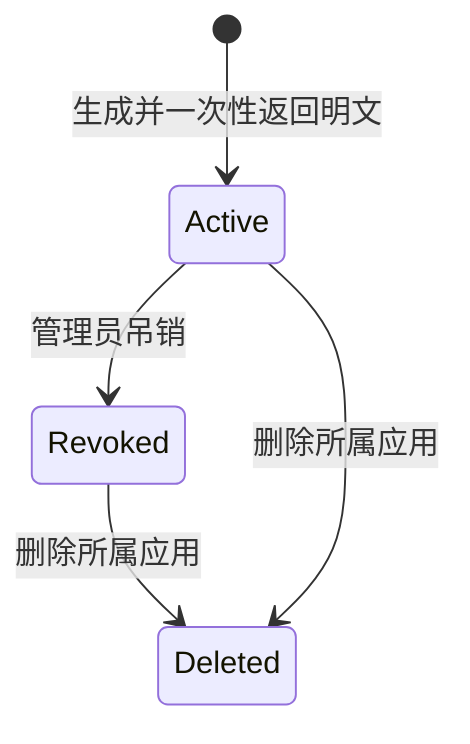
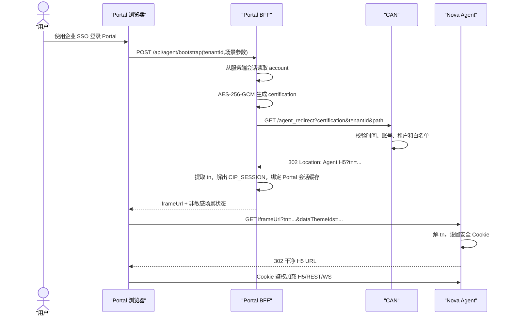
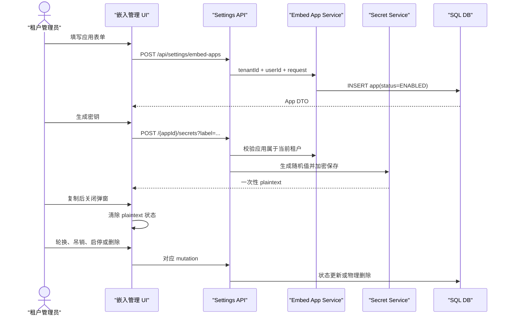
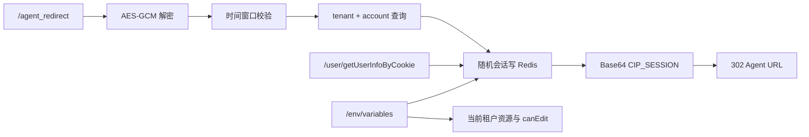

```
# 嵌入式应用创建、密钥、启停和集成指南

## 1. 结论与边界

### 1.1 业务问题与目标用户

嵌入能力解决的是：客户 Portal、业务驾驶舱、IM WebView 或其他宿主产品，如何让自己的已登录用户在宿主界面中直接使用 Agent 对话，同时保持真实用户身份、租户权限、数据主题、会话、作品和审计归属。

这一能力曾存在两套不同形态，复刻时必须先选定目标，不能把两者混成一条链路：

| 形态 | 核心身份机制 | 是否需要在 Agent 创建应用和密钥 | 当前状态 |
|---|---|---:|---|
| 旧版 App/Secret 模式 | 宿主用每应用 Secret 签外层 JWT，Agent 换发内层 JWT | 是 | `I` 曾完整实现，已于 2026-07-28 明确下线；当前只残留数据库表和测试/设计材料 |
| 当前 CAN SSO 模式 | 宿主后端用当前用户账号向 CAN 换取 `tn`/`CIP_SESSION`，再打开标准 H5/API | 否 | `I` 当前产品文档、认证过滤器、H5 参数和 Portal 样例采用的正式链路 |

因此，当前 Nova 的业务结论不是“存在可用的嵌入应用管理页”，而是：

- `I` 当前没有 `/web/settings/embed` 产品页面，没有嵌入应用 Controller、Service、Entity 或 Secret 管理服务。
- `I` 当前 `/api/embed/session` 已不再是公开路径；无 Cookie 请求会得到 401，认证后也没有对应 Controller 可处理该路径。
- `I` 当前保留 `/web/mobile/chat`、标准 REST、`/ws/chat`、`tn` 入口、跨站 Cookie 属性、URL 场景参数和宿主 `postMessage` 通知，可组成可用的嵌入聊天链路。
- `I` 当前推荐由 Portal BFF 持有 `CIP_SESSION` 并代理 Agent API；浏览器携带 `tn` 直连只用于联调或兼容。
- `I` 旧版 `embed_app`、`embed_app_secret` 两张表仍由 Flyway 创建，但当前没有业务代码读取或维护它们。不能仅凭表存在声称旧功能仍可用。
- `Retired/H` `nova_ui_e2e` 仍有一个真正连接旧页面和旧 API 的 Midscene 生命周期 spec，覆盖创建、列表/详情回读、刷新和精确删除；迁移台账同时明确发布环境管理页已下线、该流程已从 active regression 移除。文件名仍符合 Playwright 默认发现规则，仓库也保留显式运行命令，但在当前产品上预期因路由下线而失败，不能标为当前 Active 能力。
- `U` `nova_ui_e2e` 还保留名称、TTL、Origin、Secret、轮换、启停、指南和失败恢复 helper，但当前可见 spec/flow 没有调用它们。其中失败恢复 helper 使用 `page.route` 人工返回 500，属于路由 Mock 合同；其余 helper 若被接线会操作真实旧 UI/API。它们只能作为未接线的验收意图，不能一律标为 `A` 或声称已执行。
- `P` `nova_auto_test` 只登记了 6 条嵌入用例设想，没有对应 YAML case，状态均为“未登记”，不能声称 API/WS 黑盒测试已通过。

本文面向三类读者：

1. 希望复刻“当前 Nova 嵌入效果”的工程师：实现 CAN SSO、标准 H5/API 和 BFF 即可，不应重建旧管理面。
2. 因客户兼容需要而必须复刻“嵌入应用 + Secret”的工程师：本文给出旧契约、缺陷和生产化修正版。
3. 需要评估产品取舍的架构师：本文解释为何 BFF/CAN SSO 与每应用共享密钥是两种不同的信任模型。

### 1.2 输入、输出与用户可见效果

当前 CAN SSO 形态的输入和输出如下：

| 阶段 | 输入 | 输出 |
|---|---|---|
| Portal 登录 | 当前宿主用户的稳定账号 | Portal 登录会话 |
| CAN bootstrap | `account`、`tenantId`、回跳 `path`、加密 `certification` | 302 回跳 URL，其中包含 `tn` |
| Agent 登录态建立 | `tn` | Agent 域 `CIP_SESSION` Cookie；跳转到移除 `tn` 的干净 URL |
| 嵌入页面初始化 | 会话 ID及 `dataThemeIds/theme/lang/hostContext/...` | 标准移动 H5 对话页、可选隐藏导航、主题预选和首问 |
| Agent 交互 | Cookie 认证的 REST 与 WebSocket | 流式回答、会话、作品、引用及宿主事件 |

旧版 App/Secret 形态的管理输入包括名称、描述、绑定主题、允许域名、外层 Token TTL、提示词、欢迎语、外观和会话初始化 JSON。其输出包括 AppId、一个或多个一次性明文 Secret、启停状态、接入说明以及可被 iframe 使用的内层访问 Token。

### 1.3 包含与不包含

本文包含：

- 当前 CAN SSO 嵌入的完整业务链路、URL/REST/WS/事件契约。
- 旧版应用列表、创建、更新、删除、启停、Secret 生成/轮换/吊销、接入指南和双层 Token 契约。
- 两张残留表的完整 DDL 语义。
- 租户、用户、管理员、宿主 Origin、CORS、Cookie、Secret 和会话归属。
- 最小兼容 Stub、当前等价实现和生产级参考设计。

本文不展开通用对话消息格式、Artifact 全生命周期、CAN 内部用户数据库或完整 Tool Loop；但会给出嵌入接入必须知道的边界。宿主业务上下文不能代替 CAN/数据系统权限，本文件也不把 URL 中的主题参数视为授权凭据。

### 1.4 验证边界

本次仅进行了三仓和 Git 历史的静态分析，没有启动 Nova、没有访问真实 CAN、没有执行 API、WebSocket 或浏览器用例，因此本文不使用 `R`。历史源码只用于还原已下线契约，所有相关结论均显式标为“旧版”。

为避免把“代码存在”误写成“当前可运行”，本文对 UI E2E 证据增加三个局部标签：

- `H`：历史实现或历史产品合同，可由 Git 历史还原，但当前代码不再提供该能力。
- `Retired`：测试文件仍在、甚至仍可被默认发现或显式命令选中，但已经从有效发布回归范围退役。
- `U`：helper/断言代码存在，却没有被当前 spec/flow 接线；只能证明作者意图，不能证明执行结果。

这些标签细化而不替代全局证据等级。例如 `Retired/H` 表示“针对历史能力的已退役测试”，`U/Mock` 表示“未接线且依赖路由 Mock 的异常合同”。

## 2. 术语与参与方

| 术语 | 定义 |
|---|---|
| Portal | 客户宿主产品，拥有自己的登录态和业务页面 |
| Portal BFF | 宿主后端；代表当前用户访问 CAN/Agent，并避免把长期登录态暴露给浏览器 |
| CAN | 当前 Nova 所依赖的统一登录、租户和数据权限来源；提供 `/agent_redirect` |
| `certification` | Portal 使用 CAN 约定密钥对 `{account,timestamp}` 加密得到的短时免登凭证 |
| `tn` | CAN 回跳 Agent 时携带的 Base64 Cookie 字符串，通常包含 `CIP_SESSION` |
| `CIP_SESSION` | Agent 调 CAN 鉴权当前用户的会话 Cookie |
| Embed App | 旧版中的租户级嵌入配置，一个对接场景对应一条记录 |
| App Secret | 旧版中每个 Embed App 的 HMAC Secret；支持多个同时活跃 |
| Outer Token | 旧版中宿主使用 App Secret 签发的 JWT，只用于换取 Inner Token |
| Inner Token | 旧版中 Agent 使用平台主密钥签发的短时 JWT，用于 REST/WS |
| Theme Lock | 页面不允许用户切换数据主题；当前实现主要是 UI 锁定，不是独立授权边界 |
| Host Context | 宿主传来的页面筛选/业务提示，会被转成首问前缀，不是可信权限声明 |

### 2.1 当前参与方与信任边界



信任边界如下：

- Portal 浏览器不应获得 CAN certification 密钥或长期 `CIP_SESSION`。
- Portal BFF 只能使用当前 Portal 登录用户的账号，不允许浏览器覆盖 `account`。
- CAN 负责把账号映射为合法租户用户并生成 Agent 登录态。
- Agent 只相信经 CAN 校验的 `CIP_SESSION`，而不相信 URL 中的 `hostContext`、`dataThemeIds` 或用户 ID。
- iframe 与父页面跨域，状态同步必须依靠 Portal 自己保存的状态和显式 `postMessage`。

### 2.2 旧版双层 Token 参与方



## 3. 业务规则

### 3.1 当前 CAN SSO 形态

1. Portal 必须先拥有真实登录用户，并得到与 CAN 用户目录一致的稳定 `account`。
2. `account` 必须由 Portal 服务端从登录态取得；浏览器请求体中的账号不可成为权威值。
3. `tenantId` 必须来自受控配置或授权映射，不能让普通用户任意选择其他租户。
4. Portal 后端生成 `certification`，请求 CAN `/agent_redirect`，并从 302 `Location` 提取 `tn`。
5. 新会话回跳路径使用 `/web/mobile/chat/`；历史会话使用 `/web/mobile/chat/{conversationId}`。
6. iframe 首次携带 `tn` 访问 Agent。Agent 解码其中 Cookie，认证入口写入 Agent 域 Cookie，然后 302 到移除 `tn`、保留其他参数的相对 URL。
7. HTTPS 下 `CIP_SESSION` 被设置为 `HttpOnly; Secure; SameSite=None; Partitioned`，Cookie 的 `Max-Age` 为 24 小时。这个值只控制浏览器保留 Cookie 的上限，不是 CAN Session 的真实有效期；CAN 可因自身 TTL、登出、吊销或租户切换提前使其失效。反向代理必须可信地传入 `X-Forwarded-Proto: https`，否则跨站属性会丢失。
8. Portal BFF 代理 Agent API 时使用 `Cookie: CIP_SESSION=...`；浏览器不需要也不应传 `tenantId/userId`。
9. 浏览器 direct-tn 可把 `tn` 放入 API query 或 `X-Agent-Tn` Header。它会增加 URL、日志、浏览器工具暴露风险，只作为联调路径。
10. 当前 WebSocket 仍使用 Cookie 鉴权，地址为 `/ws/chat?lang=<zh|en>`；旧版 `embed_token` query 已删除。
11. 会话、消息、作品和引用归属 CAN 映射后的真实用户与租户，与桌面端一致。
12. 401、419、440、跳转到 `/login` 或 WebSocket 关闭码 4401 表示身份过期。iframe 应通知宿主重新 bootstrap，而非循环刷新。

### 3.2 当前 URL 场景参数

| 参数 | 类型 | 默认值 | 当前语义 | 安全边界 |
|---|---|---|---|---|
| `tn` | string | 无 | 首次建立 Agent Cookie；随后会从页面 URL 移除 | 敏感登录态，不应长期保留或记录 |
| `dataThemeId` | string | 无 | 指定一个主题 | 仅 UI/请求范围，不授予数据权限 |
| `dataThemeIds` | comma string | 无 | 取第一个非空 ID；与 `dataThemeId` 同时存在时单数优先 | 仅 UI/请求范围，不授予数据权限 |
| `hideSidebar` | boolean-like | false | `true/1/yes` 隐藏 PC 侧栏或 H5 菜单按钮 | 仅外观 |
| `theme` | `light|dark` | 当前主题 | UI 明暗主题 | 仅外观 |
| `lang` | `zh|en` | 浏览器/系统语言 | UI 和首问语言；API 应同步 `X-Nova-Lang` | 仅显示/回答语言 |
| `recommendedQuestions` | JSON array/object | 服务端默认 | URL 提供的问题优先于默认问题 | 不可信文本，展示时转义 |
| `hostContext` | JSON/string | 无 | 生成首问前缀，可表达筛选条件或直接 prompt | 不得作为权限过滤的唯一依据 |
| `initialQuestion` | string | 无 | 预填首问 | 不可信用户内容，按普通提问处理 |
| `autoAsk` | boolean-like | false | 有首问时进入页面自动发送一次 | 必须防止重渲染重复发送 |

主题参数解析规则：

- `dataThemeId` 优先于 `dataThemeIds`。
- 多值按逗号切分，取第一个非空值。
- `__all_data__` 表示所有数据，并仍进入“锁定”状态，用户不能在 UI 中切换。
- 新会话收到服务器返回的 conversationId 后，前端跳转到历史会话 URL时保留完整 query，因此上述场景参数继续存在。
- 当前主题锁定由前端 store 实现：锁定时用户选择主题的动作变为 no-op，输入区隐藏主题/目录控件。
- `I` 当前后端没有“embedLocked”上下文；恶意调用者仍可构造另一合法主题的 WS 请求。真正安全边界是租户可见主题校验和下游数据权限，而不是 URL 锁定。

`hostContext` 的归一化规则：

1. 纯文本变为 `当前会话需要对数据进行以下条件的过滤：\n- <文本>\n\n`。
2. JSON 字符串直接作为 prompt。
3. JSON object 中优先读取 `prompt/prefill/instruction/text`。
4. 否则从 `filters/dimensionFilters/conditions/filterConditions` 读取数组。
5. 维度名兼容 `dimensionLabel/dimension/dimensionName/dimensionKey/field/...`。
6. 值兼容 `values/value/ids/id/dimensionValues/dimensionValue`，可带展示标签。
7. 以 `{` 或 `[` 开头但 JSON 解析失败时静默忽略，不把疑似损坏 JSON 当普通提示词发送。

### 3.3 当前宿主事件

Agent H5 在 iframe 中向父窗口发送两类事件：

```ts
type NovaEmbedEvent =
  | {
      type: "nova:conversation-created";
      conversationId: string;
      timestamp: number;
    }
  | {
      type: "nova:auth-expired";
      reason: "http-401" | "http-419" | "http-440" | "redirect-login" | "websocket-4401" | string;
      status?: number;
      url?: string;
      timestamp: number;
    };
```

当前发送使用 `window.parent.postMessage(message, "*")`。宿主必须至少同时校验：

- `event.source === iframe.contentWindow`；
- `event.origin === 预期 Agent Origin`；
- `event.data.type` 属于白名单；
- conversationId 格式有效。

生产复刻建议 iframe 已知宿主 Origin 时使用精确 `targetOrigin`，不要延续 `"*"`。

### 3.4 旧版 Embed App 管理规则

以下是下线前的真实实现合同，用于兼容复刻，不代表当前可用：

1. 所有管理接口均要求租户管理员。
2. 应用是租户级资产；列表按租户读取，非创建者管理员也可管理。
3. `id` 是 UUID，创建默认 `status=ENABLED`。
4. 创建时 `tokenTtlSeconds > 0` 则原样保存，否则回退 300 秒。
5. 更新采用 nullable patch 语义：字段非 null 才覆盖；因此旧实现无法用 `null` 清空可空字段。
6. 旧服务端未严格校验名称空白、域名 JSON、TTL 范围或 JSON 配置。UI E2E 期望名称非空、域名是 JSON、TTL 在 60～86400 秒，但这些不能替代服务端约束。
7. 状态接口只接受 `ENABLED` 或 `DISABLED`。
8. 域名白名单以 JSON array string 存储并做大小写不敏感的精确 Origin 匹配，不支持通配符。
9. Secret 是 32 个随机字节，经无 padding Base64URL 编码；数据库仅存 AES-GCM 密文。
10. Secret 明文只在生成响应返回一次；列表永远不返回密文或明文。
11. 同一应用允许多个 `ACTIVE` Secret；验证按创建时间倒序逐个尝试，支持无停机轮换。
12. 吊销将单个 Secret 改为 `REVOKED` 并写 `revokedAt`；不会自动吊销其他 Secret。
13. 删除应用在一个事务中先物理删除 Secret，再物理删除应用，没有软删除和审计保留。
14. 应用禁用或 Secret 吊销会阻止新的 Session Exchange，但已签发的 Inner Token 在过期前仍可继续使用。这是旧实现的重要安全时窗。
15. 旧版主题锁定被写入 Inner Token 和运行时 Context，后端会忽略客户端传来的其他主题；这一点比当前 URL UI 锁定更强。

### 3.5 旧版状态机



Secret 状态：



生产设计应增加 `DELETING/DELETED`、配置版本、审计事件和 Session/Token 撤销版本，避免“管理 UI 已禁用但已签发 Token 仍可用”的语义落差。

## 4. 完整执行链路

### 4.1 当前 Portal BFF bootstrap



具体步骤：

1. BFF 验证 Portal 登录态和 CSRF，不接收浏览器自报账号。
2. 从受控配置解析 tenantId；如支持多租户，先做用户到租户的授权映射。
3. 构造 `{account,timestamp: nowMillis}`，使用 CAN 配置的 AES-256-GCM key/IV/tag length 生成 `certification`。
4. 请求 `/agent_redirect` 时关闭自动跟随，或记录完整但脱敏的跳转链。
5. 仅允许 CAN 回跳到配置的 Agent Origin；拒绝开放重定向。
6. 从 `Location` query 读取 `tn`，Base64 解码 Cookie 字符串并提取 `CIP_SESSION`。
7. 在 Portal 服务端 Session/Redis 保存 `tn`、`CIP_SESSION`、tenantId、account、签发时间和刷新状态；浏览器响应尽量不返回 `CIP_SESSION`。
8. 生成 iframe URL。新对话无 conversationId，历史对话把经过对象权限校验的 ID 放入路径。
9. iframe 首次用 `tn` 建立 Agent Cookie。Agent 使用相对 302，避免反向代理下错误 scheme/host。
10. 后续 Portal 左侧会话列表、标题、删除、推荐问题等功能优先调用 BFF，BFF 使用缓存 Cookie 代理 Agent。

### 4.2 当前 iframe 对话与会话创建

1. H5 根据 URL 初始化主题、语言、导航和推荐问题。
2. 有 `hostContext`/`initialQuestion` 且 `autoAsk=false` 时，仅填入输入框。
3. `autoAsk=true` 且存在 `initialQuestion` 时自动发送一次；仅 `lang` 变化不会重复触发。
4. 新对话第一条消息通过 `/ws/chat` 发送，WebSocket 使用 Agent Cookie 鉴权。
5. 服务端发送 `conversation_id` 事件后，前端更新 store，保留 query 跳转到 `/web/mobile/chat/{id}`。
6. 前端向父窗口发送 `nova:conversation-created`。Portal 保存 conversationId 与当前 hostContext/页面业务对象的映射。
7. 流式 Token、工具、作品和最终完成事件沿用标准聊天协议。
8. Cookie 在 REST 中返回 401/419/440、响应重定向到 `/login`，或 WS 以 4401 关闭时，iframe 发送 `nova:auth-expired`。
9. Portal 收到过期事件后串行化刷新：同一会话只允许一个 bootstrap 请求；成功后重建 iframe/BFF Cookie，失败则展示显式重新登录状态。

### 4.3 当前 BFF API 代理

BFF 代理应采用明确 allow-list，而不是开放任意 Agent URL。常见接口：

```text
GET    /api/conversations/history?limit=50&dataThemeIds=<csv>
GET    /api/conversations/{id}
GET    /api/conversations/{id}/messages
PUT    /api/conversations/{id}/title
PUT    /api/conversations/{id}/pin
DELETE /api/conversations/{id}/pin
DELETE /api/conversations/{id}
GET    /api/data-themes/available
GET    /api/data-themes/{themeId}/recommended-questions
GET    /api/chat/suggestions?dataThemeId=<id>
```

每次代理必须：

- 从 BFF 会话取 Cookie，不从浏览器 body/header 接受它；
- 添加 `Cookie: CIP_SESSION=<value>` 和 `X-Nova-Lang`；
- 限制 method/path/query/body 大小；
- 对 conversationId 做当前用户对象权限校验，或依赖 Agent 返回的不可枚举 404 后仍记录审计；
- 收到 401 时清除 BFF 缓存并返回稳定的 `AGENT_SESSION_EXPIRED`，不无限自动重试非幂等请求；
- 不把 Agent `Set-Cookie`、内部错误堆栈和敏感 Header直接透传到浏览器。

### 4.4 旧版管理生命周期



失败恢复合同来自 UI E2E，虽不再 active，仍适合作为复刻标准：

- 创建 500：弹窗保留、输入草稿不丢、列表不新增。
- 生成 Secret 500：不显示一次性 Secret 弹窗，Secret 列表数量不变。
- 吊销 500：该行仍是 ACTIVE，吊销按钮仍可用。
- 启停 500：Switch 和状态 Badge 回滚，刷新后仍是原状态。
- 删除 500：应用仍在列表且可重新打开详情。
- 接入指南 500：不打开空白指南弹窗，显示服务端错误。

### 4.5 旧版 Session Exchange 与运行

1. 宿主后端用 App Secret 签 HS256 JWT，claims 为 `appId/sub/iat/exp`。
2. iframe 打开 `/web/mobile/embed/chat?appId=<id>&token=<outerJwt>`。
3. 页面 `POST /api/embed/session`，不携带 Cookie。
4. Session Controller 先按客户端 IP 限流。
5. 读取 App；不存在或非 ENABLED 则拒绝。
6. 把 allowedOrigins 写为 CSP `frame-ancestors`，并用 `Origin`，缺少时用 `Referer` 的 scheme/host/port 做精确匹配。
7. 读取所有 ACTIVE Secret，逐个解密和验签；第一个成功者获胜。
8. 从 `sub` 大小写不敏感匹配该租户已有用户 `account`；不做 JIT 创建。
9. 签发包含 tenantId/userId/appId/themeId 的 30 分钟 Inner JWT。
10. iframe 后续 REST 使用 `Authorization: Bearer <innerToken>`，WS 使用 `?embed_token=<innerToken>`。
11. REST/WS 都创建真实用户 Context，并强制绑定主题。

## 5. 对外契约

### 5.1 当前 CAN `/agent_redirect` 契约

请求：

```http
GET https://can.example.com/agent_redirect
  ?certification=<url-encoded-base64>
  &tenantId=<tenant-id>
  &path=%2Fweb%2Fmobile%2Fchat%2F
```

`certification` 明文 payload：

```json
{
  "account": "current.portal.user@example.com",
  "timestamp": 1786032000123
}
```

已观察到的加密约定：

| 项 | 值 |
|---|---|
| 算法 | AES-256-GCM |
| key | CAN 租户免登设置提供的 Base64 32-byte key |
| IV | CAN 配置提供的 Base64 IV；样例允许环境变量覆盖 |
| tag | 128 bit 默认值 |
| 输出 | `base64(ciphertext + authTag)`，再 URL encode |

成功响应：

```http
HTTP/1.1 302 Found
Location: https://agent.example.com/web/mobile/chat/?tn=<url-encoded-base64-cookie-string>
```

`tn` 解码后至少应包含：

```text
CIP_SESSION=<opaque-session-value>
```

`F` CAN 对账号存在性、timestamp 窗口、tenantId 成员关系和回跳白名单做校验，是由集成手册与调用结果预期推断的对端职责；本文没有 CAN 对端源码或运行验证。生产对端必须以不泄露用户/租户存在性的统一错误返回失败。

### 5.2 当前 Agent `tn` 入口

页面入口：

```http
GET /web/mobile/chat/?tn=<tn>&dataThemeIds=sales&hideSidebar=true&lang=zh
```

行为：

- URL decode 后 Base64 decode；按分号解析 name=value Cookie。
- 找到 `CIP_SESSION` 后在响应设置 Cookie。
- 非 API 请求 302 到移除 `tn`、保留其他 query 的相对 URL。
- 解码失败返回 400：

```json
{
  "error": "Failed to decode token: <reason>"
}
```

API direct-tn：

```http
GET /api/conversations/history?limit=50&tn=<tn>
```

或：

```http
GET /api/conversations/history?limit=50
X-Agent-Tn: <tn>
```

API 模式直接解码、认证并继续执行请求，不做 clean redirect。

### 5.3 当前 Portal BFF 推荐契约

Nova 样例没有要求客户必须使用某个 BFF 路径；以下是可互操作的推荐契约：

```http
POST /api/agent/bootstrap
Content-Type: application/json
X-CSRF-Token: <portal-token>

{
  "tenantId": "tenant-1",
  "conversationId": null,
  "dataThemeIds": "sales-theme",
  "theme": "dark",
  "lang": "zh",
  "recommendedQuestions": ["本月销售额如何？"],
  "hostContext": {
    "scene": "store_dashboard",
    "filters": [
      {"dimension": "store_id", "operator": "in", "values": ["SH001"]}
    ]
  },
  "initialQuestion": "请分析本月销售",
  "autoAsk": false,
  "hideSidebar": true
}
```

成功：

```json
{
  "success": true,
  "tenantId": "tenant-1",
  "iframeUrl": "https://agent.example.com/web/mobile/chat/?tn=REDACTED&dataThemeIds=sales-theme&hideSidebar=true&lang=zh",
  "bootstrappedAt": "2026-08-07T10:00:00+08:00",
  "expiresAt": null
}
```

生产响应不应返回 `account`、`certification`、`CIP_SESSION` 或完整 redirect chain。若浏览器必须直接打开带 `tn` 的跨域 iframe，`iframeUrl` 会短暂包含 `tn`；应设置 `Cache-Control: no-store`、`Referrer-Policy: no-referrer`，并确保日志脱敏。

建议错误体：

```json
{
  "success": false,
  "errorCode": "AGENT_BOOTSTRAP_FAILED",
  "message": "暂时无法连接智能分析服务，请重试",
  "requestId": "req-...",
  "retryable": true
}
```

### 5.4 当前 CORS、WS 和 iframe Header

`I` 当前 REST `/api/**` 允许配置 `nova.cors.allowed-origin-patterns`，默认 `[*]`，允许凭据，方法包含 GET/POST/PUT/PATCH/DELETE/OPTIONS，Header 为 `*`。WebSocket 当前 `.setAllowedOrigins("*")`。

`I` 当前不存在 integration/app registry，也没有“已登记 Portal Origin”数据可供 REST 或 WS 查询。因此当前业务效果的等价复刻必须忠实表现为：默认配置下，带任意测试 `Origin` 的 REST 预检/跨域请求会被 CORS pattern 匹配，任意 `Origin` 的 WS 握手也不会被应用级 allow-list 拒绝。这里描述的是现状，不是安全保证；与 `allowCredentials=true` 组合后风险尤其高。

当前实现没有为标准 H5 页面按宿主动态设置 `Content-Security-Policy: frame-ancestors` 的业务逻辑。生产部署必须在网关或应用层补齐：

```http
Content-Security-Policy: frame-ancestors https://portal.example.com
Referrer-Policy: no-referrer
Cache-Control: no-store
```

以下是 `D` 生产安全修正，不能写成当前已实现合同：

- REST 只允许已登记 Portal Origin，并保留 `allowCredentials=true`。
- WS 握手校验同一 Origin allow-list。
- 由 BFF 完成 API 代理时，可完全不向 Portal 浏览器开放跨域 REST。
- OPTIONS 预检可以绕过认证，但实际请求必须认证。

### 5.5 旧版管理 API 总表

统一前缀：`/api/settings/embed-apps`。所有接口要求已登录租户管理员，作用域来自服务端 Context。

| 方法 | 路径 | 请求 | 响应 | 旧版语义 |
|---|---|---|---|---|
| GET | `/api/settings/embed-apps` | 无 | `EmbedApp[]` | 当前租户，createdAt 倒序 |
| GET | `/api/settings/embed-apps/{id}` | 无 | `EmbedApp` | 跨租户统一按 not found |
| POST | `/api/settings/embed-apps` | `EmbedAppCreateRequest` | `EmbedApp` | 创建即 ENABLED |
| PUT | `/api/settings/embed-apps/{id}` | `EmbedAppUpdateRequest` | `EmbedApp` | 非 null 字段覆盖 |
| PUT | `/api/settings/embed-apps/{id}/status` | `{"status":"ENABLED|DISABLED"}` | `EmbedApp` | 立即影响新 exchange |
| DELETE | `/api/settings/embed-apps/{id}` | 无 | 204 | 先删 secrets 再删 app |
| POST | `/api/settings/embed-apps/{id}/secrets?label=v2` | 无 | 一次性 Secret | 多 Secret 可并存 |
| POST | `/api/settings/embed-apps/{id}/secrets/{secretId}/revoke` | 无 | 204 | Secret 必须属于 app |
| GET | `/api/settings/embed-apps/{id}/integration-guide` | 无 | Guide DTO | 动态嵌入模板 |

创建请求：

```json
{
  "name": "Sales Portal",
  "description": "销售驾驶舱嵌入",
  "boundThemeId": "sales-theme",
  "allowedOrigins": "[\"https://portal.example.com\"]",
  "tokenTtlSeconds": 300,
  "systemPrompt": "回答仅围绕销售主题",
  "welcomeMessage": "欢迎使用销售分析助手",
  "appearanceJson": "{\"title\":\"销售助手\",\"showHeader\":true}",
  "sessionInitJson": "{\"allowNewConversation\":true}"
}
```

更新请求字段相同，但 `tokenTtlSeconds` 是 nullable，其他字段缺省表示保留。生产复刻应采用标准 JSON object，而不是在 JSON 中再套字符串：

```json
{
  "allowedOrigins": ["https://portal.example.com"],
  "appearance": {"title": "销售助手", "showHeader": true},
  "sessionInit": {"allowNewConversation": true}
}
```

应用响应：

```json
{
  "id": "app-uuid",
  "name": "Sales Portal",
  "description": "销售驾驶舱嵌入",
  "status": "ENABLED",
  "boundThemeId": "sales-theme",
  "allowedOrigins": "[\"https://portal.example.com\"]",
  "tokenTtlSeconds": 300,
  "systemPrompt": "回答仅围绕销售主题",
  "welcomeMessage": "欢迎使用销售分析助手",
  "appearanceJson": "{\"title\":\"销售助手\"}",
  "sessionInitJson": "{\"allowNewConversation\":true}",
  "createdBy": "user-1",
  "createdAt": "2026-06-03T10:00:00Z",
  "updatedAt": "2026-06-03T10:00:00Z",
  "secrets": [
    {
      "id": "secret-uuid",
      "status": "ACTIVE",
      "label": "v2",
      "createdAt": "2026-06-03T10:05:00Z",
      "revokedAt": null
    }
  ]
}
```

Secret 生成响应：

```json
{
  "secretId": "secret-uuid",
  "plaintext": "base64url-32-random-bytes",
  "label": "v2",
  "createdAt": "2026-06-03T10:05:00Z"
}
```

后续任何列表/详情都不得再返回 `plaintext` 或 `secretCipher`。

接入指南响应：

```json
{
  "embedUrl": "/web/mobile/embed/chat?appId=app-uuid&token=<outer_token>",
  "sessionEndpoint": "POST /api/embed/session",
  "tokenFieldSpec": "JWT HS256 { appId, sub: <external_user_identifier>, iat, exp }",
  "pseudoCodeExample": "<按 appId 和 TTL 生成的签名伪代码>",
  "allowedOriginsHint": "[\"https://portal.example.com\"]"
}
```

### 5.6 旧版 Session Exchange

```http
POST /api/embed/session
Origin: https://portal.example.com
Content-Type: application/json

{
  "appId": "app-uuid",
  "token": "eyJ...outer-jwt"
}
```

成功：

```json
{
  "innerToken": "eyJ...inner-jwt",
  "themeId": "sales-theme",
  "welcomeMessage": "欢迎使用销售分析助手",
  "appearanceJson": "{\"title\":\"销售助手\"}",
  "sessionInitJson": "{\"allowNewConversation\":true}",
  "allowDownload": true
}
```

失败：

| HTTP | `errorCode` | 条件 |
|---:|---|---|
| 400 | `INVALID_REQUEST` | appId 空白 |
| 400 | `APP_NOT_FOUND` | app 不存在 |
| 400 | `APP_DISABLED` | app 非 ENABLED |
| 400 | `ORIGIN_NOT_ALLOWED` | Origin/Referer 不匹配或白名单损坏 |
| 400 | `INVALID_TOKEN` | 无活跃 Secret、JWT 无效/过期/错误 appId、密文损坏 |
| 400 | `USER_NOT_FOUND` | sub 不能匹配租户已有用户 |
| 429 | `RATE_LIMITED` | 每 IP 限流，响应 `Retry-After: 60` |

错误体：

```json
{
  "errorCode": "INVALID_TOKEN",
  "message": "Invalid or expired token"
}
```

旧版 Outer JWT：

```json
{
  "sub": "external.user@example.com",
  "appId": "app-uuid",
  "iat": 1786032000,
  "exp": 1786032300
}
```

签名 key 不是直接把字符串 Secret 作为任意长度 HMAC key，而是：

```text
hmacKey = SHA-256(UTF-8(plaintextSecret))
token = JWT-HS256(payload, hmacKey)
```

`K` 历史接入指南与真实 verifier 在这里不一致：旧 Guide 的 Python 伪代码直接执行 `jwt.encode(payload, EMBED_SECRET, algorithm="HS256")`，即以原始 Secret 字符串为 key；服务端 verifier 和服务端自身的签发逻辑却使用 `SHA-256(UTF-8(secret))` 的 32 字节结果。照抄旧 Guide 生成的 Outer Token 无法通过真实 verifier。这是历史文档/实现缺陷，不得在复刻文档中悄悄任选一种。

兼容决策必须显式版本化：

1. **复刻历史运行时（推荐的兼容基线）**：保持 verifier 的派生规则，SDK 先计算 `SHA-256(UTF-8(secret))` 再做 HS256，并修正接入指南。这样兼容旧服务端真实行为，但不兼容照抄错误 Guide 的客户端。
2. **短期兼容两类存量客户端**：在可审计迁移期先尝试派生 key，再按 integration 的显式 legacy 标志尝试原始 key；禁止无条件双验。记录命中版本，迁移完成后关闭 raw-secret 路径。
3. **新设计**：在 integration 或 JWT Header 中声明受控的 `keyDerivationVersion`/`kid`，服务端按登记版本验证；不要让客户端自报任意算法。Secret 轮换完成后统一到派生 key，并同步修复 Python、Node、Java 指南。

旧版 Inner JWT：

```json
{
  "type": "embed-inner",
  "tenantId": "tenant-1",
  "userId": "user-1",
  "appId": "app-uuid",
  "themeId": "sales-theme",
  "iat": 1786032000,
  "exp": 1786033800
}
```

旧版 REST 的精确分流规则不是“任何 Bearer 都不回退”：

```text
if Authorization startsWith "Bearer ":
  candidate = trim(value after prefix)
  if candidate has exactly 3 dot-separated JWT segments
     and EmbedTokenService is actually assembled:
       verify as Inner Token
       if verification fails: return 401 immediately; do not try Cookie
  else:
       fall through to normal CIP_SESSION Cookie authentication
else:
  use normal CIP_SESSION Cookie authentication
```

因此，三段 JWT 形态的 Bearer 且服务已装配时属于 embed 尝试并 fail-hard；非 JWT Bearer、空值或服务未装配会回退 Cookie。这个回退是历史兼容事实，也可能掩盖调用方错误。

旧版 WS 的规则更严格：query 中 `embed_token` **非空**时，无条件进入 Inner Token 验证，失败立即拒绝握手，不回退 Cookie；参数缺失或空白时才使用 `CIP_SESSION` Cookie。成功地址为 `/ws/chat?embed_token=<innerToken>&lang=zh`。

`D` 新复刻建议将认证模式做成显式、互斥的路由或凭据类型；若请求声明 Bearer/embed 模式，任何格式或验签错误均 fail-hard，禁止回退 Cookie。但这项“任何 Bearer 不回退”是安全修正，不是旧版既有行为。

## 6. 数据模型与生命周期

### 6.1 当前残留 DDL

PostgreSQL 等价 DDL：

```sql
CREATE TABLE embed_app (
    id                 VARCHAR(64) PRIMARY KEY,
    tenant_id          VARCHAR(64) NOT NULL,
    user_id            VARCHAR(64),
    name               VARCHAR(255) NOT NULL,
    description        TEXT,
    status             VARCHAR(16) NOT NULL DEFAULT 'ENABLED',
    bound_theme_id     VARCHAR(64),
    allowed_origins    TEXT,
    token_ttl_seconds  INT NOT NULL DEFAULT 300,
    model_scope        TEXT,
    system_prompt      TEXT,
    welcome_message    TEXT,
    appearance_json    TEXT,
    session_init_json  TEXT,
    created_by         VARCHAR(64) NOT NULL,
    created_at         TIMESTAMPTZ NOT NULL,
    updated_at         TIMESTAMPTZ NOT NULL
);

CREATE INDEX idx_embed_app_tenant
    ON embed_app (tenant_id, created_at DESC);

CREATE TABLE embed_app_secret (
    id             VARCHAR(64) PRIMARY KEY,
    app_id         VARCHAR(64) NOT NULL REFERENCES embed_app(id),
    secret_cipher  BYTEA NOT NULL,
    status         VARCHAR(16) NOT NULL DEFAULT 'ACTIVE',
    label          VARCHAR(64),
    created_at     TIMESTAMPTZ NOT NULL,
    revoked_at     TIMESTAMPTZ
);

CREATE INDEX idx_embed_secret_app
    ON embed_app_secret (app_id, status);
```

H2 版本字段相同，但时间为 `TIMESTAMP(6)`、密文为 `VARBINARY(512)`，且 migration 没有声明外键。旧服务靠事务内“先删 Secret、后删 App”保证删除顺序。

### 6.2 字段语义

| 字段 | 归属与生命周期 | 敏感性/约束 |
|---|---|---|
| `tenant_id` | 应用租户；所有管理查询必须带该条件 | 强隔离键 |
| `user_id` | 继承的用户归属字段；旧管理行为实际是租户管理员共享管理 | 不能替代 `created_by` |
| `bound_theme_id` | 旧版签入 Inner Token 的主题 | 保存前应验证属于同租户 |
| `allowed_origins` | 旧版 JSON array string | 应改为规范化子表或 JSON 类型 |
| `token_ttl_seconds` | 宿主 Outer Token 建议时长 | 生产建议 60～900，最大不超过 86400 |
| `model_scope` | 表中存在，但旧 create/update DTO 和服务未读写 | 当前属于未接线字段 |
| `system_prompt` | 旧版应用级提示词 | 必须防越权提示、长度限制和审计 |
| `appearance_json` | 外观配置 | 不应允许注入 HTML/脚本 |
| `session_init_json` | 初始化配置 | 必须 schema 校验 |
| `secret_cipher` | AES-GCM envelope | 绝不返回 API/DOM/日志 |
| `status/revoked_at` | Secret 生命周期 | revokedAt 应与 REVOKED 一致 |

### 6.3 数据一致性和缺口

- `I` 当前 migration 会继续创建两张表，但功能下线提交没有 drop migration。这有利于保留历史数据，但也意味着数据不会被产品自动清理。
- 旧表没有 `(tenant_id,name)` 唯一约束，允许同租户重名。
- Secret 表没有 tenant_id，所有租户隔离依赖先校验父 App。
- PostgreSQL 外键没有 `ON DELETE CASCADE`；H2 甚至没有外键，两个环境约束不完全一致。
- 旧实体没有 `@Version`，并发更新/启停为最后写入者获胜。
- Secret 吊销不是幂等状态机：重复吊销会重复改写 revokedAt，而不是返回原状态。
- 物理删除不保留审计、失败记录、调用量或谁执行了吊销。

### 6.4 生产级推荐 DDL

如果确实要复刻 App/Secret 模式，建议使用：

```sql
CREATE TABLE embed_integration (
    id                    UUID PRIMARY KEY,
    tenant_id             VARCHAR(64) NOT NULL,
    name                  VARCHAR(255) NOT NULL,
    description           TEXT,
    auth_mode             VARCHAR(32) NOT NULL,
    status                VARCHAR(16) NOT NULL,
    bound_theme_id        VARCHAR(64),
    token_ttl_seconds     INT NOT NULL,
    config_json           JSONB NOT NULL DEFAULT '{}'::jsonb,
    config_version        BIGINT NOT NULL DEFAULT 1,
    revocation_version    BIGINT NOT NULL DEFAULT 0,
    created_by            VARCHAR(64) NOT NULL,
    created_at            TIMESTAMPTZ NOT NULL,
    updated_by            VARCHAR(64) NOT NULL,
    updated_at            TIMESTAMPTZ NOT NULL,
    deleted_at            TIMESTAMPTZ,
    UNIQUE (tenant_id, name)
);

CREATE TABLE embed_integration_origin (
    integration_id UUID NOT NULL REFERENCES embed_integration(id) ON DELETE CASCADE,
    origin          VARCHAR(512) NOT NULL,
    PRIMARY KEY (integration_id, origin)
);

CREATE TABLE embed_integration_secret (
    id                UUID PRIMARY KEY,
    integration_id    UUID NOT NULL REFERENCES embed_integration(id) ON DELETE CASCADE,
    key_version       VARCHAR(64) NOT NULL,
    secret_envelope   BYTEA NOT NULL,
    fingerprint       VARCHAR(64) NOT NULL,
    status            VARCHAR(16) NOT NULL,
    not_before        TIMESTAMPTZ NOT NULL,
    expires_at        TIMESTAMPTZ,
    created_by        VARCHAR(64) NOT NULL,
    created_at        TIMESTAMPTZ NOT NULL,
    revoked_by        VARCHAR(64),
    revoked_at        TIMESTAMPTZ,
    UNIQUE (integration_id, key_version)
);

CREATE TABLE embed_integration_audit (
    id                UUID PRIMARY KEY,
    tenant_id         VARCHAR(64) NOT NULL,
    integration_id    UUID,
    actor_user_id     VARCHAR(64),
    action            VARCHAR(64) NOT NULL,
    outcome           VARCHAR(16) NOT NULL,
    request_id        VARCHAR(128),
    detail_json       JSONB NOT NULL DEFAULT '{}'::jsonb,
    created_at        TIMESTAMPTZ NOT NULL
);
```

`secret_envelope` 应由 KMS/密钥版本保护；`fingerprint` 只用于定位密钥版本，不足以恢复 Secret。禁用应用时增加 `revocation_version`，Inner Token 带该版本，受保护请求检查当前版本，才能做到即时失效。

## 7. 核心实现设计

### 7.1 方案选择

#### 方案 A：复刻当前 Nova 业务效果（推荐默认）

组件：

```text
PortalIdentityAdapter
  -> CanCertificationSigner
  -> CanAgentRedirectClient
  -> AgentSessionCache
  -> AgentApiProxy
  -> AgentIframeUrlBuilder
  -> EmbedEventHandler
```

不实现 App/Secret 管理页。客户接入配置由部署配置/Portal 自己管理，身份复用 CAN，Agent 不新增第二套用户映射和密钥体系。

优点：身份和权限单源、管理面更小、会话直接归属真实用户。代价：每个客户 Portal 都要正确实现 BFF；细粒度 Origin/外观/能力配置不在 Agent 统一治理。

#### 方案 B：兼容旧版 App/Secret

仅在确有对端依赖 `/api/settings/embed-apps` 和 `/api/embed/session` 时启用，作为独立可关闭模块。不得让旧 Outer/Inner Token 与当前 `tn` 混用或互相降级。

模块：

```text
EmbedAdminController
EmbedIntegrationService
EmbedSecretVault
OuterTokenVerifier
EmbedSessionBroker
InnerTokenVerifier
EmbedPolicyEnforcer
EmbedAuditService
```

生产实现应修复旧版缺口：服务端校验、配置版本、即时撤销、Origin 规范化、KMS、审计、限流、nonce/jti、防重放、对象权限、CSP 和 WS Origin。

### 7.2 当前等价实现接口

```ts
interface CanSsoClient {
  bootstrap(input: {
    account: string;
    tenantId: string;
    agentPath: string;
  }): Promise<{
    tn: string;
    cipSession: string;
    agentOrigin: string;
  }>;
}

interface AgentSessionStore {
  put(portalSessionId: string, value: {
    tenantId: string;
    account: string;
    tnCiphertext: string;
    cipSessionCiphertext: string;
    createdAt: string;
    expiresAt?: string;
  }): Promise<void>;
  get(portalSessionId: string): Promise<AgentSession | null>;
  invalidate(portalSessionId: string): Promise<void>;
}

interface AgentApiProxy {
  call(session: AgentSession, request: AllowedAgentRequest): Promise<Response>;
}
```

核心伪代码：

```text
bootstrap(portalRequest):
  portalUser = requirePortalLogin(portalRequest)
  assertCsrf(portalRequest)
  tenantId = tenantPolicy.resolve(portalUser, portalRequest.tenantId)
  account = portalUser.canAccount        // never from request body
  certification = encryptAesGcm({account, timestamp: now})
  redirect = can.getAgentRedirect(certification, tenantId, allowedAgentPath)
  assert redirect.origin == configuredAgentOrigin
  tn = requireQuery(redirect.location, "tn")
  cip = requireCookie(decodeTn(tn), "CIP_SESSION")
  store.put(portalSessionId, encryptAtRest(tn, cip, tenantId, account))
  return noStore({iframeUrl: buildIframeUrl(tn, sanitizedSceneParams)})
```

代理伪代码：

```text
proxy(portalRequest):
  session = requireAgentSession(portalSessionId)
  route = allowList.match(method, path)
  if not route: return 404
  upstream = fetch(agentOrigin + route, Cookie=CIP_SESSION, X-Nova-Lang)
  if upstream.status in [401,419,440]:
      store.invalidate(portalSessionId)
      return 401 {errorCode: AGENT_SESSION_EXPIRED}
  return sanitize(upstream)
```

### 7.3 最小兼容外部 Stub

本地复刻可先提供一个假 CAN，而不是把认证短路进 Agent。Stub 必须实现 Agent 实际消费的响应 envelope、失败语义和管理员资源结构。

#### 7.3.1 登录态与用户信息

```ts
type StubUser = { account: string; tenantId: string; userId: string };

GET /agent_redirect?certification&tenantId&path
  1. AES-GCM 解密 certification
  2. 要求 abs(now - timestamp) <= 300000
  3. 在固定 fixture 中查找 account + tenantId
  4. 生成随机 sessionId，保存 sessionId -> StubUser，TTL 30min
  5. tn = base64("CIP_SESSION=" + sessionId)
  6. 302 Location: AGENT_ORIGIN + normalized(path) + "?tn=" + urlencode(tn)
```

Agent 对 CAN 的用户 introspection 请求是：

```http
GET /user/getUserInfoByCookie HTTP/1.1
Cookie: CIP_SESSION=<opaque-session-id>
Accept: application/json
Content-Type: application/json
```

成功 envelope 必须保持以下嵌套；`userId` 和 `tenantId` 是必填，`username`、`account` 可为 null 或缺省：

```json
{
  "success": true,
  "errorCode": null,
  "errorMsg": null,
  "data": {
    "user": {
      "userId": "user-1",
      "username": "Alice",
      "account": "alice@example.com"
    },
    "tenant": {
      "tenantId": "tenant-1"
    }
  }
}
```

业务失败仍可返回 HTTP 200，但 `success=false`，并由 `errorCode/errorMsg` 表达原因：

```json
{
  "success": false,
  "errorCode": "AM_01_0016",
  "errorMsg": "session expired",
  "data": null
}
```

Agent 消费规则必须复刻完整：

1. HTTP connect timeout 和单请求 timeout 均取认证配置，当前默认 10 秒；HTTP client 不跟随 redirect。
2. 非 2xx 一律认证失败，不能把 HTML 登录页或 redirect 当成功；响应为空、空白或以 `<` 开头也按非 JSON 失败。
3. 2xx JSON 中仅当 `success === true` 才继续；业务失败透传 `errorCode`，将 `errorMsg` 写入可定位异常。
4. 成功响应若**字段缺失或 JSON null**的 `data.user.userId` 或 `data.tenant.tenantId`，当前实现以“认证返回信息不完整”失败；不能用 account、URL tenant 或 mock 值补齐。注意当前代码只检查 Java null，文本空串 `""` 会被接受，这是 `K` 校验缺口；生产复刻应再做 `isBlank()` 并拒绝纯空白值。
5. 成功结果映射为 `{tenantId,userId,userName:username,account}`，并以 `CIP_SESSION` 为 key 缓存 10 秒、最多 10,000 条。该 10 秒只减少 CAN 调用，意味着 CAN 撤销后最多存在约 10 秒本地陈旧身份窗口，并不把 CAN Session 延长为 10 秒或 24 小时。
6. 超时、连接异常、中断、非 2xx、业务失败、解析失败和空必填字段都不能写入成功缓存。线程中断应恢复 interrupt 标记。

Stub 的对应逻辑为：

```text
GET /user/getUserInfoByCookie
  1. 从 Cookie Header 精确读取 CIP_SESSION
  2. 查找未过期、未吊销的 session
  3. 成功返回 success/errorCode/errorMsg/data.user/data.tenant envelope
  4. 过期或吊销返回 success=false, errorCode=AM_01_0016
  5. 测试开关可分别模拟 non-2xx、业务失败、缺失/null userId、缺失/null tenantId、文本空串 ID、HTML、损坏 JSON 和 >10s timeout；当前等价测试记录空串被接受的风险，安全修正版则应拒绝
```

#### 7.3.2 管理员 `/env/variables`

租户管理员判定还需要同一 CAN Base URL 下的第二个接口：

```http
GET /env/variables HTTP/1.1
Cookie: CIP_SESSION=<opaque-session-id>
Accept: application/json
Content-Type: application/json
```

成功响应 envelope：

```json
{
  "success": true,
  "errorCode": null,
  "errorMsg": null,
  "data": {
    "userInfo": {
      "userId": "user-1",
      "account": "alice@example.com",
      "nickname": "Alice",
      "photo": null,
      "userSource": "Aloudata",
      "allAuthorityResource": [
        {
          "resourceDTO": {
            "resourceType": "TENANT",
            "resourceId": "tenant-1",
            "resourceName": "Tenant One"
          },
          "authorityRole": "TENANT_ADMIN",
          "canEdit": true,
          "canDelete": true,
          "canAuth": true
        }
      ]
    },
    "tenantInfo": {
      "tenantId": "tenant-1",
      "tenantName": "Tenant One",
      "displayName": null
    }
  }
}
```

当前 Agent 真正用于管理员判定的最小字段只有：

```text
data.userInfo.allAuthorityResource[*].resourceDTO.resourceType
data.userInfo.allAuthorityResource[*].resourceDTO.resourceId
data.userInfo.allAuthorityResource[*].canEdit
```

只有数组中存在一项同时满足 `resourceType == "TENANT"`、`resourceId == 当前已认证 tenantId`、`canEdit == true`，用户才是**当前租户**管理员。`authorityRole="TENANT_ADMIN"` 本身不参与判定，其他租户的管理员资源也不能放行当前租户；数组缺失/非数组、字段缺失、类型不符或服务异常均 fail-closed 为非管理员。

`/env/variables` 使用与用户 introspection 相同的默认 10 秒 connect/request timeout、禁止 redirect、非 2xx/解析失败/`success=false` 失败语义。它成功后向调用者返回的只是 envelope 中 `data`。管理员结果以 `CIP_SESSION + "|" + 当前 tenantId` 为 key 缓存 10 秒、最多 10,000 条，避免同一 Cookie 切换租户后串用旧管理员位。

当业务失败 `errorCode == "AM_01_0016"` 时，Agent 会立即清除该 Cookie 的用户缓存以及所有租户管理员缓存；其他业务错误不会触发这项特定主动清理，但管理员检查仍返回 false。Stub 应提供该失败分支，用于验证 live `/env/variables` 调用能够把尚在 10 秒缓存窗口内的陈旧认证立即作废。

Stub 必须保留真实契约形状、过期和失败分支；只允许测试环境使用，不能提供“任意非空 token 都成功”的旁路。

### 7.4 旧版 Secret 生产实现

Secret 生成：

```text
raw = CSPRNG(32 bytes)
plaintext = base64url_without_padding(raw)
envelope = KMS.encrypt(plaintext, aad=tenantId|integrationId|secretId)
persist(envelope, fingerprint, ACTIVE)
return plaintext once over no-store response
```

UI 一次展示要求：

- 响应到达后默认视觉掩码；用户显式点击才显示。
- 复制得到与显示相同的完整值。
- 关闭弹窗立即从 React state、DOM、clipboard helper 和调试附件中清除。
- 刷新、离开返回、再生成新 Secret 时旧明文不可恢复。
- Trace、截图、录像、console、analytics、错误上报和 Redux/Zustand devtools 不得记录明文。

轮换：

1. 生成新 Secret，新旧均 ACTIVE。
2. 宿主部署新 Secret，并用探针确认新签名可 exchange。
3. 管理员吊销旧 Secret。
4. 旧 Outer Token 立即不能新 exchange。
5. 如要求即时全链路失效，增加 integration revocation version 或 token denylist，使旧 Inner Token 同时失效。

### 7.5 接入指南生成器

指南不应只是静态说明。输入 integrationId、Origin、TTL、Agent Origin、SDK 语言，输出：

- 精确 iframe URL 模板；
- Session Exchange 或 CAN SSO endpoint；
- claims/加密字段和时钟要求；
- 服务端签名示例，明确不能在浏览器签名；
- Origin/CSP/CORS 配置；
- Secret 轮换步骤；
- 401/4401 恢复步骤；
- `postMessage` 事件 schema 和 Origin 校验；
- curl/Node/Java 最小探针；
- 不含真实 Secret 的诊断信息。

## 8. 并发与非正常路径

### 8.1 当前 CAN SSO/BFF

| 场景 | 风险 | 正确处理 |
|---|---|---|
| 同一 Portal 会话并发 bootstrap | 多个 tn/Cookie 互相覆盖 | 以 sessionId 加 single-flight；只提交最后一个完整成功结果 |
| CAN 302 无 `tn` | 误把登录页或错误页当成功 | 失败并保存脱敏 redirect chain |
| CAN 回跳到异常 Origin | 开放重定向/凭据泄露 | 精确校验 Agent Origin |
| `tn` 解码成功但无 CIP_SESSION | 产生伪登录态 | 返回 `AGENT_BOOTSTRAP_INVALID_RESPONSE` |
| iframe Cookie 被浏览器阻止 | 页面循环登录 | 优先 CHIPS/Partitioned；仍失败时采用同站部署或 BFF 反向代理 |
| API 401 | Session 过期 | 清缓存、通知前端重新 bootstrap；非幂等请求不自动重放 |
| WS 4401 | 重连会持续失败 | 停止自动重连，发送 auth-expired 给宿主 |
| 多个 iframe 同时过期 | 刷新风暴 | 宿主按用户会话 single-flight 刷新并广播结果 |
| autoAsk 重渲染 | 重复建会话/重复提问 | 用 conversationId + 去除 lang 后的 query 作为一次性 key |
| hostContext 非法 JSON | 提示注入/不可预测 | 结构校验，损坏 JSON 丢弃，长度限制和审计 |
| 主题不存在 | UI 空值或越权请求 | 前端提示；后端再次验证租户可见性并 fail-closed |

### 8.2 旧版 App/Secret

| 场景 | 旧实现 | 生产修正 |
|---|---|---|
| 两管理员同时编辑 | 最后写入覆盖 | `If-Match/configVersion` 乐观锁，冲突 409 |
| 重复创建同名应用 | 数据库允许 | `(tenant_id,name)` 唯一约束，409 |
| Secret 生成请求超时但已落库 | UI 不知道 Secret 明文，形成不可用活跃 key | 支持 idempotency key；失败时标记 ABORTED 或提供明确回收流程 |
| 重复吊销 | 重写 revokedAt | 幂等返回 204，保留首次吊销信息 |
| 禁用应用 | 仅阻止新 exchange | 受保护请求检查 status/revocationVersion，或最大 Inner TTL 极短 |
| 吊销旧 Secret | 旧 Inner Token 仍有效 | 同上；区分“阻止新交换”和“撤销已建会话” |
| 删除应用与 exchange 并发 | 可能 exchange 已读到旧实体 | 事务锁/版本校验，签发前二次确认 ACTIVE |
| allowedOrigins JSON 损坏 | exchange 全部失败 | 保存时 schema 校验和规范化；不存 raw JSON string |
| 某个 Secret 密文损坏 | 跳过继续尝试其他 Secret | 告警并隔离损坏 key，不泄露明文/密文 |
| 所有 Secret 验签失败 | 统一 INVALID_TOKEN | 保持统一外部错误，内部按 expired/signature/key-not-found 分类指标 |
| 用户已离职但 Inner Token 未过期 | 仍可能访问 | 每次请求校验用户状态/会话版本，或使用可撤销 session record |

### 8.3 删除和数据恢复

当前旧表没有产品删除入口，也不应由复刻逻辑自动清理。若迁移历史数据：

1. 先只读盘点 tenant/app/secret/status。
2. 不解密 Secret 导出到普通文件。
3. 将配置迁入新 schema，Secret envelope 只在受控迁移程序内重新包封。
4. 每个应用生成迁移审计和校验 fingerprint。
5. 客户切换后等待大于最大 Token TTL，再禁用旧 exchange。
6. 数据删除遵循合规保留期，不直接执行级联物理删除。

## 9. 安全、权限和审计

### 9.1 权限矩阵

| 操作 | 租户管理员 | 普通用户 | Portal BFF | iframe 浏览器 |
|---|---:|---:|---:|---:|
| 创建/更新/删除旧版 integration | 是 | 否 | 否 | 否 |
| 生成/吊销 Secret | 是 | 否 | 否 | 否 |
| 读取 Secret 明文 | 仅生成响应一次 | 否 | 宿主自己的 Secret 可在其密钥系统读取 | 否 |
| CAN bootstrap | 不直接限定管理员 | 同一真实用户 | 代表当前登录用户 | 只调用 Portal bootstrap |
| 调 Agent API | 按真实用户权限 | 按真实用户权限 | 代理真实用户 | Cookie/iframe 用户态 |
| 指定 dataTheme | 只能选有权主题 | 只能选有权主题 | 可传建议范围 | 不能据此获得额外权限 |

### 9.2 必须防护的攻击面

- **账号冒用**：浏览器不可覆盖 certification 中 account。
- **租户切换**：tenantId 必须经过 Portal 侧授权映射和 CAN 成员校验。
- **Token 泄露**：`tn`、CIP_SESSION、Outer/Inner Token、Secret 不进入 URL 日志、APM tag、Referer、截图和测试 Trace。
- **点击劫持**：按 integration Origin 设置 `frame-ancestors`；当前 Nova 标准 H5 尚无这一业务能力，必须在部署层补齐。
- **CORS/WS Origin**：当前默认开放，生产必须收紧。
- **postMessage 欺骗**：父页面验证 source/origin/schema；子页面使用精确 targetOrigin。
- **Host Context 注入**：限制长度、结构和值；明确其只是上下文提示，不能覆盖 system policy 或权限。
- **Secret 重放**：Outer JWT 使用极短 exp、校验 iat 漂移，生产可增加 jti/nonce 一次使用缓存。
- **密钥轮换**：KMS 多版本，审计谁在何时生成/吊销；不得把掩码值当作可恢复明文。
- **错误枚举**：公共 exchange 对 app/user/token 尽量返回统一外部错误；详细分类只进安全日志和指标。

### 9.3 审计事件

至少记录：

```text
EMBED_INTEGRATION_CREATED
EMBED_INTEGRATION_UPDATED
EMBED_INTEGRATION_ENABLED
EMBED_INTEGRATION_DISABLED
EMBED_INTEGRATION_DELETED
EMBED_SECRET_GENERATED
EMBED_SECRET_REVOKED
EMBED_BOOTSTRAP_SUCCEEDED
EMBED_BOOTSTRAP_FAILED
EMBED_SESSION_EXCHANGED
EMBED_SESSION_REJECTED
EMBED_AUTH_EXPIRED
```

审计字段：tenantId、integrationId、actorUserId 或受哈希保护的 account、requestId、Origin、结果、错误分类、配置版本、secretId/fingerprint、时间。禁止记录 Secret、完整 Token、CIP_SESSION、certification 密文或业务问题全文。

## 10. 外部依赖对端设计

### 10.1 已观察到的 CAN 对端契约

Nova/Portal 对 CAN 的要求可反向归纳为：

1. 接收 AES-GCM certification、tenantId 和目标 Agent path。
2. 解密 `{account,timestamp}` 并校验时效。
3. 校验 account 是目标 tenant 的合法用户。
4. 校验 `/agent_redirect` 和目标回跳地址属于允许范围。
5. 创建或复用一个能被 Agent 鉴权服务识别的 `CIP_SESSION`。
6. 返回 302 到 Agent Origin，并在 query 中携带 Base64 Cookie 字符串 `tn`。
7. Agent 后续携带 CIP_SESSION 调 `/user/getUserInfoByCookie` 时，按 7.3.1 的 envelope 返回稳定 tenantId/userId/account；会话过期时返回认证失败。
8. Agent 调 `/env/variables` 时，按 7.3.2 返回当前用户资源；管理员判定必须绑定当前 tenantId，不能只看角色名。

无法从 Nova 证明的细节包括：CAN session 的实际存储、签发算法、timestamp 精确窗口、除已被 Agent 特判的 `AM_01_0016` 外的完整错误码表、单点登出、会话并发上限和多租户 account 冲突处理。这些必须在真实对接时单独确认。

### 10.2 最小 CAN 兼容服务



最小服务也必须有：固定 Agent allow-list、HTTPS、随机不可预测 Session、TTL、登出/失效、速率限制和审计。测试 fixture 可以固定用户目录，但不能接受任意账号。

### 10.3 生产级 CAN/身份代理

建议拆分：

- `CertificationVerifier`：多租户 key version、AES-GCM、时钟窗口、重放检测。
- `TenantUserDirectory`：account 规范化、租户成员状态、禁用/离职检查。
- `AgentRedirectPolicy`：精确 Agent Origin 和 path allow-list，阻止 open redirect。
- `SessionIssuer`：Redis/数据库会话、绝对和空闲 TTL、撤销、设备/客户端元数据。
- `AgentAuthIntrospection`：Agent 使用 Cookie 查询身份，低延迟且故障 fail-closed。
- `Audit/Risk`：失败计数、账号枚举保护、异常 Origin/IP 告警。

多实例下 Session 和重放状态必须共享；密钥从 KMS/Secret Manager 加载，支持版本轮换；系统时钟需 NTP 同步。

### 10.4 Portal BFF 对端职责

Portal 是 Agent 的直接集成方，也是一类外部依赖。它必须：

- 用企业 SSO 的真实用户身份生成 bootstrap；
- 服务端保存 Agent 会话，不把 Cookie 下发给业务 JS；
- 保存 `conversationId -> hostContext/业务对象` 映射；
- 收到 `nova:conversation-created` 时登记映射；
- 收到 `nova:auth-expired` 时去重刷新；
- 代理 API 时做 allow-list、CSRF、速率限制和响应脱敏；
- 生成 iframe 时正确 URL encode JSON 和中文参数；
- 在部署和退出时清除 Agent Session。

## 11. 可观察性

### 11.1 日志

建议结构化字段：

```json
{
  "event": "embed_bootstrap_failed",
  "requestId": "req-123",
  "tenantId": "tenant-1",
  "accountHash": "sha256:...",
  "integrationId": null,
  "origin": "https://portal.example.com",
  "stage": "CAN_REDIRECT",
  "errorCode": "TN_MISSING",
  "latencyMs": 842
}
```

不得记录：完整 redirect Location、query 中 tn、Cookie、Authorization、Outer/Inner JWT、Secret、certification、hostContext 原文。

### 11.2 指标

- `embed_bootstrap_total{tenant,outcome,stage}`
- `embed_bootstrap_latency_seconds{stage}`
- `embed_session_cache_active{tenant}`
- `embed_auth_expired_total{channel=rest|ws}`
- `embed_iframe_conversation_created_total{tenant}`
- `embed_exchange_total{integration,outcome}`（仅旧兼容模式）
- `embed_origin_rejected_total{integration}`
- `embed_secret_active{integration}`
- `embed_token_revocation_lag_seconds`

高基数 account、conversationId、token 不得作为 metric label。

### 11.3 告警

- CAN bootstrap 5 分钟失败率超过阈值。
- 302 缺 tn 或回跳 Origin 异常出现一次即安全告警。
- WS 4401 突增。
- 某 integration 连续 Origin/Token 验证失败。
- 应用禁用/Secret 吊销后仍观测到旧版本 Token 访问。
- 明文 Secret 被日志/Trace 扫描器命中。

## 12. 复刻实施顺序

### 12.1 当前 Nova 等价版本

1. **身份基线**：实现 Agent Cookie 认证与真实 tenant/user Context。静态验收：API 不接受 body 中的用户/租户作为权威值。
2. **CAN 兼容客户端/Stub**：实现 certification、`/agent_redirect`、tn 解码和 Cookie introspection。验收：成功、过期、错误租户、缺 tn、异常 Origin 均可复现。
3. **tn 入口**：页面 clean redirect、API query/header 模式、安全 Cookie。验收：HTTPS Cookie 属性和 tn 脱敏。
4. **标准 H5**：新建/历史对话、流式回答、移动外壳和 Artifact 预览。验收：iframe 内完成新对话。
5. **场景参数**：主题、语言、推荐问题、hostContext、首问、autoAsk、hideSidebar。验收：路由后参数保留且 autoAsk 不重复。
6. **宿主事件**：conversation-created/auth-expired。验收：父页面严格校验 Origin。
7. **Portal BFF**：bootstrap、Session Cache、API allow-list 代理、刷新 single-flight。验收：浏览器看不到 CIP_SESSION。
8. **生产安全**：CORS、WS Origin、CSP frame-ancestors、限流、审计和指标。

### 12.2 旧 App/Secret 兼容扩展

1. 建生产级 schema 和 Flyway 双数据库 migration。
2. 实现租户管理员 CRUD、对象级隔离和乐观锁。
3. 实现 KMS Secret 生成、一次展示、轮换和幂等吊销。
4. 实现 Outer JWT 严格验签、Origin/CSP、限流、用户映射。
5. 实现可撤销 Inner Session，而不是只依赖自包含长 TTL JWT。
6. REST/WS 共用同一策略执行器，禁止认证失败回退其他链路。
7. 实现指南生成器、UI 状态回滚和审计。
8. 再启用兼容路由；默认关闭，通过 feature flag/部署能力显式安装。

## 13. 验收标准

### 13.1 当前正式形态

1. Portal 用户 A bootstrap 后，iframe 和 BFF API 均以 A 的 Agent 用户和租户工作。
2. 用户 A 不能通过 body/query 改 account、tenantId 或访问用户 B 的 conversationId。
3. 新会话产生 conversation-created，宿主保存 ID；刷新后可打开同一历史会话。
4. dataThemeIds 锁住 UI，但非法/不可见主题由后端拒绝，不扩大权限。
5. hostContext 与 initialQuestion 正确预填；autoAsk 只执行一次。
6. 401/4401 触发 auth-expired，Portal 只发起一次并发刷新，成功后恢复。
7. HTTPS iframe Cookie 包含 Secure/SameSite=None/Partitioned/HttpOnly。
8. **当前等价基线**：默认 `allowed-origin-patterns=["*"]` 时，以一个未登记测试 Origin 发 REST 预检/跨域请求和 WS 握手，应用层不会按 integration registry 拒绝，因为当前根本没有该 registry；测试结果必须同时登记为安全风险，而不是误报为 allow-list 成功。
9. Portal BFF 的 Agent API 是 allow-list，不可被改造成任意 URL 代理。
10. `/user/getUserInfoByCookie` 对 non-2xx、`success=false`、缺失/null userId/tenantId、HTML/坏 JSON 和超时均拒绝；成功身份最多缓存 10 秒。当前对文本空串 ID 未 fail-closed，验收需显式暴露该风险。`/env/variables` 只在当前 tenantId 的 TENANT 资源 `canEdit=true` 时授予管理员，`AM_01_0016` 会清除两类缓存。

`D` 生产安全验收另行要求：REST、WS 和 `frame-ancestors` 只接受登记的 Portal Origin，并验证未登记 Origin 被拒绝。这是对当前开放基线的修正，不能混入“当前等价”断言。

### 13.2 旧兼容形态

1. 只有租户管理员可管理应用，跨租户 ID 返回不可枚举 not-found。
2. 名称 trim 后非空且租户内唯一；TTL 和 Origin 在服务端验证。
3. Secret 仅生成响应一次可见，关闭/刷新/重进/生成新 key 后旧明文不可恢复。
4. 新旧 Secret 同时 ACTIVE 时均能换 Session；吊销旧 key 后旧 Outer Token 失败，新 key 正常。
5. 禁用应用后新的 exchange 失败；若产品承诺即时禁用，既有 Inner Session 同时失效。
6. Origin/Referer 不匹配、无 Origin、错误 appId、过期 JWT、未知用户、无活跃 Secret 均 fail-closed。
7. REST 和 WS 使用相同身份/租户/主题；历史 REST 仅对“恰三段 JWT 且 EmbedTokenService 已装配”的 Bearer 验证失败 fail-hard，非 JWT Bearer/服务未装配会走 Cookie；历史 WS 仅在 `embed_token` 非空时 fail-hard，缺失/空白时走 Cookie。
8. 任一 mutation 500 时 UI 保留原持久化状态和可恢复操作。
9. 删除后 App/Secret 不再可用，同时保留规定的安全审计。

## 14. 测试矩阵

| 场景 | 通道 | 前置条件 | 操作 | 预期结果 | 当前证据等级 |
|---|---|---|---|---|---|
| CAN SSO 新会话 | 集成/UI | Portal 真用户、CAN 账号存在 | bootstrap 并打开 H5 | Cookie 建立、对话可用 | `I/F`，本次未运行 |
| tn clean redirect | HTTP | 有效 tn | GET H5?tn | 设置 Cookie，302 且移除 tn | `I` |
| HTTPS 跨站 Cookie | 单元/HTTP | secure 或可信 forwarded HTTPS | tn 入口 | Secure、SameSite=None、Partitioned、HttpOnly | `I`，源码单测存在 |
| direct-tn API | API | 有效 tn | query/Header 请求 history | 按真实用户返回 | `I` |
| H5 参数锁主题 | UI 单元 | dataThemeIds=sales | 初始化和尝试切换 | store 锁定并隐藏控件 | `I`；不是权限边界 |
| hostContext + autoAsk | UI 单元 | 合法参数 | 加载 H5 | 合并首问并只发送一次 | `I` |
| 新会话宿主事件 | WS/UI | iframe 中发送首问 | 收到 conversation_id | postMessage ID | `I` |
| REST 身份过期 | UI 单元 | API 返回 401 | 发请求 | auth-expired，jsonFetch 抛专用错误 | `I` |
| WS 身份过期 | WS/UI | 服务端关闭 4401 | 等待 close | 停止重连并通知宿主 | `I` |
| 当前 `/api/embed/session` | API | 无 Cookie | POST | 401，不是公开 exchange | `I` |
| CAN 用户 envelope | API/Stub | 各响应 fixture | success、non-2xx、业务失败、缺失/null/空串 ID、HTML、坏 JSON、超时 | 缺失/null 拒绝；当前空串被接受并报风险；成功缓存不超过 10s | `I/K` 静态合同，本次未运行 |
| CAN 管理员 envelope | API/Stub | 当前/其他租户资源 | 调 `/env/variables` | 仅当前 tenant 的 TENANT+canEdit 放行；AM_01_0016 清缓存 | `I` 静态合同，本次未运行 |
| 当前开放 Origin | REST/WS | 默认配置 | 使用未登记 Origin | 应用级 CORS/WS 不按 registry 拒绝，并报告风险 | `I/K` 当前等价基线 |
| 旧创建/删除 UI | Browser | 旧页面/API 可用 | 创建、刷新、删除 | 数据持久化后精确清理 | `Retired/H` 真 Midscene lifecycle spec；当前页面下线 |
| 名称必填 | Browser | 旧页面/API | 空/空格提交 | 保留弹窗，无新增 | `U/H` helper 未接线；旧后端未强制 |
| TTL 边界 | Browser | 旧页面/API | 59/86401、60/86400 | 越界拒绝，边界成功 | `U/H` helper 未接线；旧后端未强制 |
| Origin JSON | Browser | 旧页面/API | 提交非 JSON | 显示错误并保留草稿 | `U/H` helper 未接线；旧后端未强制 |
| Secret 一次展示 | Browser | 旧应用/API | 生成、显隐、复制、关闭、刷新 | 旧明文不可恢复 | `U/H` helper 未接线 |
| Secret 轮换 | Browser/API | 旧应用 | 生成两个，吊销旧 | 新 key ACTIVE，旧 key REVOKED | `H` 后端历史实现；`U` UI helper 未接线 |
| 启停持久化 | Browser/API | 旧应用 | 切换、离开、刷新 | 状态保持 | `H` 后端历史实现；`U` UI helper 未接线 |
| mutation 失败恢复 | Browser/Route Mock | 各接口由 `page.route` 强制 500 | 执行 create/generate/revoke/status/delete/guide | UI 不产生伪成功 | `U/Mock` helper 未接线，不是后端黑盒证据 |
| 旧 Outer/Inner Token | API/WS | 旧模块启用 | exchange 后 REST/WS | 真实用户、租户、主题一致 | `H` 历史实现；当前已删除 |
| 黑盒嵌入专项 | API/WS/Browser | nova_auto_test case | 运行 SHARE-EMBED-001..006 | 按契约通过 | `P`，无 YAML、未登记 |

## 15. 当前能力与建议汇总

### `I` 已实现事实

- 当前正式嵌入使用 CAN `/agent_redirect`、tn/CIP_SESSION、标准 H5/API。
- tn 页面入口、API query/Header、HTTPS Partitioned Cookie、H5 参数、主题 UI 锁、hostContext、autoAsk 和宿主事件存在。
- 旧嵌入管理、Secret、Session Exchange 和 Inner Token 代码曾存在，但已明确删除。
- 两张旧表仍由 migration 创建。
- 当前 `/api/embed/session` 不公开且无处理 Controller。
- 当前 REST CORS 和 WS Origin 默认开放，需要生产配置收紧。

### `Retired/H/U` UI E2E 证据

- 真正接线的 Midscene spec 只执行旧应用“创建—列表/详情回读—刷新—删除”生命周期。它仍符合默认 Playwright spec 发现规则，也可由 `test:agent:embed-settings:ai` 显式选中，但迁移台账已将其从 active regression 退役，且当前页面下线。
- 名称、TTL、Origin、Secret 一次展示、轮换、启停和指南 helper 当前没有 spec/flow 调用，标为 `U`，不能声称通过。
- mutation 失败 helper 通过浏览器 route Mock 强制 500；它们若接线只能验证前端回滚，不证明真实后端失败合同。

### `K` 已知缺口或风险

- 当前标准 H5 没有按 integration 动态 `frame-ancestors`。
- 当前主题锁主要是 UI 约束，不是后端不可变绑定。
- 当前 postMessage 使用 `*`。
- 当前 CORS 默认 `*`、WS 允许所有 Origin。
- 当前 CAN 用户响应只拒绝缺失/null 的 userId、tenantId，未拒绝文本空串或纯空白 ID。
- 旧表与当前产品功能脱节，存在历史数据治理缺口。
- 旧版禁用/吊销只阻止新 exchange，既有 Inner Token 有剩余有效期。
- 旧版后端缺少名称、Origin JSON、TTL 和配置 JSON 的强校验。
- 旧 Guide 的 Python 示例以原 Secret 做 HS256，但真实 verifier 以 `SHA-256(secret)` 作为 key；照抄指南无法互通。

### `P` 规划能力

- `nova_auto_test` 的 6 条 SHARE-EMBED 用例未登记 YAML，属于待补覆盖。
- 旧设计中的详细用量审计、nonce 防重放和技能范围并未形成当前能力。

### `F` 强推断

- CAN 必须承担 certification 时效、账号/租户成员和回跳白名单校验；该结论由 Portal 集成契约推断，未检查 CAN 源码。
- 标准 H5 的最终可嵌入性还依赖部署网关没有下发冲突的 X-Frame-Options/CSP；仓库内无法证明所有环境配置。

### `D` 复刻建议

- 默认复刻 CAN SSO + Portal BFF，不恢复第二套 App Secret 身份体系。
- 若必须兼容旧 API，将其做成独立、默认关闭的模块，并补 KMS、即时撤销、Origin/CSP、服务端校验、乐观锁和审计。
- BFF 采用路径 allow-list、会话 single-flight 和不透明服务端 Cookie Cache。
- 将 postMessage targetOrigin、REST/WS Origin、CSP frame-ancestors 收敛为同一 integration allow-list。
- 用可撤销 Session/Token version 实现真正的“停用即时生效”。
- 新认证入口应显式选择 Bearer/embed 或 Cookie 模式；声明 Bearer/embed 后格式错误或验签失败一律 fail-hard。不要把这项安全修正误写成旧 REST 的实际回退规则。

## 16. 证据附录

正文已包含复刻所需信息；以下仅用于在当前三仓追溯。

### 16.1 Nova 当前实现

- `docs/design/mobile-and-embedded-chats.md`
- `samples/portal-agent-integration-demo/README.md`
- `samples/portal-agent-integration-demo/docs/lululemon-portal-agent-integration-guide.md`
- `samples/portal-agent-integration-demo/src/auth-flow.js`
- `samples/portal-agent-integration-demo/src/server.js`
- `nova-app/src/main/java/com/aloudata/nova/auth/AuthFilter.java`
- `nova-app/src/main/java/com/aloudata/nova/auth/CipSessionAuthService.java`
- `nova-app/src/main/java/com/aloudata/nova/auth/TenantAdminChecker.java`
- `nova-app/src/main/java/com/aloudata/nova/auth/AuthenticationException.java`
- `nova-app/src/main/java/com/aloudata/nova/auth/WebSocketAuthInterceptor.java`
- `nova-app/src/main/java/com/aloudata/nova/config/CorsConfig.java`
- `nova-app/src/main/java/com/aloudata/nova/config/WebSocketConfig.java`
- `nova-app/src/test/java/com/aloudata/nova/auth/AuthFilterTokenEntryCookieTest.java`
- `nova-app/src/test/java/com/aloudata/nova/share/controller/AuthFilterPublicPathTest.java`
- `web/lib/mobile/embedParams.ts`
- `web/lib/embedHostContext.ts`
- `web/lib/embedAuthEvents.ts`
- `web/components/mobile/MobileChatView.tsx`
- `web/stores/dataThemeStore.ts`
- `web/hooks/useWebSocket.ts`
- `web/lib/mobile/embedChromeBootstrap.ts`

### 16.2 旧版历史实现

下线提交：`bc0c002354a14b88cbdc5f52d34d2e929a001895`（2026-07-28，“下线旧嵌入应用管理功能”）。以下路径不在当前工作树，需在其父提交 `02b7cedeac13bfb94d1e82cab577c4c1c6d61b79` 中用 `git show <commit>:<path>` 追溯：

- `nova-app/src/main/java/com/aloudata/nova/controller/EmbedAppController.java`
- `nova-app/src/main/java/com/aloudata/nova/embed/*`
- `nova-app/src/main/java/com/aloudata/nova/embed/dto/*`
- `web/components/settings/EmbedSettings.tsx`
- `web/app/(mobile)/mobile/embed/chat/*`
- `nova-app/src/test/java/com/aloudata/nova/embed/*`
- `nova-app/src/test/java/com/aloudata/nova/auth/AuthFilterEmbedTest.java`
- `nova-app/src/test/java/com/aloudata/nova/auth/WebSocketAuthInterceptorEmbedTest.java`

残留 schema：

- `nova-app/src/main/resources/db/product-migration/postgresql/V202606030050__add_embed_app.sql`
- `nova-app/src/main/resources/db/product-migration/h2/V202606030050__add_embed_app.sql`

### 16.3 nova_ui_e2e

- `nova_ui_e2e/src/embed-settings-page.ts`
- `nova_ui_e2e/src/embed-settings-state.ts`
- `nova_ui_e2e/src/embed-settings-scenarios.ts`
- `nova_ui_e2e/tests/agent-embed-settings.midscene.spec.ts`
- `nova_ui_e2e/flows/06-settings/embed-app-lifecycle.yaml`
- `nova_ui_e2e/playwright.config.ts`
- `nova_ui_e2e/package.json`（默认 `test` 与显式 `test:agent:embed-settings:ai`）
- `nova_ui_e2e/unit/embed-settings-page.contract.test.ts`
- `nova_ui_e2e/unit/embed-settings-state.test.ts`
- `nova_ui_e2e/docs/agent-p1-p2-playwright-migration-test-design.md`

### 16.4 nova_auto_test

- `nova_auto_test/docs/nova-test-cases/16-share-embed/README.md`
- `nova_auto_test/docs/nova-test-cases/16-share-embed/embed-app.md`

```
