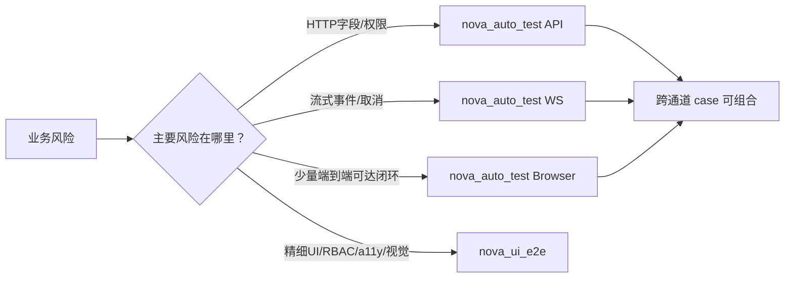
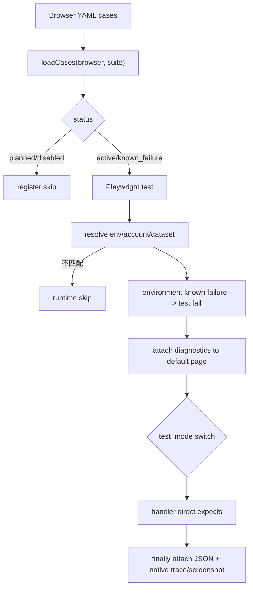
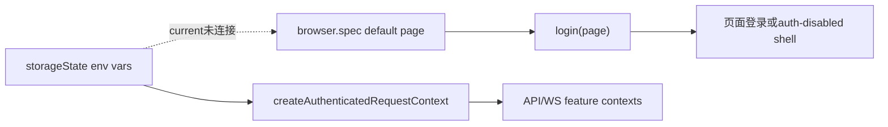
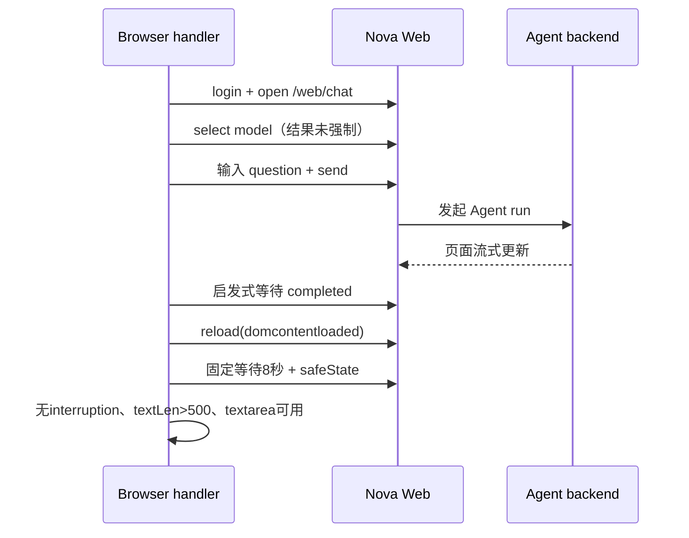
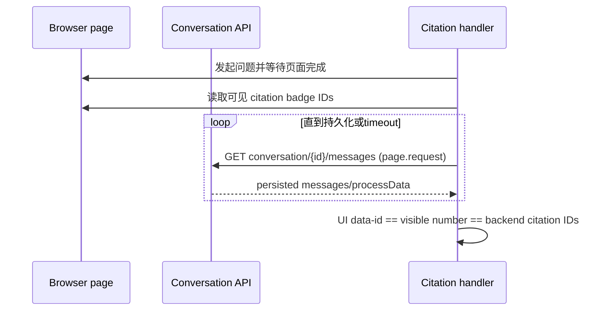

```
# Browser 通道与跨通道用例复刻

> 质量轴 Q05。本文自包含描述 `nova_auto_test` 的轻量 Browser 通道，以及 Browser、REST API、WebSocket 组合成跨通道业务证据的方法。  
> 静态审计日期：2026-08-13。  
> 本次未执行 Playwright、浏览器、登录、API、WebSocket 或任何测试；存在 case、`status: active` 和历史报告均不代表当前通过。

## 0. 标记、边界与结论

| 标记 | 含义 |
|---|---|
| **I** | 静态代码可确认的 current 实现 |
| **A** | 复刻环境必须验证的假设 |
| **K** | current 缺口或弱保证 |
| **P** | 规划/推荐设计，非 current |
| **REQ** | 等价复刻要求 |
| **F** | 失败/降级路径 |
| **D** | 推荐固定的工程决策 |

结论：

1. **I**：Browser 通道由同一 `@playwright/test` 工程中的 browser project 执行，从 YAML 只加载 `channel: browser` 的 case；目前 handler 仅覆盖登录、对话刷新、HTML 图表 artifact、归因知识页面可达、citation chip 五类 mode。
2. **I**：它是“小量产品主链路 smoke”，不是完整 UI 回归。复杂设置、RBAC、安全、可访问性和大量用户交互属于独立 `nova_ui_e2e` 工程。
3. **I/K**：Browser handler 直接写 Playwright `expect`，当前没有调用 YAML 的公共 assertion registry；YAML 中的 `chart_visible`、`refresh_not_blank`、`citation_present` 等只是文档性声明，实际判定来自 handler 内代码。
4. **I/K**：Browser project 的默认 page fixture 没有配置 storageState。`browserClient` 虽有 storageState 解析能力，但只用于显式创建 BrowserContext 的 API/WS feature；current Browser case 每次从页面登录或命中无需登录的环境。
5. **K**：多数 Browser case 通过 UI 创建真实 conversation/artifact，却没有精确 cleanup；Playwright 整 case retry 会再次造数。

## 1. 产品职责与 `nova_ui_e2e` 边界

### 1.1 nova_auto_test Browser 应负责

- 证明部署后的 `/web/chat` 能登录并进入产品 shell；
- 证明“页面操作 → Agent 执行 → 页面完成态 → 刷新后仍可见”的跨层主链路；
- 证明生成 artifact 能从聊天入口打开且预览中存在真实可见图表；
- 证明关键业务页面可以到达，而不是 404/空白/登录循环；
- 证明 citation UI 与持久化 `processData.citations` 的编号一致；
- 作为 API/WS 黑盒回归的少量浏览器补充，不重复每个字段组合。

### 1.2 nova_ui_e2e 应负责

- 菜单、Dialog、Tab、设置、上传、历史、分享、任务、RBAC、i18n、a11y、安全 UI 等精细交互；
- 确定性 Playwright P0/P1 suite；
- Midscene 的视觉语义/自然语言操作；
- 跨页面状态、异常提示、焦点、键盘和视觉证据；
- UI 专属产品问题台账与 expected-failure 治理。



**D**：同一 requirement 可以有 API/WS/Browser 变体，但 Browser 只验证浏览器独有风险。精确数据、权限和持久化用 API read-back；实时事件顺序用 WS；不要让 Browser 通过模糊文本重复证明全部业务真值。

## 2. current 工程与发现流程

### 2.1 Playwright project

```ts
defineConfig({
  testDir: "./tests",
  timeout: 360_000,
  expect: { timeout: 30_000 },
  retries: process.env.CI ? 2 : 1,
  workers: process.env.CI ? 2 : undefined,
  reporter: [["list"], ["html", {open: "never"}]],
  use: {
    trace: "retain-on-failure",
    screenshot: "only-on-failure"
  },
  projects: [{
    name: "browser",
    testMatch: /browser\.spec\.ts/,
    use: {...devices["Desktop Chrome"], headless: true}
  }]
});
```

可选 `AGENT_E2E_BROWSER_CHANNEL` 切换 browser channel；默认用 Playwright 管理的 Chromium。browser project 固定 Desktop Chrome device、headless=true；命令行可覆盖 headed/UI 等行为。

### 2.2 YAML 加载和注册

Loader 递归读取 `cases/**/*.yaml`，按 `channel=browser` 与 `AGENT_E2E_SUITE` 过滤。当前静态目录有 12 个 browser YAML 资产；其中包含 active 与 planned，数量是资产快照而非运行结果。

**I/K**：current TypeScript interface 的 Browser相关字段大多是 optional，loader没有 runtime schema；它只要求条目有truthy `id`，并用`channel`相等和suite/tags做筛选。`source/status/assertions/test_mode`缺失也可能在`full` suite进入注册；缺失或未知`test_mode`直到handler switch才失败。下文的严格接口是目标契约，不能误读成current loader已强制。

每个 case 的注册顺序：

1. planned/disabled 在定义阶段注册 skip；
2. 若有 `answerTimeoutMs`，test 总 timeout 改为 `answerTimeoutMs + 120000`；
3. 解析主账号；
4. env/account/dataset 不匹配时 runtime skip；
5. 环境命中 known failure 时直接 `test.fail(true, reason)`；
6. 为默认 page 绑定 console/requestfailed/HTTP>=400/pageerror listeners；
7. 按 `test_mode` 运行 handler；
8. finally 附加三类 diagnostics。



**K**：current browser spec 不读取 `knownFailureErrorPattern`。任何错误——登录、网络、selector、fixture、cleanup——都可能满足预期失败。这与 API spec 的 targeted matcher 不一致。推荐三通道共用精确 matcher，wrong error 普通失败，未复现为 xpass。

## 3. Browser YAML 契约

```ts
// D：目标严格契约；不是 current loader 已执行的 schema。
interface BrowserCase {
  id: string;
  channel: "browser";
  source: string;
  title?: string;
  tags: Array<"smoke" | "regression" | string>;
  status: "active" | "planned" | "known_failure" | "disabled";
  reason?: string;
  env?: string[];
  account?: string;
  dataset?: string;
  test_mode:
    | "login"
    | "chat_refresh"
    | "artifact_chart"
    | "formula_readiness"
    | "citation_chip"
    | string;
  question?: string;
  messages?: Array<{role: "user" | "assistant"; content: string}>;
  answerTimeoutMs?: number;
  artifactQuestion?: string;
  artifactReportTitlePattern?: string;
  citationOperation?: "evidence_panel" | "ordered_numbering";
  assertions: Array<{type: string; [key: string]: unknown}>;
}
```

当前 mode 矩阵：

| mode | current handler | 入口 | 最终观察 |
|---|---|---|---|
| login | 有 | `/web/chat`/`/login` | URL 离开 login |
| chat_refresh | 有 | chat + question | 完成后 reload，非空/无 interruption/input 可用 |
| artifact_chart | 有 | seed URL 或 chat 生成 | 打开首个 `.html`，标题匹配且 canvas/svg 可见 |
| formula_readiness | 有 | `/web/settings/attribution-knowledge` | 页面包含归因相关文本 |
| citation_chip | 有 | chat + question | evidence panel 或编号与 API persisted data 一致 |
| widget_preview | 无 | — | planned；执行 active 会报无 handler |

**K**：`formula_readiness` handler 不使用 YAML 的 formula question，不进行公式保存/校验，只证明页面包含“归因知识/Attribution/一个静态指标词”之一；名称比实际保证更强。  
**K**：handler 完成后没有 `runAssertions(case.assertions)`。YAML assertion 不能作为 current 执行证据；真正 oracle 必须阅读 handler。  
**D**：发现阶段使用严格schema，要求id/channel/source/tags/status/test_mode/assertions并拒绝unknown field；同时要求mode registry与assertion schema均存在。handler返回统一observation，再运行声明式assertions，禁止双轨。

## 4. 登录与 storageState

### 4.1 current Browser 登录

Browser spec 使用 Playwright project 提供的默认 `page`：

```ts
async function login(page, account) {
  await openPath(page, account, "/web/chat");
  await waitUntilLoginInputsOrAppShell(30_000);
  if (!page.url().includes("/login")) return {skipped: true, reason: "already logged in"};
  if (account.authEnabled === false) throw mismatchError();
  requireAtLeastTwoInputs();
  fill(firstInput, account.username);
  fill(secondInput, account.password);
  clickChineseLoginButton();
  await waitUntilUrlLeavesLogin(60_000); // catch timeout, then explicit URL check
  await wait(3_000);
  if (stillOnLogin) throw loginError();
}
```

`waitUntilLoginInputsOrAppShell` 每秒检查：至少两个 input、可用 textarea，或页面文案包含 app shell 特征。URL 离开 login 是登录最终判据。

返回对象中的 `skipped=true` 只是“无需执行登录”的 helper 信息，不会将 Playwright test 标为 skipped。

### 4.2 storageState 的真实边界

`browserClient` 另有 `storageStatePathForAccount` 和 `createAuthenticatedRequestContext`：它按环境+账号、账号、primary/secondary、全局等环境变量候选找到 state 文件，支持 `~` 展开并验证文件存在。API/WS feature 会显式 `browser.newContext({storageState})`。

**I/K**：Browser project 配置没有 `storageState`，browser.spec 也没有调用上述 context factory。因此 current Browser test 不会因配置这些 storageState 变量而自动给默认 page 注入登录态。仓库的 `auth:storage` 脚本只能生成 state；除非 project/global setup 显式接入，否则 Browser 通道仍走页面登录。



**P**：Browser project 应通过 per-account fixture 创建 context：先验证 state 文件权限、账号 alias、目标 origin、年龄和登录可用性；不可复用则 UI login 并保存到运行临时目录。state 禁止进入 Git/artifact，完成后安全删除。

### 4.3 凭据安全

- account config、storageState、cookie 均是 secret；日志只写 alias。
- console/pageerror 当前只替换已知账号 password；URL、request/response、其他 token 没有通用递归脱敏。
- `AGENT_E2E_IGNORE_HTTPS_ERRORS` 只在 helper显式 `browser.newContext()` 的 API/WS认证context生效；Browser project使用Playwright默认page，没有设置该选项，因此默认严格TLS。两条链路均应在release门禁显式锁定严格TLS并以contract test防止配置漂移。
- **I/P0**：独立 UI 工程源码存在 demo/release/RBAC 默认密码 fallback，且跟踪过包含非空共享 key 的 release MCP 环境文件；本文不复制值。应立即 rotate/revoke、移除 fallback/被跟踪 secret、审计历史，并由仓库 owner 协调历史清理。nova_auto_test 的复刻也必须用 CI secret manager，不能引入同类模式。

## 5. 页面 helper 的 current 契约

### 5.1 openPath

导航到 `baseUrl + route`，先以 `waitUntil=commit` 最多 60 秒等待提交，再 best-effort 等 `domcontentloaded` 15 秒；后一步 timeout 被吞。它证明导航已提交，不保证页面业务数据 ready。

### 5.2 selectModel

1. modelName 为空：返回 helper skipped；
2. body text 已含 modelName：认为已经选中；
3. 找唯一 accessible name=`Select model` 的按钮；
4. 打开，模糊文本找 modelName；找不到则 Escape 并返回 helper skipped；
5. 找到则点击。

**K**：Browser handler 忽略返回结果。model selector 不存在或 model 不存在时，case 仍继续用当前/默认模型，可能造成环境漂移。body 任意区域含模型名也可能误判已选择。

### 5.3 askQuestion

先找首个 textarea 并填入；发送动作分三级 fallback：

1. accessible role button name 匹配 send/发送，选首个 visible+enabled；
2. DOM 扫描 button 的 aria-label/title/text；
3. 按 textarea 几何位置挑最右侧候选按钮，排除少数文案；
4. 最后对 textarea 按 Enter。

这种容错让 smoke 跨版本存活，但也可能点错按钮。推荐页面提供 `data-testid=chat-composer` 与 `chat-send`，fallback 只能用于诊断模式，门禁使用稳定 selector。

### 5.4 waitForAgentResult

每 5 秒读取整个 document body：

```ts
interface AgentPageState {
  len: number;
  text: string;          // 最多前5000字符
  stopVisible: boolean;
  inputReady: boolean;
  hasArtifact: boolean;  // body命中 HTML/CSV/JSON/交付物/报告/推荐
  interrupted: boolean;  // 处理中断/请重新提问
}
```

成功条件：当前采样 input可用、若要求artifact则命中关键词、stop不可见、整个body长度超过minTextLen，且它与紧前一个任意采样的长度差<20。`stable`在条件不满足时不会reset；前一个采样也不要求input-ready/stop-hidden/artifact-ready。因此这不是严格“连续两次ready”。`AGENT_E2E_TIMEOUT_MS`优先覆盖参数timeout。

**K**：这是页面整体启发式，不绑定本次 assistant message、runId 或 conversationId；导航/侧栏等已有文本可能满足 min length，artifact 关键词也可能来自旧内容。只比较长度，文本替换但长度近似也会被视为稳定。  
**P**：等待后端 run terminal 或 assistant message DOM 的稳定 ID，结合 network/WS correlation；页面信号只做用户可见补充。

### 5.5 safeState 与 artifact 打开

`safeState` 返回 URL、title、body textLen、可用 textarea、是否包含 interruption/error 词和前 1200 字 preview。`openFirstHtmlArtifact` 扫描所有可见且文本含 `.html` 的元素，按面积从小到大选第一个，点击最近 button/a/role=button，等待 8 秒。

**K**：未绑定 artifact ID、当前消息或 owner，可能打开旧 artifact；preview 可能包含用户数据，若未来附加到报告必须脱敏。  
**K**：可见图表只检查 canvas/svg 尺寸，不证明数据正确、无错误 overlay 或与问题相关。

## 6. 五类 handler 精确流程

### 6.1 login

`login(page, account)` 后断言 URL 不匹配 `/login`。不额外检查用户名、tenant、角色或 chat 可操作性。

### 6.2 chat_refresh



**I**：证明页面刷新后不空白和仍可输入。  
**K**：不确认刷新前后的 conversationId 相同，不确认 assistant 内容持久化一致；没有删除创建的 conversation。

### 6.3 artifact_chart

两种 setup：

- 先始终执行 `login(page, account)`；随后若 `AGENT_ARTIFACT_CONVERSATION_URL` 存在，导航seed URL并等8秒；
- 否则开 chat、选模型、提问，等待 artifact heuristic + body 长度 >1000。

第二分支中的“登录”已由公共前置完成，实际不会再次调用login。seed不是免认证捷径。

之后点击第一个 `.html` artifact，等 5 秒；用正则匹配整个 body 的 report title；统计尺寸大于 20 的 canvas 或 svg，至少 1 个。

**K**：seed URL 没有 current 静态校验是否属于 account.baseUrl、当前 tenant 或允许 origin；推荐只允许 `new URL(seed).origin === new URL(baseUrl).origin` 且通过 API 校验 owner。  
**K**：新建对话/artifact 无 cleanup；seed 资产的版本、数据和归属未写入 case evidence。

### 6.4 formula_readiness

登录后打开归因知识设置页，固定等待 6 秒；body 包含任一预设页面词即通过。它只可命名为 page reachable smoke；不能据此声称 formula validate/save 已可用。

### 6.5 citation_chip

公共前半段：登录 → chat → 选择模型 → 问问题 → 等待完成。`evidence_panel`：找可见、非 failed/archived 的 citation badge，点击，等待 close button；断言 badge 至少1、active恰好1、panel可见且非空、无 interruption/backend leak。

`ordered_numbering`：等待至少两个 badge；从当前 URL query/path 提取 conversationId；使用同一 page 的 `page.request.get(/api/conversations/{id}/messages)` 每秒轮询，单请求 30 秒，总期限 answerTimeout；解析最后一个 assistant message 的 JSON 字符串 `processData.citations[].id`；断言页面 `data-citation-id`、显示数字、后端 ID 三者同序、唯一、正整数。

**K**：answer完成、badge等待、ordered DOM读取和API polling是串行阶段，多个阶段可各自消耗近answer timeout；poll循环里的单次request还可额外占30秒。外层test只设`answerTimeoutMs + 120000`，可能先于内部各阶段预算到期而截断，且finally清理空间更小。



这是 current Browser 内最明确的 UI+API 跨通道 read-back。**K**：只验证编号，不验证 evidence 内容的业务正确性；创建的 conversation 也未 cleanup。

## 7. 跨通道 setup/assert/cleanup 模式

跨通道不是让一个 case 同时把全部协议都断言一遍，而是用最适合的通道承担一段证据。

### 7.1 API setup → WS action → API cleanup

current knowledge/skill/file/task 的部分 WS feature 使用 BrowserContext 认证后的 API transport 创建 fixture，再运行 WS case，finally 删除 fixture并附加 created/API/auth diagnostics。

```ts
async function apiWsCase(ctx) {
  const auth = await createAuthenticatedRequestContext(ctx.browser, ctx.account);
  const api = createTypedTransport(auth.context.request, ctx.account.baseUrl);
  const resources = [];
  try {
    const fixture = await api.create(uniqueFixture());
    resources.push(fixture.id);
    const resolved = injectFixtureIntoWsCase(ctx.case, fixture);
    const ws = await runWsCase(resolved);
    runAssertions(wsObservation(ws), resolved.assertions);
  } finally {
    await cleanupReverse(api, resources);
    await attachApiAndWsEvidence();
    await auth.context.close();
  }
}
```

优点：API 精确造数/回收，WS 专注 Agent/tool event。**K**：current keep 环境变量可保留 fixture；必须在报告中显式标记 kept，release gate 默认禁止。

### 7.2 Browser action → API read-back

适合 citation、设置保存、artifact metadata、conversation persistence：浏览器执行用户动作，提取稳定 resource ID，API read-back 验证真值；最后 API 精确删除/恢复。

current citation 已实现 read-back，但没有统一 cleanup。推荐接口：

```ts
interface CrossChannelContext {
  page: Page;
  api: APIRequestContext;
  ws?: WsProbe;
  account: ResolvedAccount;
  resources: ResourceLedger;
  evidence: EvidenceCollector;
}
```

### 7.3 API seed → Browser display

适合不稳定/昂贵的 artifact、异常状态、历史 conversation：API/fixture service 创建版本化 seed，Browser 只打开并验证 UI；结束后删除 run-owned seed。共享 immutable seed 必须有 owner、版本、checksum 和只读 policy，禁止测试修改。

### 7.4 WS trigger → Browser presentation

适合阶段事件、取消和工具执行展示：WS/后端触发或监听 run，Browser 观察同一 conversation 的阶段 UI。必须共享 correlationId/conversationId；不可用文本猜测关联。

## 8. diagnostics 与 artifact

### 8.1 current

页面 listeners 收集：

```ts
interface Diagnostics {
  console: Array<{type: string; text: string; time: string}>;
  networkFailures: Array<{
    method: string; url: string; resourceType: string; errorText: string; time: string
  }>;
  httpErrors: Array<{
    status: number; url: string; resourceType: string; time: string
  }>;
}
```

finally 将其写为 `console.json`、`network-failures.json`、`http-errors.json` 并 attach。Playwright config 对失败保留 trace 和 screenshot；list + HTML report 展示结果。

**K**：attach 本身若失败，browser.spec finally 没有 `.catch`，可能覆盖原业务失败；推荐保留 primary failure，并把 evidence failure 作为第二错误。  
**K**：URL 可能含 query token/resource ID，console 只替换账号 password；trace/screenshot 可能含 PII、回答和 secret。  
**K**：成功 case 的 trace 被丢弃，若要 E3/E4 可审计证据，应保留脱敏的关键 step/evidence JSON，而不是全量视频。

### 8.2 推荐证据

```json
{
  "caseId": "CITE-RENDER-003-BROWSER",
  "attempt": 1,
  "environment": "release-candidate",
  "accountAlias": "tenant-a-editor",
  "browser": {"name":"chromium","version":"pinned"},
  "resources": [{"type":"conversation","idHash":"...","cleanup":"passed"}],
  "steps": [
    {"name":"send-question","channel":"browser","outcome":"passed"},
    {"name":"read-persisted-citations","channel":"api","status":200},
    {"name":"compare-numbering","channel":"assertion","outcome":"passed"}
  ],
  "diagnostics": {"consoleErrors":0,"networkFailures":0,"httpErrors":0},
  "finalOutcome": "passed"
}
```

producer 不自报 E4；中央聚合器验证签名 provenance、固定 product/test SHA、deployment、environment、artifact digest 与 cleanup 后推导证据等级。

## 9. selector 与等待策略

### 9.1 current selector 层级

| 层 | 示例 | 稳定性 |
|---|---|---|
| accessible role/name | 登录、发送、关闭 citation panel | 较好，但受 i18n 文案影响 |
| semantic class/data attribute | `.citation-badge[data-citation-id]` | 业务可观测性强 |
| text search | modelName、`.html`、页面关键字 | 易误匹配 |
| DOM geometry/evaluate | composer 右侧按钮、canvas/svg尺寸 | 最后 fallback，维护成本高 |
| fixed sleep | 1s/3s/5s/6s/8s | 环境敏感 |

**D**：产品暴露稳定可访问契约：role/name + `data-testid` + resource/run IDs。等待“可观察状态”——network response、terminal state、specific DOM attribute——而不是固定 sleep/全页文本长度。

### 9.2 超时层级

- 默认 test：360 秒；expect：30 秒；
- case 有 answerTimeout 时：test=`answer + 120秒`；
- login shell 30 秒、URL 60 秒；
- navigation commit 60 秒、DOM 15 秒；
- chat/citation的agent result通常使用case answerTimeout或300秒；artifact_chart无论case声明多少都硬传300秒，只有全局`AGENT_E2E_TIMEOUT_MS`能覆盖；例如case为420秒只会把外层test设为540秒，不会把artifact answer wait延长到420秒；
- citation API 单请求 30 秒且总循环受 answer timeout；
- artifact 打开含固定 8+5 秒等待。

**K**：超时分散且 account.timeoutMs、env override、case timeout 的优先级并不一致；`AGENT_E2E_TIMEOUT_MS` 可覆盖 handler 参数。推荐 `auth/setup/action/settle/assert/cleanup` 分段预算，并预留 cleanup。

## 10. 环境、账号、并发与副作用

### 10.1 环境筛选

case 可声明 env、account、dataset。主账号从配置/环境变量选择；不匹配直接 skip。Browser current 不支持 `requiresSecondAccount` 的独立解析，也没有跨账号 Browser handler。

**REQ**：发布报告必须列 selected、executed、skipped/blocked reason；账号/dataset 缺失不能生成虚假绿色。

### 10.2 并发

CI workers=2；Browser case 可能共享同一账号、模型设置、conversation 列表和数据集。当前 handler 没有 tenant/resource lock，也不验证新 conversation 与其他 worker 隔离。

推荐：

- 每 worker 独立账号，或每 case 独立 browser context + resource namespace；
- 会改变设置的 S2/S3 case 按 tenant/domain 串行；
- 浏览器 case 保存自己创建的 conversation/artifact ID，按 ID 清理；
- seed URL case 只读，不与 mutation suite 共享 seed；
- retry attempt 使用同一 logical run ID + 新 attempt namespace，并 reconcile 上次残留。

### 10.3 side effects

| handler | current side effect | current cleanup |
|---|---|---|
| login | session/cookie | page context 由 Playwright fixture 关闭 |
| chat_refresh | conversation/messages/LLM cost | 无精确业务清理 |
| artifact_chart (generated) | conversation/artifact/LLM/tool cost | 无精确业务清理 |
| artifact_chart (seed) | 理论只读，但可能触发预览请求 | 无 seed ownership check |
| formula_readiness | 页面读取 | 无业务副作用 |
| citation_chip | conversation/messages/LLM/tool cost；API polling | 无精确业务清理 |

**D**：Browser handler 返回 `createdResources`；统一 fixture finally 使用 API 删除并 read-back。没有硬删除能力的资源必须有 TTL/专用租户并报告 residual，不能静默。

## 11. known failure 与错误语义

current：planned/disabled skip；known failure 在环境适用时无条件 `test.fail`；未知 mode 直接抛错；login/model/page/Agent/artifact/citation 的失败均是普通 exception/expect failure。

推荐统一状态：

| outcome | 含义 |
|---|---|
| passed | 首次执行满足 handler + YAML assertions + cleanup |
| flaky_pass | earlier attempt 失败、最终通过 |
| failed_product | 页面/协议/持久化不满足契约 |
| failed_test | selector/handler/schema 错误 |
| blocked_environment | 登录、模型、dataset、依赖能力缺失 |
| xfail | 精确已知 defect signature 复现 |
| xpass | 已知 defect 未复现，需确认修复 |
| cleanup_failed | 业务结果之外的环境残留 |
| side_effect_unknown | 提交后断线，无法确认是否创建 |

错误分诊先用 API read-back 判断：DOM 错但 API 对可能是 UI/selector；DOM 与 API 都错偏产品；API 对但 Browser 打开旧 resource 偏关联错误；登录/证书/模型缺失偏环境。

## 12. 推荐扩展设计

### 12.1 Browser mode registry

```ts
interface BrowserObservation {
  status?: string;
  url: string;
  resourceIds: Record<string, string>;
  data: unknown;
}

interface BrowserHandler<C extends BrowserCase = BrowserCase> {
  mode: string;
  caseSchema: RuntimeSchema<C>;
  sideEffect: "S0" | "S1" | "S2" | "S3";
  requiredCapabilities(c: C): string[];
  run(ctx: CrossChannelContext, c: C): Promise<BrowserObservation>;
}

class BrowserModeRegistry {
  register(handler: BrowserHandler): void;
  validate(cases: BrowserCase[]): ValidationError[];
  require(mode: string): BrowserHandler;
}
```

handler 不自己隐藏 YAML assertions；统一 orchestrator：validate → preflight → setup → action → observation → assertion registry → cleanup → evidence。

### 12.2 可复刻 orchestrator

```ts
async function runBrowserCase(c: BrowserCase, fx: Fixtures) {
  const handler = registry.require(c.test_mode);
  handler.caseSchema.parse(c);
  await capabilities.require(handler.requiredCapabilities(c));
  const ctx = await fx.newCrossChannelContext(c);
  let primaryFailure: unknown;
  try {
    const observation = await handler.run(ctx, c);
    assertionRegistry.run({channel: "browser", ...observation}, c.assertions);
  } catch (error) {
    primaryFailure = error;
  } finally {
    // 两者各自settle；cleanup throw不能跳过evidence，evidence throw也不能覆盖cleanup。
    const [cleanupResult, evidenceResult] = await Promise.allSettled([
      ctx.resources.cleanupReverseWithReadBack(),
      ctx.evidence.attachRedacted(),
    ]);
    const cleanupFailures = collectCleanupFailures(cleanupResult);
    const evidenceFailures = collectEvidenceFailures(evidenceResult);
    throwCombined(primaryFailure, cleanupFailures, evidenceFailures);
  }
}
```

### 12.3 页面对象契约

```ts
interface ChatPage {
  goto(): Promise<void>;
  assertReady(): Promise<void>;
  selectModelExact(modelId: string): Promise<void>;
  send(text: string): Promise<{conversationId: string; runId: string}>;
  waitForTerminal(runId: string, timeoutMs: number): Promise<"complete"|"cancelled"|"error">;
  assistantMessage(runId: string): Locator;
  openArtifact(artifactId: string): Promise<void>;
}
```

不要把所有 page object 过度抽象；只封装稳定用户意图和 correlation IDs，业务-specific oracle 留在 handler。

## 13. 示例

### 13.1 刷新持久化的目标 case

```yaml
id: CHAT-REFRESH-001-BROWSER
channel: browser
source: requirements/chat-refresh.md
tags: [smoke, regression]
status: active
test_mode: chat_refresh
dataset: synthetic-chat
question: "Reply with marker ${run.marker}"
side_effect: S1
assertions:
  - {type: browser_run_terminal, equals: complete}
  - {type: browser_message_contains_var, variable: run.marker}
  - {type: api_persisted_message_contains_var, variable: run.marker}
  - {type: browser_same_conversation_after_reload}
cleanup:
  delete: conversation
  verifyStatus: 404
```

执行：UI 发消息并捕获 conversationId/runId → 等 terminal → 读取本次 assistant message marker → reload → URL/DOM仍为同 conversation且 marker 相同 → API messages read-back相同 → DELETE conversation → GET 404。

### 13.2 artifact seed 的目标 case

API 创建 immutable HTML artifact fixture并记录 artifactId/conversationId/checksum；Browser 打开按 ID 定位的 artifact；断言 title、无 error overlay、canvas/svg 可见、accessibility name、API metadata checksum；finally 删除 run-owned资源。不得用“第一个 `.html`”代替 ID。

### 13.3 citation 跨通道 case

UI 触发带引用回答 → 等 run terminal → DOM 读取 citation IDs → API 读取同 conversation 最后 assistant processData → 比较 ID/order → 点击每个 badge，验证 panel source identity 与后端 evidence ID → 删除 conversation。

## 14. Contract tests 与验收

### 14.1 基础设施 contract

| ID | 场景 | 预期 |
|---|---|---|
| BR-RUN-01 | YAML mode 无 handler | discovery fail-fast，不到 runtime |
| BR-RUN-02 | YAML assertion 无实现/错误 channel | discovery fail-fast |
| BR-RUN-03 | planned/disabled/环境不匹配 | reason 清晰，不计 pass |
| BR-RUN-04 | known failure wrong error | 普通 fail，不 xfail |
| BR-RUN-05 | known failure 未复现 | xpass 阻断确认 |
| BR-AUTH-01 | valid storageState | project fixture 实际加载、账号/tenant read-back一致 |
| BR-AUTH-02 | stale/wrong-origin state | 不复用，重新登录或 blocked |
| BR-AUTH-03 | secret scan | report/trace/screenshot/JSON 无 cookie/password/token |
| BR-CHAT-01 | send fallback | 门禁只用稳定 selector；几何 fallback 仅诊断 |
| BR-WAIT-01 | 旧页面文本已很长 | 未观察本 run terminal 不得提前完成 |
| BR-WAIT-02 | error terminal | 明确 failed_product，不等到总 timeout |
| BR-ART-01 | 多个 HTML artifact | 按 artifactId 打开目标，不点旧资源 |
| BR-CROSS-01 | UI + API citation IDs | 同 conversation、同 assistant message、顺序一致 |
| BR-CLEAN-01 | 主断言和 DELETE 都失败 | 两个错误都保留，residual ID 可见 |
| BR-RETRY-01 | 首轮失败次轮通过 | flaky_pass，首次 evidence 保留 |
| BR-PAR-01 | 同 tenant mutation 并发 | lock 串行或 planner 拒绝 |

### 14.2 业务验收

- 登录不仅离开 `/login`，还通过 current-user/read-back 确认账号 alias、tenant 和角色。
- 对话刷新验证同一 conversationId、同一 run 的 assistant message 在刷新前后和 API 中一致。
- artifact 图表验证目标 artifact ID、业务标题、无错误层、可见图形和后端 metadata；不以任意 canvas 代替。
- attribution page reachable 只命名为 reachable；formula regression 必须真实填写/校验/保存并回读。
- citation badge 的 DOM 编号、展示编号、后端 evidence ID 和 panel source identity 一致。
- 每个 S1+ case 都有 resource ledger、精确 cleanup、read-back；残留阻断发布。
- Browser、API、WS 各自只承担适合的 oracle，并以 conversationId/runId/artifactId 关联。
- `nova_auto_test` Browser 保持少量部署 smoke；精细 UI 契约放 `nova_ui_e2e`，追溯矩阵可见但不机械复制。
- evidence 由可信聚合器推导 E3/E4；本次静态文档最高为 E1，未宣称任何 case 当前通过。

## 15. current 缺口清单

| ID | current gap | 风险 | 推荐 |
|---|---|---|---|
| K-BR-01 | 默认 page 未接 storageState | 重复登录、账号状态漂移 | per-account fixture/global setup |
| K-BR-02 | YAML assertions 未执行 | 文档与真实 oracle 双轨 | handler observation + typed registry |
| K-BR-03 | known failure 不匹配 pattern | 吞掉无关失败 | 共用精确 matcher |
| K-BR-04 | 全页文本/关键词完成启发式 | 假阳性/超时 | run terminal + message ID |
| K-BR-05 | model selection失败继续 | 使用错误模型 | capability preflight + exact selection |
| K-BR-06 | 首个 `.html`/任意 canvas | 打开旧 artifact/弱断言 | artifactId + API metadata |
| K-BR-07 | fixed sleep 多 | 环境 flake | observable waits |
| K-BR-08 | conversation/artifact 无 cleanup | 环境污染、retry重复造数 | resource ledger + API cleanup |
| K-BR-09 | CI workers=2且共享账号 | 状态竞争 | 独立账号/namespace/lock |
| K-BR-10 | diagnostics 脱敏有限 | secret/PII进入 artifact | recursive redactor + retention |
| K-BR-11 | formula handler只测可达 | 能力命名过度 | 重命名或实现真实公式闭环 |
| K-BR-12 | seed URL未验origin/owner/version | 越权/漂移/错误资产 | allowlisted origin + ownership/checksum |

## 附录 A：静态追溯线索（非理解前提）

正文已包含复刻契约。current 审计线索为 `nova_auto_test/tests/browser.spec.ts`、`src/core/{browserClient,config,yamlCase}.ts`、`src/features/citations/browserRunner.ts`、`cases/**/*.yaml`、`playwright.config.ts`；跨通道参考 `tests/ws.spec.ts`、`src/core/{wsCaseRunner,apiCaseRunner}.ts` 与 feature runner/client。独立 UI 边界参考 `nova_ui_e2e` 的 Playwright/Midscene/unit 资产。路径不承担正文解释。

```
