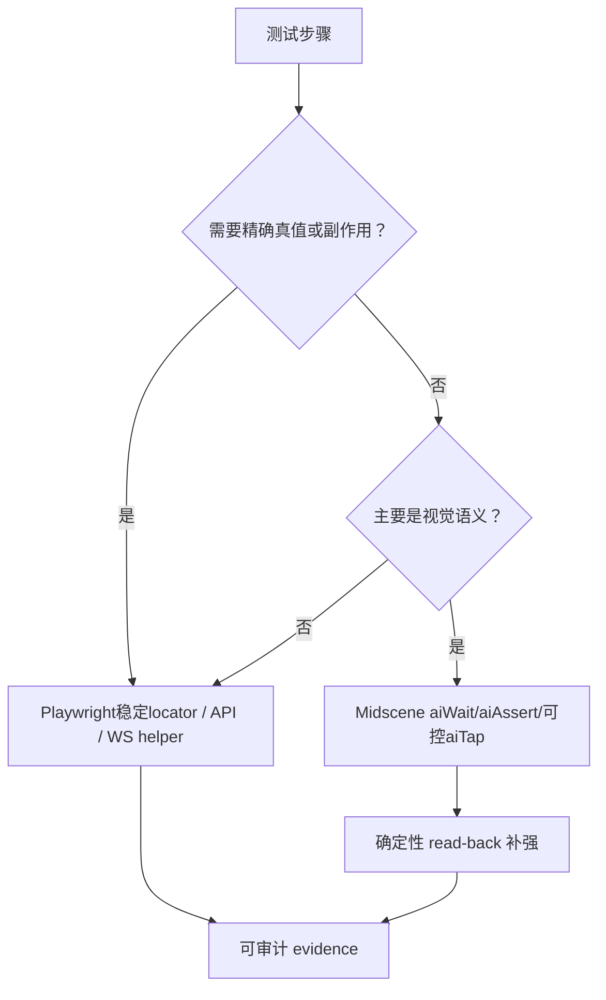
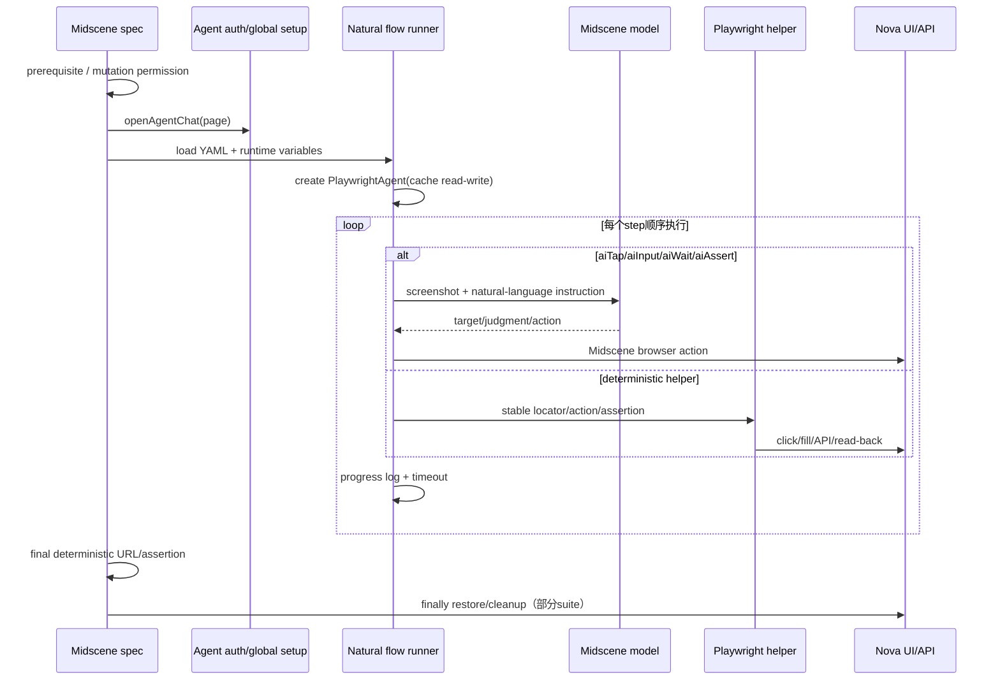

```
# Midscene 边界与自然语言 Flow 复刻

> 质量轴 Q07。本文自包含说明 `nova_ui_e2e` 如何把 Midscene 视觉/语义动作与确定性 Playwright helper 混合为 YAML flow，并给出可迁移、可治理的目标设计。  
> 静态审计日期：2026-08-13。  
> 本次未运行模型校验、Playwright、Midscene、浏览器或任何测试；仓库中的“passed”日志、历史报告和 flow 存在性均不代表当前通过。

## 0. 标记与结论

| 标记 | 含义 |
|---|---|
| **I** | current 静态实现可确认 |
| **A** | 复刻环境需验证的假设 |
| **K** | current 缺口或弱保证 |
| **P** | 推荐/规划设计，非 current |
| **REQ** | 等价复刻要求 |
| **F** | 失败/降级路径 |
| **D** | 推荐工程决策 |

核心结论：

1. **I**：自然语言 flow 不是“全部由 AI 操作页面”。每个 YAML step 二选一地调用 Midscene `aiTap/aiInput/aiWaitFor/aiAssert`，或调用确定性 Playwright/helper（发送消息、设置开关、下载、上传、模型配置恢复等）。
2. **D**：状态变更的提交、资源 ID、权限、安全、精确数据、下载内容和恢复必须使用确定性 helper/API read-back；Midscene 适合视觉定位、语义可见性和难以稳定编码的页面理解。
3. **I/K**：模型配置缺失在不同 spec 中处理不一致：多数 skip，少数直接 throw；“没运行”与“产品失败”可能混淆。
4. **I/K**：loader 只验证 flow name 和 steps 数组，不校验一步恰有一个 action、字段类型、未知 action、变量完备或副作用/cleanup。
5. **I/K**：Midscene 使用 flow name slug 作为 read-write cache ID。相同 flow 名跨环境/页面版本共享 cache 可能漂移；模型、prompt、截图和 cache provenance 未进入统一发布证据。

## 1. 产品边界：Midscene 能证明什么

### 1.1 适用

- “页面已经显示某种业务语义”，例如新会话空白态、回答区域存在证据入口；
- 控件缺稳定 selector，但视觉/文案语义明确的定位；
- 中文/英文 UI 轻微变化下的探索性 smoke；
- 布局、可见状态、错误提示、视觉上下文等难用单一 DOM 属性表达的断言；
- 手工验收脚本向自动化迁移的过渡层。

### 1.2 不适用为唯一 oracle

- 金额、日期、ID、条数、顺序、权限、租户隔离；
- PUT/POST 是否提交、数据库是否持久化、失败是否回滚；
- destructive action 的目标确认；
- secret 是否脱敏、下载字节是否正确、文件 checksum；
- 精确事件顺序、WebSocket terminal、工具调用参数；
- 安全边界、RBAC 和合规门禁。



**D**：AI 可以找“保存按钮”，但涉及设置变更时，应由确定性 helper 读取 before、点击精确 card 内保存、等待指定 response、API read-back、finally 恢复；AI 不能自行决定提交哪个对象。

## 2. 模型配置与环境

### 2.1 current 配置契约

Midscene 模型所需环境变量：

```ts
const required = [
  "MIDSCENE_MODEL_BASE_URL",
  "MIDSCENE_MODEL_API_KEY",
  "MIDSCENE_MODEL_NAME",
  "MIDSCENE_MODEL_FAMILY"
];
```

特殊情况：base URL 精确等于 Codex app-server scheme 时，API key 可缺省；其余字段以truthy判定。

| 环境变量 | required/current校验 | current消费者与语义 |
|---|---|---|
| `MIDSCENE_MODEL_BASE_URL/API_KEY/NAME/FAMILY` | 前述四项；Codex scheme仅免key | preflight helper校验；Midscene SDK从进程环境构建默认模型客户端 |
| `MIDSCENE_PLANNING_MODEL_NAME/FAMILY` | optional，不进preflight | Midscene SDK选择planning模型；runner本身不解析 |
| `MIDSCENE_INSIGHT_MODEL_NAME/FAMILY` | optional，不进preflight | Midscene SDK选择视觉理解模型；runner本身不解析 |
| `MIDSCENE_MODEL_EXTRA_BODY_JSON` | optional，不校验JSON/schema | provider模板提供；由SDK/provider请求层消费，代理脚本只转交环境 |
| `MIDSCENE_RUN_DIR` | optional | SDK决定report/log/cache根；归档脚本另按约定读取`midscene_run`，自定义目录时需同步 |

普通Playwright进程入口使用`dotenv/config`，既有`process.env`优先于`.env`默认注入。`run-with-dotenv`把选定文件临时复制为`.env`，child环境总体仍让调用进程同名值优先；个人OpenAI代理会强制把base URL改成本机兼容代理并保留其他覆盖。另一个`run-with-env`实现是file env覆盖process env，语义不同。**K**：同一配置经不同npm入口可能有不同优先级；目标只保留一个显式resolver并输出脱敏resolved descriptor。

`hasMidsceneModelConfig()` 只检查字段非空，不验证：

- URL scheme/host 是否可信；
- key 是否有效或权限最小；
- model/family 是否兼容视觉；
- endpoint 是否支持所需协议；
- quota、超时、数据驻留和截图处理政策。

### 2.2 模型缺失的 current 差异

| spec 类型 | current 行为 |
|---|---|
| 多数 main/artifact/attachment/chart/data-preview/model-setting spec | `test.skip` 并提示缺模型配置 |
| ask-human tool toggle | 直接 throw，测试失败 |
| analytics spec | 直接 throw，测试失败 |
| visual smoke | describe/test skip 条件 |

**K**：同一 prerequisite 既可能是 skip，也可能是 failure，CI 趋势不可比较。  
**D**：统一 preflight，在 discovery/worker 启动时输出 `blocked_model_config`；release-required Midscene suite 若配置缺失则 gate fail，但 case outcome 不伪装成产品失败；开发可选 suite 可 skip，并明确未覆盖。

### 2.3 模型 preflight

```ts
interface MidsceneModelDescriptor {
  baseUrlOrigin: string;
  modelName: string;
  family: string;
  planningModel?: string;
  insightModel?: string;
  providerPolicyId: string;
}

interface ModelPreflightResult {
  configured: boolean;
  reachable: boolean;
  visionSupported: boolean;
  modelResolved: string;
  credentialRef: string; // 只存secret manager引用
  blockedReason?: string;
}
```

不要把 key、完整 base URL query 或截图正文写入 evidence。release manifest 固定模型版本/family/provider policy；“latest”依赖不适合作为可重复发布证据。

## 3. Natural flow schema

### 3.1 current 顶层

```ts
type FlowVariables = Record<string, string | number | boolean>;

interface NaturalAgentFlow {
  name: string;
  description?: string;
  variables?: FlowVariables;
  steps: NaturalAgentStep[];
}
```

YAML loader 直接 `readFileSync` + YAML parse，只检查 `name` truthy 和 `steps` 是数组。runtime variables 覆盖 flow defaults。字符串模板只支持 `{{wordKey}}`；缺变量在执行到该字符串时抛错。

### 3.2 current `NaturalAgentStep` 完整字段契约

current不是discriminated union，而是所有字段optional的宽对象：

```ts
interface NaturalAgentStep {
  name: string;
  aiTap?: string; aiInput?: string; aiWaitFor?: string; aiAssert?: string;
  agentSendMessage?: string; agentStopGeneration?: boolean; agentOpenNewChat?: boolean;
  agentSelectAskHumanOption?: string;
  agentWaitForAskHumanCard?: {question:string; optionButtonNames:string[]};
  agentWaitForAnswerText?: string;
  agentWaitForAskHumanUnavailable?: {toolName:string; forbiddenOptionButtonNames:string[]};
  agentSetTenantToolEnabled?: {toolName:string; enabled:boolean};
  agentGrantClipboardPermissions?: boolean;
  agentAssertClipboardIncludes?: string; agentAssertClipboardMatches?: string;
  agentDownloadFromAiTap?: string; agentDownloadFromButton?: string; downloadFileName?: string;
  agentClickButton?: string; agentClickLink?: string; agentClickText?: string;
  agentClickTab?: string; agentClickArtifactCard?: string; agentClickSwitch?: boolean;
  agentOpenScheduledNewTask?: boolean;
  agentSelectScheduleFrequency?: string; agentSelectWeekday?: string;
  agentWaitForDialog?: boolean;
  agentFillTextboxByPlaceholder?: string; agentFillArtifactSearch?: string;
  agentFillDialogTextboxAt?: number;
  agentGotoPath?: string; agentUploadFile?: string; agentSelectModel?: string;
  agentAssertImageAlt?: string;
  agentExerciseAnalyticsView?: AnalyticsViewId;
  agentExerciseEmbedAppLifecycle?: boolean; agentExerciseModelRoleCard?: string;
  agentWaitForTextMatches?: string; agentWaitForTextNotMatches?: string;
  agentAssertTextNotMatches?: string; agentAssertNoPageError?: boolean;
  waitMs?: number; value?: string; pressKey?: string; timeout?: number; deepLocate?: boolean;
}
```

复用字段语义：`value`只供`aiInput`、placeholder fill和dialog-index fill；`pressKey`只在placeholder fill后执行，dialog-index fill不press；`downloadFileName`只供两类download；`timeout`按action解释；`deepLocate`只传给AI tap/input和AI download tap。`agentFillDialogTextboxAt`是dialog内textbox的零基`nth(index)`，所以dispatcher用`!= null`而不是truthy，index 0有效。boolean action必须是true才触发；`enabled:false`位于truthy toggle对象中，仍会正确执行关闭。

### 3.3 dispatcher精确顺序与truthy语义

current固定if链如下，命中第一个后return：

```text
aiTap → aiInput → aiWaitFor → send → openNewChat → selectAskHumanOption
→ waitAskHumanCard → waitAnswerText → waitAskHumanUnavailable → setTenantToolEnabled
→ stopGeneration → grantClipboard → clipboardIncludes → clipboardMatches
→ downloadFromAiTap → clickButton → clickLink → clickText → clickTab → clickArtifactCard
→ clickSwitch → openScheduledNewTask → selectFrequency → selectWeekday → waitDialog
→ downloadFromButton → fillByPlaceholder → fillArtifactSearch → fillDialogTextboxAt(!=null)
→ gotoPath → uploadFile → selectModel → assertImageAlt → exerciseAnalytics
→ exerciseModelRole → exerciseEmbed → waitTextMatches → waitTextNotMatches
→ assertTextNotMatches → assertNoPageError → waitMs → aiAssert → unsupported error
```

字符串、对象、number和多数boolean按JS truthy判断：空字符串、false、0不会命中；唯一例外是dialog textbox index用`!=null`，所以0会命中。一个step有多个action不会报错，只有最早truthy action执行；例如`aiTap+aiAssert`只点击、不断言。全无可命中action才抛unsupported。  
**K**：`getStepKind` 的分支不完全覆盖全部 action，只影响日志标签，但会降低诊断精度。  
**D**：目标 schema 用 discriminated union，严格要求每 step 恰好一个 action，并拒绝 unknown fields。

```ts
type StrictStep =
  | {name: string; action: "ai.tap"; target: string; timeoutMs?: number; deepLocate?: boolean}
  | {name: string; action: "ai.wait"; assertion: string; timeoutMs?: number}
  | {name: string; action: "ai.assert"; assertion: string}
  | {name: string; action: "pw.click"; locator: LocatorContract}
  | {name: string; action: "agent.send"; message: string}
  | {name: string; action: "settings.modelRoleLifecycle"; role: string}
  | {name: string; action: "api.assert"; request: RequestContract};
```

## 4. runner 执行链



runner 为每个 flow 创建一个 `PlaywrightAgent(page,{cache:{id:slug(flow.name),strategy:'read-write'}})`。step 顺序串行；开始、每10秒进度、完成耗时输出 console；finally 清 interval。

### 4.1 timeout

| 层 | current |
|---|---|
| Playwright全局test | 120s |
| stop-generation Midscene spec | 6min |
| artifacts/main/data-preview | 8min |
| ask-human/message/chart/embed | 10min |
| attachments | 12min |
| model-settings/scheduled/analytics | 15min |
| aiTap/aiInput/aiAssert | 外层race默认90s |
| aiWaitFor | 外层race默认120s，同时给SDK同一step timeout |
| click/fill/assert | 多数30s；goto45s |
| lifecycle helper | analytics120s、embed240s、model role360s |

download有两条不同边界：`agentDownloadFromAiTap`把`download event + aiTap`的`Promise.all`放进外层60s race，event自身也是60s；`agentDownloadFromButton`没有额外`withTimeout`，只由download event timeout（默认60s）和button helper timeout（未配step timeout时默认30s）约束。两者之后的`saveAs`和同步`stat`都没有step timeout，只受spec总timeout；超时race也不取消底层action。

`withTimeout` 是 runner 额外的 Promise race/定时保护（目标复刻应在 timeout 时取消底层 action或关闭 page；仅 reject 不一定停止模型/浏览器后台工作）。

### 4.2 变量

```yaml
variables:
  question: "默认问题"
steps:
  - name: 发送
    agentSendMessage: "{{runMarker}}：{{question}}"
```

runtime variables shallow覆盖defaults；render不是递归遍历YAML，只在dispatcher显式调用处替换`{{wordKey}}`。会render的字段包括四个AI文本/value、send/ask-human文本及其数组、toolName、clipboard pattern、两类download target与downloadFileName、click/link/text/tab/artifact、frequency/weekday、placeholder及value、artifact search、dialog value、goto path、upload path、model、image alt、model role和三个text regex。不会render：step name、timeout/deepLocate/waitMs/pressKey、boolean、dialog index、analytics enum、embed runMarker（它直接从variables读取）。不支持nested path、default、escape、secret namespace或step output。缺变量只在该字段实际render时抛错。**D**：目标在执行前解析typed variables，并让schema明确每个字段是否templatable；sensitive禁止进入AI prompt、日志和YAML，resource ID由确定性helper提取。

## 5. 四种 Midscene primitive

### 5.1 aiTap

给自然语言 target，可传 `deepLocate`。适合：“左侧 New task / 新建任务入口”等视觉明确、无破坏性的导航。

风险：可能点同名错误元素；页面变化/遮罩影响识别；deep locate 成本更高。删除、保存、执行、授权等不可只靠 aiTap，除非确定性 precondition、目标 ID 与 postcondition 全部补齐。

### 5.2 aiInput

target + value 输入；value 必填，否则当前 fail-fast。适合难定位的普通搜索框；密码、token、个人信息不得交给视觉模型。确定性 placeholder/label locator 可用时优先 Playwright fill。

### 5.3 aiWaitFor

等待自然语言页面状态，current 将 step timeout 同时传给 agent 并设外层上限。适合等待布局/业务阶段整体消失或出现。不能替代 API terminal、network response、精确 row 状态。

### 5.4 aiAssert

对当前页面做语义断言。适合“回答区域具有有效汇总并有证据入口”这类软质量 smoke。金额/ID/权限必须另有 exact oracle。模型判断必须保存 rubric、截图 digest、模型 descriptor和理由，不能只返回 boolean。

### 5.5 aiQuery 与 aiAction 边界

独立 visual smoke/demo 使用 `aiQuery` 提取结构化搜索结果；natural flow current schema没有 aiQuery，也没有通用 `aiAction` 字段。它把复杂确定性动作拆成命名 `agent*` helper，避免让模型自由规划任意副作用。

**D**：不引入开放式“执行任意自然语言 action”作为发布门禁。若需要 `aiAction`，限定为只读导航 sandbox，配置允许的 action/host/页面区域，并在每个副作用前转交确定性 helper确认。

## 6. 确定性 helper 的职责

### 6.1 current 示例

- `agentSendMessage`：稳定 composer helper；
- `agentSetTenantToolEnabled`：精确设置工具开关；
- `agentWaitForAskHumanCard/Option/Unavailable`：围绕卡片结构和选项断言；
- `agentExerciseModelRoleCard`：记录原配置、测试/保存/持久化、finally恢复；
- `agentExerciseEmbedAppLifecycle`：完整创建/验证/恢复；
- scheduled suite：marker 命名，afterEach/afterAll/inner finally 三层 cleanup；
- download helper：等待 download event、sanitize filename、保存、验证 size>0；
- role/name、placeholder、dialog nth 等 Playwright locator。

### 6.2 “确定性提交”规则

```ts
interface MutationHelper<T> {
  readBefore(): Promise<T>;
  apply(input: T): Promise<{requestId: string}>;
  readBack(): Promise<T>;
  restore(before: T): Promise<void>;
  verifyRestored(before: T): Promise<void>;
}
```

执行：读取 before → 识别精确对象/tenant → action → 等待指定 response → API read-back → UI semantic补充 → finally比较 current，只有 current 等于本测试 expected 时恢复；若出现第三方并发值，拒绝覆盖并报告冲突。

**D**：Midscene 负责“看见了保存成功提示/布局正常”，MutationHelper 负责“请求确实发出、目标正确、持久化并恢复”。

## 7. current flow 示例分析

### 7.1 主问答 flow

AI wait 页面 → AI tap New task → AI wait 空会话 → deterministic send → AI wait问题出现 → AI wait回答完成 → AI assert回答有效 → AI assert有引用/附件。

优点：视觉语义覆盖强。缺口：最终只 deterministic 断言 URL 有 conversationId；没有 API read-back、精确回答 message、conversation cleanup；两个 AI assert 很宽松。

### 7.2 模型角色配置 flow

deterministic goto models → AI wait卡片 → deterministic `exerciseModelRoleCard` 基础/复杂 → deterministic no page error → AI assert卡片仍正常。

这是推荐的混合形态：AI 做页面语义，提交和恢复交给强 helper。**A**：helper 的 provider/secret fixture和环境权限仍需目标环境验证。

### 7.3 ask_human 工具开关

spec 先检查 remote mutation permission；记录初始 enabled；确保开启并读取 enabled tool列表作为附件；flow 用确定性 helper完成开/关、新会话、发送、等待卡片、选择与关闭后不可用；最后 AI assert页面无反问卡片；finally恢复初始状态。

**K**：模型缺失在该 spec 直接 failure，而多数 spec skip。**REQ**：cleanup failure与主失败必须同时保留，不能覆盖。

### 7.4 Scheduled tasks

多个小 YAML flow组合 create/search/edit/toggle/execute/delete；资源以 suite marker+随机 ID 命名，inner finally、afterEach、afterAll重复 cleanup。这比一个巨型 AI flow更可恢复。

**REQ**：afterAll新 page使用storageState，若 auth/state失效，仍要把残留 marker写入 ledger供异步 janitor清理。

## 8. 适用性决策表

| 场景 | Midscene | Playwright/helper | API/WS |
|---|---|---|---|
| 页面整体已加载/布局语义 | 主 oracle | 可补关键 locator | 不需要 |
| 点击只读导航 | 可用 | 有稳定 role/testid时优先 | 不需要 |
| 保存/删除/执行 | 不作唯一 action | 主 action + response wait | 主 read-back/cleanup |
| 回答是否“像有效分析” | soft oracle | 定位本次消息 | judge/eval更适合深质量 |
| 金额/日期/条数 | 不适合 | DOM精确文本 | API真值 |
| RBAC/tenant隔离 | 不适合唯一证明 | 不可见/禁用UI | API拒绝+A/B/A |
| 等Agent完成 | 可做视觉补充 | terminal DOM/runId | WS terminal/API state |
| 下载 | 可定位入口 | download event/filename/size | checksum/content contract |
| 错误提示可理解 | 适合语义 | 具体 alert | status/error code |

## 9. 成本、随机性与 retry

### 9.1 成本模型

每个 AI step可能发送截图与文本并发生多次模型调用。记录：planning/insight model、input/output token、截图数/像素、latency、cache hit、provider费用。预算按 case/suite/run设上限；超过为 `budget_exceeded`，不是产品失败。

### 9.2 随机性

来源：视觉模型、planning model、页面动画、viewport、字体、语言、网络、cache、动态数据。固定 viewport/locale/timezone、模型版本、flow版本、产品SHA和dataset；AI assert使用清晰单一 rubric，避免“一种或另一种都行”的过宽断言成为发布唯一门禁。

### 9.3 retry

Playwright config current CI retry=1、本地=0；整 case retry会重复 Midscene调用和业务副作用。AI step本身还可能内部重试/重新定位，必须从报告区分。

**D**：

- 只读 AI wait/assert可有限 retry；保存/删除/发送/执行不盲重试；
- mutation 由 idempotency key/marker和read-back reconcile；
- first-attempt失败后最终通过为 flaky_pass；
- 每次 AI decision 保存模型/截图 digest/step attempt；
- xfail不得吞模型配置、provider 429或cleanup错误。

## 10. cache 与 artifact

### 10.1 current

cache ID 是 flow name slug，strategy=read-write。Midscene生成 `midscene_run` 下视觉 HTML、log和cache；Playwright另有 trace/screenshot/video。report index 明确：Midscene视觉报告只覆盖AI视觉步骤，不等同完整case报告；case对应关系应看steps log。

**K**：flow重名、不同环境/viewport/产品版本可能共享cache ID；cache可能把旧定位带入新UI。  
**D**：cache key包含 flow ID+schema version+product build+viewport+locale+model family；release可先冷cache验证，再允许热cache性能运行。cache不是通过证据。

### 10.2 evidence schema

```json
{
  "caseId":"MODEL-ROLE-MID-001",
  "flowId":"model-role-config@3",
  "stepId":"verify-base-model",
  "engine":"deterministic-helper",
  "model":{"name":"<model-ref>","family":"<family>","providerPolicy":"approved-vision"},
  "cache":{"key":"sha256:...","hit":false},
  "input":{"instructionSha256":"...","screenshotSha256":"..."},
  "timing":{"durationMs":1234,"attempt":1},
  "outcome":"passed",
  "readBack":{"requestIdHash":"...","restored":true},
  "artifacts":[{"type":"midscene-report","sha256":"...","uri":"artifact://..."}]
}
```

producer不自报E4；聚合器验证签名 provenance、模型 policy、固定SHA、环境、cleanup和artifact digest后推导。

## 11. 安全

- Midscene会把截图发送到配置的模型 provider；截图可能含账号、对话、业务数据、token和客户信息。运行前做数据分类、provider DPA/区域审批和页面遮罩。
- 密码/API key不得进入 flow variables、自然语言 instruction、console或截图；登录由浏览器/stored state helper完成。
- 禁止模型自由操作 destructive controls；提交前 deterministic target verification。
- download目录须在test-results受控根，filename sanitize不足以替代内容扫描；检查MIME、checksum、大小和恶意文件。
- clipboard permission按origin最小化，测试后撤销/关闭context。
- current若干命令禁用TLS校验，不得用于release门禁；安装可信CA或受控代理。
- **I/P0**：Git跟踪的UI自动化环境/example资产中静态确认存在非空凭据，且源码存在账号密码fallback。本文不复制任何值。应立即revoke/rotate、审计使用、删除fallback与tracked secret、只保留空example、接CI secret manager，并由owner协调历史清理和clone轮换。

## 12. 从 AI flow 迁移到确定性用例

### 12.1 迁移触发条件

当一个 flow 满足任一条件，就迁移对应 step：P0/P1门禁；稳定 `data-testid` 已有；步骤产生副作用；AI flake>阈值；成本高；需要精确值；涉及权限/安全；同一AI instruction频繁修订。

### 12.2 迁移顺序

1. 保留 flow 作为业务意图基线，标注每 step 的 oracle/action/side effect。
2. 为产品补accessibility role/testid或API read-back。
3. 先把提交/删除/恢复改为helper。
4. 再把精确等待改为response/run terminal。
5. 把精确断言改为DOM/API contract。
6. 仅保留真正视觉语义的 aiAssert/aiWait。
7. 并行跑AI与deterministic版本若干周期，比较差异。
8. deterministic稳定后从release门禁移除重复AI步骤；AI版本可留nightly探索。

### 12.3 示例

原 flow：

```yaml
- name: 保存模型
  aiTap: "复杂模型卡片里的保存按钮"
- name: 保存成功
  aiAssert: "复杂模型已保存成功"
```

目标 flow：

```yaml
- name: 保存并恢复复杂模型
  action: settings.modelRoleLifecycle
  role: COMPLEX
  assertions:
    - responseStatus: 200
    - persisted: true
    - secretMasked: true
    - restored: true
- name: 视觉确认卡片正常
  action: ai.assert
  assertion: "复杂模型卡片正常显示且没有错误提示"
```

## 13. 推荐严格 schema 与 orchestrator

```ts
interface FlowDefinition {
  schemaVersion: 2;
  id: string;
  name: string;
  owner: string;
  risk: "P0"|"P1"|"P2"|"P3";
  environments: string[];
  requiredCapabilities: string[];
  sideEffect: "S0"|"S1"|"S2"|"S3";
  cleanup?: CleanupPlan;
  variables: Record<string, {type:string; sensitivity:"public"|"secret"|"resource"}>;
  steps: StrictStep[];
}

async function runFlow(flow, runtime, ctx) {
  schema.parse(flow);
  await preflightModelAuthCapabilities(flow);
  const vars = resolveTypedVariables(flow, runtime);
  let primaryFailure;
  try {
    for (const step of flow.steps) {
      await test.step(step.name, () => executeOneAction(step, vars, ctx));
    }
  } catch (e) { primaryFailure = e; }
  finally {
    const [cleanupResult, evidenceResult] = await Promise.allSettled([
      ctx.resources.cleanupAndVerify(),
      ctx.evidence.redactAndAttach(),
    ]);
    throwCombined(
      primaryFailure,
      collectCleanupFailures(cleanupResult),
      collectEvidenceFailures(evidenceResult),
    );
  }
}
```

## 14. Contract tests 与验收

### 14.1 runner contract

| ID | 场景 | 预期 |
|---|---|---|
| MID-CFG-01 | required env缺失 | 统一blocked；required suite gate fail但非产品失败 |
| MID-CFG-02 | keyless app-server scheme | 仅批准scheme可无key，其余fail |
| MID-CFG-03 | model verify失败/429 | dependency分类，保存脱敏证据 |
| MID-FLOW-01 | missing name/steps | discovery fail-fast |
| MID-FLOW-02 | 一step两个action | 严格schema拒绝，不静默选第一个 |
| MID-FLOW-03 | unknown action/field | discovery拒绝 |
| MID-FLOW-04 | variable缺失/secret进入AI | 执行前拒绝 |
| MID-AI-01 | aiTap同名多个目标 | 不执行副作用；要求限定区域/确定性helper |
| MID-AI-02 | aiInput无value | fail-fast且不点击页面 |
| MID-AI-03 | aiWait timeout | 取消底层工作，分类oracle/环境 |
| MID-AI-04 | aiAssert模型分歧 | 保存rubric与evidence，不当exact真值 |
| MID-PW-01 | model role mutation失败 | before保留、恢复验证、双失败聚合 |
| MID-PW-02 | scheduled flow中断 | marker cleanup afterEach/afterAll/janitor可恢复 |
| MID-CACHE-01 | build/viewport/model变化 | cache key变化；冷cache可运行 |
| MID-RETRY-01 | 首轮AI失败次轮成功 | flaky_pass，成本/attempt全保留 |
| MID-SEC-01 | screenshot/report扫描 | 无password/token/PII；违规阻断上传 |

### 14.2 业务验收

- 主问答 flow 的 deterministic层证明conversationId、run terminal和持久化消息；AI只评价页面语义/证据入口。
- 模型角色flow证明请求、保存、API read-back、secret mask和restore；AI确认视觉状态。
- ask_human开关记录before，开启/关闭两条新会话行为准确，finally恢复；模型缺失不会被算产品fail。
- scheduled task所有资源带run marker，任何step失败后可精确删除并read-back无残留。
- download同时验证event、非空、MIME/checksum/业务内容；AI定位不构成内容证明。
- release evidence固定产品/测试/flow/model/provider policy/cache状态，保留每step engine和attempt。
- Midscene模型费用、latency、cache hit和flake可度量；超预算不盲目重跑。
- 所有secret来自secret manager，不在Git、flow、prompt、截图、report或console；已暴露secret完成rotate/revoke后才恢复受影响环境信任。
- 本文只确认E1静态资产，没有声称任何Midscene用例当前通过。

## 15. current gaps 汇总

| ID | current gap | 风险 | 推荐 |
|---|---|---|---|
| K-MID-01 | 模型缺失有skip/throw两种语义 | 趋势失真 | 统一preflight/outcome |
| K-MID-02 | loader只验name/steps | 多action静默忽略/未知字段 | strict union schema |
| K-MID-03 | flow name作为cache ID | 跨环境/版本污染 | versioned composite key |
| K-MID-04 | AI用于宽泛回答/完成判断 | 假阳性 | runId/API/WS exact补强 |
| K-MID-05 | mutation与AI action边界靠约定 | 误操作 | side-effect policy + helper |
| K-MID-06 | variable无敏感度/step output | secret泄漏/关联弱 | typed namespace/store |
| K-MID-07 | timeout未保证取消底层调用 | 成本/幽灵动作 | cancellation-aware executor |
| K-MID-08 | retry整case重复副作用 | 重复资源 | marker/idempotency/reconcile |
| K-MID-09 |视觉报告不等于完整case报告 | 证据误读 | unified step evidence |
| K-MID-10 | TLS绕过命令存在 | 中间人风险 | trusted CA/strict gate |
| K-MID-11 | tracked credential/fallback | P0凭据泄漏 | 立即rotate/remove/history治理 |
| K-MID-12 |部分flow无业务cleanup | 环境污染 | resource ledger + janitor |

## 附录 A：静态追溯线索（非理解前提）

正文已包含复刻契约。current审计线索：`src/{midscene-env,natural-agent-flow}.ts`、`flows/**/*.yaml`、`tests/*.midscene.spec.ts`、`tests/midscene.visual.spec.ts`、确定性 `agent-*`/settings helper、`unit/natural-agent-flow-action.test.ts`、Playwright config、report index脚本与环境示例。路径不替代正文说明。

```
