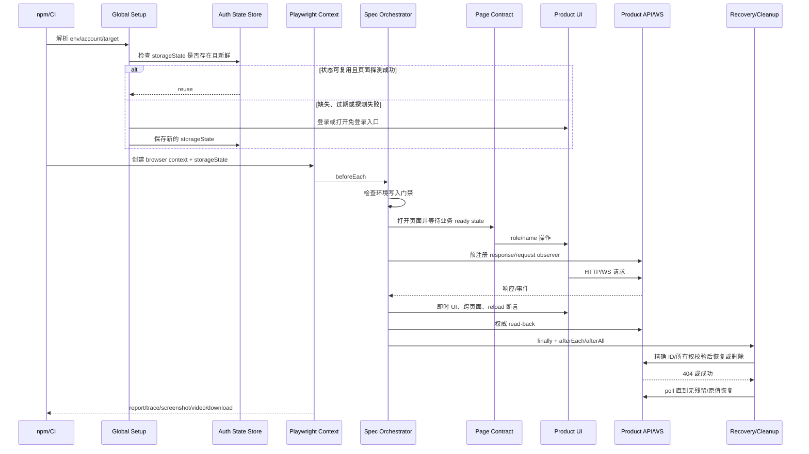
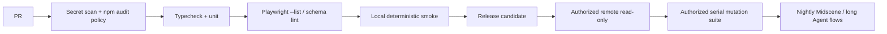

```
# Playwright 页面契约与确定性 UI 测试复刻说明

## 0. 文档目的、范围与证据标签

本文说明如何在一个完全独立、无法访问 Nova 源码和本次会话的 Agent 工程中，复刻 `nova_ui_e2e` 所代表的 UI 自动化能力：环境与认证复用、Playwright 页面契约、确定性选择器与等待、设置页 CRUD、失败注入、上传下载与剪贴板、共享环境写入门禁、测试数据归属和恢复、Midscene 混合测试、报告产物及 CI 分层。

正文给出可重新实现的 TypeScript 接口、状态机、伪代码、目录建议和验收矩阵。源码路径、符号名只放在末尾作为证据追溯，不能替代正文契约。

证据标签如下：

| 标签 | 含义 |
|---|---|
| `[I]` | 当前代码、配置或测试可静态确认的实现事实 |
| `[A]` | 当前自动化用例所表达的应验收契约；不表示本次已运行通过 |
| `[K]` | 已知产品问题、测试框架缺口、安全风险或可能造成误判的弱点 |
| `[P]` | 已有设计文档、跳过用例或待补链路表达的规划能力 |
| `[R]` | 本次实际连接环境并运行验证的结论 |
| `[F]` | 多处静态证据一致支持的强推断，仍需运行确认 |
| `[D]` | 本文为可靠复刻提出的设计增强，不冒充当前实现 |

本次只做静态分析，没有执行 `npm install`、TypeScript 检查、单元测试、Playwright 测试，也没有登录 local/demo/release 环境，因此本文没有任何 `[R]` 通过结论。数量与行为是 2026-08-13 的静态快照。`[I]`

## 1. 边界与核心结论

### 1.1 解决的业务问题

该工程服务于以下角色：

| 角色 | 诉求 |
|---|---|
| 产品/测试工程师 | 从真实浏览器视角验证聊天、设置、知识、工具、MCP、模型、分享、作品等用户链路 |
| 研发工程师 | 在接口成功、接口失败、刷新、跨页面、权限变化等情况下验证 UI 与持久化一致性 |
| 发布负责人 | 区分真实通过、明确跳过、预期失败、意外通过和环境故障，保留可诊断产物 |
| 安全/平台管理员 | 避免自动化未经授权修改远程租户共享配置或启动远程 Stdio 子进程 |
| 复刻实现者 | 用统一页面契约和资源所有权规则扩展用例，而不是在每个 spec 中复制脆弱 DOM 操作 |

输入包括目标环境、账号/密码或免登录策略、测试用例、文件夹具、可选 Midscene 模型配置和显式高风险授权。输出包括 UI/接口断言结果、HTML report、失败 trace、截图、视频、下载文件、可选 case 截图和 Midscene 报告。`[I]`

### 1.2 产品形态

从产品测试能力看，它由两类套件共同组成：

1. **确定性 Playwright 回归**：对稳定、可枚举、具有强数据一致性的页面使用 role/name、请求谓词、API read-back 和状态恢复；适合设置 CRUD、权限、安全、下载、上传和错误处理。`[I]`
2. **Playwright + Midscene 语义流程**：Playwright 负责认证、发送消息、下载等关键动作，Midscene 负责改版频繁区域的视觉定位、等待和语义断言，YAML 承载自然语言流程。`[I]`

两者不是互相替代。精确字段、HTTP 方法、错误状态、租户隔离和持久化不能只靠视觉模型；聊天回答“是否有合理内容”、复杂布局入口等才适合语义判断。`[D]`

### 1.3 技术形态

当前实现不是以 `class XxxPage` 为中心的经典 Page Object，而是四部分组合：`[I]`

- typed state：纯函数描述测试数据、payload 匹配、所有权和恢复决策；
- functional page contract：一组接收 `Page`/`APIRequestContext` 的打开、定位、操作和断言函数；
- spec orchestration：用 `test.step`、串行 suite、环境门禁和 `try/finally` 组合业务链路；
- fixtures/policies：统一运行标记、认证状态、共享资源追踪和清理。

复刻时可以继续采用函数式风格，也可以包装成类，但必须保留“状态计算不依赖浏览器、页面动作不隐藏关键契约、spec 显式表达业务生命周期”的分层。

### 1.4 当前规模

静态库存包含 44 个 Playwright spec，其中 12 个为 `*.midscene.spec.ts`；另有 13 个 Node/TypeScript 单元测试文件、28 个 YAML flow、33 个 `src` TypeScript helper。`[I]` 按“匹配源码文本行”的生成口径，当前 TypeScript 中 `getByRole` 约 900 行、`getByTestId` 为 0；18 个文件使用 `waitForResponse`，16 个文件直接调用 `page.route(...)`，17 个文件包含串行 suite。该口径不是AST调用计数，格式调整会改变数字。`[I]`

这些数量只表示代码库存，不能当作执行通过率。`test.skip`、`test.fail`、凭据缺失、远程写入门禁和外部模型都会使收集数、执行数和通过数不同。

## 2. 推荐目录与模块责任

```text
ui-e2e/
├── package.json
├── playwright.config.ts
├── global-setup.ts
├── .env.example
├── src/
│   ├── env.ts                  # 环境、账号和 URL 解析
│   ├── auth-state.ts           # storageState 路径、新鲜度、目录
│   ├── environment-policy.ts   # 远程写入和高风险能力门禁
│   ├── test-data.ts            # run marker、所有权、通用清理
│   ├── pages/                  # 函数式页面契约
│   ├── state/                  # payload、恢复和所有权纯函数
│   ├── fixtures/               # 自动 fixture
│   └── natural-flow/           # YAML + Midscene runner
├── tests/
│   ├── settings/
│   ├── chat/
│   ├── security/
│   └── fixtures/
├── flows/
├── unit/
├── docs/known-product-issues.md
└── test-results/
```

依赖方向应是 `state/policy <- page contract <- spec`。纯状态函数不得依赖 Playwright；页面 helper 可以依赖状态类型；spec 负责决定是否允许修改环境、如何恢复和什么是验收结果。`[D]`

## 3. 总体执行链路



关键顺序约束：网络 observer 必须先于触发动作注册；状态基线必须在修改前读取；恢复必须进入 `finally`；清理失败必须使测试失败或与业务失败组成 `AggregateError`，不能只写日志。`[A/D]`

## 4. 环境与认证契约

### 4.1 环境对象

```ts
type TestEnv = "local" | "demo" | "release";
type AuthMode = "none" | "password";

interface Profile {
  envName: TestEnv;
  url: string;              // 必须是完整聊天入口 URL
  username: string;
  usernameEnv: string;
  passwordEnv: string;
  password?: string;
  authMode: AuthMode;
}
```

当前环境解析规则是：仅识别 `local/demo/release`，未识别值默认成 demo；`AGENT_TARGET_URL` 覆盖所有环境，local 还可用 `AGENT_LOCAL_URL`；账号优先级为通用一次性覆盖、环境专用变量、内置默认；密码采用同样的通用/环境专用/默认顺序。local 默认回环地址并使用免登录模式。`[I]`

`[K]` 未识别环境静默回落 demo，容易把拼写错误变成远程访问。可靠复刻应对未知值 fail-fast，并要求远程目标显式声明：

```ts
function parseEnv(raw: string | undefined): TestEnv {
  if (raw === "local" || raw === "demo" || raw === "release") return raw;
  throw new Error(`Unsupported E2E_TARGET_ENV: ${raw ?? "<missing>"}`);
}
```

### 4.2 storageState 命名和时效

认证状态路径应至少包含环境和账号。当前实现直接把原始 `profile.username` 插入文件名，再交给 `resolve()`：`.auth/<env>-<raw-username>.json`。它没有 sanitize、containment check 或 hash；若账号覆盖值含 `/`、`..` 或平台路径分隔符，解析结果可能逃出 `.auth` 目录。`[I/K]`

安全复刻路径应是：

```text
.auth/<env>-<sanitized-account>.json
```

```ts
function storageStatePath(profile: Profile) {
  const root = resolve(".auth");
  const accountHash = createHash("sha256")
    .update(profile.username)
    .digest("hex")
    .slice(0, 16);
  const candidate = resolve(root, `${profile.envName}-${accountHash}.json`);
  if (dirname(candidate) !== root) throw new Error("Unsafe auth-state path");
  return candidate;
}
```

显示日志可使用脱敏账号，磁盘名优先用hash；无论是否sanitize，都要验证最终路径仍位于固定auth root内。`[D]`

当前默认最大缓存时间为 12 小时，可被毫秒环境变量覆盖。文件必须能解析成 `{cookies?:[], origins?:[]}`，且至少一类非空才认为有状态；免登录环境允许空状态进入页面探测。`[I]`

仅凭文件时间不能确认会话有效。Global Setup 会创建临时 context 加载状态并导航目标页面，只有业务 ready 条件成立才复用；失败则重新登录。`[I]`

### 4.3 登录与业务 ready state

密码登录链路为：打开入口、等待用户名和密码框、填入凭据、点击登录、竞争等待“账号密码错误”或 URL 进入聊天路径。免登录链路直接打开页面。`[I]`

聊天 ready 不应只等 `domcontentloaded`，还要同时满足：

- pathname 是聊天页面；
- body 已存在；
- 出现新建任务或定时任务等业务锚点；
- 不包含 502、页面无法加载或反向代理错误页。

当前普通打开会对明确的瞬态加载错误最多尝试 3 次；其他错误不会盲重试。`[I]`

### 4.4 缺少凭据时的语义

Global Setup 确实存在“密码环境缺少密码时写空 storage state，具体 spec 再按缺密码且无缓存状态跳过”的分支。`[I]` 但 stock demo/release profile同时带有仓库内 defaultPassword，按当前 `env || profile.defaultPassword` 解析时该分支通常被默认值遮蔽；主要风险不是大面积skip，而是CI或开发机在未显式提供secret时静默使用仓库默认凭据。只有去掉默认值、使用没有默认密码的新增profile，或改变解析策略后，空state/skip风险才成为主路径。`[K]`

推荐策略：

- 开发机可选择 `skip-with-reason`；
- 发布流水线必须设置 `E2E_REQUIRE_AUTH=true`，缺失凭据直接失败；
- 报告中区分 `not-applicable`、`missing-secret` 和 `permission-denied`，不能统一成 skip。`[D]`

### 4.5 密钥安全

复刻仓库的 example 只能放占位符，不得包含可用 API Key、默认密码或真实账号。当前仓库的模板和环境映射里存在看起来可用的默认凭据/模型 Key，这属于需要清理和轮换的安全风险；本文不复述其值。`[K]`

认证状态目录、私有 `.env`、下载内容、trace 和 Midscene 截图必须加入 ignore，并通过 CI secret 注入。trace/截图可能包含敏感 UI，产物应设置最短保留期和访问控制。`[D]`

## 5. Playwright 配置基线

当前浏览器基线为单一 Chromium Desktop Chrome、1280×720 viewport、device scale factor 2、`zh-CN` locale；单测默认 120 秒，expect 10 秒；`fullyParallel=false`，CI 重试 1 次，本地不重试。reporter 为 list + HTML。失败保留 trace，只在失败时截图，视频采用 `retain-on-failure`。`[I]`

建议配置：

```ts
export default defineConfig({
  testDir: "./tests",
  globalSetup: "./global-setup.ts",
  timeout: 120_000,
  expect: { timeout: 10_000 },
  fullyParallel: false,
  retries: process.env.CI ? 1 : 0,
  reporter: [["list"], ["html", { open: "never" }]],
  use: {
    locale: "zh-CN",
    storageState: resolveStorageState(),
    trace: "retain-on-failure",
    screenshot: "only-on-failure",
    video: "retain-on-failure",
  },
  projects: [{
    name: "chromium",
    use: {
      ...devices["Desktop Chrome"],
      viewport: {width:1280,height:720},
      deviceScaleFactor: 2,
    },
  }],
});
```

`baseURL` 必须来自同一环境解析器。当前默认 Playwright `baseURL` 与 Agent profile 使用不同环境变量，且无覆盖时指向非 Agent 网站；大多数 helper 通过 profile 构造绝对 URL，因而没有暴露问题。`[K]` 复刻时只保留一个 URL 真源。

## 6. 页面契约的设计方法

### 6.1 四类函数

每个业务页至少拆成四类函数：

| 类型 | 示例责任 | 不应承担 |
|---|---|---|
| `open/ready` | 导航并等待标题、导航和主详情可见 | 修改业务数据 |
| locator factory | 返回 scoped `Locator`，如某工具行/开关 | 内部等待和点击 |
| action | 点击、填写、保存，同时返回/验证请求 | 隐藏失败或吞异常 |
| API/assertion | 查询权威状态、验证页面与接口一致 | 用 API 代替被测 UI 动作 |

推荐接口：

```ts
interface ToolPageContract {
  open(page: Page): Promise<void>;
  row(page: Page, toolName: string): Locator;
  toggle(page: Page, toolName: string): Locator;
  openConfig(page: Page, toolName: string): Promise<Locator>;
  fetchDetail(page: Page, scope: "TENANT" | "USER"): Promise<ToolDetail>;
  seedOrRestore(page: Page, name: string, patch: ToolPatch): Promise<void>;
}
```

当前 helper 通常是具名导出函数，而不是一个对象或类；这是可接受的函数式 Page Object。`[I]`

### 6.2 typed state 的价值

纯函数层负责：

- 生成唯一测试对象；
- 判断 request payload 是否包含预期配置；
- 判断 API Key 是否被掩码；
- 判断资源名称是否归本次运行所有；
- 根据 original/test/current 三态决定是否允许恢复；
- 精确匹配 HTTP method + pathname + operation。

这些函数应有 Node 单元测试，不需要启动浏览器。当前已有环境解析、模型状态、供应商状态、嵌入应用、i18n/a11y、清理状态等 13 个单元测试文件。`[I]`

### 6.3 不要过度抽象

页面 helper 应暴露业务语义，例如 `openToolConfig("web_search")`，而不是通用的 `clickNthButton(7)`。只有组件和契约确实共用时才抽象。spec 中保留业务步骤和恢复顺序，便于报告阅读。`[D]`

## 7. 确定性选择器规范

### 7.1 优先级

当前工程实践可归纳为：`[I/A]`

1. `getByRole(role, {name, exact})`；
2. `getByLabel`、`getByPlaceholder`；
3. 精确可见文本并限制 scope；
4. `aria-*` 状态和值；
5. 结构定位或 CSS 作为末级兜底。

当前没有使用 `getByTestId`。这说明页面已大量依赖无障碍角色与名称，但不等于 test id 被禁止。`[I]` 对无稳定可访问名称且结构经常变化的控件，建议添加语义化 `data-testid`，而不是 XPath 穿透多层 DOM。`[D]`

### 7.2 scope 和 exact

不要在整页寻找常见“保存”“删除”“开关”。先定位 `main/dialog/navigation/listitem/row`，再在范围内精确定位：

```ts
const dialog = page.getByRole("dialog", { name: "配置 web_search" });
await dialog.getByRole("button", { name: "保存", exact: true }).click();
```

列表项要以业务标识过滤后再寻找操作按钮；存在多个同名控件时，`.first()`/`.last()` 只能配合明确的上层容器，不能作为默认修复。`[D]`

### 7.3 开关与可访问状态

开关必须按 role 定位，并断言 `aria-checked="true|false"`；Tab 使用 `aria-selected`，折叠使用 `aria-expanded`，选择项可用 `aria-pressed`。`[I/A]` 这既降低样式类变更影响，也顺带验证可访问契约。

### 7.4 CSS/XPath 例外

当前存在少量 `xpath=../..`、Ant Design class、通过坐标点击等兜底，集中在缺少稳定语义容器的页面。`[K]` 复刻时应把这些当作待偿还债务，并推动产品补 role、accessible name 或 test id；坐标点击不得进入发布阻断套件。`[D]`

## 8. 等待、同步与网络断言

### 8.1 禁止以固定 sleep 作为完成条件

正确完成条件应是：目标响应到达、URL 改变、dialog 隐藏、开关 aria 状态改变、输入框恢复 enabled、业务文本出现/消失、API read-back 达成。当前代码只在少量历史/复杂交互中使用固定等待，主要代码大量使用 `expect`、`expect.poll`、`waitForResponse` 和 `waitForFunction`。`[I]`

固定等待只能用于产品没有任何可观察完成信号的临时兜底，并应登记改进项。长时间模型生成要等待 Stop 按钮、输入框状态或 WS 终态，而不是睡眠 N 秒。`[D]`

### 8.2 先观察，后点击

```ts
const responsePromise = page.waitForResponse(response => {
  const req = response.request();
  const url = new URL(req.url());
  return req.method() === "PUT"
    && url.pathname === `/api/settings/tools/builtin/items/${encodeURIComponent(name)}`;
});

await toggle.click();
const response = await responsePromise;
expect(response.ok()).toBe(true);
```

如果先 click 再 `waitForResponse`，快速响应可能已经错过。谓词必须至少匹配 method + pathname；有多个同路由操作时还要验证 query 和 post body。`[A/D]`

### 8.3 请求体和响应体

保存类断言至少检查：

- 请求方法；
- 精确 path；
- scope/tenant 语义；
- 被修改字段；
- 响应 HTTP 成功；
- 若业务响应有 `success` 字段，也必须为 true。

只看 toast 或开关变化会把乐观更新误判为保存成功。只看 HTTP 200 又可能忽略业务失败 envelope。`[D]`

### 8.4 `expect.poll` 的用途

后台删除、索引刷新、关联 artifact 清理、分享撤销和最终一致 API 应使用 poll：

```ts
await expect.poll(async () => {
  const rows = await fetchRows();
  return rows.filter(row => owned(row, runMarker)).map(row => row.id);
}, { timeout: 30_000, message: "等待测试资源清理完成" }).toEqual([]);
```

poll 回调必须是只读、幂等且能给出小型可比较结果；不要在 poll 内重复删除或修改。

## 9. 设置 CRUD 的五层持久化验收

一个设置保存用例不能止于“点击保存后页面变了”。当前代表性套件采用以下五层，复刻应将其固化为模板：`[A/F]`

| 层 | 验证内容 | 能发现的问题 |
|---|---|---|
| 1. Request | method/path/query/body 精确 | UI 发错接口、scope 或字段 |
| 2. Immediate UI | dialog 关闭、值/状态立即更新 | 前端交互失败 |
| 3. Navigate away/back | 页面重建后仍正确 | 仅组件内存更新 |
| 4. Reload | 浏览器刷新后仍正确 | 客户端缓存假象 |
| 5. Backend read-back | API detail/list 为预期 | UI 与服务端不一致 |

### 9.1 保存成功模板

```ts
const original = await api.read(id);
const next = deriveUniqueTestValue(original);

try {
  await pageObject.openEditor(id);
  const responseP = observeUpdate(id);
  await pageObject.fill(next);
  await pageObject.save();
  const response = await responseP;
  expectSuccessfulBusinessResponse(response);
  await pageObject.expectImmediate(next);
  await pageObject.leaveAndReturn();
  await pageObject.expectValue(next);
  await page.reload({waitUntil: "domcontentloaded"});
  await pageObject.expectValue(next);
  expect(await api.read(id)).toMatchObject(next);
} finally {
  await restoreIfOwned(original, next);
}
```

### 9.2 删除验收

删除链路应验证：确认弹窗存在；取消不发送 DELETE；确认后才发精确 DELETE；页面消失；reload 后仍不存在；API 不存在或返回 404。当前 Skill 删除缺少二次确认已被登记为稳定产品问题，测试使用 `test.fail()` 保留目标契约。`[K/A]`

### 9.3 创建验收

创建对象必须使用本次 run marker；API 或 UI read-back 获取精确 ID；清理注册 ID。若创建请求失败，列表不得出现同名对象。不要按模糊名称删除“看起来像测试数据”的对象。`[D]`

## 10. 失败注入与回滚契约

### 10.1 route mock 的边界

失败注入必须同时匹配 URL 和 HTTP method，不相关请求执行 `route.continue()`。mock 只作用于本页 context，不直接改后端状态。finally 中必须用同一 pattern/handler `unroute`。`[I/A]`

```ts
const pattern = "**/api/settings/items/*";
const handler: RouteHandler = async route => {
  const req = route.request();
  if (req.method() !== "PUT" || !isExactTarget(req.url(), id)) {
    return route.continue();
  }
  return route.fulfill({
    status: 500,
    contentType: "application/json",
    body: JSON.stringify({success:false,message:"E2E simulated failure"}),
  });
};

await page.route(pattern, handler);
try { /* failure assertions */ }
finally { await page.unroute(pattern, handler); }
```

### 10.2 保存失败的完整断言

失败 case 至少满足：

1. 观察到目标请求且响应确为非 2xx；
2. 不能显示成功 toast 或关闭成“已保存”；
3. 页面出现用户可见错误；
4. 编辑弹窗保留用户输入，允许修正或重试；
5. 乐观开关回滚或保持原值；
6. 离开再返回显示原持久值；
7. reload 显示原持久值；
8. API read-back 完全未变；
9. mock route 被移除。

当前已知问题包括工具/Skill 失败没有可见提示、Skill 乐观更新不回滚、替换失败只写 console、知识导出 500 仍生成下载等。`[K]` 这些用例证明“接口失败断言”必须覆盖 UI、持久化和产物三面。

### 10.3 客户端校验

非法必填项、非法 URL、非法数字等应在点击保存后断言：字段级错误可见、dialog 保留、对应请求数量为 0。可以注册 request listener 收集精确目标请求，并在 finally 移除 listener。`[A]`

### 10.4 `test.fail()` 的正确治理

`test.fail()` 表示“这个契约应通过，但已确认当前产品稳定不满足”，不是跳过。产品仍失败时测试按预期结束；产品修复导致意外通过时，Playwright 会把它报告为失败，提醒移除标记。`[I]`

每个 `test.fail()` 必须对应问题台账，包含问题 ID、稳定现象、精确预期、关联用例、状态和修复回归入口。当前台账维护了数十个开放产品问题。`[I]` 不稳定外部服务、缺凭据或环境部署差异不得伪装成产品 known issue。`[D]`

## 11. 上传、下载与剪贴板

### 11.1 上传

上传前把相对路径解析成绝对路径并确认文件存在。按钮触发 file chooser 时，应并发等待和点击：

```ts
const [chooser] = await Promise.all([
  page.waitForEvent("filechooser"),
  page.getByRole("button", {name:/Add attachment|添加附件/}).click(),
]);
await chooser.setFiles(files);
```

已有 `<input type=file>` 的设置弹窗可直接 `setInputFiles`。验证应包括文件名/预览、上传 API 状态、业务结果、非法扩展/损坏/空文件和无残留。`[A]`

夹具只能包含合成、公开或脱敏数据；大型边界文件可运行时生成到临时目录，避免提交巨大二进制。`[D]`

### 11.2 下载

下载 observer 同样要先注册：

```ts
const downloadP = page.waitForEvent("download");
await downloadButton.click();
const download = await downloadP;
expect(download.suggestedFilename()).toBe(expected);
await download.saveAs(outputPath);
expect(statSync(outputPath).size).toBeGreaterThan(0);
```

某些浏览器/产品实现不是原生 download，而是先取 content API 再客户端保存。当前 artifact helper 会在 download 事件和内容响应之间竞争，并按观察结果处理。`[I]` 复刻时应先定义产品下载契约，不要无条件假设一种机制。

下载失败验收必须确认没有生成错误文件。仅验证“页面显示失败”还不够；知识导出已出现 500 body 被保存成 JSON 文件的已知问题。`[K]`

### 11.3 剪贴板

当前确定性 message-action case会授予权限、点击并用 `expect.poll` 读取，但点击前没有清空剪贴板；如果旧内容恰好满足日期或URL正则，就可能假阳性。Midscene YAML链更弱：它只授权、点击、固定等待500ms，再单次读取，同样不清空也不poll。`[I/K]` 可靠复刻必须在点击前写入不可能匹配的sentinel或清空，点击后poll直到值发生变化且满足预期：

```ts
await context.grantPermissions(
  ["clipboard-read", "clipboard-write"],
  { origin: new URL(page.url()).origin },
);
await page.evaluate(() => navigator.clipboard.writeText(""));
await copyButton.click();
await expect.poll(async () => {
  const value = await page.evaluate(() => navigator.clipboard.readText());
  return { changed: value !== "", matches: value.includes(expected) };
}).toEqual({ changed: true, matches: true });
```

复制失败 case 应确认旧剪贴板未被错误覆盖。公开分享 URL 还要验证 token 结构和未授权访问语义。

## 12. 共享环境写入门禁

### 12.1 风险分级

当前策略把以下能力分开授权：`[I]`

| 能力 | 风险 | 授权变量语义 |
|---|---|---|
| 远程租户共享配置修改 | 影响同租户其他用户 | 值必须精确等于目标 env |
| 远程 MCP Stdio | 后端启动子进程并访问外网 | 先有租户写权限，再单独授权 |
| 批量清除个人覆盖 | 可能删除非测试配置 | local 也需单独高风险授权 |
| 保留已撤销分享 | 产生无法硬删除的审计记录 | local 也需专用账号和授权 |

local 只有在目标 host 是 localhost/127.0.0.1/IPv6 loopback 时，普通租户修改才默认允许。把 `AGENT_TEST_ENV=local` 指向远程地址不能绕过门禁。`[I]`

### 12.2 门禁函数

```ts
interface Permission { allowed: boolean; reason?: string }

function mutationPermission(profile: Profile): Permission {
  if (profile.envName === "local" && isLoopback(profile.url)) {
    return {allowed:true};
  }
  if (process.env.E2E_ALLOW_REMOTE_TENANT_MUTATION === profile.envName) {
    return {allowed:true};
  }
  return {allowed:false, reason: explainImpactAndExactOptIn(profile)};
}
```

授权变量不得进入 `.env.example` 的有效默认值、npm script 或 CI 全局环境。每次运行由执行者在知情确认后临时注入。`[A]`

### 12.3 skip 的粒度

只跳过会产生该类副作用的 case；同一 suite 的只读列表、搜索、展示和 mocked failure 应继续执行。当前部分 suite 用 case ID 集合判断哪些测试需要租户写权限。`[I]`

## 13. 串行化、共享状态和并发恢复

### 13.1 为什么串行

模型角色、工具开关、租户 MCP、Skill、工具组等修改同一个共享账号/租户配置。当前相关 suite 使用 `describe.serial`，命令常附带 `--workers=1`。`[I]` `fullyParallel=false` 不能替代资源级串行：不同文件仍可能由多个 worker 并发执行。

推荐给每类共享资源定义锁键：

```text
tenant:<tenantId>:tool-settings
tenant:<tenantId>:model-role:<role>
user:<userId>:personal-skills
```

单机可用 worker=1；分布式 CI 需要数据库/Redis lease 或把同锁键作业放入同一并发组。`[D]`

### 13.2 基线恢复

修改已有共享配置前读取原值，测试结束恢复原值。不能把“默认应该是开启”写死，因为目标环境可能被管理员合法修改。`[A]`

恢复需比较三态：

```ts
type RecoveryDecision = "already-restored" | "restore" | "concurrent-change";

function decideRecovery(original, testValue, current): RecoveryDecision {
  if (same(current, original)) return "already-restored";
  if (onlyContainsValuesOwnedBy(original, testValue, current)) return "restore";
  return "concurrent-change";
}
```

若 current 出现 original/testValue 之外的字段值，说明可能有并发人工或自动修改，必须拒绝覆盖并抛出需要人工检查的错误。当前模型角色恢复已实现这种思想，并在首次恢复失败后重开页面再尝试一次。`[I]`

### 13.3 新建资源优先于修改共享默认

模型供应商、Skill、MCP、知识等能新建唯一对象时，应使用 `e2e_<suite>_<nonce>`，避免修改已有对象。仅当能力本质是单例设置时才走 original/test/current 恢复。`[D]`

## 14. 测试数据所有权和清理

### 14.1 run marker

当前 marker 规范为：

```text
e2e_<normalized-label>_<normalized-nonce>
```

只允许小写字母、数字和下划线；所有权匹配仅接受完全相同或后接 `_`、`-`、英文冒号、中文冒号。`[I]`

```ts
function isOwnedName(candidate: string | undefined, marker: string) {
  return !!candidate && isSafeMarker(marker) && (
    candidate === marker ||
    candidate.startsWith(marker + "_") ||
    candidate.startsWith(marker + "-") ||
    candidate.startsWith(marker + ":") ||
    candidate.startsWith(marker + "：")
  );
}
```

删除前再次 `assertOwnedName`，没有 ID 时失败。名称筛选只是发现手段，执行删除使用精确 ID。`[I/A]`

### 14.2 双层清理

可靠套件至少有：

- case 内 `finally`：恢复当前测试刚修改的状态；
- `afterEach`：清理本 case 遗留；
- `afterAll`：新 context/API client 再扫一次 suite marker，处理页面提前崩溃或 afterEach 失败。

当前知识、MCP、Skill、工具组、模型供应商、定时任务等套件采用其中不同组合；不是每个 suite 都已完全统一。`[I/K]`

清理函数把成功和 404 都视为幂等完成；其他状态必须抛出包含 HTTP status 和 body 的错误。删除后 poll 列表直到 ID 消失。`[I]`

### 14.3 对话及关联作品

当前对话追踪器同时观察：

- 主 frame 从无 `conversationId` 的新聊天导航到有 ID 的 URL；
- `/ws/chat` 入站 JSON 中的 `conversationId`；
- 历史列表中 title 带 run marker 的条目。

清理逻辑可按精确 ID 删除对话，并继续 poll 历史列表和 artifact 列表，直到对话及关联作品均消失。`[I]`

但是通用自动 fixture 当前在 finally 里只打印并保留已追踪 conversation 供诊断，然后移除 listener，并没有调用上述删除逻辑。`[K]` 因此不能声称“所有聊天测试自动无残留”。推荐策略：

- 成功测试自动删除；
- 失败测试默认保留短期，并在报告登记 ID/TTL；
- CI 定时 janitor 清理超过 TTL 且有安全 marker 的资源；
- 可通过显式变量选择失败也立即删除。`[D]`

### 14.4 分享的特殊生命周期

分享记录当前只能撤销，撤销后仍可能保留审计记录。清理器会：扫描本账号全部分页分享、按 marker 注册、PATCH revoke、poll 状态为 revoked/不存在，并从 public URL 提取 token，poll 公共读取返回 410。`[I]`

这不等于硬删除。会留下不可消除审计记录的真实分享 case 被单独授权，并要求专用测试账号。`[K/A]`

### 14.5 清理失败不能覆盖业务失败

```ts
let businessError: unknown;
let cleanupError: unknown;
try { await businessFlow(); }
catch (e) { businessError = e; }
try { await cleanup(); }
catch (e) { cleanupError = e; }

if (businessError || cleanupError) {
  throw new AggregateError(
    [businessError, cleanupError].filter(Boolean),
    "case and/or cleanup failed",
  );
}
```

当前部分供应商/工具用例已聚合清理错误。`[I]` 复刻时应把它提升为通用 fixture。

## 15. Midscene 混合测试与 YAML 流程

### 15.1 使用边界

适合 Midscene 的动作：视觉布局变化大但语义稳定的入口、生成回答是否完整、是否出现引用/图表、复杂内容质量。适合纯 Playwright 的动作：登录、输入发送、停止、精确设置字段、HTTP/WS 证据、下载、剪贴板、权限、安全和持久化。`[I/D]`

不要让 AI locator 决定高风险删除目标或租户共享配置对象；这类动作必须用精确 ID/accessible name 和 API read-back。`[D]`

### 15.2 YAML 契约

```yaml
name: Agent chat smoke
description: create a new chat and verify an answer
variables:
  question: "{{runMarker}}: summarize this month"
steps:
  - name: wait for chat
    aiWaitFor: "Chat page is ready and composer is editable"
    timeout: 45000
  - name: create new task
    aiTap: "New task button in left navigation"
    deepLocate: true
  - name: send exact message
    agentSendMessage: "{{question}}"
  - name: wait for completion
    aiWaitFor: "Stop button is gone and composer is editable"
    timeout: 360000
  - name: semantic assertion
    aiAssert: "The answer contains a concrete result and evidence entry"
```

当前 loader 只验证 flow 有 name 和 steps 数组，没有对“一步只能有一个 action”、字段类型、未知字段或变量完整性做预校验；runner 通过固定优先级选择第一个 action。`[K]` 复刻应使用 JSON Schema/Zod，在执行前拒绝多 action、无 action、未知 action、缺变量和非法 timeout。`[D]`

### 15.3 runner

每个步骤记录 started/running/completed，长步骤每 10 秒输出 elapsed；action 具有默认 timeout，也允许步骤覆盖；变量以 `{{key}}` 替换，缺失立即失败。`[I]`

Midscene agent 使用以 flow 名 slug 生成的 read-write cache。`[I]` `[K]` 如果不同环境/账号共享 cache ID，视觉定位缓存可能串用。复刻应把应用版本、env、viewport、locale 和 flow schema hash 纳入 cache namespace。`[D]`

### 15.4 模型与隐私

Midscene 需要 base URL、model name/family，非本机代理模式还需要 API Key。缺少配置时多数语义 spec调用 `test.skip`，但 analytics 和 ask-human tool-toggle明确抛错；因此当前不是统一的“缺模型配置=skip”契约。`[I/K]` 发布车道应显式选择required/optional policy并集中实现，避免同一缺失条件在不同spec产生skip和fail。截图会发送给模型服务商，可能还包含精简 DOM；生产/客户数据必须先确认服务商、地域、保留政策和脱敏。`[K]`

发布阻断套件应尽可能使用确定性 Playwright；Midscene 流可作为单独的 smoke/nightly 车道，记录模型、prompt、cache 命中和原始判断证据。`[D]`

## 16. 聊天类测试的确定性设计

### 16.1 新会话

点击 New task 后应等待 URL 精确回到无 `conversationId` 的 `/web/chat`，输入框可见、enabled 且为空。发送消息后不能只等气泡文本；可接受的提交证据包括：消息出现、输入框清空且 URL 获得 conversationId、WS 产生对应事件。`[I/A]`

### 16.2 生成完成

完成条件应组合：Stop 按钮消失、输入框 enabled、执行中/检索中标记消失、出现终态 WS 事件或最终 assistant 内容。页面全文中的通用“Error”正则只能作为辅助，因为用户内容或代码可能合法包含该词。`[D]`

### 16.3 模型非确定性

业务问题应使用 run marker 防止跨会话混淆；断言优先结构和契约，例如存在回答、引用、artifact、工具证据，而不是要求逐字相同。需要金额或精确数据时，应从 API/数据源取得 expected，再解析结构化输出或可访问表格，而不是让视觉模型判断“大致正确”。`[D]`

### 16.4 上下文隔离

跨 conversation 测试必须创建两个明确 ID，分别写入唯一私有 marker，再询问当前对话上下文；历史 marker 不得泄漏。当前问题台账已记录新对话可能召回旧 marker 的 P0 风险。`[K]`

## 17. 报告、产物和诊断

### 17.1 默认产物

当前默认生成 list 输出、HTML report；失败保留 trace、截图和视频，成功视频删除。`[I]` 可选环境变量会为每个 case 额外截图并作为 attachment 加入报告。下载默认保存到测试结果目录，确保文件非空。`[I]`

### 17.2 失败包应包含

可靠复刻建议每个失败 case 附加：

- env、target host、账号 hash、commit、浏览器版本；
- case ID、run marker、资源 ID；
- 失败前最后页面 URL；
- 目标请求 method/path/status/脱敏 body；
- console error、pageerror、requestfailed；
- trace、截图、失败视频；
- 清理/恢复结果；
- Midscene model/prompt/report（若使用）；
- known issue ID 或 skip reason。

严禁附件记录明文 password、API Key、session cookie、MCP secret 或敏感正文。`[D]`

### 17.3 状态判定

报告系统必须区分：passed、failed、skipped、expected-failed、unexpected-pass、flaky-retried、cleanup-failed。意外通过是重要信号，不能归到通过后自动忽略。`[D]`

## 18. CI 与运行命令

### 18.1 本地基础命令

```bash
npm ci
npx playwright install --with-deps chromium
npm run typecheck
npm run test:unit
npx playwright test --list
npx playwright test tests/settings-tools.spec.ts --workers=1
```

当前 package 提供大量按模块、local/headed/UI/Midscene 分类的脚本；确定性设置套件通常 workers=1。`[I]`

### 18.2 当前 CI 缺口

CI provenance应精确区分：`test.yml` 是仅 `workflow_dispatch` 的草案矩阵，内容仍为Maven/Java测试；`v2-ci.yml` 在指定push/PR分支运行Maven `clean verify`；`v1-ci.yml` 也只执行产品后端Maven编译。三者都没有安装Node/Chromium或执行 `nova_ui_e2e`。`[I/K]` 因此不能声称该UI工程已成为PR或release自动门禁。

### 18.3 推荐分层流水线



| 车道 | 触发 | 环境 | 是否阻断 |
|---|---|---|---|
| static | 每个 PR | 无 SUT | 是 |
| local deterministic | 每个 PR/merge | 隔离 local | 是 |
| remote read-only | 每日/RC | demo/release | 视稳定性 |
| remote mutation | 人工确认/RC | 专用租户 | 是，串行 |
| Midscene/长模型 | nightly | 专用账号 | 初期非阻断 |
| janitor/audit | scheduled | 所有测试环境 | 残留超阈值报警 |

远程写授权不应作为 repository secret 自动永久开启；应通过受审批 environment 和一次性 job input 注入精确 env。`[D]`

## 19. 已知限制与复刻改进

| 现状/问题 | 风险 | 复刻建议 |
|---|---|---|
| 未知环境默认 demo `[K]` | 拼写错误访问远程环境 | 未知值 fail-fast |
| 内置/模板疑似真实凭据 `[K]` | 泄漏与滥用 | 移除、轮换、secret scan |
| `baseURL` 与 profile 双真源 `[K]` | helper 指向不同 host | 单一 TargetConfig |
| storage state 仅按 mtime 新鲜 `[I]` | 过期会话 | 保留业务探测并增加账号/租户校验 |
| 通用对话 fixture 不自动删除 `[K]` | 数据堆积 | 成功清理、失败 TTL、janitor |
| 分享只能撤销 `[K]` | 审计残留 | 专用账号和显式授权 |
| YAML 只有最小运行时校验 `[K]` | 多 action/错字段静默 | schema lint + unit tests |
| Midscene cache ID 不含环境 `[K]` | 缓存串用 | env/version/schema hash namespace |
| 少量坐标/CSS/XPath `[K]` | UI 改版脆弱 | 补 a11y role/name/testid |
| UI E2E 未接 CI `[K]` | 只能人工运行 | 分层流水线 |
| 仅 Chromium `[I]` | 跨浏览器风险未知 | 关键契约增加 Firefox/WebKit nightly |
| `latest` 依赖较多 `[K]` | 不可复现升级 | 锁版本并受控 Renovate |
| Midscene `npx ...@latest` `[K]` | CLI 漂移 | pin CLI 版本或内部镜像 |
| 失败 artifact 可能含敏感信息 `[K]` | 数据泄漏 | 脱敏、RBAC、短保留期 |

## 20. 从零复刻实施步骤

### 阶段 1：静态骨架

1. 建立 TypeScript strict + Playwright + Chromium；
2. 实现 fail-fast 环境解析和单一 target config；
3. 实现 storageState 名称、12 小时默认时效和页面有效性探测；
4. 实现 run marker、所有权纯函数及单元测试；
5. 配置失败 trace/screenshot/video 和 HTML report。

验收：不连接 SUT 也能通过 typecheck、unit、Playwright `--list`；环境拼写错误失败；example 无密钥。

### 阶段 2：第一个确定性页面

选择一个有 list/detail/toggle 的设置页，实现 open/ready、scoped locator、fetch detail、更新 observer、五层持久化和 original restore。加入 500 mock 与客户端非法输入 case。

验收：成功和失败链路均能证明 UI 与 API 一致，finally 恢复原值。

### 阶段 3：资源生命周期

实现唯一创建、精确 ID 注册、case/afterEach/afterAll 三层清理；创建知识、Skill/MCP 或模型供应商套件。清理失败用 AggregateError 报告。

验收：测试中断后重新运行 janitor 可清理 marker 资源，不删除人工资源。

### 阶段 4：聊天与文件

实现新对话、发送、终态、Stop、上传、下载、剪贴板和关联 artifact 清理。为 WS/URL 双通道追踪 conversationId。

验收：成功无残留；失败报告有 conversationId；上传/下载边界和错误无伪成功。

### 阶段 5：语义流程

在确定性基线稳定后引入 Midscene，定义严格 YAML schema，只让 AI 负责视觉/语义步骤。模型流放入独立 nightly 车道。

验收：同一 flow 在 local/demo/release 只替换环境和运行变量，不修改步骤；缺模型配置的发布车道按策略失败而非静默通过。

## 21. 可直接采用的测试模板

```ts
test.describe.serial("tenant setting", () => {
  test.beforeEach(async ({page}, testInfo) => {
    const permission = mutationPermission(resolveTarget());
    test.skip(needsMutation(testInfo) && !permission.allowed, permission.reason);
    await settings.open(page);
  });

  test("SETTING-01 saves, persists and restores", async ({page}) => {
    const original = await settings.readApi(page, TARGET_ID);
    const next = makeOwnedValue(original, runMarker);
    let businessError: unknown;
    let cleanupError: unknown;

    try {
      const responseP = settings.observeSave(page, TARGET_ID);
      await settings.editAndSave(page, TARGET_ID, next);
      const response = await responseP;
      await expectSaveSuccess(response, next);
      await settings.expectImmediate(page, next);
      await settings.leaveAndReturn(page);
      await settings.expectPersistedUi(page, next);
      await page.reload({waitUntil:"domcontentloaded"});
      await settings.expectPersistedUi(page, next);
      expect(await settings.readApi(page, TARGET_ID)).toMatchObject(next);
    } catch (error) {
      businessError = error;
    }

    try {
      await settings.restoreSafely(page, original, next);
    } catch (error) {
      cleanupError = error;
    }

    if (businessError || cleanupError) {
      throw new AggregateError(
        [businessError, cleanupError].filter(Boolean),
        "setting case or restoration failed",
      );
    }
  });
});
```

## 22. 验收矩阵

| ID | 场景 | 前置 | 动作 | 预期可观察结果 |
|---|---|---|---|---|
| ENV-01 | 未知环境 | `E2E_TARGET_ENV=demoo` | 启动 | fail-fast，不访问网络 `[D]` |
| AUTH-01 | 复用有效状态 | 新鲜 state 且页面 ready | 启动 | 不重复登录，进入正确账号/租户 |
| AUTH-02 | 过期/无效状态 | state 过期或探测失败 | 启动 | 重新登录并原子写 state |
| AUTH-03 | CI 缺凭据 | require-auth=true | 启动 | job 失败，不报告大面积 skip `[D]` |
| SEL-01 | 语义定位 | 页面样式类变化 | 执行设置用例 | role/name locator 仍通过 |
| WAIT-01 | 快速响应 | PUT 立即返回 | 切换开关 | 不丢响应，因为 observer 先注册 |
| CRUD-01 | 保存成功 | 有原值 | UI 修改 | request/UI/back/reload/API 五层一致 |
| CRUD-02 | 保存 500 | route 精确 mock | UI 修改 | 错误可见、输入保留、后端/刷新原值 |
| CRUD-03 | 非法输入 | 必填为空 | 保存 | 字段错误、零请求、dialog 保留 |
| DEL-01 | 删除取消 | 自有资源 | 取消确认 | 零 DELETE，资源仍在 |
| DEL-02 | 删除确认 | 自有资源 | 确认 | 精确 DELETE、reload/API 均不存在 |
| FILE-01 | 上传成功 | 合成夹具 | 上传 | 文件名、响应和业务结果一致 |
| FILE-02 | 上传失败 | 损坏/越界文件 | 上传 | 错误可见，无残留，可继续操作 |
| DOWN-01 | 下载成功 | 可下载资源 | 点击 | 正确文件名、非空、内容类型合理 |
| DOWN-02 | 下载 500 | mock 非 2xx | 点击 | 无下载文件，错误可见 |
| CLIP-01 | 复制 | 已授权并清空 | 点击复制 | poll 得到精确预期内容 |
| GATE-01 | 远程未授权写 | demo/release | 运行 mutation case | 仅该 case 跳过并给出明确原因 |
| GATE-02 | local 指向远程 | env=local, host 非 loopback | 运行 mutation | 仍拒绝 |
| REC-01 | 正常恢复 | current=test value | finally | 恢复 original 并 read-back |
| REC-02 | 并发改变 | current 含第三方值 | finally | 拒绝覆盖并报人工检查 |
| CLEAN-01 | 名称不归本次 | 人工资源 | cleanup | 删除前拒绝 |
| CLEAN-02 | 幂等删除 | 资源已 404 | cleanup | 视为完成 |
| CLEAN-03 | 关联清理 | 对话有 artifact | 删除对话 | 历史和 artifact 均最终消失 |
| SHARE-01 | 分享撤销 | 自有分享 | cleanup | 列表 revoked，公开 token 返回 410 |
| MID-01 | YAML 多 action | 非法 flow | lint | 执行前失败 `[D]` |
| ISSUE-01 | 预期失败修复 | 产品已修复 | 跑 `test.fail` case | unexpected pass 提醒移除标记 |
| ART-01 | 失败诊断 | 任一 case 失败 | 完成 | trace/截图/视频/脱敏网络/清理状态齐全 |
| CI-01 | PR 静态车道 | 无环境凭据 | pipeline | typecheck/unit/list/schema/secret scan 通过 |

## 23. 完成定义

只有同时满足以下条件，才可称为“复刻了确定性 UI 自动化能力”：

1. 环境、账号、target 和认证状态只有一个权威解析链；
2. 设置修改具备五层持久化验证和 original restore；
3. 错误 mock 验证错误可见、UI 回滚/输入保留、后端未变；
4. 共享环境写入需要精确、临时、分级授权；
5. 新建数据都带安全 marker 和精确 ID，清理不会模糊删除；
6. 成功/失败/skip/预期失败/意外通过/清理失败可区分；
7. 上传、下载、剪贴板有真实浏览器事件与产物断言；
8. Midscene 只补视觉/语义弹性，不替代安全与数据契约；
9. 静态检查和 local deterministic 套件进入 CI，远程写与模型套件独立治理；
10. 报告可诊断且不泄漏凭据或敏感数据。

## 24. 当前事实、推断与建议汇总

- `[I]` 当前工程已有三环境解析、storageState 复用、函数式页面 helper、纯状态函数、串行设置套件、网络 observer、route mock、上传下载/剪贴板、run marker、部分双层清理、Midscene YAML runner和失败产物。
- `[A]` 当前用例明确要求设置持久化、失败不伪成功、API read-back、权限隔离、文件边界、公开分享失效及多类安全行为。
- `[K]` 主要缺口包括 UI E2E 未接 CI、未知环境默认 demo、疑似真实默认凭据、双 URL 真源、通用对话 fixture不自动清理、分享审计残留、YAML 校验薄弱、少量脆弱 locator 和 Midscene 隐私/缓存风险。
- `[P]` 仓库设计稿记录了更多迁移、缺口和 CI 设想，但本次没有把设计稿中的“曾通过”转写成当前运行结论。
- `[R]` 本文没有运行验证。
- `[F]` 多个设置套件共同形成了“request→即时 UI→跨页面→reload→API”的五层模式，但并非所有现存 case 都完整实现五层。
- `[D]` 生产级复刻应增加 fail-fast env、严格 flow schema、分布式资源锁、成功自动清理/失败 TTL、janitor、CI 分层、统一 URL、依赖锁定、secret scan 和 artifact 脱敏。

## 25. 证据追溯附录

以下仅用于在原仓库中审计本文结论，复刻实现不依赖这些路径：

- 环境与认证：`nova_ui_e2e/src/agent-env.ts`、`agent-auth.ts`、`global-setup.ts`、`agent-page.ts`；
- Playwright 基线：`nova_ui_e2e/playwright.config.ts`、`package.json`；
- 写入门禁：`nova_ui_e2e/src/test-environment-policy.ts`；
- 所有权与清理：`nova_ui_e2e/src/test-data-cleanup.ts`、`agent-sharing.ts`、`tests/fixtures/*.ts`；
- 页面契约：`nova_ui_e2e/src/system-settings-*.ts`、`model-*-page.ts`、`embed-settings-*.ts`、`personal-extensions.ts`；
- typed state：`nova_ui_e2e/src/*-state.ts` 及 `unit/*.test.ts`；
- 代表性确定性 spec：`settings-tools.spec.ts`、`settings-mcp.spec.ts`、`settings-skills.spec.ts`、`settings-knowledge.spec.ts`、`agent-model-providers.spec.ts`、`agent-conversation-*.spec.ts`；
- Midscene：`nova_ui_e2e/src/natural-agent-flow.ts`、`midscene-env.ts`、`flows/**/*.yaml`、`tests/*.midscene.spec.ts`；
- 问题治理：`nova_ui_e2e/docs/known-product-issues.md`；
- CI 现状：`.github/workflows/v1-ci.yml`、`.github/workflows/v2-ci.yml`、`.github/workflows/test.yml`。

```
