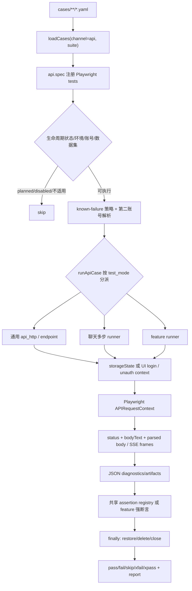
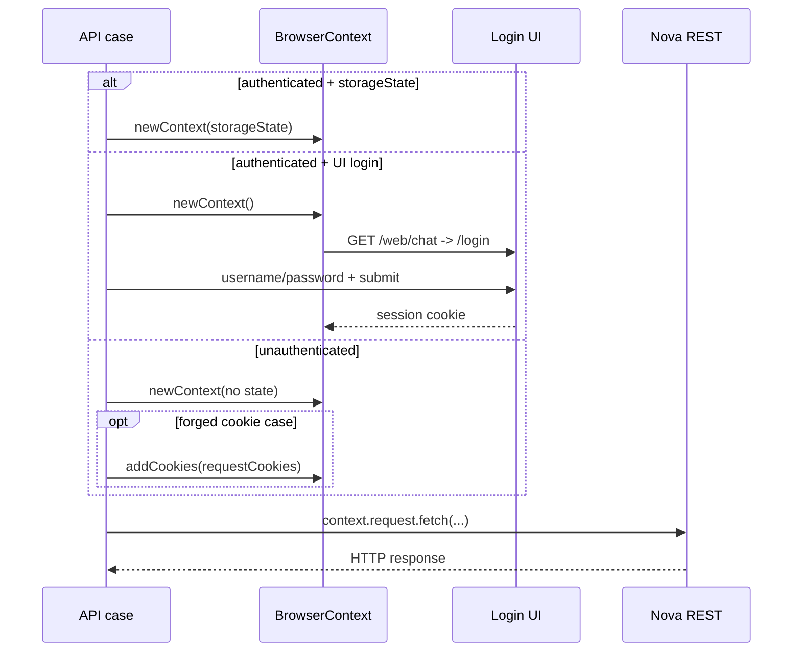
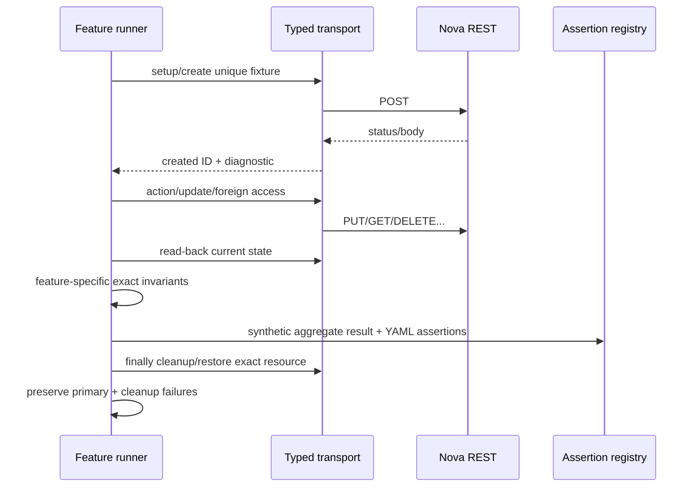
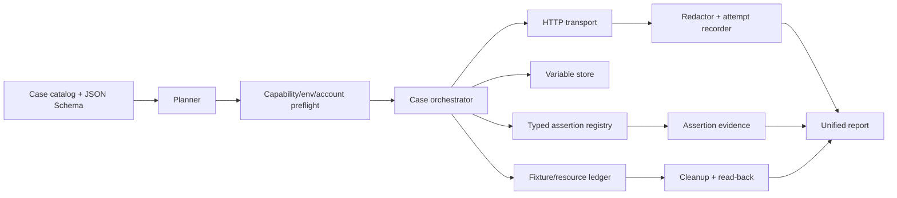

```
# REST API 黑盒 Runner 与断言体系

> 质量轴 Q03。本文给出一个不依赖 Nova 源码即可复刻的 REST API 黑盒测试执行器，并严格区分当前 `nova_auto_test` 静态实现与推荐演进设计。  
> 静态审计日期：2026-08-13。  
> 本次没有运行 Playwright、TypeScript 检查或任何 API 用例；“active”“存在测试代码”和历史报告都不代表当前提交已通过。

## 0. 标记与结论

| 标记 | 含义 |
|---|---|
| **I** | 当前静态代码可确认的实现 |
| **A** | 需要在复刻环境验证的假设 |
| **K** | 当前缺口或弱保证 |
| **P** | 规划/推荐设计，不是 current |
| **REQ** | 等价复刻必须满足的要求 |
| **F** | 失败或降级路径 |
| **D** | 推荐固定为工程决策 |

核心结论：

1. **I**：API 通道基于 `@playwright/test`，从 `cases/**/*.yaml` 加载 case；`api.spec` 负责注册、环境筛选、账号选择和 known failure，`runApiCase` 再按 `test_mode` 分派。
2. **I**：简单 endpoint case 使用统一 HTTP runner；聊天有单轮、SSE、追问、跨账号、会话详情/变更/并发等专用流程；知识、任务、设置、文件、指标等由 feature runner 承担 setup、复合请求、read-back 和 cleanup。
3. **I**：断言是 `type -> function(ctx, assertion)` 的共享注册表，API 主要消费状态码、body type/schema、JSON path、数组、敏感配置掩码、正文包含/不包含和后端泄漏检查。
4. **K**：通用 runner 没有中央变量仓、response extraction、通用 resource ledger、请求级 timeout/retry policy、请求/响应统一脱敏器或 assertion schema 校验；这些能力散落于 feature runner。
5. **K**：Playwright 的 retry 会重新执行整个 case，包含造数与副作用；当前 CI retry=2、本地=1，不能把最终通过当作首次通过。

## 1. 产品边界与职责

REST 黑盒 runner 的目标是从用户/客户端能观察的 HTTP 边界证明：

- endpoint、method、认证与权限符合契约；
- 请求校验、响应状态、字段、类型和错误语义稳定；
- 写操作真实持久化，跨请求 read-back 能观察；
- 跨账号/跨租户访问被拒绝且不泄漏敏感内容；
- 创建、更新、删除、恢复和清理形成可审计闭环；
- 流式 HTTP 响应可按 SSE 事件验证基本契约。

它不负责：

- Java 内部类/方法覆盖；
- WebSocket 实时生命周期（属于 WS 通道）；
- 页面交互与视觉状态（属于 browser/UI 通道）；
- 开放式回答质量（交给外部 judge/eval）；
- 通过数据库旁路“证明”API 正确。黑盒 read-back 应优先使用公开 API。

## 2. current 模块与数据流



### 2.1 文件职责（概念化）

| 构件 | current 职责 | 不承担的职责 |
|---|---|---|
| Playwright config | project、总 timeout、retry、worker、reporter、trace/screenshot | 业务副作用隔离、请求级重试 |
| config resolver | 环境、主/第二账号、URL、凭据、模型、dataset | secret vault、凭据轮换 |
| YAML loader | 递归加载、按 channel/suite 筛选 | 完整 JSON Schema 校验、重复 ID 检测 |
| api.spec | case 注册、status/env/account/dataset 筛选、known failure | 业务请求编排 |
| API case dispatcher | 按 test_mode 路由到 handler | 插件式动态注册；当前是 if 链 |
| generic HTTP runner | 单请求、auth/unauth cookie、response parse、附件、断言 | response 变量提取、通用 setup/cleanup |
| feature runner/client | 多请求业务闭环、强类型 transport、fixture、read-back、cleanup | 全局一致实现；各 feature 风格仍有差异 |
| assertion registry | invariant/exact 函数映射 | judge、声明式参数 schema、channel 限定 |

## 3. 配置、账号与认证

### 3.1 环境配置契约

复刻所需的 current 等价结构：

```yaml
# config/config.yaml（不放真实密码）
env: release
model: deepseek-v4-pro
timeout_ms: 240000
headless: true
environments:
  release:
    base_url: https://agent.example.test
    default_account: release-editor-a
    second_account: release-viewer-b
    model: deepseek-v4-pro
    auth_enabled: true
```

```json
{
  "release": {
    "release-editor-a": {
      "username": "injected-or-local-value",
      "password": "injected-or-local-value",
      "desc": "tenant A editor",
      "dataset": "guest-analysis"
    },
    "release-viewer-b": {
      "username": "injected-or-local-value",
      "password": "injected-or-local-value",
      "desc": "tenant B viewer",
      "dataset": "guest-analysis"
    }
  }
}
```

解析优先级概括如下：显式调用参数 > 环境/账号范围环境变量 > 通用环境变量 > 配置文件。URL 去除末尾 `/`；开启认证时用户名或密码缺失立即失败；第二账号未配置返回 null，由 case 决定 skip 或 fail。

`ResolvedAccount` 等价接口：

```ts
interface ResolvedAccount {
  envName: string;
  accountName: string;
  baseUrl: string;
  username: string;
  password: string;
  modelName: string;
  authEnabled?: boolean;
  timeoutMs: number;
  headlessDefault: boolean;
  desc: string;
  dataset: string;
}
```

### 3.2 认证流程

Authenticated case 创建 BrowserContext，并使用其 `context.request` 发 API，以共享 cookie：

1. 若命中账号范围的 storageState 环境变量，校验文件存在，以该 state 创建 context，`authMode=storage_state`。
2. 否则创建 page，访问 `/web/chat`。
3. 若已经进入 app shell，直接复用当前会话；否则识别 `/login`，填用户名/密码并点击“登录”。
4. 登录离开 `/login` 后，通过同一 BrowserContext 的 request 发 REST。

Unauthenticated case 创建无 storageState 的 context；可选 `requestCookies` 被写入 `account.baseUrl`，用于伪造/异常 cookie 测试。current 明确禁止 authenticated case 同时声明 requestCookies。



**K**：默认 `AGENT_E2E_IGNORE_HTTPS_ERRORS` 未设时会忽略 HTTPS 错误。这适合受控测试证书，不应成为 release 安全门禁。  
**K**：storageState 包含认证 cookie，属于 secret；current 只校验文件存在，没有静态可见的 freshness、权限或泄漏扫描。  
**K**：diagnostics 的 console 文本只替换已配置账号的 password；URL、响应 body、cookie 和其他 token 没有通用递归脱敏保证。

## 4. YAML case 契约与加载

### 4.1 API case 最小模型

```ts
type CaseStatus = "active" | "planned" | "known_failure" | "disabled";

interface ApiYamlCase {
  id: string;
  channel: "api";
  source: string;
  title?: string;
  tags?: string[];                    // smoke/regression
  status?: CaseStatus;
  reason?: string;
  env?: string[];
  account?: string;
  dataset?: string;
  requiresSecondAccount?: boolean;
  knownFailureEnvs?: string[];
  knownFailureErrorPattern?: string;

  test_mode?: string;
  method?: "GET" | "POST" | "PUT" | "DELETE" | "PATCH";
  endpoint?: string;
  authenticated?: boolean;            // 默认 true
  requestCookies?: Array<{name: string; value: string}>;
  body?: unknown;
  stream?: boolean;
  messages?: Array<{role: "user" | "assistant"; content: string}>;
  question?: string;
  input?: {repeatText?: string; repeat?: number; text?: string};

  // 各 feature 的 operation/fixture 字段，例如 knowledgeOperation、taskOperation
  [featureField: string]: unknown;
  assertions: Array<{type: string; [key: string]: unknown}>;
  eval_external?: string[];
}
```

Loader 递归读取 `cases` 目录全部 `.yaml/.yml`，支持一个文件多 document；只保留有 id、channel 匹配且 suite 匹配的 document。suite 规则：

- `smoke`：tags 必须含 smoke；
- `regression`：tags 必须含 regression；
- `full`：不按 tag 排除；
- 其他值立即抛错。

**K**：当前 loader 是 TypeScript cast，不是运行时 schema validator；缺 assertions、method 非法、重复 ID、未知 feature 字段等可能直到执行才暴露。  
**K**：未声明 status 的 case 会进入正常执行路径，等价于 active，但这是隐式行为；推荐要求 status 必填。  
**K**：full 会装载 planned/disabled，随后注册为 skip；它不是“全部实际执行”。

### 4.2 通用单请求示例

```yaml
id: AUTH-FILTER-004
channel: api
source: 14-auth-tenant/auth-filter.md
title: Reject a forged session without backend leakage
tags: [regression]
status: active
test_mode: api_http
method: GET
endpoint: /api/settings/providers/effective
authenticated: false
requestCookies:
  - name: CIP_SESSION
    value: invalid-e2e-forged-session
assertions:
  - type: status_code_one_of
    codes: [401, 403]
  - type: response_non_empty
  - type: no_backend_leak
```

精确映射：`GET baseUrl + endpoint`，无 JSON body；先把 cookie 绑定 baseUrl，再执行；读取完整 response text，尝试 JSON.parse；断言 status ∈ {401,403}、body/bodyText 非空，并禁止 SQL/Java stack/Traceback 特征。

### 4.3 输入模板变量

current 通用模板只支持递归替换字符串中的：

```text
${input.repeatedText} = repeatText 重复 repeat 次
${input.text}         = input.text
```

替换作用于 body 的所有字符串子节点；若没有显式 body，则首个 user message/question 会构造成 `{message}`；聊天 payload 还会在 provider 缺失时读取 `AGENT_MODEL_NAME`。

**K**：没有通用 `${env.*}`、`${account.*}`、`${random.*}`、`${response.step.jsonPath}` 变量，也没有跨 step 变量仓。conversationId 等值由专用 runner 在内存中提取和传递；feature runner 自行生成时间戳/随机后缀。

## 5. case 到请求/断言的精确执行链

### 5.1 注册与前置筛选

`api.spec` 在模块加载时调用 `loadCases("api")` 并为每个 case 注册 Playwright test：

```ts
for (const c of loadCases("api")) {
  if (c.status === "planned" || c.status === "disabled") registerSkipped(c);
  else registerTest(c, async runtime => {
    const primary = resolvePrimaryAccount();
    skipUnlessMatches(c.env, c.account, c.dataset, primary);
    const xfail = knownFailureApplies(c, primary.envName);
    const secondary = c.requiresSecondAccount ? resolveSecondAccount() : null;
    if (c.requiresSecondAccount && !secondary) skip("second account missing");
    await executeWithKnownFailureBoundary(c, xfail, () => runApiCase(...));
  });
}
```

注意：env/account/dataset 不匹配是 runtime skip，不是 failed；第二账号缺失也是 skip。发布门禁必须单独统计 skip，否则可能出现“0 fail 但关键场景未执行”。

### 5.2 dispatch 优先级

current dispatcher 是顺序 if 链。专用 `test_mode` 优先于 generic endpoint：model access、CAN plugin、task、memory、knowledge、skill、settings、metric、attribution、file/artifact、favicon、聊天模式依次路由；最后只有 `test_mode=api_http` 或声明 endpoint 才走 generic runner。都不匹配时主动 skip，理由为缺 endpoint/method migration metadata。

**REQ**：复刻 current 时必须保持“明确 feature mode 优先，endpoint fallback 最后”，否则带 endpoint 的复合 case 会被错误降为单请求。

### 5.3 generic HTTP runner

```ts
interface ApiResult {
  statusCode: number;
  bodyText: string;
  body: unknown; // JSON parse 成功为值；空/非法 JSON 为 undefined
  frames: Array<{direction: "in"; data: string; type?: string}>;
}

async function runGeneric(ctx): Promise<void> {
  require(ctx.case.endpoint);
  const method = (ctx.case.method ?? "GET").toUpperCase();
  const authenticated = ctx.case.authenticated !== false;
  rejectAuthCookieMix(authenticated, ctx.case.requestCookies);
  const browserContext = authenticated
    ? await authenticatedContext(ctx.account)
    : await unauthenticatedContext(ctx.case.requestCookies);
  try {
    const result = await fetchApi(browserContext.request, {
      url: ctx.account.baseUrl + ctx.case.endpoint,
      method,
      data: resolveBody(ctx.case),
      stream: ctx.case.stream
    });
    await attachResultAndDiagnostics(result);
    runAssertions(toAssertContext(result), ctx.case.assertions);
  } finally {
    // current：teardown 异常被吞掉；这里是在复刻现状，不是推荐实现。
    await browserContext.close().catch(() => {});
  }
}
```

**K**：上述 current `close().catch(() => {})` 会把 context/request teardown 失败静默丢失；它也不等于删除服务端业务资源。**D**：目标 runner 必须分别捕获 primary、业务 cleanup、context teardown 三类结果，报告 `teardown_outcome` 和错误摘要；即使主断言成功，只要 teardown 失败也不得产出干净 pass。验收至少注入一次 `close()` rejection，确认报告保留 teardown failure，且 primary failure 与 cleanup failure 均未被覆盖。

Playwright `request.fetch` 接收 `method` 与 `data`。package lock 当前解析到 Playwright 1.61.1（虽然 manifest 范围从较早版本起）；current 不显式设置 headers、params、failOnStatusCode、timeout 或 maxRedirects，endpoint 可自带 query string。在该锁定版本的有效契约中：非 2xx/3xx 不自动抛错（由 runner读取 status 后断言）；重定向默认跟随且最多 20 次；单请求默认 timeout 为 30 秒；未传 `params`，查询只能写在 endpoint；未传自定义 headers，JSON `data` 的 Content-Type 等由 Playwright推断并携带 context 的认证 cookie。锁文件升级可能改变依赖行为，因此这组默认值必须由 transport contract test 锁定，不能只依赖库文档。

**D**：目标 schema/transport 对每一步显式声明 `headers` allowlist、`params`、`failOnStatusCode:false`、`timeoutMs` 与 `maxRedirects`；跨 origin redirect 默认拒绝，认证 header/cookie 不得转发到非 allowlist origin。至少测试 302 相对/绝对跳转、404 仍返回可断言 response、request timeout、超过 redirect 上限/redirect loop、query 编码及敏感 header 不跨 origin。

普通响应读取完整 text；空串返回 body=undefined；JSON.parse 失败也返回 undefined，原文仍在 bodyText。因而测试非 JSON 必须使用 bodyText 类断言，不能要求 response_json_path。

### 5.4 SSE over HTTP

`stream=true` 并不是边读边断言。runner 等待完整 response text，然后按空行切 block：

- `event:` 第一行提供 type；
- 多个 `data:` 行 trim 后以换行拼接；
- 无 event 时尝试从 JSON data 的 `type/event/status/name` 推断；
- 再以文本中的 complete/error 关键词兜底，否则非空视为 token。

最终 body 是 `{events: frames.map(frame => JSON.parse(frame.data) or undefined)}`。

**K**：它不能验证首 token latency、真正增量到达、半途取消、连接 idle timeout 或 chunk 边界；这些必须用 WS runner 或流式 HTTP reader。  
**K**：SSE parser 不处理 comment、`id:`、`retry:`、字段名/值空格等完整格式，并会 trim 每个 data 行；但由于对完整 body `split` 后仍遍历最后一块，末尾没有空行的事件仍可解析。复刻应以 current fixture 锁定兼容行为，再决定是否升级为严格流式 parser。

### 5.5 专用聊天 runner

| mode | current 静态资产数 | 请求链 | side effect | current cleanup |
|---|---:|---|---|---|
| api_chat | 5 | POST `/api/chat` 一次 | 新 conversation/messages/Agent run | 只 close context，不 DELETE |
| api_chat_stream | 2 | POST `/api/chat/stream` + stream parse | 新 conversation/messages/Agent run | 只 close context，不 DELETE |
| api_chat_follow_up | 1 | POST first → 深度找 conversationId → POST second 带同 ID | 新 conversation + 多消息 | 只 close context，不 DELETE |
| api_chat_cross_account | 1 | owner 创建 marker 会话 → foreign 继续同 ID | owner conversation；foreign 请求 | 只 close 两个 context，不 DELETE |
| api_conversation_detail | 1 | 创建 → GET detail → GET messages | 新 conversation | 只 close context，不 DELETE |
| api_conversation_cross_account | 1 | owner 创建 → foreign GET/DELETE → owner GET | owner conversation；foreign 请求 | 只 close 两个 context，不 DELETE |
| api_conversation_mutations | 1 | 创建 → title update/read-back → pin/read-back → unpin/read-back → delete/read-back | 新 conversation并变更 | 主流程 DELETE；异常 finally best-effort DELETE |
| api_chat_concurrent_same_conversation | 1 | 创建 → Promise.all 两个 follow-up | 新 conversation + 并发消息 | 只 close context，不 DELETE |

上述数字是当前 YAML 资产计数，不是执行/通过数。只有 conversation mutations 实现业务资源删除；`auth.context.close()` 只关闭本地浏览器 context/session，不删除服务端会话。

**K**：除 mutations 外，专用聊天 runner 会在每个 attempt 持久化会话、消息和可能的工具副作用；Playwright retry 会进一步累积。**D**：所有 owner 创建步骤一拿到 conversationId 就登记 ledger，finally 由 owner actor DELETE，并 GET detail/list 验证 gone；若产品不提供删除能力，使用专用租户+TTL且将 residual 明确阻断/降级。主断言、删除、gone verification 的失败需聚合，不能 `.catch` 后丢失。

conversationId extraction 会在最多 8 层对象中查 `conversationId/conversation_id/conversationID`。这种容错可跨版本，但也可能误取嵌套无关对象的第一个值；推荐 endpoint contract 明确 JSON path。

## 6. feature runner：setup、业务 oracle 与 cleanup

generic runner 适合单请求。复合业务使用“runner + transport client”：client 把 endpoint 封装成强类型操作并记录 `{method,path,statusCode}`；runner 编排 fixture、权限、read-back、恢复和最终合成一个 result 给共享 assertions。



### 6.1 推荐的 feature 接口

```ts
interface HttpResult<T = unknown> {
  statusCode: number;
  body: T | unknown;
  bodyText: string;
}

interface RequestDiagnostic {
  method: "GET" | "POST" | "PUT" | "PATCH" | "DELETE";
  path: string;
  statusCode: number;
  actor: "owner" | "foreign" | "anonymous" | "admin";
  accountRef: string;  // alias/hash，绝不记录用户名/token
  sessionRef: string;  // 本次认证context的随机引用
}

interface FeatureTransport {
  diagnostics: RequestDiagnostic[];
}

interface FeatureHandler {
  mode: string;
  validate(c: ApiYamlCase): void;
  run(ctx: ApiCaseContext): Promise<void>;
}
```

### 6.2 current 的副作用保护模式

静态可见的良好模式包括：

- 创建资源后立即记录 ID；finally 只删除自己创建的精确 ID；
- 名称加入 case ID + timestamp/random 后缀，降低冲突；
- 设置类先读取 before，写入后 read-back，finally 恢复 before；
- 若恢复前发现当前值既非原值也非本测试写入值，拒绝覆盖疑似其他管理员更新；
- 跨租户场景要求第二账号，部分 runner 还调用 current-user 验证 tenant 真正不同；
- mutation runner 检测 worker 数，要求 `--workers=1`；
- 主断言与 cleanup 同时失败时用 AggregateError 保留两者；
- 删除后再次 list/get，验证无残留。

**K**：这些规则不是统一框架强制。有的 finally 使用 `.catch(() => {})` 静默 best-effort，有的完整聚合 cleanup failure；有的 mutation runner 强制 worker=1，有的依赖命名隔离。不能假设所有 feature 都同等安全。  
**K**：通用 `api_http` 对任意 POST/PUT/DELETE 没有 side-effect metadata 和 cleanup hook。  
**K**：若 Playwright retry 触发，整个 setup/action/cleanup 会重跑；首次 attempt 在 cleanup 前崩溃可能留下资源。

跨账号/租户的最小 **A/B/A contract** 必须是：actor A(owner) 创建并读回 marker → actor B(foreign) 分别尝试 read/update/delete 且被拒绝、不泄漏 marker → actor A 再次读回，确认原 ID、内容、版本/状态未被 B 改变 → 最后只由 A 删除并验证 gone。每个 request diagnostic 必须带 actor/accountRef/sessionRef，ledger 记录 owner；否则聚合响应无法证明哪一个会话执行了哪一步。

### 6.3 推荐统一 resource ledger

```ts
interface ResourceRecord {
  type: string;
  id: string;
  owner: {
    actor: "owner" | "foreign" | "admin";
    accountRef: string;
    tenantAlias: string;
    sessionRef: string;
  };
  createdByCase: string;
  cleanup: () => Promise<void>;
  verifyGone: () => Promise<boolean>;
}

class CaseResources {
  register(record: ResourceRecord): void;
  snapshotSetting<T>(key: string, before: T, restore: (v: T) => Promise<void>): void;
  cleanupReverse(): Promise<{failures: Error[]; residuals: ResourceRecord[]}>;
}
```

资源必须在 create 返回 ID 后、任何进一步断言前登记。cleanup 与 assertion 结果分列报告；残留不能因主流程通过而隐藏。

## 7. assertion registry

### 7.1 current 接口与执行

```ts
interface AssertCtx {
  frames: Array<{type?: string; direction?: string; data?: string}>;
  conversationId?: string;
  statusCode?: number;
  bodyText?: string;
  body?: unknown;
}

type Assertion = {type: string; [key: string]: unknown};
type AssertionFn = (ctx: AssertCtx, assertion: Assertion) => void;

const assertions: Record<string, AssertionFn> = { /* functions */ };

function runAssertions(ctx: AssertCtx, list: Assertion[]): void {
  for (const a of list) {
    const fn = assertions[a.type];
    if (!fn) throw new Error(`unknown assertion type: ${a.type}`);
    fn(ctx, a);
  }
}
```

按 YAML 顺序 fail-fast；首个失败阻止后续 assertion，但外层 finally 仍应 cleanup。注册表与 WS 共享，因此包含大量 WS/tool/processData assertion；API 常用子集如下：

| 类型 | 参数 | 语义 |
|---|---|---|
| status_code | code | status 精确相等 |
| status_code_one_of | codes[] | status 在集合中 |
| status_code_range | min/max | 闭区间 |
| response_body_type | expected | object/array/string/number/boolean/null/empty |
| response_schema | required[] | 顶层 object 有字段；不是 JSON Schema |
| response_json_path | path + type/equals/oneOf/minLength/notEmpty | 路径存在并满足约束 |
| response_json_any_path | paths[] + type/notEmpty | 至少一条兼容路径满足 |
| response_json_array_items | path + minLength/required/fields | 每个 item 字段和浅层类型 |
| response_json_array_unique | path + field | field JSON 序列化值唯一 |
| response_json_array_contains | path + field + equals/contains | 至少一个 item 匹配 |
| response_json_array_item_match | path + fields + required | 找到浅层 fields 全等 item |
| response_json_array_item_field_one_of | path/match/field/values | 找到 item 后字段属于集合 |
| response_non_empty | 无 | parsed body 或原 text 非空 |
| response_contains | text | bodyText + frames 包含文本 |
| response_not_contains | text | bodyText/body/frames 均不含文本 |
| response_sensitive_config_masked | 无 | 递归检测敏感配置值是否掩码 |
| response_success_or_controlled_error | allowed_error_codes | 2xx 直接成功，否则要求受控错误线索 |
| no_backend_leak | allowTraceback? | 禁止 SQLException/Mapper/NPE/Java stack/Traceback 特征 |

JSON path 是轻量路径解析器而非完整 JSONPath。复刻时要固定支持的点号/数组规则并用 unit tests 锁定，不能默默切换到语义不同的库。

**K**：注册表中仍有 `gap(name)` assertion，调用即抛“not implemented”；例如部分 context/chart/error code 能力。case 写了某 type 不等于 runner 已支持。  
**K**：Assertion 参数没有运行时 schema；拼错 `equals`、path 或类型只能在执行时发现。  
**K**：`response_schema` 只检查顶层字段存在，不验证 additional properties、format、nullable 或嵌套结构。  
**K**：字符串泄漏检查基于有限正则，不是完整 secret/PII 扫描。

### 7.2 扩展 assertion registry 的推荐设计

```ts
type Channel = "api" | "ws" | "browser";

interface AssertionDefinition<P> {
  type: string;
  channels: readonly Channel[];
  params: RuntimeSchema<P>;       // Zod/JSON Schema 等，启动时校验
  evaluate(ctx: AssertCtx, params: P): AssertionEvidence;
  description: string;
}

interface AssertionEvidence {
  passed: boolean;
  expected: unknown;
  actual: unknown;
  message: string;
  redactedDetails?: unknown;
}

class AssertionRegistry {
  register<P>(definition: AssertionDefinition<P>): void;
  validateAll(cases: ApiYamlCase[]): ValidationError[];
  run(ctx: AssertCtx, assertions: Assertion[]): AssertionEvidence[];
}
```

注册时拒绝重复 type；case discovery 阶段校验 type、channel 和参数 schema；执行时收集所有独立 assertion evidence。对于前置结构失败可 fail-fast，其他断言可继续收集，但不得让一个失败被后续成功覆盖。

新增 assertion 流程：

1. 定义业务语义和允许 channel；
2. 定义参数 schema、默认值及错误消息；
3. 写正向、反向、缺参数、错误 body type、secret redaction unit tests；
4. 在 fixture 上验证 actual/expected evidence；
5. 再迁移 YAML；
6. 更新 capability registry，禁止留下“YAML 已使用但实现 gap”。

## 8. known failure、错误与结果语义

### 8.1 current known failure

若 case.status=known_failure 且环境适用：

- 没有 `knownFailureErrorPattern`：测试一开始标记 `test.fail(true, reason)`，Playwright 期望其失败；意外通过成为 xpass。
- 有 pattern：先正常运行；仅当捕获错误的 `name + message` 命中动态 RegExp 时才标 expected failure；不匹配的错误原样失败。
- targeted known failure 若没有复现登记错误，会在末尾标记 expected failure 未复现，从而产生 xpass/异常预期结果。

```yaml
status: known_failure
reason: /health is public but currently returns 404
knownFailureEnvs: [release]
knownFailureErrorPattern: expect status 200
```

**REQ**：精确 pattern 的目的，是避免 login、network、cleanup 等无关失败被产品缺陷豁免吞掉。pattern 本身是 RegExp，元字符必须有意识地使用；无效正则会在失败处理时再抛错。

### 8.2 错误分类

| 结果 | 例子 | 应如何报告 |
|---|---|---|
| assertion failure | 期望 200，实际 500 | product_contract，保留 response |
| runner/schema error | unknown assertion、缺 endpoint | test_definition |
| auth/env error | 登录失败、账号缺凭据、URL 缺失 | environment/identity，不可算产品失败 |
| network error | DNS、TLS、timeout | dependency/environment；副作用可能 UNKNOWN |
| cleanup error | DELETE/restore 失败 | 单独 cleanup_failed + residual ID |
| xfail | 精确已知产品问题复现 | 仍是缺陷债务，不计 pass |
| xpass | expected failure 未复现 | 阻断确认修复/环境漂移 |
| skip | env/account/dataset/second account 不适用 | 覆盖缺口，不计执行通过 |

**F**：current generic fetch 抛网络错误时没有 HTTP result artifact；只有通过 UI login 创建 page 时可能有 page diagnostics，storageState 直接 request 通常没有浏览器 page 事件。推荐在 request transport 层无论成功失败都记录脱敏 attempt。current 多处 `context.close().catch(() => {})` 会吞掉本地 context teardown 失败；这与服务端业务 cleanup 是两件事。目标报告分别记录 `teardown_outcome` 与 `cleanup_outcome`，且都不覆盖 primary failure。

## 9. timeout、retry 与并发

### 9.1 current

- Playwright test 总 timeout：360,000 ms；expect timeout：30,000 ms。
- CI retries=2，本地 retries=1；CI workers=2，本地由 Playwright 默认决定。
- account 配置有 `timeoutMs`，但 generic API fetch 不把它作为 request timeout 传入。
- 部分 feature runner 自己有 polling deadline，例如任务完成；不是统一 HTTP timeout。
- mutation feature 会检查 `testInfo.config.workers`，要求 workers=1；通用 API case 没有副作用感知调度。

**K**：test timeout 同时包住 UI login、全部请求、断言、附件和 cleanup；超时时很难知道阶段，且 finally 获得的剩余时间可能不足。  
**K**：Playwright retry 重跑整个 test，不区分安全 GET、幂等 PUT 与可能已成功的 POST。网络在服务端提交后断开时，盲重试可能重复创建。  
**K**：CI 全局 workers=2，但一些 mutation cases 要求 1；若用默认 `pw:api` 在 CI 执行这些 case，它们会主动失败而非自动串行。必须由 suite 编排保证。

### 9.2 推荐策略

```ts
interface TimeoutBudget {
  authMs: number;
  setupMs: number;
  requestMs: number;
  settleMs: number;
  cleanupMs: number;
}

interface RetryPolicy {
  testAttempts: number;
  retryTransportErrors: boolean;
  retryStatuses: number[]; // 仅 GET/显式幂等请求
  idempotencyKey?: string;
}
```

- GET 可对连接重置/429/503 做有限 retry，保存每次 attempt 并遵守 Retry-After。
- POST 仅在 endpoint 支持 Idempotency-Key 或能 reconcile 唯一资源时重试。
- 断言失败、400/401/403/404 等业务结果不重试。
- S2/S3 mutation case 按 `(environment, tenant, resource-domain)` 加互斥锁；只读 case 可并行。
- 总 timeout 到达前预留 cleanup budget；cleanup 使用独立受控 context。
- retry 后通过记 `flaky_pass`，不能计首次通过。

## 10. artifacts、reporting 与 secret

### 10.1 current artifacts

Playwright 使用 list + HTML reporter；失败保留 trace 和 screenshot。generic runner 附加：

```json
{
  "method": "GET",
  "endpoint": "/api/example",
  "authenticated": true,
  "statusCode": 200,
  "body": {"example": "..."},
  "bodyText": "first 4000 chars",
  "authMode": "storage_state"
}
```

并尝试附加 `console.json`、`network-failures.json`、`http-errors.json`。feature runner 通常附加请求 diagnostics、created resource IDs、auth mode 或合成 result，具体命名按 feature 不同。

**K**：`body` 是完整 parsed body，虽 bodyText 截 4,000 字符，完整 body 仍可能把 token、邮箱、配置或用户内容写入 artifact。  
**K**：attachJson 本身不脱敏；diagnostic path 通常不含 request/response body 是优点，但 generic artifact 仍有泄漏风险。  
**K**：APIRequestContext 流量是否完整进入 browser trace 不应假设；必须以实际 Playwright 版本和 artifact fixture 验证。

### 10.2 推荐证据包

每个 case/attempt 输出：

```json
{
  "caseId": "AUTH-FILTER-004",
  "runId": "rc-0042",
  "attempt": 1,
  "testRepoCommit": "sha",
  "productDeployment": "nova-rc7",
  "environment": "release",
  "actors": [
    {"actor":"owner","accountRef":"tenant-a-editor","tenantAlias":"tenant-a","sessionRef":"session-owner-1"},
    {"actor":"foreign","accountRef":"tenant-b-viewer","tenantAlias":"tenant-b","sessionRef":"session-foreign-1"}
  ],
  "authMode": "storage_state",
  "requests": [{
    "step": "foreign-read",
    "actor": "foreign",
    "accountRef": "tenant-b-viewer",
    "sessionRef": "session-foreign-1",
    "method": "GET",
    "path": "/api/resource/<hashed-id>",
    "startedAt": "...",
    "durationMs": 123,
    "status": 403,
    "requestBodySha256": "...",
    "responseBodySha256": "..."
  }],
  "assertions": [{"type":"status_code_one_of","passed":true}],
  "resources": [{
    "type":"knowledge",
    "idHash":"...",
    "owner":{"actor":"owner","accountRef":"tenant-a-editor","tenantAlias":"tenant-a"}
  }],
  "cleanup": {"outcome":"passed","residuals":[]},
  "outcome": "passed"
}
```

默认只存 body hash、schema 摘要和允许字段；需要原 body 时按 case 显式 allowlist、先递归 redact，再加密短期保存。至少掩码：Authorization、Cookie/Set-Cookie、password、token、secret、apiKey、credential、email、storageState。

## 11. 推荐可复刻架构



### 11.1 多 step 与变量契约

```yaml
id: KNOW-CRUD-001-API
channel: api
status: active
side_effect: S1
lock: "${env}:${tenant}:knowledge"
actors:
  owner:
    accountRef: tenant-a-editor
    sessionRef: session-owner
  foreign:
    accountRef: tenant-b-viewer
    sessionRef: session-foreign
steps:
  - id: owner-create
    actor: owner
    accountRef: tenant-a-editor
    sessionRef: session-owner
    request:
      method: POST
      path: /api/settings/knowledge
      json:
        title: "e2e_${run.id}_${case.id}"
        content: "marker_${run.random}"
    extract:
      knowledgeId:
        jsonPath: $.data.id
        type: string
        required: true
    assertions:
      - {type: status_code, code: 201}
  - id: owner-read-after-create
    actor: owner
    accountRef: tenant-a-editor
    sessionRef: session-owner
    request:
      method: GET
      path: "/api/settings/knowledge/${vars.knowledgeId}"
    assertions:
      - {type: response_json_path, path: data.id, equalsVar: knowledgeId}
      - {type: response_contains, valueVar: marker}
  - id: foreign-read
    actor: foreign
    accountRef: tenant-b-viewer
    sessionRef: session-foreign
    request: {method: GET, path: "/api/settings/knowledge/${vars.knowledgeId}"}
    assertions:
      - {type: status_code_one_of, codes: [403, 404]}
      - {type: response_not_contains, valueVar: marker}
  - id: foreign-update
    actor: foreign
    accountRef: tenant-b-viewer
    sessionRef: session-foreign
    request:
      method: PUT
      path: "/api/settings/knowledge/${vars.knowledgeId}"
      json: {title: "foreign_overwrite_${run.id}"}
    assertions:
      - {type: status_code_one_of, codes: [403, 404]}
  - id: foreign-delete
    actor: foreign
    accountRef: tenant-b-viewer
    sessionRef: session-foreign
    request: {method: DELETE, path: "/api/settings/knowledge/${vars.knowledgeId}"}
    assertions:
      - {type: status_code_one_of, codes: [403, 404]}
  - id: owner-verify-unchanged
    actor: owner
    accountRef: tenant-a-editor
    sessionRef: session-owner
    request: {method: GET, path: "/api/settings/knowledge/${vars.knowledgeId}"}
    assertions:
      - {type: status_code, code: 200}
      - {type: response_json_path, path: data.id, equalsVar: knowledgeId}
      - {type: response_contains, valueVar: marker}
      - {type: response_not_contains, text: "foreign_overwrite_"}
cleanup:
  - id: owner-delete
    actor: owner
    accountRef: tenant-a-editor
    sessionRef: session-owner
    request:
      method: DELETE
      path: "/api/settings/knowledge/${vars.knowledgeId}"
    acceptStatuses: [200, 204, 404]
  - id: owner-verify-gone
    actor: owner
    accountRef: tenant-a-editor
    sessionRef: session-owner
    verify:
      method: GET
      path: "/api/settings/knowledge/${vars.knowledgeId}"
      expectStatuses: [404]
```

所有 `request`、`verify` 和 `cleanup` step 都必须显式声明 `actor + accountRef + sessionRef`；runner 在 discovery 阶段校验三者与顶层 actor registry 一致，执行时从 `sessionRef` 选择已认证 context，并把三字段写入 request evidence。不得使用“当前账号”隐式默认值。资源 ledger 在 owner create 返回 ID 后立即记录 owner 三元组，只有同一 owner 三元组能执行 cleanup。

```ts
interface ActorBinding {
  actor: "owner" | "foreign" | "admin" | "anonymous";
  accountRef: string; // 配置别名或不可逆引用，不是用户名
  sessionRef: string; // 本次 run 的认证 context 引用
}
interface BoundRequestStep extends ActorBinding {
  id: string;
  request?: RequestContract;
  verify?: RequestContract;
  assertions?: AssertionContract[];
}
interface MultiStepApiCase {
  actors: Record<string, Omit<ActorBinding, "actor">>;
  steps: BoundRequestStep[];
  cleanup: BoundRequestStep[];
}
```

变量只能来自显式 namespace：`env`、`account`、`run`、`case`、`vars`；secret namespace禁止插入 endpoint、日志和 assertion message。提取失败立即停止 action，但仍由 ledger 中登记的 owner binding 执行 cleanup。上述 DSL 是完整 A/B/A：A create/read → B read/update/delete denied且不泄漏 marker → A read-back证明未被改写 → A cleanup/read-back gone；仅验证 B 收到 403/404 还不足以证明隔离。

### 11.2 插件式 handler registry

用注册表取代长 if 链：

```ts
class ApiModeRegistry {
  private handlers = new Map<string, FeatureHandler>();
  register(handler: FeatureHandler) {
    if (this.handlers.has(handler.mode)) throw new Error(`duplicate mode ${handler.mode}`);
    this.handlers.set(handler.mode, handler);
  }
  require(mode: string): FeatureHandler {
    const h = this.handlers.get(mode);
    if (!h) throw new Error(`unsupported test_mode ${mode}`);
    return h;
  }
}
```

discovery 时验证所有 active case 的 handler 存在；不允许 current 的“缺 migration metadata 时 runtime skip”进入发布门禁。

## 12. 风险与 current gaps 汇总

| ID | 类型 | current 事实 | 复刻处理 |
|---|---|---|---|
| K-API-01 | schema | YAML 依赖 TS cast | 启动前 JSON Schema + semantic lint |
| K-API-02 | variables | 只有两个 input placeholder | 显式 typed variable store/extract |
| K-API-03 | cleanup | feature-specific，generic 无 ledger | 统一 resource ledger + residual gate |
| K-API-04 | timeout | 主要依赖 360s test timeout | 分阶段/请求 timeout，预留 cleanup |
| K-API-05 | retry | 整 case retry | 幂等感知，保留 attempts/flaky |
| K-API-06 | parallel | CI=2，与部分 mutation 要求1冲突 | side-effect lock/shard |
| K-API-07 | secret | generic 完整 parsed body 可入 artifact | allowlist + recursive redaction + encryption |
| K-API-08 | assertions | 无参数 schema，含 gap | typed registry + discovery gate |
| K-API-09 | streaming | 完整收完后解析 SSE | 真正 streaming reader 或交给 WS |
| K-API-10 | diagnostics | storageState API 无 page 事件 | transport-level attempt recorder |
| K-API-11 | coverage | env/account mismatch 与第二账号缺失会 skip | 发布统计 blocked/skip 并设阈值 |
| K-API-12 | dispatcher | if 链，未知 mode 最后可 skip | handler registry，active unknown fail-fast |

## 13. Contract tests 与验收

### 13.1 runner unit contract

| ID | 场景 | 预期 |
|---|---|---|
| API-RUN-01 | smoke/regression/full 加载 | tag 选择准确；非法 suite fail-fast |
| API-RUN-02 | 多 YAML document/递归目录 | 每个有效 API case 仅注册一次 |
| API-RUN-03 | 重复 ID/未知 status/missing assertions | 推荐 schema gate 拒绝 |
| API-RUN-04 | env/account/dataset 不匹配 | 明确 blocked/skip reason，不计 pass |
| API-RUN-05 | storageState 认证 | cookie 随 context.request 发出，artifact 无 cookie |
| API-RUN-06 | UI login 认证 | 登录成功后 API 共享 session；密码不进报告 |
| API-RUN-07 | unauth forged cookie | 仅 unauth case 可配置，cookie 不进 artifact |
| API-RUN-08 | JSON/空/非 JSON response | body/bodyText/type 语义准确 |
| API-RUN-09 | SSE 多行 data/event | frame 顺序和 type 推断符合已定义兼容契约 |
| API-RUN-10 | input placeholder 嵌套对象/数组 | 递归替换，无意外模板执行 |
| API-RUN-11 | feature mode + endpoint 同时存在 | feature handler 优先 |
| API-RUN-12 | unknown assertion/gap | discovery 或执行明确失败，绝不静默跳过 |
| API-RUN-13 | targeted known failure 命中/不命中 | 只有精确错误 xfail；无关错误普通 fail |
| API-RUN-14 | known failure 意外通过 | xpass 门禁，提示确认修复 |
| API-RUN-15 | 主断言与 cleanup 同时失败 | 两个原因和残留资源同时保留 |
| API-RUN-16 | retry 第二次通过 | outcome=flaky_pass，保留首次证据 |
| API-RUN-17 | POST 响应丢失 | 无 idempotency 不自动重试，标 side_effect_unknown |
| API-RUN-18 | 两 mutation 同租户并发 | lock 串行或 planner 拒绝 |

### 13.2 业务验收样例

#### 样例 A：只读 API

前置：有效 editor storageState。执行 `GET /api/chat/suggestions`。验收：200；body 是 object；有 greeting 与 suggestions；suggestions 是 array；artifact 只存允许字段/摘要；context 关闭。

#### 样例 B：跨租户写保护

前置：tenant A/B 两账号且通过 current-user API 确认 tenant 不同。A(owner session) 创建唯一知识、登记 owner 和 ID并读回；B(foreign session) GET/PUT/DELETE 均返回 403 或 404，响应不含 A 的 marker；随后 A 用原 session 再次读取，确认内容/状态未变；finally 仅 A 删除并 GET 确认 404。每步证据带 actor/accountRef/sessionRef。任一步失败都执行 cleanup，主失败、业务 cleanup 与 context teardown 分别报告。

#### 样例 C：设置恢复并发保护

读取 before → 写 expected → read-back expected。finally 再读 current：若 current=expected，恢复 before 并 read-back；若 current=before，无需操作；若两者都不是，判定可能有并发管理员修改，拒绝覆盖并报告冲突。该 case 持有 tenant/settings lock。

#### 样例 D：精确 known failure

release 环境 `/health` 期望 200。只有 assertion message 命中登记 pattern 才 xfail；登录失败、DNS 错、cleanup 失败不得被吞。若返回 200，结果为 xpass，必须确认产品修复并移除标记后重跑。

### 13.3 完成定义

- 文档给出的 schema、接口和执行链可在无原仓库情况下实现一个兼容 runner。
- 每个 active API case 在 discovery 时通过 schema、handler、assertion 和环境能力校验。
- 所有 HTTP attempt 均有脱敏证据；secret 不出现在 HTML、JSON、trace、截图或错误消息。
- 写操作均声明副作用、唯一命名、锁、cleanup 和 read-back；残留阻断发布。
- pass、flaky_pass、fail、xfail、xpass、skip、blocked_environment、cleanup_failed、side_effect_unknown 明确区分。
- request/phase timeout 和 retry 策略可观察，非幂等请求不会盲重试。
- 跨租户 case 验证账号确属不同 tenant，并同时验证拒绝与不泄漏。
- current 兼容 SSE parser 与推荐严格 parser 分开测试，不以 HTTP batch parser声称实时流式覆盖。
- 本次静态审计结果只标 **I/E1**，没有任何“当前测试已通过”的断言。

## 14. 复刻实施检查清单

实施者应按以下顺序落地并逐项留下可观察结果：先实现 case schema 校验与 discovery，再实现认证和请求模板展开；随后接入 assertion registry、阶段化 timeout、幂等重试和副作用 ledger；最后实现 cleanup read-back、结果分类、脱敏证据包和发布门禁。最小可交付版本必须同时证明：非法 case 在执行前失败、非幂等写请求不会盲重试、known failure 不吞掉环境错误、清理失败不能被业务断言通过掩盖、任何报告中均不存在原始 secret。

## 附录 A：静态追溯线索（非理解前提）

正文已包含复刻所需信息；以下仅用于审计 current：`nova_auto_test/playwright.config.ts`、`tests/api.spec.ts`、`src/core/{config,yamlCase,apiCaseRunner,browserClient,assertions}.ts`，以及 `src/features/**/{runner,client}.ts`、`cases/**/*.yaml`。这些路径不能替代正文契约。

```
