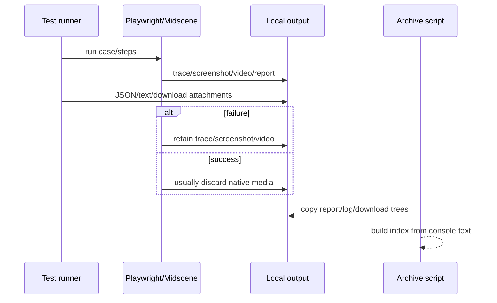
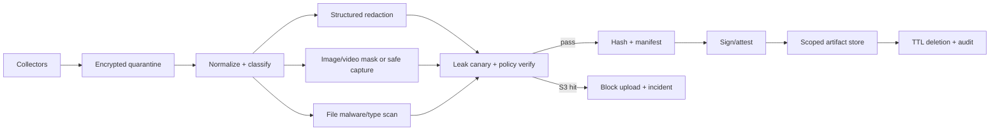

```
# Trace、截图、视频与 Secret-safe Evidence 复刻

> 质量轴 Q10。本文自包含描述 `nova_auto_test` 与 `nova_ui_e2e` 的 Playwright/Midscene 证据产物、诊断附件、下载与归档，并给出从采集、脱敏、签名、上传、访问到销毁的安全证据体系。  
> 静态审计日期：2026-08-13。  
> 本次没有打开既有运行输出，没有读取任何输出中的 secret，也没有运行 Playwright、Midscene、测试、构建或 CI。仓库中的报告代码和历史“passed”文案不证明当前通过。

## 0. 标记、边界与结论

| 标记 | 含义 |
|---|---|
| **I** | current 静态实现可确认 |
| **A** | 复刻环境仍需验证的假设 |
| **K** | current 缺口或弱保证 |
| **P** | 推荐/规划设计，非 current |
| **REQ** | 等价复刻要求 |
| **F** | 失败、降级或阻断路径 |
| **D** | 推荐工程决策 |

核心结论：

1. **I**：两仓都生成 list+HTML report，失败保留trace和自动截图；UI仓还失败保留视频，Midscene另生成视觉report/log/cache。它们不是同一证据层。
2. **I/K**：黑盒仓大量JSON附件包含API parsed body、截断bodyText、WS frames、console、失败URL；UI仓包含截图、conversation URL、工具/设置JSON、下载文件、run log。current没有统一递归redactor、manifest、大小预算、retention或签名。
3. **I/K**：`retain-on-failure`有利于成本，但失败恰是最容易含密码、Cookie、token、PII、客户问题、模型prompt和后端错误的时刻；自动上传前必须安全处理，不能把“只在失败保存”等同于安全。
4. **I/P0**：两测试仓Git资产静态存在非空凭据，UI源码另有默认密码fallback；这提高任何历史artifact、trace、日志与截图中出现有效secret的概率。本文不复制值，要求立即撤销/轮换和incident审计。
5. **D**：原始证据先进入隔离quarantine；结构化redaction、图片遮罩/安全截图、恶意文件扫描完成后，才生成内容寻址manifest并签名。原始包默认不上传，仅受控incident流程短期访问。
6. **REQ**：producer不得自称E4。中央聚合器根据固定代码/部署、可信采集、签名、cleanup、redaction和artifact digest推导证据等级。

## 1. 证据目标与威胁模型

证据应回答：运行了哪个case/attempt、在什么部署和身份、执行了哪些步骤、观察到什么、为何得到结果、是否完成cleanup、artifact是否完整未篡改。它不应泄漏认证材料或无关业务数据。

| 威胁 | 入口 | 后果 |
|---|---|---|
| secret泄漏 | trace header/cookie、console、API body、WS frame、截图、run log | 账号/tenant接管 |
| PII/客户数据泄漏 | 页面、模型回答、下载、数据库响应 | 合规事件 |
| artifact篡改 | 本机替换report/JSON | 虚假通过/错误归因 |
| 路径穿越/恶意下载 | suggested filename、ZIP/PPT/HTML | runner或查看者受攻击 |
| 证据错配 | 旧Midscene report、重名case、retry | 错把别的run当本次证据 |
| 无界增长 | 视频、trace、下载、body/frame | 存储成本/DoS |
| 过度授权 | CI artifact对所有成员可读 | 扩大事件半径 |

## 2. current 产物盘点

### 2.1 `nova_auto_test`

Playwright config：list+HTML reporter；`trace=retain-on-failure`、`screenshot=only-on-failure`，没有全局video。默认目录为`playwright-report/`与`test-results/`。

结构化附件包括：

- `console.json`：console/pageerror type、text、time；
- `network-failures.json`：method、完整URL、resourceType、errorText、time；
- `http-errors.json`：status、完整URL、resourceType、time；
- `api-http.json`、`api-chat.json`及feature-specific API JSON；
- `ws-frames.json`：按连接/attempt收集的wire frames；
- feature transport diagnostics、created IDs、状态、fixture observations；
- Playwright原生trace和失败截图。

generic API附件current会写完整parsed `body`，同时写`bodyText`前4000字符；所以“bodyText已截断”不代表响应已限量。WS frames可能含用户消息、模型token、工具参数/结果、conversationId和错误详情。

### 2.2 `nova_ui_e2e`

Playwright config：list+HTML report；失败保留trace、自动截图和video。全局storageState指向`.auth/<env>-<username>.json`，该文件不应进入artifact。

额外产物包括：

- Midscene `midscene_run/report|log|cache`，视觉步骤可包含截图、instruction、定位决策；
- case `testInfo.attach` 的JSON/text/PNG，例如enabled tools、coverage、case result、conversation/content URL；
- `test-results/agent-downloads`等下载目录，含PNG、PPTX、HTML、JSON或业务导出；
-可选`verification-results/<env>-<suite>-<timestamp>/`，包含run.log、HTML report、复制后的Midscene目录、case-report-index、每case steps/failure log、downloads；
-部分设置case在显式开关启用时保存case截图；
-Playwright自动trace/screenshot/video。

归档脚本current会先把已有`midscene_run`移动到runtime backup，再运行suite；运行后递归复制整个新目录并通过解析控制台文本把visual report关联到case。**K**：关联依赖日志格式和report路径，不是稳定run/case ID；backup无自动retention；递归复制前无secret scan。

**K**：归档脚本最终使用`process.exit(testCode ?? archiveStatus)`。当测试进程正常返回`0`而复制Midscene目录或生成case index失败时，`0`不是nullish，因而吞掉非零`archiveStatus`并整体成功退出。**D**：分别保存`testOutcome`与`archiveOutcome`，任一非零都令job非零；同时聚合两方stderr/错误，不让归档错误覆盖测试错误。用fixture覆盖：test=0/copy失败、test=0/index失败、test失败/archive成功、双方失败。

### 2.3 产物不是同义词

| 产物 | 能证明 | 不能单独证明 |
|---|---|---|
| HTML report | case结构、状态、附件链接 | 部署/证据未篡改 |
| trace | browser action/network/DOM时间线 | API业务正确、无secret |
| screenshot/video | 用户可见状态 | 后端持久化/精确数值 |
| Midscene report | AI视觉判断过程 | 确定性helper和完整case |
| WS frames | wire事件顺序/内容 | 页面最终可见或服务端持久化 |
| API body | 单次响应 | UI展示、数据库最终态 |
| download | 真实交付字节 | 来源/安全性，除非带hash和关联 |
| diagnostics | 排障线索 | 完整请求链或通过oracle |

## 3. current 捕获时机与缺口



**K**：current链路没有强制 quarantine→scan→redact→manifest→sign→upload。附件API通常直接序列化对象；部分cleanup/attach还用`.catch(()=>{})`吞掉证据失败。成功只保留较少原生媒体，失败证据更多，导致结果类别与泄漏风险相关。

**K**：trace是否包含APIRequestContext全部流量取决于Playwright版本/context路径，不能假设；必须用不是真实secret的canary做contract test。

## 4. 敏感数据分类

| 等级 | 示例 | 默认处理 |
|---|---|---|
| S0 public | case ID、状态码、耗时、代码SHA | 可进入共享evidence |
| S1 internal |内部host、资源hash、错误分类 | 脱敏后限组织读取 |
| S2 confidential | 用户问题、回答、tenant名、截图、下载内容 | 最小采集、加密、短retention |
| S3 credential | password、cookie、bearer/API key、storageState、私钥 | 禁止进入共享artifact；命中即事件 |

字段分类必须在采集前定义。未知字段按S2；key/value匹配credential detector按S3。模型prompt、Midscene截图和浏览器video至少按S2。

## 5. 目标 evidence pipeline



关键顺序：先在隔离工作区处理，后上传。不能先上传raw trace再期望服务器侧脱敏。

### 5.1 目录布局

```text
evidence/<runId>/<caseId>/<attempt>/
  manifest.json
  result.json
  steps.jsonl
  assertions.json
  cleanup.json
  browser/
    trace.redacted.zip
    failure.redacted.png
    video.redacted.webm
  protocol/
    http.jsonl
    ws.jsonl
  downloads/
    <artifact-id>.<safe-ext>
  midscene/
    decisions.jsonl
    report.redacted.html
  scan/
    redaction-report.json
    malware-report.json
  attestation.json
```

文件名只用允许字符的opaque ID，不含环境真实用户名、问题文本或原始suggested filename。manifest记录原业务filename的脱敏展示值和hash。

## 6. manifest、命名与关联

manifest必须由JSON Schema版本化校验，未知`schemaVersion`、未知outcome/channel/type、缺required字段一律拒绝，不能best-effort读取：

```ts
type Channel = "api" | "ws" | "browser" | "midscene" | "hybrid";
type ProductOutcome = "passed" | "failed_product" | "xfail" | "xpass" | "not_run";
type TestOutcome = "passed" | "failed_test" | "flaky_pass" | "skip" | "blocked_environment";
type EvidenceOutcome = "complete" | "failed" | "security_blocked" | "budget_exceeded";
type CleanupOutcome = "passed" | "failed" | "not_required" | "unknown";
type ScanOutcome = "passed" | "blocked" | "failed";
type ArtifactType =
  | "result" | "steps" | "assertions" | "cleanup" | "preflight"
  | "http-summary" | "ws-frames" | "browser-trace" | "screenshot" | "video"
  | "midscene-decisions" | "midscene-report" | "diagnostics"
  | "download" | "redaction-report" | "malware-report";
type Sensitivity = "S0" | "S1" | "S2" | "S3";

interface ArtifactDescriptor {
  id: string;                       // 本attempt内唯一opaque ID
  type: ArtifactType;
  mediaType: string;
  relativePath: string;             // 规范化相对路径，不能含..或symlink
  bytes: number;
  sha256: string;                   // lowercase 64-hex，完整性用途
  privacyHmac?: string;             // 低熵内容关联，仅本run
  sensitivity: Sensitivity;
  redaction: {status:"not_required"|"passed"|"blocked"; policyRef:string};
  scan: {status:ScanOutcome; policyRef:string; scannerVersion:string};
  producer: {collector:string; collectorVersion:string; stepId?:string};
  createdAt: string;
  truncated: boolean;
  originalBytes?: number;
  sourceResourceRef?: string;
  displayName?: string;             // 已脱敏，不是落盘路径
}

interface EvidenceManifestV2 {
  schemaVersion: 2;
  runId: string; caseId: string; attempt: number; channel: Channel;
  risk: "S0" | "S1" | "S2" | "S3";
  productOutcome: ProductOutcome;
  testOutcome: TestOutcome;
  evidenceOutcome: EvidenceOutcome;
  cleanupOutcome: CleanupOutcome;
  scanOutcome: ScanOutcome;
  retry: {attempt: number; maxAttempts: number; priorAttemptRefs: string[]};
  skip?: {reasonCode: string; requiredCapability?: string};
  knownFailure?: {issueRef: string; signatureMatched: boolean};
  evidencePolicyRef: "evidence-required@2";
  artifacts: ArtifactDescriptor[];
}
```

约束：`skip/blocked`不得同时声称product passed；`xfail/xpass`必须有knownFailure；attempt>1必须关联前序attempt；S1+ artifact必须声明sensitivity/redacted/scan/digest；业务写case必须有cleanup outcome。

`evidence-required@2`按以下行叠加required types；聚合器据此验证`evidenceOutcome=complete`，producer不能自行判断“附件够了”：

| 条件 | required artifact types |
|---|---|
| 任一实际执行的case | `result, steps, assertions, redaction-report` |
| `channel=api` | `http-summary` |
| `channel=ws` | `ws-frames` |
| `channel=browser` | `diagnostics`；失败时另需`screenshot`或明确`capture_blocked`记录 |
| `channel=midscene/hybrid` | `midscene-decisions`；有AI视觉step时需脱敏`midscene-report`或policy阻断记录 |
| `risk=S1/S2/S3`或创建资源 | `cleanup`，内含ledger、read-back、residual |
| 下载是oracle的一部分 | `download, malware-report` |
| `failed_product/failed_test/xpass`或`cleanupOutcome=failed` | `diagnostics`和failure step/assertion |
| `skip/blocked_environment/not_run` | `preflight, result`；不得要求不存在的action/assertion证据 |
| 候选E3/E4 | 上述descriptor全部digest/scan通过，并有独立JWS attestation envelope |

若required type缺失、descriptor schema无效、artifact digest不符或scan/redaction不是通过，`evidenceOutcome`只能是`failed/security_blocked/budget_exceeded`之一。policy版本未知时fail closed；风险值由case registry提供并纳入签名payload，不能由producer临时降级。

```json
{
  "schemaVersion":2,
  "runId":"run-opaque",
  "caseId":"CHAT-STREAM-001",
  "attempt":1,
  "channel":"ws",
  "risk":"S1",
  "productOutcome":"failed_product",
  "testOutcome":"passed",
  "evidenceOutcome":"complete",
  "product":{"deploymentRef":"nova-rc7","commit":"sha"},
  "test":{"repository":"nova_auto_test","commit":"sha"},
  "environment":{"id":"demo","originHash":"sha256:..."},
  "actor":{"actor":"owner","accountRef":"demo-admin","sessionRef":"session-opaque","tenantAlias":"tenant-e2e"},
  "timing":{"startedAt":"...","finishedAt":"..."},
  "cleanupOutcome":"passed",
  "cleanup":{"residuals":[]},
  "evidencePolicyRef":"evidence-required@2",
  "artifacts":[
    {
      "id":"a1","type":"ws-frames","mediaType":"application/x-ndjson",
      "relativePath":"protocol/ws.jsonl","bytes":2381,
      "sha256":"<64-lowercase-hex>","sensitivity":"S1",
      "redaction":{"status":"passed","policyRef":"evidence-redaction@4"},
      "scan":{"status":"passed","policyRef":"evidence-scan@3","scannerVersion":"3.1"},
      "producer":{"collector":"ws-collector","collectorVersion":"2.0","stepId":"wait-terminal"},
      "createdAt":"...","truncated":false
    }
  ],
  "scanOutcome":"passed",
  "scan":{"policy":"evidence-redaction@4"},
  "producerClaim":"E2"
}
```

每个collector接收显式`runId/caseId/attempt/stepId`，禁止靠时间戳或console regex关联。retry生成新attempt目录，逻辑资源ledger可共享runId；首次失败证据不能被最终通过覆盖。

## 7. 结构化 redaction 算法

### 7.1 JSON/HTTP/WS/log

```ts
function redact(value: unknown, ctx: RedactionContext, path = "$", depth = 0, seen = new WeakSet()): unknown {
  if (depth > ctx.maxDepth) return blocked("depth_limit");
  if (estimatedBytes(value) > ctx.maxNodeBytes) return digestSummary(value);
  if (isBinary(value)) return binaryDescriptor(value); // bytes/MIME/digest，不转UTF-8
  if (typeof value === "string") return redactStringLayers(value, ctx, path);
  if (isObject(value)) {
    if (seen.has(value)) return "<cycle>";
    seen.add(value);
  }
  if (Array.isArray(value)) return bounded(value, ctx.maxItems).map((v,i) => redact(v,ctx,`${path}[${i}]`,depth+1,seen));
  if (!isObject(value)) return value;
  const out: Record<string, unknown> = {};
  for (const [rawKey, raw] of boundedEntries(value, ctx.maxFields)) {
    const key = normalizeKey(rawKey); // lower-case，去空白、-、_、点和Unicode混淆
    if (credentialKey(key) || headerCookieKey(key)) out[safeKey(rawKey)] = "<redacted:S3>";
    else if (urlKey(key)) out[safeKey(rawKey)] = redactUrl(String(raw), ctx);
    else if (bodyKey(key) && !ctx.bodyAllowlist.has(canonicalPath(path, key))) out[safeKey(rawKey)] = digestSummary(raw);
    else out[safeKey(rawKey)] = redact(raw,ctx,canonicalPath(path,key),depth+1,seen);
  }
  return out;
}
```

匹配顺序必须是：secret manager领取值与本run canary的exact matcher → Authorization/Cookie/Set-Cookie等结构化header → URL userinfo/query → JWT/PEM/API key/password/token规则 → PII → 普通文本。`redactStringLayers`还要有限次解析被字符串包裹的JSON、URL encoding、base64候选和转义日志；每层都有depth/bytes上限，解析异常fail-safe保留脱敏摘要，绝不回退raw。JWT只保留`<jwt>`，PEM整块删除，不记录前后缀。

key detector使用normalized key，避免`Api-Key`、`api_key`、`A P I K E Y`和大小写绕过；header/cookie按语法解析而非逗号split。循环对象、getter异常、超深/超大节点、非法UTF-8和未知binary都必须返回blocked/digest descriptor。redactor/scanner自身异常令上传fail closed。

测试corpus至少包含nested JSON string、double URL encoding、JWT、PEM、多Set-Cookie、大小写/Unicode key变体、循环/深层/巨型对象、binary、query fragment、日志拼接和exact secret跨字段；期望值只用无权限canary。

HTTP默认只保留method、route template、status、duration、request/response size、body digest与allowlisted业务字段。WS默认保留direction、sequence、event type、timestamp、payload digest；只有case oracle需要且schema已分类的字段才展开。

### 7.2 URL

URL先用标准parser和approved-origin registry规范化scheme/host/default port/path；只有登记route template才能输出模板，例如`/api/conversations/{conversationId}`。禁止通过宽松正则把任意path猜成安全模板。query和fragment默认删除，allowlist query只保留key与类型化值摘要。未知origin/path不输出raw，记录`originHash`（实际为每run HMAC描述符）、`pathHmac + segmentCount`。

完整性与隐私不可混用：文件/manifest完整性用公开可复算SHA-256；低熵ID、host、path、账号等防枚举关联使用每run HMAC-SHA-256，key来自短期`hmacKeyRef`，不写artifact、不跨run复用。跨step比较在同run可稳定，跨run默认不可关联；确需纵向分析使用受控pseudonym service和单独policy，不能用裸hash。

### 7.3 quarantine安全边界

- 每run用`mkdtemp`创建不可预测目录，目录0700、文件0600；创建使用`O_CREAT|O_EXCL|O_NOFOLLOW`，拒绝symlink/hardlink和越出根目录；
- 每run生成DEK加密raw内容，DEK由KMS key包裹；manifest只记`kmsKeyId`与wrapped-key ref，不写明文key；sanitized输出使用不同目录/权限；
- 写入采用同目录临时文件、fsync、原子rename，读取前后校验inode/owner/mode；
- 正常结束销毁DEK、删除raw；crash由启动时reaper和store TTL按run lease清除；reaper只处理签名marker且不跟随链接；
- quarantine不被Playwright HTML server、CI普通artifact glob或Midscene index暴露；磁盘满/权限异常时停止采集并阻断上传。

### 7.4 截图与视频

优先安全采集而非事后OCR：

- 在截图前对password、token、profile、对话正文等DOM区域加不可逆mask；
- 只截目标component，不截全屏；
- 页面提供`data-evidence-sensitive`供runner统一遮罩；
- 关闭浏览器密码管理器、通知、其他tab和桌面录制；
- screenshot后执行OCR+图像规则作为第二道检查；
- video无法可靠逐帧完全脱敏，S2页面默认不录；需要时预先DOM mask并对输出抽帧/全程scan；
- Midscene必须看到业务区域时，provider审批和evidence上传是两套policy；视觉report仍需脱敏。

OCR不能证明“无secret”，尤其对小字、canvas、二维码和快速视频帧。S3页面不录制是首选。

### 7.5 HTML/trace ZIP

HTML report可能内嵌附件、DOM/text和脚本；trace ZIP包含网络、snapshot、source、action和截图。不要用字符串replace直接修改ZIP。目标使用Playwright支持的采集过滤/受控导出；若无法安全重建，raw trace留quarantine且不上传，只上传结构化step/network摘要和安全截图。

报告查看器运行在sandbox：禁网络、严格CSP、下载而非inline执行危险HTML、隔离origin。artifact内链接不能访问生产session。

## 8. 下载与附件

current下载可能直接以时间戳+业务filename或sanitized suggested filename写入`test-results`/verification downloads。目标处理：

1. Playwright download写入run quarantine的随机文件名；
2. 限制单文件/总大小和超时；
3. 计算SHA-256，识别magic bytes与声明MIME；
4. 拒绝路径分隔符、设备名、双扩展与Unicode欺骗；
5. malware/ZIP bomb/宏/HTML active content扫描；
6. 业务oracle在只读解析器/sandbox中验证；
7. manifest记录safe display name、digest、size、MIME、scanner version；
8. 只上传确有验收价值且policy允许的文件。

PPTX/ZIP设置展开大小、文件数、压缩比和嵌套深度上限；HTML默认作为下载，不在报告origin直接渲染；图片检查元数据并重编码可选副本。

## 9. 大小、retention 与成本

```ts
interface EvidenceBudget {
  perFileBytes: number;
  perCaseBytes: number;
  perRunBytes: number;
  maxJsonItems: number;
  maxTextBytes: number;
  maxVideoSeconds: number;
}
```

超限不简单截断成无效JSON：保留首尾窗口、总长度、完整内容digest和`truncated=true`。body/frame在内存也要流式限量，防止最后才截断导致OOM。

建议retention按policy配置而非硬编码：

| 类型 | passed | failed | incident hold |
|---|---|---|---|
| S0结构化结果 | 中期 | 中期 | 可延长 |
| S1脱敏协议摘要 | 短/中期 | 中期 | 审批延长 |
| S2截图/下载/video | 默认不留或极短 | 短期 | 法务/安全hold |
| S3 raw hit | 禁止普通store | quarantine最短处置期 | 专用incident vault |

TTL删除需要store-side lifecycle+janitor双保险，并产生deletion audit；legal hold只能由授权角色设置并有过期复核。

## 10. CI 上传与 attestation

**I/K**：Nova根current workflow上传的是Maven报告，静态未见两个独立TS测试仓的evidence upload job；不能声称这些Playwright产物当前被CI安全归档。

目标CI步骤：

```text
run tests into quarantine
  -> close collectors
  -> redact/scan
  -> fail closed on S3/canary
  -> produce manifest + digests
  -> sign attestation with workload identity
  -> upload allowlisted sanitized files
  -> verify remote digests
  -> delete local raw evidence/storageState
```

目标选择 **JWS JSON Flattened Serialization**，禁止含糊的“签名JSON”。envelope完整形态：

```json
{
  "protected":"<base64url(canonical protected header bytes)>",
  "payload":"<base64url(canonical attestation statement bytes)>",
  "signature":"<base64url(Ed25519 signature bytes)>"
}
```

protected header只允许`{"alg":"EdDSA","kid":"<trusted-key-id>","typ":"nova-evidence+jws"}`。attestation statement包含`issuer,audience,issuedAt,expiresAt,nonce,predicateType,subject[{name,digest.sha256}],predicate{workflowRef,jobId,runnerImage,productDeployment,redactionPolicy,scannerVersions}`。header和statement分别按RFC 8785 JCS规范化为UTF-8；拒绝duplicate key、NaN/Infinity、孤立surrogate和未知字段。base64url严格使用RFC 4648 URL-safe alphabet、无`=`padding、无空白；签名字节精确为ASCII：

```text
BASE64URL(JCS(protected-header)) + "." + BASE64URL(JCS(attestation-statement))
```

`signature`是对上述字节的Ed25519签名，不能签pretty JSON、解码后的payload或整个envelope。payload不得使用JWS unencoded payload选项，header不得有`b64:false`。

可复现编码/签验测试向量（RFC 8032测试seed，仅测试用途，绝非生产secret）：

```text
test seed hex: 9d61b19deffd5a60ba844af492ec2cc44449c5697b326919703bac031cae7f60
public SPKI DER hex: 302a300506032b6570032100d75a980182b10ab7d54bfed3c964073a0ee172f3daa62325af021a68f707511a
protected JCS: {"alg":"EdDSA","kid":"test-ed25519-rfc8032-1","typ":"nova-evidence+jws"}
protected b64url: eyJhbGciOiJFZERTQSIsImtpZCI6InRlc3QtZWQyNTUxOS1yZmM4MDMyLTEiLCJ0eXAiOiJub3ZhLWV2aWRlbmNlK2p3cyJ9
payload JCS: {"schemaVersion":2}
payload b64url: eyJzY2hlbWFWZXJzaW9uIjoyfQ
signing input: eyJhbGciOiJFZERTQSIsImtpZCI6InRlc3QtZWQyNTUxOS1yZmM4MDMyLTEiLCJ0eXAiOiJub3ZhLWV2aWRlbmNlK2p3cyJ9.eyJzY2hlbWFWZXJzaW9uIjoyfQ
signature b64url: 5RMDKZsaDXuiEo4x_e6U2Sa0rH3VWsTKajUXFFhGxsyzJPicNNBffIkJPDvZT2l91wNiOEQBgWZXPkb1s1BlCg
```

contract tests必须验证该向量sign结果逐字节相同且verify=true；修改header/payload/signature任一bit、增加padding、改变JCS数字/Unicode编码均verify=false。完整attestation fixture另验证schema字段和manifest subject digest。

verifier顺序：解析envelope大小/三个字段 → 严格base64url解码并重编码一致 → 解码protected并校验JCS/alg/typ → 从固定workflow trust policy按`kid`取候选公钥（不信artifact内自带根）→ 对原始`protected.payload`ASCII验签 → 解析payload并校验JCS/schema → 校验issuer/audience/workflow identity/repository/ref与该公钥的授权绑定 → 时间窗、证书有效期与revocation → nonce/run防replay → subject manifest SHA-256 → manifest/artifact digests与required-evidence policy。任一步失败都不能降级E3/E4。trust root轮换、key revoke和历史验证策略必须版本化；同一nonce重复提交报警并拒绝。

CI artifact权限按environment/incident角色最小化；外部fork不领取secret也不上传远程环境artifact。下载/删除/延长retention全部进入审计日志。

## 11. 证据等级

| 等级 | 最低要求 |
|---|---|
| E1 | 静态case/代码资产存在；未执行 |
| E2 | 本地运行结果，来源/环境未完整证明 |
| E3 | 固定product/test SHA、环境、身份、attempt、artifact digest、cleanup与脱敏scan；CI签名 |
| E4 | E3 + 受控release-like环境、可信部署证明、中央独立验证/聚合、策略与attestation链完整 |

producer最多声明候选等级；聚合器验证签名、digest、manifest schema、required artifacts、cleanup、residual、blocked/skipped、scanner policy和环境attestation后推导。HTML里的“passed”不是E3/E4。

## 12. P0 secret 事件响应

current静态事实：黑盒仓tracked account配置含非空password；UI源码有credential fallback，tracked release MCP env含非空key。任何现存artifact都应视为可能受影响，直到扫描和轮换完成。

响应顺序：

1. 立即revoke/rotate暴露password/API key/session；
2. 暂停受影响artifact公开下载和自动上传；
3. 审计Git clone、CI log、artifact下载、对象存储访问与provider调用；
4. 扫描历史artifact/Git历史，但不在普通工单粘贴命中值；
5. 删除源码fallback/tracked secret，只保留空example/secretRef；
6. owner批准后协调Git历史治理和所有clone重新同步；
7. 验证旧值不可用并恢复pipeline；
8. 记录incident timeline、范围、补救和防复发gate。

删除artifact不能替代轮换；轮换也不能替代访问审计。

## 13. safe canary 测试

canary必须是无权限、随机、每run唯一的合成字符串，例如`E2E_CANARY_<runId>_<random>`，不能使用真实secret格式对应的有效token。

在受控fixture把不同canary放入：header/cookie/query/JSON深层数组、WS payload、console error、DOM input/textarea/canvas旁文本、下载文件、Midscene instruction。运行collector和redactor后：

- sanitized树、压缩包、HTML、trace摘要、图片OCR、视频抽帧和manifest均不得出现明文canary；
- redaction report只记录rule ID/path/count，不记录原值；
- detector必须产生预期命中数；少命中和多余raw upload都失败；
- 验证artifact store端下载内容digest与本地sanitized digest一致；
- 测试结束销毁canary raw包。

**K**：canary通过只证明已布置路径，不证明所有未知secret形式安全；需结合schema allowlist、secret manager exact-value matcher和定期红队审计。

## 14. incident access 与查看安全

当排障确需raw evidence：

- 申请case/run/artifact级just-in-time权限，双人或owner审批；
- 给出purpose、ticket、TTL，禁止批量目录访问；
- 在隔离viewer中查看，禁止复制、外网和长期本地下载；
- 下载使用一次性URL和设备/身份绑定；
- 所有view/download/export记录不可变审计；
- viewer界面持续标注敏感级别和到期时间；
- 结束后撤权、删除临时副本，并复核是否需credential rotation；
- 安全/法务hold与普通测试retention分离。

公开issue/聊天只引用artifact ID、hash和脱敏摘要，不粘贴raw片段。

## 15. 错误与降级

| 失败 | 目标结果 |
|---|---|
| trace生成失败 | evidence_failed；保留其他oracle，不覆盖primary failure |
| cleanup和evidence都失败 | Aggregate保留primary+cleanup+evidence |
| redactor异常 | fail closed，raw不上传 |
| S3/canary命中 | security_blocked+incident，不上传普通store |
| screenshot无法可靠mask | 不生成/不上传，改结构化DOM evidence |
| video超预算 | 停止/不保留，记录budget_exceeded |
| download MIME/扩展冲突 | quarantine_rejected |
| malware/ZIP bomb | 隔离且禁止viewer打开 |
| artifact upload失败 | 本地短期quarantine重试；结果不能声称E3 |
| digest远端不一致 | integrity_failed并删除远端对象 |
| deletion失败 | retention_cleanup_failed+告警 |

evidence失败不是产品失败，但required证据缺失时不能给干净release pass。

## 16. 验收矩阵

### 16.1 采集与关联

| ID | 场景 | 预期 |
|---|---|---|
| EV-COL-01 | pass/fail/retry | attempt目录独立，首次失败不被覆盖 |
| EV-COL-02 | Midscene+deterministic helper | 同case但step engine分明 |
| EV-COL-03 | 多worker同case | run/case/attempt/step无冲突 |
| EV-COL-04 | reporter格式变化 | 不依赖console regex关联 |
| EV-COL-05 | attach失败+primary失败 | 两者均保留 |
| EV-COL-06 | test=0但copy/index失败 | 总进程非零，archive failure可定位 |
| EV-COL-07 | test与archive均失败 | 两类错误同时保留，不互相覆盖 |

### 16.2 secret与隐私

| ID | 场景 | 预期 |
|---|---|---|
| EV-SEC-01 | canary遍历HTTP/WS/log/DOM/download | sanitized包零明文 |
| EV-SEC-02 | Cookie/storageState | 永不进入普通artifact |
| EV-SEC-03 | URL query token | route保留，query secret删除 |
| EV-SEC-04 | nested unknown body | 默认digest，不全量展开 |
| EV-SEC-05 | screenshot敏感DOM | mask生效，OCR零canary |
| EV-SEC-06 | video快速敏感帧 | 默认不录或scan阻断 |
| EV-SEC-07 | tracked secret扫描 | 有效secret为零，旧值已撤销 |
| EV-SEC-08 | nested JSON/JWT/PEM/Unicode key corpus | exact-first后全被阻断或脱敏 |
| EV-SEC-09 | cycle/depth/bytes/binary | 有界完成，绝不回退raw |

### 16.3 文件、预算与生命周期

| ID | 场景 | 预期 |
|---|---|---|
| EV-FILE-01 | filename路径穿越/Unicode欺骗 | opaque落盘名，拒绝危险display name |
| EV-FILE-02 | ZIP bomb/宏/active HTML | scanner阻断viewer/upload |
| EV-SIZE-01 | 巨型body/frame/video | 流式限量、digest+truncated，无OOM |
| EV-TTL-01 | retention到期 | 对象和索引删除，audit存在 |
| EV-TTL-02 | legal hold | 授权、到期复核、访问审计 |

### 16.4 完整性与E级

| ID | 场景 | 预期 |
|---|---|---|
| EV-INT-01 | 本地文件上传后被替换 | digest验证失败 |
| EV-INT-02 | manifest被修改 | signature验证失败 |
| EV-INT-03 | attestation wrong issuer/aud/expired/revoked/replay | verifier逐项拒绝 |
| EV-E3-01 | fixed SHA+scan+cleanup+CI attestation | 聚合器可推导E3 |
| EV-E4-01 | producer写E4但缺环境attestation | 聚合器拒绝E4 |
| EV-GATE-01 | case pass但required evidence失败 | release不绿 |

## 17. 业务等价验收

- 失败case能从结构化step、assertion、协议摘要和安全截图定位问题，但不暴露credential或无关客户数据；
- API/WS/browser/Midscene证据以同一run/case/attempt/step关联，明确各自能证明的边界；
- download具备来源resourceRef、MIME/magic、size、digest、业务oracle和scanner结果；
- retry、xfail、skip、blocked、cleanup/evidence failure在manifest中不丢失；
- storageState、dotenv、password、Cookie、API key从不进入普通artifact；
- artifact上传前完成redaction、canary、malware、size与policy检查，失败时fail closed；
- CI attestation绑定workflow、代码SHA、deployment、redaction/scanner版本和manifest digest；
- access、download、retention延长和删除可审计；
- exposed current credentials已撤销/轮换并完成历史artifact审计；
- 本文只确认静态资产E1，不声称当前任何报告安全、任何case通过或任何CI已上传证据。

## 18. current gaps 汇总

| ID | current gap | 风险 | 推荐 |
|---|---|---|---|
| K-EV-01 | 无统一manifest/run-step关联 | 证据错配 | typed collector IDs |
| K-EV-02 | full parsed body/WS frames可附件 | secret/PII泄漏 | allowlist+digest summary |
| K-EV-03 | redaction仅局部password替换 | 漏cookie/token/body | recursive policy engine |
| K-EV-04 | raw trace/report直接可归档 | 隐蔽S3泄漏 | quarantine+safe export |
| K-EV-05 | UI失败保留video | 高密度页面泄漏 | sensitive页面禁录/mask |
| K-EV-06 | Midscene报告靠日志关联 | retry/旧报告错配 | explicit IDs/manifest |
| K-EV-07 | 下载无统一scanner/budget | 恶意文件/DoS | sandbox pipeline |
| K-EV-08 | 无统一retention/access audit | 长期暴露 | TTL+JIT+audit |
| K-EV-09 | 无TS测试仓CI attestation | 证据不可验证 | signed CI pipeline |
| K-EV-10 | tracked credentials/fallback | P0泄漏 | revoke/rotate/remove/history |
| K-EV-11 | evidence失败可能被吞/覆盖 | 假干净结果 | allSettled+Aggregate |
| K-EV-12 | producer结果易被当E4 | 过度证明 | independent aggregator |

## 附录 A：静态追溯线索（非理解前提）

正文已包含复刻所需契约。current审计线索包括两仓Playwright config、黑盒的browser/api/ws clients与feature attachments、UI的global auth、tests、natural-flow下载、verification归档与report index脚本、Midscene目录约定及Nova根CI workflows。路径仅供追溯，不替代正文说明。

```
