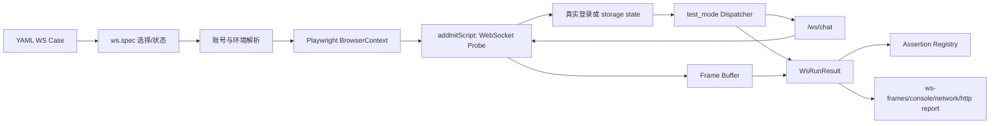
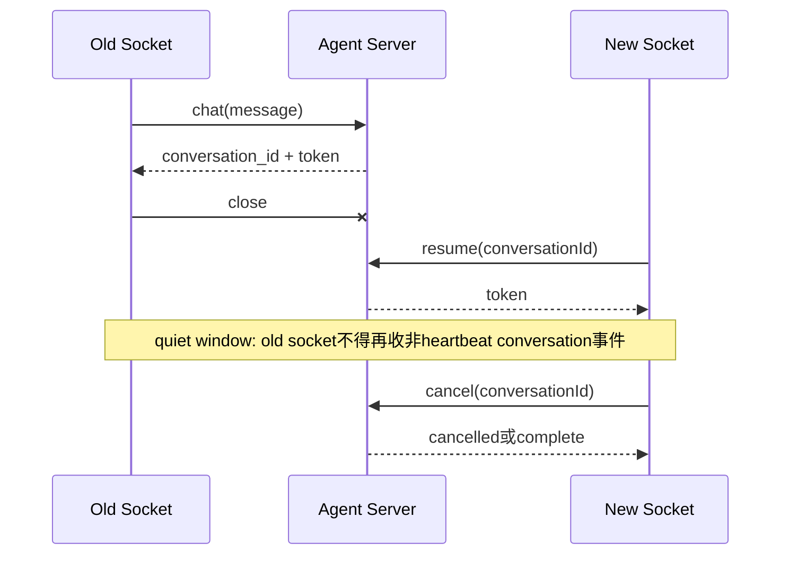
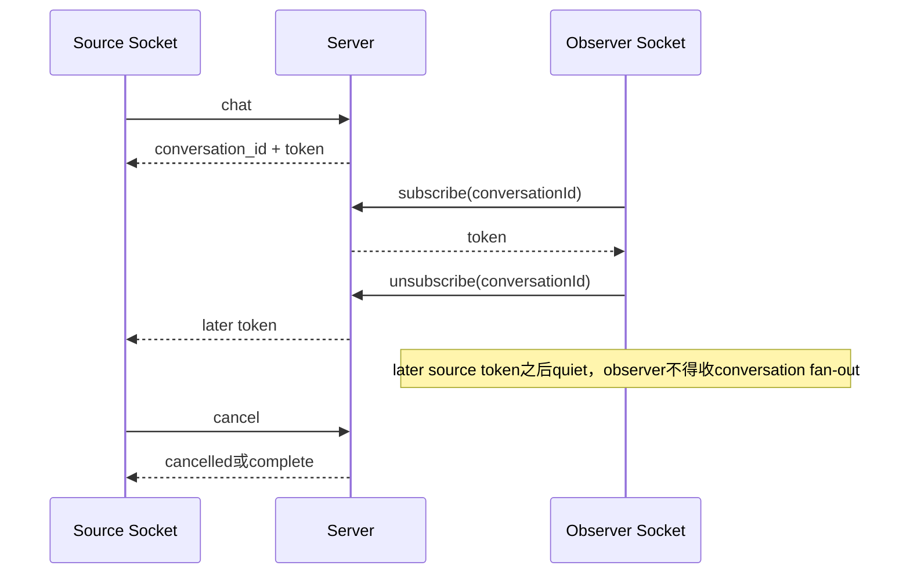
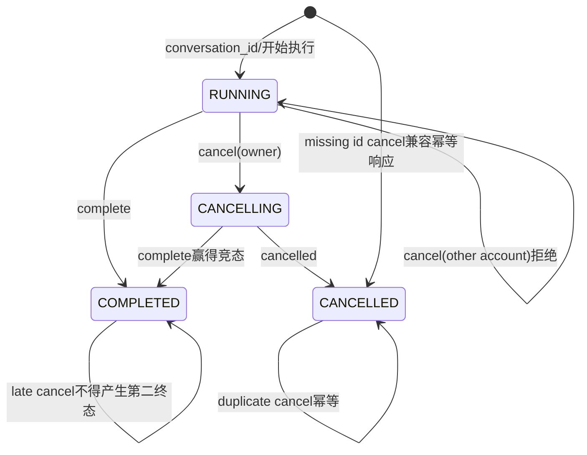
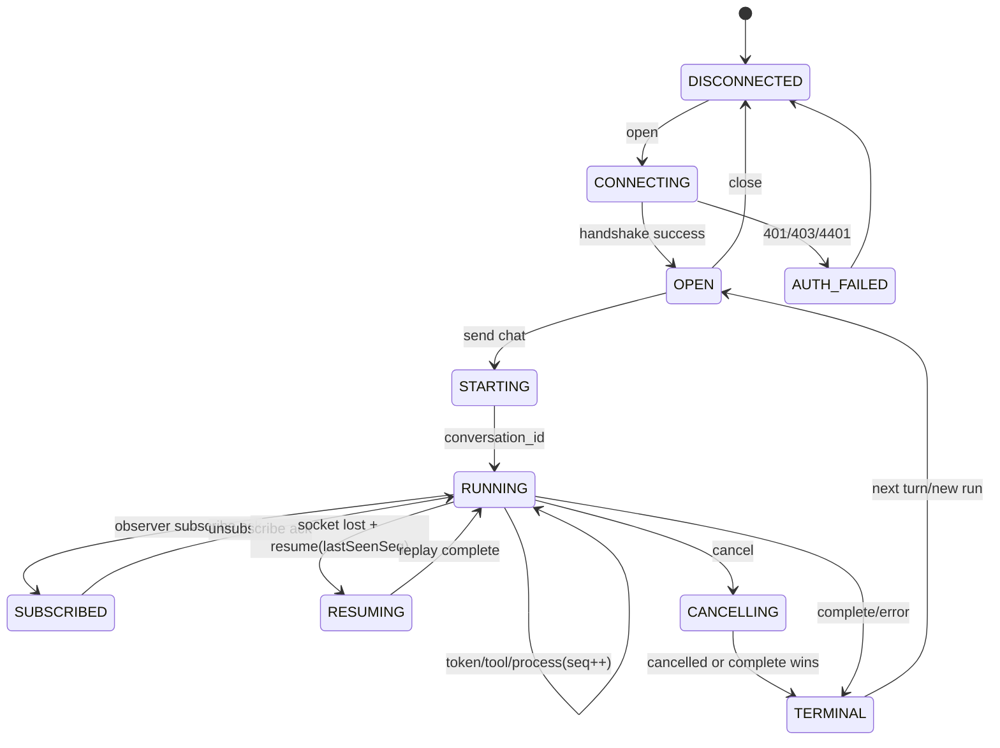

```
# WebSocket 客户端探针与协议验收复刻说明

## 0. 文档目的、边界与证据标签

本文说明如何在一个独立黑盒自动化工程中复刻 Agent WebSocket 客户端探针与协议验收能力。读者无需访问 Nova、`nova_auto_test` 或本次会话；正文给出浏览器内探针、认证建连、消息与控制帧、conversation 归属、终态、cancel/query/resume/subscribe、断言、超时、诊断、故障注入及验收矩阵。

本文聚焦 WebSocket 通道。YAML 文件的一般加载、suite 与全局状态治理由单独文档负责；这里仍会完整描述 WS runner 消费的字段。业务专用 runner（知识、技能、文件、任务）只说明如何接入统一 WS 结果，不展开其业务资源 API。

证据标签：

| 标签 | 含义 |
|---|---|
| `[I]` | 当前代码、YAML、配置可静态确认的实现事实 |
| `[A]` | 当前 `active` 用例表达的应执行契约，不表示本次已通过 |
| `[K]` | 当前已登记缺陷、已知偏差或会造成误判的实现弱点 |
| `[P]` | 当前 `planned` 用例表达的目标需求或缺失测试能力 |
| `[R]` | 本次连接环境并实际验证的结论 |
| `[F]` | 基于多处静态证据的强推断，仍需运行验证 |
| `[D]` | 为可靠复刻建议的新设计，不冒充现状 |

本次没有运行 Playwright、没有登录 release/demo/local，也没有建立真实 WebSocket，因此无 `[R]` 通过结论。库存数量与协议行为均为 2026-08-13 静态快照。`[I]`

## 1. 目标与结论

该能力不是一个脱离产品的裸 WS SDK，而是“真实浏览器会话 + 页面注入探针 + 可编排控制帧 + Playwright 断言”的黑盒验收器：它先以真实登录或 storage state 获得 cookie，让浏览器建立 `/ws/chat`，再代理 `window.WebSocket` 捕获所有入站、出站和状态事件，最后按 socketId、conversationId、事件类型和时间窗口判断协议效果。`[I]`

当前实现能覆盖：

- 认证/未认证建连、ping/pong、空帧、raw text、未知 type、idle 和消息大小边界；
- 新会话与多轮对话、并发 socket 隔离、首条 `conversation_id`；
- `cancel` 的按 ID、当前 session、工具中、跨账号、missing、竞态、double 和 UI Stop；
- `query_running`、断线后 `resume`、第二 socket `subscribe/unsubscribe`、跨账号拒绝；
- WS 帧、console、network failure、HTTP error 和 conversation snapshot 诊断。`[I]`

当前探针为兼容不稳定 wire shape 使用深层字段搜索、文本正则和终态别名，适合迁移期黑盒验证，但不足以证明严格版本化协议；尤其没有系统校验帧 `seq` 单调/连续/去重，`ws_event_order` 也不按 conversation 过滤。生产复刻应保留兼容 decoder 作为诊断层，同时新增严格 envelope decoder 和每会话状态机。`[D]`

## 2. 当前 WS 库存与实现边界

当前有 216 条 `channel: ws` 用例：132 active、80 planned、4 known_failure。`[I]` 其中大量业务用例使用通用 `tool_chat`，而协议层模式分布包括：

| 能力组 | 模式/数量 |
|---|---|
| 普通聊天 | `simple_chat` 10、`multi_turn_chat` 12、`single_turn_chat` 1、`oversized_single_turn` 1 |
| 工具聊天 | `tool_chat` 100，加知识/技能/文件/任务专用 runner |
| socket 基础 | open、ping、unauth、raw、unknown type、empty、idle、size、concurrent 各1 |
| conversation 生命周期 | first-message、query-running、resume、subscribe、cross-account resume/subscribe、blank ids、expired query、stale initial id 各1 |
| cancel | 按ID、当前session、工具中、跨账号、missing、race、double、without-error、UI stop 各1 |
| snapshot/process | completed 8、running 2、cross-account 1，另有 planned 统计场景 |
| error fault injection | 10 条，全为 planned，当前没有对应 handler |

`[I]` 这只是库存，不是通过率。planned case 在注册时跳过，所以“full project能注册这些名字”不能证明 fault injection 已实现。

## 3. 总体架构



### 3.1 参与者

| 参与者 | 责任 |
|---|---|
| WS spec | 按 channel/suite 注册测试，处理 env/account/dataset/second-account 和状态 |
| BrowserContext | 隔离 cookie、storage state、代理和多个账号 |
| Probe | 包装 `window.WebSocket`，记录 socket 生命周期和帧，提供主动发帧 API |
| Handler | 按 `test_mode` 编排一个协议场景 |
| Frame parser | 从兼容 wire shape 提取 type、conversationId、终态和工具信号 |
| Assertion registry | 对归一化运行结果执行声明式断言 |
| Diagnostics | 附加帧、console、network failure、HTTP error、trace/截图 |
| SUT | 浏览器应用、`/ws/chat`、conversation snapshot REST 和 Agent 后台任务 |

## 4. 浏览器内 WebSocket Probe

### 4.1 为什么注入浏览器而非 Node 直连

真实浏览器连接会自动携带产品页面的认证 cookie，并能同时观察 UI 自己建立的 socket、UI Stop 触发的 cancel 和刷新/路由行为。它也避免在测试代码中复制 WebSocket 握手 cookie。代价是必须在页面任何应用脚本创建 socket前注入，所以采用 BrowserContext init script。`[I]`

### 4.2 Probe 对外接口

```ts
interface BrowserWsProbe {
  clearFrames(): void;
  getFrames(): ProbeFrame[];
  getSockets(): SocketView[];

  sendJson(payload: unknown, urlPart?: string): SendResult;
  sendJsonToSocket(socketId: string, payload: unknown): SendResult;
  sendRaw(payload: string, urlPart?: string): RawSendResult;
  sendRawToSocket(socketId: string, payload: string): RawSendResult;

  closeSocket(socketId: string): CloseSocketResult;
  openSocket(url: string): Promise<{ url: string }>;
}

interface SocketView {
  id: string;
  url: string;
  readyState: 0 | 1 | 2 | 3;
}

interface CloseSocketResult {
  socketId: string;
  url: string;
  readyState: 0 | 1 | 2 | 3;
}

interface ProbeFrame {
  direction: "in" | "out" | "state";
  socketId: string;
  url: string;
  time: string;                  // ISO timestamp, probe capture time
  data?: string;
  dataLength?: number;           // JavaScript characters, not guaranteed bytes
  dataTruncated?: boolean;
  state?: "created" | "open" | "close" | "error";
  code?: number;
  reason?: string;
}
```

### 4.3 包装算法

```ts
function installProbe(window) {
  if (window.__agentWsProbeInstalled) return;
  const Native = window.WebSocket;
  const sockets = [];
  const frames = [];

  function WrappedWebSocket(url, protocols?) {
    const ws = new Native(url, protocols?);
    const socket = { id: timestampPlusRandom(), url: String(url), ws };
    sockets.push(socket);
    capture({ direction: "state", state: "created", ...identity(socket) });

    const nativeSend = ws.send.bind(ws);
    ws.send = data => {
      capture({ direction: "out", ...identity(socket), ...boundedData(data) });
      return nativeSend(data);
    };
    ws.on("open",  () => capture({ direction: "state", state: "open"  }));
    ws.on("close", e => capture({ direction: "state", state: "close",
                                  code: e.code, reason: e.reason }));
    ws.on("error", () => capture({ direction: "state", state: "error" }));
    ws.on("message", e => capture({ direction: "in", ...boundedData(e.data) }));
    return ws;
  }

  WrappedWebSocket.prototype = Native.prototype;
  copyStaticReadyStateConstants(Native, WrappedWebSocket);
  window.WebSocket = WrappedWebSocket;
  window.__agentWsProbe = exposeActions(sockets, frames);
}
```

当前实现保留原生 prototype 和 CONNECTING/OPEN/CLOSING/CLOSED 静态常量，避免常见前端类型检查失效；同一 context 只安装一次。`[I]`

### 4.4 捕获上限和截断

- 最多保留 2,000 帧；超过后丢最旧帧。
- 单帧 data 最多完整保留 16,384 个字符。
- 超长 data 只保留头256和尾256字符，并记录原字符长度与 `dataTruncated:true`。
- ArrayBuffer 尝试用 TextDecoder 解码；其他非字符串对象只记录类型标记。
- 所有 capture 都添加测试浏览器时钟的 ISO 时间。`[I]`

`[K]` 上限按“字符”而非 wire bytes；Blob不读取内容；环形缓冲会让超长会话丢失最早的 conversation_id 或出站问题。生产探针应同时保存 `byteLength`、`frameOrdinal`、captureDroppedCount`，并将完整流式附件增量写到测试侧，而不是只保留页面内数组。`[D]`

### 4.5 目标 socket 选择

不指定 socketId 的 `sendJson/sendRaw` 从后向前选择最后一个 OPEN 且 URL 包含 `/ws/chat` 的 socket；找不到时退回最后一个任意 OPEN socket。指定 socketId 的操作只允许目标仍为 OPEN，否则抛错。`openSocket` 有固定10秒打开超时。`[I]`

`[K]` “退回任意 OPEN socket”可能误发到产品的其他 WebSocket。严格复刻应取消 fallback，要求 URL pathname 精确匹配或显式 socketId。`[D]`

## 5. 认证、账号与连接建立

### 5.1 已认证路径

默认 WS case 创建全新 BrowserContext，注入 probe，创建 page，挂 console/network/HTTP 诊断，然后登录：

1. 如果配置了对应账号的 Playwright storage state，context加载它；否则打开 `/web/chat` 并走 UI login。
2. auth-disabled 环境若出现登录页直接失败。
3. 页面已有 app shell 时不重复登录。
4. 浏览器应用或 probe 打开 `ws(s)://<base>/ws/chat`，浏览器自动携带 cookie。
5. `wss`/`ws` 由 base URL 的 `https/http` 转换，pathname固定 `/ws/chat`，清除 query/hash。`[I]`

storage state 环境变量按“环境+账号 → 账号 → primary/secondary通用”优先解析；第二账号使用独立候选链，避免错误复用主账号cookie。`[I]`

### 5.2 未认证路径

`ws_unauth_message` 是唯一不预建登录page的通用模式。它创建无storage state的新context、注入probe、尽力打开页面，再直接打开 `/ws/chat`：

- 若握手失败，记录 `opened:false`，场景可接受；
- 若握手成功，发送消息并观察 quiet window；
- 任何 `conversation_id/token/complete` 都视为越权进入聊天流；
- 最终关闭context。`[I/A]`

该场景没有要求固定的握手HTTP状态、WS close code或结构化 auth error，只验证“不进入聊天”。而浏览器页面 API 本身也不能可靠读取 WebSocket upgrade 被拒绝时的 HTTP 401/403；若要把握手状态纳入契约，应增加 CDP Network 事件或使用 Node WebSocket/HTTP upgrade probe，并复用同一 cookie jar。生产验收应增加：无cookie握手返回401/403，或连接后立即以4401关闭；同时不创建conversation、不泄露租户信息。`[K/D]`

### 5.3 双账号

跨账号 cancel/resume/subscribe/snapshot 各自建立 owner 与 secondary 两个完全隔离的context。owner创建conversation，secondary发送控制或REST读取；预期是403/404或结构化 unauthorized error，随后owner仍能继续或自行cancel。finally关闭两个context。`[I]`

`[K]` 当前这些自建 context 的局部 console/network/HTTP 诊断没有完整汇入通用 diagnostics，展平 frame 也缺少稳定的 `actor:"owner"|"secondary"|"anonymous"` 归属；只从数组位置推断 actor 会使跨账号失败难以审计。复刻应给所有 attachment 和 frame group 显式加 actor/contextId/accountHash，并把两个 context 的 console、pageerror、requestfailed、HTTP error 和 close state 一并聚合。`[D]`

## 6. 当前 wire 消息契约

### 6.1 客户端聊天消息

```ts
interface ChatMessage {
  type?: undefined;             // 缺type按chat处理是当前active契约
  conversationId?: string;      // follow-up复用会话
  message: string;
  provider?: string;
  lang: "en";
}
```

示例：

```json
{
  "conversationId": "conv-01J...",
  "message": "Continue with a concise summary.",
  "provider": "configured-model",
  "lang": "en"
}
```

首轮不传conversationId。测试语言固定 `en`，与问题文本语言可以不同。未知type兼容场景发送 `{type:"foobar",message,...}` 并期望仍按chat。`[I/A]`

### 6.2 控制消息

```ts
type ClientControl =
  | { type: "ping" }
  | { type: "query_running" }
  | { type: "cancel"; conversationId?: string }
  | { type: "resume"; conversationId: string }
  | { type: "subscribe"; conversationId: string }
  | { type: "unsubscribe"; conversationId: string };
```

语义：

| type | 当前验收语义 |
|---|---|
| ping | 收到 `pong` |
| query_running | 不带ID，返回当前session仍在运行的conversation信息；当前active case只验证完成后第31秒查询不再返回旧ID，未证明正式TTL |
| cancel + ID | 取消当前身份拥有的该conversation |
| cancel 无ID | 取消当前socket/session关联的运行任务 |
| resume | 断线后把该conversation后续事件交给新socket，旧socket不再收到 |
| subscribe | 同一用户另一socket开始接收该conversation fan-out |
| unsubscribe | observer停止接收，source仍继续 |

blank ID 场景会发送空/空白 resume、subscribe、cancel，只要求socket不关闭；没有强制具体错误响应。`[A]`

### 6.3 服务端事件兼容模型

当前 probe 保存原始文本，parser从 JSON 任意深度（最多8层）搜索以下字段：

- event type：`type | event | status | name`
- conversation：`conversationId | conversation_id | conversationID`
- 工具关联：`stepId/taskId/callId/id` 等，由断言单独解析。

无法JSON解析时，还会在原文用正则寻找 `conversationId: ...`。这意味着当前不是一个严格 JSON Schema。`[I]`

建议的生产 envelope：

```ts
interface ServerEventV1<T = unknown> {
  protocolVersion: "1";
  type: string;
  conversationId?: string;
  messageId?: string;
  runId?: string;
  seq?: number;
  emittedAt: string;
  payload: T;
}
```

conversation事件必须有conversationId和runId；同一run的seq从1严格递增；control ack可没有conversationId但必须有requestId。兼容decoder可把旧帧转成该内部形态并标 `decodedBy:"legacy"`。`[D]`

## 7. 类型、conversation 与终态归一化

### 7.1 conversationId 发现

发送问题后，每秒轮询帧，先找到包含该精确问题的最后一个 outbound frame，只观察其后的帧：

1. 优先取 type为 `conversation_id` 的第一个显式ID；
2. 否则取任意后续帧中找到的最后一个ID；
3. 再退回当前页面URL query的conversationId；
4. 排除发送前URL里的旧conversationId；
5. 超时失败。`[I]`

指定socket的并发模式先按socketId过滤，再执行相同逻辑，但不使用URL回退。`[I]`

`[K]` 深层任意字段搜索可能把业务payload中的外部conversationId误当协议ID，URL回退也可能掩盖缺少 `conversation_id` 事件。严格验收应只接受 envelope顶层字段，并为“首消息必须显式发ID”关闭回退。`[D]`

### 7.2 conversation过滤

等待器通常先按socketId（多socket场景）再按conversationId筛选。若帧能提取ID，则必须精确相等；文本帧提取不到ID时，只有原文包含目标ID才匹配。断言库使用同类逻辑。`[I]`

`conversation_first_message` 进一步要求：显式 `conversation_id` 之后的所有非heartbeat入站事件都必须带conversationId。这是防多会话串流的关键 active 契约。`[A]`

### 7.3 终态别名

当前把以下入站帧归一为：

| 归一终态 | 可接受type/文本 |
|---|---|
| cancelled | cancelled、canceled、cancelled_by_user、包含 AgentCancelledException |
| complete | complete、completed、done、finish、finished |
| error | error、failed、failure、包含 not authorized/unauthorized |

终态只来自 `direction:in`。`single_terminal` 要求目标conversation至少有一个 complete/cancelled，且不能同时出现两种；error不计入它的唯一集合。cancel专用quiet检查也只禁止 complete与cancelled同时出现。`[I]`

`[K]` 同一种terminal重复两次不会被 `single_terminal` 拒绝；cancelled后再error也可能不被唯一性检查捕获。生产断言应要求“每run恰好一个终态帧”，任何第二终态无论类型都失败。`[D]`

### 7.4 事件顺序和 seq 的真实覆盖

`ws_event_order` 把全部捕获帧转成type，然后检查给定序列是否为子序列；它当前不按conversationId或socketId过滤。并发socket场景中，A的conversation_id、B的token、A的complete可能误组成通过序列。`[I/K]`

当前对 `seq` 的直接检查仅见 conversation snapshot 的 `lastSeq` 为number/满足最小值；没有通用断言验证每帧seq存在、单调递增、无重复、resume后从watermark继续或 snapshot.lastSeq与最后WS seq一致。`[I/P]`

推荐断言：

```ts
function assertSequence(events, runId, snapshotLastSeq?) {
  const scoped = events.filter(e => e.runId === runId);
  assert(scoped.length > 0);
  for (let i = 0; i < scoped.length; i++) {
    assert(Number.isSafeInteger(scoped[i].seq));
    if (i > 0) assert(scoped[i].seq === scoped[i - 1].seq + 1);
  }
  assert(new Set(scoped.map(e => e.seq)).size === scoped.length);
  if (snapshotLastSeq !== undefined)
    assert(snapshotLastSeq >= scoped.at(-1).seq);
}
```

若协议允许resume重放，不能要求全局无重复；应按 `(runId,seq)` 去重并断言重放payload hash相同，之后连续前进。`[D]`

## 8. 运行结果与断言管线

### 8.1 统一结果

```ts
interface WsRunResult {
  detail: unknown;              // handler专用诊断
  frames: ProbeFrame[];         // 默认page + owner/other frame groups展平
  conversationId?: string;
  bodyText?: string;            // 页面或handler聚合文本
  body?: unknown;               // snapshot/REST归一对象
}
```

通用 runner执行handler后，从detail提取conversationId/bodyText/body；需要知识/过程快照时调用：

```http
GET /api/conversations/{urlEncodedConversationId}/snapshot
Cookie: browser session
```

非200直接失败；JSON解析成功后可供 `snapshot_status/snapshot_last_seq/process_data_*` 断言。跨账号snapshot只接受403或404。`[I]`

### 8.2 代表性 assertions

| 断言 | 语义 |
|---|---|
| `ws_state_event` | state created/open/close/error 的数量 |
| `ws_event_received/not_received` | 目标conversation是否出现type |
| `ws_event_contains/payload_contains` | 事件content/raw包含文本 |
| `ws_event_order` | 全frames上检查类型子序列，当前不scoped `[K]` |
| `ws_event_count` | conversation范围内 exact/min/max |
| `ws_event_pairing` | start/end计数，并尽量按correlation id配对 |
| `ws_outbound_sent` | outbound JSON type与可选conversationId |
| `single_terminal` | 至少一个complete/cancelled，禁止二者并存 |
| `terminal_one_of` | complete/cancelled/error 中至少一个属于允许集 |
| `no_error` | 全frame无error，不按conversation过滤 |
| `no_backend_leak` | body/frames不含SQL、Mapper、NPE、Java stack或Traceback |
| `tool_lifecycle/tool_exec_success/...` | 工具start/end/result及callId/成功/时长 |
| `snapshot_last_seq` | snapshot.lastSeq为number/null和min |

所有断言按YAML顺序执行，首个失败即停止。未知type直接失败。`[I]`

## 9. 各协议场景的精确编排

### 9.1 基础连接

**open：** 打开 `/web/chat`，等3秒；若已有OPEN `/ws/chat` 返回 `opened:false`，否则probe新开；断言至少一个open state。

**ping：** 确保socket OPEN，清帧，发 `{type:"ping"}`，从发送后的索引等待pong。

**empty：** 发空raw payload，静默观察；socket必须仍OPEN且无state error。

**idle：** 清帧后默认等待35秒，socket保持OPEN；目的为越过heartbeat间隔。

**size：** 两个额外socket；一个发20MiB ASCII并要求保持OPEN，一个发20MiB+1并要求send报错或socket close/error，且不得出现conversation_id/token/complete。该用例只在full。`[A]`

### 9.2 raw text 与未知type

`ws_raw_chat` 直接发送非JSON文本，目标契约是降级成chat并出现 `conversation_id → token → complete`。当前YAML仍为 active，但reason明确记录 release 2026-07-20 未产生这些事件。它是“active红灯契约 + 已知环境缺陷”，并没有使用 `known_failure` 状态。`[A/K]`

因此报告预期会红，不能把它写成当前已保证能力。若产品决定正式协议只接受JSON，应把需求改为“raw text受控拒绝、不建conversation”，而不是让测试静默迁就实现。`[D]`

未知type `foobar` 当前期望按chat处理。缺type普通payload也期望按chat处理。`[A]`

### 9.3 并发连接

同一已认证page额外开两个socket，在不同socket同时发不同问题；分别只从该socket发现conversationId，要求两ID不同，再分别等待complete。最终 `response_contains` 在展平frames上检查两个marker。`[I/A]`

`[K]` 展平检查会把 outbound prompt 本身包含的 marker 当作“响应包含”，形成自证；它也没有证明 A 的 token 不含 B。严格 oracle 应分别过滤 `direction:"in" + socketId + conversationId`，聚合 token/content 后断言 A 响应含 markerA 且不含 markerB，B 响应含 markerB 且不含 markerA；outbound 帧只能用于建立 fromIndex，不能作为回答证据。`[D]`

生产验收还应验证：token不跨socket、同ID不跨账号、关闭一个socket不影响另一个run、服务端并发上限返回明确错误。`[D]`

### 9.4 query_running

运行中场景：启动长任务 → 记录frame索引 → 发 `{type:"query_running"}` → 等新入站raw文本包含conversationId → cancel → 等cancelled或complete。`[I]`

完成窗口场景：先complete → 等31秒 → query_running → quiet 5秒 → 新入站帧不得包含已完成ID。`[A]` 这只证明“在本次观察中，第31秒查询结果不含旧ID”这一点；它既不能推出保留窗口约30秒，也不能区分TTL、即时删除或响应遗漏。要验收TTL，必须读取服务端配置或在多个边界点（如 0、5、15、29、30、31、45 秒）查询并定义包含/不包含区间，同时验证正式响应Schema。`[K/D]`

### 9.5 resume reconnect



当前场景在同一browser identity开old/new两个socket，先观察old token，关闭old并等close/error，再从new发resume，要求new收到同conversation token；之后quiet期间old不能再收非heartbeat事件。`[I/A]`

它没有验证从哪个seq恢复、是否丢token、是否重放，也没有传lastSeenSeq。生产协议应使用 `{type:"resume",conversationId,lastSeenSeq}` 并返回 `resumed{fromSeq,currentSeq,replayComplete}`。`[D]`

### 9.6 subscribe / unsubscribe



observer在同一用户context中订阅。unsubscribe后先要求source继续收到token，用该时点作为因果边界，再检查observer后续没有非control/heartbeat conversation事件。`[I]`

当前未要求 subscribed/unsubscribed ack，若unsubscribe与某个已在途token竞态，边界依赖source的下一个token。生产协议应有带requestId和effectiveAfterSeq的ack。`[D]`

### 9.7 跨账号控制

secondary对owner conversation发送resume/subscribe，runner用空conversation filter等待error，再检查raw payload匹配 `not authorized to resume/subscribe`；owner随后自行cancel结束任务。cancel跨账号同理，且观察owner quiet window中不得被cancelled。`[I/A]`

`[K]` 错误文本是脆弱契约，空conversation filter可能匹配同socket其他error。应按 `requestId + error.code + targetConversationId` 精确关联，并在404/403语义之间做一致选择以避免ID枚举。`[D]`

`[K]` foreign-cancel 的“owner quiet 10秒未收到 cancelled”不证明 owner run 仍活着，也不证明 finally 已终止它；任务可能在quiet后继续运行并产生残留。复刻应维护 owner run ledger，在拒绝发生后先要求 owner channel 出现后续 token/`query_running` 命中以证明未被外部取消，再由 owner channel 显式 cancel，等待 owner 单一终态并查询 snapshot/运行状态收敛；若任一步失败，独立 cleanup channel 仍按ledger清理并聚合错误。`[D]`

### 9.8 stale initial ID

客户端发 `{initialConversationId:<随机>,message,...}`，服务端必须生成不同的真实ID并在 `conversation_id` 事件中回传；任何入站帧不得泄露stale ID。query_running只能包含真实ID；用stale ID cancel不能终止真实任务，必须仍看到真实ID token；最后真实ID cancel结束。`[A]`

这是防前端残留路由ID污染新会话的重要场景。生产服务端不要信任client initial ID作为对象授权依据。`[D]`

## 10. cancel 状态机与幂等语义



当前 active 契约：

| 场景 | 触发 | 预期 |
|---|---|---|
| by id | `{cancel,conversationId}` | cancelled，quiet内不再complete |
| active session | `{cancel}` | 当前socket任务cancelled |
| during tool | 等启发式tool signal后cancel | cancelled，无error |
| other account | secondary cancel owner ID | secondary error文本，owner未cancelled |
| missing/completed | 随机missing ID | 返回cancelled，幂等 |
| race | 延迟1秒再cancel | 当前post-boundary观察要求complete或cancelled其一，不得同时两类；仍有边界缺口 |
| double | cancel两次 | 第二次无error、无complete；可无第二cancelled |
| exception path | cancel | AgentCancelledException映射cancelled而非error |
| UI stop | 点击停止按钮 | WS仍观测cancelled和单终态 |

`waitForToolSignal` 当前不是结构化tool event判断，而是目标conversation任意帧文本命中 `tool|工具|execution|执行|artifact|csv|html|query`。`[I/K]` 它可能被普通回答文本误触发；复刻应只接受 `tool_exec_start` 或指定toolName。`[D]`

`[K]` 当前 race oracle 主要从 cancel 动作后的数组边界观察，可能漏掉边界前已经到达的 complete，也可能只禁止 complete/cancelled 两类共存而放过更晚到达的 cancelled。严格 fixture 应在发起chat时创建该 run 的 terminal ledger，合并 cancel 前和 cancel 后全部 `direction:"in" + socketId + conversationId/runId` 终态，持续到服务端terminal ack/watermark或协议SLO quiet结束，并断言 `exactlyOneTerminal`；late cancelled、重复 complete、cancelled 后 error 都算第二终态失败。`[D]`

```ts
function assertExactlyOneTerminal(preFrames, postFrames, scope) {
  const terminals = [...preFrames, ...postFrames]
    .filter(frame => frame.direction === "in")
    .filter(frame => matchesScope(frame, scope))
    .map(decodeStrictTerminal)
    .filter(Boolean);
  expect(terminals).toHaveLength(1);
}
```

missing ID直接返回cancelled是一种隐藏存在性的幂等设计，但需要明确它是“ack”还是任务真实终态。推荐响应 `cancel_ack{conversationId,accepted:false,reason:"not_running"}`，不要伪造持久化终态；客户端将其视为幂等成功。`[D]`

## 11. 超时、轮询与竞态边界

### 11.1 默认值

| 参数 | 默认 |
|---|---:|
| `startTimeoutMs` | 90,000 |
| `cancelTimeoutMs` | 45,000 |
| `toolSignalTimeoutMs` | 60,000 |
| `quietMs` | 10,000 |
| `raceDelayMs` | 1,000 |
| probe openSocket | 10,000 |
| 页面首次navigation | commit 60,000，DOM 15,000 best-effort |
| 登录离开login | 60,000 |

所有帧等待器通常每1秒轮询browser frame buffer。answerTimeout若未填常回退startTimeout；不同handler有差异。`[I]`

### 11.2 fromIndex 因果边界

发送控制前记录当前frames.length，等待时只看该索引之后，避免旧terminal/pong误满足新操作。resume/subscribe/unsubscribe还显式定位目标outbound或新token索引。`[I]`

这是可复刻的关键模式：

```ts
const boundary = frames.length;
await send(control);
const event = await waitUntil(
  () => frames.slice(boundary).find(matchesRequestAndConversation),
  timeout
);
```

生产版应以requestId/seq替代单纯数组索引；数组发生头部淘汰时旧索引不再稳定。`[D]`

### 11.3 quiet window

quiet不是“服务端任务完成”的证明，而是负向观察窗口：cancel后查双终态、unsubscribe后查泄漏、unauth后查是否进入chat。网络延迟超过quiet仍可能漏报。应结合服务器ack/watermark或将quiet配置成协议SLO上限。`[D]`

## 12. diagnostics、保留与清理

### 12.1 附件

每个通用WS run正常或失败时尽力附加：

- `ws-frames.json`：按case、owner、other分组的raw probe frames；
- `console.json`：console/pageerror，密码字符串替换成 `***`；
- `network-failures.json`：method/url/resourceType/errorText/time；
- `http-errors.json`：所有status>=400的响应摘要；
- Playwright全局 trace retain-on-failure、screenshot only-on-failure。`[I]`

单帧最多16,384字符，诊断不是完整审计日志。只对已知账号password做字符串掩码，不能保证token、cookie、API key或业务PII全被遮蔽。生产附件写入前应按header/key/高熵值统一脱敏并设置短TTL。`[I/K/D]`

### 12.2 finally 清理

- 通用owner context无论结果如何都关闭；若handler早失败且尚未收集frames，finally尽力补抓帧和诊断。
- 双账号/未认证场景各自在finally关闭自建context。
- 关闭context会关闭socket，但不等价于cancel服务器后台Agent；协议场景应在结束前显式cancel长任务。
- cancel/query/resume/subscribe场景多数最终cancel owner run；普通完成场景依赖complete。
- 通用runner不会删除已完成conversation，可能在共享测试账号积累历史。
- 业务知识/技能/文件fixture由专用runner自身try/finally清理，不由WS core统一清理。`[I]`

`[K]` 若handler在启动run后、执行显式cancel前失败，context关闭可能留下后台任务继续执行。复刻应维护带 actor 的 `ownedRunningConversations` 账本，finally对每个仍RUNNING的ID用 owner 的独立受认证control channel尝试cancel，等待cancelled/complete唯一终态并核对snapshot，再关闭context；cleanup错误与主失败同时报告。secondary/anonymous channel绝不能被用来清理owner资源。`[D]`

## 13. YAML 到 handler 的映射

### 13.1 WS核心字段

```ts
interface WsCaseFields {
  id: string;
  channel: "ws";
  status: "active" | "planned" | "known_failure" | "disabled";
  test_mode: string;
  tags: string[];
  env?: string[];
  account?: string;
  dataset?: string;
  requiresSecondAccount?: boolean;

  question?: string;
  messages?: Array<{ role: "user" | "assistant"; content: string }>;
  rawPayload?: string;
  concurrentMessages?: string[];
  input?: { text?: string; repeatText?: string; repeat?: number };

  startTimeoutMs?: number;
  cancelTimeoutMs?: number;
  toolSignalTimeoutMs?: number;
  answerTimeoutMs?: number;
  quietMs?: number;
  idleMs?: number;
  raceDelayMs?: number;
  maxMessageBytes?: number;
  overLimitBytes?: number;

  waitForComplete?: boolean;
  waitForToolName?: string;
  expectAbsentConversationId?: boolean;
  captureConversationSnapshot?: boolean;
  assertions: Array<{ type: string; [key: string]: unknown }>;
}
```

`caseQuestion` 优先question，否则取messages中第一条user。`multi_turn_chat`读取全部user message；assistant entries不作为发出回合。`[I]`

### 13.2 handler选择

WS顶层先把知识搜索/匹配、技能执行/触发、文件、任务管理分派到专用runner；剩余进入core switch。未知test_mode直接失败。planned/disabled在进入runner前已skip，所以当前10个planned error mode虽然无handler也不会报错。`[I]`

### 13.3 示例

```yaml
id: WS-RESUME-001
channel: ws
source: 01-chat/conversation-lifecycle.md
title: Resume moves delivery to the replacement socket
tags: [full]
status: active
test_mode: conversation_resume_reconnect
question: >
  Write 80 numbered short items so the response remains streaming.
startTimeoutMs: 120000
cancelTimeoutMs: 45000
quietMs: 5000
assertions:
  - type: ws_outbound_sent
    message_type: resume
  - type: ws_event_received
    event_type: token
  - type: no_backend_leak
```

仅这组YAML不足以实现resume场景；handler还必须执行old/new socket编排、断线、conversation过滤、旧socket负向观察和最终cancel。`[I]`

## 14. status 与 known failure

WS spec对planned/disabled注册skip。active正常执行。known_failure在匹配环境时执行前调用Playwright expected-failure；`knownFailureEnvs` 缺失表示所有环境。`[I]`

当前WS known failure有4条，分别涉及工具执行不稳定、grep executor缺失、跨租户知识同词匹配、主Agent缺task_management。24条全项目known failure中的WS只占这4条。`[I/K]`

`[K]` WS spec不读取 `knownFailureErrorPattern` 做定向匹配，即使YAML填写pattern，任意登录、网络、setup、cleanup错误也可能被当成预期失败。这与API通道不同。复刻必须让expected failure限定：环境、phase、error code/pattern、期限和缺陷ID；不匹配错误普通失败，普通通过则unexpected pass。`[D]`

raw-text缺陷又是另一种治理形态：case仍active，reason记录release不满足，所以会作为普通失败暴露，不会expected-fail。`[A/K]`

## 15. 当前 planned 故障注入能力

错误流库存定义了10类目标：provider未配置、LLM 401、429、context overflow、timeout/network/5xx、模型配置错误、Completion/ExecutionException解包、secret redaction、unknown exception、null message。全部status planned且只在full tag。`[P]`

当前缺口：

- core dispatcher没有这10个 `ws_error_*` handler；
- `error_code` assertion是明确抛错的gap占位；
- 没有可控provider或网络fault proxy；
- redaction case要求synthetic secret但无安全注入接口。`[I/P]`

不能把这些用例列在报告里就声称错误分类已测试。`[K]`

### 15.1 推荐fault injection契约

仅在隔离测试环境开放受服务身份保护的fault profile：

```http
POST /test-control/faults
Authorization: Bearer <ephemeral-ci-token>
Content-Type: application/json

{
  "runId":"run-01J",
  "provider":"synthetic",
  "trigger":"next_chat",
  "fault":{
    "kind":"http",
    "status":429,
    "body":{"error":{"code":"rate_limit","message":"synthetic"}},
    "delayMs":0
  },
  "expiresInSeconds":120
}
```

约束：只作用于runId和测试tenant；一次触发后消费；TTL自动清除；生产配置完全关闭；审计不记录synthetic secret全文。`[D]`

### 15.2 故障矩阵

| 故障 | 注入点 | 期望WS结果 |
|---|---|---|
| provider missing | router | error.code=PROVIDER_NOT_CONFIGURED，单终态 |
| LLM 401 | provider HTTP | LLM_AUTH_ERROR，不可重试，secret脱敏 |
| LLM 429 | provider HTTP | LLM_RATE_LIMIT，retryable=true，可有retryAfter |
| context overflow | provider/runtime | LLM_CONTEXT_OVERFLOW，受控用户文案 |
| connect/read timeout | fault proxy | LLM_TIMEOUT，不泄漏host/token |
| 5xx | provider HTTP | LLM_UPSTREAM_ERROR，保留diagnosticId |
| wrapped error | future/completion | 显示root cause分类，不出现wrapper类名 |
| null message | synthetic exception | non-empty fallback detail，不NPE |
| disconnect mid-token | WS proxy | run继续/取消策略明确，resume可恢复 |
| duplicate/out-of-order event | test server | strict decoder拒绝或dedupe，报告seq异常 |

## 16. 推荐严格客户端状态机



每个transition必须由结构化事件触发；非法transition例如terminal后token、未conversation_id先token、两个terminal、seq回退均失败。多轮同conversation必须引入runId，不能只用conversationId区分不同回合。`[D]`

## 17. 安全与隐私

1. WS握手身份只能来自浏览器受保护cookie或明确短期token，不接受消息body伪造tenant/user。
2. cancel/resume/subscribe/snapshot必须做 `tenantId + userId + conversationId` 对象授权。
3. unauthorized与missing应返回不可区分错误，避免ID枚举。
4. probe附件必须在落盘前脱敏Cookie、Authorization、API key、密码和业务PII。
5. raw frame正文设总字节上限和TTL；CI artifact访问受控。
6. fault injection endpoint只在隔离环境、短TTL、run-bound、mTLS/CI token下开放。
7. 超大消息测试使用专用环境和worker内存预算，避免共享release DoS。
8. 前端注入probe只存在测试BrowserContext，不应进入生产bundle。

## 18. 可观测性建议

每个运行至少保存：

```json
{
  "caseId":"WS-RESUME-001",
  "runId":"test-run-01J",
  "environment":"release",
  "accountAlias":"primary",
  "socketCount":2,
  "conversationIdHash":"sha256:...",
  "protocolVersion":"legacy",
  "firstConversationIdMs":413,
  "firstTokenMs":972,
  "terminalMs":18234,
  "resumeGapMs":811,
  "capturedFrames":137,
  "droppedFrames":0,
  "terminal":"cancelled",
  "outcome":"passed"
}
```

conversationId可在跨附件关联时使用受控hash；不要把账号password或session写进metadata。服务端事件应携 traceId/runId/seq，让客户端附件与后端日志关联。`[D]`

## 19. 失败传播和降级

| 阶段 | 当前行为 | 推荐 |
|---|---|---|
| 登录/storage state | 失败抛错 | 分类AUTH_SETUP，known failure不得吞 |
| probe安装 | 缺probe通常page.evaluate失败 | 启动时自检probe API/version |
| socket open | 10秒失败 | 记录握手status/close code |
| conversationId | 90秒默认后失败 | 附最近帧、禁止URL回退掩盖严格case |
| terminal | 指定timeout后失败 | 附状态机、last seq、running snapshot |
| snapshot非200 | 立即失败 | 403/404按场景显式建模 |
| assertion | 首失败停止 | 聚合独立断言但保留主因 |
| context close | catch忽略 | cleanupErrors独立记录 |
| frame attachment失败 | catch忽略避免覆盖主失败 | report标diagnosticIncomplete |

网络错误不应自动重发chat，因为首请求可能已创建conversation；只能先query idempotency key或通过clientMessageId恢复。`[D]`

## 20. 复刻验收矩阵

### 20.1 Probe

| ID | 场景 | 预期 |
|---|---|---|
| WP-01 | 页面创建socket | state顺序created→open，socketId稳定 |
| WP-02 | send text | outbound先于native send返回，data正确 |
| WP-03 | inbound ArrayBuffer | 可解码或明确类型标记，不崩溃 |
| WP-04 | >16,384字符帧 | 头尾保留、length与truncated正确 |
| WP-05 | >2,000帧 | 有dropped计数；严格版完整附件不丢 |
| WP-06 | 两socket指定发送 | payload只到指定socket |
| WP-07 | 无目标socket | 明确失败，不误发其他URL |
| WP-08 | close | code/reason/state被捕获 |

### 20.2 认证与连接

| ID | 场景 | 预期 |
|---|---|---|
| WA-01 | 有效storage state | `/ws/chat` OPEN且身份正确 |
| WA-02 | UI login | 登录后cookie随握手发送 |
| WA-03 | 无cookie | 不进入chat，不创建conversation |
| WA-04 | 过期cookie | 401/403或4401，结构化auth error |
| WA-05 | 主/次账号 | context/cookie完全隔离 |
| WA-06 | ws URL转换 | https→wss、http→ws、path精确 `/ws/chat` |

### 20.3 消息与终态

| ID | 场景 | 预期 |
|---|---|---|
| WM-01 | 缺type chat | conversation_id→token→complete |
| WM-02 | unknown type | 按已选择契约降级chat或受控拒绝，不可模糊 |
| WM-03 | raw non-JSON | 当前目标降级chat，但release缺陷明确红灯 `[A/K]` |
| WM-04 | empty | socket保持OPEN，无state error |
| WM-05 | idle 35s | socket保持OPEN |
| WM-06 | 两socket并发 | ID不同、事件不串流 |
| WM-07 | 首message | 显式conversation_id；后续业务帧都带ID |
| WM-08 | terminal | 每run恰好一个；之后无token/tool |
| WM-09 | seq | 同run单调、连续或按协议声明gap；重复可验证 |
| WM-10 | 20MiB/20MiB+1 | 边界接受，超限受控关闭且不建conversation |

### 20.4 控制协议

| ID | 场景 | 预期 |
|---|---|---|
| WC-01 | ping | 关联pong |
| WC-02 | query_running active | 返回当前身份运行ID |
| WC-03 | completed窗口过期 | 不返回旧ID |
| WC-04 | resume新socket | 新socket继续，旧socket无业务帧 |
| WC-05 | resume seq | 从lastSeenSeq恢复，无不可解释缺口 |
| WC-06 | subscribe | observer收到同ID事件 |
| WC-07 | unsubscribe ack后 | observer不再收，source继续 |
| WC-08 | foreign resume/subscribe | 不可区分not-found/denied，owner不受影响 |
| WC-09 | blank IDs | socket不崩溃，返回结构化invalid request |
| WC-10 | stale initial ID | 真实ID替换，stale不能query/cancel真实run |

### 20.5 cancel

| ID | 场景 | 预期 |
|---|---|---|
| WX-01 | owner cancel by ID | cancelled单终态 |
| WX-02 | cancel current session | 只取消该session关联run |
| WX-03 | during structured tool_start | cancelled且工具协作式停止 |
| WX-04 | foreign cancel | 拒绝，owner继续 |
| WX-05 | missing/late cancel | 幂等ack，不泄露存在性 |
| WX-06 | complete/cancel race | 只一个胜者终态 |
| WX-07 | double cancel | 第二次幂等，无error/complete |
| WX-08 | UI Stop | UI发送正确control且最终cancelled |
| WX-09 | handler中途失败 | finally cancel owned run，不留后台任务 |

### 20.6 故障与诊断

| ID | 场景 | 预期 |
|---|---|---|
| WF-01 | LLM 401/429/timeout/5xx | 各自typed error、retryable正确 |
| WF-02 | wrapper/null message | root cause稳定，非空detail |
| WF-03 | secret in upstream error | WS/report/log均不含明文 |
| WF-04 | assertion失败 | ws-frames/console/network/http/trace可用 |
| WF-05 | cleanup也失败 | 主错误与cleanupErrors同时保留 |
| WF-06 | known failure出现无关登录错 | 普通failed，不得expected-fail |

## 21. 最小复刻实现清单

要称为等价复刻，至少交付：

- BrowserContext init-script WebSocket wrapper；
- socketId、方向、state、time、bounded raw data捕获；
- 已认证、未认证和双账号context工厂；
- `/ws/chat` URL构造和严格socket选择；
- chat/ping/cancel/query/resume/subscribe/unsubscribe发送器；
- conversationId、event type、terminal兼容decoder；
- socket + conversation + fromIndex三层过滤；
- open、ping、raw、empty、idle、size、concurrent handlers；
- query/resume/subscribe/stale-ID handlers；
- cancel完整竞态/幂等/跨账号handlers；
- snapshot读取与标准 `WsRunResult`；
- WS/工具/终态/安全断言注册表；
- frame/console/network/http/trace脱敏附件；
- owned run finally cancel与context cleanup；
- 三通道一致的定向known failure；
- 隔离fault injection和错误分类handler；
- 严格envelope、runId与seq状态机。

只用Node WebSocket发一条消息或只断言最终文本，不构成该能力的等价复刻。

## 22. 静态事实、需求与建议总结

### `[I]` 已实现静态事实

- 浏览器内包装原生WebSocket，最多2,000帧、单帧16,384字符，捕获in/out/state。
- 真实登录/storage state、未认证和双账号context均有编排。
- 支持chat、cancel、query_running、resume、subscribe/unsubscribe及多socket场景。
- 兼容parser深搜type/conversationId，终态有多种别名。
- 216条WS库存中132 active、80 planned、4 known_failure。
- 当前只对snapshot.lastSeq做有限检查，没有通用帧seq验收。

### `[A]` 当前 active 契约

- 缺type与未知type降级chat；raw text也被要求降级chat。
- 首消息显式conversation_id且后续事件带ID。
- cancel幂等、竞态单终态、跨账号拒绝。
- resume切换交付socket，subscribe/unsubscribe控制fan-out。

### `[K]` 已知缺陷/风险

- release记录raw non-JSON不产生conversationId/token/complete，但case保持active红灯。
- WS known failure忽略error pattern，可能吞掉无关失败。
- parser和终态别名宽松；event order不按conversation过滤。
- terminal重复、cancelled+error和seq问题覆盖不足。
- context关闭不保证服务器任务取消；附件脱敏只覆盖账号password。

### `[P]` 计划能力

- 10类WS错误fault injection均planned；对应handler与error_code断言未实现。
- 严格seq、resume replay watermark、结构化control ack未形成当前保证。

### `[R]` 本次运行验证

- 无。本次未执行测试、未连接任何环境。

### `[F]` 强推断

- 宽松parser主要为适配历史wire shape；不能据此推断服务端承诺所有别名。

### `[K]` 关键 oracle 缺口

- 第31秒单点缺失不能推出约30秒TTL；需要配置证据或多点边界测试。
- race、foreign control 和 concurrent response 的当前观察范围可能漏掉跨边界终态、后台残留或outbound自证。
- 双账号和未认证自建context的局部诊断/actor归属尚未完整聚合；浏览器probe本身也不能可靠证明upgrade的401/403。

### `[D]` 复刻建议

- 在兼容decoder之外增加版本化envelope、runId、requestId、seq与严格状态机。
- targeted known failure、fault profile、owned-run cleanup、统一脱敏成为CI门禁。
- 所有对象级control按身份+conversation授权并返回不可枚举错误。

## 23. 证据追溯附录

以下路径仅供审计，正文已包含复刻所需信息：

- 浏览器probe与核心handlers：`nova_auto_test/src/core/wsClient.ts`
- WS业务分派：`nova_auto_test/src/core/wsCaseRunner.ts`
- WS注册、状态和账号过滤：`nova_auto_test/tests/ws.spec.ts`
- 账号、URL与脱敏：`nova_auto_test/src/core/config.ts`
- 登录、storage state与诊断：`nova_auto_test/src/core/browserClient.ts`
- 断言注册表：`nova_auto_test/src/core/assertions.ts`
- DSL类型：`nova_auto_test/src/core/yamlCase.ts`
- 连接/cancel/conversation/error用例：`nova_auto_test/cases/01-chat-streaming/**`
- Playwright trace/retry/project配置：`nova_auto_test/playwright.config.ts`

```
