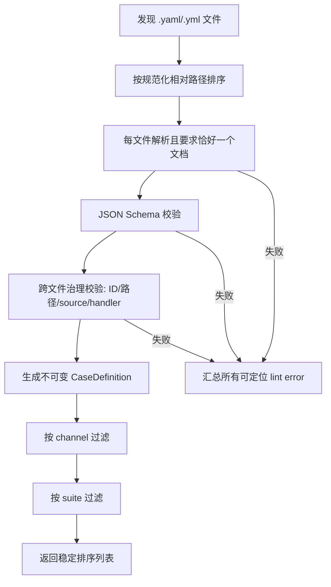
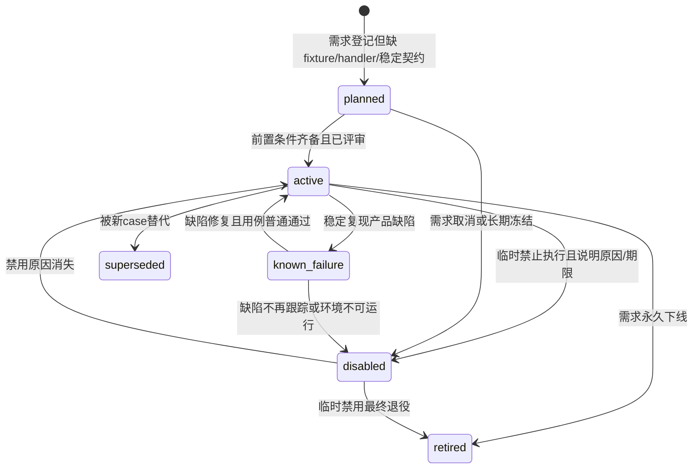
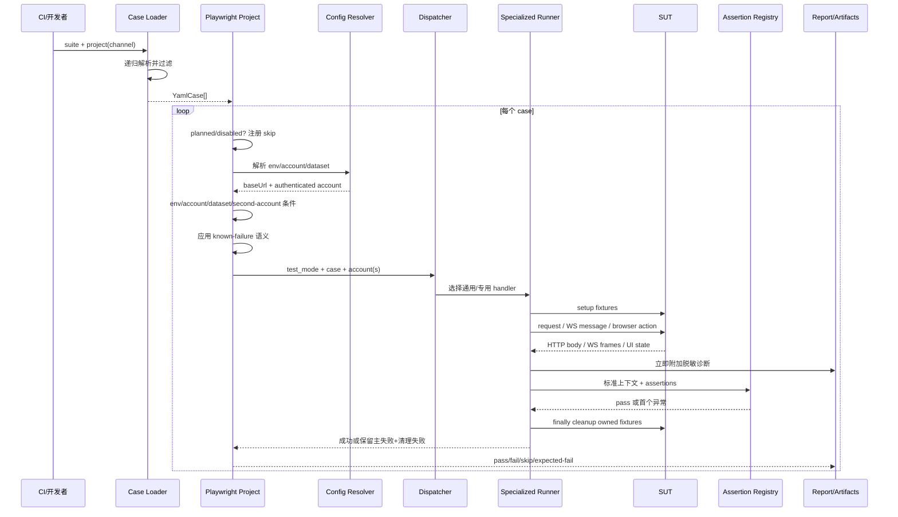
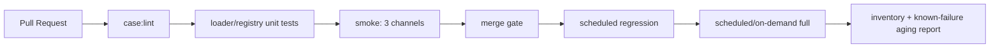
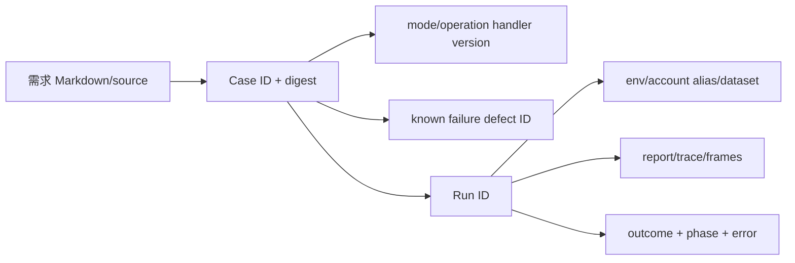

```
# YAML 用例 DSL、加载与状态治理复刻说明

## 0. 文档目的、边界与证据口径

本文描述一个独立黑盒自动化工程如何用 `cases/**/*.yaml` 管理 API、WebSocket 和浏览器三类用例，并给出可在另一套 Agent 工程中直接实现的等价方案。读者不需要访问 Nova、`nova_auto_test` 或本次会话；正文包含字段语义、加载算法、状态机、过滤规则、推荐 JSON Schema、错误策略、CI 门禁和验收标准。

本文只负责“用例作为数据”的 DSL 与治理，不展开每一种业务 runner、WS 帧协议或浏览器 Page Object 的内部实现。用例中出现的业务操作扩展字段会说明分派契约，但各业务模块如何创建知识、技能、任务等资源，应由对应功能复刻文档描述。

证据标签如下：

| 标签 | 含义 |
|---|---|
| `[I]` | 当前代码、配置或仓库结构可静态确认的实现事实 |
| `[A]` | 当前标记为 `active` 的自动化契约；表示应执行，不等同于本次已运行通过 |
| `[K]` | 当前登记的已知失败或已知实现偏差 |
| `[P]` | 当前 `planned` 用例表达的目标需求，尚不能当作现有能力 |
| `[R]` | 本次实际运行验证得到的事实 |
| `[F]` | 由多处静态证据得到的强推断，仍需运行验证 |
| `[D]` | 为可维护、可移植复刻而提出的设计建议，不冒充当前实现 |

本次只做静态分析，没有连接 release/demo/local 环境，也没有执行 Playwright。因此本文没有 `[R]` 通过结论；后文的 498 条统计是仓库快照，不是测试结果。

## 1. 一句话结论

当前方案的产品价值是：测试设计者用一个 YAML 文件登记一个需求用例，通过 `channel + tags + status + env/account/dataset` 决定“由哪个通道、在哪些运行条件、以何种预期结果”执行，再由 `test_mode + operation` 分派到专用 runner，最终以声明式 assertions 验证响应或事件。`[I]`

当前方案已经形成稳定的事实约定——一用例一文件、文件名等于 ID、目录镜像需求文档、三通道、三套 suite、四种状态语义——但加载器本身只执行很薄的 YAML 解析和过滤，未运行 JSON Schema、未检查重复 ID、路径镜像、未知字段、未知 `test_mode` 或断言参数。当前 498 个文件全部满足若干约定，是维护纪律的结果，不是 loader 的保证。`[I]`

复刻时应保留这种“YAML 只描述意图、runner 实现能力”的分层，同时增加版本化 Schema、全库 lint、确定性排序、唯一性和 handler 可达性校验。不要让执行阶段才发现拼写错误，也不要把 planned 用例伪装成绿色通过。`[D]`

## 2. 业务目标与参与者

### 2.1 解决的问题

该模块解决五类治理问题：

1. **需求可追踪**：每个测试用例回链到一份需求/测试设计 Markdown。
2. **通道统一**：REST、WebSocket、真实浏览器共用一套用例库存和状态词汇。
3. **分层选集**：smoke 用于快速门禁，regression 用于主回归，full 用于完整库存。
4. **未完成能力显式化**：计划项和已知缺陷仍保留在库存中，但不与稳定通过混淆。
5. **环境/账号隔离**：用例可以限制环境、账号、数据集，并显式要求第二账号验证越权。

### 2.2 参与者与职责

| 参与者 | 输入 | 责任 | 输出 |
|---|---|---|---|
| 测试设计者 | 需求、接口契约、缺陷 | 创建一个自包含 YAML，选择通道、状态、suite 和断言 | 可审查的用例文件 |
| Loader | cases 根目录、channel、suite | 递归解析 YAML 并筛选 | `YamlCase[]` |
| Playwright project | `api/ws/browser` | 把每条 case 注册成测试，处理 skip/expected-failure | 测试节点和结果 |
| 环境解析器 | 配置、账号文件、环境变量 | 解析 URL、账号、数据集、模型和超时 | 运行上下文 |
| Dispatcher | `channel + test_mode` | 选择通用或专用 runner | 一次业务执行 |
| Runner | case、账号、客户端 | setup、发请求/消息、采集结果、cleanup | 标准断言上下文和附件 |
| Assertion registry | 断言列表、标准上下文 | 按顺序执行精确断言 | pass 或首个异常 |
| CI/linter | 整个 cases 树 | 在执行前发现治理错误 | 可定位诊断、库存报告 |

### 2.3 输入与最终可见结果

输入是 YAML 文件、环境配置、账号配置和少量环境变量。输出不是另一个业务数据对象，而是 Playwright 测试结果：passed、failed、skipped、expected-failed，及 HTML report、trace、截图、HTTP/console/network 诊断和 WS 帧附件。`[I]`

## 3. 当前仓库快照：库存事实而非执行结论

统计日期：2026-08-13。统计方法是只读解析全部 `cases/**/*.yaml`；未发起任何网络调用。`[I]`

| 项目 | 数量 | 解释 |
|---|---:|---|
| YAML 文件 | 498 | `.yaml/.yml` 递归库存 |
| YAML 文档 | 498 | 当前每文件恰好一个文档 |
| API / WS / Browser | 270 / 216 / 12 | 三通道分布 |
| active / planned / known_failure / disabled | 292 / 182 / 24 / 0 | `disabled` 被实现支持，但当前无实例 |
| smoke 可选 | 18 | 均同时带 `regression` |
| regression 可选 | 478 | 包含上述 18 个 smoke |
| 仅 full 执行 | 20 | 只带 `full`；full 模式实际无条件加载全部 498 条 |
| known failure 带错误正则 | 21/24 | 只有 API project 会做定向错误匹配 |
| known failure 带环境限制 | 3/24 | 其余对所有环境生效 |
| 要求第二账号 | 23 | 用于跨账号/租户隔离场景 |
| 带 dataset 限制 | 103 | 运行账号数据集不符时跳过 |
| 带外部 judge 回链 | 42 | 只登记，不在本工程执行 |

当前静态一致性为：0 个 YAML 解析错误、0 个缺失 ID、0 个文件名/ID 不一致、0 个重复 ID、0 个多文档文件、0 个未知 channel、0 个缺失 assertions，498 个 `source` 都能在需求文档根目录下找到目标。`[I]` 这些数字只能证明当前库存，不能证明 loader 会阻止未来违规提交。

## 4. 文件、ID 与需求路径契约

### 4.1 当前约定

每个业务用例独占一个文件，文件 basename 必须等于用例 ID：

```text
需求：docs/nova-test-cases/07-knowledge/import.md
用例：cases/07-knowledge/import/KNOW-IMPORT-005.yaml
字段：id: KNOW-IMPORT-005
      source: 07-knowledge/import.md
```

镜像算法为：

```text
source = <module>/<topic>.md
case directory = cases/<module>/<topic>/
case filename = <id>.yaml
```

`source` 是相对于需求根 `docs/nova-test-cases/` 的 POSIX 路径，不应写绝对路径，也不应包含 `..`。多个 case 可以回链同一 Markdown；一个 case 只能有一个权威 source。`[I/D]`

### 4.2 为什么坚持一文件一用例

- Git diff、code owner 和缺陷归属以 case 为最小单位。
- 可直接用文件名和 Playwright `-g <id>` 定位。
- 避免 YAML 多文档中一处语法错误令整批用例不可读。
- planned 需求也可独立演进，不需要与已执行用例共享状态。

当前 loader 使用多文档解析 API，技术上会接受 `---` 分隔的多条 case；“一文件一用例”尚未由运行时代码强制。复刻 linter 必须把文档数不等于 1 视为错误。`[I/D]`

## 5. 当前 v1 DSL 数据契约

当前没有显式 `schemaVersion`。以下称为“v1”只是本文给现状起的迁移名称，不代表 YAML 中已存在版本字段。`[I]`

### 5.1 核心 TypeScript 形态

```ts
type Channel = "api" | "ws" | "browser";
type CaseStatus = "active" | "planned" | "known_failure" | "disabled";

interface Assertion {
  type: string;
  [parameter: string]: unknown;
}

interface CaseMessage {
  role: "user" | "assistant";
  content: string;
}

interface YamlCaseV1 {
  id: string;
  channel: Channel;
  source: string;
  title?: string;
  tags?: string[];
  status?: CaseStatus;
  reason?: string;

  env?: string[];
  account?: string;
  dataset?: string;
  requiresSecondAccount?: boolean;

  knownFailureEnvs?: string[];
  knownFailureErrorPattern?: string;

  test_mode?: string;
  messages?: CaseMessage[];
  question?: string;
  assertions: Assertion[];
  eval_external?: string[];

  // 真实接口还逐项声明 API/WS/Browser 与业务 runner 的可选字段，见后续表格；
  // 它本身没有 string index signature。
}
```

注意：真实 `YamlCase` 没有 `[extension:string]:unknown`；只有 `Assertion` 允许任意参数键。未知YAML字段之所以未被拒绝，是因为 parser 结果被直接强制转换成 interface，运行时没有Schema或additional-properties检查，而不是因为类型声明显式允许扩展。TypeScript interface只帮助源码编译，不会验证从YAML得到的对象。`[I]`

### 5.2 身份、选择与追踪字段

| 字段 | 类型 | 当前必填 | 语义与规则 |
|---|---|---:|---|
| `id` | string | 是 | 全局稳定标识；建议大写域前缀加序号，如 `CHAT-CANCEL-001` |
| `channel` | enum | 是 | `api`、`ws`、`browser`；决定 project 与顶层执行器 |
| `source` | string | 是 | 需求 Markdown 相对路径；当前 loader 不验证存在性 |
| `title` | string | 否 | 人类可读标题，拼到 Playwright test title |
| `tags` | string[] | 实际必需 | suite 过滤；不带 tag 的 case 在 smoke/regression 不会加载 |
| `status` | enum | 实际必需 | 当前库存每条均填写；代码未提供默认值 |
| `reason` | string | 条件必填 | planned、disabled、known_failure 应解释原因和解除条件 |
| `env` | string[] | 否 | 允许的环境名；不匹配在测试运行期 skip |
| `account` | string | 否 | 只允许指定逻辑账号名；不匹配 skip |
| `dataset` | string | 否 | 账号声明的数据集必须相等；不匹配 skip |
| `requiresSecondAccount` | boolean | 否 | true 时解析第二账号；缺失则 skip |
| `eval_external` | string[] | 否 | 外部 judge/评测标识，只登记回链，当前工程不执行 |

`env/account/dataset` 是选择约束，不是请求中可伪造的租户身份。runner 应从已认证账号上下文获得真实身份。`[I/D]`

### 5.3 状态字段

| 字段 | 类型 | 适用状态 | 语义 |
|---|---|---|---|
| `status` | enum | 全部 | 执行和结果预期的主状态 |
| `reason` | string | 非 active | 为什么不能作为普通稳定用例 |
| `knownFailureEnvs` | string[] | known_failure | 只在这些环境按预期失败；缺失表示所有环境 |
| `knownFailureErrorPattern` | regex string | known_failure | 期望命中的错误摘要；当前只有 API 通道做定向匹配 |

### 5.4 通用刺激与请求字段

| 字段 | 类型 | 使用方 | 语义 |
|---|---|---|---|
| `test_mode` | string | dispatcher | 选择 runner；专用模式通常还要求一个 operation 字段 |
| `messages` | `{role,content}[]` | chat runner | 多轮对话；role 当前只允许 user/assistant |
| `question` | string | WS/browser runner | 单次用户问题；部分 runner 退回读取首条 user message |
| `input` | object | 消息边界 runner | `text` 或 `repeatText * repeat` 生成输入 |
| `rawPayload` | string | WS 低层 runner | 发送原始负载以测错误处理 |
| `concurrentMessages` | string[] | 并发 runner | 并发刺激集合 |
| `method` | enum | API HTTP | GET/POST/PUT/DELETE/PATCH，未填默认 GET |
| `endpoint` | string | API HTTP | 相对 base URL 的路径；存在时即进入通用 HTTP runner |
| `authenticated` | boolean | API HTTP | 未填视为 true |
| `requestCookies` | `{name,value}[]` | 未认证 API | 仅 `authenticated:false` 可用；否则执行时报错 |
| `body` | any | API HTTP | 请求 JSON/body |
| `stream` | boolean | API HTTP | 是否按流式响应采集 frame |
| `expectedStatusCodes` | number[] | 部分 runner | 允许状态码集合；具体消费依 runner |
| `expectedStatusMin/Max` | number | 部分 runner | 状态码区间；不要与 assertions 中的范围断言重复漂移 |
| `expectAbsentConversationId` | boolean | chat runner | 负向契约中断言不应产生会话 ID |

当前 v1 没有统一的 `request:{...}` 对象；字段平铺在 case 顶层。`[I]` 复刻兼容层可读取平铺字段，新版应收拢进按 channel 区分的 request union。`[D]`

### 5.5 时序、等待和诊断字段

| 字段 | 类型 | 语义 |
|---|---|---|
| `startTimeoutMs` | number | 等待任务开始/首阶段的上限 |
| `answerTimeoutMs` | number | 等待 Agent 回答的上限；Browser project 会再给 test timeout 增加 120 秒 |
| `cancelTimeoutMs` | number | 等待取消终态上限 |
| `toolSignalTimeoutMs` | number | 等待目标工具阶段上限 |
| `quietMs` | number | 观察无额外事件的静默窗口 |
| `idleMs` | number | WS idle 场景持续时间 |
| `raceDelayMs` | number | 竞态场景中注入的延迟 |
| `waitForToolSignal` | boolean | 是否等待工具信号 |
| `waitForToolName` | string | 目标工具名 |
| `waitForComplete` | boolean | 工具事件后是否继续等 complete |
| `captureConversationSnapshot` | boolean | 是否抓取会话快照用于后续断言 |
| `maxMessageBytes/overLimitBytes` | number | 消息大小边界参数 |

这些字段不是 loader 的行为；只有选中的 runner 读取时才生效。字段写错或放在不支持的 `test_mode` 上，当前可能被静默忽略。`[I]`

### 5.6 业务分派扩展

专用 runner 使用“一种模式 + 一种操作”作为判别器，例如：

```yaml
test_mode: knowledge_crud
knowledgeOperation: update
```

当前已定义的主要扩展族包括：

| `test_mode` 族 | operation/fixture 字段 | 目的 |
|---|---|---|
| knowledge | `knowledgeOperation`、`knowledgeSearchOperation`、`knowledgeMatcherOperation`、`knowledgeSettingsOperation`、`knowledgeErrorOperation`、`knowledgeImportOperation`、`knowledgeSynonymOperation`、`knowledgeFixture` | 知识 CRUD、搜索、导入、同义词、隔离 |
| skill | `skillSettingsOperation`、`skillSettingsErrorOperation`、`skillFrontmatterOperation`、`skillExecutionOperation`、`skillTriggerOperation` | 技能管理、加载、触发和资源执行 |
| task | `taskOperation`、`taskManagementOperation` | 定时任务、执行、取消、流水线 |
| memory | `memoryPersistenceOperation`、`memoryProfileOperation` | 消息持久化、画像注入、隔离 |
| settings | `settingsFeedbackOperation`、`settingsToolOperation`、`settingsRecommendedQuestionOperation`、`settingsPlatformOperation`、`settingsDataSourceOperation`、`settingsThemeOperation` | 设置项 CRUD、掩码和跨租户保护 |
| metric/CAN | `metricQueryOperation`、`metricFixture(s)`、`canPluginOperation` | 指标查询及插件注册契约 |
| attribution | `attributionKnowledgeOperation` | 因子、维度、相关性和租户隔离 |
| file/artifact | `fileArtifactOperation`、`fileReadOperation`、`fileToolOperation` | 上传、读写、工件、路径安全 |
| citation | `citationOperation`、`citationFaviconOperation` | 引用证据、编号、favicon 安全 |

每个 operation 应是闭合 enum，handler 应做穷尽分派；未知值必须在执行前 lint 失败。`[D]`

### 5.7 assertions 契约

`assertions` 是有序数组，每项至少含 `type`，其余参数由对应断言函数解释。当前执行器逐项执行，遇到未知 type 或首个断言失败即抛错，不继续后续断言。`[I]`

标准断言上下文可抽象为：

```ts
interface AssertContext {
  frames: Array<Record<string, unknown>>;
  conversationId?: string;
  statusCode?: number;
  bodyText?: string;
  body?: unknown;
}
```

当前断言族包括：

| 类别 | 代表类型 | 关键参数 |
|---|---|---|
| HTTP | `status_code`、`status_code_one_of`、`status_code_range` | `code/codes/min/max` |
| JSON/body | `response_schema`、`response_body_type`、`response_json_path`、`response_json_array_*`、`response_non_empty` | `path/equals/required/...` |
| 安全 | `no_backend_leak`、`response_sensitive_config_masked`、`response_not_contains` | `text/allowTraceback` |
| WS 事件 | `ws_event_received`、`ws_event_not_received`、`ws_event_order`、`ws_event_count`、`ws_event_pairing` | `event_type/order/exact/min/max` |
| 终态 | `single_terminal`、`terminal_one_of`、`controlled_error_or_complete`、`no_error` | `event_types/allowed_error_codes` |
| 工具 | `tool_called`、`tool_not_called`、`tool_args_json_path`、`tool_result_contains`、`tool_result_success`、`tool_lifecycle` | `tool/path/equals/text/success/callIndex` |
| 过程统计 | `snapshot_status`、`process_data_*`、`stats_present` | 状态、token、时长、工具计数 |
| 工件/引用 | `artifact_created`、`citation_present`、`citation_payload_present` | `extension/contains/min` |

断言注册表中还有若干 `gap(...)` 占位类型，用例如果执行到它们会明确失败；这表示需求被登记但断言能力尚缺，不是空操作通过。`[I/P]`

## 6. 当前 loader 的精确行为

### 6.1 等价伪代码

```ts
function loadCases(channel?: Channel,
                   suite = env.AGENT_E2E_SUITE ?? "smoke"): YamlCase[] {
  const out = [];
  if (!exists(CASES_DIR)) return out;

  function walk(dir) {
    for (const entry of readdir(dir, { withFileTypes: true })) {
      const full = join(dir, entry.name);
      if (entry.isDirectory()) walk(full);
      else if (/\.ya?ml$/.test(entry.name)) {
        const documents = yaml.loadAll(readUtf8(full));
        for (const doc of documents) {
          if (doc && doc.id &&
              (!channel || doc.channel === channel) &&
              matchesSuite(doc, suite)) {
            out.push(doc as YamlCase);
          }
        }
      }
    }
  }

  walk(CASES_DIR);
  return out;
}

function matchesSuite(c, suite) {
  if (suite === "full") return true;
  if (suite !== "smoke" && suite !== "regression")
    throw Error("Unknown suite");
  return Array.isArray(c.tags) && c.tags.includes(suite);
}
```

### 6.2 已执行与未执行的校验

| 项目 | 当前 loader 行为 |
|---|---|
| cases 根不存在 | 返回空数组，不报错 |
| 目录遍历 | 递归，接受 `.yaml/.yml` |
| YAML 语法/重复 mapping key/未知 tag | parser 抛错，整个加载中断 |
| 一个文件多个文档 | 全部读取；没有一文件一用例校验 |
| 空文档或缺 `id` | 静默丢弃 |
| channel 不匹配 | 正常过滤 |
| 未知 channel | 若 project 按合法 channel 加载，会永远不入选；无显式错误 |
| 缺 tags | smoke/regression 下静默不入选；full 下入选 |
| 未知 suite | 在遇到具有 ID 且 channel 匹配的文档时抛错 |
| 缺 source/assertions/status | loader 不检查 |
| 重复 ID | 不检查，可能注册同名测试 |
| 文件名与 ID/路径不匹配 | 不检查 |
| 未知字段 | 保留但通常无人读取 |
| 顺序 | 取决于文件系统返回和递归顺序；未显式 sort |

`js-yaml` 解析得到的是普通 JavaScript 值；例如 YAML 时间戳、数字、布尔值的隐式类型可能与作者预期不同。复刻 Schema 应要求字符串的字段加引号策略，并在 lint 输出解析后的类型。`[D]`

### 6.3 推荐的确定性加载流水线



生产复刻不应在 cases 根缺失时返回“0 tests, success”；CI 和正式运行都应 fail closed。只有明确的 library/unit-test 场景可选择允许空根。`[D]`

## 7. Suite 选择规则

### 7.1 当前语义

| suite 参数 | 选择条件 | 当前快照 |
|---|---|---:|
| `smoke` | `tags` 包含 `smoke` | 18 |
| `regression` | `tags` 包含 `regression` | 478 |
| `full` | 无条件选择全部 case，忽略 tags | 498 |

默认 suite 是环境变量 `AGENT_E2E_SUITE`，未设置则 `smoke`。`full` 是 loader 模式，不是“只选 `tags:[full]`”。当前 20 个仅带 full 的用例会被 smoke/regression 排除，但会被 full 的无条件规则选中。`[I]`

推荐 tag 约束：

- `smoke` 必须同时有 `regression`，保证集合嵌套。
- 普通稳定/计划用例至少属于 regression；昂贵、破坏性或依赖专用 fixture 的用例可只标 full。
- 不要用 tag 表达状态，状态只能由 `status` 决定。
- 业务标签可扩展，如 `security`、`tenant-isolation`，但不改变 suite 基本语义。

### 7.2 单用例运行陷阱

Playwright `-g ID` 只会在“已经由 loader 注册”的测试中筛选。若 ID 只有 regression 标签而默认 suite 是 smoke，单独执行 `-g` 会得到零匹配。稳定的单用例命令应显式选择 full：

```bash
AGENT_E2E_SUITE=full npx playwright test --project=ws -g '^CHAT-CANCEL-001\b'
```

CI 应把“零测试”视为错误，避免误报绿色。`[D]`

## 8. 状态治理与真实执行语义

### 8.1 状态机



状态变更必须通过代码评审；不要由 runner 自动把失败改成 known_failure，也不要在测试通过后自动删掉 known_failure。`[D]`

### 8.2 四种状态

| 状态 | 注册/执行 | 预期结果 | 治理要求 |
|---|---|---|---|
| `active` | 正常注册并执行 | 必须通过 | `[A]` 契约；失败阻断相应门禁 |
| `planned` | 注册为 skipped，不执行 runner | skip | `[P]` 必须写缺失前置和激活条件 |
| `disabled` | 注册为 skipped，不执行 runner | skip | 必须写责任人/期限；不可无限期隐藏失败 |
| `known_failure` | 执行并标 expected failure | 应按预期方式失败 | `[K]` 必须写缺陷、环境和期望错误 |

当前v1只有上表四种状态。推荐v2再增加不可执行终态 `retired` 与 `superseded`：前者表示需求永久撤销，后者必须指向 `replacementCaseId`；两者进入历史库存而非Playwright executable inventory，并保存 `retiredAt/owner/ticket/aliases`。`disabled` 只表达有期限的临时隔离，必须有owner、category、ticket和expiresAt，过期CI失败；不要让永久废弃用例长期以disabled污染skip率。`[D]`

planned/disabled 在注册时就形成 skipped test，不解析账号，也不做 env/account/dataset 判断。`[I]`

### 8.3 known_failure 的三通道差异

**API 通道：**

1. `knownFailureEnvs` 缺失或包含当前环境，状态才生效。
2. 没有 `knownFailureErrorPattern` 时，测试开始即调用 expected-failure 标记；任何失败都可能被视为预期失败。
3. 有 pattern 时，runner 抛错后把 `Error.name + ': ' + Error.message` 与动态构造的正则匹配；只在匹配时标 expected failure，然后重新抛出。
4. 若 runner 没有抛错，结尾仍标 expected failure，Playwright 应把“预期失败但通过”识别为异常结果。
5. 不匹配的错误不会被标为预期失败，防止清理失败、登录失败等无关错误被缺陷豁免。`[I]`

**WS 和 Browser 通道：**

- 环境选择相同，但当前直接在执行前标 expected failure。
- 即使 YAML 写了 `knownFailureErrorPattern`，这两个 project 也不做正则定向匹配。
- 因此任意失败都可能满足 expected-failure，缺陷漂移识别能力弱。`[I/K]`

推荐统一三个通道的定向错误机制，并让 known failure 具备 `defectId`、`expiresAt`、`owner`、`expected.phase`、`expected.errorCode/pattern`。过期或未命中必须失败。`[D]`

### 8.4 无效正则与错误遮蔽

pattern 在实际匹配时才 `new RegExp(...)`。无效正则会在处理原始 runner 错误时抛出新的 SyntaxError，可能遮蔽真正失败。linter 必须提前编译全部正则并定位到文件/字段。`[I/D]`

## 9. 从注册到清理的完整链路



### 9.1 环境与账号解析优先级

环境：显式参数 → `AGENT_E2E_ENV` → 配置默认 `env` → `release`。账号：显式参数 → 环境专属变量 → 全局变量 → username override → 环境默认账号。URL、username、password 也允许环境变量覆盖。认证开启时缺 username/password 直接失败；缺 base URL 直接失败。`[I]`

账号对象还包含 `dataset`、模型名、超时、headless 默认值。case 的 dataset 必须与账号声明值精确相等，否则 skip。第二账号有独立 override 链；用例要求第二账号而配置缺失时 skip。`[I]`

凭据不得进入 YAML。当前配置 helper 提供密码掩码和 redact；复刻时报告、异常、HTTP 附件、WS frame 和 trace 都应通过统一 secret scrubber。`[I/D]`

### 9.2 setup/request/expect/assertions/cleanup 的当前真实形态

用户要复刻这五段生命周期时必须注意：当前 v1 **没有**通用 `setup`、`request`、`expect`、`cleanup` 顶层对象。`[I]`

| 阶段 | 当前载体 | 风险 |
|---|---|---|
| setup | 专用 runner 根据 `test_mode + operation + fixture` 在代码中创建资源 | YAML 看不出完整副作用，新增场景可能要改代码 |
| request | 顶层平铺的 endpoint/body/messages/question 等，或 runner 内建请求序列 | 字段与 handler 耦合，拼写错误可能静默 |
| expect | 业务 runner 内的中间 invariant + YAML assertions | 期望分散，重复或冲突难 lint |
| assertions | YAML 有序数组，由注册表执行 | type 参数没有判别联合校验 |
| cleanup | runner 的 try/finally 和已创建资源账本；部分支持 keep 环境变量 | 不同业务清理策略不统一 |

知识和技能 runner 会在 finally 清理已创建资源，404 常被视为幂等成功；部分 runner 会恢复查询创建 ID、逆序删除，并用 `AggregateError` 同时保留业务验证失败和 cleanup 失败。技能可用 `AGENT_E2E_KEEP_SKILL=true`、知识可用 `AGENT_E2E_KEEP_KNOWLEDGE=true` 保留 fixture 供调试，但跨租户等敏感场景可能强制清理。`[I]`

复刻的通用生命周期必须维护“资源归属账本”：只有本 case 成功创建或能用唯一 owner marker 恢复定位的资源可以删除；绝不能按宽泛名称清理共享环境数据。`[D]`

## 10. 分派与错误传播

### 10.1 API

API dispatcher 先匹配专用 `test_mode`，再匹配 chat 模式；若 `test_mode === api_http` 或存在 endpoint，则进入通用 HTTP runner。两者都不满足时当前调用 `test.skip`，理由是缺 migration metadata。`[I]`

通用 HTTP runner 的关键规则：

- endpoint 必须存在，method 默认 GET；
- `authenticated !== false` 默认认证；
- 认证请求禁止同时声明 `requestCookies`；
- 未认证请求可在浏览器上下文中注入 cookie；
- 结果归一为 `statusCode/body/bodyText/frames`；
- 先附加诊断，再执行 assertions；
- finally 关闭临时认证/未认证上下文。`[I]`

### 10.2 WebSocket

WS dispatcher 先识别知识搜索/匹配、技能执行/触发、文件读写、任务管理等专用模式；其余进入通用 WS client，再将 `frames/conversationId/bodyText/body` 交给断言注册表。`[I]`

### 10.3 Browser

Browser dispatcher 当前只实现 `login`、`chat_refresh`、`artifact_chart`、`formula_readiness`、`citation_chip`。未知模式直接抛 `No Browser handler implemented...`，不会 skip。每条 browser case 的 console/network/HTTP 诊断在 finally 附加。`[I]`

### 10.4 推荐错误分类

| 错误码 | 阶段 | 是否可重试 | 示例 |
|---|---|---:|---|
| `CASE_DISCOVERY_ERROR` | 发现 | 否 | 根目录不可读 |
| `CASE_YAML_PARSE_ERROR` | 解析 | 否 | 缩进、重复 key、未知 tag |
| `CASE_SCHEMA_ERROR` | 校验 | 否 | channel 枚举错误、断言缺参数 |
| `CASE_GOVERNANCE_ERROR` | 跨文件 | 否 | 重复 ID、路径不镜像、source 丢失 |
| `CASE_HANDLER_MISSING` | 分派 | 否 | test_mode/operation 无 handler |
| `CASE_PRECONDITION_SKIP` | 选择 | 否 | 环境、数据集、第二账号不满足 |
| `CASE_SETUP_ERROR` | setup | 视情况 | fixture 创建失败 |
| `CASE_EXECUTION_ERROR` | request | 视幂等性 | 网络失败、WS 断开 |
| `CASE_ASSERTION_ERROR` | expect | 否 | 状态码、事件、数据不符 |
| `CASE_CLEANUP_ERROR` | cleanup | 谨慎 | 删除 fixture 失败 |

报告应保留 `primaryError` 与 `cleanupErrors[]`，不能用清理失败覆盖原始业务失败。`[D]`

## 11. 推荐 v2 DSL：兼容现状但可严格校验

### 11.1 设计原则

1. `schemaVersion` 必填且只接受已知 major。
2. 核心字段 `additionalProperties:false`；扩展放进显式 `scenario`。
3. `request` 按 channel 使用判别联合。
4. `statusPolicy` 收拢 known failure 元数据。
5. setup/cleanup 使用受控动作注册表，不允许 YAML 执行任意 shell。
6. assertions 是按 `type` 判别的 union，每种参数单独校验。
7. loader/linter 先验证全部库存，再执行任何用例。

### 11.2 推荐 TypeScript 接口

```ts
type CaseActor = "primary" | "secondary" | "anonymous";

interface CaseDefinitionV2 {
  schemaVersion: "2.0";
  id: string;
  source: string;
  title: string;
  channel: "api" | "ws" | "browser";
  tags: string[];
  status:
    | "active" | "planned" | "known_failure" | "disabled"
    | "retired" | "superseded";
  reason?: string;

  selectors?: {
    env?: string[];
    account?: string;
    dataset?: string;
    requiresSecondAccount?: boolean;
  };

  statusPolicy?: {
    defectId?: string;
    ticket?: string;
    category?: "product_defect" | "infrastructure" | "quarantine" | "dependency";
    owner?: string;
    expiresAt?: string; // RFC 3339 full-date
    knownFailureEnvs?: string[];
    expectedErrorPattern?: string;
    expectedPhase?: "setup" | "request" | "assert" | "cleanup";
  };

  retirementPolicy?: {
    retiredAt: string;
    owner: string;
    ticket: string;
    replacementCaseId?: string;
    aliases?: string[];
  };

  scenario: {
    mode: string;
    operation?: string;
    fixtures?: Record<string, unknown>;
  };

  setup?: LifecycleAction[];
  request: ApiRequest | WsRequest | BrowserRequest;
  expect?: { timeoutMs?: number; terminal?: string[] };
  assertions: StrictAssertion[];
  cleanup?: LifecycleAction[];
  externalEvaluations?: string[];
}

interface LifecycleAction {
  action: string;              // 注册表名称，不是可执行代码
  actor: CaseActor;            // 由谁执行，决定cookie/tenant/user
  credentialRef?: string;      // 只引用secret store alias，不含明文凭据
  as?: string;                 // 把输出存入 case-local context
  with?: Record<string, unknown>;
  when?: "always" | "on_success" | "on_failure";
  tolerateNotFound?: boolean;
}
```

API/WS/Browser request同样必须声明 `actor`，并可声明 `credentialRef`；`primary/secondary`解析到各自隔离的认证context，`anonymous`明确创建无认证context。setup输出的资源账本必须保存owner actor，request的requester和cleanup actor分别记录，不能用“当前账号”这种隐式状态。`[D]`

### 11.3 推荐 JSON Schema（Draft 2020-12）

下面 Schema 覆盖核心、三通道请求、生命周期和常用断言。业务团队应在 `$defs.scenario` 和 `$defs.assertion` 的 `oneOf` 中继续添加闭合分支，而不是恢复任意字段。

```json
{
  "$schema": "https://json-schema.org/draft/2020-12/schema",
  "$id": "https://example.internal/schemas/agent-e2e-case-2.0.json",
  "title": "Agent E2E Case DSL v2",
  "type": "object",
  "additionalProperties": false,
  "required": [
    "schemaVersion", "id", "source", "title", "channel",
    "tags", "status", "scenario", "request", "assertions"
  ],
  "properties": {
    "schemaVersion": { "const": "2.0" },
    "id": {
      "type": "string",
      "pattern": "^[A-Z][A-Z0-9]*(?:-[A-Z0-9]+){2,}$",
      "maxLength": 96
    },
    "source": {
      "type": "string",
      "pattern": "^(?!/)(?!.*(?:^|/)\\.\\.(?:/|$))[a-z0-9][a-z0-9-]*(?:/[a-z0-9][a-z0-9-]*)*\\.md$"
    },
    "title": { "type": "string", "minLength": 5, "maxLength": 240 },
    "channel": { "enum": ["api", "ws", "browser"] },
    "tags": {
      "type": "array",
      "minItems": 1,
      "uniqueItems": true,
      "items": { "type": "string", "pattern": "^[a-z][a-z0-9-]*$" }
    },
    "status": {
      "enum": ["active", "planned", "known_failure", "disabled", "retired", "superseded"]
    },
    "reason": { "type": "string", "minLength": 8, "maxLength": 1000 },
    "selectors": { "$ref": "#/$defs/selectors" },
    "statusPolicy": { "$ref": "#/$defs/statusPolicy" },
    "retirementPolicy": { "$ref": "#/$defs/retirementPolicy" },
    "scenario": { "$ref": "#/$defs/scenario" },
    "setup": {
      "type": "array", "items": { "$ref": "#/$defs/action" }
    },
    "request": { "$ref": "#/$defs/request" },
    "expect": { "$ref": "#/$defs/expect" },
    "assertions": {
      "type": "array",
      "minItems": 1,
      "items": { "$ref": "#/$defs/assertion" }
    },
    "cleanup": {
      "type": "array", "items": { "$ref": "#/$defs/action" }
    },
    "externalEvaluations": {
      "type": "array", "uniqueItems": true,
      "items": { "type": "string", "minLength": 1 }
    }
  },
  "allOf": [
    {
      "if": {
        "properties": {
          "status": {
            "enum": ["planned", "disabled", "known_failure", "retired", "superseded"]
          }
        }
      },
      "then": { "required": ["reason"] }
    },
    {
      "if": { "properties": { "status": { "const": "known_failure" } } },
      "then": {
        "required": ["statusPolicy"],
        "properties": {
          "statusPolicy": {
            "required": ["defectId", "owner", "expiresAt", "expectedErrorPattern"]
          }
        }
      }
    },
    {
      "if": { "properties": { "status": { "const": "disabled" } } },
      "then": {
        "required": ["statusPolicy"],
        "properties": {
          "statusPolicy": { "required": ["owner", "expiresAt", "ticket", "category"] }
        }
      }
    },
    {
      "if": { "properties": { "status": { "enum": ["retired", "superseded"] } } },
      "then": { "required": ["retirementPolicy"] }
    },
    {
      "if": { "properties": { "status": { "const": "superseded" } } },
      "then": {
        "properties": {
          "retirementPolicy": { "required": ["replacementCaseId"] }
        }
      }
    },
    {
      "if": { "properties": { "channel": { "const": "api" } } },
      "then": { "properties": { "request": { "$ref": "#/$defs/apiRequest" } } }
    },
    {
      "if": { "properties": { "channel": { "const": "ws" } } },
      "then": { "properties": { "request": { "$ref": "#/$defs/wsRequest" } } }
    },
    {
      "if": { "properties": { "channel": { "const": "browser" } } },
      "then": { "properties": { "request": { "$ref": "#/$defs/browserRequest" } } }
    }
  ],
  "$defs": {
    "selectors": {
      "type": "object",
      "additionalProperties": false,
      "properties": {
        "env": {
          "type": "array", "minItems": 1, "uniqueItems": true,
          "items": { "type": "string", "minLength": 1 }
        },
        "account": { "type": "string", "minLength": 1 },
        "dataset": { "type": "string", "minLength": 1 },
        "requiresSecondAccount": { "type": "boolean", "default": false }
      }
    },
    "statusPolicy": {
      "type": "object",
      "additionalProperties": false,
      "properties": {
        "defectId": { "type": "string", "minLength": 1 },
        "ticket": { "type": "string", "minLength": 1 },
        "category": {
          "enum": ["product_defect", "infrastructure", "quarantine", "dependency"]
        },
        "owner": { "type": "string", "minLength": 1 },
        "expiresAt": { "type": "string", "format": "date" },
        "knownFailureEnvs": {
          "type": "array", "minItems": 1, "uniqueItems": true,
          "items": { "type": "string", "minLength": 1 }
        },
        "expectedErrorPattern": { "type": "string", "minLength": 1 },
        "expectedPhase": { "enum": ["setup", "request", "assert", "cleanup"] }
      }
    },
    "retirementPolicy": {
      "type": "object",
      "additionalProperties": false,
      "required": ["retiredAt", "owner", "ticket"],
      "properties": {
        "retiredAt": { "type": "string", "format": "date" },
        "owner": { "type": "string", "minLength": 1 },
        "ticket": { "type": "string", "minLength": 1 },
        "replacementCaseId": { "type": "string", "minLength": 1 },
        "aliases": {
          "type": "array", "uniqueItems": true,
          "items": { "type": "string", "minLength": 1 }
        }
      }
    },
    "scenario": {
      "type": "object",
      "additionalProperties": false,
      "required": ["mode"],
      "properties": {
        "mode": { "type": "string", "pattern": "^[a-z][a-z0-9_]*$" },
        "operation": { "type": "string", "pattern": "^[a-z][a-z0-9_]*$" },
        "fixtures": { "type": "object" }
      }
    },
    "action": {
      "type": "object",
      "additionalProperties": false,
      "required": ["action", "actor"],
      "properties": {
        "action": { "type": "string", "pattern": "^[a-z][a-z0-9_]*$" },
        "actor": { "enum": ["primary", "secondary", "anonymous"] },
        "credentialRef": { "type": "string", "minLength": 1 },
        "as": { "type": "string", "pattern": "^[a-z][a-zA-Z0-9_]*$" },
        "with": { "type": "object" },
        "when": { "enum": ["always", "on_success", "on_failure"], "default": "always" },
        "tolerateNotFound": { "type": "boolean", "default": false }
      }
    },
    "request": {
      "oneOf": [
        { "$ref": "#/$defs/apiRequest" },
        { "$ref": "#/$defs/wsRequest" },
        { "$ref": "#/$defs/browserRequest" }
      ]
    },
    "apiRequest": {
      "type": "object",
      "additionalProperties": false,
      "required": ["kind", "actor", "method", "endpoint"],
      "properties": {
        "kind": { "const": "api" },
        "actor": { "enum": ["primary", "secondary", "anonymous"] },
        "credentialRef": { "type": "string", "minLength": 1 },
        "method": { "enum": ["GET", "POST", "PUT", "DELETE", "PATCH"] },
        "endpoint": { "type": "string", "pattern": "^/" },
        "authenticated": { "type": "boolean", "default": true },
        "headers": {
          "type": "object",
          "additionalProperties": { "type": "string" },
          "propertyNames": {
            "not": {
              "pattern": "^(?:[Aa][Uu][Tt][Hh][Oo][Rr][Ii][Zz][Aa][Tt][Ii][Oo][Nn]|[Cc][Oo][Oo][Kk][Ii][Ee])$"
            }
          }
        },
        "cookies": {
          "type": "array",
          "items": {
            "type": "object", "additionalProperties": false,
            "required": ["name", "value"],
            "properties": {
              "name": { "type": "string", "minLength": 1 },
              "value": { "type": "string" }
            }
          }
        },
        "body": {},
        "stream": { "type": "boolean", "default": false },
        "timeoutMs": { "type": "integer", "minimum": 1, "maximum": 900000 }
      },
      "allOf": [
        {
          "if": { "properties": { "authenticated": { "const": true } } },
          "then": { "not": { "required": ["cookies"] } }
        }
      ]
    },
    "message": {
      "type": "object", "additionalProperties": false,
      "required": ["role", "content"],
      "properties": {
        "role": { "enum": ["user", "assistant"] },
        "content": { "type": "string", "minLength": 1 }
      }
    },
    "wsRequest": {
      "type": "object",
      "additionalProperties": false,
      "required": ["kind", "actor"],
      "properties": {
        "kind": { "const": "ws" },
        "actor": { "enum": ["primary", "secondary", "anonymous"] },
        "credentialRef": { "type": "string", "minLength": 1 },
        "question": { "type": "string", "minLength": 1 },
        "messages": {
          "type": "array", "minItems": 1,
          "items": { "$ref": "#/$defs/message" }
        },
        "rawPayload": { "type": "string" },
        "waitForComplete": { "type": "boolean", "default": true },
        "waitForToolName": { "type": "string", "minLength": 1 },
        "startTimeoutMs": { "type": "integer", "minimum": 1, "maximum": 900000 },
        "answerTimeoutMs": { "type": "integer", "minimum": 1, "maximum": 900000 },
        "toolSignalTimeoutMs": { "type": "integer", "minimum": 1, "maximum": 900000 }
      },
      "oneOf": [
        { "required": ["question"] },
        { "required": ["messages"] },
        { "required": ["rawPayload"] }
      ]
    },
    "browserRequest": {
      "type": "object",
      "additionalProperties": false,
      "required": ["kind", "actor", "path"],
      "properties": {
        "kind": { "const": "browser" },
        "actor": { "enum": ["primary", "secondary", "anonymous"] },
        "credentialRef": { "type": "string", "minLength": 1 },
        "path": { "type": "string", "pattern": "^/" },
        "question": { "type": "string" },
        "answerTimeoutMs": { "type": "integer", "minimum": 1, "maximum": 900000 },
        "viewport": {
          "type": "object", "additionalProperties": false,
          "required": ["width", "height"],
          "properties": {
            "width": { "type": "integer", "minimum": 320 },
            "height": { "type": "integer", "minimum": 480 }
          }
        }
      }
    },
    "expect": {
      "type": "object",
      "additionalProperties": false,
      "properties": {
        "timeoutMs": { "type": "integer", "minimum": 1, "maximum": 900000 },
        "terminal": {
          "type": "array", "minItems": 1, "uniqueItems": true,
          "items": { "enum": ["complete", "cancelled", "error"] }
        }
      }
    },
    "assertion": {
      "oneOf": [
        {
          "type": "object", "additionalProperties": false,
          "required": ["type", "code"],
          "properties": {
            "type": { "const": "status_code" },
            "code": { "type": "integer", "minimum": 100, "maximum": 599 }
          }
        },
        {
          "type": "object", "additionalProperties": false,
          "required": ["type", "path"],
          "properties": {
            "type": { "const": "response_json_path" },
            "path": { "type": "string", "minLength": 1 },
            "equals": {},
            "exists": { "type": "boolean" }
          },
          "anyOf": [{ "required": ["equals"] }, { "required": ["exists"] }]
        },
        {
          "type": "object", "additionalProperties": false,
          "required": ["type", "event_type"],
          "properties": {
            "type": { "enum": ["ws_event_received", "ws_event_not_received"] },
            "event_type": { "type": "string", "minLength": 1 }
          }
        },
        {
          "type": "object", "additionalProperties": false,
          "required": ["type", "tool"],
          "properties": {
            "type": { "enum": ["tool_called", "tool_not_called"] },
            "tool": { "type": "string", "minLength": 1 },
            "min": { "type": "integer", "minimum": 0 }
          }
        },
        {
          "type": "object", "additionalProperties": false,
          "required": ["type"],
          "properties": {
            "type": { "enum": ["no_error", "no_backend_leak", "response_non_empty"] }
          }
        }
      ]
    }
  }
}
```

Schema 只能校验单文件结构；ID 唯一性、basename、source 镜像、handler/operation 注册、tag 集合嵌套、known failure 过期等必须由语义 linter 处理。`[D]`

## 12. 示例

### 12.1 当前 v1：API 普通用例

```yaml
id: KNOW-CRUD-UPDATE-001
channel: api
source: 07-knowledge/crud.md
title: Owner can update knowledge content and read it back
tags: [regression]
status: active
dataset: guest-analysis
test_mode: knowledge_crud
knowledgeOperation: update
knowledgeFixture:
  titlePrefix: E2E_KNOW_UPDATE
  contentPrefix: E2E_KNOW_CONTENT
assertions:
  - type: status_code
    code: 200
  - type: response_json_path
    path: success
    equals: true
  - type: no_backend_leak
```

setup 和 cleanup 不在文件中；`knowledge_crud/update` runner 负责创建带 case marker 的知识、更新/读取并最终删除。`[I]`

### 12.2 当前 v1：定向 known failure

```yaml
id: SET-THEME-COLOR-003
channel: api
source: 15-settings/theme-settings.md
title: Invalid brand color should be rejected
tags: [regression]
status: known_failure
reason: Product currently accepts a non-hex brand color.
knownFailureEnvs: [release]
knownFailureErrorPattern: '^Error: Invalid theme primaryColor was accepted with status 200\.$'
test_mode: settings_theme
settingsThemeOperation: invalid_brand_color
assertions:
  - type: status_code_range
    min: 400
    max: 422
  - type: no_backend_leak
```

只在 release 将匹配的失败视为 expected failure；其他环境按普通 active 预期运行。修复后 release 也普通通过时，expected-failure 机制应让该 case 变为异常，提醒维护者将状态改回 active。`[I/D]`

### 12.3 推荐 v2：显式生命周期

```yaml
schemaVersion: "2.0"
id: KNOW-CROSS-TENANT-001
source: 07-knowledge/conflict-access.md
title: Foreign account cannot read owner knowledge
channel: api
tags: [regression, security, tenant-isolation]
status: active
selectors:
  requiresSecondAccount: true
scenario:
  mode: knowledge_access
  operation: foreign_read
setup:
  - action: knowledge.create
    actor: primary
    credentialRef: account.primary
    as: ownerKnowledge
    with:
      account: primary
      title: "E2E_${case.id}_${run.id}"
      content: "private fixture ${run.id}"
request:
  kind: api
  actor: secondary
  credentialRef: account.secondary
  method: GET
  endpoint: "/api/knowledge/${ownerKnowledge.id}"
  authenticated: true
expect:
  timeoutMs: 30000
assertions:
  - type: status_code
    code: 404
  - type: no_backend_leak
cleanup:
  - action: knowledge.delete
    actor: primary
    credentialRef: account.primary
    with:
      account: primary
      id: "${ownerKnowledge.id}"
    when: always
    tolerateNotFound: true
```

该闭环中资源owner是primary、越权requester是secondary、cleanup重新使用primary；三者不能因“最后使用的账号”而串换。`credentialRef` 只解析到运行配置/secret store中的逻辑账号，不在YAML保存cookie或密码。插值只能引用 case-local、run-local 和 setup 输出；不允许读取任意进程环境变量或调用函数。生命周期 action 由代码注册表实现并声明权限、输入 Schema、输出 Schema 和幂等性。`[D]`

## 13. Lint 与 CI 治理

### 13.1 必须实现的 linter 规则

**文件级：**

1. UTF-8、无 BOM、文件扩展名为 `.yaml` 或统一选定一种。
2. 恰好一个 YAML 文档；禁止自定义 tag。
3. Schema 校验通过；未知字段报错。
4. basename 等于 `id`；ID 满足命名正则。
5. 不允许明文 password、token、secret、cookie、API key；fixture 中用于断言的假 marker 必须明显非凭据。

**仓库级：**

1. ID 全局唯一，大小写归一后也唯一。
2. source 存在且是需求根内文件；case 所在目录等于 source 去扩展名后的路径。
3. `smoke ⊆ regression`；每条 case 至少属于一个执行层。
4. `test_mode/scenario.mode` 有对应 channel handler；operation 有对应闭合分支。
5. assertion type 已注册，参数 Schema 正确；gap 断言只能用于 planned。
6. planned/disabled/known_failure 必须有 reason。
7. known failure 必须有缺陷 ID、owner、到期日、定向错误；正则可编译。disabled必须有owner/category/ticket/expiresAt，过期直接阻断CI。
8. `knownFailureEnvs`、env、account、dataset 都引用配置目录中已知值，或显式标记为部署注入。
9. requiresSecondAccount 的可能环境都配置第二账号，否则需在 reason 说明预期 skip。
10. active 用例不可选择不存在的 fixture、外部 judge-only assertion 或未实现 handler。
11. setup 创建的资源必须有 always cleanup 或声明 `retention: debug-only`；cleanup 引用必须能解析。
12. 请求 endpoint 必须相对路径；禁止把 release/demo URL 硬编码进 case。
13. retired/superseded只进入历史索引，不注册测试；superseded的replacement必须存在且可追踪，aliases不能与现役ID冲突。

### 13.2 推荐 CI 阶段



建议命令契约：

```bash
npm run case:lint
npm run case:list -- --suite smoke --channel ws
npm run pw:unit
AGENT_E2E_SUITE=smoke npm run pw
AGENT_E2E_SUITE=regression npm run pw
AGENT_E2E_SUITE=full npm run pw
```

`case:list` 应输出确定性 JSON：`id,file,channel,status,tags,source,selected,skipReason,handler`，供 CI 对比库存变化。`[D]`

### 13.3 变更门禁

| 变更 | 必须触发 |
|---|---|
| 新增/修改 YAML | lint、loader unit、对应 channel smoke 或定向 case |
| 新增 assertion | 参数 Schema、正反 unit test、至少一条用例 |
| 新增 mode/operation | handler registry test、setup/cleanup unit、至少一条 active 或 planned case |
| 状态 active→known_failure | 缺陷链接、定向错误、owner、过期日、失败证据 |
| known_failure→active | 修复证据、目标环境普通通过、删除豁免字段 |
| planned→active | handler/fixture/断言全部可达，目标环境至少一次运行验证 |
| source 移动 | 原子更新 source 与目录，保持 Git rename 可追踪 |

## 14. 可观测性、审计与追踪

### 14.1 每次运行的最小元数据

```json
{
  "runId": "01J...",
  "caseId": "CHAT-CANCEL-001",
  "schemaVersion": "2.0",
  "caseDigest": "sha256:...",
  "source": "01-chat-streaming/cancel.md",
  "channel": "ws",
  "suite": "regression",
  "statusAtRun": "active",
  "environment": "release",
  "accountAlias": "primary-release",
  "dataset": "guest-analysis",
  "handler": "cancel_by_id@3",
  "startedAt": "2026-08-13T09:00:00Z",
  "outcome": "failed",
  "phase": "assert",
  "errorCode": "CASE_ASSERTION_ERROR",
  "attachments": ["ws-frames.json", "trace.zip"]
}
```

不得记录明文账号密码、session cookie、Authorization、用户真实隐私数据或完整敏感工具输出。case digest 用规范化 YAML 内容计算，用于证明报告对应哪一版定义。`[D]`

### 14.2 需求—用例—缺陷—执行的关系



删除需求时不应直接删除历史 case，也不应无限期disabled；将其标记 `retired`，或在有替代case时标记 `superseded` 并填写replacement。报告系统保留历史ID、retiredAt和alias/redirect清单，但执行选集永久排除这些终态。`[D]`

## 15. 并发、重试、取消与清理边界

- Loader 应先生成不可变 case snapshot；多个 worker 不能共享可变 YAML 对象。`[D]`
- fixture 名必须包含 case ID 和 run ID，避免 CI worker 互相覆盖。`[D]`
- Playwright 当前 CI retries 为 2、本地为 1。重试会重新执行整个 case，因此 setup/request/cleanup 必须可重入或使用新 run ID。`[I/D]`
- 不应自动重试非幂等业务 mutation，除非 runner 能确认第一次未提交或能按幂等键查询结果。`[D]`
- cleanup 按资源依赖逆序执行，逐项收集错误；404 可在动作声明允许时视为成功。`[D]`
- 取消/超时后仍执行 finally cleanup，但要先停止后台写入或等待终态，防止“刚删完又被异步任务重建”。`[D]`
- 浏览器 trace/截图和 WS frames 应在 cleanup 前保存关键失败现场；cleanup 诊断作为独立附件。`[D]`
- known failure 只豁免预期 phase/pattern，不能豁免 setup、认证或 cleanup 基础设施失败。`[D]`

## 16. 安全设计

1. YAML 视为不可信输入：禁止自定义构造 tag、任意代码、shell、模块路径或网络 URL action。
2. parser 设置 alias/文档大小/嵌套深度上限，防止 YAML bomb。
3. endpoint 只允许相对路径；生命周期 action 由 allowlist 注册。
4. 插值作用域最小化，不提供 `process.env` 通配访问。
5. request headers 禁止在 YAML 写 Authorization/Cookie；认证由 account provider 注入。
6. secret scanner 同时扫 key 名和高熵值；测试 marker 用固定无敏感性的前缀。
7. 跨账号用例必须显式标注资源 owner；cleanup 用 owner 身份执行。
8. 报告脱敏在写文件前完成，而不是展示时再遮挡。

## 17. 当前缺口、风险与迁移优先级

### 17.1 当前可确认缺口

- 没有运行时 Schema；interface 强转不构成校验。`[I]`
- 缺 ID 的文档会静默消失，未知 channel 也可能永远不注册。`[I]`
- 不校验重复 ID、一文件一文档、文件名、source 或路径镜像。`[I]`
- 不显式排序，跨平台注册/报告顺序可能变化。`[I/F]`
- 未知字段可能静默无效；handler 可达性到执行时才暴露。`[I]`
- WS/Browser known failure 不支持定向错误匹配。`[I/K]`
- known failure 没有强制 defect/owner/expiry，可能永久化。`[I]`
- setup/request/expect/cleanup 没有统一 DSL，逻辑分散在 runner。`[I]`
- `full` 的语义是全部，不是 full tag；命名易误解。`[I]`
- 默认 smoke 会让 `-g` 找不到 regression-only case，零测试可能被误判。`[I/D]`

### 17.2 迁移顺序

1. **P0，不改 YAML：** 增加仓库 linter，固化当前 498 条事实约定；CI 零错误。
2. **P0：** known failure 三通道统一定向匹配，并预编译正则。
3. **P1：** loader 确定性排序、重复 ID 和空根 fail closed。
4. **P1：** 增加 `schemaVersion:"1.0"`，为现有平铺字段发布兼容 Schema。
5. **P2：** 引入 v2 nested request/statusPolicy；loader 同时支持 v1/v2并转换成统一 IR。
6. **P2：** 逐业务把隐式 setup/cleanup 提升为注册化 lifecycle action；复杂编排仍可留在专用 runner。
7. **P3：** 完成 case digest、handler version、缺陷老化和覆盖率报表。

兼容窗口内，转换器应输出弃用警告但不能改变 v1 行为；所有 v1 清零后再移除。major 版本未知必须拒绝，minor 新字段只有在声明向后兼容时才接受。`[D]`

## 18. 复刻验收标准

### 18.1 Loader 与 Schema

| 编号 | 场景 | 输入 | 预期 |
|---|---|---|---|
| L01 | 正常单文件 | 合法 API case | 返回一个不可变定义 |
| L02 | YAML 语法错 | 未闭合 mapping | 报文件、行列和解析错误；不执行任何 case |
| L03 | 多文档 | 一个文件两个 `---` 文档 | lint 失败 |
| L04 | 缺 ID | 无 id | lint 失败，不得静默丢弃 |
| L05 | 重复 ID | 两文件同 id | 两个路径同时列出，加载失败 |
| L06 | basename 不符 | `A.yaml` 内 id B | lint 失败 |
| L07 | source 丢失/越界 | 不存在或 `../` | lint 失败 |
| L08 | 未知字段 | `chanenl` | Schema 报 additional property |
| L09 | 未知 handler | mode 无注册 | lint 失败 |
| L10 | 未知 assertion | type 无注册 | lint 失败 |
| L11 | 无效正则 | known failure pattern `[` | lint 失败且不遮蔽运行错误 |
| L12 | 确定性 | 不同文件系统枚举顺序 | 输出 ID 顺序与 digest 相同 |

### 18.2 Suite 与选择器

| 编号 | 场景 | 预期 |
|---|---|---|
| S01 | 默认未设置 suite | 只选择 smoke |
| S02 | regression | 包含所有 smoke 和 regression，不含 full-only |
| S03 | full | 选择所有状态的全部库存 |
| S04 | 未知 suite | 执行前明确失败 |
| S05 | env 不匹配 | 测试 skip，理由列允许环境 |
| S06 | account/dataset 不匹配 | skip 且不发送请求 |
| S07 | 缺第二账号 | requiresSecondAccount 用例 skip 并说明配置缺失 |
| S08 | 单 ID | 显式 full 后 `-g` 恰好注册一条；零匹配失败 |

### 18.3 状态

| 编号 | 状态/结果 | 预期 |
|---|---|---|
| T01 | active + runner pass | passed |
| T02 | active + assertion fail | failed |
| T03 | planned/disabled | skipped；setup 不执行 |
| T04 | known failure + pattern 命中 | expected-failed |
| T05 | known failure + 无关登录错误 | failed，不得豁免 |
| T06 | known failure + 普通通过 | unexpected pass/failed gate，提醒解除状态 |
| T07 | knownFailureEnvs 不含当前环境 | 按 active 运行 |
| T08 | known failure 过期 | lint/运行门禁失败 |

### 18.4 生命周期和清理

| 编号 | 场景 | 预期 |
|---|---|---|
| C01 | setup 第二步失败 | 已创建第一步资源仍被 cleanup |
| C02 | assertion 失败 + cleanup 成功 | 保留 assertion 为主错误 |
| C03 | assertion 和 cleanup 都失败 | 报主错误和 cleanupErrors，不互相覆盖 |
| C04 | cleanup 返回 404 且允许幂等 | cleanup 成功 |
| C05 | worker 并行同 case | fixture 名隔离，无互删 |
| C06 | retry | 新 run ID 或幂等恢复，不产生永久脏数据 |
| C07 | 跨账号隔离 | 第二账号发请求，owner 账号清理 |
| C08 | keep 调试模式 | 只在显式非 CI 允许，报告资源 ID 和回收命令 |

### 18.5 当前快照基线

若目标是先等价迁移当前库存，首次导入后至少满足：498 文件/498 case、API 270、WS 216、Browser 12、active 292、planned 182、known failure 24、ID/filename/source/assertions 全部校验通过。`[I]` 这些数值是迁移时的快照基线，后续新增/删除用例应通过审查更新基线，不能永久硬编码为产品约束。

## 19. 最小实现清单

复刻者至少需要交付：

- YAML parser，带大小/alias/depth 安全限制；
- v1 兼容 Schema 与 v2 严格 Schema；
- 全库语义 linter；
- 稳定 loader 和规范化内部 IR；
- handler、lifecycle action、assertion 三个显式注册表；
- API/WS/Browser Playwright project adapter；
- suite/status/env/account/dataset/second-account 选择器；
- 三通道一致的 targeted known failure；
- 资源账本和 finally cleanup；
- 主错误与清理错误聚合；
- 脱敏附件、case digest、运行元数据；
- loader/status/lifecycle 的正反单元测试；
- CI lint、smoke、regression、full 和 known-failure aging report。

完成以上清单并通过第 18 节矩阵，才能称为“YAML 用例 DSL 与状态治理等价复刻”；仅能读取 YAML 或跑通一条 HTTP 用例不构成等价。

## 20. 证据追溯附录

以下路径只用于审计本文结论，正文已提供复刻所需契约：

- 当前 DSL、loader、suite 和 known failure helper：`nova_auto_test/src/core/yamlCase.ts`
- 环境和账号解析：`nova_auto_test/src/core/config.ts`
- API/WS/Browser 状态与过滤：`nova_auto_test/tests/api.spec.ts`、`ws.spec.ts`、`browser.spec.ts`
- API/WS dispatcher：`nova_auto_test/src/core/apiCaseRunner.ts`、`wsCaseRunner.ts`
- assertion registry：`nova_auto_test/src/core/assertions.ts`
- Playwright project/retry/附件配置：`nova_auto_test/playwright.config.ts`
- 用例布局与运行说明：`nova_auto_test/README.md`、`nova_auto_test/AGENTS.md`
- 当前库存：`nova_auto_test/cases/**/*.yaml`
- 需求回链根：`nova_auto_test/docs/nova-test-cases/**/*.md`

结论分层：当前加载、选择、分派和统计属于 `[I]`；active/planned/known-failure 的 YAML 意图分别属于 `[A]/[P]/[K]`；本次无 `[R]`；文件系统顺序可能导致报告漂移属于 `[F]`；v2 Schema、严格 lint、统一 lifecycle 与 CI 门禁属于 `[D]`。

```
