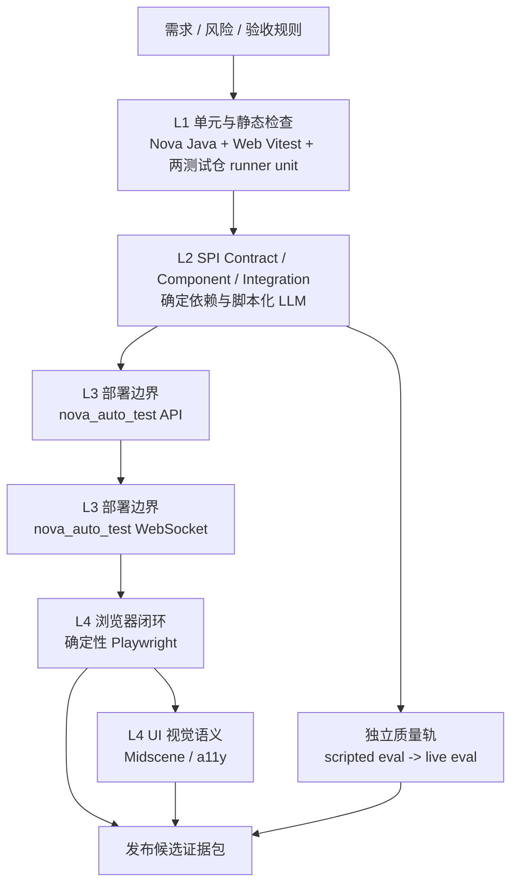
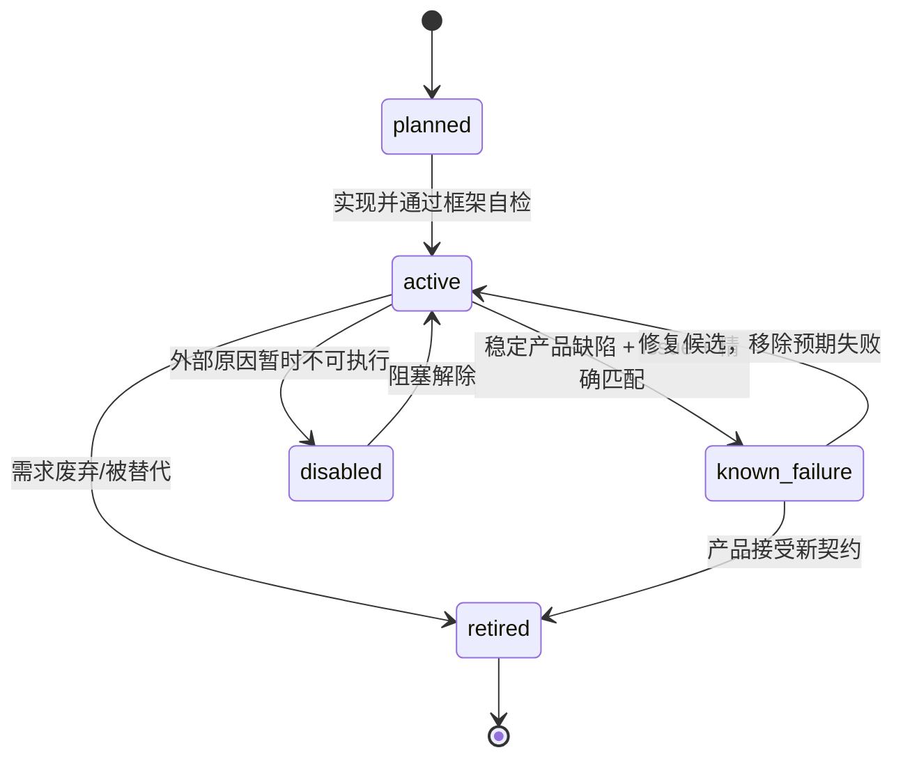
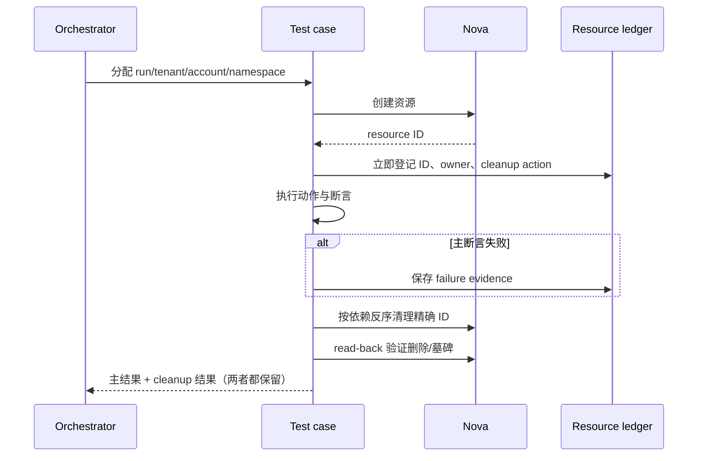
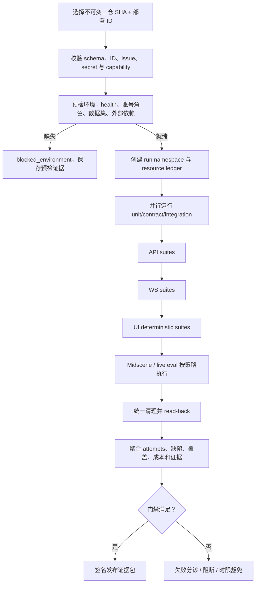

```
# 三仓测试策略与覆盖模型

> 文档性质：可独立复刻的质量工程设计与当前资产审计。  
> 分析对象：Nova 产品仓库、`nova_auto_test` 黑盒自动化仓库、`nova_ui_e2e` UI 自动化仓库。  
> 静态审计日期：2026-08-13。  
> 重要限制：本次只检查代码、配置、用例定义和历史文档，**没有执行编译或测试**。因此本文不会把“存在测试”“标记 active”“历史报告称通过”写成当前版本已通过。

## 1. 结论、边界与证据口径

Nova 的质量体系不是三个重复的测试工程，而是三种不同观察距离的组合：

1. **Nova 仓库**验证白盒行为、SPI 契约、插件组合、进程级协议以及非确定性 Agent 质量；失败应尽量定位到类、契约或运行时阶段。
2. **nova_auto_test**从产品边界验证 REST、WebSocket 和少量浏览器主链路；它不依赖 Java 内部类型，适合验证部署后的跨模块业务契约。
3. **nova_ui_e2e**验证真实用户看到和操作到的页面、权限、文案、可访问性、复杂交互及 AI 视觉语义；它应关注浏览器独有风险，而不是重复所有 API 组合。

三仓的合理关系是“同一需求由不同风险选择不同观察点”，而不是要求每个功能都在三个仓库各写一遍。对 P0 业务闭环，通常至少需要一个底层确定性测试和一个部署边界测试；只有用户可见行为才增加 UI 测试；模型语义质量另进入 eval 轨道。

### 1.1 证据分级

本文使用下列等级，状态与证据必须分开存储：

| 等级 | 名称 | 能证明什么 | 不能证明什么 |
|---|---|---|---|
| E0 | 计划证据 | 清单或设计中存在需求、场景、预期 | 已实现、可运行或通过 |
| E1 | 静态资产证据 | 测试代码/用例 YAML/配置存在且可追溯 | 当前提交能编译、测试能启动或通过 |
| E2 | 单次运行证据 | 特定提交、环境、数据上有原始报告 | 其他环境或未来提交仍通过 |
| E3 | CI 门禁证据 | 聚合器验证可信 CI 签名与 provenance，确认对不可变提交执行并保存产物 | 发布环境真实依赖一定一致 |
| E4 | 发布认证证据 | 聚合器验证受信 issuer 的签名 attestation，确认固定候选在目标环境、账号角色和数据集上通过 | 无未覆盖风险 |

本次审计最高只有 E1。仓库中已有的报告、README 中的“release 单跑通过”和问题台账属于历史记录；若缺少可关联的 commit、run ID、环境快照、不可变产物及可信签名 provenance，不提升本次结论等级。证据等级由中央聚合器推导，测试 producer 的自报字段不具备升级效力。

### 1.2 结论标记

为避免把推断写成事实，正文使用以下标记：

- **[I] Implemented**：静态资产已存在，E1。
- **[A] Assumption**：复刻时的显式假设，必须验证。
- **[K] Known gap**：当前可静态确认的缺口或契约漂移。
- **[P] Proposed**：建议复刻的目标设计，不能描述成 current。
- **[K] Known risk**：未处理会造成误判、数据污染或发布风险。
- **[F] Failure**：台账/资产中登记的已知失败，不代表本轮复现。
- **[D] Decision**：复刻工程应固定下来的治理决策。

## 2. 业务目标与非目标

### 2.1 目标

- 对代码正确性、协议正确性、用户闭环、Agent 语义质量建立互补证据。
- 每条 P0/P1 需求可以由 requirement ID 追到 case ID，再追到运行证据和缺陷。
- 对环境、账号、租户、数据和副作用进行显式管理，避免“用例绿但环境脏”。
- 区分产品失败、自动化失败、环境失败和模型随机性，缩短分诊时间。
- 让 PR、夜间回归和发布候选使用不同成本与稳定性预算。

### 2.2 非目标

- 不以 UI 自动化替代单元测试或 API 契约测试。
- 不以代码覆盖率代替需求和风险覆盖率。
- 不要求真实 LLM 用例成为每次 PR 的硬门禁。
- 不允许 `planned`、skip、`test.fail()` 或重试后通过被统计为普通通过。
- 不从生产环境借用真实用户数据做可变更测试。

## 3. 三仓职责与当前资产

| 仓库 | 主要输入 | 观察面 | 合适断言 | 主要输出 | 当前静态事实 |
|---|---|---|---|---|---|
| Nova | Java/TS 代码、插件、脚本化模型响应、场景 YAML | 类、SPI、组件组合、应用进程、WebSocket、eval | exact、invariant、协议序列、judge | Surefire、JaCoCo、eval markdown/CSV、进程日志 | [I] Maven reactor 已包含 `nova-test` 五模块；Web 有 Vitest 资产；存在 unit/contract/integration/eval/e2e 分层 |
| nova_auto_test | YAML case、目标 URL、测试账号、API/WS/browser 客户端 | 已部署产品边界 | HTTP 状态/字段、WS 事件序列、跨账号隔离、少量页面闭环 | Playwright HTML、trace、截图、HTTP/WS 记录 | [I] 单一 Playwright 底座含 unit/api/ws/browser 四 project；静态 YAML 状态快照为 active 292、known_failure 24、planned 182；这不是执行结果 |
| nova_ui_e2e | 环境 profile、storageState、浏览器、Midscene 模型 | 用户界面和真实交互 | DOM/网络/持久化回读、axe、视觉语义 | Playwright HTML、trace、截图、失败视频、问题台账 | [I] 同时存在确定性 Playwright、Midscene spec 和 runner/unit 测试；问题台账自述的总问题、开放问题、`test.fail()` 与普通失败数量口径无法由同一表稳定校准，本文不采用其合计数作为 current 指标 |

### 3.1 Nova 白盒与进程级测试

Nova 的目标测试金字塔由以下层组成：

| 层 | 职责 | 依赖与替身 | 典型失败定位 |
|---|---|---|---|
| Java unit | 单类算法、校验、序列化、权限分支、异常转换 | Mockito、内存对象、临时目录 | 方法/分支 |
| Web unit | React 组件、hook、状态转换、请求适配 | Vitest、DOM/mock transport | 组件/前端契约 |
| SPI contract | 第三方 provider、store、hook、reducer、tool 等满足公共契约 | 可复用抽象测试、FakePluginContext、内存 registry | SPI 实现不兼容 |
| Integration | NovaCore 与多个插件组合、脚本化 tool loop | ScriptedLlmProvider、builder injection、测试存储 | 跨插件编排 |
| Scripted eval | YAML 场景在确定模型脚本上经过 judge | 关键词/工具路由/benchmark judge | 场景或 judge |
| Live eval | 同一类场景使用真实 LLM | API key、模型、预算 | 提示词/模型质量漂移 |
| Process E2E | 启动 NovaApp 子进程，验证 REST/WS 和 fat-jar 插件装载 | 应用包、端口、配置、进程管理 | 打包/启动/协议/装载 |

`nova-test-contract` 可发布给插件作者；fixtures、integration、eval、e2e 是内部资产。Eval 报告模型包含 case result、judge result、耗时、汇总，并有长期 baseline CSV 写入能力。这个分层可以复刻，但不能仅凭 README 中的目标耗时或“release-blocking”字样认定 CI 已强制执行。

[K] 当前默认 `nova-app` Surefire 会排除 integration、eval、live、contract 等 tag，专门 profile 才选择它们；复刻时必须审计每个 Maven profile 实际包含/排除规则，不能把“模块在 reactor 中”误当作“默认执行所有层”。

[K] 项目治理文档给出的覆盖率目标为 SPI 90%、runtime/loader 80%、其他 70%，而根构建默认 JaCoCo 阈值可见为 line 60%、branch 50%，个别模块又有覆盖；“目标”与“机器门禁”不是同一事实，必须分别登记。

### 3.2 nova_auto_test 三通道

该仓库以 `@playwright/test` 统一调度，并划分为：

- **api**：直接调用 REST，适合 CRUD、权限、跨租户、字段脱敏、异常状态和持久化回读。
- **ws**：连接 `/ws/chat`，适合增量事件、工具调用信号、完成/取消、并发消息、超时和 ProcessData。
- **browser**：验证登录、发起对话、artifact 等少量跨层主链路；复杂 UI 细节交给 UI 仓。
- **unit**：验证 YAML loader、runner、matcher、cleanup 和客户端自身，防止测试框架误判产品。

当前 Playwright 配置的测试超时为 360 秒、expect 30 秒；CI retries=2、workers=2，本地 retries=1；失败保留 trace 和截图。`smoke`/`regression` 由 tag 筛选，`full` 包含全部 YAML。状态语义如下：

| YAML 状态 | 执行语义 | 质量统计语义 |
|---|---|---|
| active | 正常执行并按断言判定 | pass/fail/error |
| planned | 跳过 | E0，不进入已覆盖分母的“已实现”部分 |
| disabled | 跳过且必须有原因/负责人/期限 | 不得算 pass |
| known_failure | 仅在指定环境且错误匹配已知 pattern 时作为 expected failure | 仍是未满足需求；unexpected pass 必须触发确认修复 |

上表“负责人/期限”“精确错误匹配”是目标治理，不是三通道 current 都已做到。**[I]** nova_auto_test 的 API spec 对配置了 `knownFailureErrorPattern` 的 case 才执行精确错误匹配；**[K]** 其 WS/browser spec 在环境命中 known failure 时直接 `test.fail`，不使用该 pattern，因此登录、网络、fixture 或 cleanup 等任意失败都可能被预期失败吞掉。**[K]** current YAML/interface 也没有统一强制 owner、issue ID、expiresAt，disabled/known_failure 不会因缺这些字段在 discovery 阶段失败。

**[D]** 三通道必须共用同一个 known-failure matcher：仅精确 defect signature 才能 xfail；wrong-error 普通失败；未复现为 xpass；并为 matcher 写 match、wrong error、xpass、无效正则、cleanup 双失败测试。对于同时发生的主断言失败与 cleanup 失败，runner 应保留两个原因（例如 AggregateError），不能以后者覆盖前者。

### 3.3 nova_ui_e2e 三类资产

1. **确定性 Playwright spec**：用 locator、网络拦截、接口回读和明确文本验证稳定关键操作。它是 P0/P1 发布门禁的首选。
2. **Midscene spec**：用自然语言完成视觉定位、语义等待或页面级断言。适合布局/可见语义和难以稳定选取的界面，不适合精确金额、ID、权限或持久化真值的唯一 oracle。
3. **unit**：验证环境解析、登录/页面 helper、数据审计和测试基础设施；不等价于产品 UI 测试。

[I] 当前全局设置按 local/demo/release profile 获取目标地址和账号，并将登录态保存到 `.auth/<env>-<account>.json`；新鲜度判断与页面可用性探测共同决定复用。默认 UI 测试 timeout 120 秒、expect 10 秒、CI retry=1、本地 0，默认不 fully parallel；失败保留 trace、截图和视频。

[K] `storageState` 是认证凭据，应进入忽略列表、设置最小权限和短生命周期；同一账号并行修改共享设置会产生相互污染。复刻时即使复用登录态，也必须给每个 worker 独立账号或资源命名空间。

[K] 当前若干 Midscene 命令通过 `NODE_TLS_REJECT_UNAUTHORIZED=0` 运行。这是环境便利配置，不应成为 CI/release 的默认安全基线；复刻应安装可信 CA 或走受控代理，并以严格 TLS 命令作为门禁。

## 4. 测试金字塔与“三通道覆盖”



这里的“三通道”专指部署边界上的 **API、WebSocket、Browser**：

| 风险 | 首选通道 | 为什么 | 是否需要其他通道 |
|---|---|---|---|
| CRUD、字段规则、错误码、租户隔离 | API | 快、精确、便于造数和清理 | 仅用户交互有独立风险时加 Browser |
| 流式 token、工具事件、取消、顺序 | WS | HTTP 无法观察事件生命周期 | UI 对停止按钮/阶段展示加 Browser |
| 文案、焦点、可访问性、菜单、上传、视觉状态 | Browser | 只有浏览器能观察 | 数据真值最好由 API read-back 佐证 |
| 模型回答是否有用/忠实 | eval judge | exact 断言易误杀 | 可组合 invariant 与人工抽样 |
| SPI 生命周期和插件兼容 | Contract/Integration | 黑盒难定位且场景成本高 | fat-jar 装载再加 process E2E |

[D] 同一个 case ID 只描述一个可判定业务意图；跨通道实现使用变体 ID，例如 `CHAT-CANCEL-001-WS` 与 `CHAT-CANCEL-001-UI`，共同关联 `REQ-CHAT-CANCEL-001`。不得在 API、WS、UI 三仓复制同一 ID 后各自悄悄改变预期。

## 5. Case ID、状态与统一 coverage schema

### 5.1 ID 规则

建议格式：`<DOMAIN>-<CAPABILITY>-<NNN>[-<CHANNEL>]`，只允许大写字母、数字和连字符，创建后永久不复用。

- `requirement_id` 表示业务契约，例如 `REQ-SHARE-REVOKE-001`。
- `case_id` 表示一个可执行/计划场景，例如 `SHARE-REVOKE-003-API`。
- `defect_id` 表示对不满足契约的追踪，例如 `NOVA-BUG-018`。
- 参数化数据集在 `variant_id` 中表达，不复制业务 case。

### 5.2 状态机



`pass/fail/error/skipped/xfail/xpass` 是**一次运行结果**，不是 case 生命周期状态。`active` 绝不等于 passed；`known_failure` 也不等于测试绿。该状态机和下方 owner/issue/expiry 必填规则是 **[D] 目标治理模型**；current 只静态确认到 `active|planned|known_failure|disabled` 与可选 reason/env/pattern 等字段，不具备统一 owner/issue/expiry schema gate。

### 5.3 自包含 coverage schema

下面的 YAML 是可直接实现的最小统一登记格式；各仓可生成本地测试代码，但中央索引必须能读取它：

```yaml
schema_version: 1
case_id: CHAT-CANCEL-001-WS
requirement_ids: [REQ-CHAT-CANCEL-001]
title: Cancel an in-flight generation and emit exactly one terminal state
repository: nova_auto_test             # nova | nova_auto_test | nova_ui_e2e
layer: boundary                        # unit | contract | integration | boundary | ui | eval
channel: ws                            # internal | api | ws | browser | judge
risk: P0                               # P0 | P1 | P2 | P3
owner: agent-runtime
status: active                         # planned | active | known_failure | disabled | retired
status_reason: null
issue_id: null
expires_at: null                       # known_failure/disabled 必填
oracle:
  kinds: [invariant, exact]
  assertions:
    - no tool or token event is emitted after the terminal cancelled event
    - terminal event count equals 1
environments: [local, test, release]
dependencies:
  services: [nova-app, llm-gateway]
  capabilities: [websocket, cancellable-model]
identity:
  tenant_role: dedicated-test-tenant
  account_role: test-editor
data:
  fixtures: [slow-scripted-model]
  sensitivity: synthetic
  isolation: per-run-prefix
side_effects:
  creates: [conversation, message, agent_run]
  mutates: []
  deletes: []
cleanup:
  strategy: delete-by-created-id
  verify: all created IDs return 404 or tombstoned=true
timeouts_ms:
  setup: 30000
  action: 120000
  settle: 10000
source_refs:
  - docs/test/chat.md#cancel
evidence: []
```

运行器追加的证据记录必须至少包括：

```json
{
  "run_id": "rc-20260813-0042",
  "case_id": "CHAT-CANCEL-001-WS",
  "commit": "40-hex-git-sha",
  "repository_commit": "40-hex-test-repo-sha",
  "environment": "release-candidate",
  "deployment_id": "nova-0.3.0-rc7",
  "account_role": "test-editor",
  "dataset_version": "synthetic-v12",
  "attempts": [
    {"attempt": 1, "outcome": "failed", "failure_class": "product"},
    {"attempt": 2, "outcome": "passed"}
  ],
  "final_outcome": "flaky_pass",
  "started_at": "2026-08-13T10:00:00+08:00",
  "duration_ms": 42103,
  "artifacts": [
    {"type": "trace", "uri": "artifact://runs/0042/trace.zip", "sha256": "..."}
  ],
  "cleanup_outcome": "passed",
  "producer_claim": "release-candidate-run",
  "attestation": {
    "issuer": "ci-release-gate",
    "subject_digest": "sha256:...",
    "signature_ref": "attestation://..."
  }
}
```

[D] 报告必须保留每次 attempt。重试后通过计为 `flaky_pass`，不能覆盖第一次失败后计入普通 pass rate。测试 producer 不得自行填写 E3/E4；中央聚合器验证签名 attestation、issuer 信任、不可变 commit/deployment/dataset、目标环境 provenance 与 artifact digest 后推导证据等级。缺签名或 provenance 不完整时最多保留运行事实，不提升到 E3/E4。

## 6. 环境、账号、数据与副作用

### 6.1 环境分层

| 环境 | 模型/依赖 | 允许副作用 | 用途 |
|---|---|---|---|
| unit | 全部 fake/mock/临时资源 | 仅进程内/临时目录 | PR 高频 |
| integration | Scripted LLM、MockWebServer、H2/容器 DB、stub MCP | 测试 schema/临时容器 | PR 门禁 |
| local-app | 真应用进程，可选 stub Gateway | 专用本地数据目录 | 开发验证 |
| test | 真实部署，受控外部依赖 | 专用测试租户 | API/WS 回归 |
| release-candidate | 与生产同版本拓扑、测试租户 | 白名单副作用 | 发布认证 |
| production | 真实外部依赖 | 默认只读、禁止破坏性造数 | 合成监控，不跑回归清理脚本 |

[A] CAN Gateway、企业 IM、邮件、MCP、真实模型等外部依赖在不同环境未必齐备。每个 case 必须声明 required capability；缺失时结果是 `blocked_environment`，不是 pass，也不应模糊地 skip。

### 6.2 账号与租户矩阵

每个环境至少预置：

- tenant A：admin、editor、viewer、普通 user 各一；
- tenant B：普通 user 一，用于跨租户拒绝；
- anonymous：公开分享/未认证接口；
- bot/service account：仅在 IM、任务或 webhook 场景使用。

凭据由 CI secret store 注入，不写入 YAML、trace 或 storageState 工件。运行日志只能记录 account alias，不记录用户名、cookie、token。需要第二账号的 case 明确声明，不能运行时任意借用共享账号。

### 6.3 数据隔离和资源账本

资源名使用 `e2e_<runId>_<worker>_<caseId>_<random>`。所有创建动作立即把资源类型、ID、owner、清理方法写入 resource ledger；即使后续断言失败也执行 `finally` 清理。清理必须按依赖反序进行，并单独报告结果。



副作用分级：

| 等级 | 示例 | 策略 |
|---|---|---|
| S0 | GET、页面读取 | 可并行 |
| S1 | 新建对话、临时文件、artifact | per-run 命名并精确删除 |
| S2 | 修改用户设置、模型、工具开关 | 独立账号；保存 before，finally 恢复并 read-back |
| S3 | 租户配置、调度任务、分享、跨系统消息 | 专用租户；串行；必须有硬清理或过期机制 |
| S4 | 删除共享/生产数据、发送真实外部通知 | 测试环境默认禁止；需显式发布审批 |

[K] UI 问题台账已记录分享撤销后缺少按 shareId 硬删除能力。这类能力缺口必须使 cleanup 标为失败/残留并保留 ledger，不能因业务断言通过而宣告整套成功。

## 7. Oracle：exact、invariant 与 judge

| Oracle | 使用场景 | 示例 | 风险控制 |
|---|---|---|---|
| exact | 状态码、ID、数据库状态、事件数 | 取消后 terminal event 恰好一次 | 避免断言无关文案/随机 ID |
| invariant | 流式顺序、脱敏、隔离、最终一致性 | tenant B 永远读不到 tenant A 资源 | 写清允许的事件和等待窗口 |
| judge | 开放式回答、摘要、归因解释 | 回答是否引用给定证据且无臆造 | 固定 rubric、阈值、judge 模型版本并抽样校准 |

推荐复合顺序：先验证协议和安全 invariant；若失败直接失败，不调用 judge；再验证 exact 结构；最后才评价语义。Judge 的评分、理由和证据都要保存，且 judge error 与 answer failure 分开。

实时模型 eval 不应只看单次 pass。对同一 case 可运行 N 次，记录成功率、均值、p10 和成本；发布阈值应基于相同模型版本与数据集的基线差异。Scripted eval 负责确定性编排回归，不能代替 live eval 的真实能力判断。

## 8. Current CI、缺口与目标门禁

### 8.1 静态确认的 current

- [I] `v1-ci.yml` 在相关 push/PR 上以 JDK 21 对 `nova-app` 及依赖执行 clean compile + test-compile，并显式 `-DskipTests`；上传可能为空的 Surefire 目录。
- [I] `v2-ci.yml` 在相关 push/PR 上以 JDK 17 执行全 reactor `clean verify`，成功时上传 JaCoCo；但 reactor 包含要求 Java 21 的 `nova-app`，该 workflow 的 JDK 与聚合工程版本结构冲突。
- [I] `test.yml` 描述 unit/contract/integration/scripted-eval/e2e/live-eval 矩阵，但文件自称 DRAFT，触发器只有 `workflow_dispatch`；注释中的 PR、tag、schedule 尚未启用。因此不能把其中的 “PR-blocking/release-blocking” 当作真实门禁。
- [K] 主仓现有 workflow 未静态显示 checkout/执行 `nova_auto_test` 或 `nova_ui_e2e`。三个仓库的联合发布门禁尚未形成单一可审计证据链。
- [K] 项目开发规范要求 commit 前 `mvn clean compile`、`mvn test`，web 变更还需 `npm run build`；这是人工/流程约束，是否每个提交实际执行必须由 CI 证据确认。
- [K] `docs/test` 的早期策略文字与当前 `nova-test` 已进入 reactor、外部自动化已落地的事实存在时间漂移。清单数字和“已有→”状态不能替代实时机器索引。
- [K] 一个主 workflow 使用结构上不足的 JDK 17，另一个使用 JDK 21 却显式跳过测试；本次也未读取到可证明两者当前成功的不可变 CI run。因此当前没有可信的“主 CI 全绿”结论。

**[D]** 合并为 JDK 21（或 Maven toolchain 同时提供 17/21）的明确矩阵：Java 17 模块按 release 17 编译，Java 21 app 按 release 21 编译；同一 required check 必须真正执行 unit/contract/integration，而不是仅 test-compile 或 `skipTests`。CI 将 toolchain、Maven、三仓 SHA 和 reactor module list 写入签名 provenance。

### 8.2 已知失败与当前缺口的处理

静态用例目录中，nova_auto_test 的 24 个 `known_failure` 和 nova_ui_e2e 台账中的开放条目都是发布风险输入，不是通过数。UI 台账示例包括跨 conversation 上下文污染、artifact 历史版本入口缺失以及多项设置/安全交互问题。台账头部的总数/开放数/expected failure/普通失败汇总与条目口径未校准，不在本文重算为可信指标；应由结构化 issue 表自动生成汇总。复刻系统应从机器可读 issue registry 生成 expected-failure 配置，避免 Markdown、`test.fail()` 与工单三处漂移。

[F] 本文只确认“资产登记了失败”，没有在当前环境复现。  
[K] 当前 UI 工程依赖手工维护问题 Markdown；auto 工程则把状态与 pattern 放在 YAML。两种机制未共享 schema。  
[K] Playwright retry 可能把不稳定用例显示为最终通过；若不保存 first-attempt 指标，会掩盖 flake。  
[K] API/WS/UI 用例数量很大，但没有发现一个由主仓 commit、两个测试仓 commit、部署 ID 共同锁定的 release manifest。

### 8.3 建议门禁

| 阶段 | 必须执行 | 门禁 | 非阻塞/异步 |
|---|---|---|---|
| PR | compile、Java/Web unit、contract、integration、测试框架 unit/typecheck、Web build（涉及 web） | 0 新失败；覆盖阈值；schema/trace 校验；0 过期 quarantine | scripted eval 可按变更选择 |
| Merge/main | PR 全部 + scripted eval + 应用进程 smoke + auto API/WS P0 | 0 unexpected fail/xpass；cleanup 全通过 | UI P1 shard |
| Nightly | auto regression、UI 确定性回归、live eval、外部依赖 contract | 输出趋势；新失败自动建分诊 | Midscene 扩展、长稳压测 |
| Release candidate | 固定三仓 SHA 与 deployment ID；API/WS/browser P0；UI security/RBAC/a11y；process fat-jar；eval 阈值 | 0 P0/P1 未豁免失败；0 未登记 skip；0 残留；证据 E4 | P2/P3 可有时限豁免 |
| Production synthetic | 只读健康、登录、轻量问答 | 不能有破坏性写入 | 深度回归回到 RC 环境 |

豁免必须包含 issue、风险接受人、适用环境、精确错误、开始时间和过期时间。到期后门禁失败；不允许无限期 quarantine。

## 9. 追溯矩阵

中央矩阵以 requirement 为行，case 实现和证据为多值列：

| Requirement | 风险 | Nova | auto API | auto WS | UI deterministic | Midscene | Eval | 当前静态结论 |
|---|---:|---|---|---|---|---|---|---|
| REQ-CHAT-STREAM-001 流式回答生命周期 | P0 | runtime unit/integration/process E2E | 可验证会话回读 | 主 oracle：事件序列/terminal | 阶段呈现/停止按钮 | 可选视觉状态 | 回答质量 | [I] 多仓有相关资产；无本轮运行证据 |
| REQ-AUTH-TENANT-001 租户隔离 | P0 | service/repository tests | 主 oracle：A/B 账号 | 身份绑定与错误事件 | RBAC/不可见入口 | 不作为安全唯一 oracle | 不适用 | [I] 有跨账号/租户 case 类型和 UI RBAC spec |
| REQ-ARTIFACT-001 创建与下载 | P1 | artifact service/unit | create/list/download/read-back | 生成事件 | 页面预览/下载 | 视觉可见性 | 可评价内容质量 | [F] UI 台账登记历史版本能力缺口；状态不可写通过 |
| REQ-SKILL-EXEC-001 技能启用与执行 | P1 | registry/trigger integration | 设置 CRUD | tool/skill 执行事件 | 设置和错误反馈 | 可选自然语言触发 | skill-trigger eval | [I] 三仓均有资产，契约需用 requirement ID 合并 |
| REQ-CAN-QUERY-001 指标查询 | P0 | CAN plugin contract/integration | Gateway/产品边界与权限 | Agent 工具事件 | 数据预览/图表 | 视觉布局 | 答案与引用 judge | [A] Gateway 可用性依环境，缺失应 blocked_environment |

复刻时必须生成而不是手填汇总：

```text
requirements.yaml ─┐
Nova test metadata ├─> coverage-index.json ─> HTML dashboard / CI gate
auto case YAML ─────┤
UI test annotations┤
issue registry ─────┘
```

索引器应检测：重复 ID、悬空 requirement、active 无实现、known_failure 无 issue/expiry、P0 无边界覆盖、证据过期、同一 case 预期不一致、cleanup 未声明。

## 10. 运行编排流程



为减少级联噪声，API health、认证、模型路由和数据集预检失败时，不继续启动数百个 UI case；将受影响 case 批量标为 blocked，并保留共同 root-cause ID。

## 11. 失败分诊

### 11.1 分类

| failure_class | 判据 | Owner |
|---|---|---|
| product | 契约不满足，可由最小步骤稳定复现 | 产品/研发 |
| test | locator、runner、fixture 或断言错误 | 自动化维护者 |
| environment | 服务不可达、部署不一致、磁盘/端口问题 | 平台/SRE |
| identity | 账号禁用、角色错误、token 过期 | IAM/环境维护者 |
| data | fixture 漂移、残留冲突、外部数据缺失 | 数据/自动化 |
| dependency | Gateway/MCP/邮件/IM/模型不可用或限流 | 依赖 owner |
| oracle | judge/视觉模型不稳定或 rubric 含糊 | eval owner |
| flaky_race | 重跑才通过，存在时序/并发不确定性 | 测试与产品共同确认 |
| cleanup | 主流程无论成败后资源无法恢复 | 资源 owner，发布风险 |

### 11.2 分诊顺序

1. 冻结 run manifest：三仓 SHA、部署 ID、环境、账号 alias、数据版本、attempt。
2. 先看预检和服务日志，排除同一基础故障造成的大面积失败。
3. 读取 exact/invariant 的原始证据：HTTP、WS frame、DOM、截图、trace、视频；judge 结论不能覆盖协议错误。
4. 用单 case、单 worker、`retries=0` 重现；不要先扩大 timeout 或增加 sleep。
5. 以另一通道交叉定位：UI 失败时 API read-back，WS 失败时查会话持久化，eval 失败时检查模型原始响应。
6. 分类并关联 issue。只有稳定产品失败可以进入 known_failure，且必须精确 pattern、环境范围和 expiry。
7. 修复后先移除 expected-failure 再回归；xpass 视为需要人工确认的门禁事件。
8. 检查 cleanup ledger；残留独立建问题，即使主断言已通过。

### 11.3 失败证据包

每个失败至少保存：case metadata、所有 attempt、请求/响应脱敏摘要、WS frame 序列、浏览器 trace/截图/失败视频、Nova correlation/run/conversation ID、服务端日志查询键、资源 ledger、cleanup 结果和分类历史。日志与 trace 要经过 secret/PII 扫描后再上传。

## 12. 指标与计算公式

| 指标 | 公式/定义 | 目的 |
|---|---|---|
| 资产覆盖率（E1） | 分母：版本内全部 in-scope requirement 风险权重；分子：至少有一个 schema-valid、handler/assertion 已实现的 active 或 known_failure case 的 requirement 权重 | 只回答“有可运行资产”，不回答通过 |
| 已验证需求覆盖率（E3/E4） | 同一 in-scope requirement 分母；分子：至少一个 fresh E3/E4、final pass、非 xfail/xpass/skip/block、cleanup passed 的 requirement 权重 | 回答“当前受控证据证明满足” |
| 已验证边界覆盖率 | 分母：全部 in-scope P0/P1 requirement；分子：至少有 API/WS/browser fresh E3/E4 pass 且 cleanup passed 的 requirement | 评价部署边界，不接受仅 E1 资产 |
| 证据新鲜度 | 分母：全部 active case；分子：聚合器推导为 E3/E4、在规定窗口内 final pass、非 xfail 且 cleanup passed 的 case | 防止陈旧或 expected-failure 绿灯 |
| 首次通过率 | attempt 1 pass / executed | 暴露 retry 掩盖的 flake |
| flaky rate | 最终 pass 但 earlier attempt fail / executed | 约束不稳定性 |
| xfail debt | 未过期 known failure 数，按 P0/P1/P2 权重 | 管理缺陷债务 |
| skip/block rate | skipped + blocked_environment / selected | 发现环境或选择器问题 |
| cleanup success | cleanup passed / 有副作用 case | 保护共享环境 |
| MTTRiage | 从失败产生到确定 failure_class 的中位时长 | 衡量分诊效率 |
| Eval delta | 当前固定数据/模型得分减基线得分，并报告置信区间 | 判断质量回退 |
| Cost per eval | token、模型费用、耗时 / eval run | 控制持续运行成本 |

风险权重建议 P0=8、P1=4、P2=2、P3=1。in-scope requirement 集合必须随 release manifest 固定；retired/out-of-scope 只能经审批移出，不能因无测试悄悄移出分母。一个 requirement 有十个 case 也只贡献一次权重。代码覆盖率作为白盒健康指标单独展示；不得与需求覆盖率相加。覆盖率阈值必须记录“治理目标”和“构建实际 enforce 值”两列。

## 13. 安全、并发、超时与取消

- **[I/P0] 凭据暴露面**：UI 自动化源码对 demo/release/RBAC 账号存在未设置环境变量时使用默认密码的 fallback；其 Git 跟踪列表还包含 release MCP 环境文件，静态检查确认至少一个共享 key 字段为非空。本文不复制任何值。**[K]** 一旦 secret 被提交，单纯删除当前文件不能撤销历史泄漏。
- **[D/立即处置]** secret owner 应立即 revoke/rotate 已暴露账号密码和 MCP key，审计使用记录；移除所有源码默认密码和被跟踪的 secret 文件，只保留空值 example；凭据改由 CI secret manager 按环境/最小权限/短 TTL 注入；增加 secret scanning 与“测试源码禁止 credential fallback”门禁。Git 历史清理会重写提交，必须由仓库 owner 协调、通知所有 clone/branch 后执行，不能由文档分析任务擅自操作。轮换完成前 release/RBAC/MCP 测试环境应视为不可信。
- API/WS case 可并行的前提是账号或 namespace 隔离；修改租户级配置的 S3 case 必须按 tenant 串行。
- UI 默认单 worker 更容易保持共享状态稳定，但不是数据隔离的替代品。
- 超时分 setup/action/settle/cleanup 四段记录。单一 360 秒总超时只能是兜底，不能说明卡在哪一步。
- 等待使用可观察条件（事件、HTTP read-back、DOM state），不使用固定长 sleep。
- 取消测试必须证明：取消请求被接受、只有一个 terminal、终止后无新 token/tool 事件、持久化状态一致、相关资源可继续操作。
- 真实 LLM 和外部 Gateway 重试只针对可证明的瞬时错误（限流、连接重置）；业务 4xx、权限错误和断言失败不得自动重试。
- 所有报告在上传前脱敏 Authorization、cookie、API key、邮件地址、IM 凭据和用户内容；失败视频同样是敏感资产。

## 14. 复刻实施顺序

1. 建立 `requirements.yaml`、统一 case schema 和 issue registry；为已有三仓资产做 adapter，不先重写用例。
2. 实现静态索引器和 lint：ID、状态、环境、owner、side effects、cleanup、known failure expiry。
3. 让三仓报告输出统一 evidence JSON，同时保留各自原生 Surefire/Playwright/eval 报告。
4. 建立独立测试租户、角色账号、secret 管理和 resource ledger 服务。
5. 先接入 Nova unit/contract/integration 与 auto API/WS PR 门禁，再接 UI P0。
6. 将 nightly live eval、Midscene 和全量 UI 与发布门禁分离，收集稳定性基线。
7. 建 release manifest，把三仓 SHA、Nova 镜像/包、配置版本、数据集和外部依赖能力固定后再认证。
8. 逐步消化 known failure；新增 expected failure 必须经过 issue + expiry 审批。

## 15. 验收标准

### 15.1 体系验收

- 给定任意 P0/P1 requirement，能从 dashboard 找到全部 case、所在仓库/通道、状态、最新证据和缺陷。
- `active` 无实现、重复 ID、known_failure 无 issue/expiry、S1-S4 无 cleanup 均会使 schema gate 失败。
- 一个重试后通过的 case 展示为 flaky_pass，首轮失败证据不丢失。
- 环境 capability 缺失展示为 blocked_environment，不计 pass；大面积预检失败不会启动 UI 风暴。
- 三仓报告可按固定 manifest 聚合，结果中同时包含产品 commit、测试仓 commit、部署 ID、数据版本。
- 主断言失败和 cleanup 失败可以同时呈现，任何 S3 残留阻断发布。

### 15.2 通道验收样例

| 场景 | 前置 | 动作 | 预期 |
|---|---|---|---|
| WS 取消 | 可取消脚本模型 | 开始生成，观察首 token 后取消 | 一个 cancelled terminal；之后无 token/tool；状态 read-back 一致 |
| 跨租户 | tenant A/B 各账号 | A 创建知识，B 按 ID/搜索/API/UI 尝试读取 | 所有入口均不可见且不泄漏标题/数量 |
| UI 保存失败 | 拦截 PUT 返回 500 | 切换设置 | 页面可见错误、状态回滚、刷新及 API read-back 均为旧值 |
| known failure 意外通过 | issue 未关闭的 xfail case | 产品行为已满足预期 | 报告 xpass 并阻断，提示确认修复和移除标记 |
| 清理双失败 | 主断言失败且 DELETE 返回 500 | 完成 finally | 报告保留两个错误、ledger 留残留 ID、发布被阻断 |
| Eval 回退 | 固定模型/数据/judge | 运行 N 次 | 输出分布与 baseline delta；协议 invariant 失败不进入 judge pass |

### 15.3 本文审计结论

- [I] 三个仓库已经形成互补资产基础，且 Nova 的 `nova-test` 已具备 contract、fixtures、integration、eval、process e2e 模块。
- [I] nova_auto_test 已有 API/WS/browser 统一 YAML 驱动框架；nova_ui_e2e 已有确定性 Playwright、Midscene 和 unit 三类测试。
- [K] 三仓尚缺统一机器可读 requirement/case/evidence/issue/side-effect schema 与不可变 release manifest。
- [K] current CI 与策略文档不完全一致，外部两个测试工程未在主仓 workflow 中形成联合门禁。
- [K] 历史“通过”、active 数量、expected failure 和 retry-final-pass 都可能制造虚假绿色；复刻必须按本文证据模型治理。
- [P] 以 API/WS/browser 三通道、独立 eval 轨、资源账本和分层门禁组合，可以在不把所有场景复制三遍的前提下获得可审计的业务等价证据。

## 附录 A：静态追溯线索（非理解前提）

以下仅用于审计人员回查当前快照，正文已包含复刻所需契约：

- Nova：`nova-test/README.md`、`nova-test/*/pom.xml`、根 `pom.xml`、`nova-app/pom.xml`、`web/vitest.config.ts`、`.github/workflows/{v1-ci,v2-ci,test}.yml`、`docs/test/{README,00-test-strategy}.md`。
- nova_auto_test：`README.md`、`playwright.config.ts`、`src/core/yamlCase.ts`、`cases/**/*.yaml`、`tests/{api,ws,browser,unit}`。
- nova_ui_e2e：`nova_ui_e2e/README.md`、`nova_ui_e2e/playwright.config.ts`、`nova_ui_e2e/global-setup.ts`、`nova_ui_e2e/src/agent-env.ts`、`nova_ui_e2e/src/agent-auth.ts`、`nova_ui_e2e/src/agent-page.ts`、`nova_ui_e2e/tests/`、`nova_ui_e2e/unit/`、`nova_ui_e2e/docs/known-product-issues.md`。

```
