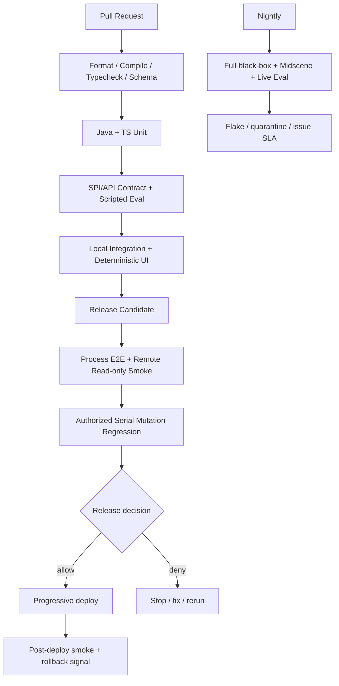
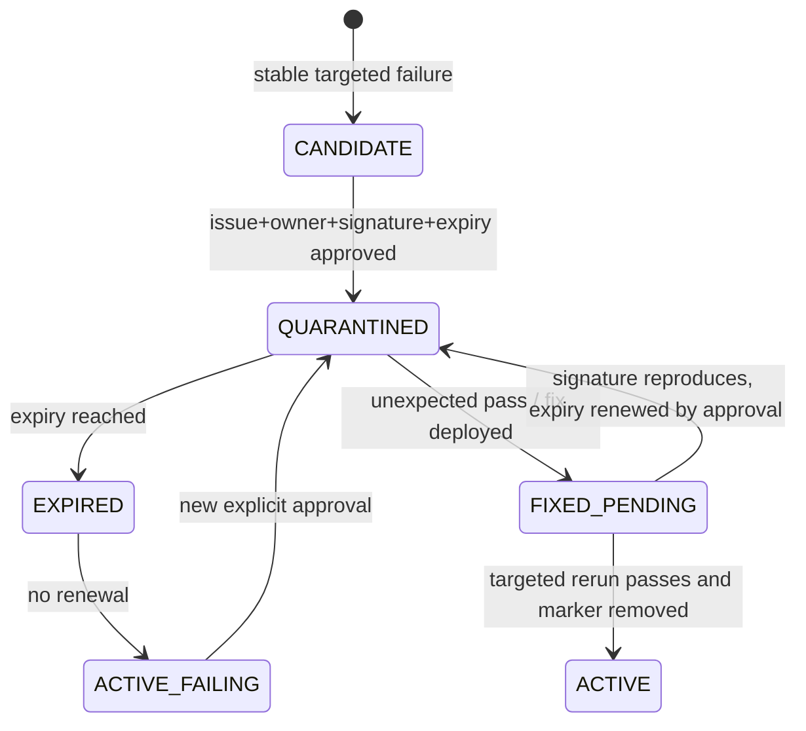

```
# 测试套件、已知失败与发布门禁复刻说明

## 0. 文档目的、范围与证据标签

本文说明如何在一个独立 Agent 工程中复刻 Nova 的质量分层和发布决策能力：如何把 Java 单元/契约/集成/eval/process E2E、API/WS/browser 黑盒、确定性 UI 和模型视觉流程组织成 smoke、regression、full；如何治理 planned、disabled、known failure、skip、retry、unexpected pass；以及如何把证据、清理、安全、回滚能力纳入发布门禁，而不是只检查“测试进程退出码为0”。

范围包含：

- `nova_auto_test` 的 npm scripts、Playwright projects、YAML tags/status 和 known-failure分支；
- `nova_ui_e2e` 的模块脚本、串行写套件、`test.fail/test.skip`、问题台账和Midscene车道；
- Nova Maven reactor 的 Surefire group/profile、`nova-test-*`模块；
- 当前 GitHub Actions workflow及其结构性缺口；
- 推荐的quarantine、expiry、issue ownership、flake、证据和release policy。

证据标签：

| 标签 | 含义 |
|---|---|
| `[I]` | 当前代码、配置、YAML或workflow可静态确认的事实 |
| `[A]` | 当前测试表达的验收契约，不表示本次通过 |
| `[K]` | 当前门禁缺口、错误归类风险或已知不一致 |
| `[P]` | 草案workflow、planned case或待启用能力 |
| `[R]` | 本次实际运行得到的结论 |
| `[F]` | 多处静态证据支持的强推断，仍需运行确认 |
| `[D]` | 本文建议的新门禁设计，不冒充现状 |

本次没有执行 Maven、npm、Playwright、浏览器、模型或远程环境测试，也没有触发CI，因此没有任何 `[R]` 通过结论。库存为 2026-08-13 静态快照。`[I]`

## 1. 核心结论

当前工程拥有丰富的测试资产，但“资产存在”和“发布已被门禁”是两回事：

1. Maven默认测试会排除integration/eval/live/contract/skill-trigger和process E2E等tag；专用profile才执行它们。`[I]`
2. Auto Test有498条YAML：292 active、182 planned、24 known_failure、0 disabled；smoke tag仅18条，regression tag 478条，而`full` suite会无视tag加载全部498条。`[I]`
3. UI E2E提供大量模块化npm命令、known-product-issues和确定性/语义两类套件，但现有GitHub workflow没有安装Node/Chromium，也没有执行两个TypeScript测试工程。`[K]`
4. `v1-ci.yml`仅compile+test-compile且`-DskipTests`；`v2-ci.yml`使用JDK17编译要求release21的`nova-app`且无toolchain，静态上无法完成reactor，即使修成JDK21仍遵循默认tag排除；`test.yml`是仅workflow_dispatch的草案矩阵，不是已启用PR门禁。`[I/K]`
5. Playwright `test.fail`能暴露unexpected pass，这是积极机制；但Auto Test WS/browser对known failure不限定失败签名，任何错误都可能被当成预期失败，掩盖认证、环境或清理回归。API通道已有可选正则targeting，治理更严格。`[I/K]`
6. retries不能把首次失败后的通过简单当成绿色。AI/外部依赖套件确有波动，但核心契约、清理和安全失败不能通过重试漂白。`[D]`

## 2. 质量轴总览



### 2.1 测试层的职责

| 层 | 主要发现 | 不应承担 |
|---|---|---|
| 静态/单元 | 类型、纯算法、状态机、序列化、恢复决策 | 真实浏览器和部署拓扑 |
| Contract | SPI/API/Schema兼容、错误语义 | 端到端业务效果 |
| Integration | 模块接线、数据库、插件、Spring上下文 | 远程生产数据差异 |
| Scripted Eval | 确定性Agent编排、无需真实LLM | 模型质量随机性 |
| Process E2E | JAR、WS、classloader、真实进程 | 全量产品UI |
| API/WS黑盒 | 部署环境协议、权限、业务接口 | 像素/交互可用性 |
| Deterministic UI | 用户可见CRUD、持久化、失败回滚 | 开放式回答质量 |
| Midscene/Live Eval | 语义质量、复杂视觉与真实模型 | 严格安全和数据一致性 |

## 3. Auto Test：projects、suite和状态

### 3.1 Playwright Projects

Auto Test定义四个project：`[I]`

| Project | testMatch | 作用 |
|---|---|---|
| unit | `unit/**/*.spec.ts` | 本地纯契约/runner测试 |
| api | `api.spec.ts` | REST及feature API runner |
| ws | `ws.spec.ts` | `/ws/chat`和业务WS runner |
| browser | `browser.spec.ts` | 登录、刷新、artifact、citation等页面 |

默认timeout 360秒、expect 30秒；CI retries=2、本地retries=1；CI workers=2；trace失败保留、失败截图。`[I]` 部分mutation runner在workers不等于1时主动拒绝，以防共享状态并发。`[I]`

### 3.2 npm命令

```text
npm test / npm run pw       -> playwright test
npm run pw:smoke            -> AGENT_E2E_SUITE=smoke playwright test
npm run pw:regression       -> AGENT_E2E_SUITE=regression playwright test
npm run pw:full             -> AGENT_E2E_SUITE=full playwright test
npm run pw:unit             -> --project=unit
npm run pw:api              -> --project=api
npm run pw:ws               -> --project=ws
npm run pw:browser          -> --project=browser
npm run typecheck           -> tsc --noEmit
```

`pw:api/ws/browser`没有设置suite，loader默认smoke，因此它们不是各通道的全量回归；想跑某通道regression必须同时设置 `AGENT_E2E_SUITE=regression`。`[I/K]` 命令命名容易让使用者误以为 `pw:ws` 是全部WS。

### 3.3 Suite选择算法

```ts
function matchesSuite(testCase, suite) {
  if (suite === "full") return true;
  if (suite !== "smoke" && suite !== "regression") throw Error("unknown suite");
  return Array.isArray(testCase.tags) && testCase.tags.includes(suite);
}
```

因此：

- smoke加载带`smoke`的18条；
- regression加载带`regression`的478条；
- full加载所有498条，包括没有full tag的case；
- 20条显式full tag只表达“长/特殊case的分类”，不决定full是否加载其他case。`[I]`

### 3.4 YAML Status

```ts
type CaseStatus = "active" | "planned" | "known_failure" | "disabled";
```

| Status | 当前执行语义 | 推荐治理语义 |
|---|---|---|
| active | 正常执行；失败红灯 | 必须有适用环境和owner |
| planned | 注册为skip，不执行handler | 仅需求库存，不计覆盖通过 |
| disabled | 注册为skip | 必须有原因、owner、expiry |
| known_failure | 执行并设expected fail | 必须绑定issue/signature/expiry |

planned/disabled仍出现在Playwright报告，避免“文件存在却完全不可见”；但大量planned不能计入通过率分母。`[I/D]`

### 3.5 环境适用性 Skip

执行前按`env/account/dataset/requiresSecondAccount`判断，不适用则skip。`[I]` 这些属于条件不适用或环境能力缺失，应与planned、permission-denied、missing-secret区分。

推荐结果原因码：

```ts
type SkipReasonCode =
  | "NOT_APPLICABLE_ENV"
  | "NOT_APPLICABLE_DATASET"
  | "MISSING_SECOND_ACCOUNT"
  | "MISSING_SECRET"
  | "MUTATION_NOT_APPROVED"
  | "PLANNED"
  | "DISABLED";
```

release必需case若因missing secret/second account跳过，应使gate incomplete并失败，而不是视为绿色。`[D]`

## 4. Known Failure 与 Unexpected Pass

### 4.1 Playwright预期状态

调用 `test.fail(true, reason)` 会把expected status设为failed：

- 实际failed：expected failure，测试进程可继续为绿；
- 实际passed：unexpected pass，Playwright判失败；
- 实际timedOut/crashed：是否接受取决于框架状态匹配，不能当成目标缺陷复现证据。

unexpected pass必须触发issue复审：可能是产品已修复、环境未部署、断言失效或用例没有真正执行目标路径。`[D]`

### 4.2 Auto Test API的Targeted Known Failure

API通道支持：

```yaml
status: known_failure
knownFailureEnvs: [release]
knownFailureErrorPattern: '^Error: exact expected defect\.$'
reason: "issue summary"
```

执行逻辑为：只有在适用环境，且捕获错误文本匹配正则时才调用`test.fail`；不匹配错误重新抛出为真实失败；若整个case没有抛错，末尾设置expected fail，形成unexpected pass。`[I]`

这比“任何失败都接受”安全，但错误字符串仍可能因包装变化漂移。生产应使用结构化defect oracle：HTTP status、error code、关键字段、cleanup状态，而不是只匹配异常message。`[D]`

### 4.3 WS/Browser的宽泛Known Failure

WS和browser通道在执行handler前直接`test.fail`，没有使用`knownFailureErrorPattern`定向判断。`[I/K]` 于是预期“raw协议缺陷”的case若因为登录失败、DNS、cleanup失败或locator坏掉而failed，也可能被报告成expected failure。

修复方式：所有通道共享targeted wrapper：

```ts
async function runWithKnownFailurePolicy(caseMeta, action) {
  try {
    await action();
  } catch (error) {
    if (matchesStructuredExpectedFailure(caseMeta.expectedFailure, error)) {
      test.fail(true, caseMeta.issue.summary);
    }
    throw error;
  }
  if (caseMeta.expectedFailure) {
    test.fail(true, "known failure was not reproduced");
  }
}
```

cleanup/security/authorization失败永远不能被业务known-failure signature吸收。`[D]`

### 4.4 UI E2E的Known Product Issues

UI工程在spec中直接调用`test.fail`，并以独立Markdown台账登记问题ID、优先级、现象、精确预期、关联case、处理和状态。`[I]` 这是良好追溯，但代码标记与台账是人工同步，没有机器schema、expiry或CI lint。`[K]`

### 4.5 Quarantine Schema

```yaml
quarantine:
  issue: NOVA-BUG-001
  owner: team-agent-platform
  approvedBy: release-quality-owner
  approvedAt: 2026-08-01T09:00:00Z
  openedAt: 2026-08-01
  expiresAt: 2026-08-15
  environments: [release]
  mode: expected_failure
  signature:
    phase: assertion
    errorCode: TOOL_CONFIG_SAVE_FAILED_UI_MISSING
    messagePattern: '^Expected visible save error'
  maxOccurrences: 20
  securityImpact: false
  dataIntegrityImpact: false
  cleanupMustPass: true
```

规则：

- issue/owner/approval/openedAt/expiresAt/environments/signature/maxOccurrences及三项影响/清理字段必填；
- `maxOccurrences`必须是正整数，approval必须可验证且覆盖当前quarantine内容摘要；
- P0、安全、越权、数据丢失、密钥泄漏、清理失败不得quarantine；
- expiry到期自动变普通失败；
- unexpected pass和签名不匹配都失败；
- issue关闭必须先移除quarantine并重新跑目标环境；
- quarantine数量和年龄设预算，不能无限增长。`[D]`

## 5. UI E2E 套件结构

### 5.1 命令形态

UI工程提供：

- 全量`playwright test`、TypeScript unit、typecheck、test-data audit；
- 按settings tools/MCP/tool-groups/skills/knowledge/attribution；
- 按personal extensions；
- Agent P0/P1/P2、conversations、RBAC、security、i18n/a11y；
- local/headed/UI variants；
- Midscene模型验证和`*.midscene.spec.ts`长流程；
- 多数共享设置命令显式`--workers=1`。`[I]`

这些是方便人工运行的命令目录，不是声明式suite manifest。case优先级散落在script文件列表和case ID中，缺少“一个release gate到底包含哪些spec和grep”的单一机器契约。`[K]`

### 5.2 Skip来源

常见skip：目标环境缺认证、缺Midscene模型、远程tenant mutation未批准、Stdio未批准、缺第二账号/专用分享授权。`[I]` 多数Midscene spec缺模型时skip，但analytics和ask-human明确throw，语义不一致。`[K]`

发布策略必须指定：

- optional nightly模型车道可skip但记incomplete；
- required smoke缺模型/凭据必须fail setup；
- mutation未批准属于“未执行”，不能当作功能通过；
- not-applicable环境可从分母排除，但需有替代环境证据。`[D]`

### 5.3 UI重试

UI Playwright config在CI重试1次、本地0次；Auto Test CI重试2次、本地1次。`[I]` 两仓策略不一致，且Auto Test本地默认重试会降低复现时对首失败的可见度。

建议：unit/contract/deterministic local默认0 retry；remote网络smoke最多1次；LLM/Midscene可2次但每次保留独立证据和随机种子/model ID。`[D]`

## 6. Maven 测试层与Profile

### 6.1 默认Nova App测试

`nova-app`默认Surefire排除：`integration, eval, eval-live, live, contract, skill-trigger-eval`。`[I]` 专用profile覆盖groups/excludedGroups：

| Profile | groups | 目的 |
|---|---|---|
| `contract` | contract | 产品契约 |
| `eval` | eval | 确定性Agent eval |
| `eval-live` | eval-live | 真实LLM |
| `skill-trigger` | skill-trigger-eval | Skill触发质量 |
| `integration` | integration | DB/Spring/模块集成 |

### 6.2 nova-test模块

| Module/Profile | 默认 | 专用执行 |
|---|---|---|
| nova-test-contract | 常规模块测试 | `-pl ... -am` |
| nova-test-integration | 模块测试/接线 | workflow草案单独job |
| nova-test-eval | 默认排除eval/eval-live | `-Peval`/`-Peval-live` |
| nova-test-e2e | 默认排除eval-e2e/smoke | `-Peval-e2e`/`-Peval-e2e-smoke` |

Process smoke测试双tag `eval-e2e-smoke`和`eval-e2e`，因此smoke是full E2E子集。`[I]`

### 6.3 关键命令

```bash
# 默认单元/静态门禁，仍排除专用tag
mvn clean compile
mvn test

# 产品专用层
mvn -pl nova-app -am test -Pcontract
mvn -pl nova-app -am test -Pintegration
mvn -pl nova-app -am test -Peval
mvn -pl nova-app -am test -Peval-live
mvn -pl nova-app -am test -Pskill-trigger

# Nova测试基础设施
mvn -pl nova-test/nova-test-contract -am test
mvn -pl nova-test/nova-test-eval -am test -Peval
mvn -pl nova-test/nova-test-eval -am test -Peval-live
mvn -pl nova-test/nova-test-e2e -am test -Peval-e2e-smoke
mvn -pl nova-test/nova-test-e2e -am test -Peval-e2e
```

具体profile是否同时在多个module同名激活，需在复刻工程通过effective-pom验证；不要仅凭命令名称推断所有模块选择一致。`[D]`

## 7. 当前CI Workflow事实与缺口

### 7.1 `v1-ci.yml`

指定分支push/PR触发，JDK21，只运行：

```text
mvn -pl nova-app -am clean compile test-compile -DskipTests
```

它验证编译和测试源码可编译，不执行测试；上传Surefire目录但通常没有本job新测试结果。`[I/K]`

### 7.2 `v2-ci.yml`

指定分支push/PR触发，JDK17，运行根reactor `mvn clean verify`并上传Surefire/JaCoCo。`[I]` 它执行默认测试与质量插件，但专用integration/eval/live/process E2E tags被各模块默认配置排除。`[I/K]`

`nova-app`明确配置`java.version=21`、`maven.compiler.release=21`，仓库和workflow没有为该job配置Maven Toolchains去提供另一个JDK；JDK17的`javac`不支持`--release 21`。因此按当前静态配置，v2 job一旦编译到`nova-app`必然在编译阶段失败，而不是“需运行后才知道”。`[I/K]`

修复有两种合法形态：整个reactor使用JDK21，让core/plugin模块继续按各自`release=17`编译；或在runner同时安装JDK17和JDK21，并用已提交的`toolchains.xml`及compiler配置将`nova-app`绑定21、框架模块绑定17。只把workflow显示版本改名、或期望JDK17交叉编译21都无效。`[D]`

### 7.3 `test.yml`

这是文件头明确标为DRAFT的M5模板，仅启用`workflow_dispatch`；PR、tag、schedule触发均被注释。它定义unit、contract、integration、scripted-eval、tag条件e2e-smoke、continue-on-error的e2e-full/live-eval。`[P]`

手动触发不是PR required check。e2e-smoke还有`startsWith(github.ref,'refs/tags/v')`条件，只有从tag ref手动触发才运行。`[I]`

### 7.4 TypeScript工程缺口

三个workflow均未：

- `npm ci`两个测试工程；
- typecheck/unit/schema lint；
- 安装Playwright Chromium；
- 启动Nova或指定远程target；
- 执行Auto Test smoke/regression；
- 执行UI deterministic smoke；
- 运行残留audit strict；
- 汇总known failure/xpass/skip/flake预算。`[K]`

因此当前不能声称完整发布门禁已闭环。

## 8. 推荐的门禁层级

### 8.1 PR Gate

必须阻断：

1. secret/license/dependency policy；
2. Maven compile + 默认test + coverage；
3. contract + scripted eval；
4. 两TS工程`npm ci/typecheck/unit/YAML lint/--list`；
5. 可在隔离local执行的确定性smoke；
6. known-failure元数据lint、过期检查；
7. 前端改动时Next build。

不在PR强制：真实LLM、远程共享tenant mutation、长full和Midscene。

### 8.2 Release Candidate Gate

- 构建最终JAR/容器并用该产物启动；
- process `eval-e2e-smoke`；
- Auto Test smoke三通道；
- UI核心确定性P0；
- auth/RBAC/security/secret masking；
- 数据库migration/rollback compatibility；
- 远程只读或专用tenant的授权串行mutation；
- test-data audit strict；
- cleanup/security failure为绝对红灯；
- 生成可回滚artifact和版本manifest。

### 8.3 Nightly/Full

- Auto Test regression和full分开；
- process full E2E；
- integration、eval-live、skill trigger；
- UI P1/P2、Midscene、长Agent图表/PPT；
- 多浏览器、性能、故障注入；
- flake统计、quarantine expiry和残留趋势。

full可以初期非阻断，但结果必须自动建issue/更新债务；不能永久`continue-on-error`而无人负责。`[D]`

## 9. Gate Manifest

required job不能只冻结一条command，因为tag、grep、动态YAML和测试发现规则都可能在不改command时改变选择集。每个required job必须提交一份selection lock：规范化且无重复的完整expected case ID数组、解析器版本和selection digest；digest计算对象是canonical `{resolverVersion, expectedCaseIds}`。下面的`<materialized-...>`表示在复刻工程生成并提交的真实完整ID，不允许在实际manifest中保留通配符或省略号。`[D]`

```yaml
schemaVersion: 1
selectionCanonicalization: sorted-unique-utf8-json-v1
qualityBudgets:
  historyWindowDays: 7
  minimumHistoricalRuns: 1
  noHistoryPolicy: DENY
  core:
    caseClassificationRef: gates/core-cases.json
    maxFlakyRate: 0.0
  nonCore:
    maxFlakyRate: 0.01
  quarantine:
    maxQuarantines: 5
    maxQuarantineAgeDays: 14
gates:
  pr:
    blocking: true
    jobs:
      - id: java-default
        required: true
        command: mvn -B clean verify
        selection:
          resolverVersion: junit-platform-discovery-v1
          expectedCaseIds:
            - <materialized-junit-unique-id-1>
            - <materialized-junit-unique-id-2>
          selectionDigest: sha256:<digest-of-canonical-selection-lock>
        requiredEvidence: [junitXml, surefireSummary, environmentManifest]
      - id: java-contract
        required: true
        command: mvn -B -pl nova-test/nova-test-contract -am test
        selection:
          resolverVersion: junit-platform-discovery-v1
          expectedCaseIds: [<materialized-contract-id-1>]
          selectionDigest: sha256:<digest-of-canonical-selection-lock>
        requiredEvidence: [junitXml, environmentManifest]
      - id: auto-unit
        required: true
        cwd: nova_auto_test
        command: npm run pw:unit
        selection:
          resolverVersion: playwright-list-v1
          expectedCaseIds: [<materialized-playwright-unit-id-1>]
          selectionDigest: sha256:<digest-of-canonical-selection-lock>
        requiredEvidence: [playwrightJson, attemptManifest, environmentManifest]
      - id: ui-unit
        required: true
        cwd: nova_ui_e2e
        command: npm run test:unit
        selection:
          resolverVersion: playwright-list-v1
          expectedCaseIds: [<materialized-ui-unit-id-1>]
          selectionDigest: sha256:<digest-of-canonical-selection-lock>
        requiredEvidence: [playwrightJson, attemptManifest, environmentManifest]
  release:
    blocking: true
    jobs:
      - id: process-smoke
        required: true
        command: mvn -B -pl nova-test/nova-test-e2e -am test -Peval-e2e-smoke
        selection:
          resolverVersion: junit-platform-discovery-v1
          expectedCaseIds: [<materialized-process-smoke-id-1>]
          selectionDigest: sha256:<digest-of-canonical-selection-lock>
        requiredEvidence: [junitXml, processLog, deploymentAttestation]
      - id: blackbox-smoke
        required: true
        cwd: nova_auto_test
        command: npm run pw:smoke
        selection:
          resolverVersion: playwright-plus-yaml-loader-v1
          expectedCaseIds: [<all-materialized-unit-and-18-YAML-smoke-Playwright-ids>]
          selectionDigest: sha256:<digest-of-canonical-selection-lock>
        requiredEvidence: [playwrightJson, attemptManifest, deploymentAttestation]
      - id: ui-p0
        required: true
        cwd: nova_ui_e2e
        command: npm run test:agent:p0
        selection:
          resolverVersion: playwright-list-v1
          expectedCaseIds: [<materialized-ui-p0-id-1>]
          selectionDigest: sha256:<digest-of-canonical-selection-lock>
        requiredEvidence: [playwrightJson, attemptManifest, deploymentAttestation]
      - id: residual-audit
        required: true
        cwd: nova_ui_e2e
        command: npm run test-data:audit -- --strict
        selection:
          resolverVersion: residual-audit-coverage-v1
          expectedCaseIds: [residual-audit:all-supported-resource-types]
          selectionDigest: sha256:<digest-of-canonical-selection-lock>
        requiredEvidence: [residualAudit, queryCoverage, deploymentAttestation]
  nightly:
    blocking: false
    jobs:
      - id: full-blackbox
        command: npm run pw:full
      - id: live-eval
        command: mvn -B -pl nova-test/nova-test-eval -am test -Peval-live
```

依赖安装、typecheck和测试必须是独立可审计step，不能用shell `&&`隐藏边界。每个job还需固定Node/JDK/浏览器版本、timeout和artifact保留策略。selection lock应由可信工具从同一revision执行JUnit discovery、Playwright `--list`或YAML loader生成，review后提交；gate运行时不能自行重写expected列表。`[D]`

required job的有效PASS定义为以下条件全部成立：job记录存在且`status=PASS`；进程`exitCode=0`；所有required evidence存在、digest可校验；运行时resolved/executed/reported IDs各自无重复；expected与reported做精确集合差得到`missing=[]`、`unexpected=[]`；运行时selection digest等于锁定digest。任一缺失、重复、意外case、选择漂移、非零退出或证据缺失都返回DENY/INCOMPLETE，即便测试框架摘要显示“0 failed”。`[D]`

每个expected case还必须在case manifest中冻结criticality和适用性，不允许runner临时以任意字符串skip：

```yaml
cases:
  - id: <materialized-case-id>
    criticality: core
    securitySensitive: true
    dataIntegritySensitive: false
    applicability:
      predicate:
        all:
          - {field: environment.kind, op: in, value: [release-candidate]}
          - {field: capabilities.secondAccount, op: eq, value: true}
      whenFalse: SKIP_NOT_APPLICABLE
      replacementEvidenceRefs:
        - gate-run://security-dedicated-tenant/<case-result-id>
    quarantineRef: quarantine://NOVA-BUG-001
```

predicate使用白名单字段和操作符的声明式AST，并由gate evaluator基于已签名environment manifest求值；不能执行任意脚本。`SKIP_NOT_APPLICABLE`只有在predicate确实为false、所有replacement evidence都存在且PASS、替代证据覆盖相同revision/artifact和同等安全边界时才可接受。predicate缺失/求值失败、replacement为空/过期/指向不同artifact时状态为INCOMPLETE。`[D]`

## 10. 发布决策算法

### 10.1 归一结果

```ts
type NormalizedStatus =
  | "PASS"
  | "FAIL"
  | "FLAKY_PASS"
  | "EXPECTED_FAIL"
  | "UNEXPECTED_PASS"
  | "SKIP_APPLICABLE"
  | "SKIP_NOT_APPLICABLE"
  | "INCOMPLETE"
  | "CLEANUP_FAIL";

interface GateCaseResult {
  caseId: string;
  gate: string;
  status: NormalizedStatus;
  attempts: number;
  criticality: "core" | "non-core";
  quarantineRef?: string;
  applicabilityPredicateRef: string;
  replacementEvidenceRefs: string[];
  evidenceComplete: boolean;
  cleanupComplete: boolean;
  securitySensitive: boolean;
  dataIntegritySensitive: boolean;
}

interface RequiredJobResult {
  jobId: string;
  status: "PASS" | "FAIL" | "INCOMPLETE";
  exitCode: number | null;
  expectedSelectionDigest: string;
  observedSelectionDigest: string;
  resolvedCaseIds: string[];
  executedCaseIds: string[];
  reportedCaseIds: string[];
  missingCaseIds: string[];
  unexpectedCaseIds: string[];
  duplicateCaseIds: string[];
  evidence: Array<{ type: string; uri: string; sha256: string }>;
}

interface QuarantineRecord {
  issue: string;
  owner: string;
  mode: "expected_failure";
  approvedBy: string;
  approvedAt: string;
  openedAt: string;
  expiresAt: string;
  environments: string[];
  signature: { phase: string; errorCode: string; messagePattern?: string };
  maxOccurrences: number;
  securityImpact: boolean;
  dataIntegrityImpact: boolean;
  cleanupMustPass: true;
}
```

单次发布决策产物建议采用以下 JSON 契约；它必须引用不可变构建产物和完整证据清单，而不是只保存一个布尔值：

```json
{
  "schemaVersion": 1,
  "gateId": "release",
  "runId": "rc-20260813-001",
  "sourceRevision": "<git-commit-sha>",
  "artifact": {
    "name": "nova-app.jar",
    "sha256": "<artifact-sha256>"
  },
  "deploymentAttestation": {
    "ref": "attestations/deployment-rc-001.json",
    "sha256": "<attestation-sha256>"
  },
  "environment": "release-candidate",
  "startedAt": "2026-08-13T02:10:00Z",
  "finishedAt": "2026-08-13T02:42:00Z",
  "decision": "DENY",
  "reasonCodes": ["REQUIRED_CASE_INCOMPLETE"],
  "summary": {
    "pass": 143,
    "fail": 0,
    "flakyPass": 1,
    "expectedFail": 2,
    "unexpectedPass": 0,
    "skipApplicable": 1,
    "skipNotApplicable": 5,
    "cleanupFail": 0
  },
  "requiredJobs": [
    {
      "id": "process-smoke",
      "status": "PASS",
      "exitCode": 0,
      "selectionDigest": "sha256:<digest>",
      "missingCaseIds": [],
      "unexpectedCaseIds": [],
      "duplicateCaseIds": []
    },
    {
      "id": "blackbox-smoke",
      "status": "INCOMPLETE",
      "exitCode": null,
      "selectionDigest": "sha256:<digest>",
      "missingCaseIds": ["<required-case-id>"],
      "unexpectedCaseIds": [],
      "duplicateCaseIds": []
    }
  ],
  "quarantineRefs": ["quarantine://NOVA-BUG-001"],
  "evidence": {
    "manifest": "artifacts/case-manifest.json",
    "playwrightReport": "artifacts/playwright-report.zip",
    "junit": "artifacts/junit.xml",
    "cleanupSummary": "artifacts/cleanup-summary.json",
    "residualAudit": "artifacts/residual-audit.json"
  }
}
```

`decision`至少支持`ALLOW`、`DENY`、`INCOMPLETE`；`reasonCodes`必须机器稳定，面向人的说明另放本地化字段。所有数量都从逐case结果聚合，不能由调用者手填。`[D]`

### 10.2 Deployment attestation

远程target的URL并不能证明正在测试哪个构建。每个release run必须冻结`deploymentRef -> artifact digest -> observed build identity`链路：`[D]`

```ts
interface DeploymentAttestation {
  schemaVersion: 1;
  environment: string;
  targetOrigin: string;
  deploymentRef: string;          // immutable deployment UID/revision
  expectedArtifactSha256: string;
  expectedSourceRevision: string;
  observedInstances: Array<{
    instanceId: string;
    deploymentRef: string;
    artifactSha256: string;
    sourceRevision: string;
    buildStartedAt: string;
  }>;
  observedBeforeTestsAt: string;
  observedAfterTestsAt: string;
  signedBy: string;
  signature: string;
}
```

测试前从受信任部署控制面和应用只读build-info端点各取一次identity，要求deploymentRef、artifact digest、source revision与待发布artifact完全一致。测试期间每个HTTP/WS连接通过受信任响应header或连接元数据记录instance/build identity；测试后再次读取控制面与所有实例。发现部署切换、扩缩容带入不同digest、负载均衡后端混合版本、前后identity变化、无法枚举所有后端、或attestation签名/时效无效，结果一律INCOMPLETE。只有target URL且没有observed build证明时不得发布。`[D]`

若平台不能为每个实例提供identity，可把测试target固定到由deployment UID寻址的隔离service，并由控制面签署其唯一artifact digest；否则无法排除混合版本。attestation必须在test evidence中引用并校验digest，不能由测试日志中的自报版本替代。`[D]`

### 10.3 决策伪代码

```ts
function decideRelease(manifest, results, registry, deployment, history, now): Decision {
  if (!validDeploymentAttestation(deployment, results.artifact, results.requestedTarget)) {
    return incomplete("deployment identity drift or unproven artifact");
  }

  for (const requiredJob of manifest.release.jobs) {
    const job = results.job(requiredJob.id);
    if (!job) return deny("missing required job");
    if (job.status !== "PASS" || job.exitCode !== 0) return deny("job not PASS/zero");
    if (!hasAllEvidence(job, requiredJob.requiredEvidence)) return deny("evidence incomplete");
    if (job.expectedSelectionDigest !== requiredJob.selection.selectionDigest
        || job.observedSelectionDigest !== requiredJob.selection.selectionDigest) {
      return deny("selection digest drift");
    }
    if (hasDuplicates(job.resolvedCaseIds)
        || hasDuplicates(job.executedCaseIds)
        || hasDuplicates(job.reportedCaseIds)
        || job.duplicateCaseIds.length > 0) return deny("duplicate case result");
    const diff = exactSetDiff(requiredJob.selection.expectedCaseIds, job.reportedCaseIds);
    if (diff.missing.length || diff.unexpected.length
        || job.missingCaseIds.length || job.unexpectedCaseIds.length) {
      return deny("missing or unexpected case result");
    }
  }

  for (const result of results.releaseCases()) {
    const caseSpec = manifest.caseById(result.caseId);
    if (!caseSpec) return deny("unmanifested case");
    if (!result.cleanupComplete) return deny("cleanup failure");
    if ((caseSpec.securitySensitive || caseSpec.dataIntegritySensitive)
        && result.status !== "PASS") {
      return deny("security/data-integrity red line");
    }
    if (!result.evidenceComplete) return deny("evidence incomplete");
    if (["FAIL", "UNEXPECTED_PASS", "INCOMPLETE", "CLEANUP_FAIL"]
        .includes(result.status)) return deny(result.status);
    if (result.status === "SKIP_APPLICABLE") return deny("required case skipped");
    if (result.status === "SKIP_NOT_APPLICABLE") {
      const applicable = evaluateSignedPredicate(
        caseSpec.applicability.predicate,
        results.environmentManifest,
      );
      if (applicable !== false
          || !replacementEvidencePassesSameArtifact(caseSpec, results, deployment)) {
        return incomplete("not-applicable is unproven or lacks replacement evidence");
      }
    }
    if (result.status === "EXPECTED_FAIL") {
      if (!result.quarantineRef) return deny("missing quarantineRef");
      const quarantine: QuarantineRecord = registry.loadAndVerify(result.quarantineRef);
      if (!completeApprovedQuarantine(quarantine)
          || isExpired(quarantine.expiresAt, now)
          || !quarantine.environments.includes(results.environment)
          || !matchesStructuredSignature(result, quarantine.signature)
          || results.occurrences(result.quarantineRef) > quarantine.maxOccurrences) {
        return deny("invalid quarantine");
      }
      if (quarantine.securityImpact || quarantine.dataIntegrityImpact
          || quarantine.cleanupMustPass !== true) {
        return deny("quarantine red line");
      }
    }
  }

  const budget = evaluateSevenDayBudgets(manifest.qualityBudgets, history, results, now);
  if (budget.status !== "PASS") return deny(budget.reason);
  return allowWithEvidenceDigest();
}
```

quarantine registry加载必须是fail closed：引用不存在、schema字段缺失、approval无法验证、正则不可编译、环境不匹配、超过`maxOccurrences`、过期，均按普通FAIL处理。cleanup、安全和数据完整性红线在读取quarantine前已无条件拒绝；即使台账错误地把这些影响字段写成false，case manifest的敏感分类也不能被覆盖。`[D]`

## 11. 门禁决策表

| 结果 | PR | Release | Nightly | 说明 |
|---|---|---|---|---|
| 首次PASS | 允许 | 允许 | 记录 | 证据/清理完整前提 |
| retry后PASS | 预算内警告 | 默认阻断核心，非核心可审批 | 记录flake | 不能改写成普通PASS |
| active FAIL | 阻断 | 阻断 | 告警/issue | 无例外 |
| valid expected fail | 预算内允许 | 仅非红线且完整quarantineRef验证通过 | 记录 | owner/approval/expiry/env/signature/count齐全 |
| unexpected pass | 阻断 | 阻断 | 提醒复审 | 移除quarantine前先验证 |
| planned/disabled | 不计通过 | required case则阻断/incomplete | 统计债务 | 不算覆盖 |
| not-applicable skip | predicate=false且替代证据PASS才允许 | 同revision/artifact/安全边界替代证据必需 | 记录 | 否则INCOMPLETE |
| missing secret/account | 阻断required job | 阻断 | incomplete | CI配置错误 |
| mutation未批准 | 可跳非PR项 | required mutation gate未执行则阻断 | incomplete | 不能冒充PASS |
| cleanup fail | 阻断 | 阻断 | 阻断并升级 | 即使业务expected fail |
| security/RBAC fail | 阻断 | 阻断 | 阻断并升级 | 禁止quarantine |
| evidence缺失 | 阻断required | 阻断 | incomplete | 没有可审计结论 |
| audit residual | 阻断 | 阻断 | 告警/清理 | accepted revoke-only除外 |

## 12. Flake与Retry治理

### 12.1 Retry记录

每次attempt单独保存：开始/结束、worker、env、model/provider、seed、trace、网络错误、case数据ID和cleanup结果。最终状态不能只保留最后一次。`[D]`

### 12.2 分类

| 类别 | 示例 | 处理 |
|---|---|---|
| product deterministic | 同一API稳定500 | 缺陷，不重试漂白 |
| test race | observer注册晚 | 修测试，owner明确 |
| infrastructure | DNS/runner crash | infra retry，仍计可靠性 |
| external dependency | LLM 429/gateway timeout | 单独SLO，不吞产品降级问题 |
| model stochastic |回答/视觉judge差异 | 多样本统计，不以单次retry当pass |

### 12.3 Flake预算

推荐采用以下强类型预算：`[D]`

```ts
interface QualityBudgets {
  historyWindowDays: 7;            // 固定滚动7*24小时
  minimumHistoricalRuns: number;  // integer, >=1
  noHistoryPolicy: "DENY";
  core: {
    caseClassificationRef: string;
    maxFlakyRate: number;          // [0,1]，release推荐0
  };
  nonCore: {
    maxFlakyRate: number;          // [0,1]，推荐0.01
  };
  quarantine: {
    maxQuarantines: number;        // integer, >=0
    maxQuarantineAgeDays: number;  // integer, >=0
  };
}
```

核心分类由版本化case manifest冻结，不允许根据本次失败临时降为non-core。滚动窗口截止当前决策时刻，只接受相同gate、环境类别、selection digest和主版本线的已签名历史run。`flake rate`按case-run而不是attempt计算：分母是窗口内“predicate适用且完成首次attempt”的case-run数；分子是首次attempt非PASS、后续attempt PASS的case-run数。`SKIP_NOT_APPLICABLE`、setup INCOMPLETE和未开始case不进入flake分母，但它们按各自门禁规则处理，不能用来稀释比率。分别聚合core/non-core，再与各自`maxFlakyRate`比较。`[D]`

配置校验拒绝NaN、负数、rate>1、非整数count/age和未知字段。没有满足`minimumHistoricalRuns`的历史，release必须fail closed为`INSUFFICIENT_HISTORY`；bootstrap需要先完成非发布候选的观测run，不能用“无历史等于0% flake”放行。`[D]`

quarantine count是在当前selection中仍有效且被引用的不同`quarantineRef`数；age取`now-openedAt`，任一超过`maxQuarantineAgeDays`即失败。每条quarantine的`maxOccurrences`同时约束本次gate匹配次数和7日窗口累计匹配次数，取更严格结果；不得用重试重复事件抬高或掩盖case-run计数。同case两次flake只能成为quarantine候选，仍需issue、owner、签名和审批。`[D]`

Auto Test当前CI retries=2意味着最多3次attempt；UI CI retries=1意味着最多2次。`[I]` 在CI接入前应先输出flaky status和attempt矩阵，否则“最终绿”会隐藏首败。

## 13. Required Evidence

每个release job必须上传：

- commit、构建artifact digest、配置版本、migration版本；
- selection lock、expected/observed digest、resolved/executed/reported ID清单和missing/unexpected/duplicate diff；
- JDK/Node/Playwright/browser/model版本；
- 选中的suite manifest和case清单；
- JUnit/Playwright JSON/HTML，不只console log；
- 每个attempt状态和skip reason code；
- known-failure issue/expiry/signature匹配结果；
- trace、截图、WS帧、HTTP诊断的脱敏版本；
- test-data ledger和cleanup summary；
- residual audit strict报告；
- 安全扫描和secret scan；
- rollback artifact/命令及post-deploy check列表。
- 签名deployment attestation：deploymentRef、预期artifact digest、测试前后及每个observed instance的build identity。

证据缺失不能解释为通过。敏感附件设RBAC、短TTL，并掩码cookie/token/password/API Key。`[D]`

## 14. Cleanup、安全和回滚门禁

### 14.1 Cleanup

cleanup失败独立于业务expected failure。任何租户资源残留、配置未恢复、运行任务未终态都使release失败。revoke-only share可作为accepted residual单列并受预算。`[D]`

### 14.2 安全

以下不得known-failure放行：跨租户读写、认证绕过、密钥明文、脚本/XSS执行、任意文件读取、破坏性命令、数据丢失、审计篡改。若测试因缺第二账号/权限被skip，安全gate是INCOMPLETE。`[D]`

### 14.3 回滚

发布前必须有：前一版本artifact、数据库migration向后兼容结论、配置回滚快照、feature flag/traffic rollback方法。post-deploy smoke失败触发自动停止扩流，满足严重阈值时回滚；回滚后重新跑auth/WS/chat/read-only smoke和数据一致性检查。`[D]`

## 15. Quarantine生命周期



自动化lint检查：case存在、issue格式、owner非空、expiresAt未来、环境明确、signature可编译、问题台账反向关联唯一。任何quarantine续期都要记录原因，不能静默改日期。`[D]`

## 16. 当前broken/incomplete gates清单

这里的“broken”指结构上不能提供所宣称的完整保证，不代表本次实际CI运行失败：

1. v1 workflow名为build但不运行测试；`[K]`
2. v2只安装JDK17而`nova-app`要求release21，且没有toolchain，静态上无法完成整个reactor；即使改用JDK21，默认verify仍排除专用tags，不能代表integration/eval/process E2E；`[I/K]`
3. test matrix仅手动草案，不是required check；`[P/K]`
4. 两个TypeScript测试工程未接任何workflow；`[K]`
5. Auto Test通道命令默认smoke，命名可能误解成全量；`[K]`
6. WS/browser known failure未做失败签名targeting；`[K]`
7. YAML/台账没有统一issue owner/expiry/quarantine schema；`[K]`
8. planned占182/498，full加载不等于执行覆盖；`[I/K]`
9. skip原因未统一分类，required case可因配置缺失变绿；`[K]`
10. retries存在但没有统一flake budget/attempt汇总；`[K]`
11. UI和Auto Test的test-data audit/cleanup证据未合并成release决策；`[K]`
12. draft full/live jobs `continue-on-error`，缺自动债务SLA。`[P/K]`
13. 现有workflow没有冻结expected case IDs/selection digest，也没有对missing/duplicate/unexpected结果做精确差异门禁；`[K]`
14. 远程测试没有deployment attestation，不能证明测试前后始终命中待发布artifact且无混合版本；`[K]`

## 17. 迁移路线

### 阶段1：清点但不改变结果

- 生成所有Java tag、YAML status/tag、UI spec/script清单；
- 为每个required job生成并review完整expected case IDs和selection digest；
- CI附加normalized result JSON；
- 分类skip/expected fail/retry；
- 建立required evidence digest。

验收：现有命令结果不变，但能回答“哪些case没执行、为什么”，并精确报告missing/duplicate/unexpected选择差异。

### 阶段2：Known Failure收紧

- 新增quarantine schema和lint；
- API targeted逻辑抽成三通道共享；
- UI issue台账机器化；
- quarantineRef完整加载owner/approval/env/signature/maxOccurrences/影响字段；
- expiry/xpass/signature mismatch和安全/数据/cleanup红线阻断。

验收：故障类型改变时不再被旧known failure吸收。

### 阶段3：PR静态/确定性门禁

- 接入两TS工程typecheck/unit/schema/list；
- Maven contract/scripted eval；
- 本地确定性smoke；
- 浏览器和依赖版本固定。

验收：无远程凭据也能完成PR gate。

### 阶段4：RC Release Gate

- 最终artifact process smoke；
- Auto smoke+UI P0；
- 专用tenant授权mutation；
- 测试前后和每个连接绑定deploymentRef/artifact digest/observed build；
- cleanup/audit/security/rollback强门禁。

验收：缺凭据、required skip、residual、cleanup fail、artifact漂移或混合版本均拒绝发布/标INCOMPLETE。

### 阶段5：Nightly质量预算

- full、live eval、Midscene、多浏览器；
- 强类型7日flake/quarantine count/age/maxOccurrences预算；
- 自动issue和expiry升级。

验收：无历史fail closed；core/non-core分母可复算；非阻断不等于无人负责，每个失败有owner和SLA。

## 18. 验收矩阵

| ID | 场景 | 输入 | 预期 |
|---|---|---|---|
| SUITE-01 | smoke选择 | 18 tagged cases | 只加载smoke tag，状态再决定执行 |
| SUITE-02 | regression选择 | 478 tagged | 加载regression tag |
| SUITE-03 | full选择 | 498 total | 全部加载，不依赖full tag |
| SUITE-04 | 未知suite | typo | loader fail-fast |
| SEL-01 | expected少执行1条 | missing=[case] | required job DENY |
| SEL-02 | report重复case | duplicate=[case] | required job DENY，不以最后结果覆盖 |
| SEL-03 | 动态多发现case | unexpected=[case] | selection drift，DENY |
| SEL-04 | 框架摘要绿但exit非零 | status=PASS, exit=1 | DENY |
| SEL-05 | IDs相同但selection digest不同 | resolver/config漂移 | DENY |
| SEL-06 | selection全对但证据缺一项 | trace/report缺失 | INCOMPLETE/DENY |
| STAT-01 | planned | handler会有副作用 | 注册skip，handler不运行 |
| STAT-02 | disabled | 有reason/expiry | skip并计债务；到期lint失败 `[D]` |
| KF-01 | targeted缺陷复现 | 错误签名匹配 | EXPECTED_FAIL |
| KF-02 | 错误类型改变 | 登录失败/cleanup失败 | 普通FAIL，不被吸收 |
| KF-03 | 产品修复 | 无目标错误 | UNEXPECTED_PASS，gate失败 |
| KF-04 | 非适用环境 | knownFailureEnvs不含env | 作为active正常执行 |
| KF-05 | quarantine过期 | expiresAt<now | 普通失败/元数据gate失败 |
| KF-06 | quarantine缺approval/owner | 不完整ref | 普通FAIL，fail closed |
| KF-07 | 签名匹配但超maxOccurrences | current/7d超限 | DENY |
| KF-08 | 安全/数据/cleanup失败 | quarantine声称可放行 | 红线优先，无条件DENY |
| SKIP-01 | dataset不适用 | predicate=false+同artifact替代PASS | NOT_APPLICABLE可接受，不算本case PASS |
| SKIP-02 | release缺secret | required case | INCOMPLETE并阻断 |
| SKIP-03 | mutation未批准 | required RC mutation | INCOMPLETE并阻断 |
| SKIP-04 | predicate false但无替代证据 | required case | INCOMPLETE并阻断 |
| SKIP-05 | 替代证据来自旧artifact | digest不同 | INCOMPLETE并阻断 |
| RETRY-01 | 首败后二过 | deterministic core | FLAKY_PASS并阻断/预算失败 |
| RETRY-02 | infra瞬态后二过 | 非核心remote | 记录infra flake，按预算决策 |
| CLEAN-01 | 业务expected fail+清理fail | 两错误 | CLEANUP_FAIL，绝对阻断 |
| SEC-01 | RBAC case skip | 无第二账号 | security gate INCOMPLETE |
| CI-01 | v1 compile成功 | tests skipped | 只能声称compile/test-compile |
| CI-02 | 当前v2使用JDK17 | app release21且无toolchain | 编译阶段硬失败 |
| CI-03 | draft手动成功 | workflow_dispatch | 不能成为PR required evidence |
| CI-04 | v2修为JDK21且verify成功 | 专用tag排除 | 仍不能声称integration/E2E通过 |
| JAVA-01 | default test | tagged integration | 不执行该tag |
| JAVA-02 | integration profile | group=integration | 仅目标group执行 |
| E2E-01 | process smoke | dual-tag tests | smoke子集执行 |
| E2E-02 | process full | eval-e2e | 包含dual-tag smoke |
| EVID-01 | 测试绿但report缺失 | 无case manifest | gate失败incomplete |
| BUD-01 | 7日无历史 | minimum=1 | INSUFFICIENT_HISTORY，fail closed |
| BUD-02 | core首次失败retry通过 | core max=0 | flake rate>0，DENY |
| BUD-03 | 不适用case很多 | predicate=false | 不进入分母，也不能稀释rate |
| BUD-04 | maxFlakyRate越界 | -0.1/1.1/NaN | manifest lint失败 |
| BUD-05 | quarantine超数量/年龄 | count或age超限 | DENY |
| DEP-01 | 测试前digest不等于artifact | attestation mismatch | INCOMPLETE/DENY |
| DEP-02 | 测试期间混合两个build | observedInstances不同digest | INCOMPLETE |
| DEP-03 | 测试前后deploymentRef变化 | rolling deploy发生 | INCOMPLETE，重新固定部署后全跑 |
| DEP-04 | 只有target URL无build identity | 无attestation | INCOMPLETE |
| AUD-01 | residual>0 | strict report | release阻断 |
| ROLL-01 | post-deploy smoke失败 | 严重阈值满足 | 停止扩流并回滚 |

## 19. 完成定义

只有同时满足以下条件，才可称为复刻了发布门禁：

1. suite manifest机器可读，为每个required job冻结完整expected IDs、selection digest、criticality和适用性predicate；
2. status、skip、known failure、xpass和flake统一归一；
3. known failure通过quarantineRef加载issue/owner/approval/env/signature/expiry/maxOccurrences/影响字段，错误类型改变和红线失败不被吸收；
4. required job必须PASS、exit=0、证据完整且missing/duplicate/unexpected均为空；
5. not-applicable由声明式predicate和同artifact替代证据证明，否则INCOMPLETE；
6. retries保留所有attempt并按冻结的core分类、7日窗口和明确分母执行有边界预算，无历史fail closed；
7. Maven默认和各profile的实际选择有自动清单验证；
8. 两个TypeScript工程进入CI；
9. PR、RC、nightly的阻断级别不同但责任明确；
10. release测试通过签名deployment attestation绑定最终artifact，前后无漂移且无混合实例；
11. residual audit、配置恢复和回滚能力进入最终决策；
12. 每个gate输出可脱敏审计证据；
13. CI required checks与文档声明一致，Java21模块由JDK21或显式toolchain编译。

## 20. 当前事实、推断与建议汇总

- `[I]` Auto Test有4个Playwright project、3种suite和498条状态化YAML；Playwright能表达skip/expected fail/unexpected pass。
- `[I]` UI工程有模块化命令、`test.fail/test.skip`、known issue台账和失败产物。
- `[I]` Maven以Surefire groups/profile隔离contract/integration/eval/live/process E2E；默认并不执行全部层。
- `[K]` 当前CI没有执行两个TS工程，v1跳测试，v2的JDK17无法编译release21的app且默认排除专用tag，draft矩阵未启用；selection、known failure、skip、retry、deployment identity和证据尚未统一成release决策。
- `[P]` `test.yml`给出了unit/contract/integration/scripted/e2e/live方向，但需owner启用和补Node/浏览器车道。
- `[R]` 本次没有运行任何gate。
- `[F]` 现有资产足以组成分层门禁，但不能从当前workflow文件推断完整发布已受保护。
- `[D]` 推荐selection-lock manifest、完整quarantineRef、声明式适用性与替代证据、7日强类型预算、deployment attestation、required evidence、cleanup/security/data-integrity绝对红线和渐进发布回滚。

## 21. 证据追溯附录

以下仅用于原仓库审计：

- Auto Test scripts/projects：`nova_auto_test/package.json`、`playwright.config.ts`；
- suite/status：`nova_auto_test/src/core/yamlCase.ts`、`cases/**/*.yaml`；
- 三通道注册：`nova_auto_test/tests/api.spec.ts`、`ws.spec.ts`、`browser.spec.ts`；
- UI scripts/config：`nova_ui_e2e/package.json`、`playwright.config.ts`；
- UI问题治理：`nova_ui_e2e/docs/known-product-issues.md`及`tests/**/*.spec.ts`；
- Maven groups：`nova-app/pom.xml`、`nova-test/nova-test-eval/pom.xml`、`nova-test/nova-test-e2e/pom.xml`；
- CI：`.github/workflows/v1-ci.yml`、`v2-ci.yml`、`test.yml`。

```
