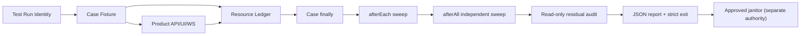
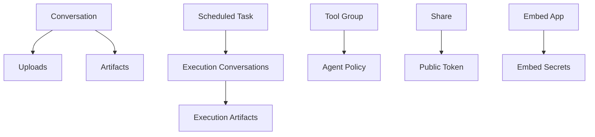
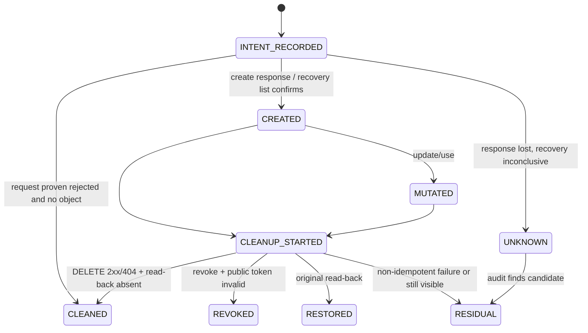

```
# 测试数据所有权、清理与残留审计复刻说明

## 0. 文档目的、边界与证据标签

本文说明如何在独立 Agent 工程中复刻一套安全的测试数据治理能力：每次测试运行生成不可混淆的所有权标记；每个持久资源记录类型、ID、owner、scope 和清理策略；正常、断言失败、fixture 部分创建、浏览器崩溃等路径都执行幂等清理或配置恢复；清理失败不被业务失败覆盖；只读审计最终报告残留并在 strict 模式阻断流水线。

分析范围覆盖两个测试工程：偏 UI 的 `nova_ui_e2e` 与 API/WS/browser 黑盒工程 `nova_auto_test`。正文是自包含复刻规范，不要求读者访问原仓库；路径和符号仅在末尾作为证据附录。

| 标签 | 含义 |
|---|---|
| `[I]` | 当前代码、配置或测试可静态确认的实现事实 |
| `[A]` | 当前用例表达的验收契约；不表示本次已运行通过 |
| `[K]` | 当前缺口、已知残留、误删/漏删风险或不一致 |
| `[P]` | 设计稿、保留开关或待接入能力表达的规划/调试用途 |
| `[R]` | 本次连接环境并实际验证的结论 |
| `[F]` | 多处静态证据支持的强推断，仍需运行确认 |
| `[D]` | 本文提出的生产级复刻设计，不冒充当前实现 |

本次没有运行任何测试、没有连接环境、没有调用 DELETE/PATCH/PUT/POST，也没有运行 audit 命令。因此没有 `[R]` 结论；所有库存为 2026-08-13 静态快照。`[I]`

## 1. 核心结论

测试清理不是“在 afterEach 搜索所有名称包含 test 的对象并删除”。可靠治理需要同时满足：

1. **可证明的所有权**：测试创建前生成 run identity，创建后记录权威资源 ID；名称前缀只是发现和恢复索引。
2. **资源账本**：每项资源记录 actor、tenant/user、scope、创建阶段、清理动作、依赖和当前状态。
3. **幂等清理**：成功和 404 视为完成；其他状态失败；清理后 read-back 证明资源或覆盖消失。
4. **配置恢复而非删除**：对模型角色、工具开关、主代理工具组等既有单例，保存 original/test/current，只有 current 仍由本次测试拥有时才恢复。
5. **分层兜底**：case `finally`、`afterEach`、`afterAll`、独立 janitor/audit 各自覆盖不同中断窗口。
6. **跨账号归属**：owner 创建的资源只能由 owner channel 清理；foreign actor 只做越权断言，不能误删 owner 资源。
7. **残留可观察**：audit 只读枚举残留，输出结构化 ID/计数；strict 模式对未接受残留返回非零。

`nova_ui_e2e` 已有统一小写 `e2e_` run marker、多个 UI suite 的后置扫描和跨资源 audit；`nova_auto_test` 的强项是每个 feature runner 内捕获精确 ID、逆序清理和 AggregateError，但命名主要是大写 `E2E_* + timestamp/random suffix`，尚无跨 feature 的统一 run ledger/audit。`[I/K]`

## 2. 业务边界与参与者

### 2.1 需要治理的对象

| 类别 | 资源/状态 |
|---|---|
| 会话运行 | conversation、运行中的 WS task、message、conversation workspace upload |
| 文件作品 | upload reference、artifact、artifact versions、任务执行关联 artifact |
| 自动化任务 | scheduled task、其执行 conversation/artifact |
| 内容 | tenant/personal knowledge、import conflict、synonym、归因 factor/dimension/correlation |
| 能力配置 | MCP server、Skill、tool group、agent policy、builtin tool override |
| 模型/数据 | model provider、model role override、data source、data theme |
| 产品分享 | share record、public token、撤销审计记录 |
| 嵌入应用 | embed app、secret、状态 |

### 2.2 参与者



Audit 和 janitor 必须分开：audit 默认只读；janitor 才有删除权限，并且只消费已验证的 ledger/marker/TTL。`[D]`

## 3. 运行身份与名称规范

### 3.1 统一身份

推荐每次顶层运行生成：

```ts
interface TestRunIdentity {
  schemaVersion: 1;
  runId: string;          // UUIDv7/ULID，跨进程唯一
  runMarker: string;      // e2e_<suite>_<shortRunId>
  suite: string;
  environment: string;
  targetOrigin: string;
  startedAt: string;
  expiresAt: string;      // 失败保留和janitor边界
  shard?: string;
  commit?: string;
}
```

`runMarker` 只允许：

```regex
^e2e_[a-z0-9]+(?:_[a-z0-9]+)*$
```

业务名称必须是 marker 本身，或后接 `_`、`-`、`:`、`：` 和具体对象用途。当前 UI 工程使用这套小写规范。`[I]`

### 3.2 当前两仓差异

| 工程 | 当前名称方式 | 风险 |
|---|---|---|
| UI E2E | `e2e_<normalized case>_<time+worker>` | 可被统一 audit 识别 |
| Auto Test | `E2E_<feature>_<timestamp>_<random>`、少量 `e2e-*` | UI audit 默认只匹配小写 `e2e_`，会漏掉大写资源 `[K]` |

Auto Test 多数 suffix 在 feature 内独立生成，没有贯穿整次 Playwright run 的统一 runId；多个资源能靠局部数组清理，但跨 runner 关联和事后归因困难。`[K]`

复刻时必须统一大小写和结构。兼容迁移期 audit 可以同时识别：

```ts
const LEGACY_MARKERS = [
  /^E2E_[A-Z0-9_]+_[0-9a-z]+_[0-9a-z]+$/,
  /^e2e-[a-z0-9-]+$/,
];
```

Legacy 模式只能报告，不能仅凭正则自动删除；删除仍需 actor/scope/ID 或经过审批的旧数据清单。`[D]`

### 3.3 所有权判定

```ts
function ownsName(candidate: string | undefined, runMarker: string): boolean {
  if (!candidate || !SAFE_MARKER.test(runMarker)) return false;
  return candidate === runMarker || ["_", "-", ":", "："]
    .some(separator => candidate.startsWith(runMarker + separator));
}
```

禁止用 `startsWith("e2e_")` 执行当前 case 清理，因为它会命中其他并发或历史运行。全局 `e2e_` 搜索只用于 audit。`[A/D]`

## 4. 资源账本契约

### 4.1 账本 Schema

```ts
type ResourceState =
  | "INTENT_RECORDED"
  | "CREATED"
  | "MUTATED"
  | "CLEANUP_STARTED"
  | "CLEANED"
  | "REVOKED"
  | "RESTORED"
  | "RESIDUAL"
  | "UNKNOWN";

type CleanupMode = "DELETE" | "REVOKE" | "RESTORE" | "CASCADE" | "NONE";

interface ResourceLedgerEntry {
  ledgerId: string;
  runId: string;
  runMarker: string;
  caseId: string;
  resourceType: string;
  resourceId?: string;
  parentLedgerId?: string;
  name?: string;
  actor: "primary" | "secondary" | "anonymous" | "system";
  tenantId?: string;
  userId?: string;
  scope?: "GLOBAL" | "TENANT" | "PERSONAL" | "PROJECT" | "CONVERSATION";
  state: ResourceState;
  cleanupMode: CleanupMode;
  cleanupEndpoint?: { method: string; pathTemplate: string };
  original?: unknown;       // encrypted/redacted snapshot for RESTORE
  testValue?: unknown;
  createdAt: string;
  updatedAt: string;
  cleanupAttempts: Array<{
    at: string;
    status?: number;
    outcome: "success" | "not-found" | "failed" | "refused";
    error?: string;
  }>;
}
```

账本不能存 password、cookie、API Key、MCP env secret 或完整敏感正文。`original/testValue` 只保存恢复所需的非秘密字段；秘密设置应使用服务端版本号/CAS 或专用测试对象。`[D]`

### 4.2 Write-ahead 注册

创建请求前先登记 `INTENT_RECORDED{name,actor,scope}`；收到响应后立即补 `resourceId` 并改为 CREATED。这样即使响应解析或后续断言失败，也能通过 name+actor 精确恢复 ID。`[D]`

当前两个工程常在 create 成功并解析 ID 后推入数组/调用 `onCreated`；若 HTTP 已创建但响应丢失 ID，会进入“未知创建”窗口。Auto Test 的 artifact runner已针对 save响应丢ID做 owner list 精确恢复，并测试不删 broad list 中无关对象，这是值得推广的模式。`[I]`

#### 4.2.1 持久文件账本

内存数组不能覆盖进程被 `SIGKILL`、runner崩溃或机器掉电。单机/CI复刻可采用“每个事件一个不可变文件”的 append-only 目录，避免依赖跨平台并不稳定的多进程文本追加原子性：`[D]`

```text
ledger/<environment>/<runId>/
├── manifest.json                 # run身份、租户、创建时间、保留策略
├── events/
│   ├── 000000000001-<eventId>.json
│   └── 000000000002-<eventId>.json
├── snapshots/latest.json         # 可丢弃缓存；真相是events
└── locks/append.lock
```

```json
{
  "schemaVersion": 1,
  "eventId": "<uuidv7>",
  "sequence": 2,
  "runId": "<run-id>",
  "ledgerId": "<resource-ledger-id>",
  "eventType": "RESOURCE_CREATED",
  "occurredAt": "2026-08-13T03:00:00Z",
  "idempotencyKey": "<run-id>:<ledger-id>:RESOURCE_CREATED:<receipt-hash>",
  "previousEventHash": "<sha256-of-sequence-1>",
  "payload": {
    "resourceType": "knowledge",
    "resourceId": "<server-id>",
    "actor": "primary",
    "scope": "TENANT",
    "tenantId": "<tenant-id>"
  },
  "eventHash": "<sha256-of-canonical-event-without-eventHash>"
}
```

追加协议必须严格按以下顺序：持有该run的独占文件锁；读取并验证最后sequence/hash；把完整canonical JSON写到同文件系统临时文件；`fsync`临时文件；原子rename为最终sequence文件；`fsync`父目录；最后释放锁。snapshot只能在事件持久化后重建并以同样的temp+fsync+rename方式替换。创建API必须在 `INTENT_RECORDED` 的持久化确认之后发送；收到服务端响应后在返回调用者之前持久化 `RESOURCE_CREATED`。`[D]`

如果采用单个JSONL文件，则必须使用OS独占锁、单次完整frame写入、长度前缀+CRC、`fdatasync/fsync`；启动时遇到尾部半帧只可隔离该帧并把run标为`LEDGER_CORRUPT/INCOMPLETE`，不得静默忽略后宣称清理完成。多writer没有可靠锁时禁止共享单文件。`[D]`

文件目录权限建议进程用户独占：目录`0700`、文件`0600`。恢复快照若不可避免含敏感配置，使用带key ID的AEAD envelope加密；密钥来自CI secret/KMS而不是账本。账本默认保留到 `max(run.expiresAt, cleanup完成时间+审计窗口)`，到期先写销毁审计再删除；失败、UNKNOWN和RESIDUAL在janitor闭环前不得过早清除。`[D]`

#### 4.2.2 数据库账本

多runner/跨机器推荐数据库事务账本；下面是可直接迁移的最小关系模型：

```sql
CREATE TABLE test_run_ledger (
  run_id            VARCHAR(64) PRIMARY KEY,
  environment       VARCHAR(64) NOT NULL,
  target_origin_hash VARCHAR(64) NOT NULL,
  tenant_id         VARCHAR(128),
  status            VARCHAR(32) NOT NULL,
  created_at        TIMESTAMP WITH TIME ZONE NOT NULL,
  expires_at        TIMESTAMP WITH TIME ZONE NOT NULL,
  retention_mode    VARCHAR(32) NOT NULL,
  version           BIGINT NOT NULL DEFAULT 0
);

CREATE TABLE test_resource_ledger (
  ledger_id         VARCHAR(64) PRIMARY KEY,
  run_id            VARCHAR(64) NOT NULL REFERENCES test_run_ledger(run_id),
  case_id           VARCHAR(256) NOT NULL,
  resource_type     VARCHAR(64) NOT NULL,
  resource_id       VARCHAR(256),
  actor             VARCHAR(32) NOT NULL,
  tenant_id         VARCHAR(128),
  user_id           VARCHAR(128),
  scope             VARCHAR(32),
  owned_name        VARCHAR(512),
  state             VARCHAR(32) NOT NULL,
  cleanup_mode      VARCHAR(32) NOT NULL,
  receipt_hash      VARCHAR(64),
  encrypted_snapshot BYTEA,
  snapshot_key_id   VARCHAR(128),
  version           BIGINT NOT NULL DEFAULT 0,
  created_at        TIMESTAMP WITH TIME ZONE NOT NULL,
  updated_at        TIMESTAMP WITH TIME ZONE NOT NULL,
  UNIQUE (run_id, ledger_id)
);

CREATE TABLE test_ledger_event (
  event_id          VARCHAR(64) PRIMARY KEY,
  run_id            VARCHAR(64) NOT NULL,
  ledger_id         VARCHAR(64) NOT NULL,
  sequence          BIGINT NOT NULL,
  event_type        VARCHAR(64) NOT NULL,
  idempotency_key   VARCHAR(512) NOT NULL UNIQUE,
  payload_json      TEXT NOT NULL,
  previous_hash     VARCHAR(64),
  event_hash        VARCHAR(64) NOT NULL,
  occurred_at       TIMESTAMP WITH TIME ZONE NOT NULL,
  UNIQUE (run_id, sequence),
  FOREIGN KEY (ledger_id) REFERENCES test_resource_ledger(ledger_id)
);
```

一次状态迁移在单事务中：锁定resource row或用`WHERE version=?`做CAS，插入唯一`idempotency_key`事件，更新resource state/version，再提交。重复回放同一key返回既有结果；不同事件争用同一version时一方失败并重新读取，不能last-write-wins。外部DELETE/REVOKE不能与数据库事务原子提交，因此采用outbox式两阶段：先持久化`CLEANUP_STARTED+operationId`，执行幂等远端操作，再持久化结果；崩溃重启从未终态operation继续read-before-retry。`[D]`

#### 4.2.3 重放与耐久性验收

重放按sequence验证无缺口、hash链和schema版本，再以`eventId/idempotencyKey`去重构造状态；相同资源的终态事件重复出现必须幂等，非法状态回退进入人工审查。至少覆盖：intent落盘后崩溃、远端创建后response丢失、cleanup请求成功但结果事件未写、两个writer争抢sequence/version、重复事件、乱序事件、尾文件截断、CRC/hash损坏、加密key不可用、磁盘满、权限过宽、retention到期但仍有RESIDUAL。每个场景都必须证明不会误删其他run、不会把UNKNOWN当CLEANED，并能在恢复后继续收敛。`[D]`

### 4.3 依赖关系

清理顺序按依赖图逆拓扑：



一般先删除/撤销依赖者，再处理父资源；若产品明确保证删除父对象级联，则清理后仍要查询依赖列表证明级联完成。`[D]`

## 5. 清理状态机与失败传播



### 5.1 错误聚合

业务断言失败和 cleanup 失败都必须保留：

```ts
let primaryFailure: unknown;
let cleanupFailure: unknown;
try {
  await verifyBusiness();
} catch (error) {
  primaryFailure = error;
} finally {
  try {
    await cleanupLedger();
  } catch (error) {
    cleanupFailure = error;
  }
}

if (primaryFailure && cleanupFailure) {
  throw new AggregateError(
    [primaryFailure, cleanupFailure],
    "verification and cleanup both failed",
  );
}
if (primaryFailure) throw primaryFailure;
if (cleanupFailure) throw cleanupFailure;
```

Auto Test 的 conversation workspace、artifact、task、Skill、data source、model role 等 runner 已多处使用该模式，并有单元测试证明主失败不会隐藏清理失败。`[I]`

### 5.2 多资源清理

批量清理逆序遍历并尝试全部资源，不应首个失败就停止：

```ts
const failures: unknown[] = [];
for (const entry of reverseTopological(entries)) {
  try { await cleanupOne(entry); }
  catch (error) { failures.push(error); }
}
if (failures.length === 1) throw failures[0];
if (failures.length > 1) throw new AggregateError(failures, "cleanup failed");
```

当前部分 batch helper只记录 `firstError`，但仍遍历所有项；结果缺少所有失败细节。`[I/K]` 复刻应保留全部错误。

### 5.3 404 和业务 envelope

DELETE 的 2xx 或 404 可视为幂等完成；其他 HTTP 状态失败。若 200 body 有 `success:false`，也必须失败。完成后应 read-back 列表/详情，避免“接口接受但异步尚未删除”。`[A/D]`

## 6. 四层清理时机

| 层 | 触发 | 处理范围 | 能覆盖的失败 |
|---|---|---|---|
| case `finally` | 当前业务函数退出 | 已知精确 ID/原值 | 断言、请求、解析失败 |
| `afterEach` | 每个 Playwright case | 当前 case marker/ledger | fixture未走到内部finally、页面失败 |
| `afterAll` | suite结束，新context优先 | suite marker扫描 | afterEach失败、page/context损坏 |
| audit/janitor | 独立作业 | runId/TTL/全环境 | 进程kill、机器断电、CI取消 |

UI 工程多个设置 suite 使用 afterEach+afterAll；定时任务、知识、嵌入应用等还在 case 中主动清理。Auto Test 更偏 feature 函数内部 finally，Playwright runner最终关闭 context和附加诊断，但缺少一个横跨所有 feature 的 afterAll ledger sweep。`[I/K]`

afterAll 不应复用可能已损坏的 page，应新建已认证 context/API client；若无法认证，也要输出 ledger 为 RESIDUAL。`[D]`

## 7. 各资源的完整契约

### 7.1 Conversation

创建来源有两类：显式 `POST createConversation` 返回 ID；聊天 WS 首次消息通过 `conversation_id` 事件或 URL query 获得 ID。`[I]`

记录字段：conversationId、actor、tenant/user、run marker title/prompt、WS run状态。清理：owner 调用 `DELETE /api/conversations/{id}`；2xx/404 接受；随后轮询 history 中无 ID。运行尚未终态时应先由 owner control channel cancel并等待单终态，再删除。`[D]`

UI 的对话追踪器同时监听 main-frame URL 和 `/ws/chat` JSON，并可按历史 title marker恢复遗漏 ID；但通用自动 fixture 当前失败/成功都只打印并保留 conversation，未自动调用删除。`[I/K]`

Auto Test 文件 workspace、memory persistence等显式创建 conversation，在 finally 精确删除并聚合错误；通用 WS case 则没有统一删除 conversation。`[I/K]`

### 7.2 Upload 和 Artifact

conversation-scoped upload通常随 conversation 删除，不一定有独立 delete；清理后要验证下载/reference不可读或关联列表消失。`[A/D]`

Artifact save响应必须捕获 artifact ID；同名版本分别登记，并逆序删除。若响应丢 ID，owner 列表恢复只能接受同时满足 actor、conversationId、精确 title/marker和创建时间窗口的对象；broad list中其他对象绝不能删。Auto Test 已有“同名两版本逆序删”“ID丢失恢复”“不删 unrelated artifact”“foreign actor不删 owner”的单元证据。`[I]`

UI 对话清理会继续轮询 `/api/files/all-artifacts`，要求相关 conversationId 的作品为空；定时任务清理也识别 `scheduled-task-<id>-execution-*` 关联 conversation。`[I]`

### 7.3 Scheduled Task

名称包含 run marker；从 create响应或 list精确同名项取得 task ID。清理先按已知 ID，若 create响应丢失则 list精确 name恢复；DELETE 2xx/404；再次 list证明 name不存在；最后检查执行 artifact。`[A]`

Auto Test 的 WS task management在创建前断言名称不存在，创建后要求exactly one匹配、读取detail验证，再 finally合并known ID与同名list IDs清理并验证缺失。`[I]` UI suite另有 case/afterEach清理，并对执行artifact做poll。`[I]`

### 7.4 Share

分享资源的 owner字段包括 share ID、title marker、public URL/token。清理动作是 `PATCH /api/shares/{id}/revoke`，接受 2xx、404、409；随后列表必须显示 revoked/不存在。只有已记录并成功解析public token时，当前cleanup才轮询匿名读取至410；若`publicUrl`或token缺失，当前实现直接跳过该验证。`[I/K]` 因而缺token不能写成“公开访问已失效”，只能把token验证标为`UNKNOWN/NOT_OBSERVABLE`；release strict应阻断，除非产品契约明确证明该share从未产生public capability。`[D]`

这是 **revoke-only例外**：产品没有硬删除能力，已撤销审计记录属于可接受已知残留，不进入普通 strict residual；但 active share仍是失败。`[I/A]` 创建真实分享会永久增加审计记录，必须用专用账号和额外授权。`[K]`

Audit 报告应分开：

```json
{
  "residuals": { "activeShares": ["share-id"] },
  "acceptedKnownResiduals": { "revokedShares": ["share-id"] }
}
```

接受不等于忽略：需跟踪数量趋势、最大年龄和专用账号容量。`[D]`

当前 `fetchAllMyShares` 固定最多请求20页、每页100条；若第20页仍非last，它会返回已收集的前2000条而不报告截断，也不按ID去重。`[I/K]` 这会让目标share位于后续页时被误判为不存在，并可能在并发新增/排序漂移时重复或漏读。

复刻时分页器必须满足：优先使用服务端稳定cursor/snapshot token；否则固定不可变排序键（例如`createdAt,id`），校验`totalElements/totalPages/last`一致；按share ID去重；检测同ID内容冲突；到达可配置安全上限但服务端仍有下一页时fail closed为`QUERY_TRUNCATED`。清理已知share时优先调用owner-scoped `GET /api/shares/{id}`，列表只做恢复与全局audit。`[D]`

```ts
async function fetchCompleteShares(api): Promise<ShareRecord[]> {
  const byId = new Map<string, ShareRecord>();
  let cursor: string | undefined;
  let seenPages = 0;
  do {
    const page = await api.list({ cursor, size: 100, sort: "createdAt,id" });
    assert(page.snapshotStable === true || page.snapshotToken);
    for (const item of page.items) {
      const prior = byId.get(item.id);
      if (prior && stableHash(prior) !== stableHash(item)) {
        throw new Error(`SHARE_PAGE_UNSTABLE:${item.id}`);
      }
      byId.set(item.id, item);
    }
    cursor = page.nextCursor;
    if (++seenPages > MAX_PAGES && cursor) throw new Error("QUERY_TRUNCATED");
  } while (cursor);
  assertServerTotalIfPresent(byId.size);
  return [...byId.values()];
}
```

若后端只有offset分页且数据会并发变化，audit需在分页前后读取版本/total并在不一致时整体重试有限次数；仍不稳定则报告`INCOMPLETE`，不能输出零残留。`[D]`

### 7.5 Knowledge

创建后立即记录 `knowledgeId + title + scope + actor`。单条 finally删除；批量逆序删除，404幂等。tenant和personal列表都要审计。`[I/A]`

Auto Test Knowledge fixture用时间戳/随机suffix构造 title，`onCreated`登记，默认finally删除；批量用records逆序。部分 runner支持 `AGENT_E2E_KEEP_KNOWLEDGE=true` 调试保留。`[I/P]` 保留模式必须被视为有意残留：只允许隔离环境/专用账号，输出ledger和TTL，不能在共享release默认开启。`[D]`

UI工程对个人“保存到知识”在case/afterEach按 marker清理。当前audit只是把tenant和personal knowledge数组直接拼接后筛选，没有像Skill/MCP那样按`knowledgeId`去重；同一对象若同时出现在两个scope视图会重复计数。`[I/K]` 复刻时以`scope + knowledgeId`为默认唯一键；若API保证ID跨scope全局唯一，可只用ID。相同键返回字段冲突时报告`QUERY_INCONSISTENT`，不得任取一条。`[D]`

### 7.6 Skill

Skill可由 JSON、Markdown、ZIP upload创建；必须捕获 skillId和最终name/scope。validation失败也可能异常创建对象，所以 create intent和“unexpected creation recovery”必不可少。`[I/D]`

Auto Test settings runner把每次成功/异常创建推入 CreatedSkill数组，finally逆序 DELETE；404接受。部分 error/frontmatter runner支持 `AGENT_E2E_KEEP_SKILL`。`[I]` UI suite使用 run marker生成唯一 ZIP内容，case清理加 afterEach/afterAll，避免覆盖现有同名Skill。`[I]`

删除前若存在 config override，应按产品契约先 remove/reset config，再删 asset；若删除本身应级联，read-back验证列表和config均不存在。`[D]`

### 7.7 MCP Server

账本记录 server ID、name、scope、transport type、actor；不得记录 token/header/env secret。创建失败可能留下 ERROR状态条目，也必须按marker扫描。删除使用精确 ID，并验证 tenant/personal列表无本run对象。`[A/D]`

UI MCP suite有 afterEach/afterAll清理、远程 Stdio专门门禁和本机私有环境文件；审计同时读取 tenant/personal MCP并按ID去重。`[I]` Auto Test 当前主要通过工具/WS连接契约验证，未形成一个能被UI audit统一识别的全局小写marker账本。`[K]`

### 7.8 Tool Group 与 Agent Policy

新组使用唯一 name；创建前要求不存在；create成功后 owned=true。若组被agent policy引用，清理顺序是先恢复/删除policy，再删除group。`[A]`

Auto Test 对 main agent policy会捕获 `previousTenantGroup`，测试后恢复旧组或删除临时policy，再删临时group并read-back；对测试专用agentId则删除policy。`[I]` 这属于“共享配置恢复+临时资源删除”的组合。

无 create ID 的 name-keyed资源必须精确匹配完整name；不能把 `E2E_TOOL_GROUP_foo` 的 ownership扩大到相似组。`[D]`

### 7.9 Builtin Tool Override

工具开关和配置是既有 singleton item，不能删除工具。应读取原 enabled/configValues/inherited状态，写 test值，finally根据 original/test/current恢复；若current出现第三方值，拒绝覆盖。`[A/D]`

UI audit读取个人 builtin detail，把 `configInherited=false` 且configValues中含run marker的工具列为残留。`[I]` 这个规则只发现测试值仍含marker；如果测试写的是普通布尔值或固定字符串，audit无法识别未恢复覆盖。`[K]` 账本应保存 toolName+scope+original version并审计 effective/owned layer，而不依赖值含marker。`[D]`

### 7.10 Model Provider 与 Model Role

Provider适合新建唯一名称，afterEach/afterAll按registered names和run marker删除并验证无 leftovers。密钥只能在create请求中短暂使用，账本和报告仅保存是否masked。`[I/D]`

Model role是分层共享配置：记录original effective role、original inheritedFrom、temporary role。恢复前再次读取current：

- current==original：已经恢复；
- current等于本测试允许的临时态：恢复原user/tenant row或删除临时override；
- 其他值：可能发生并发改变，拒绝覆盖。

Auto Test的user/tenant role恢复已实现这套 compare-and-refuse，并在恢复后read-back；UI模型角色也采用original/test/current决策。`[I]`

### 7.11 Data Source

Data source使用唯一 alias，create响应记录ID；CRUD正常删除；finally合并known ID和list中精确alias/edited alias恢复的ID，DELETE后验证所有alias缺失。foreign account只验证update/test/delete拒绝，最终由owner清理。Auto Test对这些路径有单元测试。`[I]`

账本不得保存数据库password或完整敏感JDBC URL；可保存dialect、alias、host hash。`[D]` 当前 UI audit不盘点data source，Auto Test也无全局残留审计，属于覆盖缺口。`[K]`

### 7.12 Embed App、Data Theme 与 Attribution

Embed app名称含run marker，ID来自 `id|appId`；删除后list缺失。secret作为子资源，不写账本明文。UI suite有case清理+afterEach+afterAll。`[I]`

Data theme audit目前只读取 available列表并按小写 marker报告，没有对应通用delete。`[I/K]` 在不知道删除契约时audit只能报警，不能猜DELETE路径。

Attribution资源嵌在metric detail下，所有权字段分别是 factor.name、dimension.name、correlation.description；报告必须包含type+metricName+id，以便将来定向清理。`[I]` 清理顺序和API应由具体资源契约决定，不能只凭同名跨metric删除。`[D]`

## 8. 远程修改门禁

清理本身是写操作，不因为目标名称看起来属于测试就自动获得授权。`[A]`

当前UI环境策略包括：普通远程租户修改、远程MCP Stdio、批量个人覆盖重置、撤销分享审计保留四种独立确认；local只有目标host真的是loopback时，普通租户修改才默认允许。`[I]`

推荐权限对象：

```ts
interface CaseMutationGrant {
  kind: "case-run";
  environment: string;
  targetOrigin: string;
  actor: string;
  allowedResourceTypes: string[];
  runId: string;
  expiresAt: string;
  approvedBy: string;
}
```

afterEach/afterAll只能使用与创建阶段相同的case grant；audit永远只读。janitor不能伪造“当前runId等于旧runId”，而应使用不同类型、绑定signed plan的独立grant；具体契约见第11节。不得把授权变量永久写入 `.env`、npm script或CI全局secret。`[D]`

## 9. 跨账号、并发和跨 Run 安全

### 9.1 Actor所有权

每个entry必须有actor。secondary读取owner资源失败后，不能用secondary cleanup；owner context即使主case失败也应保持到owner cleanup完成。若owner session失效，记录residual并由同owner服务凭据janitor处理。`[D]`

### 9.2 跨 Run

并发runA和runB可能使用同suite。安全删除条件至少是：

```text
entry.runId == currentRunId
AND entry.actor/scope/tenant == current context
AND exact resourceId known
AND (name ownership matches OR create receipt hash matches)
```

按marker恢复ID时只允许 current marker，不允许全局 `e2e_`。若目标产品会截断/规范化名称，创建后必须记录服务端resolvedName，并保存create response fingerprint。`[D]`

### 9.3 共享配置并发

workers=1只限制单个Playwright进程。两条CI job仍可能冲突。Auto Test主动拒绝在workers!=1运行file/artifact、data source、model mutation等；UI设置suite也多为serial+workers=1。`[I]`

生产复刻还需分布式锁或环境级CI concurrency group。恢复采用CAS/version；检测第三方改变就失败而不是覆盖。`[D]`

## 10. 只读残留审计

### 10.1 输入

当前UI audit命令支持：

- 默认：匹配所有名称以小写 `e2e_` 开头的可识别资源；
- `--run-marker=<safe marker>`：只匹配该run ownership规则；
- `--strict`：普通residual总数>0时 exit code=1；
- 使用既有storageState和当前环境profile；
- 全程只发GET。`[I]`

### 10.2 当前盘点资源

当前脚本并行读取 tenant/personal knowledge、tenant/personal Skill、tenant/personal MCP、个人 builtin tool detail、tool groups、tasks、embed apps、data themes、conversation history、artifacts、shares；随后逐metric读取attribution detail。`[I]`

输出 residual 类别：knowledge、skills、mcp、builtinToolOverrides、toolGroups、attribution、scheduledTasks、embedApps、conversations、artifacts、dataThemes、activeShares；acceptedKnownResiduals中单列revokedShares。`[I]`

### 10.3 报告 Schema

```ts
interface ResidualAuditReport {
  schemaVersion: 1;
  generatedAt: string;
  environment: string;
  targetOrigin: string;
  runMarker: string | null;
  strict: boolean;
  queries: Array<{
    resourceType: string;
    ok: boolean;
    status?: number;
    durationMs: number;
    error?: string;
  }>;
  residuals: Record<string, ResidualRecord[]>;
  acceptedKnownResiduals: Record<string, ResidualRecord[]>;
  coverage: {
    supported: string[];
    unsupported: string[];
  };
  totals: {
    residual: number;
    accepted: number;
    unknownDueToQueryFailure: number;
  };
}

interface ResidualRecord {
  id: string;
  name?: string;
  scope?: string;
  actor?: string;
  parentId?: string;
  createdAt?: string;
  ageSeconds?: number;
  source: "ledger" | "marker-scan" | "legacy-rule";
}
```

当前脚本输出ID数组，不含schemaVersion、generatedAt、query coverage或单项query状态。任一GET失败会整体抛错；这比假装零残留安全，但诊断粒度有限。`[I/K]`

### 10.4 strict算法

```ts
const residualCount = flatten(report.residuals).length;
const auditIncomplete = report.totals.unknownDueToQueryFailure > 0;

if (strict && (residualCount > 0 || auditIncomplete)) {
  process.exitCode = 1;
}
```

Accepted known residual不计入普通strict，但可以单独设置预算：例如 revoked share总数或7日增长超过阈值则失败。`[D]`

### 10.5 Conversation和Artifact关联

当前audit先按title marker筛conversation，组成ID集合，只把 `artifact.conversationId` 属于该集合的作品报告为residual。`[I]` 这能避免全局误报，但会漏掉“conversation已删除、孤儿artifact仍存在”的情况，因为父ID不再能从history发现。`[K]`

改进：artifact自身写runId metadata；或audit加载ledger中的历史conversation IDs；再检查孤儿关系。`[D]`

### 10.6 已知识别缺口

- Auto Test大写 `E2E_` 不被默认小写扫描命中；
- data source、model provider/model role、feedback/recommended question等不在当前UI audit；
- boolean/fixed-value builtin override可能不含marker；
- deleted conversation的孤儿artifact可能漏报；
- legacy conversation仅用两条硬编码标题正则兼容，不能覆盖历史fixture产生的`*_EMPTY`、`*_LONG`等变体以及其他资源类型；
- keep flags有意留下的数据没有统一TTL/accepted分类。

这些都是 `[K]`，不能把audit零结果解释为“环境完全无自动化残留”。

Legacy识别应做成“资源类型fixture/parser注册表”，而不是持续扩大一个conversation正则：`[D]`

```ts
interface LegacyOwnershipParser<T> {
  resourceType: string;
  parserVersion: string;
  parse(candidate: T):
    | { kind: "MATCH"; legacyFamily: string; confidence: "exact" }
    | { kind: "NO_MATCH" }
    | { kind: "AMBIGUOUS"; reason: string };
}

const legacyParsers = [
  conversationReadFileFixtureParser,
  attributionRuntimeFixtureParser,
  knowledgeImportFixtureParser,
  scheduledTaskFixtureParser,
  artifactFixtureParser,
];
```

每个parser必须由历史fixture样本驱动，显式覆盖base、`_EMPTY`、`_LONG`、大小写、规范化/截断后的合法变体，并配反例（真实用户标题、只有`test`、相似前缀）。parser只产生`source=legacy-rule`的审计候选，不授予DELETE/REVOKE；只有精确ledger ID或人工签署的janitor plan才能写。无法精确归属的`AMBIGUOUS`计入unknown并使strict失败。迁移完成后按parserVersion统计命中量，连续观察窗口为零才可移除旧规则。`[D]`

## 11. Janitor设计

当前已有脚本是只读audit，没有自动janitor。`[I]` 复刻时不要把删除直接塞进audit；应实现独立命令：

```text
audit --run-id X                # read only
janitor plan --run-id X         # produce signed deletion plan
janitor execute --plan plan.json --approval-token ...
audit --run-id X --strict       # verify
```

Deletion plan包含精确ID、actor、scope、当前read-back name、ledger receipt、依赖顺序和计划过期时间。execute前再读一次并校验未发生owner/scope/name漂移。`[D]`

禁止对以下目标自动janitor：无ID、只有通用名称、scope不明、actor凭据不匹配、当前值出现第三方修改、非过期失败保留、revoke-only审计记录。`[D]`

### 11.1 Signed plan契约

plan必须使用规范化JSON后签名；签名envelope与业务payload分离，避免“签了哪些字段”含糊：

```json
{
  "protected": {
    "schemaVersion": 1,
    "alg": "EdDSA",
    "keyId": "janitor-plan-key-2026-08",
    "issuer": "nova-test-ledger-service",
    "audience": "nova-test-janitor",
    "nonce": "<128-bit-random>",
    "issuedAt": "2026-08-13T04:00:00Z",
    "expiresAt": "2026-08-13T04:15:00Z"
  },
  "payload": {
    "planId": "<uuidv7>",
    "targetEnvironment": "release-candidate",
    "targetOrigin": "https://<expected-host>",
    "targetTenantId": "<tenant-id>",
    "targetRunId": "<old-run-id>",
    "ledgerDigest": "<sha256-of-verified-ledger-snapshot>",
    "createdBy": "audit-job",
    "entries": [
      {
        "ledgerId": "<ledger-id>",
        "resourceType": "knowledge",
        "resourceId": "<resource-id>",
        "actor": "primary",
        "scope": "TENANT",
        "tenantId": "<tenant-id>",
        "expectedName": "<owned-name>",
        "expectedVersion": "<etag-or-version>",
        "receiptHash": "<create-receipt-hash>",
        "operation": "DELETE",
        "dependsOn": []
      }
    ]
  },
  "signature": "<base64url-signature-over-canonical-protected-and-payload>"
}
```

只允许算法白名单，拒绝`none`、未知`alg`和payload指定的任意公钥；`keyId`从受信任keyring解析，并检查key未撤销、issuer/audience精确匹配、时钟偏差、expiry短TTL。plan的`nonce`和`planId`在执行存储中有唯一约束；第一次执行即登记`STARTED`，完成为`SUCCEEDED/PARTIAL_FAILED`，重复提交只返回原执行结果，不能再次写远端。`[D]`

### 11.2 Approval与权限绑定

审批凭证不能只是通用“允许删除”字符串，必须绑定：`planId + planDigest + targetEnvironment + targetOrigin + tenantId + targetRunId + allowedResourceTypes + allowedOperations + approver + expiresAt`。执行器同时验证plan签名和approval签名，检查审批未撤销、审批人不等于plan生成服务（双人/双角色）、实际服务凭据的tenant/actor映射与每个entry一致。任一字段扩权或目标漂移都拒绝整个plan。`[D]`

case cleanup grant与janitor grant是两个互斥联合类型：

```ts
type CleanupAuthority =
  | { kind: "case-run"; currentRunId: string; grant: CaseMutationGrant }
  | {
      kind: "janitor";
      executionId: string;
      signedPlanDigest: string;
      approvalDigest: string;
      targetRunId: string;
      allowedLedgerIds: ReadonlySet<string>;
    };
```

case路径要求`entry.runId === currentRunId === grant.runId`；janitor路径要求`entry.runId === targetRunId`且entry ledgerId精确存在于已验证plan。这样janitor可处理旧run，又不会通过伪造`ctx.runId`绕过跨run保护。每次read-before-write、DELETE/REVOKE响应、read-after-write和拒绝原因都写不可变审计事件，包含`planId/executionId/approvalDigest/actor/target/result`，但不记录秘密。`[D]`

### 11.3 执行与撤销

执行前再次读取ledger并验证digest未变、run已过期、entry仍非终态；再按依赖逆拓扑和actor分组。每项执行前read-back验证ID、tenant、scope、owner、name、version/receipt；不一致只把该项标为`REFUSED_TARGET_DRIFT`，并继续处理不依赖它的安全项。签名key或approval在执行中途被撤销时，停止尚未开始的项并输出`PARTIAL_FAILED`，不得把整个run标为clean。最终由独立只读audit复核，而不是相信写响应。`[D]`

## 12. 保留调试数据的治理

Auto Test已有 `AGENT_E2E_KEEP_KNOWLEDGE` 和 `AGENT_E2E_KEEP_SKILL`；UI通用conversation fixture也会保留追踪到的对话用于调试。`[I/P]`

保留必须显式建模：

```ts
interface RetentionPolicy {
  mode: "delete-on-finish" | "retain-on-failure" | "retain-always";
  expiresAt: string;
  reason: string;
  ticket?: string;
}
```

共享release禁止retain-always；retain-on-failure需输出ID、TTL和清理owner。超过TTL后janitor处理。不能只console.warn而无机器可读ledger。`[D]`

## 13. 安全与审计要求

1. cleanup日志保留resourceType/ID/status，不记录密码、cookie、API Key、MCP secret、data source password。`[D]`
2. 所有删除和恢复写审计事件：runId、caseId、actor、target、before version、result。`[D]`
3. audit账号只授GET；janitor账号最小化到测试租户和允许资源类型。`[D]`
4. marker不能由未可信用户输入直接拼成查询/路径；先正则校验并URL encode。`[A]`
5. list恢复ID有页数上限时必须检测truncated；不能因只读第一页而宣称无残留。`[D]`
6. 删除结果必须验证租户/用户归属，服务端也要做对象级授权；客户端marker不是安全边界。`[D]`

## 14. 从零复刻步骤

### 阶段1：统一身份和纯函数

实现runId/runMarker、所有权匹配、exact ID删除保护、actor/scope类型和单元测试。

验收：拒绝其他run的`e2e_`、通用`test`、非法marker、scope不一致和foreign actor。

### 阶段2：账本和内部finally

先实现文件或数据库durable ledger、锁/CAS、fsync/事务、重放和idempotency，再接入conversation、knowledge、Skill三类；create前write-ahead，create后补ID；finally逆序清理；主/清理失败AggregateError。

验收：create成功后断言失败仍删除；create response缺ID可安全恢复；404幂等；500使case失败；崩溃、并发writer和截断账本重放不产生假CLEANED或跨run误删。

### 阶段3：共享配置恢复

接入model role、builtin tool、main agent policy；捕获original/test/current，检测并发改变，read-back恢复。

验收：第三方值出现时拒绝覆盖并报告residual。

### 阶段4：suite兜底和跨资源

增加afterEach/afterAll新context sweep；conversation删除验证artifact；task删除验证execution artifact；share撤销验证public 410。

验收：模拟page崩溃后afterAll仍收敛；revoke-only正确分类。

### 阶段5：只读audit和CI

实现schema化报告、runMarker/global/legacy模式、strict、coverage和accepted budget。再独立设计受审批janitor。

验收：audit无写请求；任一普通残留或query不完整使strict失败；accepted residual单独计数。

## 15. 参考清理算法

```ts
async function cleanupEntry(
  entry: ResourceLedgerEntry,
  ctx: ActorContext,
  authority: CleanupAuthority,
) {
  assert(ctx.actor === entry.actor);
  assert(ctx.tenantId === entry.tenantId);
  if (authority.kind === "case-run") {
    assert(entry.runId === authority.currentRunId);
    assert(authority.grant.runId === authority.currentRunId);
  } else {
    assert(entry.runId === authority.targetRunId);
    assert(authority.allowedLedgerIds.has(entry.ledgerId));
    assertVerifiedPlanAndApproval(authority);
  }

  const current = await adapter.read(entry);
  if (current.kind === "missing") return markCleaned(entry, "not-found");

  assertCurrentStillOwned(current, entry);
  mark(entry, "CLEANUP_STARTED");

  switch (entry.cleanupMode) {
    case "DELETE":
      await adapter.delete(entry.resourceId!);
      await pollAbsent(entry);
      return mark(entry, "CLEANED");
    case "REVOKE":
      await adapter.revoke(entry.resourceId!);
      await pollRevokedAndPublicGone(entry);
      return mark(entry, "REVOKED");
    case "RESTORE":
      await restoreWithCompareAndSet(entry.original, entry.testValue, current);
      await pollEqualsOriginal(entry);
      return mark(entry, "RESTORED");
    case "CASCADE":
      await adapter.delete(entry.resourceId!);
      await pollParentAndChildrenAbsent(entry);
      return mark(entry, "CLEANED");
    case "NONE":
      throw new Error("Resource requires manual cleanup plan");
  }
}
```

## 16. 验收矩阵

| ID | 场景 | 输入/前置 | 预期 |
|---|---|---|---|
| OWN-01 | 当前run名称 | exact marker/合法后缀 | owned=true |
| OWN-02 | 其他run | `e2e_same_otherid` | owned=false，不发DELETE |
| OWN-03 | 通用名称 | `test`/`测试2` | refused |
| OWN-04 | foreign actor | owner ID+secondary context | refused |
| LED-01 | create成功 | response有ID | ledger CREATED含精确ID |
| LED-02 | response丢ID | 精确owner/name/time list可恢复 | 仅登记唯一匹配 |
| LED-03 | broad list多匹配 | 含unrelated | 不删除unrelated，标UNKNOWN/失败 |
| LED-04 | intent已fsync后进程崩溃 | 未发/不确定create | 重放为INTENT_RECORDED并定向恢复，不当CLEANED |
| LED-05 | 远端cleanup成功后进程崩溃 | 无结果事件 | 重放CLEANUP_STARTED，read-back后幂等收敛 |
| LED-06 | 两writer并发追加 | 相同run sequence/version | 锁或CAS只允许一个提交，另一方重读重试 |
| LED-07 | 尾事件截断/CRC错误 | 半个frame | run标INCOMPLETE/CORRUPT，不静默跳过 |
| LED-08 | 重复idempotency key | 同事件重放 | 返回已有事件，不重复远端写 |
| LED-09 | ledger权限/密钥异常 | 文件过宽或key不可用 | fail closed，不输出敏感snapshot |
| CLN-01 | 正常删除 | DELETE 204 | read-back absent，CLEANED |
| CLN-02 | 幂等删除 | DELETE/GET 404 | CLEANED |
| CLN-03 | 删除500 | 主流程成功 | case失败，entry RESIDUAL |
| CLN-04 | 主流程+删除均失败 | 两异常 | AggregateError顺序保留 |
| CLN-05 | 批量一项失败 | 3项 | 其余仍尝试，汇总全部失败 |
| CONV-01 | 会话有关联artifact | 删除conversation | history和artifact均消失 |
| CONV-02 | WS仍RUNNING | cleanup | owner cancel单终态后删除 |
| ART-01 | 同名版本 | 2个ID | 逆序删除两个ID |
| ART-02 | cross-account | foreign无法读/删 | owner最终清理 |
| TASK-01 | create响应ID丢失 | exact name | list恢复唯一ID并删除 |
| TASK-02 | 有执行作品 | task cleanup | task和execution artifact均无残留 |
| SHARE-01 | active share | owner revoke | 列表revoked，public token 410 |
| SHARE-02 | revoked record | audit strict | 进入accepted，不算普通residual |
| SHARE-03 | 第20页仍有next/非last | 目标在第21页 | QUERY_TRUNCATED/INCOMPLETE，不报告不存在 |
| SHARE-04 | 并发offset分页漂移 | duplicate/missing ID | 去重并检测不稳定；有限重试后fail closed |
| SHARE-05 | share无public URL/token | revoke成功 | token验证为UNKNOWN；release strict阻断或证明无capability |
| KNOW-01 | batch中途失败 | 已建2/目标3 | 两项逆序删除 |
| KNOW-02 | tenant/personal返回同knowledge | 同scope+ID重复 | 报告只计一次；字段冲突为QUERY_INCONSISTENT |
| SKILL-01 | validation意外创建 | response异常但list有marker | intent恢复ID并删除 |
| MCP-01 | create留下ERROR项 | marker+ID | owner删除并tenant/personal均缺失 |
| GROUP-01 | group有policy | original policy已捕获 | 先恢复policy再删group |
| CFG-01 | singleton恢复 | current=testValue | 恢复original并read-back |
| CFG-02 | 并发修改 | current=thirdValue | 拒绝覆盖，RESIDUAL |
| DS-01 | alias编辑 | original+updated alias | knownID和两alias扫描均清理 |
| GATE-01 | remote无grant | release | 不创建也不清理写，明确拒绝 |
| RUN-01 | 两run并发 | 相同suite不同runId | 互不删除 |
| AUD-01 | 小写marker残留 | audit `--run-marker` | JSON列出精确类型/ID |
| AUD-02 | strict有残留 | residualCount>0 | 非零退出 |
| AUD-03 | query失败 | 任一GET失败 | strict失败，不报告零残留 |
| AUD-04 | 只有revoked share | accepted budget内 | ordinary strict通过，单独计数 |
| AUD-05 | Auto Test legacy大写 | legacy scan | 报告但不自动删除 `[D]` |
| JAN-01 | 过期ledger | 已批准plan | 二次校验后删除，复审计为零 |
| AUD-06 | legacy `_EMPTY/_LONG` fixture | parser注册表 | 识别并仅报告；不直接删除 |
| AUD-07 | legacy相似真实用户标题 | parser反例 | 不匹配；AMBIGUOUS则strict incomplete |
| JAN-02 | plan被重放 | 相同planId/nonce | 返回首次execution，不重复删除 |
| JAN-03 | plan/approval目标不一致 | origin/tenant/run不同 | 整体拒绝且审计 |
| JAN-04 | approval或key已撤销 | 执行前/执行中 | 未开始项停止，结果PARTIAL_FAILED |
| JAN-05 | janitor处理旧run | plan targetRunId匹配 | 无需伪造currentRunId；仅允许plan ledgerIds |

## 17. 完成定义

以下条件全部满足，才可称为完成复刻：

1. 所有创建型fixture都有统一runId、safe marker和精确ID durable账本，能在崩溃、并发和截断后安全重放；
2. 所有共享配置都有original/test/current恢复与并发改变保护；
3. owner/secondary/anonymous明确，foreign actor不参与owner cleanup；
4. case finally、afterEach、afterAll和独立audit各自存在；
5. 多资源逆序清理，404幂等，非2xx/业务失败不吞；
6. 主失败和cleanup失败通过AggregateError同时可见；
7. conversation/task删除验证关联artifact；
8. share revoke-only作为accepted residual单列并受预算管理；
9. audit只读、有coverage、有去重/分页完整性和strict退出语义；
10. 跨run、跨shard、跨CI job不会互删；
11. keep/retain都有TTL、reason和janitor owner；
12. ledger、日志和报告不含任何秘密，敏感恢复快照加密且有权限/保留期；
13. janitor plan和approval分别签名并绑定origin/tenant/run/entry，具备nonce防重放、撤销和不可变执行审计。

## 18. 当前事实、推断和建议汇总

- `[I]` UI工程已有safe小写marker、owner name保护、conversation URL/WS追踪、知识/任务/embed清理、分享撤销、设置suite后置清理和只读strict audit。
- `[I]` Auto Test多个feature已实现精确ID、finally、逆序批量、404幂等、跨账号owner清理、共享配置compare-and-refuse及AggregateError。
- `[A]` 两仓用例共同要求不删除其他run/人工资源，清理失败必须暴露，跨账号测试后owner资源仍由owner处理。
- `[K]` 两仓marker不统一；UI audit漏Auto Test大写资源及多个类型；knowledge合并未去重；share列表最多20×100且不报告截断；缺public token时不验证410；legacy规则只覆盖两个conversation标题族；通用聊天并非全部自动删除；keep flags缺统一TTL；audit的artifact关联会漏父会话已删的孤儿；没有统一持久run ledger和受审批janitor。
- `[P]` keep knowledge/Skill和失败conversation保留服务于调试，但应转成机器可读retention policy。
- `[R]` 本文没有运行验证，也没有执行任何清理。
- `[F]` 当前局部模式足以组合成统一治理层，但“audit为零”等价于“无所有自动化残留”不成立，因为识别覆盖不完整。
- `[D]` 推荐统一run identity、durable write-ahead ledger、资源adapter、分布式锁/CAS、完整分页/去重、schema化audit、accepted residual预算和签名plan/独立approval/防重放janitor。

## 19. 证据追溯附录

以下路径仅用于原仓库审计：

- UI所有权/通用清理：`nova_ui_e2e/src/test-data-cleanup.ts`；
- UI分享撤销：`nova_ui_e2e/src/agent-sharing.ts`；
- UI门禁：`nova_ui_e2e/src/test-environment-policy.ts`；
- UI审计：`nova_ui_e2e/scripts/audit-test-data.ts`；
- UI清理设计与suite：`nova_ui_e2e/docs/test-data-cleanup-regression-test-design.md`、`tests/**/*.spec.ts`；
- Auto Test conversation workspace：`nova_auto_test/src/features/files/conversationWorkspace.ts`；
- Auto Test artifact：`nova_auto_test/src/features/files/runner.ts`；
- Auto Test knowledge：`nova_auto_test/src/features/knowledge/fixture.ts`及各runner；
- Auto Test Skill：`nova_auto_test/src/features/skills/*Runner.ts`；
- Auto Test task：`nova_auto_test/src/features/tasks/managementRunner.ts`；
- Auto Test tool group/policy：`nova_auto_test/src/features/settings/toolSettingsRunner.ts`；
- Auto Test model role：`nova_auto_test/src/features/modelAccess/runner.ts`；
- Auto Test data source：`nova_auto_test/src/features/settings/dataSourceSettingsRunner.ts`；
- 失败聚合单测：`nova_auto_test/tests/unit/features/files/*`及各feature runner spec。

```
