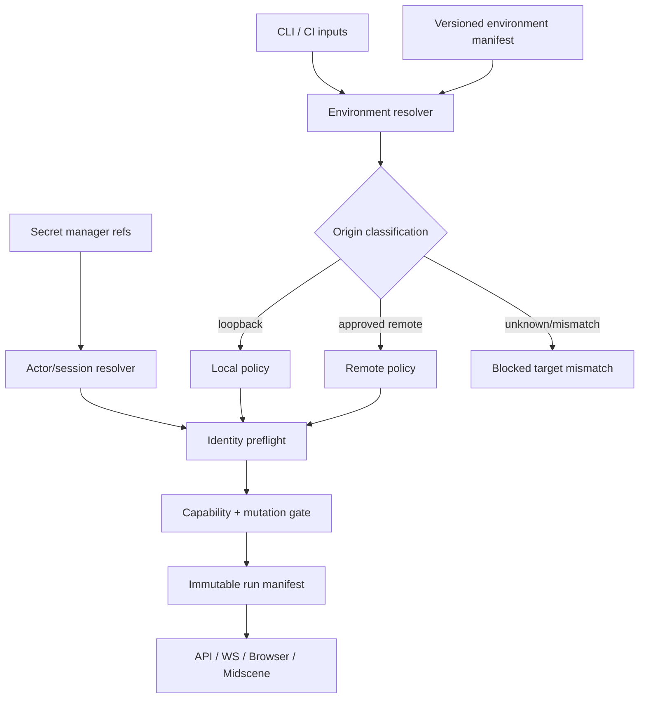

```
# 环境、账号与认证矩阵复刻

> 质量轴 Q08。本文自包含说明 `nova_auto_test` 与 `nova_ui_e2e` 的环境解析、账号角色、登录态、CIP 会话、远程写入授权、MCP 凭据、locale 与 capability skip，并给出统一复刻方案。  
> 静态审计日期：2026-08-13。  
> 本次没有运行登录、接口、浏览器、CI、测试或构建；仓库中的历史报告、日志文案和配置资产不代表当前环境可用或用例通过。本文不展示任何真实用户名、密码、Cookie 或 API key 值。

## 0. 标记、边界与结论

| 标记 | 含义 |
|---|---|
| **I** | current 静态实现可确认 |
| **A** | 目标环境仍需验证的假设 |
| **K** | current 缺口或弱保证 |
| **P** | 推荐/规划设计，非 current |
| **REQ** | 等价复刻的必要要求 |
| **F** | 失败、阻断或降级路径 |
| **D** | 推荐工程决策 |

核心结论：

1. **I**：两个测试仓都区分 `local/demo/release`，但 resolver 不同。黑盒仓是 YAML+账号文件+环境变量的多层合并；UI 仓是源码 profile+dotenv+环境变量，未知环境会静默归一为 demo。
2. **I/K**：黑盒仓可配置 primary/secondary，且 storageState 按环境、账号和角色解析；UI 仓有 admin 与专用 non-admin RBAC profile，其他多账号能力仍由各 spec 自行创建 context。
3. **I**：UI 仓对高风险写入有显式 confirmation gate；本地回环只自动允许普通租户变更，个人覆盖批量重置与不可硬删除的分享审计记录仍需单独确认。
4. **I/K/P0**：两个仓的 Git 跟踪资产静态存在非空凭据；UI 源码另有默认密码 fallback，MCP release env 也是受跟踪凭据文件。必须立即撤销/轮换并清理，不得把“测试账号”当成可提交 secret。
5. **K**：两仓没有共同的 environment manifest、capability preflight、身份 read-back 或统一 skip taxonomy；custom URL 可以保留原环境名，却把流量导向另一目标，存在凭据误投与错误授权风险。
6. **D**：目标实现只接受一个签名/审计过的环境矩阵；secret 只用引用，执行前绑定 `environmentId + origin + tenant + accountRef + role + sessionRef`，preflight 后再生成不可变 run manifest。

## 1. 产品环境与风险语义

| 环境 | current 默认意图 | 认证 | 副作用原则 | 复刻要求 |
|---|---|---|---|---|
| local | 本机 Nova | 两仓均可 auth disabled；UI profile 为 none | 普通租户变更仅在真实 loopback 自动允许 | 必须验证 URL host 是 loopback，不能只看名字 |
| demo | 共享演示环境 | 密码/CIP storageState | 默认只读；写入需本次确认 | 专用测试 tenant/account、marker、cleanup |
| release | 共享发布验证环境 | 密码/CIP storageState | 默认只读；写入需本次确认 | 最小权限、审计、严格残留门禁 |
| custom URL | UI 仓可覆盖任意已选环境 URL；黑盒仓可覆盖已配置环境 base URL | 仍沿用所选环境账号 | current 仍按原 envName 判断 gate | 必须重新分类 origin，不允许继承错误授权 |

**K**：`envName=local` 不等于安全本地；UI current 普通 mutation gate 还会检查 URL loopback，这是正确的第二条件。反向也成立：custom URL 指向 loopback但 envName=release 时，current 仍需 release confirmation。



## 2. `nova_auto_test` current resolver

### 2.1 配置模型

```ts
interface ResolvedAccount {
  envName: string;
  accountName: string;
  baseUrl: string;
  username: string;
  password: string;
  modelName: string;
  authEnabled?: boolean;
  timeoutMs: number;
  headlessDefault: boolean;
  desc: string;
  dataset: string;
}
```

`config.yaml` 保存默认环境、model、timeout、headless，以及每环境的 base URL、default account、second account、model、auth enabled。`accounts.json` 按环境和账号别名保存 username/password/description/dataset。`.env` 在第一次解析时手工加载，规则为“仅当 `process.env[key]` 当前为 falsy 才写入”。

### 2.2 环境和账号优先级

环境：

```text
getEnvConfig(explicit env argument)
  > AGENT_E2E_ENV
  > config.yaml env
  > "release"
```

primary 账号名：

```text
ResolveOptions.account（测试入口通常传 AGENT_E2E_ACCOUNT）
  > AGENT_<ENV>_ACCOUNT
  > AGENT_ACCOUNT
  > AGENT_<ENV>_USERNAME
  > AGENT_USERNAME
  > environments.<env>.default_account
```

secondary 账号名：

```text
ResolveOptions.account
  > AGENT_SECOND_<ENV>_ACCOUNT
  > AGENT_SECOND_ACCOUNT
  > AGENT_SECOND_<ENV>_USERNAME
  > AGENT_SECOND_USERNAME
  > environments.<env>.second_account
```

**I/K**：把 `*_USERNAME` 作为 accountName fallback，仍要求同名 key 存在于 `accounts.json`；它不是任意用户名直连。primary 的 `AGENT_E2E_ACCOUNT` 是调用方传入，并非 resolver 自己读取，复制 resolver 时不能遗漏入口行为。

### 2.3 URL、身份与模型优先级

primary base URL：`AGENT_<ENV>_BASE_URL > config base_url`。secondary 额外优先 `AGENT_SECOND_<ENV>_BASE_URL`。结尾单个 `/` 被移除。

primary username/password：

```text
explicit option
  > AGENT_<ENV>_USERNAME/PASSWORD
  > AGENT_USERNAME/PASSWORD
  > accounts.json field
  > accountName（仅 username 且 auth enabled）
```

secondary 使用 `AGENT_SECOND_<ENV>_* > AGENT_SECOND_* > accounts.json`。model 为 `AGENT_MODEL_NAME > environment model > global model > hardcoded fallback`；timeout/headless 为环境变量优先于全局 YAML。

**F**：环境 block、账号 entry、base URL 或启用认证时的凭据缺失会 throw；second account 未配置返回 null，要求第二账号的 case 再 skip。未知 env 不会回退，而是因缺 environment block 失败。

### 2.4 custom URL 限制

黑盒仓没有单一 `AGENT_TARGET_URL`；custom target 要通过当前环境对应的 `AGENT_<ENV>_BASE_URL`，或在 YAML 增加环境。环境身份与 URL 仍可能错配，因为 resolver 不验证 host 是否属于该环境。

## 3. `nova_ui_e2e` current resolver

### 3.1 profile

```ts
type AgentTestEnv = "release" | "demo" | "local";
type AgentAuthMode = "password" | "none";
interface ResolvedAgentProfile {
  envName: AgentTestEnv;
  url: string;
  username: string;
  password?: string;
  usernameEnv: string;
  passwordEnv: string;
  authMode: AgentAuthMode;
}
```

profile 在源码中固定环境 URL、默认账号、凭据变量名和 auth mode；`dotenv/config` 加载 `.env`。local 为免登录，demo/release 为 password。

### 3.2 优先级与静默归一

envName 取 `resolveAgentProfile(explicit) > AGENT_TEST_ENV`；只有精确的 local/demo/release 被接受，其余值静默变为 demo。

URL：

```text
AGENT_TARGET_URL
  > AGENT_LOCAL_URL（仅 envName=local）
  > profile.url
```

普通身份：

```text
username: AGENT_TEST_USERNAME > AGENT_<ENV>_USERNAME > source default
password: AGENT_TEST_PASSWORD > AGENT_<ENV>_PASSWORD > source default
```

专用 RBAC 身份只读取 `AGENT_<ENV>_RBAC_USERNAME/PASSWORD` 和自己的 source default，故意不读取普通 admin override，以避免 non-admin 用例误用管理员身份。

**K**：未知 env 静默落到 demo 会把 typo 变成真实远程执行。`AGENT_TARGET_URL` 改 URL却不改 envName、账号、storageState 文件名或 mutation confirmation 值。目标必须 fail-fast，并验证 URL/environment binding。

## 4. 登录与 storageState

### 4.1 UI 仓 global setup

默认路径：`.auth/<envName>-<username>.json`，目录被忽略。freshness 仅由 mtime 和 `AGENT_AUTH_MAX_AGE_MS` 判断，默认 12 小时；文件只要含 cookie 或 origin 就被视为非空。

复用流程：fresh → 用该 state 新 context访问 profile URL → 页面达到 chat-ready → reuse。否则：

- password mode 有密码：UI 填第一 username input、password input并点中文“登录”，等待 `/web/chat`；
- none mode：直接访问 URL并等待 chat-ready；
- password mode无密码：写空state并warning，不在global setup直接失败；不少spec随后自行skip。但demo/release普通profile和release RBAC current存在源码`defaultPassword`，通常会先静默回退而不会进入“缺密码”分支。首要P0是删除fallback；删除后，缺secret才会显式blocked/skip。

```mermaid
sequenceDiagram
  participant GS as Global setup
  participant FS as .auth state
  participant IDP as Login/CIP provider
  participant Nova as Nova
  GS->>FS: path(env, username), read + mtime
  alt fresh and reusable
    GS->>Nova: open with stored state
    Nova-->>GS: chat-ready
  else password login
    GS->>IDP: UI account/password login
    IDP-->>GS: authenticated browser state
    GS->>FS: write storageState
  else auth none
    GS->>Nova: open local chat
    GS->>FS: write state
  else password missing
    GS->>FS: write empty state
    GS-->>GS: warning; specs may skip
  end
```

**K**：mtime 不是 session expiry；chat-ready不证明当前 user/tenant/role正确。文件名含原始 username，会泄漏账号标识并存在 path字符风险。并发 global setup可能覆盖同一文件。

### 4.2 黑盒仓 login/storageState

每次 browser context 可先解析 storageState。候选顺序是：

1. `AGENT_E2E_STORAGE_STATE_<ENV>_<ACCOUNT>`；
2. `AGENT_E2E_STORAGE_STATE_<ACCOUNT>`；
3. secondary 专属三个兼容变量，且绝不回退 primary global state；
4. primary 专属三个兼容变量，再回退 `AGENT_E2E_STORAGE_STATE`。

路径支持 `~` 并要求存在。若没有 state，访问 `/web/chat`；已经登录则复用，否则 UI login。`auth_enabled=false` 却出现 login 页面会失败，而不是错误输入凭据。

**I**：API runner也用 BrowserContext request；有 state则无需打开 page，没 state则先 UI login。因此 API/WS 黑盒仍可能依赖浏览器登录链路。

### 4.3 CIP_SESSION 生成器

黑盒仓另有独立脚本：可接受已有 CIP session、账号密码自动登录，或 interactive 浏览器登录。自动登录从身份服务取 public key+nonce，RSA 加密密码后登录，从 Set-Cookie提取 CIP session，再为 Nova 与身份服务 host写 Playwright storageState。

**I/K**：该脚本不是`getEnvConfig`的完整复用。`--env/AGENT_E2E_ENV`只选择`config.yaml/accounts.json`中的账号默认值；Nova URL和Anymetrics身份URL分别由`--nova-base-url/--anymetrics-base-url`、对应`AGENT_E2E_*_BASE_URL`或脚本内hardcoded release URL决定，不随envName自动切demo/local。若只写`--env demo`，可能取demo凭据却向release身份/Nova地址投递。interactive分支也使用独立Nova URL优先级。目标resolver必须一次性绑定environment→identity origin→Nova origin→credential audience，任一显式override不一致立即fail closed、零登录请求。

**I/K**：自动登录时显式`--account`或`AGENT_E2E_ACCOUNT`会被直接当作登录接口的account字段；只有未显式提供时才优先使用账号配置里的`username`，再退accountName。因此“配置别名”不一定等于login ID，显式传alias可能错误登录。**D**：schema分离`accountRef`（本地稳定别名）与`loginId`（由secret/identity配置解析），CLI只接受accountRef；只有专门且审计的`--login-id-override`能改loginId。

写入 cookie current 契约：name=CIP session、path `/`、HTTP-only、SameSite Lax、HTTPS target 才 secure、固定约 7 天 expires。输出默认为临时目录，也可覆盖。

**K/P0**：current登录成功日志会输出session值的前缀；任何session片段都不应进入日志。默认输出是可预测的`/tmp/nova-release-storage-state.json`，普通write覆盖既有路径，没有0600、exclusive create或nofollow保证；文件含可直接复用session。脚本还把同一session值写到两个配置host，并未验证Set-Cookie原始Domain/Secure/SameSite；custom host时可能扩大投放范围。

**D**：使用每run `mkdtemp`的0700目录和随机文件，`O_CREAT|O_EXCL|O_NOFOLLOW`创建0600临时文件，校验owner/inode后fsync+atomic rename；拒绝symlink/hardlink与宽权限父目录。session只投递到身份服务签发并与credential audience匹配的approved host；日志只写opaque sessionRef。finally销毁，crash由lease/TTL reaper清理；CI禁止上传。目标优先让浏览器/服务端原样保存cookie属性，不手工扩域。

### 4.4 目标认证契约

```ts
interface AuthSessionDescriptor {
  sessionRef: string;
  environmentId: string;
  origin: string;
  accountRef: string;
  tenantRef: string;
  roles: string[];
  authMode: "oidc" | "password-bootstrap" | "mock";
  secretRef?: string;
  createdAt: string;
  expiresAt?: string;
  storageStateRef: string; // encrypted artifact/ephemeral path
}
```

preflight 必须调用 current-user/env API，验证 user/tenant/roles与声明相同；第二账号还要确认 accountRef、sessionRef不同，并在隔离用例前确认 tenant不同。storageState按 run隔离，权限 0600，退出/TTL时删除；CI artifact禁止上传。

## 5. 账号、角色与 A/B 身份矩阵

| actor | 最小角色 | 用途 | 禁止 |
|---|---|---|---|
| owner/admin | 环境允许的测试管理员 | 设置、创建资源、cleanup | 与 foreign共用state |
| foreign/member | 专用非管理员或另一tenant账号 | RBAC、跨账号隔离 | 回退admin凭据 |
| anonymous | 无cookie新context | 分享公开性、401/403 | 继承default storageState |
| local-mock | mock身份 | 本地无认证开发 | 被当成远程安全证明 |

**I**：UI RBAC suite 为 admin与non-admin分别生成 storageState，显式断言路径不同；foreign缺凭据时整组 skip。黑盒 case 用 `requiresSecondAccount`，缺 secondary时 skip，并在部分feature通过 current-user API确认 tenant。

**REQ**：每次请求/WS/browser evidence必须带 `actor/accountRef/sessionRef/tenantAlias`。A/B/A隔离链为：A create/read → B read/update/delete拒绝且不泄漏 → A再次read确认未变 → 仅A cleanup/read-back gone。

## 6. 远程 mutation gate

UI current 的 confirmation 值必须等于选中 envName（忽略大小写、trim）：

| 能力 | local loopback | demo/release或custom remote |
|---|---|---|
| tenant shared mutation | 自动允许 | `E2E_ALLOW_REMOTE_TENANT_MUTATION=<env>` |
| remote MCP stdio | local loopback自动允许 | tenant gate + `E2E_ALLOW_REMOTE_MCP_STDIO=<env>` |
| personal override bulk reset | 仍需专门确认 | tenant gate +专门reset确认 |
| revoked share retention | 仍需专门确认 | 专门retention确认 |

loopback current只接受hostname精确为`localhost`、`127.0.0.1`、`[::1]`或`::1`。它不接受其他`127/8`地址、`localhost.`、解析到loopback的自定义域名或IPv4-mapped IPv6。URL由标准parser解析；解析失败会抛错。目标若扩展范围必须基于解析后的IP与DNS rebinding防护，不能字符串前缀匹配。

**K**：授权只绑定 envName，不绑定 exact origin、tenant、commit、run或过期时间；`AGENT_TARGET_URL` 可变时尤其危险。黑盒仓没有同等级统一 mutation policy，各 runner以 worker、marker、cleanup等局部规则治理。

**D**：目标 grant 是一次性签名对象，不是常驻 env开关：

```json
{
  "grantId":"grant-opaque",
  "runId":"run-20260813-001",
  "environmentId":"demo",
  "origin":"https://demo.example.invalid",
  "tenantRef":"tenant-e2e",
  "capabilities":["tenant.settings.write"],
  "resourceScopes":["e2e_run-20260813-*"],
  "expiresAt":"2026-08-13T10:30:00Z",
  "approvedBy":"human-or-policy-ref"
}
```

host/tenant/capability任一不匹配立即 blocked；高风险 reset和不可删除审计数据不能由普通 mutation grant继承。

## 7. MCP 环境文件与出网主体

UI MCP helper按 profile envName加载 `.env.mcp.<env>`，进程环境同名值优先于 dotenv默认覆盖规则；缺所需 key时 throw，并提示应从本地忽略文件配置。Streamable HTTP与Stdio配置提交后，实际连接/子进程/外网发生在目标 Nova 后端，而非测试机。

**I/P0**：`.env.mcp.release` 被 `.gitignore` 明确例外并受 Git 跟踪，且静态存在非空凭据。注释声称“共享测试租户凭据”不能降低风险。应立即撤销/轮换、审计访问、删除 tracked exception并治理历史；example只保留空值和 secretRef说明。

```ts
interface McpFixtureBinding {
  environmentId: string;
  tenantRef: string;
  backendEgressZone: string;
  transport: "streamable_http" | "sse" | "stdio";
  credentialRef: string;
  remoteProcessAllowed: boolean;
  allowedHosts: string[];
}
```

preflight要从后端视角验证 DNS/TLS/egress；不能因测试机能访问就宣称目标后端可用。Stdio另需命令 allowlist、无shell拼接、资源/时间限制和进程回收证据。

## 8. locale 与环境矩阵

UI Playwright全局 locale 固定 `zh-CN`；多数临时 context也显式中文。i18n/a11y suite另建立 `zh-CN`和`en-US` context，并定义 navigator language、HTML lang和核心文案契约。黑盒仓 Playwright config没有统一 locale，browser行为受运行机/Playwright默认影响，部分 selector双语兼容。

**K**：环境、账号、locale、timezone、dataset、模型和浏览器没有形成正交矩阵；“demo通过”无法说明是哪个locale/dataset/role。目标 case声明 required dimensions，禁止隐式默认。

| 轴 | 示例 | preflight |
|---|---|---|
| environment | local/demo/release | origin、build、health |
| actor role | admin/member/anonymous | current-user、tenant、roles |
| locale | zh-CN/en-US | navigator.language、html lang |
| dataset | fixture alias | dataset version/readiness |
| auth mode | mock/session | session expiry、identity binding |
| capability | MCP/LLM/browser/second-account | probe结果与policy |

## 9. capability skip 与结果语义

current skip来源包括：case env/account/dataset不匹配、second account缺失、RBAC凭据缺失、password/cached auth缺失、Midscene配置缺失、remote mutation未授权、MCP key缺失或特性不适用。行为不一致：有的 `test.skip`，有的 helper throw，模型配置在不同spec也可能skip或fail。

**D**：preflight输出四态：

- `ready`：能力已实测可用；
- `not_applicable`：case契约明确不适用，不是覆盖损失；
- `blocked_environment`：本应执行但缺环境、账号、授权或dependency；发布门禁按策略失败；
- `test_definition_error`：未知env、缺声明、冲突配置；直接失败。

普通 pass分母不得包含 skip/blocked。required capability缺失不能注册成“0 fail”。

```ts
interface CapabilityResult {
  capability: string;
  actor?: string;
  status: "ready" | "not_applicable" | "blocked_environment";
  reasonCode?: string;
  observedAt: string;
  evidenceSha256?: string;
}
```

## 10. current 凭据风险与目标安全模型

### 10.1 current P0

- 黑盒仓受跟踪 `accounts.json` 静态包含多个非空 password；example才是空密码形态；
- UI 源码 profile静态包含普通账号与RBAC默认密码fallback；
- UI 受跟踪 `.env.mcp.release` 静态包含非空API凭据；
- storageState包含真实CIP cookie；登录脚本日志泄漏session前缀；
- 黑盒仓仅helper显式创建的API/WS认证BrowserContext默认`ignoreHTTPSErrors=true`；browser project默认page没有该context option，仍为Playwright严格TLS。UI若干npm script另会关闭Node TLS验证；三条链路必须分开治理和验收；
- trace、screenshot、HTML report、console与完整response可能带身份/业务数据。

本文不复制任何值。**REQ/P0响应**：立即 revoke/rotate → 查询使用/下载审计 → 删除tracked值和fallback → 清理历史并通知所有clone轮换 → secret manager短期下发 → 扫描源码、Git历史、artifact与日志 → 验证旧值不可用。历史清理是协调性破坏操作，须owner批准，但撤销暴露凭据不应等待历史重写。

### 10.2 目标原则

- manifest只存 `secretRef`；runner通过workload identity领取短TTL secret；
- 不允许CLI明文 `--password`，不打印长度、前后缀或hash可关联值；
- storageState加密落盘或只用内存/ephemeral tmpfs，0600、run结束销毁；
- TLS验证默认强制，测试CA通过trust store安装；release gate禁止 bypass；
- redactor覆盖cookie/header/body/query/trace/screenshot OCR；
- 账号是专用测试身份，最小角色、速率限制、数据TTL与审计owner；
- custom URL必须属于allowlist并与secret audience匹配。

## 11. 推荐统一 manifest

```json
{
  "schemaVersion":2,
  "environmentId":"demo",
  "classification":"shared-nonprod",
  "origins":{
    "nova":"https://demo.example.invalid",
    "identity":"https://identity-demo.example.invalid"
  },
  "webPath":"/web/chat",
  "wsPath":"/ws/chat",
  "auth":{"mode":"password-bootstrap","sessionCookieName":"CIP_SESSION"},
  "actors":{
    "owner":{"accountRef":"demo-admin","secretRef":"vault://nova-e2e/demo/admin","expectedRoles":["ADMIN"]},
    "foreign":{"accountRef":"demo-member","secretRef":"vault://nova-e2e/demo/member","expectedRoles":["MEMBER"]}
  },
  "dataset":{"id":"guest-analysis","version":"2026-08"},
  "locales":["zh-CN","en-US"],
  "capabilities":{
    "midscene":true,
    "mcp.streamableHttp":true,
    "mcp.stdio":false,
    "tenantMutation":"grant-required"
  },
  "network":{"allowedHosts":["demo.example.invalid"],"tls":"strict"}
}
```

```ts
async function resolveRun(input: RunInput): Promise<RunManifest> {
  const env = strictManifest.parse(loadEnvironment(input.environmentId));
  const target = resolveAllowedOverride(env, input.targetUrl);
  assertOriginClassification(target, env.classification);
  const actors = await resolveShortLivedSessions(env.actors, target);
  await verifyCurrentIdentity(actors, env);
  const capabilities = await probeCapabilities(env, actors);
  const grant = await validateMutationGrant(input.grantRef, env, target);
  return deepFreeze(redactedRunManifest(env, target, actors, capabilities, grant));
}
```

优先级目标统一为：CLI只选择 `environmentId/accountRef/targetOverrideRef` → CI job inputs → versioned manifest；secret值永不参与普通优先级合并。目标覆盖必须打印脱敏diff并进入evidence。

## 12. preflight 与 CI

### 12.1 preflight顺序

1. schema、未知env与重复accountRef；
2. URL parse、scheme、allowlist、DNS与loopback分类；
3. TLS/health/build identity；
4. secretRef可领取但不打印；
5. 登录并current-user read-back；
6. owner/foreign account、tenant、role和session互异；
7. dataset/model/MCP/LLM/locale capability；
8. mutation grant exact绑定；
9. artifact目录与redaction自检；
10. 生成签名run manifest，再注册case。

### 12.2 current CI事实

**I/K**：两个独立测试仓当前静态未见自己的 GitHub workflow；Nova根的现有workflow也未调用它们。一个根workflow明确是仅手动触发的draft，另两个主要执行Maven构建，其中一个跳过测试。不能据此宣称黑盒/UI矩阵在CI运行。

### 12.3 推荐 CI jobs

| job | 环境 | 凭据 | gate |
|---|---|---|---|
| config-contract | 无目标 | 无secret | PR blocking |
| local-smoke | ephemeral local | mock/ephemeral | PR blocking |
| demo-readonly | demo | owner+foreign short TTL | merge/nightly |
| demo-mutation | demo | grant+专用tenant | serialized nightly |
| release-readonly | release | read-only账号 | release blocking |
| release-mutation | release | 默认禁用，人工grant | explicit dispatch |
| midscene | approved env/provider |模型secretRef | nightly/按policy |

CI concurrency key为 `environmentId:tenantRef:resourceDomain`；mutation job `max-parallel=1`。所有job上传签名脱敏 evidence，但排除 storageState、dotenv、raw trace中的secret；artifact上传前扫描。

## 13. 失败路径

| 失败 | current可能行为 | 目标行为 |
|---|---|---|
| env typo | UI落到demo；黑盒缺block失败 | test_definition_error，零网络请求 |
| custom host与env错配 | 沿用原账号/gate | blocked_target_mismatch |
| 密码缺失 | skip、空state或throw | required suite blocked_environment |
| state过期/错身份 | 重登或页面失败 | current-user验证失败并废弃state |
| second账号=owner | 部分runner检查 | preflight统一拒绝隔离suite |
| remote写入无grant | UI skip；黑盒不统一 | blocked_policy且记录覆盖缺口 |
| MCP key缺失 | helper throw | capability blocked，非产品fail |
| TLS失败 | current可能bypass | dependency failure；release禁止bypass |
| cleanup失败 | runner差异 | cleanup_failed+residual，不能pass |
| secret扫描命中 | 无统一gate | 阻断artifact上传并触发安全响应 |

## 14. 验收矩阵

### 14.1 resolver contract

| ID | 输入 | 预期 |
|---|---|---|
| ENV-01 | 未知env | fail-fast，零网络请求 |
| ENV-02 | local名字+remote URL | 不享受loopback自动授权 |
| ENV-03 | demo+custom unapproved host | blocked_target_mismatch |
| ENV-04 | URL尾斜杠/query | canonical origin/path明确且稳定 |
| ENV-05 | env var与manifest冲突 | 输出脱敏优先级diff |
| ENV-06 | IPv4/IPv6/localhost | 仅标准loopback分类为local |
| ENV-07 | lookalike host | 不按字符串前缀误判loopback |

### 14.2 authentication contract

| ID | 场景 | 预期 |
|---|---|---|
| AUTH-01 | fresh正确state | read-back user/tenant/role后复用 |
| AUTH-02 | fresh但wrong account | 拒绝并重新取正确session |
| AUTH-03 | expired/revoked cookie | 不按mtime误复用 |
| AUTH-04 | owner state提供给foreign | resolver拒绝 |
| AUTH-05 | auth disabled却出现login | 环境契约失败 |
| AUTH-06 | CIP生成 | 日志/artifact无任何session片段 |
| AUTH-07 | state文件权限 | 0600、run后销毁、不上传 |
| AUTH-08 | A/B/A | identity和tenant均验证，B不能影响A |
| AUTH-09 | `--env demo`但未给两类base URL | 禁止使用release hardcoded URL，零凭据投递 |
| AUTH-10 | accountRef与loginId不同 | CLI alias不直接发送给登录接口 |
| AUTH-11 | 预置symlink/同名state路径 | exclusive+nofollow拒绝，不覆盖目标 |
| AUTH-12 | runner crash | lease reaper删除state并销毁session material |

### 14.3 policy/capability/security

| ID | 场景 | 预期 |
|---|---|---|
| POL-01 | remote mutation无grant | blocked，零写请求 |
| POL-02 | grant env匹配但host不匹配 | blocked |
| POL-03 | ordinary grant请求bulk reset | blocked，需独立grant |
| MCP-ENV-01 | credential ref缺失 | blocked dependency，不计产品fail |
| MCP-ENV-02 | 测试机可出网、后端不可 | backend capability probe失败 |
| LOC-01 | zh-CN/en-US | navigator/html/copy契约均有证据 |
| SEC-01 | repo/history secret scan | 零有效secret；旧值已撤销 |
| SEC-02 | artifact secret canary | redaction后不可恢复，违规阻断上传 |
| CI-01 | required capability blocked | release gate不能显示绿色pass |

## 15. 业务等价验收

- local/demo/release/custom target均能解释最终URL、环境分类、配置来源和账号来源，不靠源码默认值猜测；
- admin/member/anonymous context互不污染，每个证据带environment/origin/tenant/accountRef/role/sessionRef；
- storageState复用以服务端身份read-back为准，而非文件存在/mtime；
- remote mutation只在exact grant下发生，普通、本地高风险、Stdio和不可删除审计数据分别授权；
- MCP连接明确测试机与后端的责任边界，凭据属于正确tenant，stdio子进程可回收；
- capability缺失、policy拒绝、环境失败、产品失败、skip/not-applicable分别统计；
- locale、dataset、模型与角色进入run manifest和报告；
- Git、源码、日志、trace、screenshot、HTML report和storageState均无有效secret；暴露值完成撤销轮换；
- CI实际调用两个测试仓、固定提交和manifest，required suite没有被skip伪装为成功；
- 本文只确认静态资产 E1，不声称任何环境登录、用例或CI当前通过。

## 16. current gaps 汇总

| ID | current gap | 风险 | 推荐 |
|---|---|---|---|
| K-ENV-01 | 两仓resolver分叉 | 同名环境行为不同 | 统一manifest/library |
| K-ENV-02 | UI未知env回退demo | typo打真实环境 | strict enum fail-fast |
| K-ENV-03 | custom URL不重绑身份/policy | 凭据误投/越权 | origin audience binding |
| K-AUTH-01 | state按mtime/页面ready复用 | 错身份/过期 | current-user read-back |
| K-AUTH-02 | state文件按username命名 | 标识泄漏/冲突 | opaque sessionRef |
| K-AUTH-03 | CIP前缀进入日志 | 会话泄漏 | 零值日志+rotate |
| K-AUTH-04 | CIP env只选账号、URL独立release fallback | demo凭据误投 | environment/audience原子绑定 |
| K-AUTH-05 | account alias可直接成为login account | 登录错身份 | accountRef/loginId分离 |
| K-AUTH-06 | predictable state path且普通覆盖写 | session被窃取/覆盖 | mkdtemp+0600+exclusive+nofollow |
| K-ROLE-01 | second/RBAC机制分散 | 隔离误证 | actor registry+A/B/A |
| K-POL-01 | mutation policy只在UI仓统一 | 黑盒误写 | shared policy engine |
| K-POL-02 | grant只绑定envName | custom host风险 | signed exact grant |
| K-CAP-01 | skip/throw语义不一 | 绿色但未覆盖 | preflight四态 |
| K-LOC-01 | 黑盒locale隐式 | 不可重复 | manifest固定locale |
| K-SEC-01 | tracked password/API keys | P0泄漏 | revoke/rotate/remove/history |
| K-SEC-02 | TLS bypass默认/脚本 | MITM | trust store+strict gate |
| K-CI-01 | 两测试仓未接当前CI | 无持续证据 | 独立matrix jobs |

## 附录 A：静态追溯线索（非理解前提）

正文已包含复刻契约。current审计线索包括：黑盒仓的环境/账号解析、browser client、storageState生成器、Playwright config与config assets；UI仓的environment profile、auth/global setup、environment policy、MCP helper、RBAC/i18n specs、dotenv scripts、Playwright config与env templates；Nova根CI workflows。路径和符号仅用于追溯，不承担正文关键解释。

```
