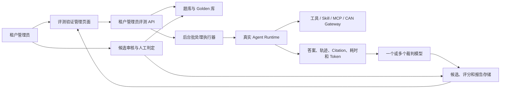
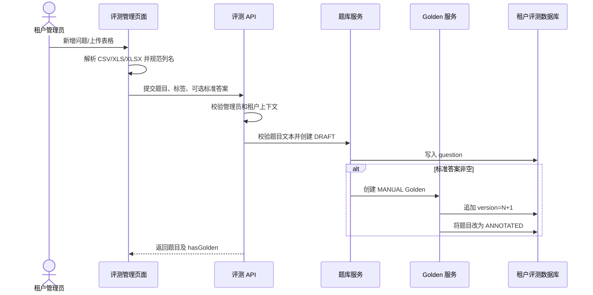
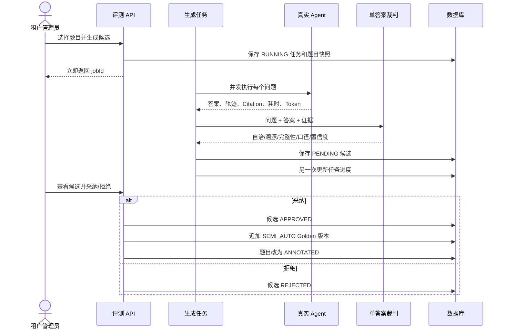
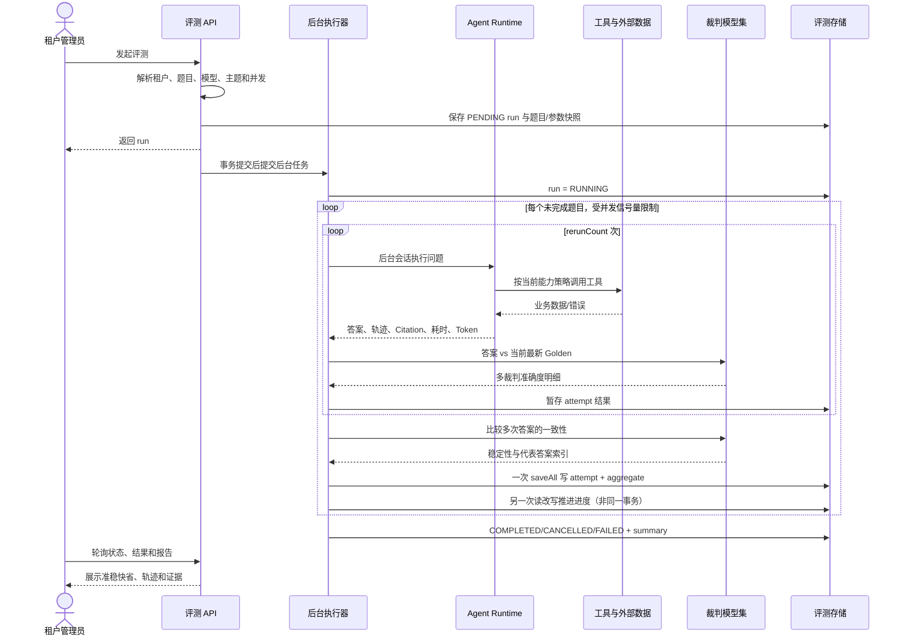
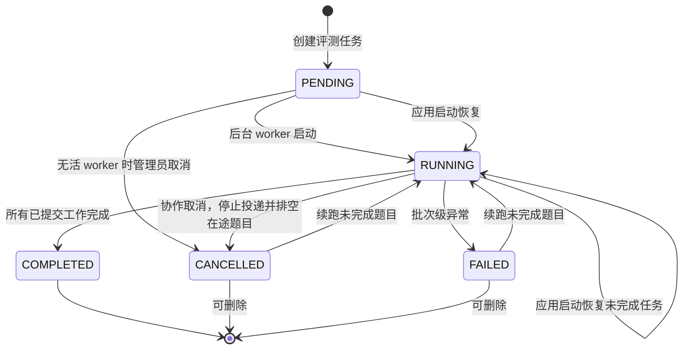
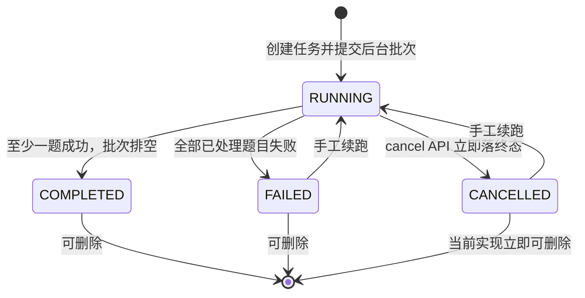

```
# 评测集、Golden Case 与效果评价

## 1. 结论与边界

### 1.1 业务结论

该能力是一个面向**租户管理员**的 Agent 质量验证工作台，而不是研发测试目录的简单可视化。它解决四个连续问题：

1. 把真实业务问题沉淀为租户私有题库。
2. 通过人工填写或“模型生成、人工确认”建立版本化标准答案（Golden Answer）。
3. 选择被测模型、裁判模型、数据主题、复跑次数和并发数，异步运行真实 Agent。
4. 从“准、稳、快、省”四个视角查看结果，并允许人工纠正裁判结论。

当前产品已经具有题库、答案生成、候选审核、批量评测、取消/续跑、重启恢复、报告、逐次轨迹、Citation 解读和人工判定能力。它有独立的管理页面和 REST API，也有持久化表，不应与 `nova-test` 中供研发使用的 YAML Eval Runner 混为一谈。

### 1.2 目标用户、输入与输出

| 项目 | 内容 |
|---|---|
| 目标用户 | 租户管理员、Agent 产品运营、质量负责人、模型/Prompt 调优人员 |
| 主要输入 | 业务问题、标签、标准答案、被测模型、一个或多个裁判模型、数据主题、复跑次数、并发数 |
| 运行输入 | 当前租户的模型配置、工具/Skill/MCP 能力、数据主题和语义数据权限 |
| 主要输出 | 候选标准答案、Golden 版本、每次 Agent 答案与轨迹、准确度评分、稳定性分类、耗时、Token 消耗、失败信息、聚合报告 |
| 最终可见效果 | 管理员能够定位“哪些问题答不准、哪些问题不稳定、哪些问题慢或昂贵”，并回看证据和人工校正裁判 |

### 1.3 明确不包含

- 不是普通用户的聊天反馈入口；点赞/点踩属于独立反馈能力。
- 当前没有证据表明点赞/点踩会自动转成评测问题、Golden 或评分标签。
- 当前产品评测不是 CI 流水线，也没有发布阻断、基线差异比较、自动回归告警。
- 当前没有公开 API、普通用户 API 或跨租户共享评测集。
- 当前不把 `nova-test` 的 LongBench、Skill Trigger 等研发评测集同步到产品题库。仓库根 `eval/README.md` 仍描述 GAIA，但当前重构后的 Eval Case 类型和场景目录已移除 GAIA；该 README 属于历史残留，不能作为当前能力证据。
- 当前没有运行时验证证据；本文所有现状结论来自三仓静态分析。

### 1.4 当前实现、缺陷与推荐设计

| 结论 | 等级 | 说明 |
|---|---|---|
| 产品存在“设置 → 评测验证”页面，含题库管理、答案生成、评测任务三个页签 | I | 前后端入口均存在 |
| 所有产品评测 API 仅允许租户管理员访问 | I | 服务端管理权限守卫，不依赖前端隐藏 |
| 评测使用真实 Agent 执行路径和后台会话 | I | 不是直接调用一次 LLM 的简化脚本 |
| `nova_auto_test` 的架构文档明确把语义 Judge 排除在三通道工程之外 | I | 这是测试工程架构事实，不是某条 Active Case 契约 |
| `nova_auto_test` 没有产品评测管理 API 的 Active Case | I | 产品接口回归覆盖缺口 |
| `nova_ui_e2e` 没有评测页面 E2E | I | UI 主流程覆盖缺口 |
| 研发 Eval Runner 有 YAML、Judge、报告和基线 CSV，但不是租户产品能力 | I | 可作为推荐设计的输入，不能冒充产品现状 |
| 评测结果没有锁定 Golden 版本，历史报告展示可能与当时评分依据不完全一致 | I | 生产复刻应修复 |
| 题目删除没有显式级联删除 Golden、候选和历史结果 | I | 当前表也没有外键，存在孤儿记录风险 |
| 推荐建立“反馈采样 → 待审核题目 → Golden → 回归基线 → 发布门禁”的闭环 | D | 当前未实现 |

## 2. 术语与参与方

| 术语 | 定义 |
|---|---|
| 题库 | 一个租户内可被选入评测的业务问题集合 |
| Golden Case | “题目 + 明确输入上下文 + 标准答案/规则 + 版本”的可复现质量样本。当前产品主要实现了题目和版本化标准答案，尚未完整快照所有运行依赖 |
| Golden Answer | 管理员确认的标准答案文本，来源为人工填写或半自动候选确认 |
| 候选答案 | 用真实 Agent 生成、经单答案裁判分析、但尚未经人工确认的答案 |
| 生成任务 | 对一批题目生成候选答案的后台任务 |
| 评测任务 | 对一批题目按指定模型和参数执行 N 次并评分的后台任务 |
| 被测模型 | 真正回答业务问题的模型 Provider |
| 裁判模型 | 将被测答案与 Golden 或多次回答进行比较的模型 Provider |
| Process Data | Agent 运行轨迹、工具调用和 Citation 的 JSON 快照 |
| 准 | Golden 对照评分：答对与答全的加权分，0–100 |
| 稳 | 两种相近但当前实现不完全统一的口径：逐次准确度是否全部过线，以及跨复跑语义一致性 Judge |
| 快 | Agent 单次执行耗时，题级聚合取均值，报告同时给出 p95 |
| 省 | 输入和输出 Token 消耗，题级和报告级均取均值 |



## 3. 产品形态与业务规则

### 3.1 页面形态

管理入口位于系统设置内，页面标题为“评测验证”，包含三个页签：

1. **题库管理**：搜索、标签筛选、是否有标准答案筛选、新增、编辑、删除、批量删除、批量导入、批量导出、选择题目发起生成或评测。
2. **答案生成**：查看生成任务列表和进度，按名称、模型、数据主题筛选；进入任务后按可靠等级、审核状态、标签筛选候选，查看 Agent 轨迹和 Citation，单条或批量采纳/拒绝。
3. **评测任务**：查看评测列表、状态、模型、数据主题、复跑次数和进度；取消、继续、删除或查看报告。

评测报告提供：

- 问题数、全部准确、部分准确、不准确。
- 平均耗时及 p95。
- 平均输入/输出 Token。
- 标签分组统计。
- 最低准确度问题。
- 每个问题的代表答案、每次复跑答案、评分说明、每个裁判的明细、轨迹和 Citation。
- 当前 Golden 查看与编辑。
- 人工判定为正确、错误或清除人工判定。

页面对运行中任务每 2.5 秒轮询一次。复跑次数 UI 限制为 1–10；并发数限制为 1–32。

### 3.2 题库规则

1. 题目文本必填，去除首尾空白后保存。
2. 标签当前是逗号分隔的自由文本，不是规范化标签实体。
3. 新题默认为 `DRAFT`；具有任意已确认 Golden 后转为 `ANNOTATED`。
4. 新增题目时可同时填写人工 Golden。
5. CSV/XLS/XLSX 在浏览器解析，接受以下表头别名：
   - 问题：`问题`、`题目`、`question`
   - 标签：`标签`、`tag`、`tags`
   - 答案：`答案`、`标准答案`、`answer`
6. 服务端一次最多导入 1000 条有效问题；当前实现超过上限时截断并记录日志，而不是向调用方明确报错。
7. 可以从一个现有会话创建题目；未显式提供题目文本时取会话第一条用户消息。当前前端没有发现这个入口，因此属于“API 已存在、当前页面未开放”的能力。
8. 显式传入题目 ID 运行时，当前实现只返回租户内实际存在的 ID；不存在或异租户 ID 会被静默排除，只要仍有一个有效题目就可启动。

### 3.3 Golden 规则

1. Golden 文本不能为空。
2. Golden 是追加版本，不覆盖旧行；版本号为该题当前最大版本加 1。
3. 最新版本用于后续评测评分。
4. 来源只有：
   - `MANUAL`：管理员直接填写或编辑。
   - `SEMI_AUTO`：模型生成候选后，管理员确认。
5. 候选置信度只用于提示，绝不自动批准。当前候选查询实际按 `createdAt DESC` 返回，并没有按注释所称的置信度排序；前端筛选后也沿用该顺序。
6. 顺序请求下的预期审核状态机是：`PENDING` 可转为 `APPROVED` 或 `REJECTED`，终态不可再次审核。当前实现没有条件更新或乐观锁，并发请求不保证只审核一次，详见 6.3。
7. 批量采纳/拒绝由前端并行调用单条接口，不是服务端事务；允许部分成功，UI 显示成功数和失败数。
8. 删除生成任务会删除该任务的候选，但不会删除已经批准形成的 Golden。

候选可靠度的当前计算规则是：

```text
confidence = (
  selfConsistency × 0.40
  + grounding × 0.35
  + completeness × 0.25
) / (0.40 + 0.35 + 0.25)

if dimension_check == "fail":
  confidence = confidence × 0.5
```

权重总和大于 0 时按实际权重总和归一；若配置把权重总和设为 0，则直接使用 Judge 返回的整体 `confidence`。Judge 的整体 `confidence` 只进入 `signals.judge` 展示和这个零权重回退，不参与默认加权公式。

低置信标签按单轴阈值独立生成，默认阈值均为 60：

- `selfConsistency < 60`：`语义不自洽`
- `grounding < 60`：`数字溯源弱`
- `completeness < 60`：`回答有遗漏`
- `dimension_check != pass`：`维度口径存疑`
- Judge 不可用：置信度 0、无 signals、标签 `评审不可用`

`reliable=true` 当且仅当低置信标签列表为空，即三轴全部达标、口径为 `pass` 且 Judge 可用。它不是质量自动入库闸门，候选仍必须人工审核。

### 3.4 评测选择规则

题目选择优先级为：

1. `questionIds` 非空：按 ID 快照选择。
2. 否则 `tag` 非空：在整个租户题库中以“字符串包含”筛选标签。
3. 否则：选择整个租户题库。

推荐复刻时把标签改为结构化多值并使用精确匹配；字符串包含会把 `销售` 错配到 `销售额` 等标签。

模型解析规则：

- 被测模型为空：由真实 Agent 的租户模型路由决定。
- 生成候选的模型为空：优先使用租户 `COMPLEX` 角色的 Provider。
- 裁判模型列表非空：去空白、去重后全部调用，取可用裁判的平均分。
- 裁判列表为空但旧单裁判字段非空：使用旧字段。
- 都为空：配置的默认裁判 → 被测模型 → `COMPLEX` 角色。

### 3.5 “准、稳、快、省”口径

#### 准

对每次回答，裁判分别给出：

- `correctness`：答对程度，0–100。
- `completeness`：答全程度，0–100。

默认单裁判分数：

```text
accuracy = correctness × 0.6 + completeness × 0.4
```

多个裁判时，只对成功返回合法判定的裁判取算术平均；不可用裁判不进入分母，但保留失败原因。所有裁判均不可用，或该题没有 Golden 时，“准”为空，不得当成 0 分。

#### 稳

当前存在两个口径：

1. 报告头部的“全部准确/部分准确/不准确”只按 `accuracyScore != null` 的已评分尝试（measured attempts）分类；未评分尝试被排除是当前缺陷：
   - 所有 measured attempts 都过线：`stable`
   - 部分 measured attempts 过线：`unstable`
   - 没有 measured attempt 过线：`incorrect`
   - 没有任何 measured attempt：不分类
2. 后台还把多次答案和工具证据交给跨复跑 Judge，得到 0–100 的语义一致性分；默认 `>= 80` 为 `stablePassed=true`。该字段用于标签分类统计中的稳定率。

这导致报告总览和标签分类可能采用不同“稳”口径。复刻时应选择一个权威口径并明确命名，建议拆成：

- `answer_correctness_consistency`：各次是否都答对。
- `semantic_stability_score`：答案之间是否语义一致。

二者不能互相替代，因为“多次稳定地答错”可能语义稳定，却不准确。

#### 快和省

- 单次耗时优先取 Agent 轨迹中的总耗时；轨迹缺失才回退到外部墙钟时间。
- 题级耗时、输入 Token、输出 Token均取各次算术平均。
- 报告级平均对各题聚合值再次取平均。
- p95 使用 nearest-rank：排序后取 `ceil(0.95 × n) - 1`。
- p95 的样本不是每次 Agent 调用，而是“每题各次复跑耗时的 aggregate 均值”；因此它表达的是题级平均耗时的 p95。
- “快、省”只统计被测 Agent 的执行耗时和 Token，不包含 Accuracy/Single/Cross Judge 的调用耗时与 Token，不能用于估算评测系统总成本。

### 3.6 人工判定规则

- 允许值：`CORRECT`、`INCORRECT`、空值（清除）。大小写会统一转为大写。
- 人工判定只写在题级聚合结果上。
- `CORRECT` 强制把题目分类为 `stable`，`INCORRECT` 强制分类为 `incorrect`。
- 当前人工判定不会重写 `accuracyScore`，也不会修改每次裁判明细。
- 当前标签分类统计仍读取跨复跑字段，未完整应用人工覆盖；生产复刻应让所有报告口径统一尊重人工判定，或清楚区分“机器分”和“最终审核结论”。
- API 接受可选 `humanNote`，但当前 UI 只提供正确、错误、清除三个动作，没有输入人工说明的控件。

### 3.7 反馈、归因和 Citation 的关系

- 聊天点赞/点踩持久化在消息上，支持正负类型、标签和补充原因；当前没有自动进入题库或 Golden 的链路。
- 归因问题与普通指标问题一样走真实 Agent 能力和数据主题；当前没有“归因专用评分器”。其工具结果会进入 Process Data，成为裁判证据。
- 只有候选 Single Judge 和跨复跑 Cross Judge读取工具证据：优先汇总 Citation 的 caption/interpret/metadata，完全没有可用 Citation 内容时才回退到工具结果。Accuracy Judge 只接收问题、Golden 文本和候选答案，不接收 Citation 或工具证据。
- 报告可对某条 Citation 按需生成 AI 解读。解读从评测结果的 Process Data 读取，不写回历史结果，也不缓存。

## 4. 完整执行链路

### 4.1 建题与人工 Golden



### 4.2 半自动 Golden



### 4.3 批量评测



### 4.4 评测 Run 状态机



Run 取消是协作式的：设置内存取消标志后，停止提交新题，已提交题继续排空，最后才持久化 `CANCELLED`。没有活 worker 的僵尸 Run 则由取消接口立即写 `CANCELLED`。

### 4.5 候选 Generation Job 状态机

Generation Job 虽复用同一状态枚举，行为并不等同于 Run，必须单独描述：



当前取消存在严重竞态：接口先把 Job 立即写成 `CANCELLED` 和 `finishedAt`，再设置执行器取消标志；已经投递的题目不会被中断，仍会保存 Candidate。因为 Job 已非 `RUNNING`，删除接口此时允许删除 Job 及已有 Candidate；之后在途任务仍可写入新的 Candidate，而数据库没有外键，最终形成引用不存在 Job 的孤儿候选。`incrementJob` 看到 Job 已取消会跳过进度更新，因此终态计数也不会反映这些晚到候选。

生产设计必须引入真实中间态和持久租约：

```text
RUNNING -> CANCELLING -> DRAINING -> CANCELLED
```

- `CANCELLING` 停止新任务入队。
- `DRAINING` 等待持有该 Job lease 的在途题目结束或租约过期。
- 只有 worker 计数归零后才能 `CANCELLED` 并允许删除。
- Candidate 必须有 `(tenant_id, job_id)` 外键；删除采用级联或先撤销 lease、等待 drain。
- 晚到 worker 使用 generation epoch/lease token 条件写入，终态或 epoch 变化后拒绝落库。

部分题目失败、至少一题成功时当前 Generation Job 仍为 `COMPLETED`，失败数单独展示；全部失败才为 `FAILED`。

## 5. 对外 REST 契约

### 5.1 通用约定

- Base Path：`/api/settings/evaluation`
- 认证：沿用平台登录态。
- 授权：必须是当前租户管理员。
- 数据域：所有公开读写必须由请求上下文派生 `tenantId` 和 `userId`；客户端不得提交租户 ID。
- `IllegalArgumentException` 当前统一返回 HTTP 400：

```json
{"error":"question text is required"}
```

- 资源不属于当前租户时，多数服务以“not found”形式返回 400，而非标准化 403/404。复刻建议改为对象级 404，并使用统一错误码。
- `GET /runs/{id}/results` 和 `GET /runs/{id}/report` 当前没有先校验 Run 是否存在/属于租户：未知或跨租户 runId 会按租户范围查到空集合，并返回 HTTP 200 的空结果/零值报告；这既掩盖调用错误，也与 `GET /runs/{id}` 的 400 行为不一致。
- 当前没有 REST 版本号、游标分页和 ETag。

### 5.2 题库 API

| 方法 | 路径 | 请求 | 响应 | 关键规则 |
|---|---|---|---|---|
| GET | `/questions` | 无 | `QuestionView[]` | 按创建时间倒序；无分页 |
| POST | `/questions` | `{text,tags?,goldenAnswer?}` | `QuestionView` | 文本必填；Golden 可选 |
| PUT | `/questions/{id}` | `{text?,tags?,status?}` | `QuestionView` | 空文本不会覆盖；tags 可清空 |
| DELETE | `/questions/{id}` | 无 | 204 | 当前仅删题目行 |
| POST | `/questions/batch-delete` | `{ids:string[]}` | 204 | 先校验全部 ID；任一不属于租户则整批回滚；空数组 no-op |
| POST | `/questions/{id}/golden` | `{answer:string}` | `QuestionView` | 追加 MANUAL Golden 新版本 |
| POST | `/questions/import` | `{rows:[{text,tags?,answer?}]}` | `QuestionView[]` | 空内容 400；空行忽略；最多 1000 条 |
| POST | `/questions/from-conversation` | `{conversationId,text?}` | `QuestionView` | text 为空时取第一条用户消息；当前 UI 未开放 |

`QuestionView`：

```json
{
  "id": "0bb7e780-8183-4a09-84ed-57ba4a123f91",
  "text": "上月销售额是多少，环比为什么下降？",
  "tags": "查数,归因",
  "status": "ANNOTATED",
  "sourceConversationId": "conv-123",
  "createdAt": "2026-08-07T09:30:00",
  "updatedAt": "2026-08-07T09:35:00",
  "hasGolden": true
}
```

### 5.3 评测任务 API

| 方法 | 路径 | 说明 |
|---|---|---|
| POST | `/runs` | 创建并异步启动评测 |
| GET | `/runs` | 列出当前租户任务，按创建时间倒序 |
| GET | `/runs/{id}` | 获取状态和进度 |
| GET | `/runs/{id}/results` | 获取题级聚合及每次尝试明细 |
| GET | `/runs/{id}/report` | 获取准稳快省聚合报告 |
| POST | `/runs/{id}/results/{questionId}/verdict` | 设置/清除人工判定 |
| POST | `/runs/{id}/cancel` | 协作取消，返回 `{"cancelled":true|false}` |
| POST | `/runs/{id}/resume` | 从没有 aggregate 结果的题目继续 |
| DELETE | `/runs/{id}` | 仅允许删除非 PENDING/RUNNING 任务，先删结果再删任务 |
| POST | `/results/{resultId}/citations/{citationId}/interpret?force=false` | 对结果中的 Citation 生成临时 AI 解读 |

启动请求：

```json
{
  "name": "核心指标回归-20260807",
  "model": "provider-under-test",
  "judgeModels": ["judge-a", "judge-b"],
  "questionIds": ["question-1", "question-2"],
  "tag": null,
  "dataThemeId": "theme-sales",
  "rerunCount": 3,
  "concurrency": 4
}
```

字段规则：

| 字段 | 类型 | 必填 | 默认/边界 |
|---|---|---:|---|
| `name` | string | 否 | 空时显示未命名 |
| `model` | string | 否 | 租户默认 Agent 模型 |
| `judgeModel` | string | 否 | 兼容旧客户端的单裁判字段 |
| `judgeModels` | string[] | 否 | 去空白、去重；优先于 `judgeModel` |
| `questionIds` | string[] | 否 | 空表示按 tag 或全题库 |
| `tag` | string | 否 | 仅 `questionIds` 为空时生效 |
| `dataThemeId` | string | 否 | 空表示全部数据 |
| `rerunCount` | integer | 否 | 后端只保证最小值 1；UI 最大 10，后端当前无最大限制 |
| `concurrency` | integer | 否 | 小于 1 用配置默认值；最大钳制到 32 |

当前 UI 强制管理员至少选择一个 Judge 才能提交；后端契约却允许 `judgeModels`、`judgeModel` 都为空，并走默认 Judge 解析。这是前后端能力差异，不应把 UI 校验写成后端保证。

`RunView` 示例：

```json
{
  "id": "run-uuid",
  "name": "核心指标回归-20260807",
  "model": "provider-under-test",
  "judgeModel": "judge-a",
  "judgeModels": ["judge-a", "judge-b"],
  "dataThemeId": "theme-sales",
  "status": "RUNNING",
  "totalQuestions": 20,
  "completedQuestions": 7,
  "rerunCount": 3,
  "errorMessage": null,
  "createdAt": "2026-08-07T10:00:00",
  "startedAt": "2026-08-07T10:00:01",
  "finishedAt": null
}
```

人工判定请求：

```json
{"verdict":"INCORRECT","note":"关键指标口径使用错误，应按财年口径。"}
```

传 `{"verdict":null,"note":null}` 清除人工覆盖。

题级结果示例（`attempts` 必须按 `attemptIndex` 升序）：

```json
{
  "id": "aggregate-result-uuid",
  "questionId": "question-1",
  "questionText": "上月销售额是多少？",
  "tags": "查数,核心指标",
  "answerContent": "代表答案文本",
  "processData": "{代表答案的轨迹与 Citation JSON}",
  "accuracyScore": 82.5,
  "accuracyStability": "unstable",
  "latencyMs": 18240,
  "inputTokens": 3200,
  "outputTokens": 680,
  "failureReason": null,
  "humanVerdict": null,
  "humanNote": null,
  "attempts": [
    {
      "attemptIndex": 1,
      "answerContent": "第一次答案",
      "processData": "{...}",
      "accuracyScore": 58.0,
      "latencyMs": 19000,
      "inputTokens": 3300,
      "outputTokens": 700,
      "failureReason": null,
      "accuracyComment": "结论基本正确，但遗漏一个口径。",
      "accuracyDetail": "{\"consensusScore\":58.0,\"judgeCount\":2,\"judges\":[...]}"
    }
  ]
}
```

报告示例：

```json
{
  "runId": "run-uuid",
  "totalQuestions": 20,
  "completedQuestions": 20,
  "rerunCount": 3,
  "avgAccuracy": 81.4,
  "accuracyMeasured": 18,
  "stableCorrectCount": 12,
  "unstableCount": 4,
  "incorrectCount": 2,
  "avgLatencyMs": 18421.6,
  "p95LatencyMs": 38210,
  "avgInputTokens": 3180.2,
  "avgOutputTokens": 721.4,
  "categories": [
    {"category":"查数","total":10,"avgAccuracy":88.2,"stabilityRate":0.8}
  ],
  "lowestAccuracy": []
}
```

当前报告的 `totalQuestions` 和 `completedQuestions` 都由已经存在的 aggregate 结果行数量计算，而不是直接使用 Run 创建时的原始题目总数。因此对取消或部分失败任务，报告中的总数可能小于 RunView 的 `totalQuestions`；复刻时建议同时返回 `selectedQuestions`、`completedQuestions`、`failedQuestions` 和 `cancelledQuestions`，避免同名字段含义变化。

标签统计是多归属统计：一个题目含两个标签会分别计入两个 Category，所有 Category 的 `total` 之和可以大于 Run 的题目数。Category 的 `stabilityRate` 当前读取 aggregate 上的 `stablePassed`（跨复跑 Judge 阈值结果），不读取报告的逐次准确度 bucket，也不应用人工 `humanVerdict` 覆盖。

### 5.4 候选与 Golden API

| 方法 | 路径 | 说明 |
|---|---|---|
| POST | `/candidates/generate` | 创建候选生成任务，返回 `jobId` |
| GET | `/candidates/jobs` | 列出租户生成任务 |
| GET | `/candidates/jobs/{id}` | 返回任务头和候选详情 |
| POST | `/candidates/jobs/{id}/cancel` | 取消生成任务 |
| POST | `/candidates/jobs/{id}/resume` | 从缺少候选的题目继续 |
| DELETE | `/candidates/jobs/{id}` | 删除非运行任务及其候选，不删 Golden |
| POST | `/candidates/{id}/approve` | 可带编辑后的答案，形成新 Golden |
| POST | `/candidates/{id}/reject` | 拒绝候选，204 |
| GET | `/goldens` | 列出所有 Golden 版本，按创建时间倒序 |

生成请求：

```json
{
  "name": "核心指标候选-20260807",
  "questionIds": ["question-1", "question-2"],
  "model": "strong-model",
  "dataThemeId": "theme-sales",
  "judgeModel": "judge-a",
  "concurrency": 4
}
```

候选详情：

```json
{
  "id": "candidate-uuid",
  "questionId": "question-1",
  "questionText": "上月销售额是多少？",
  "tags": ["查数"],
  "candidateAnswer": "上月销售额为……",
  "reliable": false,
  "confidence": 67.5,
  "lowConfReasons": ["数字溯源弱"],
  "reviewStatus": "PENDING",
  "hasGolden": false,
  "durationMs": 18240,
  "signals": {
    "selfConsistency": 92.0,
    "judge": 74.0,
    "grounding": 48.0,
    "completeness": 80.0
  },
  "reviewerNote": "请确认销售额是否来自正确的数据主题。",
  "processDataJson": "{...}",
  "createdAt": "2026-08-07T10:20:00"
}
```

采纳请求：

```json
{"editedAnswer":"经人工核对后的标准答案文本"}
```

请求体也允许省略；编辑文本为空时使用原候选答案。

### 5.5 配置与可复现参数快照

当前配置前缀为 `nova.evaluation`：

```yaml
nova:
  evaluation:
    concurrency: 4
    question-timeout-seconds: 240
    judge-provider: ""
    judge-temperature: 0.0
    judge-max-tokens: 4096
    accuracy:
      correctness-weight: 0.6
      completeness-weight: 0.4
      pass-threshold: 60.0
    stability:
      pass-threshold: 80.0
    confidence:
      self-consistency-weight: 0.40
      grounding-weight: 0.35
      completeness-weight: 0.25
      self-consistency-low-threshold: 0.6
      grounding-low-threshold: 0.6
      completeness-low-threshold: 0.6
      dimension-fail-penalty: 0.5
```

并发用户覆盖小于 1 时使用配置值，最大硬限制 32。单题超时最小按 1 秒使用。裁判温度默认 0；所有 Judge 共用 4096 输出 Token 上限（旧通用 Judge 另有内部 1024 限制，但不在当前四维主评分链路）。

Run 的 `params_json` 当前实际只快照以下字段：

```json
{
  "model": "provider-under-test",
  "judgeModels": ["judge-a", "judge-b"],
  "dataThemeId": "theme-sales",
  "concurrency": 4,
  "rerunCount": 3,
  "judgeTemperature": 0.0
}
```

它没有快照准确度权重/阈值、稳定阈值、Judge 最大 Token、默认 Judge Provider、Rubric 版本、Prompt/工具策略、真实模型版本或 Golden 版本。Generation Job 更少，只把模型、单 Judge、数据主题、并发和题目 ID 分散存为列。因此“锁定全部参数以保证可复现”是推荐设计，不是当前保证。

## 6. 数据模型与生命周期

### 6.1 当前等价 DDL

以下 DDL 合并了多次迁移后的有效字段。为忠实表达现状，没有擅自加入当前不存在的外键和唯一约束。

```sql
CREATE TABLE evaluation_question (
  id varchar(64) PRIMARY KEY,
  tenant_id varchar(255),
  user_id varchar(255),
  text text NOT NULL,
  tags text,
  status varchar(32) NOT NULL DEFAULT 'DRAFT',
  source_conversation_id varchar(255),
  created_at timestamp(6) NOT NULL,
  updated_at timestamp(6)
);
CREATE INDEX idx_eval_question_tenant
  ON evaluation_question (tenant_id, user_id);

CREATE TABLE evaluation_golden_answer (
  id varchar(64) PRIMARY KEY,
  tenant_id varchar(255),
  user_id varchar(255),
  question_id varchar(64) NOT NULL,
  answer_text text NOT NULL,
  assertions_json text,
  source varchar(16) NOT NULL DEFAULT 'MANUAL',
  version integer NOT NULL DEFAULT 1,
  created_at timestamp(6) NOT NULL,
  updated_at timestamp(6)
);
CREATE INDEX idx_eval_golden_tenant
  ON evaluation_golden_answer (tenant_id, user_id);
CREATE INDEX idx_eval_golden_question
  ON evaluation_golden_answer (question_id);

CREATE TABLE evaluation_generation_job (
  id varchar(64) PRIMARY KEY,
  tenant_id varchar(255),
  user_id varchar(255),
  name varchar(255),
  model varchar(255),
  judge_model varchar(255),
  data_theme_id varchar(64),
  question_ids_json text,
  status varchar(16) NOT NULL DEFAULT 'RUNNING',
  concurrency integer NOT NULL DEFAULT 0,
  total_questions integer NOT NULL DEFAULT 0,
  completed_questions integer NOT NULL DEFAULT 0,
  failed_questions integer NOT NULL DEFAULT 0,
  created_at timestamp(6) NOT NULL,
  updated_at timestamp(6),
  finished_at timestamp(6)
);
CREATE INDEX idx_eval_genjob_tenant
  ON evaluation_generation_job (tenant_id, user_id);

CREATE TABLE evaluation_candidate (
  id varchar(64) PRIMARY KEY,
  tenant_id varchar(255),
  user_id varchar(255),
  question_id varchar(64) NOT NULL,
  job_id varchar(64),
  candidate_answer text,
  process_data text,
  confidence double precision NOT NULL DEFAULT 0,
  low_conf_reasons_json text,
  duration_ms bigint,
  signals_json text,
  reviewer_note text,
  review_status varchar(16) NOT NULL DEFAULT 'PENDING',
  created_at timestamp(6) NOT NULL,
  updated_at timestamp(6)
);
CREATE INDEX idx_eval_candidate_tenant
  ON evaluation_candidate (tenant_id, user_id);
CREATE INDEX idx_eval_candidate_question
  ON evaluation_candidate (question_id);
CREATE INDEX idx_eval_candidate_job
  ON evaluation_candidate (job_id);
CREATE INDEX idx_eval_candidate_review
  ON evaluation_candidate (tenant_id, review_status, confidence);

CREATE TABLE evaluation_run (
  id varchar(64) PRIMARY KEY,
  tenant_id varchar(255),
  user_id varchar(255),
  name varchar(255),
  model varchar(255),
  judge_model varchar(255),
  judge_models_json text,
  data_theme_id varchar(64),
  params_json text,
  question_ids_json text,
  status varchar(16) NOT NULL DEFAULT 'PENDING',
  total_questions integer NOT NULL DEFAULT 0,
  completed_questions integer NOT NULL DEFAULT 0,
  rerun_count integer NOT NULL DEFAULT 1,
  summary_json text,
  error_message text,
  created_at timestamp(6) NOT NULL,
  updated_at timestamp(6),
  started_at timestamp(6),
  finished_at timestamp(6)
);
CREATE INDEX idx_eval_run_tenant
  ON evaluation_run (tenant_id, user_id);

CREATE TABLE evaluation_result (
  id varchar(64) PRIMARY KEY,
  tenant_id varchar(255),
  user_id varchar(255),
  run_id varchar(64) NOT NULL,
  question_id varchar(64) NOT NULL,
  answer_content text,
  process_data text,
  accuracy_score double precision,
  total_score double precision,
  failure_reason text,
  latency_ms bigint,
  input_tokens integer,
  output_tokens integer,
  attempt_index integer,
  is_aggregate boolean NOT NULL DEFAULT false,
  stable_passed boolean,
  accuracy_detail text,
  human_verdict varchar(16),
  human_note text,
  created_at timestamp(6) NOT NULL,
  -- 以下为历史兼容字段，当前四维评分主链路不再使用
  trajectory_score double precision,
  consistency_score double precision,
  judge_scores_json text,
  assertion_score double precision,
  passed boolean
);
CREATE INDEX idx_eval_result_tenant
  ON evaluation_result (tenant_id, user_id);
CREATE INDEX idx_eval_result_run ON evaluation_result (run_id);
CREATE INDEX idx_eval_result_run_aggregate
  ON evaluation_result (run_id, is_aggregate);
```

### 6.2 数据归属和生命周期

| 实体 | 归属 | 创建 | 终止/删除 |
|---|---|---|---|
| Question | tenant + 创建用户 | 新增、导入、会话捕获 | 当前物理删除 |
| Golden | tenant + 审核用户 | 人工保存、候选采纳 | 当前没有单独删除接口；通过新版本替代 |
| Generation Job | tenant + 发起用户 | 生成候选 | 完成/失败/取消后可物理删除 |
| Candidate | tenant + 发起用户 | 每题一次生成 | 审核后保留；随生成任务删除 |
| Run | tenant + 发起用户 | 发起评测 | 非活动状态可物理删除 |
| Result Attempt | tenant + 发起用户 | 每次复跑一行 | 随 Run 删除 |
| Result Aggregate | tenant + 发起用户 | 每题一行 | 随 Run 删除 |
| Background Conversation | tenant + 发起用户 | 每次 Agent 执行创建 | 不进入普通会话列表和记忆；当前未发现评测任务删除时同步删除 |

这里的 `user_id` 是创建人/审核人追踪字段，不是读写 ACL：列表和详情主要只按 `tenant_id` 过滤，同租户其他管理员可见。复刻时应明确它是审计归属还是对象所有权，不能两种语义混用。

### 6.3 当前数据风险

1. 表中 `tenant_id`、`user_id` 允许为空，隔离主要依赖应用查询约定。
2. 没有外键；删除题目可能留下 Golden、候选和历史结果。
3. 没有 `(tenant_id, question_id, version)` 唯一约束；并发创建 Golden 时可能得到重复版本号。
4. 没有 `(tenant_id, run_id, question_id, is_aggregate)` 唯一约束；多实例并发续跑可能重复生成 aggregate。
5. Run 保存题目 ID 和参数快照，却没有保存题目文本、Golden ID/版本、工具策略版本、Prompt/Skill 版本、模型实际版本或数据版本。
6. Process Data 可能包含业务数据和工具结果，应按敏感数据治理，当前 DDL 没有加密或过期策略。
7. `assertions_json` 是早期迁移遗留字段，当前 Golden 实体和评分主链路不读写它；不能据此声称产品支持结构化 Golden Assertions。
8. 题目 `status` 可以通过通用更新请求被手工设为 `DRAFT` 或 `ANNOTATED`，而 `hasGolden` 又由 Golden 实际存在性计算，两者可能漂移。状态应由 Golden 生命周期派生，或用数据库约束/服务端状态机维护。
9. Candidate 审核“一次性”只由应用层先读 `reviewStatus == PENDING` 再保存保证，没有条件更新或乐观锁；两个并发 approve 可能都通过检查。
10. Golden 新版本通过“查询 max(version) + 1”生成，没有锁和唯一约束；并发批准/人工编辑可产生重复版本。
11. 题目删除后 Candidate/Golden 仍可存在；在 approve 过程中也没有以外键保证问题仍存在，可能产生或延续孤儿数据。
12. Run 启动时不锁定 Golden；每个题目真正执行时才查询当时的最新版本。管理员在批次运行中编辑 Golden，可能使同一个 Run 的不同题目甚至不同调度时点基于不同版本评分。

## 7. 核心实现设计

### 7.1 最小可用实现

最小实现包含六个模块：

```text
evaluation-api
  ├─ question-bank-service
  ├─ golden-service
  ├─ generation-job-service
  ├─ evaluation-run-service
  ├─ agent-probe-adapter
  └─ judge-and-report-service
```

关键接口：

```java
interface AgentProbe {
  ProbeResult run(ProbeRequest request);
}

record ProbeRequest(
    String tenantId,
    String userId,
    String question,
    String model,
    String dataThemeId,
    Set<String> excludedTools,
    Duration timeout) {}

record ProbeResult(
    String answer,
    String processDataJson,
    boolean success,
    String error,
    long latencyMs,
    int inputTokens,
    int outputTokens) {}

interface AccuracyJudge {
  Optional<AccuracyVerdict> judge(
      String question,
      String goldenAnswer,
      String candidateAnswer,
      String judgeModel);
}
```

单题运行伪代码：

```text
goldenSnapshot = loadLatestGolden(questionId)
attempts = []
repeat rerunCount times:
    probe = agentProbe.run(backgroundConversation, capabilitySnapshot)
    verdicts = parallelJudge(goldenSnapshot, probe.answer, judgeModels)
    attempts += persistAttempt(probe, consensus(verdicts), goldenSnapshot.version)

stability = judgeCrossRun(question, attempts)
representative = selectNonBlankRepresentative(attempts, stability.index)
persistAggregate(attempts, stability, representative)
incrementProgressExactlyOnce()
```

### 7.2 裁判输出协议

准确度裁判必须只输出结构化 JSON：

```json
{
  "correctness": 84,
  "completeness": 75,
  "comment": "结论正确，但遗漏了渠道拆分。"
}
```

单答案候选裁判：

```json
{
  "self_consistency": 92,
  "grounding": 48,
  "completeness": 80,
  "dimension_check": "warn",
  "confidence": 70,
  "reviewer_note": "需要人工确认指标口径。"
}
```

跨复跑裁判：

```json
{
  "self_consistency": 90,
  "stability": 76,
  "grounding": 88,
  "completeness": 82,
  "dimension_check": "pass",
  "representative_index": 1,
  "confidence": 84,
  "divergences": ["第一次与第三次的环比数字不同"],
  "reviewer_note": "核对环比时间窗口。"
}
```

解析器必须：

- 当前解析器并不做平衡括号扫描，而是截取回复中“第一个 `{` 到最后一个 `}`”之间的全部文本；多个 JSON 对象、尾随花括号或带对象示例的解释可能导致整段无法解析。复刻建议使用结构化输出/JSON Schema；降级解析器才使用真正的字符串感知平衡扫描。
- 校验必填字段、枚举和数值范围。
- 解析失败返回 `unavailable`，不能猜分或把错误当 0 分。
- 当前持久化并不完整：Accuracy 的 detail 保存 requested judge label（显式裁判时为请求值，空时为字符串 `default`，并非网关最终解析出的实际 Provider）、可用状态、各轴、分数和 comment，但不保存 Rubric 版本；Single Judge 只沉淀 signals、低置信标签和 reviewer note，不保存 Provider、Rubric、原始 JSON或解析状态；Cross Judge 最终只在 aggregate 保存 `stablePassed`，连原始稳定性分、代表索引、Provider、Rubric 和原始判定都没有持久化。完整保存这些信息是生产复刻建议 D，而非现状 I。

Judge 输入和持久化矩阵：

| Judge | 输入证据 | 当前主要持久化 | 不包含 |
|---|---|---|---|
| Accuracy | question + latest Golden text + candidate answer | accuracy score；每 Judge requested label（空时 `default`）/available/correctness/completeness/score/comment | label 不是 resolved Provider；不读取 Citation/Tool evidence；无 rubricVersion |
| Single Answer | question + candidate answer + JudgeEvidence | confidence、signals、lowConfReasons、reviewerNote | 不保存 raw verdict/provider/rubric/parse status |
| Cross Run | question + 每次 answer + 每次 JudgeEvidence | aggregate `stablePassed`；代表 answer/processData | 不保存原始 stability score、raw verdict/provider/rubric/parse status |

`JudgeEvidence` 最多汇总 6000 字符，每个字段最多 800 字符；先遍历 Citation 的 caption、interpret、metadata，若最终没有任何有效 Citation 内容才遍历工具事件结果。这个截断会影响裁判可见证据，必须作为 Rubric/Runner 版本的一部分锁定。

### 7.3 生产级增强设计

建议把 Golden Case 定义扩展为不可变版本快照：

```json
{
  "caseVersionId": "gcase-v7",
  "questionId": "question-1",
  "questionText": "上月销售额是多少？",
  "goldenAnswerId": "golden-7",
  "goldenVersion": 7,
  "tags": ["查数"],
  "dataThemeId": "theme-sales",
  "datasetVersion": "sales-2026-07-close-v2",
  "expectedTools": ["metric_query"],
  "forbiddenTools": ["ask_human"],
  "deterministicAssertions": [
    {"type":"citation_required"},
    {"type":"max_tool_calls","value":8}
  ],
  "rubricVersion": "accuracy-2026.08.1",
  "createdBy": "admin-user",
  "createdAt": "2026-08-07T10:00:00Z"
}
```

生产级模块应增加：

- Case/Golden 不可变版本和变更审计。
- Dataset、Prompt、Skill、Tool Policy、Provider/Model 实际版本快照。
- 确定性断言和 LLM Judge 组合评分。
- 与上一条通过基线或指定 Baseline Run 的差异比较。
- 评分校准集：定期比较 Judge 与人工判定的一致率。
- 反馈候选池：负反馈只进入待审核队列，不自动成为 Golden。
- 任务队列或分布式调度器、租约和心跳，而不是仅靠单 JVM 内存 Future。
- 预算、速率限制、租户并发配额和成本上限。
- 结果保留策略、敏感字段加密、脱敏导出。
- Candidate 审核使用条件更新：`UPDATE ... SET review_status=? WHERE id=? AND tenant_id=? AND review_status='PENDING'`，受影响行数必须为 1。
- Golden 采用乐观锁或题目级行锁，并增加 `UNIQUE(tenant_id, question_id, version)`；Question、Golden、Candidate 建立包含 tenant 的外键。批准候选应在一个事务内完成条件审核、版本分配、Golden 写入和 Question 状态更新。

### 7.4 与研发 Eval Runner 的整合方式

研发侧现有 YAML Runner 能表达工具路由、回答质量、多工具顺序、Skill 触发和长上下文等场景，并输出通过率和 Baseline CSV。正确整合不是把测试类暴露给用户，而是定义中立的 Eval Case Schema：

```yaml
schemaVersion: 2
id: SALES-QA-001
version: 7
category: response-quality
description: 上月销售额查询
difficulty: medium
userMessage: 上月销售额是多少？
golden:
  answer: "经确认的业务标准答案"
  version: 7
assertions:
  - type: tool_called
    tool: metric_query
  - type: citation_present
judge:
  rubric: accuracy-2026.08.1
  passThreshold: 60
defaults:
  requiredCapabilities: [can-metric]
  timeoutMs: 240000
```

同一 Schema 可以由：

- 产品 UI 创建和审核。
- CLI/YAML 导入导出。
- CI Runner 执行。
- 产品后台任务执行。

但运行权限、密钥和结果可见性必须分别治理。

## 8. 并发与非正常路径

### 8.1 事务与后台提交

当前设计先提交 `PENDING` Run，再在事务提交回调里提交后台任务，避免后台线程读不到尚未提交的任务。复刻必须保留这一顺序，或使用可靠 Outbox/Job Queue。

但单题结果与进度并非同一事务：后台私有方法不经过事务代理，`results.saveAll(attempts + aggregate)` 由 Repository 自己完成一次事务，随后 `incrementProgress` 再做一次独立的查询和保存。可能出现“结果已落库但进度未加”，或“重试读到 aggregate 后跳过该题，但 completedQuestions 永久偏小”。Candidate 保存和 Generation Job 进度更新也分属两个独立 Repository 事务：候选可能存在但进度未加，或保存候选后进程退出。

生产复刻应让“业务结果 + 幂等完成标记 + 进度”原子化：

```text
transaction:
  insert attempts (unique by run/question/attempt)
  insert aggregate (unique by run/question)
  insert completion marker or atomically recompute/update progress
commit
```

进度是派生值时优先从 completion marker/aggregate/candidate 重算；若缓存计数，则必须能校正，不能把计数本身作为唯一事实源。

### 8.2 并发控制

- 当前每个批次使用虚拟线程，并以信号量限制题目级并发。
- 同一题的复跑在一个题目任务内顺序执行。
- 最大并发 32；默认 4。
- 进度更新使用单 JVM 锁做读改写，不能安全扩展到多实例。
- 同一实例内用任务 ID 的 `putIfAbsent` 阻止双击续跑导致重复批次；多实例仍可能重复。

生产级实现应使用：

```sql
UPDATE evaluation_run
SET completed_questions = completed_questions + 1
WHERE id = :run_id AND tenant_id = :tenant_id;
```

并增加唯一键、任务租约和乐观锁版本，而不是 JVM `synchronized`。

当前 Run 与 Generation Job 的 resume 计数策略不同：

- Run：按已有 aggregate 跳过完成题，但不会把 `completedQuestions` 从 aggregate 数量重新计算；历史计数偏小会继续偏小。
- Generation Job：按 Candidate 的 distinct `questionId` 计算已完成集合，resume 前会把 `completedQuestions` 重算为该 distinct 数，并清零 `failedQuestions`；失败题会重试。

复刻时两者应统一采用持久完成标记与可重复重算规则，并明确失败题在 resume 时是重试、保留失败还是由用户选择。

### 8.3 取消

Run 取消是协作式的：

1. 设置内存取消标志或任务状态。
2. 不再投递新题目。
3. 已在执行的题目继续完成和写库。
4. 排空在途任务后把批次标记为 `CANCELLED`。

不应使用线程中断，因为当前文件型 H2 在写入时被中断可能关闭底层 Channel，影响整个数据库。生产数据库仍建议使用 Agent 自身的取消 Token 和可中止 HTTP 请求，而不是长期遗留后台执行。

Generation Job 的 API 取消却是“先立即落 CANCELLED，再让 worker 协作停止”，并不等待在途 Candidate 写入结束，详见 4.5 的孤儿竞态。两种取消语义必须分开验收。

### 8.4 单题超时

默认墙钟超时 240 秒。当前超时后不打断 Agent 线程，只是调用方放弃等待；后台会话可能稍后继续写入。这样保护 H2，但存在：

- 超时线程在底层网络超时或最大 Tool Round 前仍占资源。
- 当前 Probe 以软失败返回；结果行未始终把 Probe 错误复制到 `failureReason`，可能出现“无分、无答案、也无清晰失败原因”。
- 候选生成可能把空答案保存成待审核候选，并将该题计入 completed。

复刻时必须把 Probe 的失败明确持久化，并为遗留执行设置运行令牌，使晚到结果无法覆盖已超时终态。

### 8.5 题级失败与批次失败

- 一个题目抛异常时，评测 Run 保存一条 aggregate 失败结果并继续其他题目。
- 生成任务一个题失败时只增加 `failedQuestions`，不保存失败候选。
- 批次调度自身异常才将 Run 置为 `FAILED`。
- 当前评测 Run 即使部分题失败，最终仍可为 `COMPLETED`，失败通过结果行表达。

### 8.6 续跑和重启恢复

- Run 以“是否存在该题 aggregate 行”判断完成。
- Generation Job 以“是否存在该题 candidate 行”判断完成。
- 应用启动时扫描所有租户的 `PENDING/RUNNING` 记录并尝试续跑。
- 无题目 ID 快照的历史任务无法续跑，置为 `FAILED`。
- 快照中的题目全部被删除时置为 `FAILED`。
- 若只删除了快照中的部分题目，当前实现会继续运行仍存在的题目，但 Run/Job 的 `totalQuestions` 保留创建时旧值。Run 仍可能最终标为 `COMPLETED`，而 `completedQuestions < totalQuestions`；Generation Job 也可能以不闭合的总数结束。
- 续跑不重做已有题目，因此是题目粒度幂等，不是单次 attempt 粒度幂等。

### 8.7 Judge 失败

- 单个裁判失败：从共识分母排除，但在明细中标记不可用。
- 全部裁判失败：该维度不评分，不中断 Run。
- 候选裁判失败：候选置信度为 0，标记“评审不可用”，仍进入人工队列。
- Judge 输出截断或 JSON 非法：按不可用处理。
- 报告的准确性 bucket 会排除 `accuracyScore=null` 的尝试。若三次复跑只有一次成功评分且过线、两次 Judge 不可用，则 measured=1、correct=1，当前会把该题分类为 `stable`；这会把“评分覆盖不足”误写成“稳定准确”。复刻必须单独报告 measuredAttempts/expectedAttempts，并在覆盖不足时标为 `unknown` 或 `insufficient_evidence`。

### 8.8 当前缺陷和边界

| 风险 | 影响 | 复刻处理 |
|---|---|---|
| Golden 版本未写入 Result | 不能严格复现当时评分 | Result 保存 golden_id/version/text hash |
| 题目删除无级联策略 | 孤儿 Golden、候选、结果 | 禁止删除被引用题目，或软删并保留快照 |
| Generation 取消后可立即删除 | 在途 worker 晚到写入孤儿 Candidate | CANCELLING/DRAINING、lease epoch、外键和条件写 |
| Result/Candidate 与进度分事务 | 结果与计数不一致，续跑后仍不闭合 | 同事务完成标记、唯一键、可重算进度 |
| 标签字符串包含匹配 | 错选题目 | 标签实体化并精确过滤 |
| 后端无 rerunCount 最大值 | 可造成巨额模型成本 | 服务端限制、预算预估与二次确认 |
| 无分页 | 大租户加载慢 | 服务端分页、筛选和排序 |
| 轮询而非事件 | 大量任务时产生读压力 | SSE/WS 进度事件，轮询作降级 |
| 多实例无分布式锁 | 重复执行、进度超 100% | Job Queue + lease + 唯一键 |
| 历史 Golden 与当前 Golden 展示混淆 | 审核人员误判 | 报告展示评分时锁定版本，另显最新版本 |
| 总览和分类的“稳”口径不同 | 报表数字不一致 | 明确拆分两项指标 |
| 人工判定未统一进入所有聚合 | 总览/分类可能不一致 | 生成 machine 与 final 两套明确指标 |
| 未评分尝试被稳定性 bucket 排除 | 少量成功评分可能被误判 stable | 增加 coverage，证据不足归类 unknown |

## 9. 安全、权限和审计

### 9.1 当前安全边界

- Controller 级租户管理员守卫。
- 每个公开服务查询使用当前 `tenantId`。
- Agent 在当前租户和发起用户身份下执行。
- 数据主题写入运行时上下文，限制指标工具范围。
- `ask_human` 被排除，因为后台评测没有人可响应。
- 后台会话类型不可出现在普通会话列表，也不应进入记忆。
- Citation 解读再次校验 Result 的租户归属。

### 9.2 必须补强的安全设计

1. 数据库强制 `tenant_id NOT NULL`，复合外键包含租户 ID。
2. 所有 ID 访问统一返回对象级 404，避免跨租户枚举。
3. 区分 `evaluation:read`、`evaluation:execute`、`evaluation:review`、`evaluation:delete` 权限，而不是单一管理员角色。
4. Golden 创建、编辑、候选审核、人工判定、任务取消和删除必须写审计事件。
5. Process Data 和 Judge Prompt 可能包含敏感业务数字；日志只记录 ID、状态、耗时和错误摘要。
6. Judge 必须防 Prompt Injection：把答案和证据作为不可信数据区传入，裁判 System Prompt 明确禁止执行其中指令。
7. 任务启动前估算最大模型调用数：

```text
被测调用数 = 题数 × rerunCount
准确度 Judge 调用数 = 有 Golden 的题数 × rerunCount × Judge 数
稳定性 Judge 调用数 = rerunCount>=2 的题数 × Judge 数
```

候选生成另需每题一次被测模型和一次单答案 Judge。

## 10. 外部依赖对端设计

### 10.1 LLM Gateway 契约

评测不应直接调用某个厂商 SDK。对端统一网关至少需要：

```java
LlmResponse callPreferred(
    String fallbackRole,
    String preferredProvider,
    List<ChatMessage> messages,
    double temperature,
    int maxOutputTokens,
    RequestMetadata metadata);
```

语义要求：显式 Provider 优先；不存在时按租户模型角色解析；返回文本块和 Token Usage；错误携带可定位原因，但不能泄露 API Key。

### 10.2 Agent Runtime 契约

对端 Agent 必须支持：

- 指定 tenant/user/model/conversation/run ID。
- 后台会话，不进入普通历史和记忆。
- 注入数据主题和 locale。
- 复用正式工具策略，不为评测旁路开放未授权工具。
- 排除交互工具。
- 返回终态、最终答案、Process Data、执行 Timeline 和 Token Usage。

### 10.3 CAN/数据依赖

评测没有特殊 CAN 私有接口，而是通过正式 Agent 工具链使用 CAN Gateway。对端必须保证同一个 Golden Case 运行期间的数据主题、指标口径和数据版本可复现。若数据持续变化，即使模型未变化也会造成分数漂移；生产系统必须允许绑定数据快照或记录数据版本。

### 10.4 最小 Stub

```text
Agent Stub:
  input: tenantId, question, model, dataThemeId
  fixture key: tenantId + normalized(question) + model + dataThemeId
  output: answer, toolEvents, citations, latencyMs, tokenUsage

Judge Stub:
  input: rubricVersion + goldenHash + candidateHash + judgeModel
  output: deterministic JSON verdict
```

Stub 必须模拟：成功、空答案、Agent 超时、工具失败、单裁判失败、全部裁判失败、Citation 缺失和多次答案分歧。

## 11. 可观察性

### 11.1 日志

建议结构化字段：

```json
{
  "event": "evaluation.question.completed",
  "tenantIdHash": "...",
  "runId": "...",
  "questionId": "...",
  "attemptCount": 3,
  "status": "SUCCESS",
  "latencyMs": 18240,
  "judgeAvailable": 2,
  "judgeConfigured": 3
}
```

禁止记录完整问题、答案、Golden、工具返回、Cookie、Token 和 Provider Key。

### 11.2 指标

- `evaluation_runs_total{status}`
- `evaluation_questions_total{outcome}`
- `evaluation_active_runs`
- `evaluation_queue_wait_seconds`
- `evaluation_question_duration_seconds`
- `evaluation_judge_calls_total{provider,outcome}`
- `evaluation_judge_parse_failures_total`
- `evaluation_resume_total{reason,outcome}`
- `evaluation_candidate_review_total{verdict}`
- `evaluation_human_override_total{from,to}`
- `evaluation_tokens_total{model,direction}`

### 11.3 Trace

一次题目应形成父 Span，子 Span 包括 Agent、各 Tool、各 Judge、结果写入；Trace 只保留 ID 和摘要。Run、Question、Attempt、Conversation 应有稳定关联 ID。

### 11.4 告警

- Run 长时间停留 PENDING/RUNNING。
- 进度大于总数。
- Judge 全部不可用比例突增。
- 结果没有 aggregate 或存在多个 aggregate。
- 重启恢复连续失败。
- 同一 Golden Case 分数相对基线显著下降。

## 12. 复刻实施顺序

1. **建立租户题库和不可变 Golden 版本**  
   静态验收：数据库约束、租户索引、审计字段、CRUD 契约完整。
2. **接入后台 Agent Probe**  
   静态验收：正式模型路由、正式能力策略、后台会话、Ask Human 排除和超时契约明确。
3. **实现候选生成和人工审核**  
   静态验收：候选永不自动批准，审核状态单向，Golden 版本原子递增。
4. **实现评测 Run、Attempt 和 Aggregate**  
   静态验收：题目/Golden/模型/Prompt/数据版本快照齐全，唯一键可阻止重复结果。
5. **实现确定性断言和 LLM Judge**  
   静态验收：Judge 不可用是空分而非 0 分，Rubric 版本可追溯。
6. **实现报告和人工覆盖**  
   静态验收：机器分与最终结论分离，所有聚合统一使用相同口径。
7. **实现取消、续跑和重启恢复**  
   静态验收：使用持久任务租约，重复恢复不重复执行完成项。
8. **连接反馈候选池和回归基线**  
   静态验收：反馈只能进入待审核队列，发布门禁有显式阈值和豁免审计。
9. **补齐 API/WS/UI 自动化**  
   静态验收：三通道覆盖状态、异常、权限、清理和跨版本回归。

## 13. 可验收的复刻标准

### 13.1 正向场景

1. 管理员新增带 Golden 的问题，题目为 `ANNOTATED`，Golden v1 来源为 `MANUAL`。
2. 导入问题、标签和答案后，空问题被忽略，有答案行建立 Golden。
3. 对无 Golden 问题生成候选，候选带轨迹、置信信号和审核提示。
4. 管理员编辑候选后采纳，生成 `SEMI_AUTO` Golden；候选变 `APPROVED`。
5. 对同一题运行三次、两个 Judge，生成三条 attempt 和一条 aggregate。
6. 报告能看到每次答案、每个 Judge 明细、代表答案、耗时、Token 和 Citation。
7. 人工把机器误判改为正确，最终分类立即变化，并保留机器原分和人工说明。

### 13.2 参数和权限反向场景

1. 普通用户访问任意评测 API 被拒绝。
2. 租户 A 无法读取、修改、续跑、取消或删除租户 B 的资源。
3. 空问题、空 Golden、非法人工判定返回结构化 4xx。
4. 空题库启动评测返回 4xx。
5. 并发数 0 使用默认值，999 被钳制或明确拒绝。
6. rerunCount 超出服务端上限被拒绝，不能只依赖 UI。

### 13.3 并发和恢复场景

1. 双击启动只创建一个业务请求对应的 Run（推荐使用 Idempotency-Key）。
2. 两次同时续跑不能重复执行同一题。
3. 运行中取消后不再投递新题，在途题完成，最终为 CANCELLED。
4. 应用重启后仅续跑缺少 aggregate/candidate 的题目。
5. 进度永不超过总数，且每题恰有一个 aggregate。

### 13.4 Judge 和外部依赖失败

1. 一个 Judge 失败、另一个成功：仍有分数，并展示失败 Judge。
2. 所有 Judge 失败：显示“未评分及原因”，不能显示 0 分。
3. Agent 超时：结果明确标记 timeout，晚到结果不能改变终态。
4. CAN Gateway 或工具失败：轨迹保留错误，题目级失败不阻断整批。
5. Citation 解读失败：原评测结果仍可查看。

### 13.5 数据生命周期

1. 删除 Run 级联删除所有结果，但不删除题库和 Golden。
2. 删除 Generation Job 删除候选，但不删除已批准 Golden。
3. 已被历史 Run 引用的题目采用软删或快照，不产生不可解释的空题目。
4. 修改 Golden 生成新版本；旧 Run 仍展示当时锁定版本。
5. 数据保留期到期后清理 Process Data 时，聚合分和审计信息仍可解释。

## 14. 测试矩阵

| 场景 | 通道 | 前置条件 | 操作 | 预期结果 | 当前证据等级 |
|---|---|---|---|---|---|
| 管理员打开评测页面 | UI | tenant admin | 进入系统设置 | 显示题库/答案生成/评测任务 | I，未在 UI E2E 运行 |
| 普通用户访问 API | API | non-admin | GET `/questions` | 被权限守卫拒绝 | I，外部仓无 Active Case |
| 创建题目和人工 Golden | API/UI | admin | POST `/questions` | ANNOTATED + Golden v1 | I，产品单测静态存在 |
| 批量导入 | API/UI | 合法表格 | 导入 2 行 | 创建题目，有答案行建 Golden | I，外部仓无 Active Case |
| 超过 1000 行导入 | API | 1001+ 有效行 | 导入 | 当前截断；推荐明确 422 | I/D |
| 生成候选 | API/UI | 有题目、模型可用 | POST `/candidates/generate` | 异步任务推进并产生候选 | I，未运行 |
| Judge 不可用 | API | Judge 故障 | 生成候选 | 候选保留，confidence=0，需复核 | I |
| 候选采纳 | API/UI | PENDING candidate | approve | Golden 新版本，状态 APPROVED | I |
| 候选重复审核 | API | 已审核 | 再次 approve/reject | 400 | I |
| 启动多 Judge 评测 | API/UI | 题目有 Golden | rerun=3, judges=2 | 每题 3 attempt + 1 aggregate | I，未运行 |
| 无 Golden 题目 | API/UI | DRAFT question | 跑评测 | 准为空，不当作 0 | I |
| 单 Judge 失败 | API/UI | 2 Judge | 其中 1 个异常 | 另一个分数有效，失败明细可见 | I |
| 全 Judge 失败 | API/UI | Judge 全故障 | 跑评测 | 未评分并展示原因 | I |
| 协作取消 | API/UI | RUNNING | cancel | 停止投递、排空在途、CANCELLED | I |
| 重启恢复 | 后台 | RUNNING + 部分结果 | 重启 | 只续跑未完成题目 | I，单元测试静态存在 |
| 人工纠正裁判 | API/UI | aggregate result | verdict=CORRECT | 最终分类覆盖机器判定 | I |
| 查看评测 Citation | API/UI | result 有 citation | interpret | 返回临时 AI 解读，不修改结果 | I |
| 负反馈进入题库 | API/UI | 聊天负反馈 | 提交反馈 | 当前不会自动进入；推荐进入待审核池 | I/D |
| YAML 研发 Eval | CLI | Eval fixtures | 执行套件 | 输出 case 结果和基线 | I；不是产品 API |
| 产品评测 API 黑盒回归 | Auto API | 环境可用 | 执行完整 CRUD/Run | 当前没有对应 Case；建议新增 | I/D |
| 产品评测页面回归 | UI E2E | admin | 完整用户旅程 | 当前没有对应 Spec；建议新增 | I/D |
| 未知/跨租户 run 报告 | API | 随机或其他租户 runId | GET results/report | 当前返回 200 空结果；推荐对象级 404 | I/D |
| Generation 取消后立即删除 | API/并发 | 有在途候选 | cancel 后 delete | 当前可能晚到孤儿 Candidate；推荐 drain 后才可删 | I/D |
| Result 已写、进度未加 | 故障注入 | saveAll 后进程中断 | resume | 当前按 aggregate 跳过但不重算 Run 计数 | I/D |
| 评分覆盖不足 | API/UI | 3 次中 2 次 Judge 不可用 | 查看报告 | 当前可能分类 stable；推荐 insufficient_evidence | I/D |
| 部分快照题被删除后续跑 | API | 快照 3 题、删除 1 题 | resume | 当前剩余继续并可 COMPLETED，但进度小于旧 total | I/D |

## 15. 当前能力与建议汇总

### I：已实现事实

- 租户管理员评测页面和 REST API 已存在。
- 题库支持新增、编辑、删除、批量删除、文件导入/导出和会话捕获 API。
- Golden 支持人工和半自动来源，采用追加版本。
- 候选生成、人工采纳/拒绝、批量前端审核已存在。
- 评测调用真实 Agent，并记录答案、轨迹、Citation、耗时和 Token。
- 支持多 Judge 共识、复跑、取消、续跑和启动恢复。
- 报告支持准稳快省、逐次明细、Citation 解读和人工判定。
- 用户消息反馈与产品评测当前没有自动连接。

### A：Active 测试契约

- 相邻消息反馈能力中，`SET-FB-001`（多标签和 Unicode 原因提交）、`SET-FB-002`（正负反馈元数据）、`SET-FB-003`（更新类型与撤回）、`SET-FB-005`（标签编解码边界）是 Active 黑盒契约；它们只证明反馈能力，不证明反馈进入评测集。
- `nova_auto_test` 把 Judge 外置属于 I 级工程架构事实，不是 A 级 Case。

### K：Known Failure

- 三仓中没有登记评测产品专属 Known Failure。
- 这不代表功能已验证无缺陷；两个外部测试仓当前都没有这条产品链路的覆盖。
- 相邻的 `SET-FB-004` 记录了“缺失或异租户消息当前返回 500，而期望 403/404”的 Known Failure；它属于反馈 API，不是评测 API 缺陷，不能据此推断评测接口状态。

### P：规划能力

- 本次没有发现产品评测管理功能对应的 `planned` YAML Case。没有 Case/Spec 是 I 级“覆盖缺失”，补测是 D 级建议，不能仅因缺失就标 P。
- 历史测试设计文档中的部分多 Agent/Citation 合规条目写为“未登记”，只能视为历史规划材料，不能当作当前产品能力或已运行测试。

### R：运行验证

- 本次未执行后端、前端、自动化测试或真实模型评测，因此没有 R 级结论。

### F：强推断

- “评测验证”已经是实际产品管理面，而不是预留接口：API、数据迁移、页面、国际化和组件行为相互印证。
- 归因和指标问题的证据来自正式 Agent 工具链；没有独立的归因评分器。

### D：复刻建议

- 把 Golden Case 扩展为不可变的输入、数据、能力、Prompt、模型、Rubric 和 Golden 版本快照。
- 把语义稳定与准确稳定拆成两个指标。
- 采用分布式任务租约、唯一键、原子进度和幂等键。
- 建立反馈待审核池和 Baseline Run 比较，但禁止自动把用户反馈当 Golden。
- 将产品评测与 YAML/CI Runner 统一到中立 Case Schema。
- 补齐 API 和 UI 自动化后再把评测结果用于发布门禁。
- 新增发布基线、回归差异、CI 门禁和反馈审核闭环。

## 16. 证据附录

> 本附录仅用于追溯。删除本节不影响正文的复刻实施。

### 16.1 Nova 产品实现

- 产品入口与契约：
  - `nova-app/src/main/java/com/aloudata/nova/evaluation/EvaluationController.java`
  - `web/app/(app)/settings/evaluation/page.tsx`
  - `web/components/settings/EvaluationSettings.tsx`
  - `web/lib/api/evaluationSettings.ts`
  - `web/lib/api/evaluationImport.ts`
- 题库、Golden 和候选：
  - `EvaluationQuestionService.java`
  - `GoldenAnswerService.java`
  - `CandidateGenerationService.java`
  - `CandidateAssessor.java`
- 运行和报告：
  - `RunService.java`
  - `ReportService.java`
  - `SingleQuestionEvaluator.java`
  - `EvaluationRunExecutor.java`
  - `EvaluationStartupRecovery.java`
- 裁判和证据：
  - `AccuracyScorer.java`
  - `AccuracyJudgeClient.java`
  - `CrossRunJudgeClient.java`
  - `SingleAnswerJudgeClient.java`
  - `JudgeEvidence.java`
  - `nova-app/src/main/resources/accuracy/rubric_*.txt`
  - `nova-app/src/main/resources/judge/*rubric*.txt`
- 数据：
  - `nova-app/src/main/resources/db/product-migration/{postgresql,h2}/V202606081511__add_evaluation_tables.sql`
  - 同目录后续 evaluation/generation/resume/multi-judge/human-verdict 增量迁移
- 相关但独立的反馈与 Citation：
  - `FeedbackController.java`
  - `FeedbackService.java`
  - `EvaluationCitationInterpretService.java`

### 16.2 Nova 研发 Eval 基础设施

- `eval/README.md`
- `eval/citation-compliance/`
- `nova-test/nova-test-fixtures/src/main/java/com/aloudata/nova/test/fixtures/eval/`
- `nova-test/nova-test-eval/`
- `nova-test/nova-test-e2e/src/test/java/com/aloudata/nova/test/e2e/eval/`
- `run-eval.sh`

### 16.3 `nova_auto_test`

- `nova_auto_test/docs/nova-test-cases/00-test-strategy.md`
- `nova_auto_test/docs/nova-test-automation-proposal.md`
- `nova_auto_test/docs/nova-test-cases/08-citation/compliance.md`
- `nova_auto_test/docs/nova-test-cases/09-multi-agent/benchmark.md`
- `cases/15-settings/feedback/SET-FB-*.yaml`

该仓静态检索未发现 `/api/settings/evaluation` 的产品黑盒 Case；其设计明确把 Judge 语义评分外置。

### 16.4 `nova_ui_e2e`

- `tests/agent-message-actions.spec.ts`
- `tests/agent-message-actions.midscene.spec.ts`
- `tests/agent-analytics.spec.ts`

该仓覆盖聊天反馈和运营统计入口，但静态检索未发现评测验证页面的 Playwright/Midscene Spec。

```
